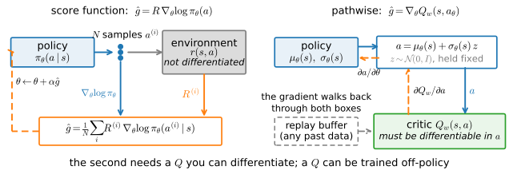
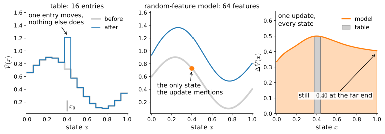

# Function Approximation in Reinforcement Learning
:label:`sec_deeprl`

Tabular methods store separate values or policy parameters for every state. They therefore do not apply directly to continuous state spaces, where an agent may rarely encounter the same state twice. Neural networks replace these tables with functions that generalize across states.

The policy-gradient derivations in :numref:`sec_policygradient` and :numref:`sec_baselines` require only a differentiable policy, a value estimate, and a sampling procedure, so the same training loop can use a neural policy for CartPole and a Gaussian policy for continuous control. We then examine how function approximation couples updates across states and compare score-function and pathwise gradient estimators.

```{.python .input #deep-rl-from-tables-to-networks}
%%tab pytorch
%matplotlib inline
from d2l import torch as d2l
import gymnasium as gym
import numpy as np
import torch
from torch import nn
```

```{.python .input #deep-rl-from-tables-to-networks}
%%tab jax
%matplotlib inline
from d2l import jax as d2l
from flax import nnx
import gymnasium as gym
import jax
from jax import numpy as jnp
import numpy as np
```

## Continuous States and Function Approximation

### CartPole

CartPole is the classic small control problem: a cart slides along a track with a pole hinged on top, the state is four real numbers (cart position, cart velocity, pole angle, angular velocity), and the two actions push the cart left or right. Every step the pole stays up earns reward $1$; the episode ends when the pole tips too far, the cart leaves the track, or 500 steps pass. The best possible return is therefore 500. A table over four continuous coordinates does not exist, so $\pi_\theta$ and $\hat{V}$ must become functions.

### Replacing the Table with a Network

The `ActorCritic` interface from :numref:`sec_imitation` requires a module that maps a state to one preference per action. The `.tabular` constructor supplies an embedding table; the constructor below instead supplies a one-hidden-layer network with four inputs and two action preferences, plus a value network of the same shape. The softmax in :eqref:`eq_softmax_policy` operates on the network outputs as it did on a table row. The score $\nabla_\theta \log \pi_\theta(a \mid s)$ now includes the hidden layer, and automatic differentiation applies the additional chain rule.

```{.python .input #deep-rl-the-swap-as-a-three-line-diff-1}
%%tab pytorch
@d2l.add_to_class(d2l.ActorCritic)  #@save
@classmethod
def mlp(cls, obs_dim, num_actions, hidden=64, lr=1e-2):
    """The same container with the tables replaced by one-hidden-layer nets."""
    def net(out):
        return nn.Sequential(nn.Linear(obs_dim, hidden), nn.Tanh(),
                             nn.Linear(hidden, out))
    return cls(net(num_actions), net(1), lr)
```

```{.python .input #deep-rl-the-swap-as-a-three-line-diff-1}
%%tab jax
@d2l.add_to_class(d2l.ActorCritic)  #@save
@classmethod
def mlp(cls, obs_dim, num_actions, hidden=64, lr=1e-2, rngs=None):
    """The same container with the tables replaced by one-hidden-layer nets."""
    rngs = nnx.Rngs(d2l.get_key()) if rngs is None else rngs
    def net(out):
        return nnx.Sequential(nnx.Linear(obs_dim, hidden, rngs=rngs), jnp.tanh,
                              nnx.Linear(hidden, out, rngs=rngs))
    return cls(net(num_actions), net(1), lr)

_act_probs = nnx.jit(lambda net, obs: jax.nn.softmax(net(obs), -1))

@d2l.add_to_class(d2l.ActorCritic)
def act(self, obs, rng):
    """As in :numref:`sec_imitation`; the acting forward has one fixed input
    shape and runs a few hundred thousand times below, so it is compiled
    once and cached (:numref:`sec_compilation`)."""
    if not hasattr(self, '_fwd'):
        self._fwd = nnx.cached_partial(_act_probs, self.policy)
    probs = np.asarray(self._fwd(jnp.asarray(obs)))
    return int(rng.choice(len(probs), p=probs))
```

The learned baseline of :numref:`sec_baselines` must also use function approximation. Equation :eqref:`eq_value_baseline` moved one table entry toward an observed reward-to-go; for a network, the corresponding update minimizes mean squared error against the observed targets. The `num_steps` argument sets the number of critic regression steps per batch. This section uses $1$ step, while :numref:`sec_actorcritic` varies it.

```{.python .input #deep-rl-the-swap-as-a-three-line-diff-2}
%%tab pytorch
def fit_value(ac, obs, target, num_steps=1):  #@save
    """Regress the value head on a fixed target: eq_value_baseline for nets."""
    obs, target = torch.as_tensor(obs), torch.as_tensor(target)
    for _ in range(num_steps):
        loss = ((ac.V(obs) - target) ** 2).mean()
        ac.opt_v.zero_grad()
        loss.backward()
        ac.opt_v.step()
    return loss.item()
```

```{.python .input #deep-rl-the-swap-as-a-three-line-diff-2}
%%tab jax
def fit_value(ac, obs, target, num_steps=1):  #@save
    """Regress the value head on a fixed target: eq_value_baseline for nets.

    Not jitted: batches change shape at every update; jit would recompile."""
    obs, target = jnp.asarray(obs), jnp.asarray(target)
    for _ in range(num_steps):
        loss, grads = nnx.value_and_grad(
            lambda value: ((ac.V(obs, value) - target) ** 2).mean())(ac.value)
        ac.opt_v.update(ac.value, grads)
    return float(loss)
```

The training function below is the learned-baseline REINFORCE algorithm from :numref:`sec_baselines`. It collects rollouts, computes reward-to-go, subtracts a learned value estimate, updates the policy, and fits the value function. The agent constructor and environment are arguments, allowing the same function to train different policy representations.

We normalize the advantages because the tasks considered below have substantially different return scales; as discussed in :numref:`sec_baselines`, under plain SGD this changes the effective step size. The controlled estimator comparison used plain SGD to expose that effect, whereas the neural-network experiments use Adam through the optimizer owned by each policy object.

```{.python .input #deep-rl-the-swap-as-a-three-line-diff-3}
%%tab pytorch, jax
def train_reinforce(seed, make_agent, env_name, gamma=0.99, num_updates=80,
                    batch_episodes=8):
    """The learned-baseline REINFORCE of :numref:`sec_baselines`, unchanged;
    what varies is the policy object handed in by `make_agent`."""
    rng, env = np.random.default_rng(seed), gym.make(env_name)
    ac = make_agent(seed)
    env.reset(seed=seed)
    for _ in range(num_updates):
        batch = d2l.rollout(env, ac.act, batch_episodes, rng)
        G = batch.reward_to_go(gamma)
        w = d2l.normalize(G - ac.value_np(batch.obs))
        L = d2l.policy_step(ac, batch, w)
        fit_value(ac, batch.obs, G)
        yield float(batch.episode_returns().mean()), L
```

Relative to :numref:`sec_baselines`, three inputs change: the constructor
is `ActorCritic.mlp(4, 2)` instead of `ActorCritic.tabular(16, 4)`, the
environment is `'CartPole-v1'` instead of `'FrozenLake-v1'`, and the
discount is $0.99$ instead of $0.95$, which raises the effective horizon
$1/(1-\gamma)$ of :numref:`sec_mdp` from 20 to 100 steps. The
rollout, reward-to-go, policy update, and value-regression code remains
unchanged. This compact diagnostic omits the replay, bootstrapped targets,
and update constraints introduced in Chapter 15. We run three seeds:

```{.python .input #deep-rl-the-swap-as-a-three-line-diff-4}
%%tab pytorch, jax
if tab.selected('pytorch'):
    def cartpole_agent(seed):
        torch.manual_seed(seed)
        return d2l.ActorCritic.mlp(4, 2)
if tab.selected('jax'):
    def cartpole_agent(seed):
        return d2l.ActorCritic.mlp(4, 2, rngs=nnx.Rngs(seed))

runs = d2l.run_seeds(train_reinforce, 3, make_agent=cartpole_agent,
                     env_name='CartPole-v1')
d2l.plot_curves({'REINFORCE + learned baseline': runs[:, :, 0]},
                xlabel='update', ylabel='mean return of the batch',
                reference=500)
```

The untrained policy obtains return about 20. Every seed's per-update batch mean exceeds 400 within approximately fifty updates and remains above 400 through the final update. Variation among seeds in this range makes the overall level more informative than the final digit. The tabular derivation requires no new equation for the network policy.

### Tables as Linear Networks on One-Hot States

`ActorCritic.tabular` stores its preferences in an embedding table. Selecting row $s$ from this table is equivalent to applying a linear layer to the one-hot vector for state $s$. A tabular policy can therefore be viewed as a linear network with fixed one-hot features. These features are orthogonal, so an update at one state does not affect another. A hidden layer learns shared features instead, allowing observations to generalize across states. Shared parameters also introduce nonconvex optimization, extrapolation outside well-sampled regions, and interference between updates; these issues are developed in :numref:`chap_deep_rl`.

## Continuous Actions and Stochastic Policies

### The Gaussian Policy

Pendulum is a simple task with continuous actions. A pendulum hangs from a motorized pivot, the state is $(\cos\vartheta,\sin\vartheta,\dot\vartheta)$, and the action is a torque in $[-2,2]$. Each step gives the negative of an approximate squared angle error, with smaller penalties for angular speed and torque. An episode lasts 200 steps. An uncontrolled policy obtains a return near $-1200$, whereas a controller that swings up and balances obtains about $-200$. Because torque is real valued, a softmax over a finite action set is not applicable.

We use a Gaussian policy $\pi_\theta(a\mid s)=\mathcal{N}(a;\mu_\theta(s),\sigma^2)$. The network produces the mean action, and the log standard deviation is a learned parameter. `GaussianPolicy` subclasses `ActorCritic` and implements the three distribution-specific methods `log_prob`, `act`, and `act_greedy`. The rollout and training functions depend only on this interface and therefore require no changes. The log standard deviation belongs to the policy module so that it is included in the policy update.

```{.python .input #deep-rl-the-gaussian-policy-1}
%%tab pytorch
class GaussianHead(nn.Module):  #@save
    """Mean network plus a state-independent learned log standard deviation."""
    def __init__(self, obs_dim, act_dim, hidden):
        super().__init__()
        self.mean = nn.Sequential(nn.Linear(obs_dim, hidden), nn.Tanh(),
                                  nn.Linear(hidden, act_dim))
        self.log_std = nn.Parameter(torch.zeros(act_dim))

    def forward(self, obs):
        return self.mean(obs), self.log_std.exp()

class GaussianPolicy(d2l.ActorCritic):  #@save
    """The same interface over a Normal instead of a softmax; nothing that
    consumes the interface changes."""
    def __init__(self, obs_dim, act_dim, hidden=64, lr=1e-2):
        super().__init__(GaussianHead(obs_dim, act_dim, hidden),
                         nn.Sequential(nn.Linear(obs_dim, hidden), nn.Tanh(),
                                       nn.Linear(hidden, 1)), lr)

    def log_prob(self, obs, act):
        mean, std = self.policy(obs)
        return torch.distributions.Normal(mean, std).log_prob(act).sum(-1)

    def act(self, obs, rng):
        with torch.no_grad():
            mean, std = self.policy(torch.as_tensor(obs))
        return mean.numpy() + std.numpy() * rng.standard_normal(
            mean.shape, dtype=np.float32)

    def act_greedy(self, obs, rng=None):
        with torch.no_grad():
            return self.policy(torch.as_tensor(obs))[0].numpy()
```

```{.python .input #deep-rl-the-gaussian-policy-1}
%%tab jax
class GaussianHead(nnx.Module):  #@save
    """Mean network plus a state-independent learned log standard deviation."""
    def __init__(self, obs_dim, act_dim, hidden, rngs):
        self.mean = nnx.Sequential(nnx.Linear(obs_dim, hidden, rngs=rngs),
                                   jnp.tanh,
                                   nnx.Linear(hidden, act_dim, rngs=rngs))
        self.log_std = nnx.Param(jnp.zeros(act_dim))

    def __call__(self, obs):
        return self.mean(obs), jnp.exp(self.log_std[...])

class GaussianPolicy(d2l.ActorCritic):  #@save
    """The same interface over a Normal instead of a softmax; nothing that
    consumes the interface changes."""
    def __init__(self, obs_dim, act_dim, hidden=64, lr=1e-2, rngs=None):
        rngs = nnx.Rngs(d2l.get_key()) if rngs is None else rngs
        super().__init__(GaussianHead(obs_dim, act_dim, hidden, rngs),
                         nnx.Sequential(nnx.Linear(obs_dim, hidden, rngs=rngs),
                                        jnp.tanh,
                                        nnx.Linear(hidden, 1, rngs=rngs)), lr)

    def log_prob(self, obs, act, policy=None):
        mean, std = (self.policy if policy is None else policy)(obs)
        return jax.scipy.stats.norm.logpdf(act, mean, std).sum(-1)

    def act(self, obs, rng):
        if not hasattr(self, '_fwd'):   # compile the fixed-shape acting
            self._fwd = nnx.cached_partial(nnx.jit(lambda net, o: net(o)),
                                           self.policy)  # forward, once
        mean, std = self._fwd(jnp.asarray(obs))
        return np.asarray(mean) + np.asarray(std) * rng.standard_normal(
            mean.shape, dtype=np.float32)

    def act_greedy(self, obs, rng=None):
        return np.asarray(self.policy(jnp.asarray(obs))[0])
```

The environment clips sampled torque to $[-2, 2]$, so `act` can return the unbounded Gaussian draw. Before training, we compare `log_prob` with the analytic Gaussian density, following the softmax-score check in :numref:`sec_policygradient`. At initialization, $\sigma = e^0 = 1$, so the analytic expression requires only the mean returned by `act_greedy`:

```{.python .input #deep-rl-the-gaussian-policy-2}
%%tab pytorch, jax
if tab.selected('pytorch'):
    torch.manual_seed(1)
    gp = GaussianPolicy(3, 1)
if tab.selected('jax'):
    gp = GaussianPolicy(3, 1, rngs=nnx.Rngs(1))
rng = np.random.default_rng(1)
obs = rng.standard_normal((5, 3)).astype(np.float32)
act = rng.standard_normal((5, 1)).astype(np.float32)
mean = np.stack([gp.act_greedy(o) for o in obs])
hand = -0.5 * (act - mean) ** 2 - 0.5 * np.log(2 * np.pi)
print(np.allclose(gp.log_prob_np(obs, act), hand.sum(-1), atol=1e-5))
```

### The Score Function with Continuous Actions

The derivation of :eqref:`eq_reinforce` requires $\log\pi_\theta$ to be differentiable in $\theta$, but does not require a finite action set. For a Gaussian policy, $\nabla_\theta\log\pi_\theta(a\mid s)$ is available just as it is for a softmax policy, so the same REINFORCE implementation applies.

We train longer because the policy must discover how to swing the pendulum upright before balancing it. We also use $\gamma=0.95$, which shortens the credit-assignment horizon in a 200-step task with a loss at every step. Since the discount factor defines the objective (:numref:`sec_mdp`), this choice changes the relative importance of later rewards; it is part of the task specification rather than a variance-reduction parameter:

```{.python .input #deep-rl-the-score-does-not-care-that-the-action-is-real}
%%tab pytorch, jax
if tab.selected('pytorch'):
    def pendulum_agent(seed):
        torch.manual_seed(seed)
        return GaussianPolicy(3, 1)
if tab.selected('jax'):
    def pendulum_agent(seed):
        return GaussianPolicy(3, 1, rngs=nnx.Rngs(seed))

runs_p = d2l.run_seeds(train_reinforce, 3, make_agent=pendulum_agent,
                       env_name='Pendulum-v1', gamma=0.95, num_updates=300)
d2l.plot_curves({'REINFORCE + learned baseline': runs_p[:, :, 0]},
                xlabel='update', ylabel='mean return of the batch',
                reference=-200, smooth=10)
```

The initial returns lie between approximately $-1200$ and $-1600$. At their best, the runs reduce this loss by roughly one quarter to three quarters, depending on the seed and framework. No seed reaches the reference level of $-200$, which corresponds to a controller that reliably swings the pendulum upright and holds it there. Performance can also decline later because the fixed step size continues to update an already improved policy.

Thus the experiment demonstrates improvement with a continuous-action policy, not mastery of the task. :numref:`sec_ppo` develops a more controlled policy update. A language model has the analogous discrete policy form: it maps a context to a distribution over vocabulary items, as discussed in :numref:`sec_rl_sequences`.

### Score-Function versus Pathwise Gradients

An expected value can also be differentiated by reparameterizing its random variable. Consider a single state, a Gaussian policy $a\sim\mathcal{N}(\mu,\sigma^2)$, and a known differentiable reward $Q(a)$. The gradient of $E[Q(a)]$ with respect to $\mu$ has two equivalent forms:

$$\nabla_\mu\, E\big[ Q(a) \big] = E\Big[ Q(a)\, \frac{a - \mu}{\sigma^2} \Big] = E\big[ Q'(\mu + \sigma z) \big], \qquad z \sim \mathcal{N}(0, 1).$$
:eqlabel:`eq_score_vs_pathwise`

The first equality is the score-function identity used throughout this chapter. The second substitutes $a = \mu + \sigma z$, placing $\mu$ inside $Q$ rather than the distribution, and differentiates through the sample. This is the *pathwise* or reparameterization gradient :cite:`Kingma.Welling.2014`, and :numref:`fig_rl_score_vs_pathwise` illustrates where each estimator's gradient flows. Both are unbiased. They are not equally noisy:

```{.python .input #deep-rl-score-function-versus-pathwise-gradients}
%%tab pytorch
def Q(a):                     # a stand-in critic, differentiable in the action
    return -(a - 1.0) ** 2

sigma, N = 0.5, 100000
a = sigma * np.random.default_rng(2).standard_normal(N, dtype=np.float32)
g_score = Q(a) * a / sigma ** 2               # score-function samples, mu = 0
at = torch.as_tensor(a).requires_grad_(True)  # pathwise: grad through a
Q(at).sum().backward()
g_path = at.grad.numpy()                      # per-sample dQ/da (da/dmu = 1)
print(f'score:    mean {g_score.mean():.2f}, variance {g_score.var():.1f}')
print(f'pathwise: mean {g_path.mean():.2f}, variance {g_path.var():.2f}')
print(f'score variance if Q gains a constant +10: '
      f'{((Q(a) + 10) * a / sigma ** 2).var():.0f}; pathwise is unchanged')
```

```{.python .input #deep-rl-score-function-versus-pathwise-gradients}
%%tab jax
def Q(a):                     # a stand-in critic, differentiable in the action
    return -(a - 1.0) ** 2

sigma, N = 0.5, 100000
a = sigma * np.random.default_rng(2).standard_normal(N, dtype=np.float32)
g_score = Q(a) * a / sigma ** 2               # score-function samples, mu = 0
g_path = np.asarray(jax.vmap(jax.grad(Q))(jnp.asarray(a)))  # per-sample dQ/da
print(f'score:    mean {g_score.mean():.2f}, variance {g_score.var():.1f}')
print(f'pathwise: mean {g_path.mean():.2f}, variance {g_path.var():.2f}')
print(f'score variance if Q gains a constant +10: '
      f'{((Q(a) + 10) * a / sigma ** 2).var():.0f}; pathwise is unchanged')
```

Both sample means are close to the exact gradient $2.0$, but the score-function variance is about twenty times larger. Adding a constant to $Q$ increases the score-function variance by another order of magnitude, because $Q$ appears as a scalar multiplier. The pathwise estimator is unchanged because it depends on $Q'$ and the derivative of a constant is zero. This lower variance requires access to $Q$ as a differentiable function of the action, rather than only to sampled returns.

![Two estimators of the same gradient. Left: the score-function estimator uses the environment only through the returned reward, so the environment need not be differentiable. Right: the pathwise estimator rewrites the sample as $a = \mu_\theta(s) + \sigma_\theta(s)\,z$ and differentiates through $\partial Q_w / \partial a$ and $\partial a / \partial \theta$. The critic $Q_w$ must be differentiable in the action and can be trained by regression on replayed data, provided the buffer covers states and actions relevant to the current policy.](../img/mdl-rl-score-vs-pathwise.svg)
:label:`fig_rl_score_vs_pathwise`

### The Argmax over Continuous Actions

Value-based methods obtain an action by maximizing $Q(s,a)$. With four discrete actions this is a table lookup. For $a\in\mathbb{R}^d$, however, it becomes a continuous optimization problem that must be solved both when acting and when constructing update targets. The DQN methods in :numref:`sec_dqn` therefore retain discrete actions. Policy-gradient methods avoid this explicit maximization by sampling directly from a parameterized policy.

A common continuous-action alternative trains a second network to approximate the maximizing action. A deterministic actor is updated through the learned critic $Q_w(s,a)$ using the pathwise derivative $\partial Q_w/\partial a\cdot\partial a/\partial\theta$ from :numref:`fig_rl_score_vs_pathwise`.

Two independent choices help organize these methods. The first is the gradient estimator: score function or pathwise. The second is the data source: on-policy or off-policy.

Pathwise gradients pair naturally with replayed data because the critic is trained by regression, but the pairing is not required by the mathematics. Importance weighting can adapt a score-function estimator to off-policy data, while a pathwise method still requires its replay buffer to cover relevant states and actions. DDPG and TD3 use deterministic actors; SAC uses a stochastic actor with a reparameterized gradient. In practice, DDPG, TD3, and SAC combine pathwise gradients with replay, whereas REINFORCE, actor--critic, and PPO commonly use score-function gradients with recent on-policy data.

## Generalization across States

### Measuring State Coupling

Networks change how updates generalize across states. A table update changes one row, whereas a network update can change every state because all states share parameters. :numref:`fig_rl_table_vs_network` illustrates this coupling. The following diagnostic raises the estimated value of one state among 256 probes and measures the change at all probes, then repeats the update with a table.

```{.python .input #deep-rl-generalization-couples-states-measured}
%%tab pytorch, jax
if tab.selected('pytorch'):
    torch.manual_seed(0)
    net_probe, tab_probe = d2l.ActorCritic.mlp(4, 2), \
        d2l.ActorCritic.tabular(16, 4)
if tab.selected('jax'):
    net_probe = d2l.ActorCritic.mlp(4, 2, rngs=nnx.Rngs(0))
    tab_probe = d2l.ActorCritic.tabular(16, 4, rngs=nnx.Rngs(0))
S = np.random.default_rng(0).uniform(-1, 1, (256, 4)).astype(np.float32)
before = net_probe.value_np(S)
fit_value(net_probe, S[:1], before[:1] + 1.0, num_steps=25)   # raise ONE state
dV = net_probe.value_np(S) - before
before_t = tab_probe.value_np(np.arange(16))
fit_value(tab_probe, np.arange(1), before_t[:1] + 1.0, num_steps=25)
dV_t = tab_probe.value_np(np.arange(16)) - before_t
print(f'network: nudged state moved {dV[0]:+.2f}; '
      f'{(np.abs(dV[1:]) > 1e-4).sum()} of the 255 others moved too, '
      f'|change| up to {np.abs(dV[1:]).max():.2f}')
print(f'table:   nudged entry moved {dV_t[0]:+.2f}; '
      f'largest move among the other fifteen: {np.abs(dV_t[1:]).max():.6f}')
```

The network update changes the output at all 255 unobserved probe states, sometimes by as much as at the selected state. The tabular update changes only one entry. Function approximation is useful because experience at one continuous state can influence nearby or related states that may never be visited exactly. The same coupling can also reduce performance at states absent from the current batch, which contributes to nonmonotone training curves. With bootstrapped value targets, this interaction becomes an important stability issue in :numref:`sec_dqn`.

![What one value update touches. A value estimate over a one-dimensional state is fitted twice, as a sixteen-entry table and as a model with 64 unit-normalized tanh random features, and each takes one gradient step of size $\alpha = 0.5$ toward a target one unit above its estimate at the marked state $x_0$, so the visited state moves by $+0.50$ under both. (a) The table moves one entry and nothing else. (b) The model moves its entire curve, because every state's estimate shares parameters with $x_0$'s. (c) The two changes side by side: the model's update is still $+0.40$ at the far end of the state space and nowhere less than $+0.33$.](../img/mdl-rl-table-vs-network.svg)
:label:`fig_rl_table_vs_network`

### Policy Gradients with Function Approximation

A policy-gradient update estimates the gradient of the scalar objective $J(\theta)$ in :eqref:`eq_pg_objective`. Under the usual assumptions of smoothness, bounded-variance unbiased gradients, and decaying step sizes, this has the form studied in stochastic optimization. The implementation here does not satisfy all of those assumptions: normalization rescales each batch using its data, samples depend on the collecting policy, and Adam uses a fixed step size. The curves should therefore be interpreted as empirical results rather than applications of a convergence theorem.

The value network in this section is fitted to observed reward-to-go targets that do not depend on the network's own predictions. Bootstrapped value methods instead construct targets from the current value estimate. Although each update is a gradient step with its target held fixed, the expected semi-gradient field need not be the gradient of a single scalar objective, and the iteration can diverge when the updated states are not sampled along the chain's own trajectories or when the approximator is nonlinear :cite:`Tsitsiklis.VanRoy.1997`. Residual-gradient methods optimize a Bellman-error objective directly but encounter the double-sampling problem from :numref:`sec_qlearning`.

Bootstrapped critics and their stability are introduced in :numref:`chap_deep_rl` and :numref:`sec_dqn`.

## The Surrogate Loss

Deep learning frameworks express updates through scalar losses. Instead of assembling the estimator $\hat{u}$ from :numref:`sec_baselines` explicitly, we define

$$L(\theta) = -\frac{1}{N} \sum_{\textrm{steps}} \hat{A}_t\, \log \pi_\theta(a_t \mid s_t),$$
:eqlabel:`eq_pg_surrogate_loss`

where $N$ is the number of steps in the batch and the advantages $\hat A_t$ are treated as fixed. Its gradient is $-\hat u$ up to the positive batch-normalization factor discussed in :numref:`sec_baselines`, so minimizing $L$ implements a policy-gradient ascent step. In `policy_step`, the advantages arrive as a NumPy array and therefore carry no gradient graph. The numerical value of this surrogate loss is not an estimate of policy performance: it is constructed to have the desired derivative at the current parameters. Consequently, a decrease in $L$ need not correspond to an increase in return. The CartPole runs record both quantities:

```{.python .input #deep-rl-the-estimator-written-as-a-loss}
%%tab pytorch, jax
d2l.plot_curves({'CartPole': runs[:, :, 1]}, xlabel='update',
                ylabel='policy loss L')
```

The return increases substantially, but the policy loss fluctuates near zero without a consistent trend across seeds. This is expected because the normalized advantages have zero sample mean and the loss records their current correlation with the log-probabilities. Its gradient defines the update, but its numerical value is not a measure of policy quality. Return and update diagnostics such as probability ratios, divergences, and entropy are more informative.

The resulting agent still has three important limitations. It waits for complete episodes before updating because the critic uses reward-to-go targets; :numref:`sec_actorcritic` introduces bootstrapping for earlier updates. It uses each on-policy batch for a single policy step; :numref:`sec_ppo` studies controlled batch reuse, while :numref:`sec_dqn` uses a replay buffer. Finally, the algorithm does not constrain the size of a policy update, even though a large change can degrade both current performance and subsequent data collection. These topics motivate :numref:`chap_deep_rl`.

## Summary

Tabular representations cannot cover continuous state spaces, whereas neural networks share parameters and generalize across states. `ActorCritic.mlp` replaces the tabular embedding with a one-hidden-layer network, and `fit_value` expresses the value-baseline update as regression. The same learned-baseline REINFORCE loop trains CartPole, and a Gaussian policy extends it to continuous actions on Pendulum. Score-function and pathwise estimators compute the same gradient with different variances and assumptions. This choice is separate from whether training uses on-policy or off-policy data, although pathwise gradients commonly appear with replay in DDPG, TD3, and SAC.

Parameter sharing makes continuous problems learnable but also couples updates across states. The next chapter introduces bootstrapped critics, batch reuse, replay, and constraints on policy updates.

**Experimental scope.** CartPole and Pendulum use three seeds per framework, so the curves support broad trends rather than precise numerical comparisons. CartPole is solved reliably, whereas Pendulum improves without approaching its maximum return. The coupling and gradient-variance examples are deterministic probes; the measured variance ratio depends on the chosen function, policy spread, and offset.

## Exercises

1. [code] **Policy size.** `ActorCritic.mlp` gives the policy and the value
   network one hidden layer of 64 units each, and its argument `hidden` sets
   that width.
    1. Train `train_reinforce` on CartPole with `hidden` in
       $\{4, 16, 64, 256\}$, three seeds each, by passing the width through
       `cartpole_agent`. Report the mean return over the last ten updates and
       the first update at which the batch mean exceeds 400.
    1. Replace the policy network by a single linear layer from the four
       state coordinates to the two action preferences, keep the value
       network of `ActorCritic.mlp`, and repeat the experiment.
    1. Near the upright position, the CartPole dynamics are approximately
       linear in the state. Use this to explain why a policy whose
       preferences are linear in the state can balance the pole. Which
       decision rules can such a policy not represent?
   :exlabel:`ex_deep-rl-policy-size`

1. **Discounting at the time limit.** `train_reinforce` yields the
   undiscounted mean return of the episodes in each batch, while its update
   weights each step by the reward-to-go at $\gamma = 0.99$. Every CartPole
   step earns reward $1$, and the environment truncates any episode that
   reaches 500 steps.
    1. Show that the discounted return of an episode of length $T$ is
       $(1 - \gamma^T)/(1 - \gamma)$, and evaluate it for
       $T \in \{20, 100, 200, 500\}$. Conclude that the undiscounted
       return and the discounted return rank episodes identically. By what
       factor does each grow when an episode lengthens from 200 to 500 steps?
    1. Compute the reward-to-go $\hat{G}_t$ at $t \in \{0, 400, 450, 490\}$ of
       an episode that reaches the time limit. The value network sees only
       the state, and the states late in a successful episode resemble those
       early in it. Which sign do the weights `w` of the last steps of a
       successful episode tend to have, and what does the policy update do to
       the actions taken at those steps?
    1. Gymnasium ends an episode at the 500-step limit with
       `truncated=True`, so the state reached by the last step can still have
       nonzero continuation value (:numref:`subsec_mdp-termination`). Propose
       a target for the steps of a truncated episode that uses $\hat{V}$ at
       that state, the last entry of `batch.next_obs` in the episode, so that
       the weight of a step no longer depends on its distance from the limit.

1. **Gaussian score.** `GaussianHead` parameterizes a one-dimensional action
   by the mean $\mu$ and the log standard deviation $\ell = \log \sigma$,
   which is `log_std`. Write $z = (a - \mu)/\sigma$ for a sampled action $a$.
    1. Show that $\partial \log \pi / \partial \mu = z / \sigma$ and
       $\partial \log \pi / \partial \ell = z^2 - 1$, and that both have mean
       zero under the policy.
    1. Let $Q$ be a quadratic function of the action with second derivative
       $Q''$. Show that $E\big[Q(a)\,(z^2 - 1)\big] = \sigma^2 Q''$, using
       $E[z^4] = 3$. In which direction does the expected policy-gradient
       step move $\sigma$ near a maximum of $Q$? What does this imply for the
       exploration of a policy whose mean approaches the best action?
    1. Pendulum clips each sampled torque to $[-2, 2]$, while `log_prob`
       scores the unclipped sample. Explain why the score-function estimate
       remains unbiased for the return of the clipped environment.

    *Adapted from Richard S. Sutton and Andrew G. Barto,
    [Reinforcement Learning: An Introduction](http://incompleteideas.net/book/RLbook2020.pdf),
    Exercise 13.4.*
   :exlabel:`ex_deep-rl-gaussian-score`

1. [code] **Fixed exploration noise.** `GaussianPolicy` learns its standard
   deviation through `log_std`. Hard-code $\sigma$ in `GaussianHead`, so that
   it is no longer a learned parameter, and train Pendulum with
   `pendulum_agent` for $\sigma \in \{0.1, 0.3, 1, 3\}$, three seeds each.
    1. Plot the return curves. What does a small $\sigma$ cost, and what does
       a large one cost?
    1. At $\mu = 0$, which fraction of the sampled torques does the
       environment clip for each $\sigma$? Describe the distribution of the
       torque that the environment applies for $\sigma = 3$.
    1. Log $\sigma = e^{\ell}$ after every update of the default
       `GaussianPolicy`, and plot it for three seeds. Explain the direction
       of its change with problem :exref:`ex_deep-rl-gaussian-score`b.

1. [code] **Discontinuous rewards.** The second equality of
   :eqref:`eq_score_vs_pathwise` differentiates through $Q$. Take $\mu = 0$
   and $\sigma = 0.5$, as in the computation of `g_score` and `g_path`, and
   the threshold reward $Q(a) = 1$ for $a > 1$ and $Q(a) = 0$ otherwise.
    1. Compute the exact gradient $\nabla_\mu E[Q(a)]$. What does the
       pathwise estimator return for every sample? Which step of the
       derivation of the second equality fails?
    1. Replace `Q` in that computation by the smooth step
       $Q_k(a) = 1 / \big(1 + e^{-k(a - 1)}\big)$ for
       $k \in \{1, 10, 100, 1000\}$, and record the mean and the variance of
       `g_score` and of `g_path`. The samples are single precision, so for
       $k \geq 100$ the factor $e^{-k(a - 1)}$ overflows at the smallest
       samples and the derivative of the formula as written is NaN there;
       implement $Q_k$ with a numerically stable sigmoid. Plot both variances
       against $k$. Which estimator has the lower variance at large $k$?
       Explain how the variance of `g_path` depends on $k$ through the
       height and the width of $Q_k'$, and how the variance of `g_score`
       depends on $k$ through $Q_k$.
    1. Pendulum clips each sampled torque to $[-2, 2]$. What does a pathwise
       estimate through the clipped torque return at samples outside this
       interval? Why does the score-function estimate of problem
       :exref:`ex_deep-rl-gaussian-score`c not lose these samples?

1. **Surrogate loss value.** `policy_step` evaluates the surrogate
   :eqref:`eq_pg_surrogate_loss` on the batch that the current policy has
   just collected. The weights from `d2l.normalize` have mean $0$ and
   standard deviation $1$ over the $N$ steps of the batch.
    1. Show that $L(\theta) = -s\, c$, where $s$ is the standard deviation
       of $\log \pi_\theta(a_t \mid s_t)$ over the batch and $c$ is the
       correlation coefficient between the weights and these
       log-probabilities. Conclude that $|L(\theta)| \leq s$.
    1. For `GaussianPolicy` with one action dimension, show that
       $s \approx 1/\sqrt{2}$ for every mean network and every $\sigma$. What
       does this imply for the policy loss of the Pendulum runs?
    1. How does $s$ behave on CartPole as the policy becomes nearly
       deterministic? What does this imply for the value of $L$ late in
       training?

1. [code] **Normalization under Adam.** ● Under plain SGD, dividing the
   weights by their standard deviation changes the effective learning rate
   (exercise :exref:`ex_baselines-step-size-confound-quantified` of
   :numref:`sec_baselines`). `train_reinforce` updates with Adam instead.
   Its step for each coordinate is
   $-\eta\, \hat{m}_t / (\sqrt{\hat{v}_t} + \epsilon)$, where $\hat{m}_t$ and
   $\hat{v}_t$ are bias-corrected moving averages of the gradient $g_t$ and
   of $g_t^2$ with decay rates $\beta_1 = 0.9$ and $\beta_2 = 0.999$.
    1. Show that for $\epsilon = 0$, multiplying every gradient by the same
       constant $c > 0$ leaves every Adam step unchanged.
    1. Show that

       $$\hat{v}_t = \frac{1 - \beta_2}{1 - \beta_2^t} \sum_{i=1}^{t} \beta_2^{t-i} g_i^2.$$

       By what factor do the weights of the oldest and the newest squared
       gradient differ at $t = 300$, the length of the Pendulum runs?
       Suppose that the gradient of a coordinate keeps a fixed sign and
       drops tenfold in scale halfway through a run of 300 updates. By what
       factor is the step at the end of the run smaller than the step at
       the start?
    1. Keep the centering of `d2l.normalize` in `train_reinforce` but drop
       its division, so that the weights are `A - A.mean()` with
       `A = G - ac.value_np(batch.obs)` and the two variants differ only in
       scale. Log the standard deviation of the weights of every batch, and
       train three seeds of both variants on CartPole and on Pendulum. How
       does the scale of the weights evolve on each task? On which task does
       part b predict that dropping
       the division changes the return curves more?
   :exlabel:`ex_deep-rl-normalization-adam`

1. **Score versus pathwise variance.** ● The samples `g_score` and
   `g_path` estimate the two forms of :eqref:`eq_score_vs_pathwise` for
   $Q(a) = -(a - 1)^2$ at $\mu = 0$. Use $E[z^4] = 3$ and $E[z^6] = 15$ for
   $z \sim \mathcal{N}(0, 1)$.
    1. Show that the single-sample variance of the score-function estimate
       is $15\sigma^2 + 14 + 1/\sigma^2$ and that of the pathwise estimate is
       $4\sigma^2$. Evaluate both at $\sigma = 0.5$, and compare them with the
       printed variances.
    1. Adding a constant $c$ to $Q$ is the same as subtracting the baseline
       $b = -c$. With the score $a/\sigma^2$ in the formula for $b^*$ of
       exercise :exref:`ex_baselines-optimal-constant-baseline` of
       :numref:`sec_baselines`, show that $b^* = -(1 + 3\sigma^2)$ and that
       the smallest score-function variance is $6\sigma^2 + 8$. Check the
       printed variance for $c = 10$ against your formula.
    1. Let $\sigma \to 0$. How do the two variances behave, with and without
       the optimal baseline? Explain the limit $8$ of the score-function
       variance through the Taylor expansion of $Q$ around $\mu$. Which of
       the two estimators remains usable for a deterministic actor?

1. [code] **Tangent kernel.** ● The measurement of `dV` raises $\hat{V}$
   at one probe state with 25 Adam steps of `fit_value`. A single plain
   gradient step makes the coupling computable. Write
   $\boldsymbol{\omega}$ for the parameters of the value network, to keep
   them apart from the policy parameters $\boldsymbol{\theta}$, and

   $$k(s, s') = \nabla_{\boldsymbol{\omega}} \hat{V}(s)^\top \nabla_{\boldsymbol{\omega}} \hat{V}(s')$$

   for its tangent kernel :cite:`Jacot.Gabriel.Hongler.2018`.
    1. Show that one gradient step of size $\eta$ on
       $\frac{1}{2}\big(y - \hat{V}(s_0)\big)^2$ changes the estimate at $s$
       by $\eta\, \big(y - \hat{V}(s_0)\big)\, k(s_0, s) + O(\eta^2)$.
    1. For a freshly constructed `net_probe`, compute the gradients
       $\nabla_{\boldsymbol{\omega}} \hat{V}$ at the 256 probe states `S`
       and the kernel values $k(s_0, s)$ for $s_0$ = `S[0]`. Take one plain
       gradient step with $\eta = 10^{-3}$ toward $y = \hat{V}(s_0) + 1$,
       without Adam, and compare the measured change at every probe with the
       prediction.
    1. Plot $k(s_0, s) / k(s_0, s_0)$ against the distance
       $\|s - s_0\|$. Do any probes move in the direction opposite to $s_0$?
    1. A CartPole policy that balances well collects batches of mostly
       near-vertical states. Use the kernel to explain how fitting such a
       batch changes the value estimate and the policy at large pole angles
       that the batch never contains. Why can that change make the policy
       worse at those angles?

1. **Semi-gradient field.** ● Consider a finite Markov chain with
   transition matrix $P$, reward vector $\mathbf{r}$ and discount
   $0 < \gamma < 1$. A linear estimate $\hat{\mathbf{V}} = \Phi \mathbf{w}$
   uses a feature matrix $\Phi$ of full column rank, and positive state
   weights $\mathbf{d}$ define $D = \textrm{diag}(\mathbf{d})$. The expected
   semi-gradient update of temporal-difference learning, with the target
   $\mathbf{r} + \gamma P \Phi \mathbf{w}$ held fixed, is

   $$F(\mathbf{w}) = \Phi^\top D \big(\mathbf{r} + \gamma P \Phi \mathbf{w} - \Phi \mathbf{w}\big).$$

    1. A continuously differentiable vector field on $\mathbb{R}^n$ is the
       gradient of a function if and only if its Jacobian is symmetric. Show
       that $F$ is a gradient field if and only if
       $\Phi^\top D (I - \gamma P) \Phi$ is symmetric. Show that the
       corresponding field of `fit_value`, with fixed Monte Carlo targets in
       place of the bootstrapped ones, is always a gradient field.
    1. With one-hot features, show that $F$ is a gradient field if and only
       if $d_s P_{s s'} = d_{s'} P_{s' s}$ for all pairs of states. Give a
       three-state chain and a weighting $\mathbf{d}$ with
       $\mathbf{d}^\top P = \mathbf{d}^\top$ for which this condition fails.
    1. Let $\mathbf{d}^\top P = \mathbf{d}^\top$, and write
       $\|\mathbf{v}\|_D^2 = \mathbf{v}^\top D \mathbf{v}$. Show with Jensen's
       inequality that $\|P\mathbf{v}\|_D \leq \|\mathbf{v}\|_D$, and conclude
       that

       $$\mathbf{v}^\top D (I - \gamma P)\, \mathbf{v} \geq (1 - \gamma)\, \|\mathbf{v}\|_D^2.$$

       The first of these inequalities is Lemma 1 of
       :citet:`Tsitsiklis.VanRoy.1997`, on which their convergence proof for
       on-policy linear temporal-difference learning rests.
    1. Use the inequality to show that the expected iteration
       $\mathbf{w} \leftarrow \mathbf{w} + \alpha F(\mathbf{w})$ converges
       for small $\alpha > 0$, also when $F$ is not a gradient field. Which
       property of $\mathbf{d}$ does the argument need, and why does
       learning from a replay buffer of older policies lose it?

1. [extended] **Parameter-space noise.** ●● Policy gradients inject noise
   into the actions. Evolution strategies
   :cite:`Salimans.Ho.Chen.ea.2017` inject it into the parameters instead:
   they perturb the parameters $\boldsymbol{\theta} \in \mathbb{R}^d$ by
   $\nu\boldsymbol{\epsilon}$ with
   $\boldsymbol{\epsilon} \sim \mathcal{N}(\mathbf{0}, I)$, run one episode
   with the perturbed deterministic policy, and ascend the smoothed
   objective

   $$J_\nu(\boldsymbol{\theta}) = E_{\boldsymbol{\epsilon}}\big[J(\boldsymbol{\theta} + \nu\boldsymbol{\epsilon})\big].$$

    1. Apply the score-function identity of :eqref:`eq_score_vs_pathwise` to
       the distribution $\mathcal{N}(\boldsymbol{\theta}, \nu^2 I)$ of the
       parameters, and show that

       $$\nabla J_\nu(\boldsymbol{\theta}) = \frac{1}{\nu}\, E\big[J(\boldsymbol{\theta} + \nu\boldsymbol{\epsilon})\, \boldsymbol{\epsilon}\big].$$

       Show that the antithetic estimate

       $$\frac{1}{2\nu}\big(J(\boldsymbol{\theta} + \nu\boldsymbol{\epsilon}) - J(\boldsymbol{\theta} - \nu\boldsymbol{\epsilon})\big)\, \boldsymbol{\epsilon}$$

       has the same mean. Which properties of the policy and of the
       environment does the estimate not require?
    1. For a linear objective
       $J(\boldsymbol{\theta}) = \mathbf{c}^\top \boldsymbol{\theta}$, show
       that the antithetic estimate equals
       $(\mathbf{c}^\top \boldsymbol{\epsilon})\, \boldsymbol{\epsilon}$ and
       that its expected squared norm is $(d + 2)\, \|\mathbf{c}\|^2$. How
       does the noise of this estimate scale with $d$ and with the episode
       length?
       How do the same two quantities enter the noise of REINFORCE?
    1. Implement the estimate on CartPole for the deterministic linear policy
       that pushes right when $\boldsymbol{\theta}^\top s > 0$, so that
       $d = 4$. Use eight antithetic pairs per update and divide the step by
       the standard deviation of the sixteen returns, as in the random search
       of :citet:`Mania.Guy.Recht.2018`. Start from $\nu = 0.1$ and a step
       size of $0.02$. Count the sixteen perturbed episodes of every update
       toward the budget, and measure progress by the mean return of the
       unperturbed policy over five further episodes. Plot this return
       against the number of episodes consumed for three seeds, together
       with `train_reinforce` for the linear policy of problem
       :exref:`ex_deep-rl-policy-size`b and with `runs`. Both of these
       consume eight episodes per update.
    1. Repeat with a deterministic one-hidden-layer tanh network of width 64
       whose single output selects the action by its sign, so that
       $d = 385$. How many episodes does each method need until its mean
       return first exceeds 400, with the small and with the large policy?
       How do these numbers change with $d$ for each method? Which properties
       of CartPole favor the search in parameter space, and on which kinds of
       task would you expect the comparison to reverse?

[Discussions](https://d2l.discourse.group/)

<!-- slides -->

::: {.slide}
::: {.cover}
[Dive into Deep Learning · §14.7]{.kicker}

From tables to networks<br>
**neural policy and value functions · Gaussian actions · score and pathwise gradients · parameter sharing**
:::
:::

::: {.slide title="A State No Table Can Hold"}
CartPole: four real numbers (position, velocity, angle, angular
velocity), two actions, $+1$ per step upright, ceiling 500.
Continuous states make exact table lookup inapplicable.

. . .

The derivations require a differentiable policy rather than a table:

@deep-rl-the-swap-as-a-three-line-diff-1

The softmax of :eqref:`eq_softmax_policy` sits on network outputs
as it did on a table row; automatic differentiation applies the
additional chain rule.
:::

::: {.slide title="One Training Function"}
The learned-baseline algorithm of :numref:`sec_baselines` is reused;
the constructor and environment become arguments.

@deep-rl-the-swap-as-a-three-line-diff-3

. . .

The changed inputs are `mlp(4, 2)` for `tabular(16, 4)`,
`'CartPole-v1'` for `'FrozenLake-v1'`, and $\gamma=0.99$ for $0.95$.
The estimator and value-regression steps remain unchanged.
:::

::: {.slide title="CartPole, Three Seeds"}
@!deep-rl-the-swap-as-a-three-line-diff-4

. . .

Every seed increases from about 20 to above 400 within roughly
fifty updates. Seed variation makes the level more informative
than the final digit.
:::

::: {.slide title="A Table Is a Linear Network"}
`nn.Embedding(16, 4)` **is** a linear layer on one-hot states:
selecting row $s$ = multiplying by the indicator of $s$.

- a tabular policy is equivalent to a linear model on fixed
  one-hot features
- one-hot features are orthogonal: no two states share a
  parameter, so an update at one state cannot touch another
- hidden-layer features are shared across states, producing
  generalization

Networks change the representation and parameter sharing, not the
policy-gradient identity.
:::

::: {.slide title="Continuous Actions"}
Pendulum uses a real-valued torque in $[-2, 2]$, so a finite-action
softmax is not applicable.

@deep-rl-the-gaussian-policy-1

Three overrides define the distribution; `rollout`,
`policy_step`, and `fit_value` use the same interface unchanged.
:::

::: {.slide title="The Same Path, a Continuous Action"}
@!deep-rl-the-score-does-not-care-that-the-action-is-real

. . .

Initial returns are about $-1200$ to $-1300$. The best segments
improve by one third to three quarters, but no seed reaches $-200$
and later performance can decline under the fixed step size.
A language model uses an analogous discrete policy
(:numref:`sec_rl_sequences`).
:::

::: {.slide title="Two Gradients of One Expectation"}
$$\nabla_\mu\, E\big[ Q(a) \big]
= E\Big[ Q(a)\, \frac{a - \mu}{\sigma^2} \Big]
= E\big[ Q'(\mu + \sigma z) \big]$$

@!deep-rl-score-function-versus-pathwise-gradients

. . .

Same mean, a factor of about twenty in variance. Adding a constant
to $Q$ substantially increases the score-function variance, while
the pathwise estimator is unchanged. It requires $Q$ to be differentiable
in the action :cite:`Kingma.Welling.2014`.
:::

::: {.slide title="Continuous-Action Optimization"}
{width=98%}

. . .

- Computing $\max_a Q(s, a)$ over $a \in \mathbb{R}^d$ requires a
  continuous optimization problem at every step, making direct value-based
  action selection impractical.
- Actor methods instead train a second network to produce high-value actions,
  using a pathwise gradient when the critic is differentiable in its action.
- The gradient estimator (score-function or pathwise) and the data source
  (on-policy or off-policy) are separate design choices.
- DDPG and TD3 use deterministic actors, while SAC uses a stochastic,
  entropy-regularized actor; all three learn from replayed transitions.
  REINFORCE, A2C, and PPO instead require fresh on-policy batches.
- The choice between PPO and SAC therefore concerns both the gradient
  estimator and whether previous experience may be reused.
:::

::: {.slide title="One Update Moves Every State"}
@!deep-rl-generalization-couples-states-measured

. . .

{width=98%}

Generalization is why CartPole is learnable, and why the curve
dips: an update moves states the batch never visited.
:::

::: {.slide title="The Estimator Written As a Loss"}
$$L(\theta) = -\frac{1}{N} \sum_{\textrm{steps}}
\hat{A}_t\, \log \pi_\theta(a_t \mid s_t),
\qquad \hat{A}_t \ \textrm{held fixed}$$

One optimizer step on $L$ = one ascent step on the return.
`policy_step` has computed it since :numref:`sec_imitation`.

. . .

@!deep-rl-the-estimator-written-as-a-loss

Return increases substantially while $L$ fluctuates near zero.
Because the sampled advantages and state distribution change between
updates, this surrogate loss is not comparable across iterations. Report
return, entropy, and value-error diagnostics alongside it.
:::

::: {.slide title="Recap and Limitations"}
- Policy gradient estimates the gradient of a stationary
  $J(\theta)$; the critic here is plain regression on data.
  Its target does not depend on the critic, avoiding a moving-target
  semi-gradient :cite:`Tsitsiklis.VanRoy.1997`.
- What this agent cannot do:
  - it waits for episodes to end (:numref:`sec_actorcritic`
    bootstraps)
  - it uses each batch once (:numref:`sec_ppo` reuses batches,
    :numref:`sec_dqn` replays transitions)
  - it does not constrain policy-update size (:numref:`sec_ppo`)
- :numref:`chap_deep_rl` develops these three extensions.
:::
