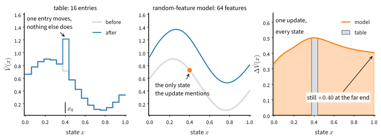

# Policies and Values as Neural Networks
:label:`sec_deeprl`

Every algorithm so far stored its knowledge in a table, with one entry per
state or per state-action pair. Tables do not work when the state is a vector
of real numbers: there are infinitely many states, and the agent may never see
the same state twice. In this section, we replace the tables by neural
networks. The estimators derived in :numref:`sec_policygradient` and
:numref:`sec_baselines` do not depend on the table; they use only the score
$\nabla_\theta \log \pi_\theta(a \mid s)$, the returns, and baselines such as
an estimate of the value function. These remain available when the policy
and the value estimate are networks, so the algorithms carry over. We train
REINFORCE with a learned baseline on the CartPole task, and we examine the
main new property that networks bring: an update at one state changes the
estimates at other states as well.

```{.python .input #deep-rl-from-tables-to-networks}
%%tab pytorch
import math
import numpy as np
import torch
from torch import nn
from torch.nn import functional as F
from d2l import torch as d2l
```

```{.python .input #deep-rl-from-tables-to-networks}
%%tab jax
import math
import numpy as np
import jax
from jax import numpy as jnp
from flax import nnx
import optax
from d2l import jax as d2l
```

```{.python .input #deep-rl-policies-and-values-as-neural-networks-1}
%%tab pytorch, jax
import gymnasium as gym
```

## From Tables to Networks

We introduce a task whose states cannot be tabulated and the networks that
replace the tables.

### CartPole

In CartPole :cite:`Barto.Sutton.Anderson.1983,Towers.Kwiatkowski.Terry.ea.2024`,
a cart moves along a track with a pole hinged on top of it. The state consists
of four real numbers: the position and velocity of the cart, and the angle and
angular velocity of the pole. The two actions push the cart to the left or to
the right. The agent receives reward $1$ for every step. An episode
terminates when the pole tilts more than $12$ degrees from vertical or the
cart moves more than $2.4$ units from the center, and Gymnasium truncates it
after $500$ steps, so the largest possible return is $500$. A policy that
pushes in a random direction at every step obtains a return of about $20$.

### Networks for the Policy and the Value

We represent the policy by a network with one hidden layer of $64$ units that
maps the four state variables to two *logits*, one per action. The softmax of
:eqref:`eq_softmax_policy` turns them into action probabilities, as it turned
a row of the preference table into probabilities before. A second network of
the same shape, with one output, represents the value estimate $\hat{V}(s)$.
The class below holds both networks with an Adam optimizer
(:numref:`sec_adam`) for each, samples actions, and evaluates
log-probabilities and values. In :numref:`sec_policygradient`, we computed
the score :eqref:`eq_softmax_score` by hand. With a network, the score has a
component for every weight, and automatic differentiation computes it. The
logits play the role of the preferences, so the derivative of
$\log \pi_\theta(a \mid s)$ with respect to the logit of action $b$ is still
$\mathbf{1}(b = a) - \pi_\theta(b \mid s)$, and backpropagation carries it
from the logits to the weights by the chain rule.

```{.python .input #deep-rl-the-swap-as-a-three-line-diff-1}
%%tab pytorch
class ActorCritic(nn.Module):  #@save
    """A policy network and a value network, each with its own optimizer."""
    def __init__(self, policy, value, lr=1e-2):
        super().__init__()
        self.policy, self.value = policy, value
        self.opt_pi = torch.optim.Adam(policy.parameters(), lr=lr)
        self.opt_v = torch.optim.Adam(value.parameters(), lr=lr)

    @classmethod
    def mlp(cls, obs_dim, num_actions, hidden=64, lr=1e-2):
        """Policy and value networks with one hidden layer each."""
        def net(out):
            return nn.Sequential(nn.Linear(obs_dim, hidden), nn.Tanh(),
                                 nn.Linear(hidden, out))
        return cls(net(num_actions), net(1), lr)

    def log_prob(self, obs, act):
        """log pi(a|s) for a batch of states and the actions taken there."""
        logp = torch.log_softmax(self.policy(obs), dim=-1)
        return logp.gather(-1, act[:, None]).squeeze(-1)

    def V(self, obs):
        return self.value(obs).squeeze(-1)

    def act(self, obs, rng):
        """Sample an action: a numpy state in, an int out."""
        with torch.no_grad():
            logits = self.policy(torch.as_tensor(obs))
            probs = torch.softmax(logits.double(), -1).numpy()
        return int(rng.choice(len(probs), p=probs))

    def act_greedy(self, obs, rng=None):
        with torch.no_grad():
            return int(self.policy(torch.as_tensor(obs)).argmax())

    def value_np(self, obs):
        with torch.no_grad():
            return self.V(torch.as_tensor(obs)).numpy()

    def log_prob_np(self, obs, act):
        with torch.no_grad():
            return self.log_prob(torch.as_tensor(obs),
                                 torch.as_tensor(act)).numpy()
```

```{.python .input #deep-rl-the-swap-as-a-three-line-diff-1}
%%tab jax
#@save
_softmax_probs = nnx.jit(lambda net, obs: jax.nn.softmax(net(obs), -1))

class ActorCritic(nnx.Module):  #@save
    """A policy network and a value network, each with its own optimizer."""
    def __init__(self, policy, value, lr=1e-2):
        self.policy, self.value = policy, value
        self.opt_pi = nnx.Optimizer(policy, optax.adam(lr), wrt=nnx.Param)
        self.opt_v = nnx.Optimizer(value, optax.adam(lr), wrt=nnx.Param)

    @classmethod
    def mlp(cls, obs_dim, num_actions, hidden=64, lr=1e-2, rngs=None):
        """Policy and value networks with one hidden layer each."""
        rngs = nnx.Rngs(d2l.get_key()) if rngs is None else rngs
        def net(out):
            return nnx.Sequential(nnx.Linear(obs_dim, hidden, rngs=rngs),
                                  jnp.tanh, nnx.Linear(hidden, out, rngs=rngs))
        return cls(net(num_actions), net(1), lr)

    def log_prob(self, obs, act):
        """log pi(a|s) for a batch of states and the actions taken there."""
        logp = jax.nn.log_softmax(self.policy(obs), axis=-1)
        return jnp.take_along_axis(logp, act[:, None], axis=-1).squeeze(-1)

    def V(self, obs):
        return self.value(obs).squeeze(-1)

    def act(self, obs, rng):
        """Sample an action: a numpy state in, an int out. The forward pass
        is compiled once and reused for every step."""
        if not hasattr(self, '_probs'):
            self._probs = nnx.cached_partial(_softmax_probs, self.policy)
        probs = np.asarray(self._probs(jnp.asarray(obs)), dtype=np.float64)
        return int(rng.choice(len(probs), p=probs / probs.sum()))

    def act_greedy(self, obs, rng=None):
        return int(self.policy(jnp.asarray(obs)).argmax())

    def value_np(self, obs):
        return np.asarray(self.V(jnp.asarray(obs)))

    def log_prob_np(self, obs, act):
        return np.asarray(self.log_prob(jnp.asarray(obs), jnp.asarray(act)))
```

### The Surrogate Loss

Deep learning frameworks minimize scalar losses. Instead of assembling the
policy-gradient estimate by hand, we therefore write down a loss whose
gradient is that estimate, up to sign. For a batch with $N$ time steps and
weights $\hat{A}_t$, let

$$L(\theta) = -\frac{1}{N} \sum_{t} \hat{A}_t\, \log \pi_\theta(a_t \mid s_t),$$
:eqlabel:`eq_pg_surrogate_loss`

where the weights $\hat{A}_t$ are treated as fixed numbers. Each
$-\log \pi_\theta(a_t \mid s_t)$ is the cross-entropy loss
:eqref:`eq_l_cross_entropy` of a classifier that predicts the action from the
state, with the sampled action $a_t$ as the label. The surrogate loss is thus
a classification loss with weight $\hat{A}_t$ on time step $t$: a positive
weight pushes the probability of the action up, as a training label would,
and a negative weight pushes it down. The gradient of
$L$ is $-1/N$ times $\sum_t \hat{A}_t \nabla_\theta \log \pi_\theta(a_t \mid s_t)$,
so one gradient descent step on $L$ is one ascent step along the policy
gradient estimate with these weights. The value of $L$, however, is not a
measure of performance: it is constructed to have the right derivative at the
current parameters, and a decrease of $L$ need not mean an increase of the
return. The function `policy_step` takes one optimizer step on
:eqref:`eq_pg_surrogate_loss`, and `fit_value` regresses the value network on
given targets with the squared error. In JAX, we compile both steps
(:numref:`sec_compilation`). Since batches of episodes differ in length, we
pad every batch with zeros to a power of two with the helper `padded` of
:numref:`sec_utils` and exclude the padding from the averages with a mask, so
that each step is compiled once per padded length and computes the same
averages as without padding:

```{.python .input #deep-rl-the-swap-as-a-three-line-diff-2}
%%tab pytorch
def policy_step(ac, batch, advantage):  #@save
    """One ascent step on the mean of A_t log pi(a_t|s_t); A_t is data."""
    obs, act = torch.as_tensor(batch.obs), torch.as_tensor(batch.act)
    adv = torch.as_tensor(advantage)
    loss = -(adv * ac.log_prob(obs, act)).mean()
    ac.opt_pi.zero_grad()
    loss.backward()
    ac.opt_pi.step()
    return loss.item()

def fit_value(ac, obs, target, num_steps=1):  #@save
    """Regress the value network on fixed targets by squared error."""
    obs, target = torch.as_tensor(obs), torch.as_tensor(target)
    for _ in range(num_steps):
        loss = ((ac.V(obs) - target) ** 2).mean()
        ac.opt_v.zero_grad()
        loss.backward()
        ac.opt_v.step()
    return loss.item()
```

```{.python .input #deep-rl-the-swap-as-a-three-line-diff-2}
%%tab jax
@nnx.jit  #@save
def _policy_loss_step(policy, opt, obs, act, adv, mask):
    def loss_fn(policy):
        logp = jnp.take_along_axis(jax.nn.log_softmax(policy(obs), -1),
                                   act[:, None], -1).squeeze(-1)
        return -(mask * adv * logp).sum() / mask.sum()
    loss, grads = nnx.value_and_grad(loss_fn)(policy)
    opt.update(policy, grads)
    return loss

@nnx.jit  #@save
def _value_loss_step(value, opt, obs, target, mask):
    def loss_fn(value):
        return (mask * (value(obs).squeeze(-1) - target) ** 2).sum() / mask.sum()
    loss, grads = nnx.value_and_grad(loss_fn)(value)
    opt.update(value, grads)
    return loss

def policy_step(ac, batch, advantage):  #@save
    """One ascent step on the mean of A_t log pi(a_t|s_t); A_t is data."""
    obs, act, adv, mask = d2l.padded(batch.obs, batch.act, advantage)
    return float(_policy_loss_step(ac.policy, ac.opt_pi, obs, act, adv, mask))

def fit_value(ac, obs, target, num_steps=1):  #@save
    """Regress the value network on fixed targets by squared error."""
    obs, target, mask = d2l.padded(obs, target)
    step = nnx.cached_partial(_value_loss_step, ac.value, ac.opt_v)
    for _ in range(num_steps):
        loss = step(obs, target, mask)
    return float(loss)
```

## REINFORCE with a Learned Baseline on CartPole

The algorithm is the one of :numref:`sec_baselines`, with networks in place of
the tables. Two of its details change on CartPole.

### Rewards at Every Step and the Discount

On FrozenLake, the only reward arrived at the end, so
$\gamma^t G_t = R(\tau)$ at every step and the reward-to-go estimator
:eqref:`eq_rtg` coincided with REINFORCE. On CartPole, a reward arrives at
every step, so the reward-to-go $G_t$ drops the rewards received before step
$t$ and differs from the return of the whole episode. In an episode of $T$
steps,
$G_t = 1 + \gamma + \cdots + \gamma^{T-1-t} = (1 - \gamma^{T-t}) / (1 - \gamma)$.
With the discount $\gamma = 0.99$ used below, $G_{T-1} = 1$ at the last step
and $G_{T-10} \approx 9.6$. Since
this task is about keeping the pole up as long as possible, we report the
undiscounted return, the number of steps
until the episode ends. The update uses the discount $\gamma = 0.99$, and it
weights the score at step $t$ by $G_t - \hat{V}(s_t)$ without the factor
$\gamma^t$ of :eqref:`eq_pg_baseline`, as in the generalized advantage
estimation and proximal policy optimization papers
:cite:`Schulman.Moritz.Levine.ea.2016,Schulman.Wolski.Dhariwal.ea.2017`. As
:numref:`sec_policygradient` noted, the resulting update is not the gradient
of the discounted objective :cite:`Thomas.2014,Nota.Thomas.2020`. :citet:`Schulman.Moritz.Levine.ea.2016`
interpret the discount in this setting as a parameter that reduces the
variance of the estimate for an undiscounted objective at the price of a bias.
All later sections follow this practice. We also standardize the weights of
each batch with `normalize` of :numref:`sec_baselines`, as implementations of
PPO do with their advantage estimates
:cite:`Huang.Dossa.Raffin.ea.2022,Andrychowicz.Raichuk.Stanczyk.ea.2021`.
The batch mean is a constant baseline, except that it also contains the
weights of the episode itself, like the group mean of
:numref:`sec_baselines`. Adam (:numref:`sec_adam`), however,
divides a running mean of the gradients by their running root-mean-square, so
multiplying every gradient by the same constant leaves its steps almost
unchanged, and the division by the standard deviation mainly changes the relative weight of
the batches.

The rewards of an episode that ends at the time limit stop at that limit, and
REINFORCE, like every Monte Carlo method, uses only the rewards it observed.
The tenth step from the end of an episode truncated after $500$ steps
therefore has the same reward-to-go, about $9.6$, as the tenth step from the
end of an episode in which the pole falls. :numref:`sec_actorcritic` revisits
this point, because methods that bootstrap from value estimates continue the
return past a time limit (:numref:`sec_mdp`).

### The Implementation

Each update collects $8$ episodes with the current policy, computes the
reward-to-go, subtracts the value estimate, and standardizes the resulting
weights. It then takes one step on the surrogate loss and one regression step
of the value network toward the reward-to-go. Besides the mean return of the
batch, we record the value of the surrogate loss:

```{.python .input #deep-rl-the-swap-as-a-three-line-diff-3}
%%tab pytorch, jax
def train_reinforce(seed, num_updates=80, batch_episodes=8, gamma=0.99):
    """REINFORCE with a learned baseline (sec_baselines), with networks."""
    rng, env = np.random.default_rng(seed), gym.make('CartPole-v1')
    if tab.selected('pytorch'):
        torch.manual_seed(seed)
        ac = ActorCritic.mlp(4, 2)
    if tab.selected('jax'):
        ac = ActorCritic.mlp(4, 2, rngs=nnx.Rngs(seed))
    env.reset(seed=seed)
    for _ in range(num_updates):
        batch = d2l.rollout(env, ac.act, batch_episodes, rng)
        G = batch.reward_to_go(gamma)
        loss = policy_step(ac, batch, d2l.normalize(G - ac.value_np(batch.obs)))
        fit_value(ac, batch.obs, G)
        yield batch.episode_returns().mean(), loss
```

We train with three random seeds:

```{.python .input #deep-rl-the-swap-as-a-three-line-diff-4}
%%tab pytorch, jax
runs = d2l.run_seeds(train_reinforce, 3)
d2l.plot_curves({'REINFORCE with a learned baseline': runs[:, :, 0]},
                xlabel='update', ylabel='mean return of the batch',
                reference=500)
```

The line is the median of the three seeds, the band spans the smallest and
largest values, and the dashed line marks the largest possible return. The
returns rise from the level of a random policy toward the maximum of
$500$ within the $80$ updates, along curves that are not monotone. Compared
with the learned-baseline runs of :numref:`sec_baselines`, the tables became
networks, the factor $\gamma^t$ is dropped, the weights are standardized, and
both networks take Adam steps on losses averaged over the batch, where the
tables took plain gradient steps. The discount is also $0.99$ instead of
$0.95$, and each batch has $8$ episodes instead of $16$. The surrogate loss,
plotted below for the same runs, shows no comparable trend:

```{.python .input #deep-rl-the-estimator-written-as-a-loss}
%%tab pytorch, jax
d2l.plot_curves({'surrogate loss': runs[:, :, 1]}, xlabel='update',
                ylabel='policy loss L')
```

After the first update, the loss stays within a few hundredths of zero, while
the return grows by a factor of more than ten. With standardized weights, the
weights of every batch have mean zero, so adding the same constant to every
log-probability leaves $L$ unchanged, and $L$ equals minus the covariance, over
the time steps of the batch, of the weights and the log-probabilities. The
loss thus measures only how the current log-probabilities happen to correlate
with the weights. Its gradient defines the update, but its value says nothing
about the quality of the policy. The return is the quantity to monitor.

## Generalization across States

A table changes one entry per state; a network changes shared parameters.
This is the main new property that networks bring to reinforcement learning.

### One Update Changes Many States

Selecting row $s$ of a table is the same as multiplying the table by the
one-hot vector of state $s$, so a table is a linear network on one-hot
features. These features do not overlap, and a gradient step at one state
changes no other entry. A network with a hidden layer computes features that
many states share. :numref:`fig_rl_table_vs_network` shows the consequence for
a value estimate over a one-dimensional state: a single regression step
toward a higher target at one state moves the estimate at every state.

![What one value update changes. A value estimate over a one-dimensional state is represented as a table of sixteen entries and as a model with 64 tanh random features whose feature vector is scaled to unit norm at every state. Each takes one gradient step of size $\alpha = 0.5$ toward a target one unit above its estimate at the marked state $x_0$, which moves the estimate at $x_0$ by $+0.50$ in both cases. (a) The table changes one entry. (b) The model changes its estimate everywhere, because all states share its parameters. (c) The two changes side by side: the change of the model is still $+0.40$ at the far end of the state space.](../img/mdl-rl-table-vs-network.svg)
:label:`fig_rl_table_vs_network`

Both estimates in the figure are linear functions of a fixed feature vector of
the state. A gradient step of size $\alpha$ on half the squared error at
$x_0$ adds to the weights $\alpha$ times the error, the target minus the
estimate, times the feature vector of $x_0$. It therefore changes the
estimate at every state $x$ by $\alpha$ times the error times the inner
product of the feature vectors of $x$ and $x_0$. The
one-hot features of the table have inner product zero for different entries.
The unit-norm features of the model have inner product one at $x_0$ and about
$0.8$ at the far end, which gives the change of $+0.40$ there.

This coupling is what makes learning from continuous states possible:
experience at one state also informs the estimates at similar states that the
agent has never visited. It also means that an update can change the
estimates at states that the current batch does not contain, for better or
worse. For the policy-gradient method of this section, the value targets are
observed returns. :numref:`sec_dqn` shows that the coupling becomes a source of
instability when the targets are computed from the network's own estimates.

### Continuous Actions

CartPole has two actions, and the softmax turns logits into a distribution
over them. When an action is a real vector, such as a torque, a common
policy is a Gaussian whose mean is computed by a network, with a learned
standard deviation
:cite:`Schulman.Levine.Abbeel.ea.2015,Schulman.Wolski.Dhariwal.ea.2017`. Its
log-density is differentiable in the parameters, so the score-function
estimators of this chapter apply, with sums over actions replaced by
integrals. A second
family of methods trains a value estimate $\hat{Q}(s, a)$ that is
differentiable in the action and improves the policy by differentiating
$\hat{Q}$ through the action. For a deterministic policy
$a = \mu_\theta(s)$, this gives the deterministic policy gradient
:cite:`Silver.Lever.Heess.ea.2014`, which DDPG and TD3 use
:cite:`Lillicrap.Hunt.Pritzel.ea.2016,Fujimoto.vanHoof.Meger.2018`. For a
stochastic policy, the sampled action is written as a differentiable function
of the parameters and independent noise, the reparameterization of
:citet:`Kingma.Welling.2014`. The soft actor-critic algorithm
:cite:`Haarnoja.Zhou.Abbeel.ea.2018` takes this route, and :numref:`sec_sac`
returns to it. Apart from that section, the experiments of this chapter use
discrete actions.

## Summary

Neural networks replace tables when the state is continuous. The
policy-gradient estimators use only the score, the returns, and a baseline
such as a value estimate, so REINFORCE with a learned baseline carries over,
with automatic differentiation computing the score and a surrogate loss
expressing the update; the value of that loss is not a measure of
performance. On CartPole, where a reward arrives at every step, the update
weights each step by the reward-to-go minus the value estimate, standardizes
these weights over the batch, and, as is common in practice, drops the
factor $\gamma^t$. Within $80$ updates, the returns approached the maximum of
$500$. Networks share parameters across states, so an update at one state
changes the estimates at others. The method still waits for the end of an
episode before it can update, uses every batch for a single step, and does
not control how far one step changes the policy. The next two sections
address these limitations.

## Exercises

1. **The surrogate loss.** Show that the gradient of
   :eqref:`eq_pg_surrogate_loss`, with the weights held fixed, is $-n/N$
   times the estimate $\hat{g}$ of :numref:`sec_policygradient` with these
   weights, for a batch of $n$ episodes and $N$ time steps. Then describe a
   situation in which $L$ decreases from one update to the next while the
   return also decreases.
1. [code] **Reward-to-go on CartPole.** With $\gamma = 1$, replace the
   reward-to-go $G_t$ in `train_reinforce` by the return of the whole
   episode, for the weights and for the value targets, and compare the
   learning curves with those of the reward-to-go at $\gamma = 1$. Explain
   the difference with the conditional identity of :numref:`sec_baselines`.
   Why would the same comparison at $\gamma = 0.99$ not isolate the effect of
   the identity?
1. [code] **Network width.** Train with hidden layers of $8$, $32$, $64$,
   and $256$ units. How small can the policy network be and still balance the
   pole?
1. [code] **Batch size.** Train with batches of $1$, $8$, and $32$ episodes,
   keeping the total number of episodes fixed. Which setting learns fastest
   per episode, and which gives the smoothest curve?
1. [code] **A Gaussian policy.** Write a policy whose mean is a network and
   whose log standard deviation is a learned parameter, and train it with
   REINFORCE and a learned baseline on `Pendulum-v1`, whose action is a torque
   in $[-2, 2]$. How much does the return improve, and what limits it?

[Discussions](https://d2l.discourse.group/t/36800)

<!-- slides -->

::: {.slide}
::: {.cover}
[Dive into Deep Learning · §14.6]{.kicker}

Policies and values as neural networks<br>
**CartPole · networks instead of tables · the surrogate loss · generalization across states**
:::
:::

::: {.slide title="A Task without a Table"}
CartPole: $4$ real state variables, $2$ actions, reward $1$ per step,
truncated at $500$ steps.

- policy: $4 \to 64 \to 2$ logits, then the softmax;
- value: $4 \to 64 \to 1$.

The score is computed by automatic differentiation.
:::

::: {.slide title="The Surrogate Loss"}
$$L(\theta) = -\frac{1}{N} \sum_{t} \hat{A}_t\, \log \pi_\theta(a_t \mid s_t),
\qquad \hat{A}_t \textrm{ held fixed}$$

@deep-rl-the-swap-as-a-three-line-diff-2

Its gradient is the update; its value is not a performance measure.
:::

::: {.slide title="REINFORCE with a Learned Baseline"}
@deep-rl-the-swap-as-a-three-line-diff-3

Weights $G_t - \hat{V}(s_t)$, standardized over the batch; no factor
$\gamma^t$, as in practice :cite:`Schulman.Moritz.Levine.ea.2016`.
:::

::: {.slide title="CartPole Learned"}
@deep-rl-the-swap-as-a-three-line-diff-4

. . .

@deep-rl-the-estimator-written-as-a-loss
:::

::: {.slide title="One Update, Many States"}
{width=92%}

Experience transfers to similar states; updates also change the estimates at
states that the batch does not contain.
:::
