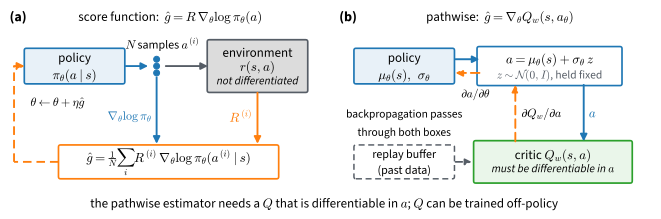
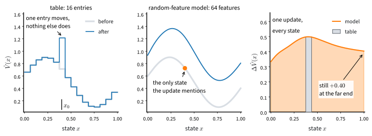
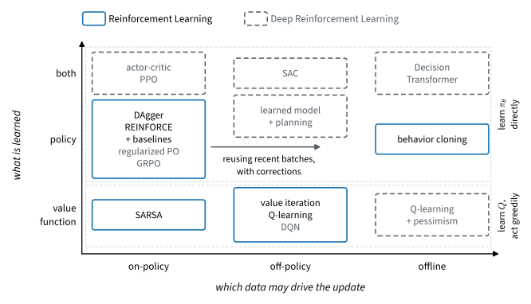

# Function Approximation in Reinforcement Learning
:label:`sec_deeprl`

For seven sections every quantity we learned lived in a table: sixteen rows for the cells of the lake, one row for each prompt of the verifier task. Now picture a cart that balances a pole hinged on top of it. Its state is four real numbers, the cart's position and velocity and the pole's angle and angular velocity, and in a thousand episodes the agent will never see the same four numbers twice. A table over such states would need a new row for every visit, and what it learned at one visit would say nothing about the next. We want a function that gives similar values to similar states, so that what the agent learns while the pole leans left at one speed carries over to the moment it leans left at a slightly different speed.

The problem is as old as the field. Bellman named the growth of tables with the number of state variables the *curse of dimensionality* :cite:`BellmanDPBook`, and in 1959 Arthur Samuel's checkers program already scored board positions by a weighted sum of features instead of looking them up :cite:`Samuel.1959`. Replacing a table by a parameterized function is called *function approximation*. With neural networks as the functions, it carried reinforcement learning to backgammon :cite:`Tesauro.1995`, to Atari games :cite:`mnih2015human` and to Go :cite:`Silver.Huang.Maddison.ea.2016`.

For policy gradients the step is short, because nothing in the derivations of :numref:`sec_policygradient` and :numref:`sec_baselines` used the table. REINFORCE needs only the score $\nabla_\theta \log \pi_\theta(a \mid s)$, and a network supplies it as readily as a table row. What changes is that one update now moves the estimate at every state. This sharing makes learning on continuous states possible, and it is also a new way for learning to go wrong. We make the step on two small control tasks, a cart with a pole and a pendulum driven by a continuous torque, measure how far one update spreads, and end with what the resulting agent still cannot do.

```{.python .input #deep-rl-setup}
%%tab jax
# Deterministic XLA kernels. On an accelerator XLA otherwise picks each
# matrix product's kernel by timing candidates, and kernels that add in
# different orders differ in the last bits; training runs at large step
# sizes can turn such differences into different outcomes. JAX reads
# XLA_FLAGS once, when it starts, so this cell runs before the imports.
import os
os.environ['XLA_FLAGS'] = (os.environ.get('XLA_FLAGS', '') +
                           ' --xla_gpu_deterministic_ops=true').strip()
```

```{.python .input #deep-rl-from-tables-to-networks}
%%tab pytorch
import math
import numpy as np
import torch
from torch import nn
from torch.nn import functional as F
from d2l import torch as d2l
```

```{.python .input #deep-rl-from-tables-to-networks}
%%tab jax
import math
import numpy as np
import jax
from jax import numpy as jnp
from flax import nnx
import optax
from d2l import jax as d2l
```

```{.python .input #deep-rl-function-approximation-in-reinforcement-learning-1}
%%tab pytorch, jax
import gymnasium as gym
```

## Networks in Place of Tables

The tables of the earlier sections become networks in two places: the policy, and the value estimate that served as a baseline. Before writing either network we look at a table in a form that a network extends.

### Tables as Linear Networks on One-Hot States

`Policy.tabular` of :numref:`sec_imitation` stores its preferences in a $16 \times 4$ embedding table $\theta$, and the preferences at state $s$ are row $s$ of that table. Row $s$ equals $\theta^\top \mathbf{e}_s$, where $\mathbf{e}_s$ is the one-hot vector of state $s$. A table is therefore a linear network whose input features are fixed one-hot vectors. The classic remedy for continuous states has the same form: it cuts the state space into boxes and lets $\mathbf{e}_s$ be the one-hot vector of the box that contains $s$. An early learning controller for the cart and pole below used 162 such boxes, a partition designed by hand :cite:`Barto.Sutton.Anderson.1983`. A network with one hidden layer keeps this form and replaces the fixed features by learned ones: the preferences become $\mathbf{W}_2 \tanh(\mathbf{W}_1 \mathbf{s} + \mathbf{b}_1) + \mathbf{b}_2$, where $\mathbf{s}$ is now the vector of real-valued observations itself.

The two forms differ in what one update does. Take a value estimate $\hat{V}_w$ with parameters $w$ and one gradient step of size $\eta_V$ on $\frac{1}{2}\big(y - \hat{V}_w(s_0)\big)^2$, which moves the estimate at a single state $s_0$ toward a target $y$. To first order in $\eta_V$, the estimate at any state $s$ changes by

$$\Delta \hat{V}(s) = \eta_V \big(y - \hat{V}(s_0)\big)\, k(s, s_0), \qquad k(s, s_0) = \nabla_w \hat{V}(s)^\top \nabla_w \hat{V}(s_0).$$
:eqlabel:`eq_deeprl_kernel`

Thus the change at $s$ is the change requested at $s_0$, scaled by how much the gradients at the two states overlap. For a table, $\nabla_w \hat{V}(s) = \mathbf{e}_s$, so $k(s, s_0)$ is $1$ when $s = s_0$ and $0$ otherwise: a gradient step at one state leaves every other entry where it was. (Adam, the default optimizer of `Policy`, can still move an entry whose gradient is zero in the current batch, through its stored momentum, so the statement holds for gradients rather than for every optimizer step.) For a network, $k$ is a smooth function of the two states, which is the *tangent kernel* of the network :cite:`Jacot.Gabriel.Hongler.2018`. A step at $s_0$ then moves the estimates at similar states along with it. Exercise :exref:`ex_deep-rl-tangent-kernel` derives :eqref:`eq_deeprl_kernel`, and :numref:`subsec_deeprl_coupling` measures the shape of $k$ for the network we train.

### The Policy and Value Networks

The `Policy` container of :numref:`sec_imitation` holds a policy network and its optimizer. In :numref:`sec_baselines` the learned baseline was a separate NumPy table: after each batch it moved $\hat{V}(s_t)$ a step $\eta_V$ toward the reward-to-go $\hat{G}_t$ observed at every visited state. Here the baseline becomes a network too, and it moves into the container. `ActorCritic` subclasses `Policy` and adds a value module `value` with its own Adam optimizer `opt_v`. `V` returns the values as a framework array, the form a loss differentiates, and `value_np` takes and returns NumPy arrays, like the boundary methods of `Policy`. The name refers to the two parts: the policy is often called the *actor* and the value estimate the *critic*. Its `tabular` constructor builds both as zero-initialized tables, so that a table can stand in for either network, as in the measurement at the end of this section:

```{.python .input #deep-rl-replacing-the-table-with-a-network-1}
%%tab pytorch
class ActorCritic(d2l.Policy):  #@save
    """A policy and a value function, each with its own optimizer."""
    def __init__(self, policy, value, lr=1e-2):
        super().__init__(policy, lr)
        self.value = value
        self.opt_v = torch.optim.Adam(value.parameters(), lr=lr)

    def V(self, obs):
        """V(s) for a batch of states, as a tensor."""
        return self.value(obs).squeeze(-1)

    def value_np(self, obs):
        """V(s) for a numpy batch of states, as numpy."""
        with torch.inference_mode():
            return self.V(torch.as_tensor(obs)).numpy()

    @classmethod
    def tabular(cls, num_states, num_actions, lr=0.1, seed=None):
        """Preference and value tables: two zero-initialized embeddings."""
        with d2l.seeded(seed):
            policy, value = (nn.Embedding(num_states, num_actions),
                             nn.Embedding(num_states, 1))
        nn.init.zeros_(policy.weight), nn.init.zeros_(value.weight)
        return cls(policy, value, lr)
```

```{.python .input #deep-rl-replacing-the-table-with-a-network-1}
%%tab jax
class ActorCritic(d2l.Policy):  #@save
    """A policy and a value function, each with its own optimizer."""
    def __init__(self, policy, value, lr=1e-2):
        super().__init__(policy, lr)
        self.value = value
        self.opt_v = nnx.Optimizer(value, d2l.shared_adam(lr), wrt=nnx.Param)

    def V(self, obs, value=None):
        """V(s) for a batch of states; `value` plays the part of `policy`
        in log_prob, for the update that differentiates it."""
        value = self.value if value is None else value
        return value(obs).squeeze(-1)

    def value_np(self, obs):
        """V(s) for a numpy batch of states, as numpy, through a forward
        pass on the batch padded to a bucket length."""
        obs_p, _ = d2l.padded(obs)
        return d2l.forward_np(self.value, obs_p)[:len(obs), 0]

    @classmethod
    def tabular(cls, num_states, num_actions, lr=0.1, seed=None):
        """Preference and value tables: two zero-initialized embeddings."""
        rngs = nnx.Rngs(d2l.get_key() if seed is None else seed)
        zeros = nnx.initializers.zeros_init()
        return cls(d2l.Embed(num_states, num_actions,
                             embedding_init=zeros, rngs=rngs),
                   d2l.Embed(num_states, 1, embedding_init=zeros, rngs=rngs),
                   lr)
```

The constructor `mlp` supplies networks instead of tables, each built by `tanh_mlp`: a policy network with `obs_dim` inputs and one preference per action, and a value network of the same shape with one output. Each has one hidden layer of 64 units, a common width for tasks this small, with tanh, the activation that a large study of on-policy methods found to work best for policy networks :cite:`Andrychowicz.Raichuk.Stanczyk.ea.2021`. The softmax of :numref:`sec_policygradient`, $\pi_\theta(a \mid s) \propto \exp(\textrm{preference}_a)$, acts on the network outputs as it did on a table row. The score now includes the hidden layer, and automatic differentiation applies the extra chain rule:

```{.python .input #deep-rl-the-swap-as-a-three-line-diff-1}
%%tab pytorch
def tanh_mlp(in_dim, hidden, out_dim):  #@save
    """A network with one tanh hidden layer."""
    return nn.Sequential(nn.Linear(in_dim, hidden), nn.Tanh(),
                         nn.Linear(hidden, out_dim))

@d2l.add_to_class(ActorCritic)  #@save
@classmethod
def mlp(cls, obs_dim, num_actions, hidden=64, lr=1e-2, seed=None):
    """The same container with the tables replaced by one-hidden-layer nets."""
    with d2l.seeded(seed):
        policy, value = (tanh_mlp(obs_dim, hidden, num_actions),
                         tanh_mlp(obs_dim, hidden, 1))
    return cls(policy, value, lr)
```

```{.python .input #deep-rl-the-swap-as-a-three-line-diff-1}
%%tab jax
def tanh_mlp(in_dim, hidden, out_dim, *, rngs):  #@save
    """A network with one tanh hidden layer."""
    return nnx.Sequential(d2l.Linear(in_dim, hidden, rngs=rngs), jnp.tanh,
                          d2l.Linear(hidden, out_dim, rngs=rngs))

@d2l.add_to_class(ActorCritic)  #@save
@classmethod
def mlp(cls, obs_dim, num_actions, hidden=64, lr=1e-2, seed=None):
    """The same container with the tables replaced by one-hidden-layer nets."""
    rngs = nnx.Rngs(d2l.get_key() if seed is None else seed)
    return cls(tanh_mlp(obs_dim, hidden, num_actions, rngs=rngs),
               tanh_mlp(obs_dim, hidden, 1, rngs=rngs), lr)
```

:begin_tab:`jax`
The layers are `d2l.Linear` (:numref:`sec_multihead-attention`), an `nnx.Linear` whose weights and biases are drawn uniformly from $[-1/\sqrt{n_\textrm{in}}, 1/\sqrt{n_\textrm{in}}]$ for $n_\textrm{in}$ inputs. Flax's default draws lecun-normal weights, whose spread is about 1.7 times larger, and sets the biases to zero. We use the uniform initialization for every network of this chapter and the next, because it trains these small networks more reliably. In the DQN of :numref:`sec_dqn`, run for 50 seeds with each initialization, it solved CartPole on about two thirds of the runs and Flax's default on about a quarter.
:end_tab:

### Value Regression

For a table, the update of the learned baseline moved one entry toward one observed target. For a network, the counterpart is regression: optimizer steps on the mean squared error between $\hat{V}(s_t)$ and the targets of the whole batch. `fit_value` takes `num_steps` such steps toward a fixed target vector.

How many steps does the baseline need per batch? The targets are discounted returns of order $100$ in size on both tasks below, while an Adam step moves each parameter by roughly its learning rate, $0.01$. With one step per batch, the baseline lags behind its targets. On the pendulum task below, the fraction of the targets' variance that the baseline accounts for, $1 - \mathrm{Var}(\hat{G} - \hat{V}) / \mathrm{Var}(\hat{G})$, then climbs only to between $0.4$ and $0.8$ by the end of a run on most seeds, and stays lower on some. The rest of the weight $\hat{G}_t - \hat{V}(s_t)$ is noise that a good baseline would remove. Forty steps per batch raise this fraction to about $0.99$, and forty is what the training loop below uses.

```{.python .input #deep-rl-the-swap-as-a-three-line-diff-2}
%%tab pytorch
def fit_value(ac, obs, target, num_steps=1):  #@save
    """Regress the value head on a fixed target: eq_value_baseline for nets."""
    obs, target = torch.as_tensor(obs), torch.as_tensor(target)
    for _ in range(num_steps):
        loss = ((ac.V(obs) - target) ** 2).mean()
        ac.opt_v.zero_grad()
        loss.backward()
        ac.opt_v.step()
    return loss.item()
```

```{.python .input #deep-rl-the-swap-as-a-three-line-diff-2}
%%tab jax
@nnx.jit  #@save
def _value_pass(ac, obs, target, mask):
    """One step on the mean squared error of V over the real rows."""
    loss, grads = nnx.value_and_grad(lambda value: (
        mask * (ac.V(obs, value) - target) ** 2).sum() / mask.sum())(ac.value)
    ac.opt_v.update(ac.value, grads)
    return loss

def fit_value(ac, obs, target, num_steps=1):  #@save
    """Regress the value head on a fixed target: eq_value_baseline for nets.
    The batch is padded to a bucket length, so the compiled pass is reused."""
    batch = d2l.padded(obs, np.float32(target))
    for _ in range(num_steps):
        loss = _value_pass(ac, *batch)
    return float(loss)
```

:begin_tab:`jax`
`value_np` runs the value network through `d2l.forward_np`, and `fit_value` runs its compiled pass `_value_pass` on a batch padded to a bucket length with `d2l.padded`, as `policy_step` does; the mask restricts the loss to the real rows. These helpers are in :numref:`sec_utils`.
:end_tab:

### Time Limits

Both tasks of this section stop episodes by a clock: CartPole after 500 steps, Pendulum after 200. :numref:`sec_mdp` drew the consequence: the sum of rewards of an episode cut by a time limit is not its return, because the process would have gone on. Reward-to-go treats the cut as the end. Consider a CartPole episode that balances the pole until the limit. Near the cut its reward-to-go shrinks toward $1$, while the value network sees a balanced pole like any other and predicts about what it predicts at upright states early in an episode. The weights $\hat{G}_t - \hat{V}(s_t)$ of the last steps are then strongly negative, and the update pushes down the very actions that kept the pole up. Take $\gamma = 0.99$, $T = 500$ and a value network that predicts $1/(1-\gamma) = 100$, the value of balancing forever. At $t = 490$ the reward-to-go is $\hat{G}_t = (1 - 0.99^{10})/0.01 \approx 9.6$, a weight near $-90$. Exercise :exref:`ex_deep-rl-time-limit` computes these weights along the whole episode.

The correction adds back the value of the future that the cut hid :cite:`Pardo.Tavakoli.Levdik.ea.2018`. This treats the limit as a convenience of training, not as part of the task; if the limit were part of the task, the remaining time would belong in the state (:numref:`sec_mdp`). Let an episode have steps $t = 0, \ldots, T-1$, let $s_T$ be the state its last action reached, and let $\mathrm{term} \in \{0, 1\}$ record whether that state is terminal. The target of step $t$ becomes

$$y_t = \hat{G}_t + (1 - \mathrm{term})\, \gamma^{T-t}\, \hat{V}(s_T).$$

For an episode that terminated nothing is added. For a truncated one, every step receives the discounted value of the state where recording stopped, as if the episode had continued from there. At $t = 490$ above the correction adds $0.99^{10} \cdot 100 \approx 90.4$, so $y_t \approx 100$ and the weight returns to about $0$. The `Batch` of :numref:`sec_policygradient` already records what this needs: `next_obs` holds $s_{t+1}$ for every step, and `term` records termination and never truncation, the rule of :numref:`sec_mdp`. `truncation_bootstrap` builds a vector that is zero except at the last step of each episode, where it holds $\gamma (1 - \mathrm{term}) \hat{V}(s_T)$, and runs the backward scan $x_t + \gamma x_{t+1} + \gamma^2 x_{t+2} + \cdots$ of :numref:`sec_baselines` over it, which carries that value back to every earlier step with the factor $\gamma^{T-t}$:

```{.python .input #deep-rl-replacing-the-table-with-a-network-2}
%%tab pytorch, jax
@d2l.add_to_class(d2l.Batch)  #@save
def truncation_bootstrap(self, gamma, V):
    """gamma^(T-t) (1 - term_T) V(s_T) for every step t of each episode:
    the discounted value of the future that a time-limit cut did not see.
    V maps a batch of numpy states to numpy values."""
    tail = np.zeros_like(self.rew)
    last = self.ep_ends - 1
    tail[last] = gamma * (1 - self.term[last]) * V(self.next_obs[last])
    return self.backward_scan(tail, gamma)
```

## REINFORCE on CartPole

With the policy network, the value network and the targets in place, we assemble the training loop and run it on the cart with the pole.

### The Training Loop

`train_reinforce` is REINFORCE with a learned baseline for any policy object: `make_agent(seed)` builds the agent and `env_name` names the environment. Each update collects eight episodes with `rollout`, computes the targets $y_t$, takes one policy step with weights computed from $y_t - \hat{V}(s_t)$, and then fits $\hat{V}$ to the targets with forty regression steps. Apart from the networks, four things differ from the learned-baseline runs of :numref:`sec_baselines`. The optimizer is Adam, the one each `Policy` owns, instead of plain SGD. The weights pass through `d2l.standardize`, which subtracts their batch mean and divides by their batch standard deviation. The baseline is fitted by regression instead of entry by entry. Truncated episodes are bootstrapped.

Under Adam, dividing every weight by one positive number barely changes the step, because Adam divides each coordinate by a running estimate of its own scale (exercise :exref:`ex_deep-rl-normalization-adam` makes this precise). Normalization still does two things. Its centering acts as a second baseline, computed from the batch itself. Its division keeps the scale of the weights steady while the returns grow over a run, a drift that Adam's slowly decaying average follows only with a lag.

The update that results is not the gradient of the objective $J(\theta)$. With $N$ steps in the batch and normalized weights $\tilde{w}_t$, the policy step follows

$$\hat{g} = \frac{1}{N} \sum_{t} \tilde{w}_t\, \nabla_\theta \log \pi_\theta(a_t \mid s_t), \qquad \tilde{w} = \mathrm{standardize}\big(y - \hat{V}(s)\big).$$

Four things separate $\hat{g}$ from $\nabla_\theta J$. The factor $\gamma^t$ is dropped, so the score at a late step counts as much as at an early one; this is the estimator :eqref:`eq_rtg` of :numref:`sec_baselines`, which in general is not the gradient of any objective :cite:`Nota.Thomas.2020`. The targets $y_t$ of a truncated episode contain $\hat{V}(s_T)$, so the critic's error at the cut enters the weights as bias. The centering uses the batch's own mean, which depends weakly on the sampled actions. Dividing by $N$ and by the batch's standard deviation rescales each batch by its own data, after which Adam takes a step of roughly fixed size. No stochastic-approximation theorem applies to this combination directly, so the evidence that the loop works comes from runs, not from a convergence proof.

```{.python .input #deep-rl-the-swap-as-a-three-line-diff-3}
%%tab pytorch, jax
def train_reinforce(seed, make_agent, env_name, gamma=0.99, num_updates=60,
                    batch_episodes=8, value_steps=40):
    """REINFORCE with a learned baseline for the agent `make_agent` builds."""
    rng, env = np.random.default_rng(seed), gym.make(env_name)
    ac = make_agent(seed)
    env.reset(seed=seed)
    for _ in range(num_updates):
        batch = d2l.rollout(env, ac.act, batch_episodes, rng)
        G = (batch.reward_to_go(gamma)
             + batch.truncation_bootstrap(gamma, ac.value_np))   # time limits
        w = d2l.standardize(G - ac.value_np(batch.obs))
        L = d2l.policy_step(ac, batch.obs, batch.act, w)
        fit_value(ac, batch.obs, G, num_steps=value_steps)  # fit V-hat well
        yield float(batch.episode_returns().mean()), L
```

### CartPole

CartPole is the classic pole-balancing problem :cite:`Barto.Sutton.Anderson.1983`. Its state is the four numbers of the opening, and its two actions push the cart left or right. Every step with the pole up earns reward $1$. The episode terminates when the pole tips too far or the cart leaves the track, and it is truncated after 500 steps, so the best possible return is 500. Compared with the runs on the lake, three settings change: the constructor is `ActorCritic.mlp(4, 2)` instead of `Policy.tabular(16, 4)`, the environment is `'CartPole-v1'`, and the discount is $0.99$, which raises the effective horizon $1/(1-\gamma)$ of :numref:`sec_mdp` from 20 to 100 steps. `d2l.run_seeds` (:numref:`sec_utils`) runs the training generator once per seed and stacks what it yields. We train three seeds for 60 updates:

```{.python .input #deep-rl-the-swap-as-a-three-line-diff-4}
%%tab pytorch, jax
def cartpole_agent(seed):
    return ActorCritic.mlp(4, 2, seed=seed)

runs = d2l.run_seeds(train_reinforce, 3, make_agent=cartpole_agent,
                     env_name='CartPole-v1')
d2l.plot_curves({'REINFORCE + learned baseline': runs[:, :, 0]},
                xlabel='update', ylabel='mean return of the batch',
                reference=500)
```

The untrained policy balances the pole for about 20 steps. Every seed's batch mean reaches the 500-step ceiling by about update 50 and mostly stays there, although single batches still dip below it. On this task the time-limit correction barely changed the average return in our runs, because only the successful episodes are truncated, but without it the policy left the ceiling more often late in the run.

### The Surrogate Loss

`train_reinforce` yields a second number at every update, the value `L` of the surrogate loss that `policy_step` minimizes (:numref:`sec_policygradient`). Deep learning frameworks express updates through scalar losses, so instead of assembling $\hat{g}$ explicitly, `policy_step` minimizes

$$L(\theta) = -\frac{1}{N} \sum_{t} \tilde{w}_t\, \log \pi_\theta(a_t \mid s_t),$$
:eqlabel:`eq_pg_surrogate_loss`

with the weights $\tilde{w}_t$ held fixed. They arrive as a NumPy array and carry no gradient graph. The gradient of $L$ is $-\hat{g}$, so a descent step on $L$ is a step along $\hat{g}$. The value of $L$, however, does not estimate how well the policy performs. $L$ is built to have the right derivative at the current parameters, and nothing more, so a decrease in $L$ need not mean an increase in return. The CartPole runs recorded both:

```{.python .input #deep-rl-the-estimator-written-as-a-loss}
%%tab pytorch, jax
d2l.plot_curves({'CartPole': runs[:, :, 1]}, xlabel='update',
                ylabel='policy loss L')
```

While the return rises from 20 to 500, $L$ stays small, below $0.1$ in size, and negative on almost every update after the first. Because the normalized weights have mean zero and unit spread, $L$ is minus the standard deviation of the log-probabilities in the batch times their correlation with the weights (exercise :exref:`ex_deep-rl-surrogate-value`). It is negative when the actions with positive weight already have above-average probability, and its size says nothing about the return. To follow training, watch the return, and quantities that describe the update itself, such as how far the policy moved.

## Continuous Actions

A softmax needs a finite list of actions. Many control problems have a real-valued action instead, a torque or a steering angle. The score-function derivation of :numref:`sec_policygradient` never used the finiteness of the action set; it needs only that $\log \pi_\theta(a \mid s)$ can be differentiated in $\theta$. So a policy whose density over real actions has that property can be trained by the same loop.

### The Gaussian Policy

Pendulum is a small task with a continuous action. A pendulum hangs from a motorized pivot, and the action is a torque $u \in [-2, 2]$. We write $\vartheta$ for the angle of the pendulum from upright, keeping $\theta$ for the policy parameters. The observation is $(\cos\vartheta, \sin\vartheta, \dot{\vartheta})$, and each step gives the reward $-(\vartheta^2 + 0.1\,\dot{\vartheta}^2 + 0.001\,u^2)$ with $\vartheta$ wrapped to $[-\pi, \pi]$, so the cost is lowest when the pendulum stands still at the top. Every episode is truncated after 200 steps. An uncontrolled pendulum collects a return near $-1200$, and a controller that swings it up and balances it collects about $-200$ or better.

We use a Gaussian policy $\pi_\theta(a \mid s) = \mathcal{N}\big(a; \mu_\theta(s), \sigma^2\big)$, whose network produces the mean action. `GaussianHead` is that network. A *trunk* computes hidden features, one tanh layer by default; the `trunk` argument replaces it by any module with `hidden` outputs. A linear layer maps the features to the mean $\mu_\theta(s)$; with `zero_mean=True` its weights and bias start at zero, which the Pendulum runs below use. The log standard deviation $\log \sigma$ is one learned vector by default, so $\sigma$ is the same at every state. With `state_std=True` it becomes a second linear layer on the features, clamped to $[-5, 2]$, so that $\sigma$ depends on the state; exercise :exref:`ex_deep-rl-gaussian-score` uses this option. Because $\log \sigma$ belongs to the policy module, the policy step updates it along with the mean:

```{.python .input #deep-rl-the-gaussian-policy-1}
%%tab pytorch
class GaussianHead(nn.Module):  #@save
    """A Gaussian over actions: a trunk of hidden features, a linear mean,
    and a log standard deviation that is one learned vector or, with
    `state_std=True`, a second linear head clamped to [-5, 2]. The default
    trunk is one tanh layer; any module with `hidden` outputs will do.
    `zero_mean=True` sets the mean layer to zero, so that mu = 0 at first."""
    def __init__(self, obs_dim, act_dim, hidden, state_std=False, trunk=None,
                 zero_mean=False):
        super().__init__()
        self.trunk = trunk if trunk is not None else nn.Sequential(
            nn.Linear(obs_dim, hidden), nn.Tanh())
        self.mean = nn.Linear(hidden, act_dim)
        if zero_mean:
            nn.init.zeros_(self.mean.weight), nn.init.zeros_(self.mean.bias)
        self.state_std = state_std
        self.log_std = (nn.Linear(hidden, act_dim) if state_std
                        else nn.Parameter(torch.zeros(act_dim)))

    def forward(self, obs):
        h = self.trunk(obs)
        if self.state_std:
            return self.mean(h), self.log_std(h).clamp(-5, 2).exp()
        return self.mean(h), self.log_std.exp()
```

```{.python .input #deep-rl-the-gaussian-policy-1}
%%tab jax
class GaussianHead(nnx.Module):  #@save
    """A Gaussian over actions: a trunk of hidden features, a linear mean,
    and a log standard deviation that is one learned vector or, with
    `state_std=True`, a second linear head clamped to [-5, 2]. The default
    trunk is one tanh layer; any module with `hidden` outputs will do.
    `zero_mean=True` sets the mean layer to zero, so that mu = 0 at first."""
    def __init__(self, obs_dim, act_dim, hidden, state_std=False, trunk=None,
                 zero_mean=False, *, rngs):
        self.trunk = trunk if trunk is not None else nnx.Sequential(
            d2l.Linear(obs_dim, hidden, rngs=rngs), jnp.tanh)
        self.mean = d2l.Linear(hidden, act_dim, rngs=rngs)
        if zero_mean:
            self.mean.kernel[...] = 0.0
            self.mean.bias[...] = 0.0
        self.state_std = state_std
        self.log_std = (d2l.Linear(hidden, act_dim, rngs=rngs) if state_std
                        else nnx.Param(jnp.zeros(act_dim)))

    def __call__(self, obs):
        h = self.trunk(obs)
        if self.state_std:
            return self.mean(h), jnp.exp(jnp.clip(self.log_std(h), -5, 2))
        return self.mean(h), jnp.exp(self.log_std[...])
```

`GaussianPolicy` subclasses `ActorCritic`, builds a `GaussianHead` and a value network with `tanh_mlp`, like that of `mlp`, and overrides the three methods that depend on the distribution, `log_prob`, `act` and `act_greedy`. `rollout`, `policy_step`, `fit_value` and `train_reinforce` use only this interface and need no change:

```{.python .input #deep-rl-the-gaussian-policy-3}
%%tab pytorch
class GaussianPolicy(ActorCritic):  #@save
    """The same interface over a Normal instead of a softmax; nothing that
    consumes the interface changes. `head_args` go to GaussianHead."""
    def __init__(self, obs_dim, act_dim, hidden=64, lr=1e-2, seed=None,
                 **head_args):
        with d2l.seeded(seed):
            policy = GaussianHead(obs_dim, act_dim, hidden, **head_args)
            value = tanh_mlp(obs_dim, hidden, 1)
        super().__init__(policy, value, lr)

    def log_prob(self, obs, act):
        """log pi(a|s): the Normal density, summed over action dimensions."""
        mean, std = self.policy(obs)
        return torch.distributions.Normal(mean, std).log_prob(act).sum(-1)

    def act(self, obs, rng):
        """Sample mu(s) + sigma(s) z, z ~ N(0, I) from the numpy rng."""
        with torch.inference_mode():
            mean, std = self.policy(torch.as_tensor(obs))
        return mean.numpy() + std.numpy() * rng.standard_normal(
            mean.shape, dtype=np.float32)

    def act_greedy(self, obs, rng=None):
        """The mean action mu(s)."""
        with torch.inference_mode():
            return self.policy(torch.as_tensor(obs))[0].numpy()
```

```{.python .input #deep-rl-the-gaussian-policy-3}
%%tab jax
class GaussianPolicy(ActorCritic):  #@save
    """The same interface over a Normal instead of a softmax; nothing that
    consumes the interface changes. `head_args` go to GaussianHead."""
    def __init__(self, obs_dim, act_dim, hidden=64, lr=1e-2, seed=None,
                 **head_args):
        rngs = nnx.Rngs(d2l.get_key() if seed is None else seed)
        super().__init__(GaussianHead(obs_dim, act_dim, hidden, **head_args,
                                      rngs=rngs),
                         tanh_mlp(obs_dim, hidden, 1, rngs=rngs), lr)

    def log_prob(self, obs, act, policy=None):
        """log pi(a|s): the Normal density, summed over action dimensions."""
        mean, std = (self.policy if policy is None else policy)(obs)
        return jax.scipy.stats.norm.logpdf(act, mean, std).sum(-1)

    def act(self, obs, rng):
        """Sample mu(s) + sigma(s) z, z ~ N(0, I) from the numpy rng."""
        mean, std = d2l.forward_np(self.policy, obs)   # compiled, as in tabular
        return mean + std * rng.standard_normal(mean.shape, dtype=np.float32)

    def act_greedy(self, obs, rng=None):
        """The mean action mu(s)."""
        return d2l.forward_np(self.policy, obs)[0]
```

The environment clips each sampled torque to $[-2, 2]$, so `act` can return the unbounded Gaussian draw; `log_prob` scores the unclipped sample, and exercise :exref:`ex_deep-rl-gaussian-score` shows why the estimate stays unbiased. The update uses `log_prob` only through its gradient, the score. With $z = (a - \mu)/\sigma$, the score of a Gaussian is

$$\frac{\partial \log \pi}{\partial \mu} = \frac{z}{\sigma}, \qquad \frac{\partial \log \pi}{\partial \log \sigma} = z^2 - 1.$$

With a positive weight, a sample above the mean pulls $\mu$ up, a sample far from the mean in either direction pulls $\sigma$ up, and a sample close to the mean pulls $\sigma$ down. We check `log_prob` against the formula for the Gaussian density, and its gradients against these two formulas, at $\sigma = 0.5$ and five random states and actions. The mean layer's bias enters $\mu$ with derivative $1$, so its gradient is the score in $\mu$ summed over the five samples:

```{.python .input #deep-rl-the-gaussian-policy-2}
%%tab pytorch
sigma = 0.5
gp = GaussianPolicy(3, 1, seed=1)
gp.policy.log_std.data.fill_(np.log(sigma))
rng = np.random.default_rng(1)
obs = rng.standard_normal((5, 3)).astype(np.float32)
act = rng.standard_normal((5, 1)).astype(np.float32)
z = (act - np.stack([gp.act_greedy(o) for o in obs])) / sigma
hand = -0.5 * z ** 2 - np.log(sigma) - 0.5 * np.log(2 * np.pi)
print('density:', np.allclose(gp.log_prob_np(obs, act), hand.sum(-1), atol=1e-5))
gp.log_prob(torch.as_tensor(obs), torch.as_tensor(act)).sum().backward()
g_mu, g_ls = gp.policy.mean.bias.grad.numpy(), gp.policy.log_std.grad.numpy()
print('score in mu:', np.allclose(g_mu, (z / sigma).sum(0), atol=1e-4),
      '| score in log sigma:', np.allclose(g_ls, (z ** 2 - 1).sum(0), atol=1e-4))
```

```{.python .input #deep-rl-the-gaussian-policy-2}
%%tab jax
sigma = 0.5
gp = GaussianPolicy(3, 1, seed=1)
gp.policy.log_std[...] = jnp.full(1, np.log(sigma))
rng = np.random.default_rng(1)
obs = rng.standard_normal((5, 3)).astype(np.float32)
act = rng.standard_normal((5, 1)).astype(np.float32)
z = (act - np.stack([gp.act_greedy(o) for o in obs])) / sigma
hand = -0.5 * z ** 2 - np.log(sigma) - 0.5 * np.log(2 * np.pi)
print('density:', np.allclose(gp.log_prob_np(obs, act), hand.sum(-1), atol=1e-5))
g = nnx.grad(lambda p: gp.log_prob(obs, act, p).sum())(gp.policy)
g_mu, g_ls = np.asarray(g.mean.bias[...]), np.asarray(g.log_std[...])
print('score in mu:', np.allclose(g_mu, (z / sigma).sum(0), atol=1e-4),
      '| score in log sigma:', np.allclose(g_ls, (z ** 2 - 1).sum(0), atol=1e-4))
```

All three checks print `True`: `log_prob` is the Gaussian density, and its gradients are the score that the update uses.

### Pendulum

The curves report the undiscounted 200-step return, while the update discounts at $\gamma = 0.95$, an effective horizon of 20 steps. The discount is our choice here, not part of the task. A torque matters for the next few dozen steps far more than for the cost a hundred steps later, and the shorter horizon gives targets with lower variance but some bias with respect to the reported objective; $\gamma = 0.9$ trained about as well in our runs.

`pendulum_agent` sets the weights and the bias of the mean layer to zero (`zero_mean=True`), so that every seed starts at $\mu = 0$ with $\sigma = 1$, whatever the random draw of the other layers. A mean outside $[-2, 2]$ would stall learning. The environment would clip nearly every sample to the same bound, the reward would no longer depend on which sample was drawn, and the score would be multiplied by weights that carry no information about the action. The initialization of our layers keeps the initial mean well inside the bounds, but initializations with larger weights put it outside on some seeds, and those seeds stall. A last policy layer with very small or zero weights is a standard recommendation for on-policy methods :cite:`Andrychowicz.Raichuk.Stanczyk.ea.2021`. The policy must first learn to swing the pendulum up before it can balance it, so we train for 300 updates of eight episodes:

```{.python .input #deep-rl-the-score-does-not-care-that-the-action-is-real}
%%tab pytorch, jax
def pendulum_agent(seed):   # every seed starts at mu = 0
    return GaussianPolicy(3, 1, seed=seed, zero_mean=True)

runs_p = d2l.run_seeds(train_reinforce, 3, make_agent=pendulum_agent,
                       env_name='Pendulum-v1', gamma=0.95, num_updates=300)
d2l.plot_curves({'REINFORCE + learned baseline': runs_p[:, :, 0]},
                xlabel='update', ylabel='mean return of the batch',
                reference=-200, smooth=10)
```

Returns start near $-1200$. Every run learns to swing the pendulum up and balance it. Its ten-update average crosses $-200$ after roughly 150 to 300 updates, that is, after a few hundred thousand environment steps, and its best stays between about $-150$ and $-200$. Later updates mostly stay near that level, although a run can fall back by several hundred for a few updates. Over the run $\sigma$ falls to about half its initial value, the direction that exercise :exref:`ex_deep-rl-gaussian-score` predicts near a good action. Here the time-limit correction matters: every Pendulum episode is truncated, and without the correction only about half of the seeds in our runs reached $-200$ within the same budget.

A few hundred thousand steps is a great deal of experience for a task this small. Each batch of 1,600 steps drives one update and is then discarded, and the weights come from whole returns rather than from a learned estimate of each action's value. Soft actor-critic (:numref:`sec_sac`) reaches $-200$ on the same task within about 5,000 to 11,000 steps. How a method can learn that much more from each sample is the question that :numref:`chap_deep_rl` takes up.

### Score-Function and Pathwise Gradients

A continuous action also allows a second way to differentiate an expected reward. Consider a single state, a Gaussian policy $a \sim \mathcal{N}(\mu, \sigma^2)$, and a known differentiable reward $Q(a)$. The gradient of $\mathbb{E}[Q(a)]$ with respect to $\mu$ has two equivalent forms:

$$\nabla_\mu\, \mathbb{E}\big[ Q(a) \big] = \mathbb{E}\Big[ Q(a)\, \frac{a - \mu}{\sigma^2} \Big] = \mathbb{E}\big[ Q'(\mu + \sigma z) \big], \qquad z \sim \mathcal{N}(0, 1).$$
:eqlabel:`eq_score_vs_pathwise`

The first equality is the score-function identity used throughout this chapter. The second substitutes $a = \mu + \sigma z$, which moves $\mu$ from the distribution into $Q$, and differentiates through the sample. This is the *pathwise* or reparameterization gradient :cite:`Kingma.Welling.2014`, and :numref:`fig_rl_score_vs_pathwise` shows where each estimator's gradient flows. With a known $Q$ both are unbiased. We compare their noise on $Q(a) = -(a - 1)^2$ at $\mu = 0$ and $\sigma = 0.5$, where the exact gradient is $2$:

```{.python .input #deep-rl-score-function-versus-pathwise-gradients}
%%tab pytorch
def Q(a):                     # a stand-in critic, differentiable in the action
    return -(a - 1.0) ** 2

sigma, N = 0.5, 100000
a = sigma * np.random.default_rng(2).standard_normal(N, dtype=np.float32)
g_score = Q(a) * a / sigma ** 2               # score-function samples, mu = 0
at = torch.as_tensor(a).requires_grad_(True)  # pathwise: grad through a
Q(at).sum().backward()
g_path = at.grad.numpy()                      # per-sample dQ/da (da/dmu = 1)
print(f'score:    mean {g_score.mean():.2f}, variance {g_score.var():.1f}')
print(f'pathwise: mean {g_path.mean():.2f}, variance {g_path.var():.2f}')
print(f'score variance if Q gains a constant +10: '
      f'{((Q(a) + 10) * a / sigma ** 2).var():.0f}; pathwise is unchanged')
```

```{.python .input #deep-rl-score-function-versus-pathwise-gradients}
%%tab jax
def Q(a):                     # a stand-in critic, differentiable in the action
    return -(a - 1.0) ** 2

sigma, N = 0.5, 100000
a = sigma * np.random.default_rng(2).standard_normal(N, dtype=np.float32)
g_score = Q(a) * a / sigma ** 2               # score-function samples, mu = 0
g_path = np.asarray(jax.vmap(jax.grad(Q))(jnp.asarray(a)))  # per-sample dQ/da
print(f'score:    mean {g_score.mean():.2f}, variance {g_score.var():.1f}')
print(f'pathwise: mean {g_path.mean():.2f}, variance {g_path.var():.2f}')
print(f'score variance if Q gains a constant +10: '
      f'{((Q(a) + 10) * a / sigma ** 2).var():.0f}; pathwise is unchanged')
```

Both sample means are close to $2$. The exact single-sample variances are $21.75$ for the score function and $1.0$ for the pathwise estimator, a ratio of about twenty, and adding the constant $10$ to $Q$ raises the score-function variance to $281.75$, because $Q$ multiplies the score. The pathwise estimator depends only on $Q'$, so a constant does not change it. Exercise :exref:`ex_deep-rl-score-pathwise-variance` derives these variances; the ratio depends on $Q$, on $\sigma$ and on the offset. The price of the lower variance is access to $Q$ as a differentiable function of the action. In practice $Q$ is a learned critic $Q_w$, and then the error of its action gradient $\partial Q_w / \partial a$ becomes bias in the policy gradient.

![Two estimators of the same gradient. (a) The score-function estimator uses the environment only through the returned reward, so the environment need not be differentiable. (b) The pathwise estimator writes the sample as $a = \mu_\theta(s) + \sigma_\theta z$, here with a single learned $\sigma_\theta$, and differentiates through $\partial Q_w / \partial a$ and $\partial a / \partial \theta$. The critic $Q_w$ must be differentiable in the action. It can be trained by regression on replayed data, and its error in $\partial Q_w / \partial a$ becomes bias in the gradient.](../img/mdl-rl-score-vs-pathwise.svg)
:label:`fig_rl_score_vs_pathwise`

The pathwise form is also how continuous control avoids a maximization over actions. A value-based method acts by computing $\max_a Q(s, a)$, a lookup among four actions on the lake but an optimization problem for $a \in \mathbb{R}^d$ at every step. The deterministic policy gradient instead trains an actor network to output a high-value action, following $\partial Q_w / \partial a$ through a learned critic :cite:`Silver.Lever.Heess.ea.2014`.

## Generalization across States

The opening asked for a function that gives similar values to similar states. :eqref:`eq_deeprl_kernel` says that one gradient step spreads across states according to the kernel $k$. We now measure that spread for a freshly built value network of the shape that trained CartPole.

### A Probe of State Coupling
:label:`subsec_deeprl_coupling`

The probe raises $\hat{V}$ at one of 256 random states in $[-1, 1]^4$ by one gradient step toward a target one unit above its current estimate, and records the change at all 256 states. It then does the same for a table of sixteen entries. Each probe replaces the Adam optimizer `opt_v` by plain SGD (`d2l.plain_sgd`, :numref:`sec_utils`), so that the one step follows :eqref:`eq_deeprl_kernel`; Adam would rescale every parameter by its own running scale. `fit_value` minimizes the mean squared error, whose gradient is twice that of the half squared error, so the table's step of $0.25$ moves its entry by $0.5$. The cell sorts the other 255 probes by their distance from the nudged state:

```{.python .input #deep-rl-generalization-couples-states-measured}
%%tab pytorch, jax
net_probe = ActorCritic.mlp(4, 2, seed=0)
tab_probe = ActorCritic.tabular(16, 4, seed=0)
for ac, lr in ((net_probe, 0.02), (tab_probe, 0.25)):  # one plain step
    ac.opt_v = d2l.plain_sgd(ac.value, lr)
S = np.random.default_rng(0).uniform(-1, 1, (256, 4)).astype(np.float32)
before = net_probe.value_np(S)
fit_value(net_probe, S[:1], before[:1] + 1.0)      # raise ONE state
dV = net_probe.value_np(S) - before
order = 1 + np.argsort(np.linalg.norm(S[1:] - S[0], axis=1))  # nearest first
before_t = tab_probe.value_np(np.arange(16))
fit_value(tab_probe, np.arange(1), before_t[:1] + 1.0)
dV_t = tab_probe.value_np(np.arange(16)) - before_t
print(f'network: nudged state {dV[0]:+.2f}; 10 nearest probes '
      f'{dV[order[:10]].mean():+.2f}, 10 farthest {dV[order[-10:]].mean():+.2f}; '
      f'{(dV[1:] < 0).sum()} of 255 moved down')
print(f'table:   nudged entry {dV_t[0]:+.2f}; '
      f'largest move among the other fifteen: {np.abs(dV_t[1:]).max():.6f}')
```

The nudged state rises, and the ten probes nearest to it rise almost as much, by more than 80 percent of its change. The change falls off with distance, and at the farthest probes it is near zero or slightly negative: some probes move the other way. The table moves the nudged entry by $+0.50$ and no other entry at all. How far down the farthest probes move, and how many probes move down, depends on the random initialization of the network; the shape does not. :numref:`fig_rl_table_vs_network` draws the same contrast on a one-dimensional state.

![What one value update touches. A value estimate over a one-dimensional state is fitted as a sixteen-entry table and as a network with 64 tanh units, and each takes one gradient step toward a target one unit above its estimate at the marked state $x_0$, with the step size $\eta_V$ of each chosen so that $x_0$ moves by $+0.50$. (a) The table moves one entry and nothing else. (b) The network moves its whole curve, because every state's estimate shares parameters with $x_0$'s. (c) The two changes side by side. To first order the network's change is $\eta_V\,\big(y - \hat{V}(x_0)\big)\,k(x, x_0)$ for the target $y$, where $k$ is the inner product of the parameter gradients at $x$ and $x_0$: a bump around $x_0$ that turns negative beyond $x \approx 0.7$ and reaches $-0.20$ at the far end.](../img/mdl-rl-table-vs-network.svg)
:label:`fig_rl_table_vs_network`

The positive bump is generalization: experience at one state informs the estimates at states like it, which is why a network learns CartPole without a hand-made partition of its state space. The negative far field is interference: fitting one region of the state space changes the estimates in regions the batch does not contain. A CartPole policy that balances well collects batches of nearly upright states, and fitting them moves the estimates at large pole angles that the batch never visits (exercise :exref:`ex_deep-rl-tangent-kernel` follows this through). Such changes can make a training curve dip even when every update fits its own batch well.

### Limits of the Monte Carlo Agent

The value network of this section is fitted to observed returns, except at a time-limit cut, where the target contains its own estimate $\hat{V}(s_T)$. Away from the cut, fitting it is ordinary regression. Methods that *bootstrap* at every step, putting the estimate at the next state into every target, lose this property. Their target moves with every update, the update is no longer the gradient of a fixed objective, and with nonlinear approximators or data from another policy the iteration can diverge :cite:`Tsitsiklis.VanRoy.1997`.

We can now train a policy network on continuous states and continuous actions with the REINFORCE estimator, a fitted baseline and the time-limit correction. The agent still has three limits. It waits for every episode to end, because its targets are whole returns; :numref:`sec_actorcritic` bootstraps to learn sooner. It uses each batch for one step and discards it; :numref:`sec_ppo` reuses a batch for a few controlled steps, and :numref:`sec_dqn` replays old transitions. It does not limit how far one update moves the policy, although a large move can spoil both the current return and the data collected next. :numref:`chap_deep_rl` takes up all three, and with them the gap between a few hundred thousand steps here and ten thousand for soft actor-critic.

## A Map of the Methods

This chapter and the next present many methods. Two questions locate each of them: what does it learn, and which data may drive its update? :numref:`fig_rl_roadmap` arranges the methods along these two questions.

![The methods of this chapter and of :numref:`chap_deep_rl`, arranged by what they learn and which data may drive their updates. Solid boxes hold this chapter's methods; dashed boxes and gray names belong to :numref:`chap_deep_rl`. Behavior cloning learns from a fixed set of demonstrations, while DAgger learns from the learner's own states relabeled by an expert, which places it in the on-policy column. Value iteration sits in the off-policy column because its update uses the known kernel rather than data from any one policy. The arrow from the on-policy policy box marks the reuse of recent batches, which needs a correction because the policy has changed since they were collected. The learned model in the off-policy column is fitted to the agent's own stored experience, and the agent plans in it (:numref:`sec_model_based`).](../img/mdl-rl-roadmap.svg)
:label:`fig_rl_roadmap`

:numref:`tab_rl_map` lists the algorithms of both chapters with what each estimates, which data it can use, and where it is introduced.

:The algorithm map of these two chapters. "Named in" marks methods this book describes but does not implement.
:label:`tab_rl_map`

| algorithm | what it estimates | which data may drive the update | where |
|:--|:--|:--|:--|
| value iteration, policy iteration | $V^*$ exactly, by sweeping the Bellman operator; $V^\pi$ by policy evaluation | none: it consumes the kernel $P$ and reward $r$ | :numref:`sec_valueiter` |
| behavior cloning | $\pi(a \mid s)$ by cross-entropy on demonstrations | a fixed expert dataset | :numref:`sec_imitation` |
| DAgger | the same fit | the learner's own states, relabeled by an expert on call | :numref:`sec_imitation` |
| Q-learning (tabular) | $Q^*$ from sampled backups | any behavior's transitions (off-policy) | :numref:`sec_qlearning` |
| SARSA | the behavior's own $Q$, exploration included | its own transitions (on-policy) | :numref:`sec_qlearning` |
| certainty-equivalent planning | $Q^*$ of the model counted from samples | any behavior's transitions, counted | :numref:`sec_qlearning` |
| UCB, Thompson sampling | arm means plus their uncertainty | its own pulls (the bandit) | :numref:`sec_exploration` |
| REINFORCE | $\nabla_\theta J$ by the score function | fresh trajectories from the current policy only | :numref:`sec_policygradient` |
| REINFORCE with baselines, RLOO | the same gradient at lower variance | fresh trajectories from the current policy | :numref:`sec_baselines` |
| GRPO | group-normalized advantages, no value network | fresh groups per prompt, each reused for a few clipped steps | weights in :numref:`sec_baselines`; machinery in :numref:`sec_rl_sequences` |
| REINFORCE with a learned baseline, on networks | $\pi_\theta$ and $\hat{V}$ as networks | fresh trajectories from the current policy | :numref:`sec_deeprl` |
| actor-critic (A2C) | $\pi_\theta$ plus a bootstrapped critic | fresh, near-current trajectories | :numref:`sec_actorcritic` |
| PPO | $\pi_\theta$ under a clipped probability ratio | one batch, reused for a few steps | :numref:`sec_ppo` |
| KL-regularized policy optimization (the objective behind RLHF) | a policy tilted from a reference by reward | rollouts scored by a learned reward | :numref:`sec_regularized`; RLHF at scale is left to the Language Models part, which takes it up in more depth |
| DQN, Double DQN | $Q$ as a network | a replay buffer of stale experience | :numref:`sec_dqn` |
| Rainbow | DQN plus its measured components | a replay buffer | named in :numref:`sec_deep_rl-further-reading` |
| DDPG, TD3 | a critic, and a deterministic actor trained to maximize it | a replay buffer (off-policy) | named in :numref:`sec_sac` |
| SAC | twin soft critics, and a stochastic squashed actor maximizing reward plus entropy | a replay buffer (off-policy) | :numref:`sec_sac` |
| model-predictive control in a learned model; search distilled into the policy | a model of the dynamics and reward fitted by regression, and plans searched in it | the agent's own stored experience, refit into the model | :numref:`sec_model_based` |
| Dyna, MBPO | the same model, used to imagine extra transitions for an off-policy learner | a replay buffer plus model rollouts | named in :numref:`sec_model_based` |
| offline Q-learning with pessimism, CQL | $Q$ penalized where the data is thin | a fixed logged dataset, no interaction at all | :numref:`sec_offline` |
| Decision Transformer | a return-conditioned sequence model | a fixed logged dataset | named in :numref:`sec_offline` |
| MuZero, Dreamer | a learned model of the environment, to plan or imagine in | its own interaction, replayed through the model | named in :numref:`sec_deep_rl-further-reading` |
| DPO | the regularized optimum directly from preferences | a fixed preference dataset | :numref:`sec_rl_sequences`; preference optimization at scale is left to the Language Models part, which takes it up in more depth |

## Summary

A table over continuous states would need a row for every visit, so the policy and the value estimate become networks; a table is the special case of a linear network on one-hot states. The policy-gradient derivation needs only the score, so REINFORCE with a learned baseline carries over to networks with three practical additions: the baseline is fitted by enough regression steps to track its targets, the weights are normalized, and episodes cut by a time limit are bootstrapped with the value of their last state. The update this loop runs is the per-step surrogate rather than an unbiased gradient of $J$, and its loss value says nothing about performance. A Gaussian policy extends the loop to a continuous torque, and with it every Pendulum run swings up and balances, after a few hundred thousand steps. One update moves the estimate at every state, raising similar states and lowering distant ones. The agent waits for whole episodes, uses each batch once and does not limit its steps, which is where :numref:`chap_deep_rl` begins.

## Exercises

1. **Discounting at the time limit.** `train_reinforce` yields the
   undiscounted mean return of the episodes in each batch, while its update
   weights each step by the reward-to-go at $\gamma = 0.99$. Every CartPole
   step earns reward $1$, and the environment truncates any episode that
   reaches 500 steps.
    1. Show that the discounted return of an episode of length $T$ is
       $(1 - \gamma^T)/(1 - \gamma)$, and evaluate it for
       $T \in \{20, 100, 200, 500\}$. Conclude that the undiscounted
       return and the discounted return rank episodes identically. By what
       factor does each grow when an episode lengthens from 200 to 500 steps?
    1. Without the time-limit correction, compute the reward-to-go
       $\hat{G}_t$ at $t \in \{0, 400, 450, 490\}$ of an episode that reaches
       the limit. The value network sees only the state, and the states late
       in a successful episode resemble those early in it. Which sign do the
       weights of the last steps of a successful episode tend to have, and
       what does the policy update do to the actions taken at those steps?
    1. `train_reinforce` adds `batch.truncation_bootstrap(gamma, ac.value_np)`
       to these targets. Suppose that $\hat{V}$ predicts $1/(1 - \gamma)$ at
       every state with the pole up. Show that the target $y_t$ of every step
       of a truncated episode is then $1/(1 - \gamma)$, whatever its distance
       from the limit. Why does the target of an episode that ends with the
       pole falling still shrink toward its end, and why is that correct?
    1. Every Pendulum episode is truncated, while on CartPole only the
       successful episodes are. Use this to explain why removing the
       correction slows Pendulum down much more than CartPole.
   :exlabel:`ex_deep-rl-time-limit`

1. [code] **Gaussian score.** `GaussianHead` parameterizes a one-dimensional action
   by the mean $\mu$ and the log standard deviation $\ell = \log \sigma$,
   which is `log_std`. Write $z = (a - \mu)/\sigma$ for a sampled action $a$.
    1. Show that $\partial \log \pi / \partial \mu = z / \sigma$ and
       $\partial \log \pi / \partial \ell = z^2 - 1$, and that both have mean
       zero under the policy.
    1. Let $Q$ be a quadratic function of the action with second derivative
       $Q''$. Show that $\mathbb{E}\big[Q(a)\,(z^2 - 1)\big] = \sigma^2 Q''$, using
       $\mathbb{E}[z^4] = 3$. In which direction does the expected policy-gradient
       step move $\sigma$ near a maximum of $Q$? What does this imply for the
       exploration of a policy whose mean approaches the best action?
    1. Pendulum clips each sampled torque to $[-2, 2]$, while `log_prob`
       scores the unclipped sample. Explain why the score-function estimate
       remains unbiased for the return of the clipped environment.
    1. Build the agent of `pendulum_agent` with
       `GaussianPolicy(3, 1, state_std=True)`, so that $\sigma$ depends on the
       state, and train three seeds with `train_reinforce` as in the Pendulum
       run. Every 25 updates, record $\sigma$ at the hanging state
       $(\cos\vartheta, \sin\vartheta, \dot{\vartheta}) = (-1, 0, 0)$ and at
       the upright state $(1, 0, 0)$. Where does $\sigma$ shrink first, and how
       does this agree with part b? Compare the return curve with `runs_p`.

    *Adapted from Richard S. Sutton and Andrew G. Barto,
    [Reinforcement Learning: An Introduction](http://incompleteideas.net/book/RLbook2020.pdf),
    Exercise 13.4.*
   :exlabel:`ex_deep-rl-gaussian-score`

1. [code] **Discontinuous rewards.** The second equality of
   :eqref:`eq_score_vs_pathwise` differentiates through $Q$. Take $\mu = 0$
   and $\sigma = 0.5$, as in the computation of `g_score` and `g_path`, and
   the threshold reward $Q(a) = 1$ for $a > 1$ and $Q(a) = 0$ otherwise.
    1. Compute the exact gradient $\nabla_\mu \mathbb{E}[Q(a)]$. What does the
       pathwise estimator return for every sample? Which step of the
       derivation of the second equality fails?
    1. Replace `Q` in that computation by the smooth step
       $Q_k(a) = 1 / \big(1 + e^{-k(a - 1)}\big)$ for
       $k \in \{1, 10, 100, 1000\}$, and record the mean and the variance of
       `g_score` and of `g_path`. The samples are single precision, so for
       $k \geq 100$ the factor $e^{-k(a - 1)}$ overflows at the smallest
       samples and the derivative of the formula as written is NaN there;
       implement $Q_k$ with a numerically stable sigmoid. Plot both variances
       against $k$. Which estimator has the lower variance at large $k$?
       Explain how the variance of `g_path` depends on $k$ through the
       height and the width of $Q_k'$, and how the variance of `g_score`
       depends on $k$ through $Q_k$.
    1. Pendulum clips each sampled torque to $[-2, 2]$. What does a pathwise
       estimate through the clipped torque return at samples outside this
       interval? Why does the score-function estimate of problem
       :exref:`ex_deep-rl-gaussian-score`c not lose these samples?

1. **Surrogate loss value.** `policy_step` evaluates the surrogate
   :eqref:`eq_pg_surrogate_loss` on the batch that the current policy has
   just collected. The weights from `d2l.standardize` have mean $0$ and
   standard deviation $1$ over the $N$ steps of the batch.
    1. Show that $L(\theta) = -s\, c$, where $s$ is the standard deviation
       of $\log \pi_\theta(a_t \mid s_t)$ over the batch and $c$ is the
       correlation coefficient between the weights and these
       log-probabilities. Conclude that $|L(\theta)| \leq s$.
    1. For `GaussianPolicy` with one action dimension, show that
       $s \approx 1/\sqrt{2}$ for every mean network and every $\sigma$. What
       does this imply for the policy loss of the Pendulum runs?
    1. How does $s$ behave on CartPole as the policy becomes nearly
       deterministic? What does this imply for the value of $L$ late in
       training?
   :exlabel:`ex_deep-rl-surrogate-value`

1. [code] **Normalization under Adam.** ● Under plain SGD, dividing the
   weights by their standard deviation changes the effective learning rate
   (exercise :exref:`ex_baselines-step-size-confound-quantified`
   of :numref:`sec_baselines`). `train_reinforce` updates with Adam instead.
   Its step for each coordinate is
   $-\eta\, \hat{m}_t / (\sqrt{\hat{v}_t} + \epsilon_0)$, where $\hat{m}_t$ and
   $\hat{v}_t$ are bias-corrected moving averages of the gradient $g_t$ and
   of $g_t^2$ with decay rates $\beta_1 = 0.9$ and $\beta_2 = 0.999$.
    1. Show that for $\epsilon_0 = 0$, multiplying every gradient by the same
       constant $c > 0$ leaves every Adam step unchanged.
    1. Show that

       $$\hat{v}_t = \frac{1 - \beta_2}{1 - \beta_2^t} \sum_{i=1}^{t} \beta_2^{t-i} g_i^2.$$

       By what factor do the weights of the oldest and the newest squared
       gradient differ at $t = 300$, the length of the Pendulum runs?
       Suppose that the gradient of a coordinate keeps a fixed sign and
       drops tenfold in scale halfway through a run of 300 updates. By what
       factor is the step at the end of the run smaller than the step at
       the start?
    1. Keep the centering of `d2l.standardize` in `train_reinforce` but drop
       its division, so that the weights are `A - A.mean()` with
       `A = G - ac.value_np(batch.obs)` and the two variants differ only in
       scale. Log the standard deviation of the weights of every batch, and
       train three seeds of both variants on CartPole and on Pendulum. How
       does the scale of the weights evolve on each task? On which task does
       part b predict that dropping
       the division changes the return curves more?
   :exlabel:`ex_deep-rl-normalization-adam`

1. **Score versus pathwise variance.** ● The samples `g_score` and
   `g_path` estimate the two forms of :eqref:`eq_score_vs_pathwise` for
   $Q(a) = -(a - 1)^2$ at $\mu = 0$. Use $\mathbb{E}[z^4] = 3$ and $\mathbb{E}[z^6] = 15$ for
   $z \sim \mathcal{N}(0, 1)$.
    1. Show that the single-sample variance of the score-function estimate
       is $15\sigma^2 + 14 + 1/\sigma^2$ and that of the pathwise estimate is
       $4\sigma^2$. Evaluate both at $\sigma = 0.5$, and compare them with the
       printed variances.
    1. Adding a constant $c$ to $Q$ is the same as subtracting the baseline
       $b = -c$. With the score $a/\sigma^2$ in the formula for $b^*$ of
       exercise :exref:`ex_baselines-optimal-constant-baseline` of
       :numref:`sec_baselines`, show that $b^* = -(1 + 3\sigma^2)$ and that
       the smallest score-function variance is $6\sigma^2 + 8$. Check the
       printed variance for $c = 10$ against your formula.
    1. Let $\sigma \to 0$. How do the two variances behave, with and without
       the optimal baseline? Explain the limit $8$ of the score-function
       variance through the Taylor expansion of $Q$ around $\mu$. Which of
       the two estimators remains usable for a deterministic actor?
   :exlabel:`ex_deep-rl-score-pathwise-variance`

1. [code] **Tangent kernel.** ● The measurement of `dV` raises $\hat{V}$
   at one probe state with one plain SGD step of `fit_value`. Write $w$ for
   the parameters of the value network and

   $$k(s, s') = \nabla_w \hat{V}(s)^\top \nabla_w \hat{V}(s')$$

   for its tangent kernel, as in :eqref:`eq_deeprl_kernel`.
    1. Show that one gradient step of size $\eta$ on
       $\frac{1}{2}\big(y - \hat{V}(s_0)\big)^2$ changes the estimate at $s$
       by $\eta\, \big(y - \hat{V}(s_0)\big)\, k(s_0, s) + O(\eta^2)$.
       `fit_value` minimizes $\big(y - \hat{V}(s_0)\big)^2$ instead; how does
       the prediction change?
    1. For a freshly constructed `net_probe`, compute the gradients
       $\nabla_w \hat{V}$ at the 256 probe states `S`
       and the kernel values $k(s_0, s)$ for $s_0$ = `S[0]`. Take one plain
       gradient step with $\eta = 10^{-3}$ toward $y = \hat{V}(s_0) + 1$,
       without Adam, and compare the measured change at every probe with the
       prediction.
    1. Plot $k(s_0, s) / k(s_0, s_0)$ against the distance
       $\|s - s_0\|$. How many probes have a negative kernel value, and how
       does that count compare with the number of probes that the cell
       reported moving down?
    1. A CartPole policy that balances well collects batches of mostly
       near-vertical states. Use the kernel to explain how fitting such a
       batch changes the value estimate and the policy at large pole angles
       that the batch never contains. Why can that change make the policy
       worse at those angles?
   :exlabel:`ex_deep-rl-tangent-kernel`

1. [extended] **Parameter-space noise.** ●● Policy gradients inject noise
   into the actions. Evolution strategies
   :cite:`Salimans.Ho.Chen.ea.2017` inject it into the parameters instead:
   they perturb the parameters $\boldsymbol{\theta} \in \mathbb{R}^d$ by
   $\nu\mathbf{z}$ with
   $\mathbf{z} \sim \mathcal{N}(\mathbf{0}, I)$, run one episode
   with the perturbed deterministic policy, and ascend the smoothed
   objective

   $$J_\nu(\boldsymbol{\theta}) = \mathbb{E}_{\mathbf{z}}\big[J(\boldsymbol{\theta} + \nu\mathbf{z})\big].$$

    1. Apply the score-function identity of :eqref:`eq_score_vs_pathwise` to
       the distribution $\mathcal{N}(\boldsymbol{\theta}, \nu^2 I)$ of the
       parameters, and show that

       $$\nabla J_\nu(\boldsymbol{\theta}) = \frac{1}{\nu}\, \mathbb{E}\big[J(\boldsymbol{\theta} + \nu\mathbf{z})\, \mathbf{z}\big].$$

       Show that the antithetic estimate

       $$\frac{1}{2\nu}\big(J(\boldsymbol{\theta} + \nu\mathbf{z}) - J(\boldsymbol{\theta} - \nu\mathbf{z})\big)\, \mathbf{z}$$

       has the same mean. Which properties of the policy and of the
       environment does the estimate not require?
    1. For a linear objective
       $J(\boldsymbol{\theta}) = \mathbf{c}^\top \boldsymbol{\theta}$, show
       that the antithetic estimate equals
       $(\mathbf{c}^\top \mathbf{z})\, \mathbf{z}$ and
       that its expected squared norm is $(d + 2)\, \|\mathbf{c}\|^2$. How
       does the noise of this estimate scale with $d$ and with the episode
       length?
       How do the same two quantities enter the noise of REINFORCE?
    1. Implement the estimate on CartPole for the deterministic linear policy
       that pushes right when $\boldsymbol{\theta}^\top s > 0$, so that
       $d = 4$. Use eight antithetic pairs per update and divide the step by
       the standard deviation of the sixteen returns, as in the random search
       of :citet:`Mania.Guy.Recht.2018`. Start from $\nu = 0.1$ and a step
       size of $0.02$. Count the sixteen perturbed episodes of every update
       toward the budget, and measure progress by the mean return of the
       unperturbed policy over five further episodes. Plot this return
       against the number of episodes consumed for three seeds, together
       with `train_reinforce` for a policy network replaced by a single
       linear layer from the four state coordinates to the two action
       preferences, keeping the value network of `ActorCritic.mlp`, and with
       `runs`. Both of these consume eight episodes per update.
    1. Repeat with a deterministic one-hidden-layer tanh network of width 64
       whose single output selects the action by its sign, so that
       $d = 385$. How many episodes does each method need until its mean
       return first exceeds 400, with the small and with the large policy?
       How do these numbers change with $d$ for each method? Which properties
       of CartPole favor the search in parameter space, and on which kinds of
       task would you expect the comparison to reverse?

[Discussions](https://d2l.discourse.group/t/36800)

<!-- slides -->

::: {.slide}
::: {.cover}
[Dive into Deep Learning · §14.8]{.kicker}

Function Approximation in Reinforcement Learning<br>
**tables as linear networks · the tangent kernel · the time-limit bootstrap · Gaussian policies · score and pathwise gradients**
:::
:::

::: {.slide title="No CartPole State Repeats in a Thousand Episodes"}
[The problem]{.kicker}

CartPole: a cart balances a pole hinged on top of it.

- state: four real numbers, cart position and velocity, pole angle and
  angular velocity; two actions, push left or push right
- in 1,000 episodes the agent never sees the same four numbers twice
- a table needs a new row at every visit, and what it learns there
  says nothing about the next visit
- Pendulum's action is a torque in $[-2, 2]$: a softmax has no finite
  list of actions to put a probability on

::: {.d2l-note .warn}
We need a function that gives similar values to similar states.
:::
:::

::: {.slide title="By the End of This Deck You Can"}
[Goals]{.kicker}

- write a table as a linear network and predict how far one update spreads;
- swap the policy and value tables for networks in REINFORCE, with value
  regression and a bootstrap at the time limit;
- tell what the policy loss measures and what it does not;
- train a Gaussian policy on a continuous torque;
- compare the score-function and pathwise gradients of one expectation.

**Running example:** CartPole (4 numbers, 2 actions, ceiling 500), then
Pendulum (a torque in $[-2, 2]$, 200 steps).
:::

::: {.slide title="Networks Carry the Policy Gradient to Continuous States and Actions"}
[Where this fits]{.kicker}

::: {.cols .vc}
::: {.col}
| section | adds |
|---|---|
| Markov Decision Processes | states, actions, returns, values |
| Dynamic Programming | exact values from a known model |
| Temporal-Difference Learning | values from sampled transitions |
| Exploration | bandits, UCB, Thompson sampling |
| Learning from Demonstrations | behavior cloning, DAgger |
| Policy Gradient | the score function, REINFORCE |
| Baselines and Variance Reduction | reward-to-go, baselines, RLOO |
| **Function Approximation** | **networks, continuous states and actions** |
:::

::: {.col .narrow}
- **Uses:** REINFORCE, reward-to-go, the learned baseline, `Policy`,
  `rollout`, `policy_step`.
- **Skips:** bootstrapped critics, batch reuse, replay (the next
  chapter).
:::
:::
:::

::: {.slide title="A Table Is a Linear Network Whose Kernel Is the Indicator"}
Row $s$ of a $16 \times 4$ preference table $\theta$ is
$\theta^\top \mathbf{e}_s$, with $\mathbf{e}_s$ the one-hot vector of $s$.
A hidden layer learns the features instead:
$\mathbf{W}_2 \tanh(\mathbf{W}_1 \mathbf{s} + \mathbf{b}_1) + \mathbf{b}_2$.

One gradient step of size $\eta_V$ that moves $\hat V(s_0)$ toward a
target $y$ changes every state, to first order:

$$\Delta \hat{V}(s) = \eta_V \big(y - \hat{V}(s_0)\big)\, k(s, s_0), \qquad k(s, s_0) = \nabla_w \hat{V}(s)^\top \nabla_w \hat{V}(s_0)$$

- table: $\nabla_w \hat V(s) = \mathbf{e}_s$, so $k = 1$ at $s = s_0$ and $0$ elsewhere
- network: $k$ varies smoothly with both states, the *tangent kernel*
:::

::: {.slide title="ActorCritic Is a Policy With a Value Network and Its Own Optimizer"}
The learned baseline was a separate NumPy table; now it is a network in
the container. `ActorCritic(policy, value, lr)` subclasses
`Policy(policy, lr)`. *Actor* = the policy, *critic* = the value estimate.

| | inherited from `Policy` | added by `ActorCritic` |
|---|---|---|
| modules | `policy` | `value` |
| optimizers | `opt_pi` (Adam) | `opt_v` (Adam) |
| methods | `log_prob`, `act`, `act_greedy` | `V` (framework array, for a loss), `value_np` (NumPy in and out) |
| constructor | `tabular`: one zero table | `tabular`: both as zero tables |

A table can stand in for either network.
:::

::: {.slide title="One Constructor Replaces Both Tables by One-Hidden-Layer Networks"}
@deep-rl-the-swap-as-a-three-line-diff-1

- 64 tanh units, the activation a large study of on-policy methods found
  best for policy networks
- the softmax acts on the network's outputs as it did on a table row;
  automatic differentiation applies the extra chain rule

[Andrychowicz et al. 2021]{.small}
:::

::: {.slide title="One Adam Step per Batch Leaves the Baseline Behind Its Targets"}
`fit_value` takes `num_steps` optimizer steps on the mean squared error
between $\hat V(s_t)$ and a fixed target vector.

- targets: discounted returns of order 100; one Adam step moves each
  parameter by about its learning rate, 0.01
- share of the targets' variance explained on Pendulum,
  $1 - \mathrm{Var}(\hat G - \hat V)/\mathrm{Var}(\hat G)$: one step per
  batch, only 0.4 to 0.8 by the end of a run on most seeds; forty steps,
  about 0.99

::: {.d2l-note}
Away from a time-limit cut the targets are observed returns, so this is
ordinary regression. Targets that use $\hat V$ at every next state move
with each update, and with networks or off-policy data they can diverge.
:::

[Tsitsiklis and Van Roy 1997]{.small}
:::

::: {.slide title="A Time-Limit Cut Is Not an Ending, So the Target Adds the Value at the Cut"}
CartPole stops at 500 steps. Near the cut $\hat G_t$ shrinks toward 1
while $\hat V \approx 1/(1-\gamma) = 100$, so the weights
$\hat G_t - \hat V(s_t)$ push down the actions that kept the pole up.

$$y_t = \hat{G}_t + (1 - \mathrm{term})\, \gamma^{T-t}\, \hat{V}(s_T), \qquad \mathrm{term} = 1 \textrm{ only if } s_T \textrm{ is terminal}$$

@deep-rl-replacing-the-table-with-a-network-2
:::

::: {.slide title="Check: The Last Weights of a Perfect CartPole Episode"}
[Check]{.kicker}

An episode balances until the cut at $T = 500$, with $\gamma = 0.99$ and
$\hat V \approx 100$ at every upright state. At $t = 490$, what are
$\hat G_t$ and the weight $\hat G_t - \hat V(s_t)$ without the
correction? What is the target $y_t$ with it?

::: {.fragment .fade-up}
::: {.d2l-note}
**Answer.** $\hat G_{490} = (1 - 0.99^{10})/0.01 \approx 9.6$, a weight
of about $-90$. The correction adds $0.99^{10} \cdot 100 \approx 90.4$,
so $y_{490} \approx 100$ and the weight is about $0$, as at every other
step of the episode.
:::
:::
:::

::: {.slide title="The Loop Rolls Out, Bootstraps, Normalizes, Steps, and Fits"}
@deep-rl-the-swap-as-a-three-line-diff-3

`make_agent(seed)` builds any agent with the `ActorCritic` interface.
Each update collects eight episodes, takes one policy step and then
forty value-regression steps.
:::

::: {.slide title="The Update Is a Per-Step Surrogate, Not the Gradient of J"}
$$\hat{g} = \frac{1}{N} \sum_{t} \tilde{w}_t\, \nabla_\theta \log \pi_\theta(a_t \mid s_t), \qquad \tilde{w} = \mathrm{standardize}\big(y - \hat{V}(s)\big)$$

- $\gamma^t$ is dropped: a late step's score counts as much as an early one's
- `standardize` subtracts the batch mean, which depends weakly on the
  sampled actions, and divides by the batch standard deviation
- Adam then takes steps of roughly fixed size; the centering acts as a
  second baseline, computed from the batch itself
- no stochastic-approximation theorem covers this combination: the
  evidence that it works comes from runs

[Nota and Thomas 2020]{.small}
:::

::: {.slide title="Every CartPole Seed Reaches the 500-Step Ceiling by About Update 50"}
::: {.cols .vc}
::: {.col .fig}
@!deep-rl-the-swap-as-a-three-line-diff-4
:::

::: {.col}
- `ActorCritic.mlp(4, 2)` on `'CartPole-v1'`, $\gamma = 0.99$ (horizon
  100 steps), three seeds
- the untrained policy balances for about 20 steps
- single batches still dip below the ceiling
- without the time-limit correction the average barely changes (only
  successful episodes are cut), but late batches leave 500 more often
:::
:::
:::

::: {.slide title="The Surrogate Loss Has the Right Gradient and an Uninformative Value"}
$$L(\theta) = -\frac{1}{N} \sum_{t} \tilde{w}_t\, \log \pi_\theta(a_t \mid s_t), \quad \tilde{w}_t \textrm{ held fixed}, \quad \nabla_\theta L = -\hat g$$

::: {.cols .vc}
::: {.col .fig}
@!deep-rl-the-estimator-written-as-a-loss
:::

::: {.col}
While the return rises from 20 to 500, $L$ stays below 0.1 in size and
negative on almost every update.

To follow training, watch the return.
:::
:::
:::

::: {.slide title="Check: What Bounds the Size of L"}
[Check]{.kicker}

The weights $\tilde w_t$ have mean 0 and standard deviation 1 over the
batch. Write $L$ through the standard deviation $s$ of
$\log \pi_\theta(a_t \mid s_t)$ over the batch and the correlation $c$
between weights and log-probabilities. What happens to $L$ as the policy
becomes nearly deterministic?

::: {.fragment .fade-up}
::: {.d2l-note}
**Answer.** With mean-zero weights, $L$ is minus a covariance:
$L = -s\,c$, so $|L| \leq s$. Under a nearly deterministic policy almost
every taken action has $\log \pi \approx 0$ and the rare other one
$\log \epsilon$, so $s^2 \approx \epsilon (\log \epsilon)^2 \to 0$ and
$L \to 0$, whatever the return.
:::
:::
:::

::: {.slide title="Pendulum's Action Is a Real-Valued Torque, Which a Softmax Cannot Choose"}
A pendulum hangs from a motorized pivot; $\vartheta$ is its angle from
upright ($\theta$ stays the policy parameters).

- observation $(\cos\vartheta, \sin\vartheta, \dot\vartheta)$; action: a
  torque $u \in [-2, 2]$
- reward $-(\vartheta^2 + 0.1\,\dot\vartheta^2 + 0.001\,u^2)$: highest
  when the pendulum stands still at the top
- every episode is truncated after 200 steps
- hanging uncontrolled: a return near $-1200$; swinging up and
  balancing: about $-200$ or better

The score-function derivation needs only a differentiable
$\log \pi_\theta(a \mid s)$, not a finite list of actions.
:::

::: {.slide title="A Gaussian Policy Changes Three Methods and Nothing Else"}
$\pi_\theta(a \mid s) = \mathcal{N}\big(a; \mu_\theta(s), \sigma^2\big)$:
`GaussianHead` maps the state through a tanh layer to $\mu_\theta(s)$, and
$\log\sigma$ is one learned vector. `GaussianPolicy(ActorCritic)`
overrides `log_prob`, `act` and `act_greedy`; `train_reinforce` is
unchanged. With $z = (a - \mu)/\sigma$ the score is

$$\frac{\partial \log \pi}{\partial \mu} = \frac{z}{\sigma}, \qquad \frac{\partial \log \pi}{\partial \log \sigma} = z^2 - 1$$

Checked against the density and automatic differentiation at
$\sigma = 0.5$:

@!deep-rl-the-gaussian-policy-2
:::

::: {.slide title="Every Pendulum Run Swings Up and Balances, After a Few Hundred Thousand Steps"}
::: {.cols .vc}
::: {.col .fig}
@!deep-rl-the-score-does-not-care-that-the-action-is-real
:::

::: {.col}
- $\gamma = 0.95$; 300 updates of eight episodes
- the mean layer starts at zero, so every seed starts at $\mu = 0$,
  $\sigma = 1$
- the ten-update average crosses $-200$ after roughly 150 to 300 updates
- $\sigma$ falls to about half; the best lies between about $-150$ and
  $-200$
- without the time-limit correction only about half the seeds reached
  $-200$
:::
:::
:::

::: {.slide title="Check: Why Does σ Fall as the Policy Improves?"}
[Check]{.kicker}

Two samples receive a positive weight, one at $z = 0.2$ and one at
$z = 2$. Which way does each push $\sigma$? Near a good action, which
samples tend to receive the positive weights?

::: {.fragment .fade-up}
::: {.d2l-note}
**Answer.** $z^2 - 1 = -0.96$ pushes $\sigma$ down; $z^2 - 1 = +3$ pushes
it up. Near the best action, samples close to the mean score highest,
so the positive weights sit at small $|z|$ and $\sigma$ shrinks:
exploration fades as the mean approaches the best action.
:::
:::
:::

::: {.slide title="Two Unbiased Gradients of One Expectation Differ Twentyfold in Variance"}
$$\nabla_\mu\, \mathbb{E}\big[ Q(a) \big] = \mathbb{E}\Big[ Q(a)\, \frac{a - \mu}{\sigma^2} \Big] = \mathbb{E}\big[ Q'(\mu + \sigma z) \big], \qquad z \sim \mathcal{N}(0, 1)$$

Score function on the left; pathwise on the right, through
$a = \mu + \sigma z$. For $Q(a) = -(a-1)^2$ at $\mu = 0$, $\sigma = 0.5$
(exact gradient 2), 100,000 samples:

@!deep-rl-score-function-versus-pathwise-gradients

Exact variances: 21.75 against 1.0, and 281.75 for the score function
when $Q$ gains $+10$. The price: $Q$ must be differentiable in $a$.

[Kingma and Welling 2014]{.small}
:::

::: {.slide title="The Pathwise Gradient Runs Through a Differentiable Critic"}
{width=98%}

- (a) uses the environment only through rewards; (b) needs a critic
  $Q_w$, whose error in $\partial Q_w / \partial a$ becomes bias
- it avoids $\max_a Q(s, a)$ over $a \in \mathbb{R}^d$: the deterministic
  policy gradient trains an actor along $\partial Q_w / \partial a$

[Silver et al. 2014]{.small}
:::

::: {.slide title="One Value Step Raises Near States and Lowers Far Ones"}
{width=98%}

On the CartPole value network, one plain SGD step raising one of 256
random states in $[-1, 1]^4$: the ten nearest rise by over 80% as much;
the farthest barely move, and some fall.
:::

::: {.slide title="The Positive Bump Generalizes; the Negative Far Field Interferes"}
- **generalization:** experience at one state informs the estimates at
  similar states, so a network learns CartPole without a hand-made
  partition of its state space
- **interference:** fitting one region moves the estimates in regions the
  batch does not contain
- a CartPole policy that balances well collects nearly upright states;
  fitting them moves the estimates at large pole angles it never visits
- so a training curve can dip even when every update fits its own batch
:::

::: {.slide title="Two Questions Place Every Method: What It Learns and Which Data Drives It"}
{width=72%}

Solid boxes: this chapter; dashed: the next. This deck's agent is
REINFORCE with a learned baseline: on-policy, learning the policy.
Reusing recent batches needs a correction, since the policy has changed.
:::

::: {.slide title="Wrap-up"}
[Wrap-up]{.kicker}

- A table is a linear network; a network's kernel spreads each update.
- `ActorCritic.mlp(4, 2)` with forty value steps brings every CartPole
  seed to 500 by about update 50.
- The update is a per-step surrogate; its loss value is not the return.
- A Gaussian policy swings Pendulum up to between $-150$ and $-200$.
- Score function against pathwise: variance 21.75 against 1.0.
- One value step raises near states and lowers far ones.

**Next:** this agent waits for whole episodes, uses each batch once and
does not limit its steps; the next chapter removes all three, and soft
actor-critic reaches $-200$ after about 5,000 to 11,000 steps.
:::
