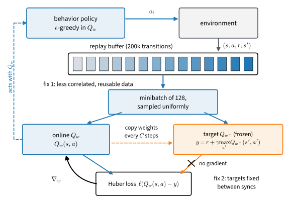
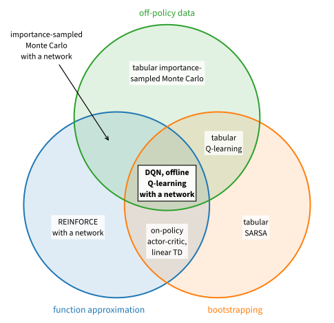

# Deep Q-Networks
:label:`sec_dqn`

The last three sections moved the policy-gradient methods onto neural
networks. This section does the same for Q-learning. Q-learning with a neural
network is known to be unstable, and its value estimates can even diverge
:cite:`mnih2015human`. The deep Q-network (DQN) adds two mechanisms against
this instability: :citet:`mnih2013playing` trained it from a replay buffer,
and :citet:`mnih2015human` added a target network. With both, DQN learned to
play $49$ Atari games from the screen pixels and the game score, with one
architecture and one set of hyperparameters for all games. We build DQN
on CartPole, test what happens without the target network, and examine a bias
that the maximum in the update introduces, together with its reduction by
Double DQN.

```{.python .input #dqn-deep-q-networks-1}
%%tab pytorch
import math
import numpy as np
import torch
from torch import nn
from torch.nn import functional as F
from d2l import torch as d2l
```

```{.python .input #dqn-deep-q-networks-1}
%%tab jax
import math
import numpy as np
import jax
from jax import numpy as jnp
from flax import nnx
import optax
from d2l import jax as d2l
```

```{.python .input #dqn-deep-q-networks-3}
%%tab pytorch, jax
import gymnasium as gym
```

## Q-Learning with a Network

We first state the update and then the two problems that DQN addresses.

### The Update

Let $Q_w$ be a network that maps a state to one value per action. Q-learning
with this network samples transitions $(s, a, r, s')$, forms the targets

$$y = r + \gamma\, (1 - d')\, \max_{a'} Q_w(s', a'),$$

where $d'$ is one if $s'$ is terminal and zero otherwise, holds the targets
fixed, and takes an optimizer step on a regression loss between $Q_w(s, a)$
and $y$. In the terms of supervised learning, $(s, a)$ is the input and $y$
is its label, except that the label is computed by the network being trained.
As in :numref:`sec_qlearning`, this is a semi-gradient step: the target also
depends on $w$, but the step does not differentiate through it.
Unlike the surrogate loss of the policy-gradient methods, the regression loss
has a meaning: when it decreases, the network fits its current targets better.
It does not tell us whether the targets themselves are correct.

### Two Problems, Two Fixes

:citet:`mnih2015human` attribute the instability to correlations in the
sequence of observations, to changes of the data distribution when small
updates of $Q_w$ change the policy, and to correlations between the action
values and the targets. The first two causes are problems of the training
data, which are correlated and shift with the policy, and the third is a
problem of the targets, which move with $Q_w$. :citet:`mnih2015human` address
the problem of the data with a replay buffer and the problem of the targets
with a target network.

The data of a single episode are strongly correlated, because the cart and the
pole move only a little from one step to the next. Since a network shares its
parameters across states (:numref:`fig_rl_table_vs_network`), updates on such
a stream also change the estimates at states that the agent does not currently
visit. The fix is a *replay buffer* :cite:`Lin.1992`: transitions are stored in
a large buffer, and each update uses a minibatch sampled uniformly from it.
:citet:`mnih2013playing` list its advantages. Each transition can be used in
many updates. Random sampling breaks the correlations between consecutive
samples, which reduces the variance of the updates. Finally, the training data
average over many past behaviors, which smooths out changes of the data
distribution. Replay is valid for Q-learning because the target for
$(s, a, r, s')$ does not depend on the policy that chose $a$: Q-learning is
off-policy (:numref:`sec_qlearning`).

The target $y$ contains $Q_w$. With a table, an update changed one entry;
with a network, an update that increases $Q_w(s, a)$ often also increases
$Q_w(s', a')$, and thereby the target, which can lead to oscillations or
divergence :cite:`mnih2015human`. The fix is a *target network*: a copy
$Q_{w^-}$ of the network computes the targets,

$$y = r + \gamma\, (1 - d')\, \max_{a'} Q_{w^-}(s', a'),$$
:eqlabel:`eq_dqn_target`

and the copy is set to the current weights, $w^- \leftarrow w$, only every $C$
environment steps. Between these synchronizations, the targets do not change,
and the network solves an ordinary regression problem. With a squared loss,
and with $r$ and $s'$ drawn from the environment given $s$ and $a$, the
function of $(s, a)$ that minimizes the expected loss is the expected target,
$(TQ_{w^-})(s, a)$ in the notation of :numref:`sec_qlearning`. A network
attains this function only if it can represent it, and only at the
state-action pairs that occur in the data.

### The Deadly Triad

Function approximation (a network or another parameterized function in place
of a table), bootstrapping (targets built from current estimates, as $y$ is),
and off-policy data (transitions distributed differently from those of the
policy whose values are learned) can each be used safely in many settings.
The combination of all three, however, can make the value estimates diverge;
it is called the *deadly triad*
:cite:`Sutton.Barto.2018,vanHasselt.Doron.Strub.ea.2018`.
:numref:`fig_rl_deadly_triad` places example methods by the ingredients they
use, and DQN uses all three. Leaving out one ingredient does not by itself
guarantee convergence: convergence results require further conditions on step
sizes, data, and representation, and even on-policy TD learning can diverge
with a nonlinear function approximator :cite:`Tsitsiklis.VanRoy.1997`.


:label:`fig_rl_deadly_triad`

Baird's counterexample shows the divergence in a small problem
:cite:`Baird.1995`. In the form of :citet:`Sutton.Barto.2018` that we use, it
has seven states, every reward is zero, and the values are linear functions
of eight weights, so the true value function, zero, is represented exactly by
$w = 0$. The evaluated policy always moves to state seven, while the updates
weight the seven states equally, as the data of a different behavior policy
would. We apply the expected semi-gradient TD update, averaged over the seven
states, so there is no sampling noise:

```{.python .input #dqn-the-deadly-triad}
%%tab pytorch, jax
gamma = 0.99
w = np.ones(8)                             # eight weights for seven states
w[6] = 10.0                                # the standard starting point
Phi = np.zeros((7, 8))                     # linear values v = Phi w
Phi[:6, :6], Phi[:6, 7] = 2 * np.eye(6), 1.0   # v(i) = 2 w_i + w_8
Phi[6, 6], Phi[6, 7] = 1.0, 2.0                # v(7) = w_7 + 2 w_8
sup = []
for _ in range(1000):
    v = Phi @ w                            # every reward is 0
    delta = gamma * v[6] - v               # the next state is always state 7
    w += 0.01 * (delta[:, None] * Phi).mean(0)   # all states weighted equally
    sup.append(np.abs(w).max())
print(f'largest |w| after 500 and 1000 sweeps: {sup[499]:.0f}, {sup[-1]:.0f}')
print(f'value estimate of state 7: {(Phi @ w)[6]:.0f} (true value 0)')
```

All weights except $w_7$ keep growing, although the exact solution is
representable and the updates contain no noise; with these updates, the
weights diverge :cite:`Baird.1995,Sutton.Barto.2018`. The cause is the
weighting of the states. With the values $v = \Phi w$ of the code, every
target is $\gamma v(7)$. Throughout this run, the TD errors of states one to
six are positive, so their updates keep raising the weight $w_8$ that all
states share. Through $w_8$, these updates also raise $v(7)$, and with it
the target of every state. The update at state seven, the only one with a
negative TD error, would lower $v(7)$. However, since state seven is its own
next state, this error is only $(\gamma - 1)\, v(7)$, and the average over
the seven states gives the update a factor of only $1/7$. If the same
expected updates weight the states by the state distribution of the
evaluated policy instead, they converge
:cite:`Sutton.Barto.2018`, and for linear TD learning with on-policy sampling,
:citet:`Tsitsiklis.VanRoy.1997` proved convergence under conditions on the
Markov chain, the features, and the step sizes. The replay buffer and the
target network do not remove any ingredient of the triad. They make the
training data less correlated and the targets change more slowly, but they do
not restore a guarantee of convergence.

## DQN on CartPole

We now assemble DQN and train it with and without the target network.

### The Components

:numref:`fig_rl_dqn_dataflow` shows how the parts fit together. The buffer is
a ring of preallocated arrays. Its method `sample` returns a `Batch` of
transitions without episode structure, which is all that the one-step target
needs. The buffer stores the flag `terminated`, not `truncated`: a CartPole
episode that ends at the time limit ends in a state with a future, and the
target must keep bootstrapping there (:numref:`sec_mdp`).


:label:`fig_rl_dqn_dataflow`

```{.python .input #dqn-replay-and-the-off-policy-licence}
%%tab pytorch, jax
class ReplayBuffer:  #@save
    """A ring of transitions in preallocated numpy; sample() returns a Batch."""
    def __init__(self, capacity, obs_dim):
        self.obs = np.zeros((capacity, obs_dim), np.float32)
        self.act = np.zeros(capacity, np.int64)
        self.rew = np.zeros(capacity, np.float32)
        self.next_obs = np.zeros((capacity, obs_dim), np.float32)
        self.term = np.zeros(capacity, np.float32)
        self.capacity, self.size, self.ptr = capacity, 0, 0

    def add(self, obs, act, rew, next_obs, term):
        i = self.ptr
        self.obs[i], self.act[i], self.rew[i] = obs, act, rew
        self.next_obs[i], self.term[i] = next_obs, term
        self.ptr, self.size = (i + 1) % self.capacity, min(self.size + 1,
                                                           self.capacity)

    def __len__(self):
        return self.size

    def sample(self, batch_size, rng):
        i = rng.integers(self.size, size=batch_size)
        return d2l.Batch(self.obs[i], self.act[i], self.rew[i],
                         self.next_obs[i], self.term[i],
                         np.array([batch_size]))
```

The discount is $\gamma = 0.99$, and the network has two hidden layers of
$128$ units. The training budget is
$50{,}000$ environment steps, with one update after every second step once the
buffer holds $1{,}000$ transitions, and the target network is synchronized
every $C = 250$ steps. The buffer holds $200{,}000$ transitions, so no
transition is evicted during training. The behavior policy is
$\epsilon$-greedy, with $\epsilon$ decreasing from $1$ to $0.05$ over the first
$10{,}000$ steps. :citet:`mnih2015human` clipped the error term of the update
to $[-1, 1]$, which is equivalent to the Huber loss: for an error $\delta$,
the loss is $\delta^2/2$ if $|\delta| \leq 1$ and $|\delta| - 1/2$ otherwise,
so its derivative with respect to $\delta$ is $\delta$ clipped to $[-1, 1]$.
We use the Huber loss and also clip the norm of the gradient.

```{.python .input #dqn-deep-q-networks-2}
%%tab pytorch, jax
num_env_steps, num_seeds, gamma = 50_000, 3, 0.99
buffer_size, batch_size, lr = 200_000, 128, 1e-3
train_freq, sync_every, warmup, grad_clip = 2, 250, 1_000, 10.0
epsilon = d2l.linear_schedule(1.0, 0.05, 10_000)
if tab.selected('pytorch'):
    def make_qnet():
        return nn.Sequential(nn.Linear(4, 128), nn.ReLU(),
                             nn.Linear(128, 128), nn.ReLU(),
                             nn.Linear(128, 2))
if tab.selected('jax'):
    def make_qnet(rngs):
        return nnx.Sequential(nnx.Linear(4, 128, rngs=rngs), jax.nn.relu,
                              nnx.Linear(128, 128, rngs=rngs), jax.nn.relu,
                              nnx.Linear(128, 2, rngs=rngs))
```

The update computes the targets :eqref:`eq_dqn_target` with the copy and takes
one optimizer step. In PyTorch, it reuses `Batch.td_target` from
:numref:`sec_actorcritic`; the JAX version computes the same expression inside
a compiled function.

```{.python .input #dqn-the-target-network-1}
%%tab pytorch
def q_values(qnet, obs):
    """Q-values for a state or a batch of states, as numpy."""
    with torch.no_grad():
        return qnet(torch.as_tensor(obs)).numpy()

def fit_q(qnet, opt, batch, y):
    """One clipped Huber regression step of Q_w(s, a) toward fixed y."""
    pred = qnet(torch.as_tensor(batch.obs)).gather(
        -1, torch.as_tensor(batch.act)[:, None]).squeeze(-1)
    loss = nn.functional.huber_loss(pred, torch.as_tensor(y))
    opt.zero_grad()
    loss.backward()
    nn.utils.clip_grad_norm_(qnet.parameters(), grad_clip)
    opt.step()

def q_step(qnet, target, opt, batch):
    """The DQN update with targets from the copy, eq_dqn_target."""
    fit_q(qnet, opt, batch, batch.td_target(
        lambda s: q_values(target, s).max(-1), gamma))
```

```{.python .input #dqn-the-target-network-1}
%%tab jax
def fit_q(qnet, opt, obs, act, y):
    """One Huber regression step of Q_w(s, a) toward fixed y (the norm clip
    is part of the optimizer)."""
    _, grads = nnx.value_and_grad(lambda q: optax.huber_loss(
        jnp.take_along_axis(q(obs), act[:, None], -1).squeeze(-1),
        y).mean())(qnet)
    opt.update(qnet, grads)

@nnx.jit
def q_step(qnet, target, opt, obs, act, rew, next_obs, term):
    """The DQN update with targets from the copy, eq_dqn_target."""
    fit_q(qnet, opt, obs, act,
          rew + gamma * (1 - term) * target(next_obs).max(-1))

_q_forward, _cached = nnx.jit(lambda net, obs: net(obs)), {}

def q_values(qnet, obs):
    """Q-values for a state or a batch of states, as numpy; the graph
    traversal is cached per network."""
    if id(qnet) not in _cached:   # keep qnet alive, so its id stays unique
        _cached[id(qnet)] = qnet, nnx.cached_partial(_q_forward, qnet)
    return np.asarray(_cached[id(qnet)][1](jnp.asarray(obs)))
```

The training loop acts with `epsilon_greedy` from :numref:`sec_qlearning`.
With `use_target=False`, the copy is synchronized after every step, so the
targets come from the online network itself. At the end of every episode, the
loop records the step count, the return of the episode, and the estimate
$\max_a Q_w(s_0, a)$ at the state $s_0 = \mathbf{0}$, the center of CartPole's
start distribution.

```{.python .input #dqn-the-target-network-3}
%%tab pytorch
def train_dqn(seed, qnet, use_target=True, step=q_step):
    """DQN on CartPole; yields (env step, episode return, max_a Q(s0, a))."""
    rng, env = np.random.default_rng(seed), gym.make('CartPole-v1')
    target = make_qnet()
    target.load_state_dict(qnet.state_dict())
    opt = torch.optim.Adam(qnet.parameters(), lr=lr)
    buffer, s0 = ReplayBuffer(buffer_size, 4), np.zeros(4, np.float32)
    obs, ep_return = env.reset(seed=seed)[0], 0.0
    sync = sync_every if use_target else 1
    for t in range(1, num_env_steps + 1):
        a = d2l.epsilon_greedy(q_values(qnet, obs), epsilon(t), rng)
        next_obs, rew, terminated, truncated, _ = env.step(a)
        buffer.add(obs, a, rew, next_obs, float(terminated))
        obs, ep_return = next_obs, ep_return + rew
        if terminated or truncated:
            yield t, ep_return, q_values(qnet, s0).max()
            obs, ep_return = env.reset()[0], 0.0
        if len(buffer) >= warmup and t % train_freq == 0:
            step(qnet, target, opt, buffer.sample(batch_size, rng))
        if t % sync == 0:
            target.load_state_dict(qnet.state_dict())
```

```{.python .input #dqn-the-target-network-3}
%%tab jax
def train_dqn(seed, qnet, use_target=True, step=q_step):
    """DQN on CartPole; yields (env step, episode return, max_a Q(s0, a))."""
    rng, env = np.random.default_rng(seed), gym.make('CartPole-v1')
    target = nnx.clone(qnet)
    opt = nnx.Optimizer(qnet, optax.chain(
        optax.clip_by_global_norm(grad_clip), optax.adam(lr)), wrt=nnx.Param)
    step_fn = nnx.cached_partial(step, qnet, target, opt)
    buffer, s0 = ReplayBuffer(buffer_size, 4), np.zeros(4, np.float32)
    obs, ep_return = env.reset(seed=seed)[0], 0.0
    sync = sync_every if use_target else 1
    for t in range(1, num_env_steps + 1):
        a = d2l.epsilon_greedy(q_values(qnet, obs), epsilon(t), rng)
        next_obs, rew, terminated, truncated, _ = env.step(a)
        buffer.add(obs, a, rew, next_obs, float(terminated))
        obs, ep_return = next_obs, ep_return + rew
        if terminated or truncated:
            yield t, ep_return, q_values(qnet, s0).max()
            obs, ep_return = env.reset()[0], 0.0
        if len(buffer) >= warmup and t % train_freq == 0:
            b = buffer.sample(batch_size, rng)
            step_fn(jnp.asarray(b.obs), jnp.asarray(b.act),
                    jnp.asarray(b.rew), jnp.asarray(b.next_obs),
                    jnp.asarray(b.term))
        if t % sync == 0:
            nnx.update(target, nnx.state(qnet, nnx.Param))
```

### With and without the Target Network

We train three seeds with the target network and three without it:

```{.python .input #dqn-the-ablation-1}
%%tab pytorch, jax
if tab.selected('pytorch'):
    def new_qnet(seed):
        torch.manual_seed(seed)
        return make_qnet()
if tab.selected('jax'):
    def new_qnet(seed):
        return make_qnet(nnx.Rngs(seed))

arms = ('DQN', 'no target network')
qnets = {arm: [new_qnet(seed) for seed in range(num_seeds)] for arm in arms}
runs = {arm: [np.array(list(train_dqn(seed, qnets[arm][seed],
                                      use_target=arm == 'DQN')))
              for seed in range(num_seeds)] for arm in arms}
```

Seeds complete different numbers of episodes. To plot them together, we
replace the return of each episode by the mean return of the ten most recent
episodes, a moving average, and interpolate these averages onto a common grid
of environment steps:

```{.python .input #dqn-the-ablation-2}
%%tab pytorch, jax
grid = np.arange(num_env_steps // 1000 + 1) * 1000

def on_grid(arm, col, k=1):
    """Per seed, the mean of column col over the last k episodes,
    interpolated onto the grid of environment steps."""
    return np.stack([np.interp(grid, r[k - 1:, 0], np.convolve(
        r[:, col], np.ones(k) / k, 'valid')) for r in runs[arm]])

d2l.plot_curves({arm: on_grid(arm, 1, k=10) for arm in arms},
                xlabel='thousand environment steps',
                ylabel='training return', reference=500)
```

As in :numref:`sec_actorcritic`, the curves show the median over the three
seeds, with bands from the smallest to the largest value; the dashed line marks
$500$, the largest return of a CartPole episode. The two arms differ only in
the target network. Without it, the training return falls below that of a
random policy, about $20$, and stays near $10$ in every run. With it, the
training return rises within the first $10{,}000$ steps. It does not
increase steadily, however: it rises and falls during
training, and the runs differ widely.

The training returns include the random actions of the behavior policy. After
the $50{,}000$ steps, we therefore also evaluate the greedy policy of every
network, without random actions, on $100$ episodes:

```{.python .input #dqn-the-ablation-4}
%%tab pytorch, jax
env = gym.make('CartPole-v1')
for arm in arms:
    scores = []
    for seed in range(num_seeds):
        env.reset(seed=100 + seed)
        qnet = qnets[arm][seed]
        scores.append(d2l.evaluate(
            env, lambda s, rng: int(q_values(qnet, s).argmax()), 100))
    print(f'{arm:>17}: mean greedy return per seed {np.round(scores)}')
```

With the target network, the greedy policy of at least one of the three runs
reaches a mean return of $500$, the time limit of CartPole, while the weakest
run averages only slightly more than $100$ steps. Without the target network, the greedy
policies keep the pole up for only about $10$ steps.

### The Value Estimates

The targets keep bootstrapping at the time limit, and the state contains no
time variable, so the network estimates the values of the task without a time
limit :cite:`Pardo.Tavakoli.Levdik.ea.2018`. Every step earns a reward of one,
so in this task no value exceeds $\sum_{t \geq 0} \gamma^t = 1/(1-\gamma) =
100$, and a policy whose episodes never terminate attains this value. The
recorded estimates at $s_0$ can therefore be compared with this ceiling:

```{.python .input #dqn-the-ablation-5}
%%tab pytorch, jax
ceiling = 1 / (1 - gamma)
d2l.plot_curves({'DQN': on_grid('DQN', 2)},
                xlabel='thousand environment steps',
                ylabel='estimate of max_a Q(s0, a)', reference=ceiling)
for arm in arms:
    print(f'{arm:>17}: final estimate of max_a Q(s0, a) per seed:',
          ', '.join(f'{r[-1, 2]:.3g}' for r in runs[arm]))
```

With the target network, the estimates rise over the whole run and approach
the ceiling. At the end of training, one of the three estimates lies above the
ceiling. Since no value in this task exceeds $100$, this estimate is too
large. One known source of overestimates is the maximum in the target
:cite:`Thrun.Schwartz.1993,Hasselt.Guez.Silver.2016`, which we examine next.
Without the target network, the estimates exceed $10^8$ in every run, more
than a million times the ceiling.

## Overestimation

The maximum in the target introduces a bias, which we can observe without a
network.

### The Maximization Bias

The target :eqref:`eq_dqn_target` takes a maximum over estimated values. If
the estimates are noisy, the expected maximum of the estimates is at least the
maximum of their expected values,
$\mathbb{E}[\max_{a'} \hat{Q}(s', a')] \geq \max_{a'} \mathbb{E}[\hat{Q}(s', a')]$, because the
maximum tends to select estimates with positive errors. Formally,
$\max_{a'} \hat{Q}(s', a') \geq \hat{Q}(s', b)$ for every action $b$; taking
expectations and then the maximum over $b$ gives the inequality. A small
example shows the size of the effect. Let two actions both have the true
value zero, and let each estimate be $+1$ or $-1$ with probability one half,
independently. The larger estimate is $-1$ only if both errors are negative,
which happens with probability $1/4$, so its expected value is
$3/4 - 1/4 = 1/2$, although each estimate has expected value zero.
Bootstrapping passes this bias on to the targets of other states, and with
function approximation it can accumulate :cite:`Thrun.Schwartz.1993`. The
following simulation gives four actions the same true value, zero, and adds
independent standard normal noise to each estimate. The *single estimator*
selects and evaluates the action with the same estimates; the
*double estimator* selects with one set of estimates and evaluates with an
independent second set :cite:`vanHasselt.2010`:

```{.python .input #dqn-the-max-bias-measured}
%%tab pytorch, jax
rng = np.random.default_rng(0)
est = rng.standard_normal((100_000, 4))     # four values, all truly zero
second = rng.standard_normal((100_000, 4))  # an independent second estimate
sel = est.argmax(1)
print(f'single estimator: {est.max(1).mean():+.3f}')
print(f'double estimator: {second[np.arange(100_000), sel].mean():+.3f}')
```

The single estimator is biased upward by about one standard deviation of the
noise. The double estimator is unbiased in this example, because the noise of
the second estimate is independent of the selection and all true values are
equal; its measured mean differs from zero only by simulation error. In general, the double estimator can be biased downward
:cite:`vanHasselt.2010`. When the second estimate is unbiased and
independent of the selection, the double estimator returns, in expectation,
an average of the true values, weighted by the probabilities of selecting
each action. Such an average lies below the largest true value whenever an
action with a smaller true value is selected with positive probability.
:numref:`fig_rl_max_bias` shows that, for independent noise, the bias of the
single estimator grows with the number of actions.


:label:`fig_rl_max_bias`

### Double DQN

DQN already maintains two networks. Double DQN uses the online network to
select the action and the target network to evaluate it
:cite:`Hasselt.Guez.Silver.2016`:

$$y = r + \gamma\, (1 - d')\ Q_{w^-}\big(s',\ \underset{a'}{\mathrm{argmax}}\ Q_w(s', a')\big).$$
:eqlabel:`eq_double_dqn`

The DQN target :eqref:`eq_dqn_target` can be written in the same form, since
$\max_{a'} Q_{w^-}(s', a') = Q_{w^-}(s', \mathrm{argmax}_{a'} Q_{w^-}(s', a'))$:
it selects and evaluates with the same network, as the single estimator does,
and :eqref:`eq_double_dqn` changes only the network that selects. The two
networks are not independent, since the copy is a recent version of the
online network, so this is an approximation of the double estimator. It
requires one additional forward pass of the online network at the next
states. The change to the update is small:

```{.python .input #dqn-double-dqn-in-three-lines-1}
%%tab pytorch
def q_step_double(qnet, target, opt, batch):
    """q_step with selection split from evaluation, eq_double_dqn."""
    sel = q_values(qnet, batch.next_obs).argmax(-1)
    fit_q(qnet, opt, batch, batch.td_target(
        lambda s: q_values(target, s)[np.arange(len(s)), sel], gamma))
```

```{.python .input #dqn-double-dqn-in-three-lines-1}
%%tab jax
@nnx.jit
def q_step_double(qnet, target, opt, obs, act, rew, next_obs, term):
    """q_step with selection split from evaluation, eq_double_dqn."""
    sel = qnet(next_obs).argmax(-1)
    fit_q(qnet, opt, obs, act, rew + gamma * (1 - term) * jnp.take_along_axis(
        target(next_obs), sel[:, None], -1).squeeze(-1))
```

On Atari games, :citet:`Hasselt.Guez.Silver.2016` found that Double DQN
reduced the overestimates of DQN and led to much better scores on several
games. Exercise :exref:`ex_dqn-double` asks you to compare the two on
CartPole. Later work
added further components to DQN, such as prioritized replay
:cite:`Schaul.Quan.Antonoglou.ea.2016`, dueling networks
:cite:`Wang.Schaul.Hessel.ea.2016`, and distributional value estimates
:cite:`Bellemare.Dabney.Munos.2017`, and
:citet:`Hessel.Modayil.vanHasselt.ea.2018` combined six such extensions in
the Rainbow agent.

## Summary

DQN is Q-learning with a network and two additional mechanisms. The replay
buffer reduces the correlation of the training data and reuses each
transition many times, which is valid because the Q-learning target does not
depend on the behavior policy. The target network keeps the targets fixed
between synchronizations. Neither mechanism removes the deadly triad of
function approximation, bootstrapping, and off-policy data, whose combination
can make value estimates diverge even when the solution is representable.
On CartPole, without the target network, the value estimates grew beyond
$10^8$ in every run, more than a million times the largest value of the task.
With it, every run ended with a greedy policy that balanced the pole far
longer than a random policy, although the training returns rose and fell and
differed widely between runs. The maximum in the target biases the
estimates upward, and Double DQN reduces this bias by selecting the action
with the online network and evaluating it with the target network. The next
section keeps the replay buffer and the target networks and replaces the
maximum over actions by an actor, for actions that vary continuously.

## Exercises

1. [code] **Double DQN on CartPole.** Train three seeds with
   `step=q_step_double` and compare the estimates of $\max_a Q_w(s_0, a)$ and
   the greedy returns with those of DQN. Is the difference larger than the
   variation between seeds?
   :exlabel:`ex_dqn-double`
1. [code] **The synchronization period.** Train with
   $C \in \{1, 50, 250, 2000\}$. Which variant of this section is $C = 1$?
   How does a very large $C$ affect the speed of learning, and why?
1. [code] **A small buffer.** Reduce the buffer to $1{,}000$ transitions.
   Which of the two problems of this section does this bring back, and how do
   the curves change?
1. **Time limits.** Suppose that the buffer stored
   `float(terminated or truncated)` instead of `float(terminated)`. What
   targets would the network then receive at the states where episodes reach
   the time limit, and why are these targets inconsistent with the targets at
   similar states earlier in an episode?
1. [code] **Baird's counterexample on-policy.** Repeat the computation with
   the states weighted by the state distribution of the evaluated policy,
   which puts all its weight on state seven. Do the weights still diverge?
   Is the value function correct at the other six states?

[Discussions](https://d2l.discourse.group/t/36804)

<!-- slides -->

::: {.slide}
::: {.cover}
[Dive into Deep Learning · §14.10]{.kicker}

Deep Q-networks<br>
**Q-learning with a network · replay · target networks · the deadly triad · overestimation**
:::
:::

::: {.slide title="Two Problems, Two Fixes"}
$$y = r + \gamma\, (1 - d')\, \max_{a'} Q_{w^-}(s', a')$$

- correlated data $\to$ a replay buffer, sampled uniformly;
- targets that move with $w$ $\to$ a target network $Q_{w^-}$,
  synchronized every $C$ steps.

{width=65%}
:::

::: {.slide title="The Deadly Triad"}
{width=50%}

Function approximation + bootstrapping + off-policy data: Baird's
counterexample diverges without any sampling noise.

@dqn-the-deadly-triad
:::

::: {.slide title="With and without the Target Network"}
@dqn-the-ablation-2

. . .

@dqn-the-ablation-4
:::

::: {.slide title="Overestimation"}
$$\mathbb{E}\big[\max_{a'} \hat{Q}(s', a')\big] \geq \max_{a'} \mathbb{E}\big[\hat{Q}(s', a')\big]$$

@dqn-the-max-bias-measured

Double DQN: select with $Q_w$, evaluate with $Q_{w^-}$.
:::
