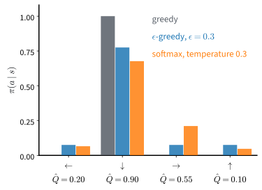

# Exploration
:label:`sec_exploration`

Q-learning in :numref:`sec_qlearning` learned only the entries of its table
that it tried. To keep trying commands that its table rated poorly, it acted
at random with probability $\epsilon$, and this rule has a visible cost:
forced to act at random one step in twenty, the optimal policy on the
slippery lake succeeds about 54% of the time instead of 73%. Is that the
right amount of trying? Could a different rule learn as much while losing
less?

The same question arises whenever we choose repeatedly among options whose
value we learn only by choosing them. Returning to a favorite restaurant
gives a good meal; a new one may give a better meal or a worse one, and
staying with the favorite forever means never finding out. William Thompson
posed the problem in 1933 for medicine: which of two treatments should the
next patient receive, given how the earlier patients fared
:cite:`Thompson.1933`? Herbert Robbins restated it in 1952 for a gambler
facing several slot machines, the *multi-armed bandit*
:cite:`Robbins.1952`. In 1985 Tze Leung Lai and Robbins showed that the cost
of learning must grow with the number of trials, but that it can be kept as
small as the logarithm of that number :cite:`Lai.Robbins.1985`.

The question matters again for language models trained with a verifier. The
model samples several answers to a prompt, a checker scores them, and the
model moves toward the answers that scored better. If every answer scores the
same, there is nothing to move toward, and the model's own randomness is the
only way it can find a better answer.

We first study the trade-off in a problem with a single state, the bandit,
where its cost can be measured exactly. We then return to MDPs, where trying
an untried pair can require a long sequence of actions, and end with the
verifier task of :numref:`sec_mdp`.

```{.python .input #exploration}
%%tab pytorch
%matplotlib inline
from d2l import torch as d2l
import gymnasium as gym
import numpy as np
```

```{.python .input #exploration}
%%tab jax
%matplotlib inline
from d2l import jax as d2l
import gymnasium as gym
import numpy as np
```

## The Multi-Armed Bandit

A bandit is an MDP with a single state. Each round the agent pulls one of
several arms and receives a random reward. Nothing it does changes what comes
next, and no reward is delayed, so only one question remains: which arm is
best? The agent can answer it only by pulling arms, and every pull of a worse
arm is a pull not spent on the best one.

### Arms and Regret

We use ten arms with Bernoulli rewards: arm $a$ returns $1$ with probability
$\mu_a$ and $0$ otherwise. The best arm, the third, has
$\mu^* = \max_a \mu_a = 0.90$; the second best has $0.60$. The agent does not
know the $\mu_a$. After $n(a)$ pulls of arm $a$ it knows the empirical mean
$\hat\mu(a)$, the fraction of those pulls that returned $1$. A *bandit rule*
maps these tallies to the next arm. The function `bandit_run` plays one rule
for `num_pulls` rounds, drawing all randomness from the generator `rng`; it
keeps the tallies `wins` and `count` for every arm and passes them to the
rule:

```{.python .input #qlearning-a-bandit-is-an-mdp-with-one-state}
%%tab pytorch, jax
arms = np.array([0.50, 0.42, 0.90, 0.25, 0.55, 0.38, 0.60, 0.32, 0.50, 0.45])

def bandit_run(arms, rule, num_pulls, rng):
    """One state, one step: pull an arm, log the shortfall, update tallies.
    Returns the cumulative regret after each pull."""
    wins, count = np.zeros(len(arms)), np.zeros(len(arms))
    gap = np.empty(num_pulls)
    for t in range(num_pulls):
        a = rule(wins, count, t, rng)
        count[a] += 1
        wins[a] += float(rng.random() < arms[a])
        gap[t] = arms.max() - arms[a]
    return np.cumsum(gap)
```

The function records the shortfall of each pull rather than its reward. A
success rate says how good a policy is; for a learner we want to know how much
the learning cost. The pull of arm $a_u$ in round $u$ falls short of the best
arm by $\mu^* - \mu_{a_u}$ in expectation, and the *regret* after $t$ pulls
adds up these gaps:

$$
\textrm{Regret}(t) = \sum_{u=1}^{t} \big(\mu^* - \mu_{a_u}\big)
= \sum_a \Delta_a\, n_t(a), \qquad \Delta_a = \mu^* - \mu_a.
$$
:eqlabel:`eq_regret`

The second form groups the pulls by arm: each arm's gap $\Delta_a$ times the
number $n_t(a)$ of its pulls. Regret is what the agent loses against one that
knew the best arm from the start. A rule that pulls one arm with mean $0.50$
for good loses $0.40$ per pull, $800$ after $2000$ pulls, and its regret grows
linearly in $t$. A rule whose regret grows more slowly than $t$ pulls worse
arms ever more rarely, so its average regret per pull tends to zero.

### Greedy and Epsilon-Greedy Rules

The rule of :numref:`sec_qlearning` works here unchanged.
`d2l.epsilon_greedy(q, epsilon, rng)` takes a row of value estimates, here the
ten empirical means. With probability $\epsilon$ it picks an arm uniformly at
random; otherwise it picks the arm with the largest estimate, breaking ties at
random. An arm that was never pulled has empirical mean $0$. With
$\epsilon = 0$ the rule is *greedy*. A fixed $\epsilon$ keeps exploring at the
same rate forever, while an *annealed* rule lowers $\epsilon$ over time. We
use $\epsilon_t = \min(1, 20/t)$ in round $t$, which pulls at random for the
first twenty rounds and then ever more rarely. The schedule depends only on
the round, not on anything the agent has learned.

Each of these rules turns a row of value estimates into a distribution over
actions, as :numref:`fig_rl_exploration` shows for a row of the lake's table.
Greedy puts all probability on the largest estimate, and $\epsilon$-greedy
spreads a fraction $\epsilon$ of it uniformly over all actions. A third rule,
*Boltzmann exploration*, makes the probability of each action proportional to
$\exp(\hat Q(s, a)/\beta)$. This is the softmax of :numref:`sec_softmax` with
temperature $\beta$: a large $\beta$ approaches the uniform distribution, a
small one the greedy rule. Unlike $\epsilon$-greedy, it tries an action that
is nearly the best more often than one that is clearly bad.


:label:`fig_rl_exploration`

The function `eps_rule` turns a schedule $t \mapsto \epsilon_t$ into a bandit
rule that applies `d2l.epsilon_greedy` to the empirical means. The function
`regret_runs` plays a rule in twenty independent runs and returns their regret
curves; each run seeds its own generator from the stream number and the run
index, so that different rules get independent runs. The function `report`
prints the median and the quartiles of the final regret over the runs. We
report medians because a few runs can dominate a mean:

```{.python .input #qlearning-regret-and-the-linear-tax}
%%tab pytorch, jax
def eps_rule(schedule):
    """Epsilon-greedy on the empirical means, with epsilon = schedule(t)."""
    return lambda wins, count, t, rng: d2l.epsilon_greedy(
        wins / np.maximum(count, 1), schedule(t), rng)

def regret_runs(arms, rule, stream, num_runs=20, num_pulls=2000):
    """Regret curves of `num_runs` independent runs, shape [run, pull]."""
    return np.array([bandit_run(arms, rule, num_pulls,
                                np.random.default_rng([2026, stream, s]))
                     for s in range(num_runs)])

def report(name, r):
    q25, q50, q75 = np.percentile(r[:, -1], [25, 50, 75])
    print(f'{name:>16}: regret after {r.shape[1]} pulls: median {q50:3.0f}'
          f' (quartiles {q25:.0f} to {q75:.0f})')

rules = {'greedy': eps_rule(lambda t: 0.0),
         'epsilon = 0.1': eps_rule(lambda t: 0.1),
         'epsilon = 20/t': eps_rule(lambda t: min(1.0, 20 / (t + 1)))}
regret = {name: regret_runs(arms, rule, i)
          for i, (name, rule) in enumerate(rules.items())}
for name, r in regret.items():
    report(name, r)
```

The greedy rule does worst, and the reason can be worked out exactly. All
empirical means start at $0$, so the first pull goes to a random arm. If it
returns $0$, that arm's mean stays $0$ and all ten arms are still tied. If it
returns $1$, its mean becomes positive and stays positive forever: one success
keeps the fraction of wins above zero, while every other arm still reads $0$.
Greedy therefore pulls random arms until one returns a reward and then never
pulls anything else. In each of those random pulls, arm $a$ is chosen with
probability $1/10$ and returns $1$ with probability $\mu_a$, so the arm it
settles on is $a$ with probability $\mu_a / \sum_b \mu_b$. The best arm wins
this lottery with probability $0.90/4.87$, in about one run in five. A run
that settles on arm $a$ loses $\Delta_a$ on almost every pull, about
$2000\,\Delta_a$ in all, so the expected regret is

$$\mathbb{E}\big[\textrm{Regret}(2000)\big] \approx 2000 \sum_a \frac{\mu_a}{\sum_b \mu_b}\, \Delta_a \approx 707.$$

A single run loses one of the values $2000\,\Delta_a$, which lie between $0$
and $1300$, so the quartiles of greedy's regret lie far apart. Its median,
around $800$, belongs to the runs that settle on an arm with mean $0.50$.

The fixed rule with $\epsilon = 0.1$ finds the best arm in almost every run
but never stops exploring. A random pull falls short of the best arm by the
average gap, $0.90 - 0.487 = 0.41$, where $0.487$ is the mean of the ten
$\mu_a$. Exploration alone therefore costs $0.1 \times 0.41 \approx 0.04$ per
pull, about $83$ of its median regret of about $100$, and this cost does not
shrink: the regret of a fixed $\epsilon$ grows linearly in $t$.

The annealed rule makes about $112$ random pulls in $2000$ rounds: twenty at
the start and about $20 \ln(2000/20) \approx 92$ afterwards. At $0.41$ each,
they cost $46$, close to its median regret of about $50$. Nearly all of its
regret is spent on exploration, and the greedy pulls in between go to the best
arm. Since the number of random pulls up to round $t$ grows like $20 \ln t$,
so does the regret: an $\epsilon_t$ proportional to $1/t$ gives logarithmic
regret. The constant matters. If it is too small, the rule stops exploring
before it has told the best arm from the second best. The analysis of
:citet:`Auer.CesaBianchi.Fischer.2002` guarantees logarithmic regret on every
bandit whose gaps are at least $d$ with $\epsilon_t = \min(1, c\,m/(d^2 t))$
for $m$ arms and any $c > 5$. For these arms, with $d = 0.30$, that is nearly
thirty times our $20/t$. Our constant was chosen for these arms, and the
guarantee does not cover it.

## Optimism and Posterior Sampling

The $\epsilon$-greedy rules explore blindly. A random pull is as likely to go
to the worst arm as to the second best, and an arm pulled a hundred times is
as likely to be tried again as one pulled twice. A better rule directs
exploration to the arms whose means are still uncertain and might be the
best, because only those pulls can change the decision.

### Upper Confidence Bounds

One way to do this is optimism: treat each arm as if it were as good as the
data still allow. An untried arm could be anything, so it gets tried. An arm
pulled often has a precise estimate and is pulled again only if that estimate
is high. The *upper confidence bound* (UCB) rule adds to each empirical mean a
bonus that measures its uncertainty, and pulls the arm with the largest sum
:cite:`Auer.CesaBianchi.Fischer.2002`:

$$a_t = \underset{a}{\mathrm{argmax}} \Big[ \hat{\mu}(a) + \kappa \sqrt{\log t \,/\, n(a)} \Big].$$
:eqlabel:`eq_ucb`

The bonus shrinks like $1/\sqrt{n(a)}$, the rate at which the error of an
average of $n(a)$ rewards shrinks, and it grows slowly with $t$ while arm $a$
is not pulled, so no arm is given up for good. An arm is pulled either because
its mean is high or because its mean is uncertain. Every arm is pulled once
before the rule starts, since the bonus is undefined at $n(a) = 0$.
:numref:`fig_rl_ucb` shows the bonus and the indices of one run.

![Optimism under uncertainty, with $\kappa = 0.5$. (a) The bonus $\kappa\sqrt{\log t/n(a)}$ shrinks with an arm's count $n(a)$ and grows slowly with time $t$. (b) One run of the UCB rule on the ten arms after 2,000 pulls: each bar is an arm's estimate $\hat\mu(a)$ with its bonus on top, labeled by the arm's pull count, and the black marks are the true means. Nearly all pulls went to the best arm, whose index is the largest; the rarely tried arms keep indices close to it, so each will be tried again as $\log t$ grows.](../img/mdl-rl-ucb.svg)
:label:`fig_rl_ucb`

The size of the bonus comes from Hoeffding's inequality
:cite:`Hoeffding.1963`: the mean $\hat\mu_n$ of $n$ independent rewards in
$[0, 1]$ exceeds the true mean $\mu$ by more than $h$ with probability at
most $e^{-2 n h^2}$, and likewise falls below it. With
$h = \kappa \sqrt{\log t / n}$, the true mean lies above the index
with probability at most $t^{-2\kappa^2}$. A larger $\kappa$ makes such
failures rarer and spends more pulls on bad arms. With
$\kappa = \sqrt{2}$ the rule is UCB1 of
:citet:`Auer.CesaBianchi.Fischer.2002`, whose regret grows logarithmically in
$t$ on every bandit with rewards in $[0, 1]$; the same holds for every
$\kappa > 1$ :cite:`Bubeck.CesaBianchi.2012`, and exercise
:exref:`ex_qlearning-ucb-logarithmic-regret` derives the bound.

### Thompson Sampling

Thompson's rule of 1933 replaces the bonus by a belief. It keeps, for each
arm, a posterior distribution over the arm's mean, draws one sample from each
posterior, and pulls the arm with the largest draw. For rewards in $\{0, 1\}$
and a uniform prior on $[0, 1]$, the posterior after $w$ wins in $n$ pulls is
the Beta distribution $\mathrm{Beta}(1 + w, 1 + n - w)$. An arm with $3$ wins
in $4$ pulls has the posterior $\mathrm{Beta}(4, 2)$, with mean $2/3$ but
wide. An untried arm has the uniform $\mathrm{Beta}(1, 1)$, and its draw beats
a draw from $\mathrm{Beta}(4, 2)$ with probability $1/3$. As pulls
accumulate, the posteriors narrow, and each arm is pulled with the posterior
probability that it is the best one. Thompson sampling also has logarithmic
regret :cite:`Agrawal.Goyal.2012`, and it has no constant to choose.

### UCB and Thompson Sampling Compared

The function `ucb(kappa)` returns the UCB rule with coefficient $\kappa$, and
`thompson` draws from the Beta posteriors. We run UCB with $\kappa = 0.5$, a
value chosen for these arms that we examine below, and Thompson sampling, and
then plot all five rules. `d2l.plot_curves` draws the median over the runs
with the band between the quartiles, here at 100 pulls spaced evenly on
logarithmic axes:

```{.python .input #qlearning-optimism-ucb-and-thompson-sampling}
%%tab pytorch, jax
def ucb(kappa):
    """The UCB rule with coefficient kappa: each arm once, then the largest
    index mean + kappa * sqrt(log t / n)."""
    def rule(wins, count, t, rng):
        if (count == 0).any():          # play each arm once before pricing any
            return int(np.argmax(count == 0))
        bonus = kappa * np.sqrt(np.log(t) / count)
        return int(np.argmax(wins / count + bonus))
    return rule

def thompson(wins, count, t, rng):
    """Draw each arm's mean from its Beta posterior; play the largest draw."""
    return int(rng.beta(1 + wins, 1 + count - wins).argmax())

for i, (name, rule) in enumerate([('UCB, kappa = 0.5', ucb(0.5)),
                                  ('Thompson', thompson)], 3):
    regret[name] = regret_runs(arms, rule, i)
    report(name, regret[name])
pulls = np.unique(np.geomspace(1, 2000, 100).astype(int))  # even on a log axis
d2l.plot_curves({name: r[:, pulls - 1] for name, r in regret.items()},
                xlabel='pulls', ylabel='cumulative regret', x=pulls,
                xscale='log', yscale='log', band='iqr')
```

Both rules end with a median regret of roughly $30$ to $40$, about a third of
the fixed $\epsilon$ and below the annealed rule. They are close to each
other: the difference between them is smaller than the spread over runs. On
logarithmic axes a regret that grows linearly is a line of slope one. Greedy
and fixed $\epsilon$ approach that slope, while UCB and Thompson sampling bend
away from it. $2000$ pulls cannot establish an asymptotic rate, but the bend
is what logarithmic growth looks like.

### The UCB Coefficient

The value $\kappa = 0.5$ lies below the range $\kappa > 1$ that the theory
covers. How much does the coefficient matter? The cell plays forty runs for
each of three coefficients and prints the median and extremes of the regret:

```{.python .input #exploration-optimism-ucb-and-thompson-sampling-1}
%%tab pytorch, jax
for j, kappa in enumerate([0.15, 0.5, np.sqrt(2)]):
    r = regret_runs(arms, ucb(kappa), 10 + j, num_runs=40)[:, -1]
    print(f'kappa = {kappa:.2f}: regret after 2000 pulls over 40 runs: median '
          f'{np.median(r):3.0f}, min {r.min():3.0f}, max {r.max():3.0f}')
```

At $2000$ pulls the coefficient decides the result. With $\kappa = \sqrt{2}$,
UCB1 with its guarantee, the regret ends near $200$, five to six times that of
$\kappa = 0.5$. With $\kappa = 0.15$ the median is the smallest, under ten,
but the maximum is large. With so small a bonus, a run in which the best arm
starts with a few unlucky pulls can settle on a worse arm and keep losing
$0.3$ or more per pull. This happens in roughly one run in ten; the median
hides these runs, and the mean does not.

One might expect the theory's $\kappa$ to win once the horizon is long
enough. On these arms it does not: in runs of $10^5$ pulls and more, which
exercise :exref:`ex_exploration-long-horizons` reproduces, $\kappa = \sqrt{2}$
keeps six to eight times the regret of $\kappa = 0.5$, and both grow like
$\log t$. What the theory guarantees is something else: $\kappa = \sqrt{2}$
has logarithmic regret on every bandit with rewards in $[0, 1]$, and
$\kappa = 0.5$ has no such guarantee. Hoeffding's inequality must hold for the
worst case, an arm with variance $1/4$. The best arm here has variance
$0.9 \times 0.1 = 0.09$, so its empirical mean is more accurate than the
inequality assumes, and a smaller bonus is enough on this problem. Thompson
sampling matches the tuned UCB rule without a constant to tune.

### A Lower Bound on Regret

How low can regret go? Lai and Robbins proved that any rule that does well on
every bandit of a family must, in $t$ pulls, pull each worse arm $a$ at least
about $\ln t / D(\mu_a \,\|\, \mu^*)$ times :cite:`Lai.Robbins.1985`. Here

$$D(p \,\|\, q) = p \ln \frac{p}{q} + (1 - p) \ln \frac{1 - p}{1 - q}$$

is the relative entropy between Bernoulli distributions with means $p$ and
$q$. It is small when the two means are close, so an arm that is nearly as
good as the best is hard to tell apart and must be pulled more often. For the
arm with mean $0.60$, $D(0.60 \,\|\, 0.90) = 0.31$, and it must be pulled
about $\ln 2000 / 0.31 \approx 24$ times by round $2000$. With
:eqref:`eq_regret`, the regret of every such rule grows at least like
$\ln t$. UCB and Thompson sampling grow at this rate, so in long runs no rule does
better by more than a constant factor; fixed $\epsilon$ does not.

## Exploration in MDPs

In a bandit every arm can be pulled in every round. In an MDP, a
state-action pair can be tried only from its state, and reaching that state
may take a particular sequence of actions. Random actions produce a given
sequence with a probability that falls geometrically in its length: with two
actions, a particular sequence of $k$ actions comes up with probability
$2^{-k}$.

### A Chain of States

A chain makes this exact. It has $N$ states in a row and starts in state $0$.
Action $1$ moves one state on, action $0$ returns to the start, and entering
the last state gives reward $1$ and ends the episode, which is cut after $2N$
steps. To succeed, the agent must choose action $1$ in $N - 1$ consecutive
steps. The function `chain` builds this MDP as a
`d2l.TabularMDP(P, r, gamma)`, the arrays of :numref:`sec_mdp`: `P[s, a]` is
the distribution of the next state and `r[s, a]` the expected reward. The
function `success_random` computes the exact probability that uniformly random
actions reach the end within `horizon` steps. It averages the kernel over the
two actions, $P_\pi(s' \mid s) = \frac12 \sum_a P(s' \mid s, a)$, and
propagates the state distribution from state $0$ through $P_\pi$ one step at a
time. The last state is absorbing, so its probability after `horizon` steps is
the probability of having arrived:

```{.python .input #exploration-exploration-in-mdps-1}
%%tab pytorch, jax
def chain(N, gamma):
    """N states in a row: action 1 moves one state on, action 0 returns to
    the start; entering the last state pays 1 and ends the episode."""
    P, r = np.zeros((N, 2, N)), np.zeros((N, 2))
    P[:, 0, 0] = 1
    P[np.arange(N - 1), 1, np.arange(1, N)] = 1
    P[N - 1] = 0
    P[N - 1, :, N - 1] = 1              # the last state is absorbing
    r[N - 2, 1] = 1
    return d2l.TabularMDP(P, r, gamma)

def success_random(mdp, horizon):
    """Exact probability that uniformly random actions, started in state 0,
    reach the last state within `horizon` steps."""
    P_pi, d = mdp.P.mean(axis=1), np.eye(mdp.num_states)[0]
    for _ in range(horizon):
        d = d @ P_pi
    return d[-1]
```

`d2l.q_learning(seed, Q, visits, env, num_episodes, gamma, alpha, epsilon)`
of :numref:`sec_qlearning` updates the table `Q` in place from transitions it
collects with $\epsilon$-greedy actions, counts visits in `visits`, and yields
the return of each episode. It touches the environment only through
`env.reset` and `env.step`, and the class `ModelEnv` gives a `TabularMDP`
these two methods: `reset` puts the agent in state $0$, and `step` draws the
next state from `P[s, a]`, reporting termination in a terminal state and
truncation after `max_steps` steps.

The learner is the Q-learning of :numref:`sec_qlearning` with one change:
every entry of the table starts at $1$, an upper bound on every return, and
the agent acts greedily, $\epsilon = 0$. This is *optimistic initialization*,
the idea behind UCB applied to a table: an untried pair looks as good as
anything can be. For comparison, the cell prints the expected number of
episodes until random actions first succeed, the inverse of the probability
from `success_random`. Q-learning from a zero table acts exactly like this
until its first success, whatever its $\epsilon$, because every row is a tie
broken at random (exercise :exref:`ex_qlearning-exploration-schedule`):

```{.python .input #exploration-exploration-in-mdps-2}
%%tab pytorch, jax
class ModelEnv:
    """Gymnasium's reset/step on a TabularMDP: start in state 0, draw s'
    from P[s, a], end in a terminal state or after max_steps steps."""
    def __init__(self, mdp, terminal, max_steps):
        self.mdp, self.terminal, self.max_steps = mdp, terminal, max_steps
        self.rng = np.random.default_rng(0)

    def reset(self, seed=None):
        if seed is not None:
            self.rng = np.random.default_rng(seed)
        self.s, self.t = 0, 0
        return self.s, {}

    def step(self, a):
        s, self.t = self.s, self.t + 1
        self.s = int(self.rng.choice(self.mdp.num_states, p=self.mdp.P[s, a]))
        return (self.s, self.mdp.r[s, a], self.s in self.terminal,
                self.t >= self.max_steps, {})

for N in (4, 8, 12, 16, 20):
    mdp = chain(N, gamma=0.95)
    env = ModelEnv(mdp, terminal={N - 1}, max_steps=2 * N)
    first = []
    for seed in range(20):
        Q = np.ones((N, 2))             # optimistic: 1 bounds every return
        for k, ret in enumerate(d2l.q_learning(
                seed, Q, np.zeros_like(Q), env, 100, mdp.gamma,
                epsilon=lambda episode: 0.0)):
            if ret > 0:
                break
        first.append(k + 1)
    print(f'N = {N:2d}: episodes to the first success: random '
          f'{1 / success_random(mdp, 2 * N):5.0f} (mean), optimistic '
          f'{np.median(first):2.0f} (median, max {max(first)})')
```

Random actions need about twice as many episodes for every state added:
$23$ at $N = 8$, about $3{,}400$ at $N = 16$, about $46{,}000$ at $N = 20$. The
optimistic learner needs a handful, about eight at $N = 20$, a number that
grows roughly in proportion to $N$. Optimism works because a tried pair is
marked as tried. After one try of a pair that pays nothing, its entry moves
toward a target $r + \gamma \max_{a'} Q(s', a')$ of at most $\gamma < 1$, so it
falls below every untried entry, which still reads $1$. The greedy rule
therefore prefers a pair it has not tried, and the learner works through the
chain systematically instead of by chance. The number of episodes grows
polynomially in $N$ instead of exponentially.

### Count-Based Bonuses

Optimistic initialization explores a pair until its first try lowers its
value. In a stochastic MDP one try says little, and a pair needs repeated
visits before its value is known. *Count-based bonuses* carry the UCB rule
over to MDPs. They add to the reward of each pair a bonus that shrinks like
$1/\sqrt{n(s, a)}$ with its visit count, and let the value backups carry the
bonus back to the states that lead there, so the agent plans its way toward
pairs it knows little about. Model-based interval estimation does this with a
learned model :cite:`Strehl.Littman.2008`, and Q-learning with such bonuses
has a regret that grows like the square root of the number of steps, up to
factors polynomial in the size of the MDP :cite:`Jin.AllenZhu.Bubeck.ea.2018`.
With a network in place of a table, states are rarely visited twice, and
practical agents replace the count by a learned measure of novelty, such as
the error of a network trained to predict a fixed random function of the
state :cite:`Burda.Edwards.Storkey.ea.2019`.

### Coverage on the Lake

Does the lake need any of this? In :numref:`sec_qlearning`, Q-learning on the
calm lake, where every move goes where it is commanded, used the step size
$\alpha = 0.9$ for $256$ episodes, and its greedy table solved the lake. We
repeat that run under three schedules: greedy, $\epsilon = 0$; always random,
$\epsilon = 1$; and the default of `q_learning`,
`d2l.linear_schedule(1.0, 0.05, 128)`, which lowers $\epsilon$ linearly from
$1$ to $0.05$ over the first half of training. In each of twenty runs the cell
records, after every episode, the fraction of the $44$ pairs tried at least
once ($11$ cells to act from, four actions each). It also records the
fraction of training episodes that reach the goal, and whether the greedy
policy of the final table does, which `d2l.evaluate` of
:numref:`sec_valueiter` checks in one episode on this deterministic lake:

```{.python .input #exploration-exploration-in-mdps-3}
%%tab pytorch, jax
calm = gym.make('FrozenLake-v1', is_slippery=False)
live = np.array([c not in b'HG' for c in calm.unwrapped.desc.flatten()])
schedules = {'greedy': lambda k: 0.0,
             'epsilon = 1': lambda k: 1.0,
             'linear, 1 to 0.05': d2l.linear_schedule(1.0, 0.05, 128)}
coverage = {}
for name, epsilon in schedules.items():
    tried, won, solved = [], [], []
    for seed in range(20):
        Q, visits = np.zeros((16, 4)), np.zeros((16, 4))
        rets = []
        for ret in d2l.q_learning(seed, Q, visits, calm, 256, 0.95,
                                  alpha=lambda n: 0.9, epsilon=epsilon):
            rets.append(ret)
            tried.append((visits[live] > 0).mean())
        won.append(np.mean(rets))
        solved.append(d2l.evaluate(calm, lambda s, rng: int(Q[s].argmax()), 1))
    coverage[name] = np.array(tried).reshape(20, 256)
    print(f'{name:>17}: pairs tried {np.median(coverage[name][:, -1]):.0%}, '
          f'episodes won {np.median(won):.0%} (medians); greedy policy '
          f'solves {np.sum(solved):.0f}/20')
d2l.plot_curves(coverage, xlabel='episode', ylabel='fraction of pairs tried',
                band='iqr')
```

On the calm lake, random tie-breaking alone makes the greedy rule explore: it
tries about nine pairs in ten, and its final greedy table solves the lake in
nearly every run, as do the tables of the other two schedules. With
$\epsilon = 1$ the agent tries every pair but reaches the goal in almost none
of its training episodes. Learning a good table and collecting reward while
learning are different goals, and $\epsilon$ trades one for the other. What
limits all three schedules is the first success. Until then every entry is
zero and every schedule acts at random, so for a given seed the first success
arrives in the same episode under every schedule. The goal is six moves from
the start, and random walks find it within a few dozen episodes. The lake is
too small to show the difficulty of the chain. On slippery ice, where a single
visit to a pair says little about it, trying every pair once is not enough
(exercise :exref:`ex_qlearning-exploration-schedule`).

## Exploration on the Verifier Task

The verifier task of :numref:`sec_mdp` has four arithmetic prompts $x$, nine
candidate responses $y$ shared by all of them, and a verifier with
$r(x, y) = 1$ if $y$ is the prompt's answer and $0$ otherwise. The reference
policy $\pi_{\textrm{ref}}$, a softmax over one row of preferences per prompt,
spreads its probability evenly over the eight ordinary candidates. It gives
almost none to the ninth, a hedge that lists every answer and that the
exact-match verifier never accepts. Two prompts, $2+2$ and $3 \times 4$, have
their answer among the candidates; for $8 \times 8$ and $9 \times 9$ no
candidate matches. A sampled response is correct with probability $0.062$ on
average over the prompts.

Each round a prompt arrives, one response is scored, and the episode ends.
The prompt is a context that the agent observes but cannot influence, and the
response is the arm. A bandit whose best arm depends on an observed context
is a *contextual bandit*: the agent faces one bandit per prompt and, with a
model, can share what it learns across prompts.

A language model explores such a task differently from the rules above. A
common way to train it, derived in :numref:`sec_baselines`, samples a group of
$K$ responses to a prompt from the current policy, scores them, and raises
the probability of the responses that scored above the group's average while
lowering those below it. A group in which every response scores the same has
nothing above or below its average and changes nothing. If the policy answers
a prompt correctly with probability $p = \pi(\textrm{correct} \mid x)$, a
group of $K$ independent responses is identical with probability

$$(1 - p)^K + p^K,$$

the chance that all $K$ are wrong plus the chance that all are right. The
cell samples $1{,}000$ groups per prompt and compares the fraction of
identical groups with this formula. It does so at the reference policy and at
a policy that has nearly solved the two answerable prompts, built by hand by
raising the preference of each correct answer by $5$; it is not a trained
policy. The array `R[x, y]` holds the verifier's score of every pair:

```{.python .input #exploration-exploration-on-the-verifier-task}
%%tab pytorch, jax
task = d2l.VerifierTask()
R = np.array([[task.verify(x, y) for y in range(len(task.resp))]
              for x in range(len(task.prompts))])
rng = np.random.default_rng(0)
for name, pi in [('reference', task.pi_ref),
                 ('solved', task.policy(task.theta_ref + 5 * R))]:
    p = (pi * R).sum(axis=1)            # chance that one response is right
    for K in (2, 8, 32):
        same = []                       # per prompt: all K rewards equal
        for x in range(len(task.prompts)):
            ys = rng.choice(len(task.resp), (1000, K), p=pi[x])
            same.append((R[x, ys] == R[x, ys[:, :1]]).all(axis=1).mean())
        print(f'{name:>9}, K = {K:2d}: identical {np.round(same, 2)}, '
              f'mean {np.mean(same):.2f}, '
              f'exact {np.mean((1 - p) ** K + p ** K):.2f}')
```

The sampled fractions agree with the formula. Half of all groups are
identical at every $K$: on the two prompts without a correct candidate every
response fails, and no amount of sampling finds an answer that the policy
cannot produce. On the two answerable prompts the reference is right with
probability $p \approx 0.125$, and larger groups are more often mixed: about
$78\%$ of the groups of two are identical, a third of the groups of eight,
and almost none of the groups of $32$. Once a prompt is nearly solved, groups
become identical again, about two thirds of them at $K = 8$, now because
almost every response is right, and learning on that prompt slows to a halt.

The learner explores only through its own sampling. The probability that a
group contains at least one correct response, $1 - (1 - p)^K$, is the
*pass@$K$* score used to evaluate models for code and reasoning
:cite:`Chen.Tworek.Jun.ea.2021`. On a prompt that the policy usually fails, it
is nearly the probability that a group can teach anything. Sampling at a
higher temperature spreads probability over more responses and mixes more
groups on a prompt the policy has nearly solved, at the cost of more wrong
answers. It cannot help where no candidate is right.

Every rule in this section learns which actions are good by trying them, and
the trying costs pulls of worse arms, episodes of random walking, or groups
that teach nothing. On the chain an untried pair is hard to reach, and on the
verifier task a correct answer that the policy never produces is never found.
An expert who shows good actions would spare the agent all of this, and
:numref:`sec_imitation` learns from such demonstrations.

## Summary

An agent that learns from its own actions must try actions that look worse to
find out whether they are, and regret measures what this costs against an
agent that knew the best action from the start. On a ten-armed bandit, the
greedy rule settles on the first arm that pays out, and a fixed $\epsilon$
loses the same amount per pull forever. An $\epsilon$ that decays like $1/t$,
UCB and Thompson sampling make regret grow only like the logarithm of the
number of pulls, which Lai and Robbins showed is the best possible rate. UCB's
coefficient decides its regret on a given problem: the coefficient of the
theory is safe on every bandit and slower on this one. In an MDP, random
actions find a required sequence of actions with a probability that falls
geometrically in its length, while optimistic values make the agent seek out
untried pairs. When a verifier scores groups of sampled responses, groups
that score alike carry no signal, and the policy's own sampling is its only
exploration.

## Exercises

1. [code] **The exploration schedule.** On a zero-initialized table,
   `epsilon_greedy` breaks every tie uniformly at random, and every reward
   of FrozenLake is nonnegative.
    1. Show that every entry of the table stays exactly zero until the
       first successful episode, and that until then every $\epsilon$
       produces the same behavior. What does this imply for the episode of
       the first success as a criterion for choosing $\epsilon$?
    1. After the first success, which entries are positive? Show that an
       entry, once positive, stays positive, and that the greedy rule,
       $\epsilon = 0$, never again tries the zero entries of a row that
       contains a positive entry. The coverage experiment of this section
       shows this rule trying about nine pairs in ten on the calm lake and
       learning to succeed there. Predict whether it also learns a good
       policy on slippery ice.
    1. The optional argument `epsilon` of `q_learning` is a function from
       the episode index to the exploration rate, such as those returned by
       `linear_schedule`. On the slippery lake, run five seeds each with
       $\epsilon$ held at $0$, $0.1$, $0.5$ and $1$, and with the schedule
       `linear_schedule(1.0, 0.05, num_episodes // 2)` that `q_learning`
       uses in :numref:`sec_qlearning`. For each setting, report the mean
       training return, the success rate of the final greedy policy under
       `d2l.evaluate` over $1000$ episodes, the fraction of pairs tried, and
       $\max_s |\max_a \hat{Q}(s, a) - V^*(s)|$. Was your prediction right?
    1. Rank the settings by training return and by greedy success rate.
       Where do the two rankings disagree, and what explains the
       disagreement?
   :exlabel:`ex_qlearning-exploration-schedule`

1. **Logarithmic regret of UCB.** ●● With $\kappa = \sqrt{2}$, the rule
   :eqref:`eq_ucb` is UCB1 of :citet:`Auer.CesaBianchi.Fischer.2002`,
   whose Theorem 1 bounds the expected regret after $t$ pulls of arms with
   rewards in $[0, 1]$ by
   $$\sum_{a:\, \Delta_a > 0} \frac{8 \ln t}{\Delta_a} + \Big(1 + \frac{\pi^2}{3}\Big) \sum_a \Delta_a, \qquad \Delta_a = \mu^* - \mu_a.$$
   Derive this bound. The tool is Hoeffding's inequality: the mean
   $\hat{\mu}_n$ of $n$ independent rewards in $[0, 1]$ with mean $\mu$
   satisfies
   $$P(\hat{\mu}_n \geq \mu + h) \leq e^{-2 n h^2},$$
   and likewise for the lower tail.
    1. Fix a suboptimal arm $a$ and let
       $\ell = \lceil 8 \ln t / \Delta_a^2 \rceil$. Show that if arm $a$ is
       pulled at a step $u \leq t$ while $n(a) \geq \ell$, then either the
       index of the best arm lies at or below $\mu^*$, or the empirical
       mean of arm $a$ exceeds $\mu_a$ by more than its bonus.
    1. For fixed pull counts of both arms, bound the probability of each
       of the two events at step $u$ by $u^{-4}$. Take a union bound over
       the counts and sum over $u$ to show
       $\mathbb{E}[n(a)] \leq \ell + \pi^2/3$ after $t$ pulls.
    1. Combine part (b) with the regret decomposition :eqref:`eq_regret`
       to obtain the theorem. Evaluate the bound for `arms` at $t = 2000$
       and compare it with the median regret near $200$ that the
       coefficient sweep of this section prints for $\kappa = \sqrt{2}$.
       Which step of the proof loses the most?
    1. Repeat the argument for a general coefficient $\kappa$. For which
       $\kappa$ does the sum over steps in part (b) still converge, and
       what does the answer say about the section's choice
       $\kappa = 0.5$?
   :exlabel:`ex_qlearning-ucb-logarithmic-regret`

1. **Thompson's posterior.** ● Thompson sampling draws each arm's mean
   from $\mathrm{Beta}(1 + w, 1 + n - w)$ after $w$ wins in $n$ pulls.
    1. Show that this is the posterior of a Bernoulli mean under the
       uniform prior on $[0, 1]$.
    1. Arm A has $3$ wins in $4$ pulls and arm B is untried. Show that
       Thompson sampling pulls B with probability $1/3$. More generally,
       show that against an untried arm it pulls the untried one with
       probability one minus the posterior mean of the other.
    1. Show that, given the data, Thompson sampling pulls each arm with
       the posterior probability that this arm has the largest mean.
    1. [code] Replace the uniform prior by $\mathrm{Beta}(1, 9)$, which
       expects arms to be bad, and by $\mathrm{Beta}(9, 1)$, which expects
       them to be good. How does the median regret after $2000$ pulls
       change? Which of the two priors acts like optimistic initialization,
       and why?
   :exlabel:`ex_exploration-thompson-posterior`

1. [code] **Long horizons.** ●● `bandit_run` plays one run at a time.
    1. Write a version that plays many runs at once: keep `wins` and
       `count` as arrays of shape (runs, arms) and choose the arms of all
       runs in one step, for UCB and for Thompson sampling. Check that its
       medians at $2000$ pulls agree with those of this section up to the
       spread over runs.
    1. Run $200$ runs of UCB with $\kappa \in \{0.15, 0.3, 0.5, \sqrt{2}\}$
       and of Thompson sampling to $10^5$ pulls, and plot the median regret
       on logarithmic axes. Does $\kappa = \sqrt{2}$ catch up with
       $\kappa = 0.5$?
    1. For $\kappa = 0.15$, plot the mean regret as well as the median. Why
       do they grow at different rates, and which of the two describes the
       risk to a user who runs the rule once?
   :exlabel:`ex_exploration-long-horizons`

1. [extended] **Deep exploration.** ●● Take the chain of this section:
   states $0, \ldots, N-1$, start in state $0$, action $0$ returns to state
   $0$, action $1$ advances one state, reaching state $N-1$ gives reward
   $1$ and terminates, and episodes are truncated after $2N$ steps.
    1. Show that the uniformly random policy succeeds in one episode with
       probability at most $2N \cdot 2^{-(N-1)}$, so that the expected
       number of episodes up to the first success is at least
       $2^{N-2}/N$, and compare the bound with the exact values that the
       chain cell prints. By part (a) of exercise
       :exref:`ex_qlearning-exploration-schedule`, $\epsilon$-greedy
       Q-learning from a zero table acts uniformly at random until its
       first success, so the bound holds for it whatever the value of
       $\epsilon$.
    1. Trace the first episodes of the optimistic greedy learner on the
       chain with $N = 4$: which entries does each episode lower? Use the
       pattern to argue that the number of episodes it needs grows at most
       polynomially in $N$.
    1. Move both learners to
       `gym.make('FrozenLake-v1', map_name='8x8', is_slippery=True)`, which
       truncates at $100$ steps. Compare the optimistic greedy learner
       with the zero-initialized learner under the schedule
       `linear_schedule(1.0, 0.05, num_episodes // 2)` at $4000$ and
       $20000$ episodes, five seeds each. Report the success rate of the
       greedy policy under `d2l.evaluate`, the environment steps used,
       and, as a reference, the success rate of the optimal policy
       computed by value iteration. Does optimism keep its advantage on a
       stochastic map, and what does it cost?

   The project takes a few minutes of CPU time.
   :exlabel:`ex_exploration-deep-exploration`

1. **Groups that teach nothing.** ● On a prompt that the policy answers
   correctly with probability $p$, a group of $K$ independent responses is
   identical with probability $(1 - p)^K + p^K$.
    1. For a fixed $K \geq 2$, which $p$ makes a mixed group most likely,
       and how likely is it then?
    1. For small $p$, show that the smallest $K$ for which a group is mixed
       with probability at least $1/2$ is about $\ln 2 / p$. Evaluate it
       for the reference policy of the verifier task, $p \approx 0.125$,
       and for $p = 0.01$.
    1. The prompts of a training set have success probabilities $p$
       spread uniformly over $[0, 1]$. What fraction of the groups of size
       $K = 8$ is identical, and which prompts produce them?
    1. On the two prompts of `VerifierTask` without a correct candidate,
       every group is identical for every $K$ and every sampling
       temperature. Name two changes, to the task or to the learner, that
       would let it learn on these prompts, and say what each needs that
       the verifier alone does not provide.
   :exlabel:`ex_exploration-identical-groups`

[Discussions](https://d2l.discourse.group/)

<!-- slides -->

::: {.slide}
::: {.cover}
[Dive into Deep Learning · §14.4]{.kicker}

Exploration<br>
**bandits and regret · epsilon-greedy · UCB and Thompson sampling · exploration in MDPs**
:::
:::

::: {.slide title="Exploration Measured by Regret"}
A bandit is an MDP with one state. Regret assigns each pull the mean-reward
gap from the best arm.

{width=98%}

. . .

Median regret after 2,000 pulls: greedy about 800 · fixed $\epsilon$ about
100 (linear regret) · $\epsilon = 20/t$ about 50 · UCB and Thompson 30 to 40.
:::

::: {.slide title="Optimism and Uncertainty"}
$$a_t = \mathrm{argmax}_a \big[ \hat{\mu}(a) + \kappa \sqrt{\log t / n(a)} \big]$$

Per-arm exploration decreases as observations accumulate: logarithmic regret
under the stated UCB conditions, whereas fixed $\epsilon$ has linear regret (proved for $\kappa > 1$; play each arm once
first). Thompson: sample a Beta posterior, play the argmax.

. . .

**Online and offline uncertainty.** Online exploration adds a confidence
radius that decreases with counts; offline pessimism (:numref:`sec_offline`)
subtracts an uncertainty penalty because no new samples can correct errors.
:::
