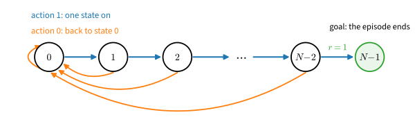
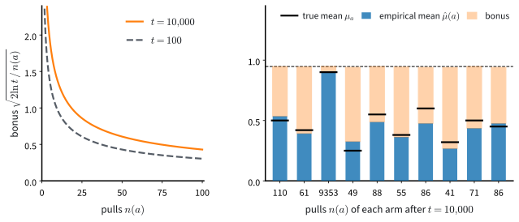

# Exploration
:label:`sec_exploration`

Q-learning in :numref:`sec_qlearning` learns only the entries of its table
that it tries. To keep trying actions whose estimates are low, its behavior
policy takes a random action with probability $\epsilon$. Choosing the action
that currently looks best is called *exploitation*, and choosing another
action to learn more about it is called *exploration*
:cite:`Sutton.Barto.2018`. Both have a cost. An exploratory action gives up
the reward that the agent expects from its best action, and an action that
the agent stops trying may be better than its estimate suggests. How often
should an agent explore, and which actions should it try?

In this section, we study this question first in the simplest problem in
which it arises, the multi-armed bandit, an MDP with a single state. There,
the cost of exploration can be measured exactly, and we compare four rules
for choosing actions: the greedy rule, the $\epsilon$-greedy rule, upper
confidence bounds, and Thompson sampling. We then return to MDPs, where
trying a state-action pair can first require reaching its state through a
long sequence of actions. On a chain of states, random actions need a number
of episodes that grows exponentially in the length of the chain, while a
Q-learning agent that starts with optimistic values needs a number that grows
roughly in proportion to the length.

```{.python .input #exploration-preamble}
%%tab pytorch
import math
import numpy as np
import torch
from torch import nn
from torch.nn import functional as F
from d2l import torch as d2l
```

```{.python .input #exploration-preamble}
%%tab jax
import math
import numpy as np
import jax
from jax import numpy as jnp
from flax import nnx
import optax
from d2l import jax as d2l
```

## The Multi-Armed Bandit

In 1933, William Thompson asked which of two treatments the next patient
should receive, given how the earlier patients had fared under each of them
:cite:`Thompson.1933`. Herbert Robbins later stated the problem as sampling
repeatedly from two populations, choosing each time which one to sample
:cite:`Robbins.1952`. With any number of options, it is now called the
*multi-armed bandit*, after slot machines, which are known as one-armed
bandits: each machine is an arm, and the player decides which arm to pull
next.

### Arms and Regret

A bandit has a single state and $m$ actions, called *arms*. In each round
$t = 1, 2, \ldots$, the agent pulls an arm $a_t$ and receives a random reward
whose distribution depends only on the arm. We write $\mu_a$ for the mean
reward of arm $a$ and $\mu^* = \max_a \mu_a$ for the largest mean. The rewards
of different rounds are independent, and their distributions do not change
over time. In the terms of :numref:`sec_mdp`, every episode has a single
step, so no reward is delayed. The agent's only question is which arm has the
largest mean, and it can answer this question only by pulling arms.

Our example has $m = 10$ arms with rewards in $\{0, 1\}$: arm $a$ returns $1$
with probability $\mu_a$ and $0$ otherwise. The best arm has $\mu^* = 0.90$,
the second best has $0.60$, and the ten means average $0.487$. The agent does
not know the means. After $n(a)$ pulls of arm $a$, it knows the *empirical
mean* $\hat{\mu}(a)$, the fraction of these pulls that returned $1$.

In :numref:`sec_qlearning`, we judged Q-learning by the return of its greedy
policy at the end of training. A bandit has no separate training phase: in
Thompson's setting, every pull is a treatment given to a patient. The rewards
collected while learning are therefore what matter, and every pull of a worse
arm is a pull not spent on the best one. The pull in round $u$ falls short of
the best arm by $\mu^* - \mu_{a_u}$ in expectation, and the *regret* after $t$
rounds adds up these shortfalls:

$$
\textrm{Regret}(t) = \sum_{u=1}^{t} \big(\mu^* - \mu_{a_u}\big) = \sum_a \Delta_a\, n_t(a),
$$
:eqlabel:`eq_regret`

where $\Delta_a = \mu^* - \mu_a$ is the *gap* of arm $a$ and $n_t(a)$ is the
number of times that arm $a$ was pulled in the first $t$ rounds. We write
$n(a)$ for the current number of pulls when the round is clear from the
context. The second form groups the rounds by arm: a rule has small regret if
it rarely pulls worse arms, and the arms with large gaps cost the most per
pull. Since the regret uses the means and not the observed rewards, it
measures the choices of a rule and not the luck of its draws. It is still
random, because each choice depends on the rewards observed before it and on
the random draws of the rule itself.

Two examples set the scale. An agent that knew the best arm would pull it in
every round and have no regret. An agent that pulls an arm with mean $0.50$
in every round loses $0.40$ per round, $4{,}000$ after $10{,}000$ rounds, and
its regret grows linearly in $t$. If the regret of a rule grows more slowly
than $t$, its average shortfall per round, $\textrm{Regret}(t)/t$, tends to
zero, so the rule pulls worse arms ever more rarely. The question of this
section is how slowly the regret can grow.

The function `bandit_run` plays a rule for `num_pulls` rounds and returns the
regret after each round. A *rule* is a function `rule(wins, count, t, rng)`.
For every arm, `count` holds its number of pulls and `wins` the number of
these pulls that returned $1$; `t` is the current round and `rng` a random
number generator. The rule returns the arm to pull:

```{.python .input #exploration-the-bandit-simulator}
%%tab pytorch, jax
arms = np.array([0.50, 0.42, 0.90, 0.25, 0.55, 0.38, 0.60, 0.32, 0.50, 0.45])

def bandit_run(arms, rule, num_pulls, rng):
    """Play `rule` for num_pulls rounds; return the regret after each round."""
    wins, count = np.zeros(len(arms)), np.zeros(len(arms))
    shortfall = np.empty(num_pulls)
    for t in range(1, num_pulls + 1):
        a = rule(wins, count, t, rng)
        count[a] += 1
        wins[a] += float(rng.random() < arms[a])   # reward 1 w.p. arms[a]
        shortfall[t - 1] = arms.max() - arms[a]
    return np.cumsum(shortfall)
```

### Greedy and Epsilon-Greedy Rules

The $\epsilon$-greedy rule of :numref:`sec_qlearning` applies unchanged, with
the empirical means in place of the action values. `d2l.epsilon_greedy`
pulls a uniformly random arm with probability $\epsilon$ and otherwise an arm
with the largest empirical mean, breaking ties at random. With $\epsilon = 0$,
it is the *greedy* rule. An arm that has not been pulled yet counts as
having the empirical mean zero. We play each rule in 20 independent runs of
$10{,}000$ rounds and report the median of the final regret together with
its quartiles, the values below which a quarter and three quarters of the
runs fall. The runs of a rule can end far apart, as the greedy rule shows,
and a mean over $20$ runs would hide this spread:

```{.python .input #exploration-epsilon-greedy-regret}
%%tab pytorch, jax
def epsilon_rule(epsilon):
    """The epsilon-greedy rule on the empirical means (0 for unpulled arms)."""
    return lambda wins, count, t, rng: d2l.epsilon_greedy(
        wins / np.maximum(count, 1), epsilon, rng)

def regret_runs(rule, num_runs=20, num_pulls=10_000):
    """Regret curves of independent runs, an array of shape (run, round)."""
    return np.array([bandit_run(arms, rule, num_pulls,
                                np.random.default_rng(seed))
                     for seed in range(num_runs)])

def report(name, regret):
    q25, q50, q75 = np.percentile(regret[:, -1], [25, 50, 75])
    print(f'{name:>13}: regret after {regret.shape[1]} rounds: median '
          f'{q50:4.0f} (quartiles {q25:.0f} to {q75:.0f})')

regret = {'greedy': regret_runs(epsilon_rule(0.0)),
          'epsilon = 0.1': regret_runs(epsilon_rule(0.1))}
for name, r in regret.items():
    report(name, r)
```

The greedy rule has a median regret of $4{,}000$, and its quartiles span
$0$ to $4{,}500$. Its behavior can be worked out exactly. All empirical means
start at zero, so the first pull goes to a random arm. If this pull returns
$0$, the mean of the arm stays zero, and all ten arms are still tied. If it
returns $1$, the mean becomes positive and stays positive forever, since the
fraction of wins of an arm with at least one win is positive, while every
other arm still reads zero. The greedy rule therefore pulls random arms until
one of them returns $1$, and then it never pulls another arm.

Which arm does a run settle on? In each of the random pulls, arm $a$ is
chosen with probability $1/10$ and returns $1$ with probability $\mu_a$, so
the run settles on arm $a$ with probability $\mu_a / \sum_b \mu_b$. The ten
means sum to $4.87$, so the best arm wins this lottery with probability
$0.90 / 4.87 \approx 0.18$, in about one run in five, and these runs have
almost no regret. A run that settles on arm $a$ loses $\Delta_a$ in almost
every round, about $10{,}000\, \Delta_a$ in all. A regret of $4{,}000$ is
that of a run that settles on an arm with mean $0.50$, whose gap is $0.40$.
Averaged over the lottery, the expected regret is

$$\mathbb{E}\big[\textrm{Regret}(10{,}000)\big] \approx 10{,}000 \sum_a \frac{\mu_a}{\sum_b \mu_b}\, \Delta_a \approx 3{,}500.$$

It is below the median because the runs that settle on the best arm add
almost nothing to it. The greedy rule does explore, but only until the first
reward of $1$.

The rule with $\epsilon = 0.1$ ends with a median regret of about $440$, and
we can predict most of it. In a tenth of the rounds, the rule pulls a
uniformly random arm, which falls short of the best arm by the average gap
$0.90 - 0.487 = 0.413$. These random pulls alone cost
$0.1 \times 0.413 \approx 0.041$ per round, about $413$ over $10{,}000$
rounds. The rest of the regret comes from greedy pulls of worse arms. The
cost of the random pulls does not shrink as the estimates improve, so the
regret of a fixed $\epsilon$ grows linearly in $t$.

A natural remedy lowers $\epsilon$ over time. If $\epsilon_u = k/u$ in round
$u$, the expected number of random pulls in the first $t$ rounds is
$\sum_{u=1}^{t} k/u \approx k \ln t$, since the harmonic sum
$\sum_{u \leq t} 1/u$ grows like $\ln t$. Their cost then grows like $\ln t$
as well, much more slowly than $t$.
:citet:`Auer.CesaBianchi.Fischer.2002` proved that the schedule
$\epsilon_t = \min\big(1, c\, m / (d^2 t)\big)$ gives a regret that grows
logarithmically in $t$ if, for example, $c > 5$ and $d$ is at most the
smallest positive gap. The schedule therefore needs to know how close the
arms are. With $c$ just above $5$ and $d = 0.30$, the smallest gap of our
arms, the schedule gives $\epsilon_t = 1$ as long as
$t \leq 5 \cdot 10 / 0.30^2 \approx 556$, so the rule pulls uniformly at
random in the first $556$ rounds. If the two best arms differed by $0.01$, it
would do so in the first $500{,}000$ rounds. The agent does not know the
gaps, and the two rules below adapt to them.

## Directed Exploration

The $\epsilon$-greedy rule explores blindly. A random pull is as likely to
go to the worst arm as to the second best, and an arm pulled a thousand times
is as likely to be tried again as an arm pulled twice. A pull of an arm whose
mean is already known to be low teaches the agent little. The two rules below
direct exploration toward the arms that, given the data, could still be the
best.

### Upper Confidence Bounds

The first rule is optimistic: it treats each arm as if its mean were as
large as the data still plausibly allow. The *upper confidence bound* rule
UCB1 :cite:`Auer.CesaBianchi.Fischer.2002` pulls each arm once and then, in
round $t$, pulls the arm

$$a_t = \underset{a}{\mathrm{argmax}} \Big[ \hat{\mu}(a) + \sqrt{\frac{2 \ln t}{n(a)}} \Big],$$
:eqlabel:`eq_ucb`

where $\hat{\mu}(a)$ and $n(a) \geq 1$ are the empirical mean and the number
of pulls of arm $a$ before round $t$. We call the sum in the brackets the
*index* of arm $a$ and its second term the *bonus*. Auer et al. use the
number of rounds played so far, $t - 1$, in place of $t$; the difference does
not matter here.

The size of the bonus comes from Hoeffding's inequality
:cite:`Hoeffding.1963`. :numref:`sec_mdl-concentration-generalization`
proves it in a two-sided form, and its proof bounds each tail separately; we
need only the lower tail. The mean of $n$ independent rewards in $[0, 1]$
falls below their expected value $\mu$ by more than $h$ with probability at
most $e^{-2 n h^2}$. The index of arm $a$ is below $\mu_a$ exactly when
$\hat{\mu}(a)$ falls below $\mu_a$ by more than the bonus, so we set $h$ to
the bonus, $h = \sqrt{2 \ln t / n}$. Then $2 n h^2 = 4 \ln t$, and the
probability is at most $e^{-4 \ln t} = t^{-4}$. The index is therefore an
upper confidence bound on the mean that fails with probability at most
$t^{-4}$, ever more rarely as $t$ grows. This holds for a fixed number of
pulls $n$. Since $n(a)$ is itself random, the proof in exercise
:exref:`ex_exploration-ucb-bound` adds a union bound over its possible
values.

Panel (a) of :numref:`fig_rl_ucb` plots the bonus. It shrinks like
$1/\sqrt{n(a)}$, as does the standard deviation of an average of $n(a)$
independent rewards. While an arm is not pulled, its bonus grows slowly with
$t$, so no arm is given up for good. At $t = 100$, for example, the bonus is
about $1.52$ for an arm pulled $4$ times and $0.38$ for an arm pulled $64$
times. UCB1 therefore pulls an arm either because its empirical mean is high
or because the arm was pulled too rarely to rule out a high mean. Panel (b)
shows one run after $10{,}000$ rounds. The best arm was pulled more than
$9{,}000$ times, and its bonus is below $0.05$. Each worse arm was pulled
between $41$ and $110$ times, and its larger bonus lifts its index almost to
the largest one.

![UCB1 on the ten arms of this section. (a) The bonus $\sqrt{2 \ln t / n(a)}$ shrinks with the number of pulls $n(a)$ of an arm and grows slowly with the round $t$. (b) One run after $10{,}000$ rounds. Each bar is the empirical mean of an arm (blue) with its bonus on top (orange), the black marks are the true means, and the label below each bar is the number of pulls of the arm. The rule pulls the arm with the largest index (dashed line). A pull lowers the bonus of the pulled arm, and the bonus of every other arm grows slowly with $t$, so all indices stay close to the largest one.](../img/mdl-rl-ucb.svg)
:label:`fig_rl_ucb`

How often does UCB1 pull a worse arm? Once the empirical means are accurate,
it pulls arm $a$ only while the index of $a$ exceeds the index of the best
arm, which is at least about $\mu^*$, since it is an upper confidence bound
on $\mu^*$. This holds while $\mu_a + \sqrt{2 \ln t / n(a)} \geq \mu^*$,
that is, while $n(a) \leq 2 \ln t / \Delta_a^2$. By round $t$, arm $a$ has
thus been pulled about $2 \ln t / \Delta_a^2$ times. Each of these pulls
costs $\Delta_a$, so by :eqref:`eq_regret`, the regret is about

$$\textrm{Regret}(t) \approx \sum_{a:\, \Delta_a > 0} \Delta_a \cdot \frac{2 \ln t}{\Delta_a^2} = \sum_{a:\, \Delta_a > 0} \frac{2 \ln t}{\Delta_a}.$$
:eqlabel:`eq_ucb_regret_estimate`

This rough estimate ignores the errors of the empirical means and the bonus
of the best arm, but it shows two properties of UCB1. The regret grows like
$\ln t$, and the arms closest to the best cost the most: each pull of such
an arm costs little, but many pulls are needed to tell it apart from the
best arm. :citet:`Auer.CesaBianchi.Fischer.2002` proved a bound of the same
form on the expected regret for every bandit with rewards in $[0, 1]$, with
$8$ in place of $2$ and an added constant, and exercise
:exref:`ex_exploration-ucb-bound` derives it.

### Thompson Sampling

The second rule goes back to Thompson's paper of 1933
:cite:`Thompson.1933`. Instead of adding a bonus, it describes what the agent
knows about the mean of each arm by a probability distribution, which it
updates with Bayes' rule after every pull. Before any pull, the mean of an
arm is taken to be uniform on $[0, 1]$; this distribution is the *prior*.
After $w$ wins in $n$ pulls, the distribution of the mean given these
outcomes, the *posterior*, is the Beta distribution
$\mathrm{Beta}(1 + w, 1 + n - w)$. Its density at $x$ is proportional to
$x^w (1 - x)^{n - w}$, the probability of the observed outcomes if the mean
were $x$ (:eqref:`eq_mdl-beta_posterior`). Its mean is $(1 + w)/(2 + n)$,
and its standard deviation shrinks like $1/\sqrt{n}$. In each round,
Thompson sampling draws one sample from the posterior of each arm and pulls
the arm whose sample is largest.

For example, consider two arms: arm A has $3$ wins in $4$ pulls, and arm B
is untried. The posterior of A is $\mathrm{Beta}(4, 2)$, with mean $2/3$,
and that of B is the uniform $\mathrm{Beta}(1, 1)$, with mean $1/2$. A
uniform sample exceeds a given value $x$ with probability $1 - x$. Averaging
over the sample $X$ of arm A, the sample of B is the larger one with
probability $\mathbb{E}[1 - X] = 1 - 2/3 = 1/3$. Thompson sampling
therefore pulls the untried arm with probability $1/3$, although A has the
larger posterior mean. This $1/3$ is also the posterior probability that B
has the larger mean, and the same holds in general: given the data,
Thompson sampling pulls each arm with the posterior probability that this
arm has the largest mean (exercise :exref:`ex_exploration-thompson`). As
pulls accumulate, the posteriors narrow, and an arm whose posterior puts
little probability above the mean of the best arm rarely produces the
largest sample. The expected regret of Thompson sampling also grows
logarithmically in $t$ :cite:`Agrawal.Goyal.2012`, and the only choice it
requires is the prior.

### Comparing the Rules

The functions `ucb` and `thompson` implement the two rules in the form that
`bandit_run` expects. While some arm has not been pulled, `ucb` pulls the
first such arm, since the bonus is undefined for $n(a) = 0$. The plot shows
the median regret over the runs and the band between the quartiles, without
the greedy rule, whose regret we computed above. Both axes are logarithmic.
On such axes, a regret that grows in proportion to $t$ is a straight line of
slope one, while a regret that grows like $\ln t$ bends away from such a
line and becomes ever flatter. We therefore look at whether each curve keeps
the slope one or flattens:

```{.python .input #exploration-ucb-and-thompson}
%%tab pytorch, jax
def ucb(wins, count, t, rng):
    """UCB1: each arm once, then the arm with the largest index."""
    if (count == 0).any():
        return int(np.argmax(count == 0))
    return int(np.argmax(wins / count + np.sqrt(2 * np.log(t) / count)))

def thompson(wins, count, t, rng):
    """Draw each arm's mean from its Beta posterior; pull the largest draw."""
    return int(np.argmax(rng.beta(1 + wins, 1 + count - wins)))

regret['UCB1'] = regret_runs(ucb)
regret['Thompson'] = regret_runs(thompson)
for name in ('UCB1', 'Thompson'):
    report(name, regret[name])
rounds = np.unique(np.geomspace(1, 10_000, 100).astype(int))
d2l.plot_curves({name: r[:, rounds - 1] for name, r in regret.items()
                 if name != 'greedy'},
                xlabel='round', ylabel='regret', x=rounds,
                xscale='log', yscale='log', band='iqr')
```

UCB1 ends with a median regret of about $310$. For these arms, the estimate
:eqref:`eq_ucb_regret_estimate` gives about $380$, and the guarantee of Auer
et al., which must hold for every bandit with rewards in $[0, 1]$, gives
about $1{,}540$. Thompson sampling ends near $40$, roughly a tenth of the
regret of UCB1 or of $\epsilon = 0.1$.

The curve of $\epsilon = 0.1$ approaches slope one, while the curves of UCB1
and Thompson sampling flatten. A regret that grows like $\ln t$ is not
necessarily small at a given round. The bonuses of UCB1 are large while the
counts are small, and its median regret falls below that of $\epsilon = 0.1$
only after several thousand rounds. Ten thousand rounds cannot establish how
the regret grows as $t \to \infty$, but the flattening curves are what
logarithmic growth looks like.

### How Low Can Regret Go?

:citet:`Lai.Robbins.1985` showed that no rule can have an expected regret
that grows more slowly than $\ln t$ on every bandit of a family such as the
family of all bandits whose arms have rewards in $\{0, 1\}$. The words
"every bandit" matter. The rule that always pulls arm $1$ has no regret on
the bandits whose best arm is arm $1$, but its regret grows linearly on all
the others. The theorem therefore considers rules that do reasonably well on
every bandit of the family: rules whose expected regret grows more slowly
than $t^p$ for every $p > 0$, as a regret that grows like $\ln t$ does. For
every worse arm $a$ of every bandit of the family, such a rule satisfies

$$\liminf_{t \to \infty} \frac{\mathbb{E}[n_t(a)]}{\ln t} \geq \frac{1}{D(\mu_a \,\|\, \mu^*)}, \qquad D(p \,\|\, q) = p \ln \frac{p}{q} + (1 - p) \ln \frac{1 - p}{1 - q},$$

where $D(p \,\|\, q)$ is the KL divergence between the distributions on
$\{0, 1\}$ with means $p$ and $q$ (:numref:`sec_mdl-information_theory`).
The $\liminf$ is the smallest value that the ratio keeps returning to as $t$
grows, so for large $t$, every worse arm must be pulled at least about
$\ln t / D(\mu_a \,\|\, \mu^*)$ times by round $t$. Roughly, the divergence
appears because each pull of arm $a$ changes the log-likelihood ratio
between the hypotheses "the mean of arm $a$ is $\mu_a$" and "it is $\mu^*$"
by $D(\mu_a \,\|\, \mu^*)$ on average, and telling the two hypotheses apart
with an error probability of about $1/t$ requires a log-likelihood ratio of
about $\ln t$. The divergence is small when the two means are close, so an
arm that is nearly as good as the best must be pulled often before the agent
can tell the two apart. For our arms, $D(0.60 \,\|\, 0.90) \approx 0.31$ and
$D(0.25 \,\|\, 0.90) \approx 1.19$, so the lower bound for the arm with mean
$0.60$ is about four times that for the arm with mean $0.25$.

By :eqref:`eq_regret`, the expected regret of such a rule therefore grows at
least like $\ln t$. For our arms,
$\sum_{a:\, \Delta_a > 0} \Delta_a / D(\mu_a \,\|\, \mu^*) \approx 6.6$, so
the ratio of the expected regret to $\ln t$ must eventually be at least
about $6.6$. The bound concerns the regret as $t \to \infty$, and terms of
lower order still matter at any finite round. After $10{,}000$ rounds, for
example, the regret of Thompson sampling, about $40$, is below
$6.6 \ln 10{,}000 \approx 61$.

The expected regret of UCB1 and of Thompson sampling grows like $\ln t$
:cite:`Auer.CesaBianchi.Fischer.2002,Agrawal.Goyal.2012`. On every bandit of
the family, no rule that does reasonably well on all of them can therefore
improve on these two rules by more than a factor that depends on the means
of the arms. This factor can be large. For the arm with mean $0.60$, the
rough estimate behind :eqref:`eq_ucb_regret_estimate` gives UCB1 about
$2 \ln t / \Delta_a^2 \approx 22 \ln t$ pulls, about seven times the lower
bound $\ln t / D(\mu_a \,\|\, \mu^*) \approx 3.2 \ln t$. The bonus of UCB1
is sized by Hoeffding's inequality to hold for every distribution of rewards
on $[0, 1]$, not for these arms in particular.

## Exploration in MDPs

In a bandit, every arm can be pulled in every round. In an MDP, a
state-action pair can be tried only in its state, and reaching this state can
require a particular sequence of actions. With two actions per step, random
actions produce a particular sequence of $k$ actions with probability
$2^{-k}$, which falls exponentially in $k$.

### A Chain of States

The MDP of :numref:`fig_rl_chain` makes this exact. It has $N$ states in a
row and starts in state $0$. Action $1$ moves one state to the right, and
action $0$ returns to state $0$. Entering the last state, $N - 1$, gives the
reward $1$ and ends the episode. All other rewards are zero, and episodes are
truncated after $2N$ steps. To succeed, the agent must choose action $1$ in
$N - 1$ consecutive steps.


:label:`fig_rl_chain`

Consider first Q-learning from a table of zeros, as in
:numref:`sec_qlearning`. Until the agent first reaches the goal, every reward
is zero, so every target is zero, and every entry of the table stays zero.
The two actions of every state are then tied, and `epsilon_greedy` breaks the
tie uniformly at random, as its random action does too. Whatever its
$\epsilon$, the agent thus acts uniformly at random until its first success.
The function `random_success` computes the probability $p_N$ that random
actions reach the goal within one episode. It propagates the distribution of
the state from state $0$ through $2N$ steps, and the probability that reaches
the goal stays there, because the episode ends. Since episodes are
independent, the number of episodes until the first success has a geometric
distribution with mean $1/p_N$.

The alternative is *optimistic initialization* :cite:`Sutton.Barto.2018`:
every entry of the table starts at $1$, an upper bound on every return of
this task, and the agent acts greedily, with $\epsilon = 0$. An untried pair
then looks as good as any pair can be, which carries the optimism of UCB
over to a table. This is the opposite of the greedy bandit rule above, which
valued an unpulled arm at zero, the smallest possible mean. Since the chain
is deterministic, we use the step size $\alpha = 1$, which replaces an entry
by its target. The function `optimistic_q_learning` returns the episode in
which this learner first reaches the goal:

```{.python .input #exploration-a-chain-of-states}
%%tab pytorch, jax
def random_success(N):
    """Exact probability that random actions reach state N - 1 within 2N
    steps."""
    d = np.eye(N)[0]                      # the distribution of the state
    for _ in range(2 * N):
        moved = np.zeros(N)
        moved[0] = d[:-1].sum() / 2       # action 0: back to the start
        moved[1:] += d[:-1] / 2           # action 1: one state right
        moved[-1] += d[-1]                # the goal ends the episode
        d = moved
    return d[-1]

def optimistic_q_learning(N, gamma, seed, max_episodes=100):
    """Greedy Q-learning with step size 1 from a table of ones; returns the
    episode of the first success."""
    rng, Q = np.random.default_rng(seed), np.ones((N, 2))
    for episode in range(1, max_episodes + 1):
        s = 0
        for _ in range(2 * N):
            a = d2l.epsilon_greedy(Q[s], 0.0, rng)
            s_next = s + 1 if a == 1 else 0
            if s_next == N - 1:           # reward 1, and the episode ends
                return episode
            Q[s, a] = gamma * Q[s_next].max()   # target with reward 0
            s = s_next
    return np.inf
```

For each length $N$, the cell prints the number of episodes until the first
success: its expected value for random actions, and its median and largest
value over $20$ seeds for the optimistic learner, with $\gamma = 0.95$:

```{.python .input #exploration-chain-first-success}
%%tab pytorch, jax
for N in (4, 8, 12, 16, 20):
    first = [optimistic_q_learning(N, 0.95, seed) for seed in range(20)]
    print(f'N = {N:2d}: random actions {1 / random_success(N):6.0f}, '
          f'optimistic {np.median(first):4.1f} (median), '
          f'{max(first):2.0f} (largest)')
```

Random actions need about twice as many episodes for every state added to
the chain, as the factor $2^{-k}$ predicts: $23$ for $N = 8$, about
$3{,}400$ for $N = 16$, and about $46{,}000$ for $N = 20$. The optimistic
learner succeeds within at most $9$ episodes for every length here, and its
median grows roughly in proportion to $N$.

The reason lies in the values of tried pairs. Entries start at one, and the
target of a step with reward zero is $\gamma$ times an entry, so no entry
ever exceeds one. After its first try, a pair that does not reach the goal
has the entry $\gamma \max_{a'} Q(s', a') \leq \gamma < 1$, below every
untried entry, which still reads $1$. In every state, the greedy rule
therefore tries an untried action before it repeats a tried one. The backups
also carry the optimism back to the states that lead to untried pairs. A
pair whose next state still had an untried action at the time of its update
has the value $\gamma$, because the maximum over that state is the untried
entry $1$. A pair whose next state had only tried actions has at most
$\gamma^2$, because each of those entries is at most $\gamma$. The greedy
agent thus prefers pairs whose next state had an untried action the last
time it took them, and it works through the chain systematically. The
argument relies on the chain being deterministic: one try of a pair then
reveals its reward and its next state.

### Count-Based Bonuses and Novelty

With the step size $1$, optimistic initialization explores a pair until its
first try lowers its value. When rewards or transitions are random, one try
says little, and a pair must be tried many times before its value is known.
*Count-based bonuses* carry UCB over to MDPs. They replace the reward $r$ of
each transition from $(s, a)$ by $r + \kappa / \sqrt{n(s, a)}$, where
$n(s, a)$ is the number of visits to the pair and $\kappa > 0$ sets the size
of the bonus. The backups carry the bonus back to the states that lead to the
pair, so the agent plans its way toward pairs about which it knows little.
The MBIE-EB variant of model-based interval estimation
:cite:`Strehl.Littman.2008` estimates the transition probabilities and the
mean rewards from the visits, adds such a bonus to the estimated rewards, and
solves the estimated MDP by value iteration (:numref:`sec_valueiter`).

For episodic MDPs whose episodes have a fixed length $T$, the regret adds up,
over the episodes, how much less each episode returns in expectation than an
optimal policy. Q-learning with count-based bonuses has a regret that grows
at most like the square root of the total number of steps, up to factors
polynomial in $T$ and in the numbers of states and actions and up to
logarithmic factors :cite:`Jin.AllenZhu.Bubeck.ea.2018`. Unlike the $\ln t$
rates of the bandit, this bound holds for every MDP of the class and does not
depend on gaps.

In state spaces large enough to need a neural network, such as spaces of
images, the agent rarely sees the same state twice, and almost every count is
zero or one. Practical agents then replace the count by a learned measure of
novelty. Random network distillation, for example, trains a network to
predict the output of a fixed, randomly initialized network on each state
that the agent reaches and uses the prediction error as the bonus
:cite:`Burda.Edwards.Storkey.ea.2019`. The error is large on states unlike
those seen before, and it shrinks as similar states are visited, because the
predicting network is trained on them.

### Exploration in the Rest of This Chapter

The later sections of this chapter explore as follows. DQN
(:numref:`sec_dqn`) acts $\epsilon$-greedily, with $\epsilon$ decreasing
linearly from $1$ to $0.05$. Policy-gradient methods
(:numref:`sec_policygradient`) sample their actions from a policy that gives
every action a positive probability, so they explore without a separate
mechanism, and they explore less as the policy becomes more deterministic
during training. PPO (:numref:`sec_ppo`) can add an entropy bonus that
counteracts this, and SAC (:numref:`sec_sac`) makes the entropy of the
policy part of the return. Offline reinforcement learning
(:numref:`sec_offline`) cannot explore at all: no new data can correct an
optimistic estimate, so the pessimistic method of that section does the
opposite of UCB and lowers the values of the pairs that the data cover
poorly. A language model trained with a verifier (:numref:`sec_baselines`,
:numref:`sec_rl_sequences`) explores only through its own sampling: if every
response that it samples for a prompt receives the same reward, for example
because all of them are wrong, the rewards of that prompt contribute nothing
to the update.

## Summary

An agent that learns from its own actions must sometimes choose actions that
look worse in order to find out whether they are, and the regret measures
what this costs against an agent that knew the best action from the start.
On a bandit with ten arms, the greedy rule settles on the first arm that
returns a $1$, and a fixed $\epsilon$ loses at least a fixed amount per round
forever, so both have regret that grows linearly. UCB1 adds to each
empirical mean a bonus that shrinks with the number of pulls, and Thompson
sampling draws each mean from its posterior. Both direct exploration toward
arms that could still be the best, and their regret grows like $\ln t$, the
rate that Lai and Robbins showed no rule can beat on every bandit of a family
such as all bandits with rewards in $\{0, 1\}$. In an MDP, random actions find a required sequence of actions with a
probability that falls exponentially in its length, while optimistic initial
values make a greedy agent seek out untried pairs. Count-based bonuses and
learned measures of novelty extend this optimism to stochastic MDPs and to
neural networks.

## Exercises

1. **Logarithmic regret of UCB1.** :citet:`Auer.CesaBianchi.Fischer.2002`
   bound the expected regret of UCB1 after $t$ rounds, for any rewards in
   $[0, 1]$, by
   $$\sum_{a:\, \Delta_a > 0} \frac{8 \ln t}{\Delta_a} + \Big(1 + \frac{\pi^2}{3}\Big) \sum_a \Delta_a.$$
   Derive this bound. The tool is Hoeffding's inequality: the mean
   $\hat{\mu}_n$ of $n$ independent rewards in $[0, 1]$ with expected value
   $\mu$ satisfies $P(\hat{\mu}_n \geq \mu + h) \leq e^{-2 n h^2}$ and
   $P(\hat{\mu}_n \leq \mu - h) \leq e^{-2 n h^2}$.
    1. Fix a worse arm $a$ and let $\ell = \lceil 8 \ln t / \Delta_a^2 \rceil$.
       Show that if arm $a$ is pulled in a round $u \leq t$ after at least
       $\ell$ pulls, then the index of a best arm is at most $\mu^*$, or the
       empirical mean of arm $a$ exceeds $\mu_a$ by more than its bonus.
    1. For fixed numbers of pulls of the two arms, bound the probability of
       each of the two events in round $u$ by $u^{-4}$. Take a union bound
       over the possible numbers of pulls and sum over $u$ to show
       $\mathbb{E}[n_t(a)] \leq 8 \ln t / \Delta_a^2 + 1 + \pi^2/3$.
    1. Combine this result with :eqref:`eq_regret` to obtain the bound.
       Evaluate the bound for `arms` at $t = 10{,}000$ and compare it with
       the median regret of UCB1 in this section. Which step of the argument
       loses the most?
   :exlabel:`ex_exploration-ucb-bound`
1. **Thompson's posterior.** Thompson sampling draws the mean of each arm
   from $\mathrm{Beta}(1 + w, 1 + n - w)$ after $w$ wins in $n$ pulls.
    1. Show that, given the data, Thompson sampling pulls each arm with the
       posterior probability that this arm has the largest mean.
    1. [code] Replace the uniform prior by $\mathrm{Beta}(1, 9)$, which
       expects the arms to be bad, and by $\mathrm{Beta}(9, 1)$, which
       expects them to be good. How does the median regret after $10{,}000$
       rounds change? Which of the two priors acts like the optimistic
       initialization of the chain experiment, and why?
   :exlabel:`ex_exploration-thompson`
1. [code] **A decaying exploration rate.** Run the $\epsilon$-greedy rule
   with $\epsilon_t = \min(1, k/t)$ on the arms of this section for
   $10{,}000$ rounds, with $k = 1$, $k = 20$, and $k = 560$, just above the
   value $c\, m / d^2 \approx 556$ (for $c = 5$ and $d = 0.30$) that the
   result of :citet:`Auer.CesaBianchi.Fischer.2002` assumes for these arms.
   Which value gives the smallest median regret, and do some runs settle on a
   worse arm? Why can an agent facing a new bandit not use the value that
   the result assumes?
1. **Deep exploration.** Consider the chain of this section.
    1. Show that uniformly random actions reach the goal within one episode
       with probability at most $2N \cdot 2^{-(N-1)}$, so that the expected
       number of episodes until the first success is at least $2^{N-2}/N$.
       Compare this bound with the exact values that the chain experiment
       prints.
    1. Trace the first two episodes of the optimistic learner for $N = 4$,
       breaking ties as you like. Which entries change, and to which values?
    1. [code] Make the chain stochastic: action $1$ moves one state to the
       right with probability $0.9$ and returns to state $0$ otherwise. Run
       the optimistic learner with the step sizes $\alpha = 1$ and
       $\alpha = 0.1$ for $N = 12$, and record the episode of the first
       success and the fraction of successful episodes among the first
       $500$. Explain the differences that you observe.

[Discussions](https://d2l.discourse.group/t/36871)

<!-- slides -->

::: {.slide}
::: {.cover}
[Dive into Deep Learning · §14.4]{.kicker}

Exploration<br>
**bandits and regret · greedy and ε-greedy · UCB1 and Thompson sampling · the lower bound · exploration in MDPs**
:::
:::

::: {.slide title="Regret Adds Up the Shortfall of Every Pull"}
Ten arms with rewards in $\{0, 1\}$; arm $a$ returns $1$ with probability
$\mu_a$, and the agent does not know the means.

$$\textrm{Regret}(t) = \sum_{u=1}^{t} \big(\mu^* - \mu_{a_u}\big) = \sum_a \Delta_a\, n_t(a), \qquad \Delta_a = \mu^* - \mu_a$$

. . .

- Pulling an arm with mean $0.50$ forever: $0.40$ per round, linear in $t$.
- Regret that grows more slowly than $t$: worse arms are pulled ever more
  rarely.
:::

::: {.slide title="Greedy Stops after the First Reward; Fixed ε Never Stops"}
@exploration-epsilon-greedy-regret

- Greedy settles on arm $a$ with probability $\mu_a / \sum_b \mu_b$.
- $\epsilon = 0.1$: random pulls cost $0.1 \times 0.413$ per round, forever.
:::

::: {.slide title="UCB1 Pulls the Arm That Could Still Be the Best"}
$$a_t = \underset{a}{\mathrm{argmax}} \Big[ \hat{\mu}(a) + \sqrt{\frac{2 \ln t}{n(a)}} \Big]$$

{width=85%}

A worse arm is pulled about $2 \ln t / \Delta_a^2$ times by round $t$.
:::

::: {.slide title="Thompson Sampling Draws Each Mean from Its Posterior"}
- Rewards in $\{0, 1\}$, uniform prior: $w$ wins in $n$ pulls give
  $\mathrm{Beta}(1 + w, 1 + n - w)$.
- Pull the arm with the largest draw: each arm is pulled with the posterior
  probability that it is the best.
- $3$ wins in $4$ pulls against an untried arm: the untried arm is pulled
  with probability $1/3$.
:::

::: {.slide title="UCB1 and Thompson Sampling Grow like ln t"}
@exploration-ucb-and-thompson
:::

::: {.slide title="How Low Regret Can Go"}
$$\liminf_{t \to \infty} \frac{\mathbb{E}[n_t(a)]}{\ln t} \geq \frac{1}{D(\mu_a \,\|\, \mu^*)}$$

- Close arms are hard to tell apart: $D(0.60 \,\|\, 0.90) \approx 0.31$,
  $D(0.25 \,\|\, 0.90) \approx 1.19$.
- A statement about growth as $t \to \infty$, not about the regret at a
  given round.
:::

::: {.slide title="A Chain Hides Its Reward behind N − 1 Moves"}
{width=90%}

@exploration-chain-first-success

Optimism: a tried pair falls below every untried one.
:::
