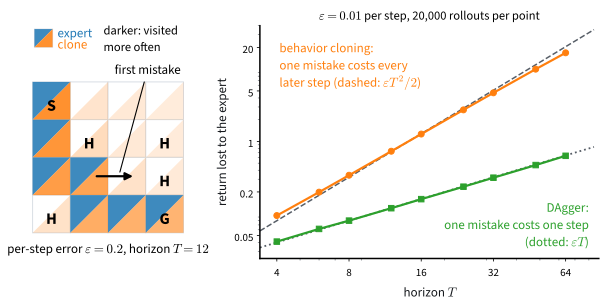

# Learning from Demonstrations
:label:`sec_imitation`

Every model in the Basics part learned from labeled examples: an image and its class, a sentence and its next word. The previous section showed how much an agent loses when nobody supplies labels and it must find good actions by trying bad ones. Often someone can show us instead. Suppose we record what a skilled driver sees and does, the camera image at each moment and the steering angle chosen in response. Could we train a driving policy from these pairs the way we trained a classifier on Fashion-MNIST, with the image as the input and the steering angle as the label?

Dean Pomerleau built such a network at Carnegie Mellon in the late 1980s. His network ALVINN, with a single hidden layer, mapped road images to a steering direction and drove a van along a road :cite:`Pomerleau.1989`; a later version learned to drive in a few minutes by watching a person do it :cite:`Pomerleau.1991`. The method is now called *behavior cloning*. It needs neither a model of the environment nor a reward, only an expert whose choices can be recorded, and it is the most common way to learn from an expert today: fine-tuning a language model on curated responses is behavior cloning, with the text so far as the state and the next token as the action.

Pomerleau also saw its weakness. The driver kept the van in the middle of the lane, so the recordings contained no view of the roadside and no example of steering back. Once the network drifted, it saw images it had never been shown, and he had to synthesize shifted views of the road, labeled with the steering that would bring the van back. A classifier is tested on inputs like those it was trained on, but a policy chooses the inputs it sees next. This section measures what that costs on the lake, shows how the cost can grow with the length of the task, and changes the data so that the expert labels the states the learner reaches on its own.

```{.python .input #imitation-learning-from-demonstrations}
%%tab pytorch
%matplotlib inline
from d2l import torch as d2l
import gymnasium as gym
import numpy as np
import torch
from torch import nn
```

```{.python .input #imitation-learning-from-demonstrations}
%%tab jax
%matplotlib inline
from d2l import jax as d2l
from flax import nnx
import gymnasium as gym
import jax
from jax import numpy as jnp
import numpy as np
```

## Behavior Cloning

A *demonstration* is a trajectory recorded from an expert. Behavior cloning keeps only the states the expert visited and the actions it took there; it uses no rewards and no transition model. On the lake, the expert is the optimal policy $\pi^*$ that value iteration computes in :numref:`sec_valueiter`, so in this section $\pi^*$ names both the optimal policy and the expert. We use calm ice, where every command moves the agent in the intended direction. The expert then walks the same six-move path from the start to the goal in every episode, and its states form a narrow tube through the lake, like the middle of the lane in Pomerleau's recordings. Because the model of the lake is known, we can compute every success rate exactly and compare the learner with the expert without sampling noise.

### The Reduction to Classification

The cell below builds the calm lake as a `TabularMDP`, the arrays $P$ and $r$ with the discount $\gamma$ of :numref:`sec_mdp`, solves it with `d2l.value_iteration`, and reads the expert off `mdp.backup`, the Bellman operator applied to $V^*$, by taking the best action in each state. `demonstrations` rolls the expert in the environment and records only what it saw and what it did:

```{.python .input #imitation-the-reduction-to-classification-1}
%%tab pytorch, jax
gamma = 0.95
env = gym.make('FrozenLake-v1', is_slippery=False)
mdp = d2l.TabularMDP.from_gym(env, gamma)
V_star = d2l.value_iteration(mdp, num_iters=1000)[-1]
pi_star = mdp.backup(V_star).argmax(axis=1)

def demonstrations(env, expert, num_episodes):
    """Roll the expert; record only what it saw and what it did."""
    states, actions = [], []
    for _ in range(num_episodes):
        s, done = env.reset()[0], False
        while not done:
            states.append(s)
            actions.append(int(expert[s]))
            s, _, terminated, truncated, _ = env.step(actions[-1])
            done = terminated or truncated
    return np.array(states), np.array(actions)

demo_s, demo_a = demonstrations(env, pi_star, 3)
print(f'{demo_s.size} state-action pairs from 3 expert episodes, '
      f'covering states {np.unique(demo_s)}')
```

Three episodes give 18 labeled pairs, the same six pairs three times, because on calm ice every expert episode is the same: *down*, *down*, *right*, *down*, *right*, *right*. At states 0 and 9, *down* and *right* are equally short, and the tie goes to *down*. The expert never visits the frozen cells 1, 2, 3, 6 and 10.

Behavior cloning treats these pairs as :numref:`sec_softmax` treated images and labels: the state is the input, the expert's action is the class, and we fit a conditional distribution $\pi_\theta(a \mid s)$ with parameters $\theta$ by maximizing the log-likelihood $\sum_i \log \pi_\theta(a_i \mid s_i)$, that is, by minimizing the cross-entropy. All we need is a policy with parameters and a way to take gradient steps on it.

### The Policy Container

`Policy` holds a network `policy` that maps a state to one score per action, so that $\pi_\theta(\cdot \mid s)$ is the softmax of the scores at $s$, together with an Adam optimizer `opt_pi` for its parameters. `log_prob` returns $\log \pi_\theta(a \mid s)$ for a batch of states and the actions taken there, the quantity that behavior cloning maximizes:

```{.python .input #imitation-the-reduction-to-classification-2}
%%tab pytorch
class Policy(nn.Module):  #@save
    """A policy network and its optimizer; pi(.|s) is the softmax of the
    network's outputs at s."""
    def __init__(self, policy, lr=1e-2):
        super().__init__()
        self.policy = policy
        self.opt_pi = torch.optim.Adam(policy.parameters(), lr=lr)

    def log_prob(self, obs, act):
        """log pi(a|s) for a batch of states and the actions taken there."""
        return torch.log_softmax(self.policy(obs), dim=-1) \
                    .gather(-1, act[:, None]).squeeze(-1)

    @classmethod
    def tabular(cls, num_states, num_actions, lr=0.1):
        """One preference theta_{s,a} per state-action pair: an embedding."""
        policy = nn.Embedding(num_states, num_actions)
        nn.init.zeros_(policy.weight)
        return cls(policy, lr)
```

```{.python .input #imitation-the-reduction-to-classification-2}
%%tab jax
class Policy(nnx.Module):  #@save
    """A policy network and its optimizer; pi(.|s) is the softmax of the
    network's outputs at s."""
    def __init__(self, policy, lr=1e-2):
        self.policy = policy
        self.opt_pi = nnx.Optimizer(policy, d2l.shared_adam(lr),
                                    wrt=nnx.Param)

    def log_prob(self, obs, act, policy=None):
        """log pi(a|s). Gradients flow w.r.t. the module you differentiate;
        the update functions pass that module back in as `policy`."""
        policy = self.policy if policy is None else policy
        logp = jax.nn.log_softmax(policy(obs), axis=-1)
        return jnp.take_along_axis(logp, act[:, None], axis=-1).squeeze(-1)

    @classmethod
    def tabular(cls, num_states, num_actions, lr=0.1, rngs=None):
        """One preference theta_{s,a} per state-action pair: an embedding."""
        rngs = nnx.Rngs(d2l.get_key()) if rngs is None else rngs
        return cls(nnx.Embed(num_states, num_actions, rngs=rngs,
                             embedding_init=nnx.initializers.zeros_init()),
                   lr)
```

The `tabular` constructor is a softmax-regression model: an embedding table holds one preference $\theta_{s,a}$ per state--action pair, an integer state indexes its row, and a softmax produces $\pi_\theta(\cdot\mid s)$. Zero initialization makes the initial policy uniform.

The environment exchanges NumPy integers and arrays, so three methods convert at the boundary. `act` samples an action from $\pi_\theta(\cdot \mid s)$ with a NumPy generator that the caller passes in, so all randomness that reaches the environment comes from one visible source. It follows the acting protocol of `d2l.evaluate` from :numref:`sec_valueiter`, which averages the returns of sampled episodes. `act_greedy` returns the most probable action, and `log_prob_np` returns log-probabilities as a NumPy array:

```{.python .input #imitation-the-reduction-to-classification-3}
%%tab pytorch
@d2l.add_to_class(Policy)  #@save
def act(self, obs, rng):
    """Sample an action; numpy in, int out, the acting protocol of evaluate."""
    with torch.no_grad():
        probs = torch.softmax(self.policy(torch.as_tensor(obs)), -1).numpy()
    return int(rng.choice(len(probs), p=probs))

@d2l.add_to_class(Policy)  #@save
def act_greedy(self, obs, rng=None):
    with torch.no_grad():
        return int(self.policy(torch.as_tensor(obs)).argmax())

@d2l.add_to_class(Policy)  #@save
def log_prob_np(self, obs, act):
    with torch.no_grad():
        return self.log_prob(torch.as_tensor(obs),
                             torch.as_tensor(act)).numpy()
```

```{.python .input #imitation-the-reduction-to-classification-3}
%%tab jax
@d2l.add_to_class(Policy)  #@save
def act(self, obs, rng):
    """Sample an action; numpy in, int out, the acting protocol of evaluate."""
    logits = d2l.forward_np(self.policy, obs)
    probs = np.exp(logits - logits.max())
    return int(rng.choice(len(probs), p=probs / probs.sum()))

@d2l.add_to_class(Policy)  #@save
def act_greedy(self, obs, rng=None):
    return int(d2l.forward_np(self.policy, obs).argmax())

@d2l.add_to_class(Policy)  #@save
def log_prob_np(self, obs, act):
    """log pi(a|s) as numpy, on a batch padded to a bucket length, so that
    each operation compiles once per bucket rather than once per length."""
    n = len(act)
    size = d2l._bucket(n)
    return np.asarray(self.log_prob(jnp.asarray(d2l._pad(obs, size)),
                                    jnp.asarray(d2l._pad(act, size))))[:n]
```

:begin_tab:`pytorch`
The three methods run under `torch.no_grad`, because nothing they compute is differentiated.
:end_tab:

:begin_tab:`jax`
`act` and `act_greedy` run the network through `d2l.forward_np`; `log_prob_np`, and `policy_step` below, pad their batch to a bucket length with `d2l._pad` and `d2l._bucket`, so that compiled code is reused across batch sizes; `d2l.shared_adam` gives every agent with the same learning rate one optimizer, so compiled updates are shared. These helpers are in :numref:`sec_utils`. `log_prob` takes an optional `policy` argument because `nnx.value_and_grad` differentiates with respect to the module it is given, and the update passes that module back in. No `no_grad` wrapper is needed: JAX computes gradients only inside such a transformation.
:end_tab:

### Fitting the Clone

Fitting the clone is gradient ascent on $\frac{1}{n}\sum_i w_i \log \pi_\theta(a_i \mid s_i)$ with every weight $w_i$ equal to one. `policy_step` takes one optimizer step on this objective for a batch of states, actions and weights:

```{.python .input #imitation-the-reduction-to-classification-5}
%%tab pytorch
def policy_step(ac, obs, act, weight):  #@save
    """One ascent step on (1/n) sum_t w_t log pi(a_t|s_t) over a batch of
    n states and actions; the weights w arrive as numpy, that is, as data."""
    w = torch.as_tensor(weight)
    loss = -(w * ac.log_prob(torch.as_tensor(obs),
                             torch.as_tensor(act))).mean()
    ac.opt_pi.zero_grad()
    loss.backward()
    ac.opt_pi.step()
    return loss.item()
```

```{.python .input #imitation-the-reduction-to-classification-5}
%%tab jax
@nnx.jit  #@save
def _policy_pass(ac, obs, act, w, n):
    """-sum(w * log pi(act|obs)) / n and one optimizer step; padded rows
    carry w = 0 and add nothing."""
    loss, grads = nnx.value_and_grad(
        lambda policy: -(w * ac.log_prob(obs, act, policy)).sum() / n)(
            ac.policy)
    ac.opt_pi.update(ac.policy, grads)
    return loss

def policy_step(ac, obs, act, weight):  #@save
    """One ascent step on (1/n) sum_t w_t log pi(a_t|s_t) over a batch of
    n states and actions; the weights w arrive as numpy, that is, as data.
    The batch is padded to a bucket length, so the compiled pass is reused."""
    n = len(weight)
    size = d2l._bucket(n)
    return float(_policy_pass(ac, d2l._pad(obs, size), d2l._pad(act, size),
                              d2l._pad(np.float32(weight), size), n))
```

The weights arrive as a NumPy array, that is, as data, and no gradient flows into them. For behavior cloning they are all one.

How long should the fit run? Trained to convergence, a table with one row per state would copy the six demonstrated actions exactly, and on calm ice the clone would then walk the expert's path every time. Real classifiers are not exact: inputs that look alike, limited capacity and noisy labels leave some error on the training distribution. To give the clone such an error, `clone` calls `policy_step` with unit weights until $\pi_\theta$ disagrees with the demonstrated actions with probability at most $\varepsilon = 0.2$, averaged over the pairs. The stopping rule fixes $\varepsilon$, so every comparison in this section holds the fit error constant. `policy_table` reads the whole table $\pi_\theta(a \mid s)$ off a learner as an array, for the exact computations that follow:

```{.python .input #imitation-the-reduction-to-classification-4}
%%tab pytorch, jax
def clone(mdp, states, actions, eps=0.2):
    """Behavior cloning: cross-entropy fit of pi(a|s) to the expert's
    choices (policy_step with every weight equal to one), stopped once pi
    disagrees with the demonstrated actions with probability at most eps."""
    learner = Policy.tabular(mdp.num_states, mdp.num_actions)
    weight = np.ones(len(states), np.float32)
    while 1 - np.exp(learner.log_prob_np(states, actions)).mean() > eps:
        policy_step(learner, states, actions, weight)
    return learner

def policy_table(mdp, learner):
    """pi(a|s) of a learner as an array of shape (num_states, num_actions)."""
    s, a = np.divmod(np.arange(mdp.num_states * mdp.num_actions),
                     mdp.num_actions)
    return np.exp(learner.log_prob_np(s, a)).reshape(mdp.num_states, -1)

bc = clone(mdp, demo_s, demo_a)
pi_bc = policy_table(mdp, bc)
for s in (9, 10):
    print(f'clone pi(.|s={s}): {np.round(pi_bc[s], 3)}')
```

Fourteen Adam steps bring the disagreement to 0.182. Every demonstrated state appears equally often and receives the same gradient, so each of the six rows ends with probability 0.818 on the expert's action and 0.061 on each of the three others, as the row of state 9 shows. State 10 was never demonstrated. Its row receives no gradient and stays uniform, so there the clone disagrees with the expert three times in four. Repeating the data does not change the fit: the mean loss over three copies of six pairs is the mean over one copy, so a clone of one expert episode and a clone of a hundred are the same table.

## Distribution Shift
:label:`subsec_il_distribution_shift`

### Training and Deployment

A classifier's guarantee refers to the distribution its training data came from. Behavior cloning trains on the states the expert visits and is deployed on the states its own actions produce. We deploy the clone in two ways: greedily, taking the most probable action, and by sampling from $\pi_\theta$ with `act`, as a language model samples its next token.

Because the lake is known, the state distribution of a policy can be computed instead of sampled. Let $d^\pi_t(s)$ be the probability that policy $\pi$ is in state $s$ after $t$ steps. It starts with all mass on the start state, and one step moves the mass through the policy and the kernel:

$$d^\pi_{t+1}(s') = \sum_{s} d^\pi_t(s) \sum_a \pi(a \mid s)\, P(s' \mid s, a).$$

The mass in $s'$ at the next step is the mass that each state sends there under the actions the policy chooses. `visitation` carries out this recursion for the lake's 100-step time limit; the goal and the holes end an episode and keep their mass, so the mass at the goal after 100 steps is the probability of success. A Monte Carlo run of `d2l.evaluate` checks the exact number for the sampling clone:

```{.python .input #imitation-what-the-reduction-quietly-assumes-1}
%%tab pytorch, jax
def visitation(mdp, pi, absorbing=None, T=100):
    """d_0, ..., d_T: the state distributions of the policy pi[s, a] from the
    start state, propagated exactly through P for FrozenLake's 100-step
    limit. Mass that enters an `absorbing` state stays there."""
    P_pi = np.einsum('sa,sat->st', pi, mdp.P)
    if absorbing is not None:
        P_pi[absorbing] = np.eye(mdp.num_states)[absorbing]
    d = [np.eye(mdp.num_states)[0]]
    for _ in range(T):
        d.append(d[-1] @ P_pi)
    return np.array(d)

desc = env.unwrapped.desc.ravel()
goal, holes = desc == b'G', desc == b'H'
expert = np.eye(mdp.num_actions)[pi_star]                # one-hot rows
greedy = np.eye(mdp.num_actions)[pi_bc.argmax(axis=1)]
for name, pi in [('expert', expert), ('greedy clone', greedy),
                 ('sampling clone', pi_bc)]:
    d_T = visitation(mdp, pi)[-1]
    print(f'{name:>14}: reaches the goal {d_T[goal].sum():.3f}, '
          f'falls into a hole {d_T[holes].sum():.3f}')
rate = d2l.evaluate(env, bc.act, num_episodes=1000,
                    rng=np.random.default_rng(0))
print(f'sampling clone, 1000 episodes of bc.act: reaches the goal {rate:.3f}')
```

The expert reaches the goal every time, and so does the greedy clone: the most probable action of each demonstrated row is the expert's, so the greedy clone walks the expert's path. The sampling clone reaches the goal in 66% of its episodes and falls into a hole in the rest; the 1,000 sampled episodes agree within their noise. Nothing on calm ice is random except the clone's own choices, so every step it takes off the path is one of its own wrong actions.

Is the classifier to blame? The next cell measures how often the clone disagrees with the expert on three sets of states: its training pairs, the states of 100 fresh expert episodes, and the states the clone visits itself, weighted by how often it visits them. It then clones 1, 10 and 100 expert episodes:

```{.python .input #imitation-what-the-reduction-quietly-assumes-2}
%%tab pytorch, jax
disagree = 1 - pi_bc[np.arange(mdp.num_states), pi_star]   # per state
fresh_s, _ = demonstrations(env, pi_star, 100)
occupancy = (visitation(mdp, pi_bc)[:-1] * ~(goal | holes)).sum(axis=0)
print('disagreement with the expert')
print(f'  on the training pairs:        {disagree[demo_s].mean():.3f}')
print(f'  on 100 fresh expert episodes: {disagree[fresh_s].mean():.3f}')
print(f"  on the clone's own states:    "
      f'{occupancy @ disagree / occupancy.sum():.3f}')
for n in [1, 10, 100]:
    pi_n = policy_table(mdp, clone(mdp, *demonstrations(env, pi_star, n)))
    print(f'clone of {n:>3} expert episodes: reaches the goal '
          f'{visitation(mdp, pi_n)[-1][goal].sum():.3f}')
```

On fresh expert episodes the clone errs as often as on its training pairs, 18% of the time, so there is no generalization gap: the demonstrations cover the expert's distribution. Here more expert data cannot help: it adds no new state, and every clone of the repeated six pairs is the same table, succeeding 66% of the time. On its own states the clone errs more often, 22% of the time, because some of them are cells where it has no data and disagrees with probability $3/4$. The states the policy is tested on have moved, and its own actions moved them. This is *distribution shift*. On a six-step task the shift is small, and :numref:`subsec_il_state_divergence` measures how much of the loss it causes.

### Missing Coverage

Missing coverage is a different failure. On slippery ice the expert itself slides, so the set of states it visits is random, and a few episodes can miss a state where the right action matters. The next cell builds the slippery lake and its optimal policy, draws 200 datasets of $n$ expert episodes for each $n$, and evaluates the greedy clone of each dataset exactly. That clone takes the expert's action at every demonstrated state; at every other state its row is uniform and the tie goes to action 0. The cell writes this table down directly instead of fitting 600 clones:

```{.python .input #imitation-distribution-shift-between-training-and-deployment-1}
%%tab pytorch, jax
ice = gym.make('FrozenLake-v1', is_slippery=True)
mdp_ice = d2l.TabularMDP.from_gym(ice, gamma)
V_ice = d2l.value_iteration(mdp_ice, num_iters=1000)[-1]
pi_ice = mdp_ice.backup(V_ice).argmax(axis=1)
one_hot = np.eye(mdp_ice.num_actions)
expert_ice = visitation(mdp_ice, one_hot[pi_ice])[-1][goal].sum()
ice.reset(seed=5)
print(f'share of 200 datasets whose greedy clone is below half the expert '
      f'({expert_ice:.3f}):')
for n in [1, 3, 10]:
    rates = []
    for _ in range(200):
        seen = np.isin(np.arange(mdp_ice.num_states),
                       demonstrations(ice, pi_ice, n)[0])
        # the greedy clone: the expert's action where it has data; elsewhere
        # its row is untouched and uniform, and the tie goes to action 0
        tab = np.where(seen, pi_ice, 0)
        rates.append(visitation(mdp_ice, one_hot[tab])[-1][goal].sum())
    failed = np.mean(np.array(rates) < expert_ice / 2)
    print(f'  expert episodes per dataset {n:>2}: {failed:.1%}')
```

With one episode, about one dataset in three gives a clone below half the expert's success rate; with three episodes, one or two in a hundred; with ten, none of the 200. Missing coverage disappears as expert data accumulate. Distribution shift does not, because the states the clone reaches through its own mistakes are states the expert never visits.

## Compounding Error

### Quadratic and Linear Error Growth
:label:`subsec_il_error_bounds`

The expert's path on the lake is six moves long. How does the cost of a per-step error grow when the task is longer? Supervised learning bounds the probability of an error at one decision. In a sequential task an early error changes all later states and can cost all later rewards. Demonstrations sample states from the expert's distributions $d^{\pi^*}_t$, so behavior cloning controls the clone's error rate there and nowhere else.

**Proposition (compounding error).** *Consider an episodic task of $T$ steps with rewards in $[0, 1]$ at every step, and a policy $\hat\pi$ that at every step $t$ disagrees with the expert with probability at most $\varepsilon$ when the state is drawn from the expert's distribution $d^{\pi^*}_t$. (i) The expected return of $\hat\pi$ falls short of the expert's by at most $\varepsilon T(T+1)/2 \leq \varepsilon T^2$, and there are tasks in which the shortfall is of this order whenever $\varepsilon T \leq 1$. (ii) If instead $\hat\pi$ disagrees with probability at most $\varepsilon$ when the state is drawn from its own distribution $d^{\hat\pi}_t$, and one wrong action followed by the expert's behavior costs at most $u$, the shortfall is at most $u \varepsilon T$* :cite:`Ross.Bagnell.2010`.

**Proof.** (i) Run $\hat\pi$ and the expert from the same start with the same environment randomness, so that their trajectories coincide until $\hat\pi$ first takes an action the expert would not take. The expert's state at step $t$ is drawn from $d^{\pi^*}_t$, and the first disagreement can fall at step $t$ only if $\hat\pi$ disagrees at that state, which has probability at most $\varepsilon$. From then on $\hat\pi$ can lose at most the rewards of steps $t, \ldots, T$, which number $T-t+1$. Summing over $t$, the shortfall is at most $\sum_{t=1}^{T} \varepsilon (T-t+1) = \varepsilon T(T+1)/2$. (ii) Let $\pi_k$ follow $\hat\pi$ for the first $k$ steps and the expert afterwards, so that $\pi_0$ is the expert and $\pi_T$ is $\hat\pi$. Two consecutive hybrids $\pi_{k-1}$ and $\pi_k$ differ only in the action at step $k$, taken at a state drawn from $d^{\hat\pi}_k$. That action disagrees with the expert with probability at most $\varepsilon$, and a disagreement followed by the expert's behavior costs at most $u$. The expert's return minus that of $\hat\pi$ is the sum of the $T$ differences between consecutive hybrids, hence at most $u \varepsilon T$. $\blacksquare$

The second part is the telescoping argument of :citet:`Kakade.Langford.2002`. If $\varepsilon$ is the average of the per-step error rates over the $T$ steps rather than their maximum, the sum in part (i) is still at most $\varepsilon T^2$. Part (i) charges a first mistake with everything that follows, because afterwards the policy is in states where nothing controls its error. Part (ii) moves the measurement of $\varepsilon$ to the policy's own states, and it is useful only when $u$ is small, that is, when the task allows recovery from a single wrong action. If one mistake is fatal, $u$ is as large as the remaining horizon and part (ii) gives order $\varepsilon T^2$ again.

The horizon of the lake is fixed, so we watch the growth with $T$ on a chain of $T$ steps instead. The expert moves right at every step and earns one per step. Two imitators disagree with it independently with probability $\varepsilon$ at every step. For the *cloned* imitator a mistake is permanent: it leaves the chain for states it was never shown and earns nothing afterwards, so it earns the reward of step $t$ with probability $(1-\varepsilon)^t$. The *recovering* imitator returns to the chain after one step, so a mistake costs exactly one reward, part (ii) with $u = 1$, and it earns the reward of step $t$ with probability $1-\varepsilon$. The cell computes the lost return exactly for $\varepsilon = 0.01$ and $T$ up to 64:

```{.python .input #imitation-the-proposition}
%%tab pytorch, jax
eps, T_max = 0.01, 64
T = np.arange(1, T_max + 1)
# probability of earning the reward of step t: the cloned imitator only if
# it has agreed at every step up to t, the recovering one if it agrees at t
earn_bc = np.cumprod(np.full(T_max, 1 - eps))
earn_rec = np.full(T_max, 1 - eps)
gap_bc, gap_rec = T - earn_bc.cumsum(), T - earn_rec.cumsum()
d2l.plot([T] * 3, [gap_bc, eps * T * (T + 1) / 2, gap_rec],
         xlabel='horizon T', ylabel='return lost to the expert',
         legend=['cloned', '$\\varepsilon T(T+1)/2$',
                 'recovering ($=\\varepsilon T$)'],
         xscale='log', yscale='log', figsize=(5, 3.5))
print(f'lost return at T={T_max}: cloned {gap_bc[-1]:.2f} '
      f'(eps T(T+1)/2 = {eps * T_max * (T_max + 1) / 2:.2f}), '
      f'recovering {gap_rec[-1]:.2f} (eps T = {eps * T_max:.2f})')
```

On logarithmic axes the cloned imitator stays close to the quadratic reference $\varepsilon T(T+1)/2$, within 3% at $T = 10$ and 10% at $T = 30$, and falls gradually below it as $\varepsilon T$ grows, because a first mistake can happen only once: the first disagreement falls at step $t$ with probability $\varepsilon(1-\varepsilon)^{t-1}$, less than the $\varepsilon$ the bound charges. It never rises above the reference, as part (i) requires. The recovering imitator loses exactly $\varepsilon T$. At $T = 64$ the cloned imitator loses about 17 rewards and the recovering one 0.64, about 27 times less. Exercise :exref:`ex_imitation-chain-closed-form` derives both curves in closed form.

### Decomposition of the Clone's Loss
:label:`subsec_il_state_divergence`

Back on the lake, how much of the clone's 34-point loss comes from distribution shift? The clone can fail in two ways. It can fall into a hole straight from the expert's path, through a wrong action at one of the six states it was trained on; that is the error $\varepsilon$ on the expert's distribution, which only a better fit removes. Or it can leave the path for a cell where it has no data and fail from there; that is the shift. The next cell makes the cells off the path absorbing, so that `visitation` measures how often the clone leaves the path, and compares how often the episodes that stay on it and those that leave it reach the goal. Its last line evaluates a learner with the clone's 18% error at every cell, on the path and off it:

```{.python .input #imitation-why-this-is-not-a-defect-of-the-fit}
%%tab pytorch, jax
path = np.isin(np.arange(mdp.num_states), demo_s)    # the expert's cells
off_path = ~path & ~(goal | holes)
d_T = visitation(mdp, pi_bc, absorbing=off_path)[-1]
left = d_T[off_path].sum()
stay_goal = d_T[goal].sum()
clone_goal = visitation(mdp, pi_bc)[-1][goal].sum()
print(f'the clone leaves the expert path in {left:.3f} of its episodes, '
      f'entering cells {np.flatnonzero(d_T * off_path)}')
print(f'it reaches the goal in {stay_goal / (1 - left):.3f} of the episodes '
      f'that stay on the path, {(clone_goal - stay_goal) / left:.3f} of '
      f'those that leave it')
# the clone's demonstrated rows, with their error, at every cell
p_agree = pi_bc[demo_s[0], demo_a[0]]
labeled = np.where(expert == 1, p_agree, (1 - p_agree) / 3)
print(f'a learner with the same error at every cell reaches the goal '
      f'{visitation(mdp, labeled)[-1][goal].sum():.3f}')
```

The clone leaves the path in 17% of its episodes, always through a wrong action at state 0 into cell 1, or at state 9 or 14 into cell 10 (:numref:`fig_rl_compounding_error`). Episodes that stay on the path reach the goal 72% of the time, and episodes that leave it 39% of the time. The loss splits accordingly. Of the 34 points, 24 are falls from the path itself ($0.828 \times 0.285$) and 10 are failures after leaving it ($0.172 \times 0.606$). A learner with the clone's error at every cell would reach the goal 73.5% of the time, so labels off the path can recover about 7.5 of the 34 points, less than the 10, because a labeled cell still errs 18% of the time. On this lake distribution shift accounts for about a fifth of the clone's loss. The rest is the 18% error itself, on the path and off it, which no change of data removes. On a longer path the clone leaves it far more often; exercise :exref:`ex_imitation-dagger-s-budget` finds what that does to the two parts of the loss on the $8 \times 8$ lake.

![Where this section's clone goes on the calm lake. Blue arrows mark the expert's six-move path. Each cell shows the probability that the deployed clone, which samples its actions and disagrees with the expert with probability $\varepsilon = 0.18$ on the expert's states, enters the cell within the 100-step limit; darker cells are entered more often. The dashed arrows are the clone's exits from the path into cells where it has no data and acts uniformly: from 0 into 1, and from 9 or 14 into 10. The clone reaches the goal with probability $0.66$; the holes beside the path, 5 and 12, take most of the rest.](../img/mdl-rl-compounding-error.svg)
:label:`fig_rl_compounding_error`

## Interactive Data Collection

### Dataset Aggregation
:label:`subsec_il_dagger`

More demonstrations cannot fix the shift, because the expert never visits the cells where the clone goes wrong. The learner has to visit them, and the expert has to label them. *DAgger*, short for dataset aggregation, does this :cite:`Ross.Gordon.Bagnell.2011`: it runs the current learner, asks the expert which action it would have taken at each state the learner visited, adds these pairs to the dataset, and refits. The model, the loss, the optimizer and the stopping rule stay as they are; only the data change.

In the next cell, `relabel` rolls the learner with `act`, sampling as it does when deployed, and labels its states with the expert's actions. `dagger` starts from the three demonstrations, runs four rounds of ten learner episodes each, refits with `clone` after every round, and evaluates each learner exactly. `d2l.run_seeds` from :numref:`sec_utils` runs it for ten seeds and stacks the results:

```{.python .input #imitation-dagger-collect-from-the-learner-relabel-with-the-expert}
%%tab pytorch, jax
def relabel(env, expert, learner, num_episodes, rng):
    """Roll the learner, sampling its actions; label its states with the
    expert's actions."""
    visited = []
    for _ in range(num_episodes):
        s, done = env.reset()[0], False
        while not done:
            visited.append(s)
            s, _, terminated, truncated, _ = env.step(learner.act(s, rng))
            done = terminated or truncated
    visited = np.array(visited)
    return visited, expert[visited]

def dagger(seed, env, mdp, expert, demo_s, demo_a, num_rounds=4,
           num_episodes=10):
    """Yield (labels, distinct states, success) for behavior cloning and
    each DAgger round after it."""
    rng = np.random.default_rng(seed)
    goal = env.unwrapped.desc.ravel() == b'G'
    agg_s, agg_a = demo_s, demo_a
    for k in range(num_rounds + 1):
        if k > 0:
            new_s, new_a = relabel(env, expert, learner, num_episodes, rng)
            agg_s = np.concatenate([agg_s, new_s])
            agg_a = np.concatenate([agg_a, new_a])
        learner = clone(mdp, agg_s, agg_a)
        d_T = visitation(mdp, policy_table(mdp, learner))[-1]
        yield agg_s.size, np.unique(agg_s).size, d_T[goal].sum()

runs = d2l.run_seeds(dagger, num_seeds=10, env=env, mdp=mdp, expert=pi_star,
                     demo_s=demo_s, demo_a=demo_a)   # (seed, round, quantity)
for k, (n, m, rate) in enumerate(np.median(runs, axis=0)):
    print(f'round {k}: {n:>3.0f} labels at {m:>2.0f} states, success '
          f'{rate:.3f} (seeds: {runs[:, k, 2].min():.3f} to '
          f'{runs[:, k, 2].max():.3f}; medians over 10 seeds)')
```

Round 0 is behavior cloning at 0.66. Each round adds about 65 labels, most of them at the six states of the path, and now and then a cell off it. Within four rounds, a few hundred labels, the median over ten seeds reaches 0.70 to 0.735, depending on which ten, at or near the 0.735 of a learner with the clone's error at every cell; on every seed the learner of the fourth round is above behavior cloning. Behavior cloning with any number of expert labels stays at 0.66. DAgger recovers the part of the loss that came from states off the path. The remaining gap to the expert is the 18% error of the fit itself, which DAgger does not touch. A learner lands on the 0.735 exactly, not approximately: Adam divides each parameter's step by the size of that parameter's own gradients, and the gradient of a labeled row is its label count times a factor common to all labeled rows, so every labeled row ends at the same 0.818 however often it was labeled. The learner is therefore fixed by which cells carry labels, and once every cell it reaches has one, it is the 0.735 learner.

The rounds need not improve monotonically. On some seeds a round lowers success slightly, to 0.649 at worst, and exercise :exref:`ex_imitation-dagger-guarantee` finds the cause. The guarantee of :citet:`Ross.Gordon.Bagnell.2011` concerns the best learner of the sequence, or one drawn from it at random, not the last one. It assumes many rounds of data collection, a no-regret learner trained on the accumulated dataset and, in the original analysis, a mixture of expert and learner actions during collection. It also needs the expert on call to label whatever states the learner reaches. Keeping the data of all earlier rounds prevents the fitted policy from depending only on its most recent trajectories.

### Supervised Fine-Tuning as Behavior Cloning
:label:`subsec_il_sft`

The token MDP of :numref:`sec_mdp` makes supervised fine-tuning of a language model an instance of behavior cloning. The state is the context, the prompt with the tokens written so far; the action is the next token; the transition appends it with probability one; and the curated responses are the expert's demonstrations. The cross-entropy of fine-tuning is the negative log-likelihood of behavior cloning, summed over the tokens of each response. The horizon $T$ is the length of the response, and $u$ is the cost of one wrong token if the model continues well afterwards: little for an unusual but harmless word, a lot for a wrong digit early in a calculation that every later step builds on. At deployment the model samples its own tokens and conditions on them, so its contexts drift from those of the curated responses as a response grows.

DAgger for a language model needs an expert who labels the model's own prefixes: for each context the student generated, which token should come next. People cannot do this for millions of prefixes, but a larger model can. On-policy distillation trains a student on its own samples, with the next-token distributions of a teacher model as the labels :cite:`Agarwal.Vieillard.Zhou.ea.2024`; it is DAgger with the teacher as the expert on call. Behavior cloning is also the standard first baseline in offline reinforcement learning, where only a fixed dataset is available, and :numref:`sec_offline` compares offline methods against it.

Behavior cloning turns an expert's recorded choices into a policy with nothing more than a classifier, and DAgger removes the part of its loss that comes from the learner's own states by changing the data alone. Both need an expert: one who demonstrates, and for DAgger one on call to label whatever the learner does. Without an expert, the cloning update still applies if the weight $w_i = 1$ is replaced by a number that says how well the action turned out. :numref:`sec_policygradient` derives that weight from the reward.

## Summary

Behavior cloning fits a policy $\pi_\theta(a \mid s)$ to an expert's state--action pairs by cross-entropy, as softmax regression, and needs neither a transition model nor a reward; each fitting step is a gradient step on log-probabilities with unit weights. The fit controls the policy's error on the expert's state distribution, but the deployed policy visits the states its own actions produce. A per-step error $\varepsilon$ on the expert's states can cost up to $\varepsilon T(T+1)/2$ of return over $T$ steps, while the same error on the policy's own states costs at most $u \varepsilon T$ when one mistake costs at most $u$. On the six-move path of the calm lake, more expert data cannot change the clone, and the shift to states the expert never visits accounts for about a fifth of its loss. DAgger labels the learner's own states with the expert's actions and recovers that part by changing only the data.

## Exercises

1. **The chain in closed form.** In the chain experiment of
   :numref:`subsec_il_error_bounds`, an imitator disagrees with the expert
   independently with probability $\varepsilon$ at each step
   $t = 1, \ldots, T$. The cloned imitator earns the reward of step $t$ only
   if it has agreed at every step up to $t$. The recovering imitator earns it
   whenever it agrees at step $t$.
    1. Derive in closed form the expected return $G(T)$ that the cloned
       imitator loses to the expert, and show that the recovering imitator
       loses $\varepsilon T$. Compare both with the values printed for
       $\varepsilon = 0.01$ and $T = 64$.
    1. Expand $G(T)$ to second order in $\varepsilon$. Show that the
       first-order term is the bound $\varepsilon T(T+1)/2$ of the
       proposition, and find the second-order term. What does its sign say
       about where the cloned curve lies relative to the reference? For
       $\varepsilon = 0.01$, up to which horizon is the first-order term
       within 10% of $G(T)$?
    1. How does $G(T)$ grow once $\varepsilon T \gg 1$, and which condition
       on $\varepsilon T$ does the quadratic regime therefore require?
       Compute the ratio of the two losses at $\varepsilon = 0.01$ and
       $T = 64$, the right end of the plot, and compare it with the ratio
       $(T+1)/2$ of the two references.
   :exlabel:`ex_imitation-chain-closed-form`

1. [code] **Where the clone's mass goes.** Use `visitation` to propagate the
   state distributions of the expert and of the sampling clone `pi_bc` over
   the 100 steps of the time limit.
    1. Plot the total variation distance
       $\frac{1}{2}\sum_s |d^{\pi^*}_t(s) - d^{\hat\pi}_t(s)|$ against $t$,
       together with the mass that the clone places on the goal, on each
       hole, and on the cells off the expert's path. Which holes take the
       clone's lost successes? Around $t = 6$ the total variation exceeds
       one half, although the mass off the path stays at about 5 percent.
       What else makes the two distributions differ? Consider what a wrong
       action does at states 0, 4 and 8.
    1. Show that $|\mathbb{E}_{s \sim d}[f(s)] - \mathbb{E}_{s \sim d'}[f(s)]|$
       is at most the total variation distance between $d$ and $d'$ for
       every function $f$ with values in $[0, 1]$, with equality for the
       indicator of the set where $d$ exceeds $d'$. Conclude that the two
       success probabilities differ by at most the total variation distance
       at $t = 100$. Why does the bound hold with equality there, and why is
       the total variation at $t = 6$ a poor measure of distribution shift?

1. **Fine-tuning as behavior cloning.** :numref:`subsec_il_sft` identifies
   supervised fine-tuning of a language model with behavior cloning: the
   context is the state, the next token is the action, and the curated
   responses are the demonstrations.
    1. The proposition of :numref:`subsec_il_error_bounds` assumes the same
       error rate $\varepsilon$ at every step. A fine-tuned model may err at
       a small constant rate along curated responses, yet at a rate that
       grows with the position along its own responses. Explain why, and say
       which part of the proposition then describes the model.
    1. Apart from their number, why are people a poor source of DAgger's
       labels for a language model? On-policy distillation labels each of the student's
       prefixes with the teacher's whole next-token distribution rather than
       with one token. Write down the resulting loss, and show that it
       reduces to the behavior-cloning loss when the teacher puts all its
       probability on one token.

1. **Two valid paths.** A robot faces an obstacle. Half of the
   demonstrations pass it on the left and half on the right. Each maneuver
   takes several steps, during which the robot's observations of the two
   maneuvers barely differ.
    1. A deterministic policy is fitted to the demonstrated steering angles
       $-c$ and $+c$ by squared error. Which angle does it output in
       front of the obstacle?
    1. The steering is discretized into *left*, *straight*, and *right*, and
       a categorical policy is fitted by cross-entropy, as `clone` does. What
       does the fit converge to in front of the obstacle, and what does
       `act_greedy` do there?
    1. Diffusion policies :cite:`Chi.Feng.Du.ea.2023` sample a sequence of
       several actions from one observation and execute it before sampling
       again. Compare this with sampling one action per step with `act`
       during the maneuver. What can go wrong with the per-step sampler, and
       what does executing a sequence without replanning cost?

1. [code] **Demonstrations needed for coverage.** ● The coverage cell of
   :numref:`subsec_il_distribution_shift` builds the slippery lake
   `mdp_ice` and its optimal policy `pi_ice`. The probability that a
   deterministic policy `pi` reaches the goal is the mass at the goal after
   `visitation(mdp_ice, one_hot[pi])`.
    1. For each nonterminal state $s$, compute the success probability of the
       policy that follows `pi_ice` except at $s$, where it takes action 0.
       Call $s$ critical if this deviation lowers the success probability to
       less than half that of `pi_ice`. Which states are critical?
    1. Let $q_s$ be the probability that one expert episode visits $s$.
       Compute $q_s$ exactly with the `absorbing` argument of `visitation`:
       make $s$ absorbing and read off the mass at $s$ after 100 steps. Which
       nonterminal state has $q_s = 0$, and what does that imply for any
       amount of expert data? How probable is a dataset of three episodes
       that never visits state 13?
    1. Treating the critical states as independent, predict from their $q_s$
       the probability that $n \in \{1, 3, 10\}$ expert episodes leave some
       critical state undemonstrated, and compare the prediction with the
       rates that the cell prints. Is the prediction too high or too low,
       and what does that say about visits to different critical states?
   :exlabel:`ex_imitation-demonstrations-coverage`

1. [code] **DAgger on a longer path.** ● On the $4 \times 4$ calm lake,
   distribution shift accounts for about a fifth of the clone's loss. Repeat
   the experiment on the $8 \times 8$ calm lake,
   `gym.make('FrozenLake-v1', map_name='8x8', is_slippery=False)`, whose
   optimal path takes 14 moves: rebuild `env`, `mdp`, `pi_star`, `demo_s`
   and `demo_a`, and rerun the cells of this section.
    1. Compute the sampling clone's success probability, the probability
       that it leaves the expert's path, and the success probability of a
       learner with the clone's error at every cell. Which share of the
       clone's loss is incurred after it leaves the path, and which share
       can labels off the path recover? Why does the first grow with the
       length of the path while the second does not?
    1. Run DAgger for ten seeds and plot the success rate against the number
       of expert queries, next to behavior cloning on at least as many
       expert labels.
    1. A tabular policy needs at most one label per state. Count the distinct
       states that DAgger has labeled after each round, and estimate how many
       queries it would need if it asked the expert only at states without a
       label.
   :exlabel:`ex_imitation-dagger-s-budget`

1. [code] **A noisy expert.** Suppose that the expert reports a uniformly
   random action instead of its own with probability 0.1, in the
   demonstrations and in DAgger's labels alike.
    1. To which distribution does cross-entropy converge at a state labeled
       many times by this expert? What does `act_greedy` do there, and what
       does `act` do?
    1. Corrupt the labels of `demonstrations` and `relabel` in this way,
       rerun `clone` and DAgger on the calm lake, and compare their exact
       success rates with those of the section. Against which actions does
       the stopping rule of `clone` now measure the disagreement, and how
       does that change what $\varepsilon = 0.2$ means?
    1. Which part of the clone's loss grows with the noise, the falls from
       the path or the failures after leaving it? Which part can DAgger
       still remove?

1. **DAgger's guarantee.** ● In the analysis of
   :citet:`Ross.Gordon.Bagnell.2011`, the data-collecting policy $\pi_i$ of
   iteration $i$ takes the expert's action with probability $\beta_i$ at
   each step and the action of the current learner $\hat\pi_i$ otherwise.
   The next learner $\hat\pi_{i+1}$ minimizes the loss on the aggregated data
   of iterations $1, \ldots, i$, as refitting with `clone` does. Write
   $d_\pi = \frac{1}{T}\sum_{t=1}^T d^\pi_t$ for the average state
   distribution of $\pi$, let $c(s, \pi) \in [0, c_{\max}]$ be a
   classification loss of $\pi$ at $s$, such as
   $\mathbf{1}[\pi(s) \neq \pi^*(s)]$, and set
   $c_i(\pi) = \mathbb{E}_{s \sim d_{\pi_i}}[c(s, \pi)]$.
    1. Show that $\|d_{\pi_i} - d_{\hat\pi_i}\|_1 \leq 2\min(1, T\beta_i)$.
    1. Let $\varepsilon_N = \min_\pi \frac{1}{N}\sum_{i=1}^N c_i(\pi)$ be
       the loss of the best policy in hindsight, and suppose that the
       learners have average regret at most $\delta_N$:
       $$\frac{1}{N}\sum_{i=1}^N c_i(\hat\pi_i) - \varepsilon_N \leq \delta_N.$$
       Show that some learner $\hat\pi_j$ of the sequence satisfies
       $$\mathbb{E}_{s \sim d_{\hat\pi_j}}[c(s, \hat\pi_j)] \leq \varepsilon_N + \delta_N + \frac{2c_{\max}}{N}\sum_{i=1}^N \min(1, T\beta_i).$$
       The proof of Theorem 4.1 of the paper derives this bound before it
       simplifies the last sum.
    1. The loop of :numref:`subsec_il_dagger` uses $\beta_1 = 1$ and
       $\beta_i = 0$ for $i \geq 2$. Specialize the bound to this schedule
       and to the 0-1 loss, and combine it with part (ii) of the proposition
       in :numref:`subsec_il_error_bounds`. How must $N$ grow with $T$ for the
       term that does not involve $\varepsilon_N$ or $\delta_N$ to stay
       bounded?
    1. On some seeds of the printed run, the learner of the first round is
       worse than behavior cloning. Show that labeling only state 1 lowers
       the exact success rate of the calm-lake clone, and explain the drop
       from the expert's action at state 1 and the learner's rows at states
       1 and 2 before and after the label. What would identifying the best
       learner of a sequence require?
   :exlabel:`ex_imitation-dagger-guarantee`

1. **Rewards behind demonstrations.** ● The text learned from the expert's
   actions. *Inverse reinforcement learning* instead infers a reward under
   which the demonstrations are optimal and then plans with that reward.
    1. By the telescoping argument of :numref:`subsec_vi_shaping`, every
       potential-based shaping $\tilde r(s, a, s') = r(s, a) + \gamma
       \Phi(s') - \Phi(s)$ of $r$ with $\Phi = 0$ at terminal states keeps
       the expert optimal. Show that the zero reward makes the expert optimal
       as well. What do the two facts imply about recovering $r$ from
       demonstrations?
    1. Maximum-entropy inverse reinforcement learning
       :cite:`Ziebart.Maas.Bagnell.ea.2008` models the trajectories of a
       deterministic episodic task with a fixed start state as
       $P_\theta(\tau) \propto \exp\big(\sum_t r_\theta(s_t, a_t)\big)$ over
       the feasible trajectories, and fits $\theta$ by maximizing the
       likelihood of the demonstrations. Why does this criterion reject the
       zero reward for an expert that reaches the goal? Suppose every
       feasible trajectory ends at a terminal state. Why can the criterion
       then not distinguish $r$ from its shaping with $\gamma = 1$, and
       which step of your argument fails for trajectories cut by a time
       limit?

[Discussions](https://d2l.discourse.group/t/36796)

<!-- slides -->

::: {.slide}
::: {.cover}
[Dive into Deep Learning · §14.5]{.kicker}

Learning from Demonstrations<br>
**behavior cloning · distribution shift · compounding error · DAgger · fine-tuning as cloning**
:::
:::

::: {.slide title="A Clone That Copies the Expert 82% of the Time Reaches the Goal 66% of the Time"}
[The problem]{.kicker}

- ALVINN (1989) learned to steer a van from road images, each labeled with
  a driver's steering angle.
- The driver stayed in the middle of the lane: no views of the roadside, no
  examples of steering back. Once the van drifted, the network saw images
  it had never been shown.
- On the calm lake the expert walks one six-move path and always succeeds.
  Its clone takes the expert's action with probability 0.82 at every state
  it was shown, and succeeds **66%** of the time, with 3 demonstrations or
  with 100.

::: {.d2l-note .warn}
A classifier is tested on inputs like those it was trained on. A policy
chooses the inputs it sees next.
:::
:::

::: {.slide title="By the End of This Deck You Can"}
[Goals]{.kicker}

- fit a policy to an expert's state–action pairs by cross-entropy;
- compute a policy's state distribution exactly, and where its errors occur;
- tell distribution shift from missing coverage;
- show why a per-step error $\varepsilon$ can cost $\varepsilon T^2$ over
  $T$ steps, or only $u\varepsilon T$;
- split a clone's loss into its fit error and the shift, and remove the
  shift with DAgger.

**Running example:** calm 4×4 FrozenLake, $\gamma = 0.95$, the expert's
six-move path, a tabular clone with 18% error.

**The idea:** let the learner choose the states and the expert label them.
:::

::: {.slide title="Demonstrations Replace Trying"}
[Where this fits]{.kicker}

::: {.cols .vc}
::: {.col}
| section | adds |
|---|---|
| Markov Decision Processes | states, actions, rewards, return |
| Dynamic Programming | the best policy when the rules are known |
| Temporal-Difference Learning | values from observed transitions |
| Exploration | which actions to try, and what trying costs |
| **Learning from Demonstrations** | **an expert's actions instead of trying** |
| Policy Gradient | a policy improved from its own attempts |
| Baselines and Variance Reduction | less noisy estimates; group updates |
| Function Approximation | a network in place of the table |
:::

::: {.col .narrow}
- **Uses:** the optimal policy from value iteration as the expert; the
  tabular MDP; softmax regression.
- **Skips:** inverse RL (exercises); fine-tuning and RLHF at scale, left
  to the Language Models part.
:::
:::
:::

::: {.slide title="Three Expert Episodes Give 18 Pairs: One Six-Move Path, Three Times"}
[Behavior cloning]{.kicker}

The expert $\pi^*$ is the calm lake's optimal policy; record what it saw and did:

```{.python #imitation-exercises-1}
def demonstrations(env, expert, num_episodes):
    states, actions = [], []
    for _ in range(num_episodes):
        s, done = env.reset()[0], False
        while not done:
            states.append(s)
            actions.append(int(expert[s]))
            s, _, terminated, truncated, _ = env.step(actions[-1])
            done = terminated or truncated
    return np.array(states), np.array(actions)
```

@!imitation-the-reduction-to-classification-1

Every episode: *down, down, right, down, right, right*. Cells 1, 2, 3, 6,
10 are never visited.
:::

::: {.slide title="Behavior Cloning Is Softmax Regression on the Expert's Pairs" only="pytorch"}
[Behavior cloning]{.kicker}

Maximize $\sum_i \log \pi_\theta(a_i \mid s_i)$, the negative cross-entropy.

```{.python #imitation-exercises-2}
class Policy(nn.Module):
    def __init__(self, policy, lr=1e-2):
        super().__init__()
        self.policy = policy
        self.opt_pi = torch.optim.Adam(policy.parameters(), lr=lr)

    def log_prob(self, obs, act):
        return torch.log_softmax(self.policy(obs), dim=-1) \
                    .gather(-1, act[:, None]).squeeze(-1)
```

- `Policy.tabular`: `nn.Embedding(16, 4)` of preferences $\theta_{s,a}$, zeros: uniform.
:::

::: {.slide title="Behavior Cloning Is Softmax Regression on the Expert's Pairs" only="jax"}
[Behavior cloning]{.kicker}

Maximize $\sum_i \log \pi_\theta(a_i \mid s_i)$, the negative cross-entropy.

```{.python #imitation-exercises-3}
class Policy(nnx.Module):
    def __init__(self, policy, lr=1e-2):
        self.policy = policy
        self.opt_pi = nnx.Optimizer(policy, d2l.shared_adam(lr),
                                    wrt=nnx.Param)

    def log_prob(self, obs, act, policy=None):
        policy = self.policy if policy is None else policy
        logp = jax.nn.log_softmax(policy(obs), axis=-1)
        return jnp.take_along_axis(logp, act[:, None],
                                   axis=-1).squeeze(-1)
```

- `Policy.tabular`: `nnx.Embed(16, 4)` of preferences $\theta_{s,a}$, zeros: uniform.
:::

::: {.slide title="One Fitting Step Ascends the Weighted Log-Likelihood, Every Weight One" only="pytorch"}
[Behavior cloning]{.kicker}

$\frac{1}{n}\sum_i w_i \log \pi_\theta(a_i \mid s_i)$, one Adam step per call:

@imitation-the-reduction-to-classification-5

- The weights are NumPy data: no gradient flows into them.
- Cloning sets every $w_i = 1$.
:::

::: {.slide title="One Fitting Step Ascends the Weighted Log-Likelihood, Every Weight One" only="jax"}
[Behavior cloning]{.kicker}

$\frac{1}{n}\sum_i w_i \log \pi_\theta(a_i \mid s_i)$, one Adam step per call:

```{.python #imitation-exercises-4}
@nnx.jit
def _policy_pass(ac, obs, act, w, n):
    loss, grads = nnx.value_and_grad(
        lambda policy: -(w * ac.log_prob(obs, act, policy)).sum() / n)(
            ac.policy)
    ac.opt_pi.update(ac.policy, grads)
    return loss
```

- `policy_step(ac, obs, act, weight)` runs this pass; the weights are NumPy
  data, so no gradient flows into them.
- Cloning sets every $w_i = 1$.
:::

::: {.slide title="Stopped at 18% Error, Each Demonstrated Row Puts 0.818 on the Expert's Action"}
[Behavior cloning]{.kicker}

Real classifiers keep some error: stop at average disagreement $\le 0.2$.

```{.python #imitation-exercises-5}
def clone(mdp, states, actions, eps=0.2):
    learner = Policy.tabular(mdp.num_states, mdp.num_actions)
    weight = np.ones(len(states), np.float32)
    while 1 - np.exp(learner.log_prob_np(states, actions)).mean() > eps:
        policy_step(learner, states, actions, weight)
    return learner
```

@!imitation-the-reduction-to-classification-4

- 14 Adam steps: disagreement 0.182. State 10, never shown, stays uniform.
- A clone of one expert episode and of a hundred: the same table.
:::

::: {.slide title="The State Distribution Moves by One Matrix Product per Step"}
[Distribution shift]{.kicker}

$$d^\pi_{t+1}(s') = \sum_{s} d^\pi_t(s) \sum_a \pi(a \mid s)\, P(s' \mid s, a)$$

```{.python #imitation-exercises-6}
def visitation(mdp, pi, absorbing=None, T=100):
    P_pi = np.einsum('sa,sat->st', pi, mdp.P)
    if absorbing is not None:
        P_pi[absorbing] = np.eye(mdp.num_states)[absorbing]
    d = [np.eye(mdp.num_states)[0]]
    for _ in range(T):
        d.append(d[-1] @ P_pi)
    return np.array(d)
```

- $d^\pi_0$: all mass on the start cell. The goal and the holes keep their
  mass, so the goal's mass at $t = 100$ is the success probability, exactly.
:::

::: {.slide title="Check: Greedy or Sampled?"}
[Check]{.kicker}

The *greedy* clone takes the most probable action of each row. The
*sampling* clone draws from $\pi_\theta$, as a language model samples its
next token. Each demonstrated row puts 0.818 on the expert's action.
Predict both success rates.

. . .

- Greedy: **100%**. Every demonstrated row's most probable action is the
  expert's, so it walks the expert's path.
- Sampling: at least $0.818^6 \approx 0.30$, the chance of six agreements in
  a row; some wrong moves are survivable, so the exact rate is higher.
:::

::: {.slide title="Sampled, the Clone Reaches the Goal 66% of the Time; Greedy, Always"}
[Distribution shift]{.kicker}

@!imitation-what-the-reduction-quietly-assumes-1

- Nothing on calm ice is random except the clone's own choices: every step
  off the path is one of its own wrong actions.
- 1,000 sampled episodes agree with the exact 0.660 within their noise.
:::

::: {.slide title="The Clone Errs 18% of the Time on the Expert's States, 22% on Its Own"}
[Distribution shift]{.kicker}

Disagreement at $s$: $1 - \pi_\theta(\pi^*(s) \mid s)$.

| states | disagreement |
|---|---|
| the 18 training pairs | 18% |
| 100 fresh expert episodes | 18% |
| the clone's own states, weighted by visits | 22% |

- No generalization gap, and clones of 1, 10, 100 expert episodes all
  succeed 66%: more expert data cannot help.
- The clone's own states include cells with no data, where it disagrees
  with probability 3/4. Its own actions moved the test distribution:
  **distribution shift**.
:::

::: {.slide title="Missing Coverage Fades with More Demonstrations"}
[Distribution shift]{.kicker}

On slippery ice the expert slides, so the states it visits are random. For
each $n$: 200 datasets of $n$ expert episodes, the greedy clone of each,
evaluated exactly (the expert succeeds 73% of the time).

| expert episodes | datasets whose clone is below half the expert |
|---|---|
| 1 | about 1 in 3 |
| 3 | 1 or 2 in 100 |
| 10 | none of 200 |

::: {.d2l-note}
Coverage of the expert's states improves with data. Distribution shift
does not: the clone's mistakes take it where the expert never goes.
:::
:::

::: {.slide title="Errors on the Expert's States Can Cost Quadratically in the Horizon"}
[Compounding error]{.kicker}

**Proposition.** A task of $T$ steps with rewards in $[0, 1]$; $\hat\pi$
disagrees with the expert with probability at most $\varepsilon$ per step.

- **(i)** $\varepsilon$ measured on the expert's states $d^{\pi^*}_t$, what
  cloning controls: the return lost is at most
  $\varepsilon T(T+1)/2 \le \varepsilon T^2$, and of this order on some
  tasks when $\varepsilon T \le 1$.
- **(ii)** $\varepsilon$ measured on $\hat\pi$'s own states $d^{\hat\pi}_t$,
  and one wrong action followed by the expert costs at most $u$: the return
  lost is at most $u\varepsilon T$.
- If one mistake is fatal, $u$ is the remaining horizon and (ii) gives
  order $\varepsilon T^2$ again.

[Ross and Bagnell 2010]{.small}
:::

::: {.slide title="A First Mistake Is Charged with Everything After It"}
[Compounding error]{.kicker}

- **(i)** Run $\hat\pi$ and the expert on the same randomness: they agree
  until $\hat\pi$'s first disagreement. The expert's state at step $t$
  follows $d^{\pi^*}_t$, so the first disagreement falls at $t$ with
  probability at most $\varepsilon$ and loses at most $T - t + 1$ rewards:
  $\sum_{t=1}^T \varepsilon (T - t + 1) = \varepsilon T(T+1)/2$.
- **(ii)** Hybrid $\pi_k$: follow $\hat\pi$ for $k$ steps, then the expert;
  $\pi_0$ is the expert, $\pi_T$ is $\hat\pi$. Consecutive hybrids differ
  only at step $k$, at a state from $d^{\hat\pi}_k$: at most $u\varepsilon$.
  The $T$ differences telescope to at most $u\varepsilon T$. $\blacksquare$
:::

::: {.slide title="Check: Two Imitators on a 64-Step Chain"}
[Check]{.kicker}

The expert earns 1 per step. Two imitators err independently with
$\varepsilon = 0.01$ per step. The *cloned* one leaves the chain for good at
its first mistake; the *recovering* one loses only that step's reward.
Estimate what each loses at $T = 64$.

. . .

- Recovering: exactly $\varepsilon T = 0.64$.
- Cloned: the bound is $\varepsilon T(T+1)/2 = 20.8$. Exactly,
  $T - \sum_{t=1}^{T} (1-\varepsilon)^t \approx 17$: at $\varepsilon T =
  0.64$ the curve has begun to bend below the bound.
:::

::: {.slide title="At T = 64 Cloning Loses About 17 Rewards, Recovery 0.64"}
[Compounding error]{.kicker}

@!imitation-the-proposition

Cloned: within 10% of $\varepsilon T(T+1)/2$ up to $T \approx 30$, then below:
a first mistake happens only once. Recovering: $\varepsilon T$, about 27 times less.
:::

::: {.slide title="The Clone Leaves the Expert's Path in 17% of Its Episodes"}
[Compounding error]{.kicker}

::: {.cols .vc}
::: {.col .fig}
{width=80%}
:::

::: {.col}
- Blue arrows: the expert's path. Each cell: the probability that the
  sampling clone enters it within 100 steps.
- Dashed: exits into cells without data, from 0 into 1 and from 9 or 14
  into 10.
- The holes beside the path, 5 and 12, take most of the failures.
:::
:::
:::

::: {.slide title="Distribution Shift Causes About a Fifth of the Clone's 34-Point Loss"}
[Compounding error]{.kicker}

Make the cells off the path absorbing, then split the episodes:

| episodes | share | reach the goal | points lost |
|---|---|---|---|
| stay on the path | 0.828 | 72% | 24 $= 0.828 \times 0.285$ |
| leave the path | 0.172 | 39% | 10 $= 0.172 \times 0.606$ |

- A learner with the clone's 18% error at every cell, on the path and off,
  reaches the goal 73.5% of the time.
- Labels off the path can recover about 7.5 of the 34 points. The rest is
  the 18% error itself, which no change of data removes.
:::

::: {.slide title="DAgger Changes Only the Data: the Learner Visits, the Expert Labels"}
[DAgger]{.kicker}

```{.python #imitation-exercises-7}
agg_s, agg_a = demo_s, demo_a
for k in range(num_rounds + 1):
    if k > 0:
        new_s, new_a = relabel(env, expert, learner, num_episodes, rng)
        agg_s = np.concatenate([agg_s, new_s])
        agg_a = np.concatenate([agg_a, new_a])
    learner = clone(mdp, agg_s, agg_a)
```

- `relabel` rolls the learner, sampling with `act` as when deployed, and
  labels each state it visits with the expert's action.
- Model, loss, optimizer and stopping rule stay as they are; the data of
  all earlier rounds are kept.

[Ross, Gordon and Bagnell 2011]{.small}
:::

::: {.slide title="Four DAgger Rounds Lift the Median Learner from 0.66 to 0.70–0.735"}
[DAgger]{.kicker}

Four rounds of ten learner episodes, ten seeds, each learner evaluated
exactly:

| learner | expert labels | success |
|---|---|---|
| behavior cloning, any number of expert episodes | any number | 0.66 |
| DAgger after four rounds, median over ten seeds | a few hundred | 0.70 to 0.735 |
| the clone's error at every cell | | 0.735 |

- About 65 labels per round, most at the six states of the path, now and
  then a cell off it. On every seed round 4 beats cloning.
- A round can dip, to 0.649 at worst: the guarantee concerns the best
  learner of the sequence, not the last one.
:::

::: {.slide title="Supervised Fine-Tuning Is Behavior Cloning on Tokens"}
[Language models]{.kicker}

| behavior cloning | a language model |
|---|---|
| state | the prompt and the tokens written so far |
| action, transition | the next token, appended with probability 1 |
| demonstrations | curated responses |
| horizon $T$; cost $u$ | response length; one wrong token, small for an odd word, large for an early wrong digit |

- At deployment the model conditions on its own samples, so its contexts
  drift from the curated ones as a response grows.
- On-policy distillation is DAgger: a teacher model labels the student's
  own prefixes with its next-token distributions.
:::

::: {.slide title="Check: What Would Close the Last Gap?"}
[Check]{.kicker}

After four rounds DAgger's median learner is at or near 0.735; the expert
succeeds every time. Which closes the gap: more DAgger rounds, more expert
episodes, or a fit with smaller $\varepsilon$?

. . .

- Only a smaller $\varepsilon$. DAgger already labels the states the
  learner reaches; 0.735 is what the clone's 18% error at every cell
  allows.
- More expert episodes give the same table; more rounds add labels where
  the learner already has them.
:::

::: {.slide title="Wrap-up"}
[Wrap-up]{.kicker}

- Behavior cloning is cross-entropy on the expert's $(s, a)$ pairs: no model, no reward.
- The clone errs 18% on the expert's states, 22% on its own; sampled, it succeeds 66%.
- Error $\varepsilon$ costs up to $\varepsilon T(T+1)/2$ on the expert's states,
  $u\varepsilon T$ on the learner's own; chain at $T = 64$: about 17 against 0.64.
- The shift is a fifth of the 34-point loss; DAgger recovers it, 0.66 to 0.70–0.735.
- Fine-tuning a language model is behavior cloning; on-policy distillation is DAgger.

**Next:** without an expert, replace the weight $w_i = 1$ by a number that
says how well the action turned out.
:::
