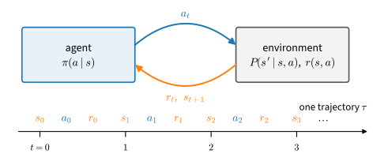

# Reinforcement Learning
:label:`chap_reinforcement_learning`

In supervised learning, a prediction typically does not affect which test example is observed next. In reinforcement learning, an action can change the state of the environment and thereby affect subsequent observations and rewards. The agent consequently influences both its performance and the data from which it learns.

:numref:`fig_rl_agent_env` shows this interaction. Unrolling the agent--environment loop over time produces a *trajectory* $\tau=(s_0,a_0,r_0,s_1,\ldots)$. This feedback introduces the central difficulties studied in this chapter: exploration determines which data are collected, errors alter later state distributions, and policy updates change the distribution used for subsequent learning. The same formulation also applies to language-model generation, where the context is a state and the next token is an action; :numref:`sec_rl_sequences` develops that correspondence.


:label:`fig_rl_agent_env`

The chapter has three parts. The first part works with small, finite problems. :numref:`sec_mdp` defines the Markov decision process, :numref:`sec_valueiter` solves a known MDP by dynamic programming, and :numref:`sec_qlearning` learns optimal action values from sampled transitions, without a model. :numref:`sec_policygradient` optimizes a policy directly by following the gradient of its expected return, and :numref:`sec_baselines` reduces the variance of the gradient estimates. The second part uses neural networks. :numref:`sec_deeprl` represents the policy and the value function as networks, :numref:`sec_actorcritic` replaces the sampled remainder of each trajectory by the value estimate, :numref:`sec_ppo` reuses each batch of data for several updates while limiting how far the policy moves, :numref:`sec_dqn` carries Q-learning over to networks, and :numref:`sec_sac` replaces the maximum over actions by an actor, for actions that vary continuously, and adds the entropy of the policy to the reward. The third part asks where the data come from: :numref:`sec_offline` learns from a fixed dataset without any interaction, and :numref:`sec_rl_sequences` applies the methods of the chapter to language models. Most experiments use two small environments, FrozenLake and CartPole, so that results can be compared with exact solutions where these exist and repeated over several random seeds on a CPU; :numref:`sec_sac` adds Pendulum, whose action is a torque.

:numref:`fig_rl_roadmap` organizes the methods of the chapter by what they learn and which data they use, and :numref:`tab_rl_map` lists them with the sections that introduce them.

![The main methods of this chapter, organized by what they learn and by which data may drive their updates. The methods in the top two rows learn a policy, and those in the top row also learn a bootstrapped critic; a value function that REINFORCE fits to sampled returns is only a baseline. The methods in the bottom row learn action values and act greedily on them. The arrow marks the use of importance ratios, which let policy-gradient methods reuse data from other policies. Dynamic programming is not shown, since it uses a model of the environment rather than data.](../img/mdl-rl-roadmap.svg)
:label:`fig_rl_roadmap`

:The methods of this chapter. "Named in" marks methods that a section describes without running them.
:label:`tab_rl_map`

| algorithm | what it learns | which data may drive the update | where |
|:--|:--|:--|:--|
| value iteration, policy iteration | $V^*$ and an optimal policy | none: they use the transition probabilities and rewards | :numref:`sec_valueiter` |
| Q-learning | $Q^*$ from sampled transitions | transitions of any policy (off-policy) | :numref:`sec_qlearning` |
| SARSA | the action values of the behavior policy | its own transitions (on-policy) | named in :numref:`sec_qlearning` |
| UCB | the means of the arms and their uncertainty | its own pulls of a bandit | named in :numref:`sec_qlearning` |
| REINFORCE | a policy, by the score-function gradient | trajectories of the current policy | :numref:`sec_policygradient` |
| REINFORCE with baselines | the same gradient with lower variance | trajectories of the current policy | :numref:`sec_baselines` |
| group baseline, as in GRPO | a policy, with the mean return of trajectories from the same start state as the baseline and the division by the standard deviation of these returns | trajectories of the current policy | :numref:`sec_baselines` |
| REINFORCE with a learned baseline | a policy network and a value network | trajectories of the current policy | :numref:`sec_deeprl` |
| actor-critic | a policy and a bootstrapped critic | trajectories of the current policy | :numref:`sec_actorcritic` |
| PPO | a policy under a clipped probability ratio, and a critic | a batch of the current policy, reused for several epochs | :numref:`sec_ppo` |
| TRPO | a policy under a bound on the KL divergence | a batch of the current policy | named in :numref:`sec_ppo` |
| DQN | $Q^*$ with a network | a replay buffer of past transitions | :numref:`sec_dqn` |
| Double DQN | the same, with a smaller maximization bias | a replay buffer of past transitions | named in :numref:`sec_dqn` |
| Rainbow | DQN with six extensions | a replay buffer | named in :numref:`sec_dqn` |
| DDPG, TD3 | one critic (DDPG) or two (TD3), and a deterministic actor, for continuous actions | a replay buffer | named in :numref:`sec_deeprl` and :numref:`sec_sac` |
| SAC | two critics, a stochastic actor, and a temperature, for a return with the entropy of the policy | a replay buffer | :numref:`sec_sac` |
| behavior cloning | the policy that generated the data | a fixed dataset | :numref:`sec_offline` |
| DAgger | the policy of an expert | the learner's own states, labeled by the expert | named in :numref:`sec_offline` |
| offline Q-learning with pessimism | the optimal values of the empirical MDP, lowered where data are scarce | a fixed dataset | :numref:`sec_offline` |
| BCQ, CQL, IQL, TD3+BC, CDC | a critic and a policy, with the policy or the values kept close to the data | a fixed dataset | named in :numref:`sec_offline` |
| Decision Transformer | a return-conditioned sequence model | a fixed dataset | named in :numref:`sec_offline` |
| PPO for language models | a policy that maximizes a reward with a KL penalty, and a critic | responses of the current policy | named in :numref:`sec_rl_sequences` |
| GRPO | a policy, with group-normalized rewards instead of a critic and a per-token KL estimate in the loss | responses of the current policy | named in :numref:`sec_rl_sequences` |
| DPO | a policy, fitted directly to preferences, with the reward written in terms of the policy | a fixed dataset of preferences | named in :numref:`sec_rl_sequences` |

:numref:`tab_rl_notation` collects the symbols of the chapter with the section that defines each.

:Notation of this chapter.
:label:`tab_rl_notation`

| symbol | meaning | defined in |
|:--|:--|:--|
| $\mathcal{S}$, $\mathcal{A}$ | the sets of states and actions | :numref:`sec_mdp` |
| $s_t$, $a_t$, $r_t$ | the state, action, and reward at step $t$ | :numref:`sec_mdp` |
| $P(s' \mid s, a)$, $r(s, a)$ | the transition kernel; the expected reward | :numref:`sec_mdp` |
| $\gamma$ | the discount factor | :numref:`sec_mdp` |
| $T$, $T^\pi$ | the length of an episode; the Bellman optimality operator; the Bellman operator of a fixed policy $\pi$ | :numref:`sec_mdp`, :numref:`sec_valueiter` |
| $\tau$, $R(\tau)$ | a trajectory; its discounted return | :numref:`sec_mdp` |
| $\pi(a \mid s)$ | a policy | :numref:`sec_valueiter` |
| $V^\pi$, $Q^\pi$, $A^\pi$ | the state values, action values, and advantages of $\pi$ | :numref:`sec_valueiter` |
| $V^*$, $Q^*$ | the value functions of an optimal policy | :numref:`sec_valueiter` |
| $\alpha$ | a step size | :numref:`sec_qlearning` |
| $\delta$, $\delta_t$ | the temporal-difference error | :numref:`sec_qlearning`, :numref:`sec_actorcritic` |
| $\epsilon$ | the exploration rate of $\epsilon$-greedy action selection; in :numref:`sec_ppo` and :numref:`sec_rl_sequences`, the clipping parameter | :numref:`sec_qlearning`, :numref:`sec_ppo` |
| $\eta$ | the temperature of the softmax policy | :numref:`sec_qlearning` |
| $n(a)$, $n(s, a)$ | the number of times an arm was chosen; the number of times a pair occurs in the data (in an exercise of :numref:`sec_qlearning`, the number of updates of a pair) | :numref:`sec_qlearning`, :numref:`sec_offline` |
| $\pi_\theta$, $J(\theta)$ | a policy with parameters $\theta$; its expected return | :numref:`sec_policygradient` |
| $G_t$ | the reward-to-go | :numref:`sec_baselines` |
| $b$, $\hat{V}$ | a baseline; a learned estimate of $V^\pi$ | :numref:`sec_baselines` |
| $K$, $\bar{R}$, $s_R$ | the number of trajectories in a group; the mean and the standard deviation of their returns | :numref:`sec_baselines` |
| $w_t$; $w$ | the weight of the score at step $t$; the parameters of a value network | :numref:`sec_policygradient`, :numref:`sec_actorcritic` |
| $\hat{A}_i$, $\hat{A}_t$ | the weight of the score: a group-normalized return; an advantage estimate | :numref:`sec_baselines`, :numref:`sec_deeprl` |
| $\lambda$ | the parameter of the $\lambda$-return and of GAE | :numref:`sec_actorcritic` |
| $d_{t+1}$, $d'$ | one if the next state is terminal and zero otherwise; $d(s)$ is the smallest number of moves from $s$ to the goal in :numref:`sec_valueiter`, and the discounted number of visits to $s$ in :numref:`sec_baselines` ($d_{\textrm{old}}$, of the old policy, in :numref:`sec_ppo`) | :numref:`sec_actorcritic`, :numref:`sec_dqn` |
| $\rho_t(\theta)$ | the probability ratio of the new and the old policy | :numref:`sec_ppo` |
| $\sigma$, $\sigma_\theta(s)$ | the sigmoid function; a standard deviation that the actor outputs | :numref:`sec_ppo`, :numref:`sec_sac` |
| $w^-$, $C$ | the parameters of a target network; the synchronization period of DQN | :numref:`sec_dqn` |
| $\beta$, $\bar{H}$ | the temperature, the weight of the entropy; the target entropy. In :numref:`sec_rl_sequences`, $\beta$ weighs the KL penalty | :numref:`sec_sac` |
| $\nu$ | the rate of Polyak averaging | :numref:`sec_sac` |
| $\mathcal{D}$, $\pi_\beta$, $\kappa$ | a fixed dataset; the behavior policy that collected it; the strength of the count-based penalty | :numref:`sec_offline` |
| $x$, $y$, $\pi_{\textrm{ref}}$ | a prompt; a response (in :numref:`sec_qlearning`, :numref:`sec_dqn`, and :numref:`sec_sac`, $y$ is a regression target); the reference policy | :numref:`sec_rl_sequences` |

This chapter does not cover multi-agent, meta-, hierarchical, or goal-conditioned reinforcement learning, or model-based reinforcement learning beyond the empirical MDP of :numref:`sec_offline`, and it treats partial observability only briefly.

```toc
:maxdepth: 2

mdp
value-iter
qlearning
policy-gradient
baselines
deep-rl
actor-critic
ppo
dqn
sac
offline-rl
rl-sequences
```

## Resources and Further Reading {.unnumbered}

The following freely available resources provide theoretical treatments, courses, implementations, and empirical guidance.

**Textbooks**

- Sutton and Barto, *Reinforcement Learning: An Introduction* :cite:`Sutton.Barto.2018`, introduces value methods, policy methods, planning, and function approximation. Sutton and Barto received the 2024 ACM A.M. Turing Award "for developing the conceptual and algorithmic foundations of reinforcement learning".
- Szepesvári, *Algorithms for Reinforcement Learning* :cite:`Szepesvari.2010`, is a concise treatment of dynamic programming, temporal-difference learning, bandits, Q-learning, and actor-critic methods, and of their guarantees.
- Bertsekas, *A Course in Reinforcement Learning* :cite:`Bertsekas.2025`, develops reinforcement learning from the perspective of optimal control and dynamic programming.
- Agarwal, Jiang, Kakade, and Sun, *Reinforcement Learning: Theory and Algorithms* :cite:`Agarwal.Jiang.Kakade.ea.2019`, develops the theory of reinforcement learning, including bounds on the number of samples that learning requires.
- Lattimore and Szepesvári, *Bandit Algorithms* :cite:`Lattimore.Szepesvari.2020`, treats the bandit problems of :numref:`sec_qlearning` in depth.

**Courses**

- [Berkeley CS 185/285: Deep Reinforcement Learning](https://rail.eecs.berkeley.edu/deeprlcourse/) covers policy gradients, value methods, model-based learning, and offline reinforcement learning.
- [Stanford CS234: Reinforcement Learning](https://web.stanford.edu/class/cs234/) covers the foundations of reinforcement learning, policy gradients, and exploration.
- [Stanford CS224R: Deep Reinforcement Learning](https://cs224r.stanford.edu/) covers deep reinforcement learning, including imitation and offline learning.
- [MIT 6.7920: Reinforcement Learning: Foundations and Methods](https://web.mit.edu/6.7920/www/) treats the foundations of reinforcement learning, starting from dynamic programming.
- [David Silver: Reinforcement Learning](https://davidstarsilver.wordpress.com/teaching/) (2015) offers video lectures and slides on Markov decision processes, dynamic programming, model-free prediction and control, value function approximation, policy gradients, integrating learning and planning, and exploration.

**Implementations**

- [Stable-Baselines3](https://github.com/DLR-RM/stable-baselines3) :cite:`Raffin.Hill.Gleave.ea.2021` provides library implementations of the main deep reinforcement learning algorithms, with tuned hyperparameters in its accompanying zoo.
- [Gymnasium](https://gymnasium.farama.org/) :cite:`Towers.Kwiatkowski.Terry.ea.2024` documents the environment interface used throughout this chapter.
- [FeynRL](https://github.com/FeynRL-project/FeynRL) :cite:`Fakoor.Aubry.2026` implements the post-training methods of :numref:`sec_rl_sequences` for language models: reinforcement learning (PPO, GRPO, DAPO, P3O, and others), DPO, and supervised fine-tuning.

**Empirical practice**

- [Spinning Up in Deep RL](https://spinningup.openai.com/) :cite:`Achiam.2018` introduces deep reinforcement learning with documented implementations of its main algorithms.
- [The 37 Implementation Details of Proximal Policy Optimization](https://iclr-blog-track.github.io/2022/03/25/ppo-implementation-details/) :cite:`Huang.Dossa.Raffin.ea.2022` documents how implementation choices omitted from algorithm descriptions affect PPO performance and reproducibility.
