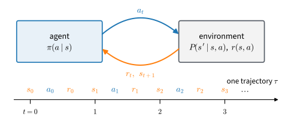

# Reinforcement Learning
:label:`chap_reinforcement_learning`

In supervised learning, a prediction typically does not affect which test example is observed next. In reinforcement learning, an action changes the state of the environment and therefore affects subsequent observations and rewards. The agent consequently influences both its performance and the data from which it learns.

:numref:`fig_rl_agent_env` shows this interaction. Unrolling the agent--environment loop over time produces a *trajectory* $\tau=(s_0,a_0,r_0,s_1,\ldots)$. This feedback introduces the central difficulties studied in this chapter: exploration determines which data are collected, errors alter later state distributions, and policy updates change the distribution used for subsequent learning. The same formulation also applies to language-model generation, where the context is a state and the next token is an action; :numref:`sec_rl_sequences` develops that correspondence.


:label:`fig_rl_agent_env`

The sections progress from settings with the most information to settings with the least. :numref:`sec_mdp` defines the Markov decision process, and :numref:`sec_valueiter` solves a known finite MDP by dynamic programming. :numref:`sec_qlearning` removes the model and learns action values from sampled transitions, and :numref:`sec_exploration` studies how to collect those transitions. :numref:`sec_imitation` learns from expert demonstrations instead. :numref:`sec_policygradient` optimizes the policy directly, while :numref:`sec_baselines` develops lower-variance estimators. Finally, :numref:`sec_deeprl` replaces tabular representations with neural networks for continuous state and action spaces.

:numref:`chap_deep_rl` continues with bootstrapped critics, controlled reuse of on-policy data, replay buffers, regularized objectives, and offline learning. :numref:`sec_deeprl` closes the chapter with a map of the methods in both chapters.

The experiments use small environments so that results can be evaluated against exact solutions and repeated across random seeds on a CPU. Numerical conclusions are reported with their relevant uncertainty and limitations in the sections where they arise. This chapter does not cover multi-agent, meta-, hierarchical, or goal-conditioned reinforcement learning, and it introduces partial observability only briefly. The Language Models part treats post-training, including learning from human preferences, in more depth.

```toc
:maxdepth: 2

mdp
value-iter
qlearning
exploration
imitation
policy-gradient
baselines
deep-rl
```

## Resources and Further Reading {.unnumbered}

The following freely available resources provide theoretical treatments, courses, implementations, and empirical guidance.

**Textbooks**

- Sutton and Barto, *Reinforcement Learning: An Introduction* :cite:`Sutton.Barto.2018` provides a comprehensive introduction to value methods, policy methods, planning, and function approximation. Sutton and Barto received the 2024 Turing Award for their foundational contributions to reinforcement learning.
- Szepesvári, *Algorithms for Reinforcement Learning* :cite:`Szepesvari.2010` states this chapter's algorithms and their guarantees in under a hundred pages.
- Bertsekas, *A Course in Reinforcement Learning* :cite:`Bertsekas.2025` develops reinforcement learning from the perspective of optimal control and dynamic programming.
- Agarwal, Jiang, Kakade, and Sun, *Reinforcement Learning: Theory and Algorithms* :cite:`Agarwal.Jiang.Kakade.ea.2019` supplies the sample-complexity rates this chapter states qualitatively.
- Lattimore and Szepesvári, *Bandit Algorithms* :cite:`Lattimore.Szepesvari.2020` is the full theory behind :numref:`sec_exploration`.

**Courses**

- [Berkeley CS285: Deep Reinforcement Learning](https://rail.eecs.berkeley.edu/deeprlcourse/) covers policy gradients, value methods, model-based learning, and offline reinforcement learning at the graduate level.
- [Stanford CS234: Reinforcement Learning](https://web.stanford.edu/class/cs234/) is the course closest in scope to this chapter: foundations, exploration, and policy gradients with their guarantees.
- [Stanford CS224R: Deep Reinforcement Learning](https://cs224r.stanford.edu/) covers the practice, imitation and offline methods included.
- [CMU 10-703: Deep Reinforcement Learning and Control](https://cmudeeprl.github.io/703website/) pairs the algorithms with control and physical embodiment.
- [MIT 6.7920: Reinforcement Learning: Foundations and Methods](https://web.mit.edu/6.7920/www/) develops the dynamic-programming theory introduced in :numref:`sec_valueiter`.

**Annotated implementations**

- [CleanRL](https://github.com/vwxyzjn/cleanrl) :cite:`Huang.Dossa.Ye.ea.2022` provides single-file, benchmarked implementations of the major deep reinforcement learning algorithms discussed after :numref:`sec_deeprl`.
- [Stable-Baselines3](https://github.com/DLR-RM/stable-baselines3) :cite:`Raffin.Hill.Gleave.ea.2021` provides library implementations of the same algorithms, with tuned hyperparameters in its accompanying zoo.
- [Gymnasium](https://gymnasium.farama.org/) :cite:`Towers.Kwiatkowski.Terry.ea.2024` documents the environment interface used throughout these chapters.

**Empirical practice**

- [Spinning Up in Deep RL](https://spinningup.openai.com/) :cite:`Achiam.2018` is a short curriculum from the score function to SAC, written to be read beside running code.
- [The 37 Implementation Details of Proximal Policy Optimization](https://iclr-blog-track.github.io/2022/03/25/ppo-implementation-details/) :cite:`Huang.Dossa.Raffin.ea.2022` documents how implementation choices omitted from algorithm descriptions affect PPO performance and reproducibility.
