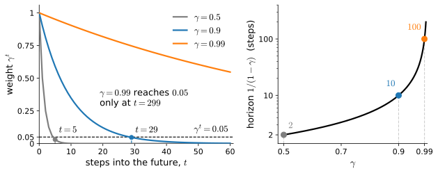

# Markov Decision Processes
:label:`sec_mdp`

A *Markov decision process* (MDP) provides a mathematical model of sequential interaction :cite:`BellmanMDP,Puterman.1994`. It consists of states, actions, transition probabilities, and rewards, together with the Markov assumption that the current state contains the information needed to predict the next state. This section develops these components using a sixteen-state FrozenLake environment.

We first inspect the simulator's transition data and then express the same model in notation. The transition dynamics describe the environment, whereas the reward specifies the objective. A final example shows how an apparently reasonable reward modification can change the optimal policy in an unintended way.

```{.python .input #mdp-markov-decision-processes}
%%tab pytorch
%matplotlib inline
from d2l import torch as d2l
import gymnasium as gym
import numpy as np
```

```{.python .input #mdp-markov-decision-processes}
%%tab jax
%matplotlib inline
from d2l import jax as d2l
import gymnasium as gym
import numpy as np
```

## The Model

:numref:`fig_rl_gridworld` shows the environment used in the next four sections: FrozenLake from the Gymnasium suite :cite:`Towers.Kwiatkowski.Terry.ea.2024`. The agent starts at the top-left cell and seeks the goal at the bottom right, which gives reward one. Four cells are holes, and reaching either a hole or the goal ends the episode. On *slippery* ice, a commanded move occurs with probability $1/3$; each of the two perpendicular moves also occurs with probability $1/3$. A move off the edge of the grid leaves the agent in its cell.

![The environment for the next four sections. (a) S marks the start, G the goal, and the grey cells marked H are holes; each cell carries its state index. On non-slippery ice the shortest path takes six moves, for a discounted return of $\gamma^5$. (b) One command on slippery ice, read straight out of the transition table: from state $s = 9$ the action *down* lands in one of the three shaded cells with probability $1/3$ each; the intended move is one outcome among equals, and the probabilities sum to one.](../img/mdl-rl-gridworld.svg)
:label:`fig_rl_gridworld`

### States, Actions and the Transition Kernel

Here the set of *states* $\mathcal{S}$ consists of the agent's cell, $\{0, 1, \ldots, 15\}$ numbered row by row. The set of *actions* $\mathcal{A}$ contains the four commands *left*, *down*, *right*, and *up*, encoded as 0 through 3. On slippery ice, an action determines a distribution over next states. Gymnasium stores this transition model as a table:

```{.python .input #mdp-states-actions-and-the-transition-kernel-1}
%%tab pytorch, jax
env = gym.make('FrozenLake-v1', is_slippery=True)
env.unwrapped.P[9][1]
```

The output contains three tuples, one per outcome, each of the form (probability, next state, reward, terminated). When commanded *down* from state 9, the agent reaches 13, 8, or 10 with probability $1/3$ each, as shown in :numref:`fig_rl_gridworld`. In symbols this is the *transition kernel* $P: \mathcal{S} \times \mathcal{A} \times \mathcal{S} \to [0, 1]$, where $P(s' \mid s, a)$ is the conditional probability of reaching state $s'$ from state $s$ under action $a$; each row is a distribution, so $\sum_{s' \in \mathcal{S}} P(s' \mid s, a) = 1$.

The fourth object is the *reward* $r: \mathcal{S} \times \mathcal{A} \to \mathbb{R}$, which assigns a numerical objective to taking action $a$ at state $s$. Together:

$$
\textrm{MDP}: \quad (\mathcal{S}, \mathcal{A}, P, r).
$$
:eqlabel:`eq_mdp`

Some treatments fold the discount factor of the next subsection into this tuple, and some let the reward be random or depend on the next state; our $r(s, a)$ then plays the role of the expected reward, and nothing in this chapter loses generality from the simpler form.

The transition and reward model fits in two dense arrays. We wrap them in a class and save it to the `d2l` library for use throughout the chapter:

```{.python .input #mdp-states-actions-and-the-transition-kernel-2}
%%tab pytorch, jax
class TabularMDP:  #@save
    """A finite MDP as dense arrays: P[s, a, s'] and r[s, a]."""
    def __init__(self, P, r, gamma):
        self.P, self.r, self.gamma = P, r, gamma
        self.num_states, self.num_actions = r.shape

    @classmethod
    def from_gym(cls, env, gamma):
        """Read the transition table Gymnasium exposes as env.unwrapped.P."""
        n_s, n_a = env.observation_space.n, env.action_space.n
        P, r = np.zeros((n_s, n_a, n_s)), np.zeros((n_s, n_a))
        for s, actions in env.unwrapped.P.items():
            for a, outcomes in actions.items():
                for p, s_next, reward, _ in outcomes:
                    P[s, a, s_next] += p      # several outcomes may share s'
                    r[s, a] += p * reward     # r(s,a) is the expected reward
        return cls(P, r, gamma)

    def backup(self, V):
        """Q(s, a) = r(s, a) + gamma * sum_{s'} P(s'|s, a) V(s')."""
        return self.r + self.gamma * self.P @ V
```

In `backup`, `numpy`'s matrix product contracts the last axis of $P$ against a value estimate $V$: reward plus discounted lookahead for every state-action pair, in one line. :numref:`sec_valueiter` builds this chapter's first algorithm by repeating it.

```{.python .input #mdp-states-actions-and-the-transition-kernel-3}
%%tab pytorch, jax
gamma = 0.95
LEFT, DOWN, RIGHT, UP = 0, 1, 2, 3
mdp = TabularMDP.from_gym(env, gamma)
print(mdp.P[9, DOWN])
```

The dictionary of tuples has become a dense row: probability $1/3$ in columns 8, 10 and 13, zero elsewhere. Two consistency checks, one per array:

```{.python .input #mdp-states-actions-and-the-transition-kernel-4}
%%tab pytorch, jax
print(f'largest |row sum - 1|: {np.abs(mdp.P.sum(axis=-1) - 1).max():.1e}')
for s, a in np.argwhere(mdp.r > 0):
    print(f'r(s={s}, a={"<v>^"[a]}) = {mdp.r[s, a]:.3f}')
```

Every row of $P$ sums to one. The reward array is almost entirely zero: its nonzero entries occur at state 14, the only cell from which the goal can be entered, and equal $1/3$ because the corresponding action reaches the goal with that probability. FrozenLake therefore provides reward only on transitions into the goal.

### Reward Design and Potential-Based Shaping

The reward is chosen by the designer to represent the task. In contrast, the states, actions, and transition kernel describe the environment. An optimization algorithm maximizes the specified reward, so a mismatch between the reward and the intended task can produce undesirable behavior.

One reward modification provably preserves the optimal policy. Let $\Phi: \mathcal{S} \to \mathbb{R}$ be a *potential* that is zero at every terminal state, and replace the reward on each transition by

$$\tilde r(s, a, s') = r(s, a) + \gamma \Phi(s') - \Phi(s).$$
:eqlabel:`eq_mdp_shaping`

Along a trajectory, the shaping terms telescope to $\gamma^T \Phi(s_T)-\Phi(s_0)$. The first term vanishes for an infinite discounted trajectory or for an episode ending at a state with $\Phi(s_T)=0$. Every policy's return then changes by the same constant $-\Phi(s_0)$, so the optimal policy is unchanged :cite:`Ng.Harada.Russell.1999`. This construction is called *potential-based shaping*.

The terminal-state condition is essential. If returns stop at the terminal transition and $\Phi(s_T)$ is unconstrained, the remaining term $\gamma^T\Phi(s_T)$ can depend on the terminal state and duration, thereby changing the optimum. Equivalently, one may retain an unconstrained terminal potential if the return includes an absorbing continuation that cancels the residual. General bonuses need not preserve the optimal policy; the example at the end of the section demonstrates such a failure. :numref:`sec_regularized` discusses explicit constraints, and :numref:`sec_rl_sequences` returns to reward misspecification at larger scale.

## Return, Discount and Horizon

The start-state distribution and return objective complete the problem specification. The agent starts at a state $s_0$ drawn from a *start-state distribution* $\mu_0$ (a point mass on state 0 here; the distribution over prompts in :numref:`sec_rl_sequences`) and produces a *trajectory*

$$\tau = (s_0, a_0, r_0, s_1, a_1, r_1, s_2, a_2, r_2, \ldots),$$

where at each step $t$ it is at state $s_t$, takes action $a_t$, receives reward $r_t = r(s_t, a_t)$, and moves to $s_{t+1} \sim P(\cdot \mid s_t, a_t)$. The *return* of a trajectory is the total reward collected along it,

$$R(\tau) = r_0 + r_1 + r_2 + \cdots.$$

The goal of reinforcement learning is to act so that the return is as large as possible, on average over the randomness of the kernel, the start state and the agent's own choices. For finite discounted MDPs the problem is well posed: an optimal way of acting exists and can be taken deterministic and time-independent :cite:`Puterman.1994`.

We make this precise with policies and value functions in :numref:`sec_valueiter`; the same objects define imitation from demonstrations (:numref:`sec_imitation`) and direct policy improvement from sampled returns (:numref:`sec_policygradient`). The following uniformly random policy produces one example trajectory $\tau$:

```{.python .input #mdp-return-discount-and-horizon}
%%tab pytorch, jax
rng = np.random.default_rng(8)
s, _ = env.reset(seed=8)
terminated = truncated = False
ret, t = 0.0, 0
while not (terminated or truncated):
    a = int(rng.integers(4))
    s_next, r, terminated, truncated, _ = env.step(a)
    print(f't={t:>2}  s={s:>2}  a={"<v>^"[a]}  r={r:.0f}')
    ret, s, t = ret + r, s_next, t + 1
print(f'terminated={terminated}, truncated={truncated}, return={ret:.0f}')
```

In the transcript, the agent commands *right* at $t=0$ but remains in place. At $t=2$, it commands *left* and instead moves *down* to state 4. At $t=8$, it commands *right* from state 10 and enters the hole at state 11. These outcomes illustrate the stochastic transition kernel in :numref:`fig_rl_gridworld`. Because the agent never reaches the goal, every reward and the total return are zero.

### The Geometric Bound and the Effective Horizon

An agent that wanders forever without reaching a hole or the goal has an infinitely long trajectory, and with positive rewards along the way the sum $R(\tau)$ could grow without bound. To keep the objective meaningful we introduce a *discount factor* $0 \leq \gamma < 1$ and use the discounted return

$$R(\tau) = r_0 + \gamma r_1 + \gamma^2 r_2 + \cdots = \sum_{t=0}^\infty \gamma^t r_t.$$
:eqlabel:`eq_mdp_discounted_return`

If rewards are bounded by $|r_t|\leq r_{\max}$, discounting makes the infinite return finite and gives a geometric bound on its tail:

$$|R(\tau)| \leq \frac{r_{\max}}{1 - \gamma}, \qquad \Big| \sum_{t \geq k} \gamma^t r_t \Big| \leq \frac{\gamma^k \, r_{\max}}{1 - \gamma}.$$

The first bound makes the objective finite. The second motivates the *effective horizon* $1/(1-\gamma)$. For a constant reward stream, the fraction of discounted mass after step $k$ is $\gamma^k$; hence 95 percent lies within $\log(0.05)/\log(\gamma)$ steps, approximately three effective horizons. For example, the effective horizons for $\gamma=0.5$ and $\gamma=0.99$ are two and one hundred steps, respectively.

```{.python .input #mdp-the-geometric-bound-and-the-effective-horizon}
%%tab pytorch, jax
print(f'{"gamma":>6} {"horizon 1/(1-gamma)":>20} {"t: gamma^t < 0.05":>18}')
for g in [0.5, 0.9, 0.95, 0.99]:
    t5 = int(np.ceil(np.log(0.05) / np.log(g)))
    print(f'{g:>6} {1 / (1 - g):>20.0f} {t5:>18}')
```

:numref:`fig_rl_return_discount` shows these quantities. The shortest path in FrozenLake takes six moves, so the terminal reward receives weight $\gamma^5$: approximately $0.03$ for $\gamma=0.5$ and $0.77$ for $\gamma=0.95$. The discount factor therefore determines the relative importance of delayed rewards.


:label:`fig_rl_return_discount`

### Episodes, Termination and Truncation
:label:`subsec_mdp-termination`

A state that ends the process is *terminal*. For analysis it may be represented as an absorbing state whose actions return to itself with zero reward. FrozenLake stores holes and the goal in this form, although the simulator ends the episode and requires a reset. A trajectory from the start to a terminal state is an *episode*. In an episodic task with at most $T$ steps, bounded rewards have a finite undiscounted sum and $\gamma=1$ is permitted. Continuing tasks instead rely on discounting or another average-reward formulation.

Gymnasium distinguishes termination from truncation. `terminated=True` means that the process reached a terminal state and has zero continuation value. `truncated=True` means that observation stopped, usually because of a time limit, although the state can have nonzero continuation value. `gym.make` wraps FrozenLake in such a limit: after 100 steps the episode ends with `truncated=True`. Either flag may stop an interaction loop, but only termination should set a bootstrapped target's continuation to zero. The learning algorithms beginning in :numref:`sec_qlearning` therefore mask targets with `terminated` alone.

## The Choice of State

The kernel $P(s' \mid s,a)$ conditions only on the current state and action. This is the *Markov assumption*: once the present state is known, the history provides no additional information for predicting the next state. Whether the assumption holds depends on how the state is defined.

### The Markov Assumption and State Augmentation

Suppose the recorded state $s_t$ is a vehicle's location and the action $a_t$ is its acceleration. The next location also depends on the current velocity, which cannot generally be recovered from the current location alone. If velocity is inferred from successive locations, the dynamics have the form

$$s_{t+1} = f(s_t, a_t, s_{t-1});$$

and the location by itself is not Markov.

The problem is resolved by defining the state as $(\textrm{location},\textrm{velocity})$. Newtonian dynamics then determine the distribution of the next location and velocity from the current pair and the applied acceleration. Thus the Markov property is a condition on the representation of state, not only on the physical system.

This construction is called *state augmentation*: the state is enlarged until it contains the information needed to predict the future. Augmentation increases the state-space dimension, and the required sufficient statistic may be unknown, too large to store, or unobservable. The unobservable case leads to partial observability and belief states.

### Partial Observability

State augmentation requires the added variables to be observable. A poker player, for example, cannot observe the opponents' cards. When an agent receives an observation $o_t$ that reveals only part of the state, the problem is a *partially observable* MDP. Exact methods then maintain beliefs over the hidden state. A common approximation augments the observation with a short history. In Atari, a single frame gives position but not velocity, whereas several consecutive frames reveal motion. The remainder of this chapter assumes that the observation is a Markov state.

## Bandits, Degenerate MDPs and the Model-Based Axis

Two special cases and the distinction between model-based and model-free methods organize the following sections.

### The Bandit as a One-State MDP

When $|\mathcal{S}|=1$, each round consists of selecting an action and observing a reward. This is a *multi-armed bandit*. There are no state transitions or delayed rewards, so the problem isolates the exploration required to identify the action with the largest expected reward. :numref:`sec_qlearning` uses this setting to compare exploration strategies.

### The Degenerate MDP: Deterministic Transitions, Terminal Reward

Another special case has deterministic transitions and reward only at termination. FrozenLake has terminal-only reward, and disabling its slippery dynamics makes the transitions deterministic as well. Text generation has this structure when appending a token deterministically updates the context and a verifier or reward model assigns a score to the completed sequence. :numref:`sec_rl_sequences` develops this formulation.

### Model-Based versus Model-Free Methods

The computations above use the transition and reward model directly. Algorithms that plan with a known or learned model are *model-based*; value iteration in :numref:`sec_valueiter` is an example. *Model-free* algorithms instead use sampled transitions $(s,a,r,s')$, as in :numref:`sec_qlearning`. A model can be evaluated at any state-action pair, whereas samples are available only for pairs visited by the data-collection policy.

Because the original reward is sparse, one might add a bonus of $0.3$ whenever a transition moves closer to the goal. In expectation this gives $\tilde r(s,a)=r(s,a)+0.3\sum_{s'}P(s'\mid s,a)\mathbf{1}(d(s')<d(s))$, where $d$ is the Manhattan distance to the goal. This modification is not potential based: movement toward the goal receives a bonus, whereas movement away incurs no corresponding penalty. We compute its optimal policy by repeated backups and evaluate both policies under the original reward using exact policy evaluation:

```{.python .input #mdp-model-based-versus-model-free}
%%tab pytorch, jax
dist = abs(np.arange(16) // 4 - 3) + abs(np.arange(16) % 4 - 3)
closer = dist < dist[:, None, None]    # closer[s, :, s'] = 1 iff d(s') < d(s)
shaped = TabularMDP(mdp.P, mdp.r + 0.3 * (mdp.P * closer).sum(-1), gamma)

def greedy_sweeps(m):                  # repeated backups; named in next section
    V = np.zeros(m.num_states)
    for _ in range(500):
        V = m.backup(V).max(axis=1)
    return m.backup(V).argmax(axis=1), V

def exact_value(pi, s=0):              # V(s) under the true reward, exactly
    i = np.arange(mdp.num_states)
    return np.linalg.solve(np.eye(16) - gamma * mdp.P[i, pi], mdp.r[i, pi])[s]

pi_shaped, V_shaped = greedy_sweeps(shaped)
pi_true, V_true = greedy_sweeps(mdp)
print(f'shaped-optimal: at s=14 goes {"<v>^"[pi_shaped[14]]}, shaped value '
      f'{V_shaped[0]:.2f}, true value {exact_value(pi_shaped):.3f}')
print(f'true-optimal:   at s=14 goes {"<v>^"[pi_true[14]]}, true value '
      f'{exact_value(pi_true):.3f}')
```

State 14 is the only cell from which the goal can be entered. The optimal policy for the original reward commands *down*, which reaches the goal with probability $1/3$. The policy optimized for the shaped reward instead commands *left*, whose possible successors are states 10, 13, and 14. It therefore never reaches the goal.

Its value under the original reward is zero, although its value under the shaped reward is $2.15$, compared with $0.180$ for the original optimum. The per-step bonus favors continuing to collect approach rewards instead of terminating. With a smaller bonus of $0.1$, the policy still reaches the goal but remains altered. Exercise :exref:`ex_mdp-reward-design-its-failure`c replaces the bonus with a potential-based reward.

## Summary

A Markov decision process consists of states $\mathcal{S}$, actions $\mathcal{A}$, a transition kernel $P$, and a reward $r$. The Markov assumption requires the state to contain the information from the past needed to predict the future; state augmentation can restore this property when the necessary information is observable. The objective is expected discounted return, and $1/(1-\gamma)$ provides a useful effective-horizon scale. Terminal states end the process, whereas truncation ends only the observation of it, so bootstrapped value estimates must distinguish the two.

A one-state MDP is a bandit, and a deterministic MDP with terminal reward describes settings such as text generation. Potential-based shaping preserves the optimal policy when its terminal conditions are handled correctly; arbitrary reward modifications do not.

**Experimental scope.** Except for the illustrative sampled trajectory, the results in this section are exact computations on a known sixteen-state model. The reward-shaping example establishes that one plausible bonus can change the optimal policy; it does not imply that all reward shaping fails. Estimation, exploration, and function approximation are introduced in later sections.

## Exercises

1. [code] **Episodes from the kernel.** The example trajectory $\tau$ of
   :numref:`sec_mdp` draws every action uniformly at random with
   `rng.integers(4)`. Under this policy the next state has the distribution

   $$P_\pi(s' \mid s) = \frac{1}{4} \sum_{a \in \mathcal{A}} P(s' \mid s, a),$$

   which is `mdp.P.mean(axis=1)`.
    1. `from_gym` accumulates probabilities with `+=` because several of
       Gymnasium's outcomes for one state-action pair can lead to the same
       next state. Find every pair at which this happens, and explain from
       :numref:`fig_rl_gridworld` why these pairs and no others. If the line
       that fills `P` assigned with `=` instead, which rows of `mdp.P` would
       no longer sum to one, and what would they sum to?
    1. Let $\mu_t$ be the distribution of $s_t$, starting from the point
       mass $\mu_0$ on state 0, so that
       $\mu_{t+1}(s') = \sum_{s} \mu_t(s) P_\pi(s' \mid s)$. Plot, for
       $t \leq 30$, the probability that the agent has reached the goal, the
       probability that it has fallen into a hole, and the probability that
       its episode is still running. What are the limits as
       $t \to \infty$?
    1. Ignoring the time limit of `env`, show that the mean episode length
       equals $\sum_{t \geq 0} \Pr(s_t \textrm{ is not terminal})$. Run
       10,000 episodes of `env` with the random policy, and compare the
       fraction of episodes that reach the goal and the mean episode length
       with the values that $\mu_t$ predicts.
   :exlabel:`ex_mdp-kernel-predicts-episodes`

1. **Expected rewards.** Gymnasium attaches its reward to the transition:
   entering the goal pays one. `from_gym` replaces this reward
   $\rho(s, a, s')$ by its expectation
   $r(s, a) = \sum_{s'} P(s' \mid s, a)\, \rho(s, a, s')$.
    1. Show that for every policy and every start state the expected
       discounted return is the same whether step $t$ pays
       $\rho(s_t, a_t, s_{t+1})$ or $r(s_t, a_t)$. Extend the argument to a
       reward that is drawn at each visit of $(s, a)$, independently of
       everything else, from a distribution with mean $r(s, a)$.
    1. Under the convention $r(s, a)$, which FrozenLake episodes have a
       positive return? For the policy `pi_true`, compare the probability of
       a positive return under the two conventions. Which properties of the
       return does the model :eqref:`eq_mdp` therefore determine, and which
       does it not?

1. **Discount as termination.** The discounted return
   :eqref:`eq_mdp_discounted_return` weights the reward of step $t$ by
   $\gamma^t$.
    1. :numref:`sec_mdp` locates 95 percent of the discounted weight within
       $\log(0.05) / \log(\gamma)$ steps and calls this about three effective
       horizons. Show that for every $\varepsilon \in (0, 1)$

        $$\frac{\ln(1/\varepsilon)}{\ln(1/\gamma)} \leq \frac{\ln(1/\varepsilon)}{1 - \gamma},$$

       and that the ratio of the two sides tends to one as $\gamma \to 1$.
       Use the inequality to explain the step counts of
       :numref:`fig_rl_return_discount` at $\gamma = 0.5$, $0.9$ and $0.99$.
    1. Modify an MDP so that after every reward the process moves, with
       probability $1 - \gamma$, to an absorbing state with zero reward, and
       otherwise moves according to $P$. Show that the expected undiscounted
       return of every policy in the modified process equals its expected
       discounted return in the original, and that the expected number of
       rewards collected is $1 / (1 - \gamma)$. Read `TabularMDP.backup` in
       these terms: what do the row sums of $\gamma P$ mean?
   :exlabel:`ex_mdp-discount-as-termination`

1. [code] **Time limits.** `gym.make` wraps FrozenLake in a time limit:
   after 100 steps the episode ends with
   `truncated=True` (:numref:`subsec_mdp-termination`).
    1. Propagate the state distribution $\mu_t$ of problem
       :exref:`ex_mdp-kernel-predicts-episodes`b under `pi_true` instead of
       the random policy. Compute the probabilities that an episode reaches
       the goal, falls into a hole, or is truncated. Compare the truncated
       fraction with the one that $\mu_{100}$ gives for the random policy.
    1. Suppose now that the limit is part of the task: the objective is the
       probability of entering the goal within 100 steps. Model the end of
       the limit as a move to an absorbing state. Show that the distribution
       of the next state then depends on the number $h$ of steps that
       remain, so that the location alone is not a Markov state, whereas the
       pair $(s, h)$ is :cite:`Pardo.Tavakoli.Levdik.ea.2018`. Why can the
       best action at a location depend on $h$?
   :exlabel:`ex_mdp-time-limits`

1. **Actions without consequences.** A multi-armed bandit has a single
   state, so no action can influence the future.
    1. Suppose more generally that the kernel does not depend on the action,
       $P(s' \mid s, a) = P(s' \mid s)$ for all $a$. Show that for every
       $\gamma$ the policy that picks an action in
       $\arg\max_a r(s, a)$ at every state maximizes the expected discounted
       return from every start state.
    1. Construct an MDP with two states and two actions in which this
       greedy policy is optimal for small $\gamma$ and not for large
       $\gamma$, and find the value of $\gamma$ at which the optimal action
       changes.

1. [code] **Potential-based shaping.** ● `TabularMDP` stores the holes and
   the goal as absorbing states whose actions lead back to themselves, so
   the returns it defines continue forever, while the simulator stops at the
   first terminal state. The telescoping argument of :numref:`sec_mdp` shows
   that the shaped reward :eqref:`eq_mdp_shaping` preserves the optimal
   policy in the first setting for every potential $\Phi$, and in the second
   only when $\Phi$ vanishes at the terminal states.
    1. Add a constant $c$ to every entry of `mdp.r`, the absorbing states
       included. Show that the discounted return of every trajectory changes
       by the same amount, and find that amount. Which constant potential
       $\Phi$ satisfies $\gamma \Phi(s') - \Phi(s) = c$?
    1. Now charge the constant only while the episode runs: add $c$ to
       $r(s, a)$ at the nonterminal states alone. For
       $c \in \{-0.02, -0.01, 0.01, 0.05\}$, compute the optimal policy with
       `greedy_sweeps`, report its action at state 0 and its value under the
       original reward with `exact_value`, and estimate its success rate from
       1,000 episodes of `env`. Explain the effect of each sign of $c$ with
       the constant potential and the terminal condition.
    1. Replace the approach bonus of `shaped` by the potential
       $\Phi(s) = -0.3\, d(s)$, where $d$ is the Manhattan distance `dist`,
       and average :eqref:`eq_mdp_shaping` over the next state, which gives
       at every state

        $$\tilde r(s, a) = r(s, a) + \sum_{s'} P(s' \mid s, a)\,[\gamma \Phi(s') - \Phi(s)].$$

       Check that the values $\tilde V$ that `greedy_sweeps` returns
       satisfy $\tilde V(s) = V(s) - \Phi(s)$ at every state, where $V$ is
       `V_true`, and that the shaped optimum has
       the same value under the original reward as `pi_true`. Then drop the
       shaping term at the terminal states, as a simulator that stops there
       would, and recompute the value of the optimum under the original
       reward. Finally set $\Phi$ to zero at the terminal states and repeat.

   *Adapted from Sutton and Barto,
   [Reinforcement Learning: An Introduction](http://incompleteideas.net/book/RLbook2020.pdf),
   Exercises 3.15 and 3.16.*
   :exlabel:`ex_mdp-reward-design-its-failure`

1. **Belief states.** ● In a partially observable MDP the agent receives
   an observation $o_t$, drawn with probability $O(o_t \mid s_t)$, instead
   of the state $s_t$. Its *belief*
   $b_t(s) = \Pr(s_t = s \mid o_0, a_0, \ldots, a_{t-1}, o_t)$ is the
   posterior over the hidden state given everything observed so far
   :cite:`Kaelbling.Littman.Cassandra.1998`.
    1. Using the Markov property of the hidden states, derive the update

        $$b_{t+1}(s') \propto O(o_{t+1} \mid s') \sum_{s \in \mathcal{S}} P(s' \mid s, a_t)\, b_t(s).$$

    1. Show that the belief is a Markov state: given $b_t$ and $a_t$, the
       distribution of $b_{t+1}$ and the expected reward do not depend on
       earlier observations. What are the state space and the kernel of the
       resulting MDP over beliefs?
    1. In a T-maze adapted from :citet:`Bakker.2001`, the agent observes a
       cue at the start, *left* or *right* with probability $1/2$ each, then
       moves one cell per step through $N$ corridor cells that all produce
       the same observation, and then reaches a junction. Turning toward
       the cue there gives reward one, and turning away gives zero. Show
       that a policy that acts on the $k$ most recent observations succeeds
       with probability at most $1/2$ unless $k \geq N + 2$. What is the
       belief at the junction, and how much memory suffices to act
       optimally? Why does stacking a few frames work for Pong but not
       here?

1. [extended] **Planning horizon and model error.** ●● The discount
   $\gamma$ of the objective is fixed by the task, but a planner may compute
   its policy with a smaller *planning discount* $\gamma'$.
   :citet:`Jiang.Kulesza.Singh.ea.2015` found that when the model is
   estimated from data, $\gamma' < \gamma$ can yield a better policy than
   $\gamma' = \gamma$. Let $V^\pi_\gamma(s)$ be the expected discounted
   return from $s$ under policy $\pi$ and discount $\gamma$, computed by a
   linear solve as in `exact_value`.
    1. Let rewards lie in $[0, r_{\max}]$ and let $\gamma' \leq \gamma$.
       Show that for every policy $\pi$ and state $s$

        $$0 \leq V^\pi_\gamma(s) - V^\pi_{\gamma'}(s) \leq \frac{(\gamma - \gamma')\, r_{\max}}{(1 - \gamma)(1 - \gamma')},$$

       and conclude that on the true model the policy that is optimal for
       $\gamma'$ loses at most this amount under $\gamma$.
    1. Reproduce their experiment at small scale with `TabularMDP`. Draw 100
       random MDPs with 10 states and 2 actions: for each state-action pair,
       choose 5 next states uniformly without replacement, give them weights
       drawn uniformly from $[0, 1]$, and normalize; draw each $r(s, a)$
       uniformly from $[0, 1]$. For each MDP and each
       $n \in \{2, 5, 10, 20\}$, build 20 estimated kernels $\hat P$ from $n$
       next states sampled per pair, keeping the true $r$. Compute the
       optimal policy of each estimated model for
       $\gamma' \in \{0, 0.1, \ldots, 0.9, 0.99\}$, evaluate it on the true
       model at $\gamma = 0.99$, and average the loss
       $V^*_\gamma(s) - V^\pi_\gamma(s)$ over states, kernels and MDPs,
       where $V^*_\gamma$ is the value of the optimal policy of the true
       model. `greedy_sweeps` runs 500 backups, which is too few at $0.99$;
       use about 2,000 there. Plot the loss against $\gamma'$ for each $n$
       (a few minutes of CPU time).
    1. Which $\gamma'$ minimizes the loss for each $n$, and how does it move
       with $n$? Explain the shape of the curves with two sources of loss,
       the horizon bias bounded in this problem and the error of $\hat P$,
       and say which of the two grows with $\gamma'$.

[Discussions](https://d2l.discourse.group/)

<!-- slides -->

::: {.slide}
::: {.cover}
[Dive into Deep Learning · §14.1]{.kicker}

Markov decision processes<br>
**states, actions, transitions, and rewards · the Markov assumption · discounting · reward design**
:::
:::

::: {.slide title="Four Objects and One Assumption"}
Acting changes the data the agent will see next. The model of acting over time:

$$\textrm{MDP}: \quad (\mathcal{S}, \mathcal{A}, P, r)$$

- $\mathcal{S}$: states. $\mathcal{A}$: actions.
- $P(s' \mid s, a)$: transition kernel, a **distribution** over next states.
- $r(s, a)$: expected immediate reward, specified by the task designer.

. . .

The assumption: given the present state, the past is irrelevant
for predicting the future.
:::

::: {.slide title="The Kernel Is Data"}
Slippery FrozenLake: a command goes as intended with probability $1/3$,
and slides perpendicular with probability $1/3$ each.

@mdp-states-actions-and-the-transition-kernel-1

. . .

@mdp-states-actions-and-the-transition-kernel-3

The commanded move is one outcome among equals.
:::

::: {.slide title="One Object for the Whole Chapter"}
@mdp-states-actions-and-the-transition-kernel-2

`backup` is one application of $r + \gamma P V$: the chapter's
algorithms are built out of this line.
:::

::: {.slide title="Trajectory and Return"}
$$\tau = (s_0, a_0, r_0, s_1, a_1, r_1, \ldots), \qquad
R(\tau) = \sum_{t=0}^{\infty} \gamma^t r_t$$

@mdp-return-discount-and-horizon

FrozenLake gives reward only on reaching the goal; this episode has return zero.
:::

::: {.slide title="The Discount Is a Horizon"}
{width=88%}

. . .

@!mdp-the-geometric-bound-and-the-effective-horizon

For $\gamma = 0.99$, the effective horizon is one hundred steps.
:::

::: {.slide title="Terminated Is Not Truncated"}
- **terminated**: the process entered a terminal state, whose
  continuation value is zero.
- **truncated**: observation stopped, often because of a time limit;
  the underlying state can still have nonzero continuation value.

. . .

An interaction loop may stop for either flag, but value estimation
must distinguish them: bootstrapped targets are masked by `terminated` alone.
:::

::: {.slide title="Reward Misspecification"}
A plausible modification of a sparse reward: add $0.3$ for a step that moves
the agent closer to the goal.

@mdp-model-based-versus-model-free

. . .

At $s = 14$, the shaped-reward optimum selects *left* and never
reaches the goal. Its shaped value is $2.15$, but its true value is
$0$. Potential-based shaping,
$r + \gamma \Phi(s') - \Phi(s)$ with $\Phi = 0$ at terminal states,
preserves the optimal policy.
:::

::: {.slide title="Recap"}
- An MDP is $(\mathcal{S}, \mathcal{A}, P, r)$ with discount $\gamma$.
- The kernel is a distribution: on slippery ice, commands are proposals.
- Effective horizon $1/(1-\gamma)$: rewards past it are geometrically negligible.
- Terminal states end the future; truncation only ends the recording.
- Not Markov? Augment the state (location *and* velocity; stacked frames).
- Bandit = one-state MDP; text generation = deterministic, terminal-reward MDP.
- Optimization follows the specified reward, including any mismatch with the intended task.
:::
