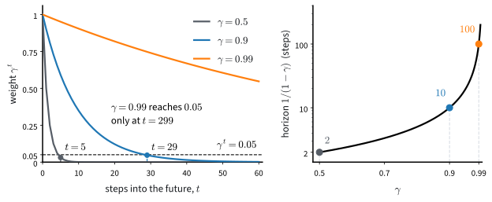

# Markov Decision Processes
:label:`sec_mdp`

In reinforcement learning, an agent interacts with an environment over many
time steps. At each step it observes the situation it is in, chooses an
action, and receives a numerical reward. The action also influences which
situation comes next, and with it the rewards that remain available. A
*Markov decision process* (MDP) is the mathematical model of this interaction
on which the algorithms of this chapter are built
:cite:`BellmanMDP,Puterman.1994`. In this section we define its components,
the objective that an agent maximizes, and the assumption that gives the
model its name. Our running example is FrozenLake from the Gymnasium library
:cite:`Towers.Kwiatkowski.Terry.ea.2024`, a grid world small enough that every
quantity of interest can be computed exactly. The tabular sections of this
chapter all use it.

```{.python .input #mdp-markov-decision-processes}
%%tab pytorch
import math
import numpy as np
import torch
from torch import nn
from torch.nn import functional as F
from d2l import torch as d2l
```

```{.python .input #mdp-markov-decision-processes}
%%tab jax
import math
import numpy as np
import jax
from jax import numpy as jnp
from flax import nnx
import optax
from d2l import jax as d2l
```

```{.python .input #mdp-markov-decision-processes-1}
%%tab pytorch, jax
import gymnasium as gym
```

## The Model

An MDP has four components: the states, the actions, the transition
probabilities, and the reward. We introduce them on FrozenLake.

### States, Actions, and Transitions

:numref:`fig_rl_gridworld` shows FrozenLake. The agent starts in the top-left
cell (S) and should reach the goal (G) in the bottom-right cell without
falling into one of the four holes (H). The *states* are the sixteen cells,
numbered $0$ to $15$ row by row, so the start is state $0$, the goal is state
$15$, and the holes are states $5$, $7$, $11$, and $12$. The *actions* are the
four moves *left*, *down*, *right*, and *up*, encoded as $0$ to $3$. An
episode ends when the agent enters a hole or the goal.


:label:`fig_rl_gridworld`

FrozenLake comes in two versions. On *calm* ice, every action moves the agent
one cell in the commanded direction, except that a move into the border of
the grid leaves it in place. On *slippery* ice, the agent moves in the
commanded direction with probability $1/3$ and in each of the two
perpendicular directions with probability $1/3$. Gymnasium stores these
dynamics as a table, which we read for state $9$ and the action *down*:

```{.python .input #mdp-states-actions-and-the-transition-kernel-1}
%%tab pytorch, jax
env = gym.make('FrozenLake-v1', is_slippery=True)
calm_env = gym.make('FrozenLake-v1', is_slippery=False)
for name, e in [('slippery', env), ('calm', calm_env)]:
    print(f'{name:>8}:', [(round(p, 3), s2, r, done)
                          for p, s2, r, done in e.unwrapped.P[9][1]])
```

Each tuple lists a probability, a next state, a reward, and whether the next
state ends the episode. On slippery ice, the command *down* from state $9$
leads to states $8$, $13$, and $10$ with probability $1/3$ each. On calm ice,
it leads to state $13$ with probability one. In general, the dynamics are
described by a *transition kernel* $P(s' \mid s, a)$, the probability of
moving to state $s'$ when action $a$ is taken in state $s$. For every $s$ and
$a$, these probabilities form a distribution over next states,
$\sum_{s'} P(s' \mid s, a) = 1$. Calm ice is the special case in which each of
these distributions puts all its mass on a single state.

### Rewards

The last component is the reward. FrozenLake pays reward $1$ for a transition
into the goal and $0$ for every other transition, so the reward paid depends
on the next state. We write $r(s, a, s')$ for the reward of a transition from
$s$ to $s'$ under action $a$. The methods of this chapter maximize expected
rewards, and for these only the mean reward of each state-action pair matters,

$$r(s, a) = \sum_{s'} P(s' \mid s, a)\, r(s, a, s').$$

We write $r_t$ for the reward received at time step $t$, so that
$\mathbb{E}[r_t \mid s_t = s, a_t = a] = r(s, a)$. Together, the four
components form the MDP

$$\textrm{MDP}: \quad (\mathcal{S}, \mathcal{A}, P, r),$$
:eqlabel:`eq_mdp`

where $\mathcal{S}$ and $\mathcal{A}$ denote the sets of states and actions.

The transition and reward model of a small MDP fits into two arrays. The
class below stores them, and we save it in the `d2l` library for the rest of
the chapter. Its method `backup` computes the quantity
$r(s, a) + \gamma \sum_{s'} P(s' \mid s, a)\, V(s')$ for every state-action
pair, given a number $V(s')$ for every state. If $V(s')$ is read as the total
reward still to be collected after reaching $s'$, this quantity is the
expected reward of the step plus the discounted total that follows it,
averaged over the next state. The discount factor $\gamma$ is introduced
below, and :numref:`sec_valueiter` builds its first algorithm by repeating
this one line.

```{.python .input #mdp-states-actions-and-the-transition-kernel-2}
%%tab pytorch, jax
class TabularMDP:  #@save
    """A finite MDP as dense arrays: P[s, a, s'] and r[s, a]."""
    def __init__(self, P, r, gamma):
        self.P, self.r, self.gamma = P, r, gamma
        self.num_states, self.num_actions = r.shape

    @classmethod
    def from_gym(cls, env, gamma):
        """Read the transition table Gymnasium exposes as env.unwrapped.P."""
        n_s, n_a = env.observation_space.n, env.action_space.n
        P, r = np.zeros((n_s, n_a, n_s)), np.zeros((n_s, n_a))
        for s, actions in env.unwrapped.P.items():
            for a, outcomes in actions.items():
                for p, s_next, reward, _ in outcomes:
                    P[s, a, s_next] += p      # several outcomes may share s'
                    r[s, a] += p * reward     # r(s,a) is the expected reward
        return cls(P, r, gamma)

    def backup(self, V):
        """Q(s, a) = r(s, a) + gamma * sum_{s'} P(s'|s, a) V(s')."""
        return self.r + self.gamma * self.P @ V
```

The method `from_gym` adds up the probabilities of outcomes that share a next
state. For example, on slippery ice the command *left* in the corner state
$0$ leaves the agent in place both when it moves as commanded and when it
slips upward, so the array stores
$P(0 \mid 0, \textrm{left}) = 1/3 + 1/3 = 2/3$.

```{.python .input #mdp-states-actions-and-the-transition-kernel-3}
%%tab pytorch, jax
gamma = 0.95
LEFT, DOWN, RIGHT, UP = 0, 1, 2, 3
mdp = TabularMDP.from_gym(env, gamma)
print(mdp.P[9, DOWN])
```

The list of outcomes has become a row of the array: probability $1/3$ in the
columns $8$, $10$, and $13$, and zero elsewhere. The expected reward is zero
for most state-action pairs:

```{.python .input #mdp-states-actions-and-the-transition-kernel-4}
%%tab pytorch, jax
for s, a in np.argwhere(mdp.r > 0):
    print(f'r(s={s}, a={"<v>^"[a]}) = {mdp.r[s, a]:.3f}')
```

Its only nonzero entries are at state $14$, the one cell from which the goal
can be entered, since the goal's other neighbor, state $11$, is a hole. There
the three actions that can carry the agent into the goal each have expected
reward $1/3$: *right* enters the goal when it moves as commanded, and *down*
and *up* when they slip to the right, in each case with probability $1/3$ and
reward $1$. The command *left* slips only up or down and never reaches the
goal.

The states, the actions, and the kernel describe the environment. The reward
describes the task, and the designer of the task chooses it. A change of the
reward generally changes which behavior is best. One family of changes
provably does not: adding $\gamma \Phi(s') - \Phi(s)$ to the reward of every
transition, for a function $\Phi$ of the state that is zero at the states
where episodes terminate, leaves the best behavior unchanged
:cite:`Ng.Harada.Russell.1999`. The added terms telescope along any episode
that ends in such a state. Weight the term of step $t$ by $\gamma^t$, as the
return defined in :eqref:`eq_return` below does, and consider an episode that
terminates in the state $s_T$ after $T$ steps. The term
$\gamma^{t+1} \Phi(s_{t+1})$ of step $t$ cancels against the term
$-\gamma^{t+1} \Phi(s_{t+1})$ of step $t + 1$, and $\Phi(s_T) = 0$, so

$$\sum_{t=0}^{T-1} \gamma^t \big(\gamma \Phi(s_{t+1}) - \Phi(s_t)\big) = \gamma^T \Phi(s_T) - \Phi(s_0) = -\Phi(s_0).$$

For an episode that never terminates, the same sum up to step $T$ equals
$\gamma^T \Phi(s_T) - \Phi(s_0)$, which converges to $-\Phi(s_0)$ as
$T \to \infty$, because $\Phi$ is bounded on the finitely many states and
$\gamma < 1$. The added terms therefore change the return of every trajectory
that starts in $s_0$ by the same amount, $-\Phi(s_0)$.

## Returns and Discounting

The model describes what happens after each action. We now define what the
agent tries to achieve.

### Trajectories

The agent starts in a state $s_0$, which is state $0$ in FrozenLake. At each
time step $t$, it is in a state $s_t$, takes an action $a_t$, receives a
reward $r_t$, and moves to a next state $s_{t+1} \sim P(\cdot \mid s_t, a_t)$.
The result is a *trajectory*

$$\tau = (s_0, a_0, r_0, s_1, a_1, r_1, s_2, a_2, r_2, \ldots).$$

The following loop produces one trajectory on slippery ice, choosing every
action uniformly at random:

```{.python .input #mdp-return-discount-and-horizon}
%%tab pytorch, jax
rng = np.random.default_rng(8)
s, _ = env.reset(seed=8)
terminated = truncated = False
t = 0
while not (terminated or truncated):
    a = int(rng.integers(4))
    s_next, r, terminated, truncated, _ = env.step(a)
    print(f't={t:>2}  s={s:>2}  a={"<v>^"[a]}  r={r:.0f}')
    s, t = s_next, t + 1
print(f'terminated={terminated}, truncated={truncated}')
```

Each row shows the state at step $t$ and the command issued there, and the
next row shows where the command led. The commanded and the realized moves
often differ, because the ice is slippery. At $t = 0$, for example, the
command *right* leaves the agent in state $0$, because the agent slipped
upward into the border, and at $t = 2$ the command *left* takes it down to
state $4$. The episode ends when the last command, *right* from state $10$,
enters the hole at state $11$, so every reward along this trajectory is zero.
The aim of reinforcement learning is to act so that the rewards collected
along the trajectory are large, on average over the randomness of the
transitions and of the agent's own choices.

### Discounting and the Effective Horizon

A trajectory can be infinitely long. On FrozenLake, for example, an agent that
starts in state $0$ and always commands *up* never leaves the top row, on
either version of the ice, so it reaches neither a hole nor the goal. With a
positive reward at every step, the plain sum of rewards along such a
trajectory would be infinite. We therefore weight the reward at step $t$ by
$\gamma^t$ for a *discount factor* $0 \leq \gamma < 1$, and define the
*return* of a trajectory as

$$R(\tau) = r_0 + \gamma r_1 + \gamma^2 r_2 + \cdots = \sum_{t=0}^\infty \gamma^t r_t.$$
:eqlabel:`eq_return`

If every reward satisfies $|r_t| \leq r_{\max}$, the geometric series bounds
the return and its tail:

$$|R(\tau)| \leq \frac{r_{\max}}{1 - \gamma}, \qquad \Big| \sum_{t \geq k} \gamma^t r_t \Big| \leq \frac{\gamma^k\, r_{\max}}{1 - \gamma}.$$

The first bound makes the return finite. The second shows that the rewards
from step $k$ on contribute at most a fraction $\gamma^k$ of the largest
possible return. The sum of the weights, $1/(1-\gamma)$, is called the
*effective horizon*. For $\gamma$ close to one, $\ln \gamma \approx -(1-\gamma)$,
so $\gamma^k = e^{k \ln \gamma} \approx e^{-k(1-\gamma)}$, and the weights
fall below $0.05$ after about three effective horizons, since
$e^{-3} \approx 0.05$. For the value $\gamma = 0.95$ used in the code above,
the effective horizon is $20$ steps, and $\gamma^t$ first falls below $0.05$
at $t = 59$. :numref:`fig_rl_return_discount` shows both quantities.


:label:`fig_rl_return_discount`

The discount factor also sets how much delayed rewards count. With $\gamma$
close to zero, a reward a few steps ahead has almost no weight; with $\gamma$
close to one, a reward far in the future counts almost as much as an
immediate one. On FrozenLake the only reward comes at the goal, so a
successful episode of $k$ moves has return $\gamma^{k-1}$ (the $k$-th move
earns $r_{k-1}$, because steps are counted from zero). With $\gamma = 0.95$,
the six-move shortest path of :numref:`fig_rl_gridworld` has return
$\gamma^5 \approx 0.77$, and every longer successful episode has a smaller
return. With $\gamma < 1$, the expected return therefore rewards reaching the
goal in few moves as well as reaching it at all.

### Termination and Truncation

A state in which the interaction ends, such as a hole or the goal of
FrozenLake, is called *terminal*, and a trajectory from the start until the
simulator stops it is an *episode*. The simulator stops an episode for one of
two reasons. The episode is *terminated* when the agent enters a terminal
state. No reward follows a terminal state, so the return collected after it is
zero. Gymnasium's transition table, and with it `TabularMDP`, represents this
by making each terminal state *absorbing*: every action leads back to the same
state with reward zero. For the hole at state $5$, for example, the table
lists the single outcome `(1.0, 5, 0, True)` for each of the four actions.
The episode is *truncated* when it reaches a time limit: Gymnasium stops
FrozenLake after $100$ steps and CartPole, the environment of
:numref:`sec_deeprl`, after $500$ steps. The two cases are reported
separately, by the flags `terminated` and `truncated` that appeared in the
loop above.

The distinction matters for learning. When an episode is truncated in a
nonterminal state, the rewards that the agent would have collected after the
time limit need not be zero. If the time limit is a property of the simulator
rather than of the task, an algorithm that estimates future returns with a
learned estimate should therefore set the return that follows a terminal
state to zero, and replace the return that follows a truncation by the
estimate at the state in which the episode was cut off
:cite:`Pardo.Tavakoli.Levdik.ea.2018`. The algorithms in this chapter that bootstrap from
such estimates follow this rule.

## The Markov Property

The kernel $P(s' \mid s, a)$ conditions only on the current state and action,
and so does the mean reward $r(s, a)$. Both rest on the *Markov assumption*:
once the current state and action are known, the earlier history provides no
additional information about the next state or the reward. On FrozenLake the
assumption holds by construction: the transition table gives the distribution
of the next cell and the reward from the current cell and the command alone,
however the agent reached that cell. In general, whether the assumption holds
depends on what we choose to call the state.

### State Augmentation

Consider a robot whose state is its location and whose action is the
acceleration applied by its wheels. The next location depends on the current
location, the acceleration, and the current velocity, which the location alone
does not reveal. If the velocity can be computed from the last two locations,
the dynamics take the form

$$s_{t+1} = f(s_t, a_t, s_{t-1}),$$

and the location is not a Markov state. Choosing the pair
$(\textrm{location}, \textrm{velocity})$ as the state restores the property:
by Newton's laws of motion, the next location and velocity are determined by
the current pair and the applied acceleration. The Markov property is thus a
property of the chosen representation of the state, not only of the physical
system. Enlarging the state until it contains the information needed to
predict the future is called *state augmentation*.

### Partial Observability

Augmentation requires the missing information to be observable. A poker
player cannot see the opponents' cards, however long the history of play.
When the agent receives observations that reveal only part of the state, the
problem is a *partially observable* MDP. Exact methods for this setting
maintain a *belief*, a probability distribution over the hidden state that is
updated after every observation :cite:`Kaelbling.Littman.Cassandra.1998`. A
common approximation adds a short history of observations to the input of the
agent. In Atari games, for example, a single frame shows where the objects are
but not how they move, and the agents of :citet:`mnih2015human` receive the
last four frames. When the hidden variable is the task itself, as in
meta-reinforcement learning, the same device applies: a learned summary of the
past trajectory, given to the agent as an additional input, makes off-policy
Q-learning competitive with specialized meta-reinforcement learning algorithms
:cite:`Fakoor.Chaudhari.Soatto.ea.2020`.
The rest of this chapter assumes that the agent observes a Markov state.

## Summary

An MDP consists of states, actions, a transition kernel, and a reward. The
Markov assumption requires the state to contain everything about the past that
matters for the future, and state augmentation restores the assumption when
the missing information is observable. The agent maximizes the expected
discounted return, and the effective horizon $1/(1-\gamma)$ measures how far
ahead it looks. Episodes end at terminal states, after which the return is
zero, or at time limits, after which the return is unknown and need not be
zero.
Methods that build on value estimates must distinguish the two.

## Exercises

1. **What the state must contain.** A single frame of
   [Pong](https://gymnasium.farama.org/environments/atari/pong/) shows where
   the ball is but not where it is going.
    1. Explain which property of :eqref:`eq_mdp` fails when the state is a
       single frame, and propose an augmentation of the state that reveals
       where the ball is going.
    1. Name the state and action sets of
       [MountainCar](https://gymnasium.farama.org/environments/classic_control/mountain_car/),
       and explain why its observation, a position and a velocity, is a
       Markov state while the position alone is not.
1. [code] **Counting outcomes.** Build the slippery FrozenLake MDP with
   `d2l.TabularMDP.from_gym`. Check that every row of `mdp.P` sums to one,
   and count the state-action pairs that have more than one possible next
   state. Repeat with `is_slippery=False`.
1. **The effective horizon.** Prove the tail bound in the text. For
   $\gamma \in \{0.9, 0.95, 0.99, 0.999\}$, find the smallest $k$ with
   $\gamma^k \leq 0.01$ and compare it with $1/(1-\gamma)$. Explain why the
   ratio of the two approaches $\ln 100$ as $\gamma \to 1$.
1. **Random rewards.** Suppose the reward of each transition is random, drawn
   independently at each step, with mean $r(s, a, s')$. Show that the
   expected return of every policy that chooses its actions from the states
   and actions so far, without looking at the rewards, is unchanged when each
   reward is replaced by its mean. Where does the randomness of the rewards
   still matter?
1. **Truncation.** On CartPole, every step earns reward $1$, and episodes are
   truncated after $500$ steps. Consider a policy under which the episode
   never terminates, and the state reached $10$ steps before the time limit,
   with $\gamma = 0.99$.
    1. Compute the discounted return from that state if the truncation is
       treated as termination, and the return if the interaction continues
       forever.
    1. Which of the two should a learned value estimate predict, and what
       would go wrong if it were trained on the other one?

[Discussions](https://d2l.discourse.group/t/36794)

<!-- slides -->

::: {.slide}
::: {.cover}
[Dive into Deep Learning · §14.1]{.kicker}

Markov decision processes<br>
**states, actions, transitions, rewards · return and discount · termination and truncation · the Markov property**
:::
:::

::: {.slide title="Four Components"}
The model of acting over time:

$$\textrm{MDP}: \quad (\mathcal{S}, \mathcal{A}, P, r)$$

- $\mathcal{S}$: states. $\mathcal{A}$: actions.
- $P(s' \mid s, a)$: the transition kernel, a **distribution** over next
  states.
- $r(s, a)$: the expected reward, chosen by the designer of the task.

. . .

The Markov assumption: given the current state and action, the earlier
history does not help predict the next state or the reward.
:::

::: {.slide title="The Kernel Is a Table"}
FrozenLake: $16$ cells, $4$ moves, $4$ holes, $1$ goal.

@mdp-states-actions-and-the-transition-kernel-1

. . .

Slippery ice: the commanded move and the two perpendicular moves, $1/3$ each.
Calm ice: one next state with probability one.
:::

::: {.slide title="One Class for the Chapter"}
@mdp-states-actions-and-the-transition-kernel-2

`backup` computes $r(s, a) + \gamma \sum_{s'} P(s' \mid s, a) V(s')$ for every
state-action pair.
:::

::: {.slide title="Trajectory and Return"}
$$\tau = (s_0, a_0, r_0, s_1, a_1, r_1, \ldots), \qquad
R(\tau) = \sum_{t=0}^{\infty} \gamma^t r_t$$

@mdp-return-discount-and-horizon

A successful FrozenLake episode of $k$ moves has return $\gamma^{k-1}$.
:::

::: {.slide title="The Discount Sets a Horizon"}
{width=88%}

$|R(\tau)| \leq r_{\max}/(1-\gamma)$; the effective horizon is
$1/(1-\gamma)$.
:::

::: {.slide title="Terminated or Truncated"}
- **terminated**: a terminal state; the future return is zero.
- **truncated**: a time limit; the future return is unknown and need not be
  zero.

. . .

Methods that bootstrap from value estimates stop bootstrapping only at
terminal states :cite:`Pardo.Tavakoli.Levdik.ea.2018`.
:::

::: {.slide title="Choosing the State"}
- Location alone is not Markov for a robot controlled by acceleration;
  (location, velocity) is.
- Partial observability: maintain a belief, or add a short history of
  observations to the input.

. . .

The Markov property is a property of the representation, not only of the
system.
:::
