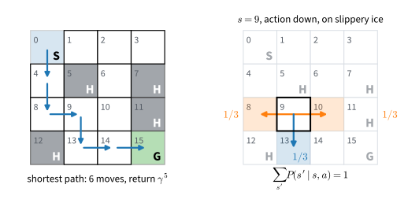
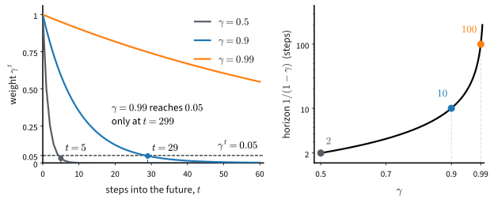
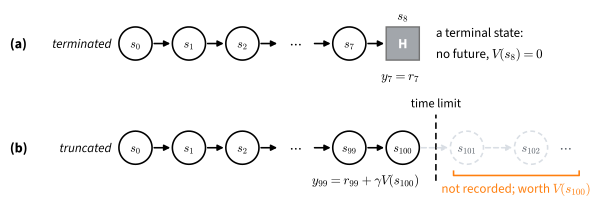

# Markov Decision Processes
:label:`sec_mdp`

Picture a robot crossing a frozen lake, a program playing a board game, or a language model writing an answer one token at a time. Each choice changes what happens next: the robot slips into a different cell, the game reaches a different position, the answer takes a different turn. The reward may come only at the end, and the same command may have several outcomes. Before we can ask how to act well, we need a way to write such a problem down: what the decision maker knows at each step, what it can do, what follows, and what it is trying to achieve.

Bellman gave this description its form in a 1957 paper on Markovian decision processes :cite:`BellmanMDP`. His idea was to put everything about the past that matters for the future into a *state*, so that the consequences of an action depend only on the state in which it is taken. That one assumption makes the problem tractable. Once the future depends on the present state alone, a single number per state can say how good it is to be there. The resulting model, the *Markov decision process* (MDP), became a standard tool of operations research :cite:`Puterman.1994`. Every method in this chapter and the next works on it, from dynamic programming to the training of language models with a reward.

We work on a sixteen-cell frozen lake, small enough that every quantity can be checked by hand. It still has the feature that makes acting over time hard: on slippery ice the agent often slides somewhere other than where it meant to go. We read the lake's transition table out of a simulator and name its parts, then define the return an agent maximizes and the discount that keeps it finite. We ask what a state must contain, and we examine a bonus that looks helpful but pays the agent for going in circles. A second, even smaller example closes the section: a language model answering arithmetic questions, scored by a checker.

The chapter uses the symbols of :numref:`tab_rl_notation`. Those of this section are defined below; the others belong to later sections, which define each where it is first used.

:Symbols of the reinforcement-learning chapters. The rows from $V^\pi$ on belong to later sections, and those from $\lambda$ on to :numref:`chap_deep_rl`. The exploration rate $\epsilon$ and the per-step disagreement $\varepsilon$ are different symbols, and so are a response $y$ and a value target $y_t$. A $\mu$ with a subscript or argument other than 0 is a mean (an arm's, a Gaussian's).
:label:`tab_rl_notation`

| Symbol | Meaning | Introduced in |
|:--|:--|:--|
| $\mathcal{S}$, $\mathcal{A}$ | the sets of states and actions | :numref:`sec_mdp` |
| $s_t$, $a_t$, $r_t$ | the state, action and reward at step $t$ | :numref:`sec_mdp` |
| $P(s' \mid s, a)$ | transition kernel: the probability of reaching $s'$ from $s$ under action $a$ | :numref:`sec_mdp` |
| $r(s, a)$ | expected reward of action $a$ at state $s$ | :numref:`sec_mdp` |
| $\mu_0$ | start-state distribution (for language models, the distribution of prompts) | :numref:`sec_mdp` |
| $\tau$ | trajectory $(s_0, a_0, r_0, s_1, \ldots)$ | :numref:`sec_mdp` |
| $\gamma$ | discount factor | :numref:`sec_mdp` |
| $R(\tau)$ | return of a trajectory, $\sum_t \gamma^t r_t$ | :numref:`sec_mdp` |
| $T$ | number of steps of an episode, or a time limit | :numref:`sec_mdp` |
| $\pi(a \mid s)$, $\pi(s)$ | policy: probability of action $a$ at state $s$; the action of a deterministic policy | :numref:`sec_mdp`, :numref:`sec_valueiter` |
| $\ell(s)$ | Manhattan distance from cell $s$ to the goal | :numref:`sec_mdp` |
| $\Phi(s)$ | potential of a shaping bonus | :numref:`sec_mdp` |
| $x$, $y$, $r(x, y)$ | prompt, response, and the verifier's score of the response | :numref:`sec_mdp` |
| $y_t$ | target of a value update: an estimate of the return from step $t$ | :numref:`sec_mdp`, :numref:`sec_deeprl` |
| $V^\pi$, $Q^\pi$ | expected return under $\pi$ from a state, from a state-action pair | :numref:`sec_valueiter` |
| $V^*$, $Q^*$ | the same under an optimal policy | :numref:`sec_valueiter` |
| $\mathcal{T}$ | Bellman operator: one step of lookahead applied to a vector of values | :numref:`sec_valueiter` |
| $\delta$, $\delta_t$ | temporal-difference error of one transition, of the transition at step $t$ | :numref:`sec_qlearning` |
| $\alpha$ | step size of temporal-difference updates | :numref:`sec_qlearning` |
| $\epsilon$ | exploration rate of $\epsilon$-greedy action selection | :numref:`sec_qlearning` |
| $\pi_e$ | behavior policy, the one that chooses the actions while a method learns | :numref:`sec_qlearning` |
| $\kappa$ | weight of the uncertainty bonus | :numref:`sec_exploration` |
| $K$ | number of responses sampled per prompt | :numref:`sec_exploration` |
| $\pi_\theta$, $\theta$ | policy with parameters $\theta$ | :numref:`sec_mdp` (the verifier's preference table), :numref:`sec_imitation` |
| $d^\pi_t$, $d^\pi_\gamma$ | distribution of $s_t$ under $\pi$; its discounted average over $t$ | :numref:`sec_imitation`, :numref:`sec_policygradient` |
| $\varepsilon$ | per-step probability that a cloned policy disagrees with the expert | :numref:`sec_imitation` |
| $J(\theta)$ | expected return of $\pi_\theta$ | :numref:`sec_policygradient` |
| $\eta$ | step size of a policy update | :numref:`sec_policygradient` |
| $\hat{G}_t$ | reward-to-go: the discounted sum of the rewards from step $t$ on | :numref:`sec_baselines` |
| $b$ | baseline subtracted from a return | :numref:`sec_baselines` |
| $\eta_V$ | step size of a value-baseline update | :numref:`sec_baselines` |
| $A^\pi$ | advantage $Q^\pi - V^\pi$ | :numref:`sec_baselines` |
| $\lambda$ | weight of the $\lambda$-return | :numref:`sec_actorcritic` |
| $w$, $w^-$ | parameters of a value network; of its frozen or Polyak-averaged copy | :numref:`sec_actorcritic`, :numref:`sec_dqn` |
| $n$ | depth of an $n$-step target, or of a plan | :numref:`sec_actorcritic`, :numref:`sec_model_based` |
| $\rho_t$ | importance ratio $\pi_\theta(a_t \mid s_t) / \pi_{\theta_{\textrm{old}}}(a_t \mid s_t)$ at step $t$ | :numref:`sec_ppo` |
| $\epsilon_{\textrm{clip}}$ | half-width of the clip band of the ratio | :numref:`sec_ppo` |
| $\Delta_{\textrm{KL}}$ | a KL budget per update | :numref:`sec_ppo` |
| $\pi_{\textrm{ref}}$, $\beta$ | reference policy; weight of the KL penalty, and soft actor-critic's temperature | :numref:`sec_regularized`, :numref:`sec_sac` |
| $\hat{r}$ | a fitted reward | :numref:`sec_regularized`, :numref:`sec_model_based` |
| $\nu$ | Polyak rate of a target network | :numref:`sec_sac` |
| $\hat{f}_\phi$ | a learned transition model | :numref:`sec_model_based` |

```{.python .input #mdp-markov-decision-processes}
%%tab pytorch
from d2l import torch as d2l
import gymnasium as gym
import numpy as np
```

```{.python .input #mdp-markov-decision-processes}
%%tab jax
from d2l import jax as d2l
import gymnasium as gym
import numpy as np
```

## The Model

:numref:`fig_rl_gridworld` shows the lake: FrozenLake from the Gymnasium suite :cite:`Towers.Kwiatkowski.Terry.ea.2024`, which the tabular sections of this chapter share. The agent starts in the top-left cell and tries to reach the goal at the bottom right, which pays a reward of one. Four cells are holes, and entering a hole or the goal ends the attempt. On *slippery* ice a command moves the agent in the intended direction with probability $1/3$ and in each of the two perpendicular directions with probability $1/3$. A move off the edge of the grid leaves the agent where it is.


:label:`fig_rl_gridworld`

Consider the agent in cell 9, three moves from the goal. Three of its four commands can slide it into the hole at cell 5, one time in three each. Only *down* cannot, but *down* also slides it sideways two times in three, into cell 8 or 10. Is the safety of *down* worth the steps it loses sliding sideways? To compare commands we need to know where each can lead, what the agent can do from there, and what it receives at the end.

### States, Actions and the Transition Kernel

The *state* of the lake is the agent's cell. The set of states $\mathcal{S} = \{0, 1, \ldots, 15\}$ numbers the cells row by row. The *actions* are the four commands *left*, *down*, *right* and *up*, encoded as 0 to 3; they form the set $\mathcal{A}$. On slippery ice an action determines a distribution over next states, and Gymnasium stores this distribution as a table that we can read directly:

```{.python .input #mdp-states-actions-and-the-transition-kernel-1}
%%tab pytorch, jax
env = gym.make('FrozenLake-v1', is_slippery=True)
LEFT, DOWN, RIGHT, UP = 0, 1, 2, 3
ARROWS = '<v>^'                        # one glyph per action, for printing
env.unwrapped.P[9][DOWN]
```

The output lists three outcomes, each of the form (probability, next state, reward, terminated). Commanded *down* from cell 9, the agent reaches 8, 13 or 10 with probability $1/3$ each, as in :numref:`fig_rl_gridworld`. In symbols, this table is the *transition kernel* $P(s' \mid s, a)$, the probability of reaching state $s'$ from state $s$ under action $a$. For each pair $(s, a)$ the numbers $P(\cdot \mid s, a)$ form a distribution, so $\sum_{s' \in \mathcal{S}} P(s' \mid s, a) = 1$.

The fourth ingredient is the *reward*. The simulator pays one for the step that enters the goal and zero for every other step, so the reward of a step depends on where the step lands. We work with its average over the landing cell, the *expected reward* $r(s, a)$ of action $a$ at state $s$; exercise :exref:`ex_mdp-expected-rewards` shows that the averaging changes no expected return. Together, the four objects form the MDP:

$$
\textrm{MDP}: \quad (\mathcal{S}, \mathcal{A}, P, r).
$$
:eqlabel:`eq_mdp`

The first three describe the environment. The reward describes the task, and whoever sets the task chooses it, a difference that the section on reward design turns on. Some treatments add the discount factor defined below to this tuple, or let the reward be random or depend on the next state. Our $r(s, a)$ then plays the role of the expected reward, and nothing in this chapter loses generality from the simpler form.

## Return, Discount and Horizon

The agent starts at a state $s_0$ drawn from a *start-state distribution* $\mu_0$, which for the lake puts all its mass on cell 0. At each step $t$ the agent is at state $s_t$, takes action $a_t$, receives reward $r_t$, and moves to a next state $s_{t+1} \sim P(\cdot \mid s_t, a_t)$. The sequence of these quantities is a *trajectory*,

$$\tau = (s_0, a_0, r_0, s_1, a_1, r_1, s_2, a_2, r_2, \ldots).$$

The reward $r_t$ in a trajectory is the realized one that the simulator pays; the expected reward $r(s_t, a_t)$ is its average given $s_t$ and $a_t$.

A rule for choosing actions is called a *policy*; we write $\pi(a \mid s)$ for the probability that it picks action $a$ in state $s$. The simplest one picks each of the four commands with probability $1/4$, whatever the state. We run it once from cell 0 and print every step:

```{.python .input #mdp-return-discount-and-horizon}
%%tab pytorch, jax
rng = np.random.default_rng(8)
s, _ = env.reset(seed=8)
terminated = truncated = False
total, t = 0.0, 0
while not (terminated or truncated):
    a = int(rng.integers(4))
    s_next, r, terminated, truncated, _ = env.step(a)
    print(f"t={t:>2}  s={s:>2}  a={ARROWS[a]}  s'={s_next:>2}  r={r:.0f}")
    total, s, t = total + r, s_next, t + 1
print(f'terminated={terminated}, truncated={truncated}, total reward={total:.0f}')
```

The transcript shows the kernel at work. At $t=0$ the agent commands *right* and stays in cell 0, because the ice slid it into the wall above. At $t=2$ it commands *left* and slides *down* to cell 4. At $t=8$ it commands *right* from cell 10 and enters the hole at cell 11, which ends the attempt with `terminated=True`. No step entered the goal, so every reward is zero. To score a trajectory that does reach the goal, we must first decide how much a late reward counts.

### Discounting and the Effective Horizon

Why not simply add the rewards? A trajectory can be infinitely long. The policy that always commands *up* never leaves the top row of the lake: *up* runs into the wall, and its two slips move along the row. With a positive reward on every step, the sum along such a trajectory grows without bound. A reward now is also usually worth more than the same reward later. Both concerns lead to a *discount factor* $0 \leq \gamma < 1$, which weights the reward of step $t$ by $\gamma^t$. The *return* of a trajectory is the discounted sum

$$R(\tau) = r_0 + \gamma r_1 + \gamma^2 r_2 + \cdots = \sum_{t=0}^\infty \gamma^t r_t.$$
:eqlabel:`eq_mdp_discounted_return`

With $\gamma = 0.95$ a reward one step away counts $0.95$, and a reward twenty steps away counts about $0.36$. The goal is to act so that the return is as large as possible on average, over the draws of the kernel, the start state and the agent's own choices. We maximize this *expected return* because it is what many independent attempts collect on average. For a finite MDP with $\gamma < 1$ the problem has a definite answer :cite:`Puterman.1994`. There is one policy that is best from every start state at once, and it can be chosen deterministic and independent of time: one command per cell. So the best policy does not depend on where the agent starts, and a start-state distribution concentrated on one cell loses nothing.

The discount also controls how far ahead the agent looks. If every reward satisfies $|r_t| \leq r_{\max}$, discounting keeps the return finite and bounds the part of it that lies beyond step $k$:

$$|R(\tau)| \leq \frac{r_{\max}}{1 - \gamma}, \qquad \Big| \sum_{t \geq k} \gamma^t r_t \Big| \leq \frac{\gamma^k \, r_{\max}}{1 - \gamma}.$$

The first bound makes the objective finite. The second says that rewards beyond step $k$ can move the return by at most a fraction $\gamma^k$ of its largest possible size. This suggests measuring the reach of the discount in steps, by the *effective horizon* $1/(1-\gamma)$. For $\gamma$ near one, $\gamma^{1/(1-\gamma)} \approx e^{-1}$, so the weights fall by a factor of about $e$ per horizon. For a constant reward stream, 95 percent of the discounted weight then lies within $\log(0.05)/\log(\gamma)$ steps, about three horizons. The table below lists both step counts for four discounts, together with the weight $\gamma^5$ that the goal's reward receives at the end of the six-move shortest path on calm ice:

```{.python .input #mdp-the-geometric-bound-and-the-effective-horizon}
%%tab pytorch, jax
print(f'{"gamma":>6} {"horizon 1/(1-gamma)":>20} {"t: gamma^t < 0.05":>18} '
      f'{"gamma^5":>8}')
for g in [0.5, 0.9, 0.95, 0.99]:
    t95 = int(np.ceil(np.log(0.05) / np.log(g)))
    print(f'{g:>6} {1 / (1 - g):>20.0f} {t95:>18} {g**5:>8.3f}')
```

At $\gamma = 0.95$, the discount used throughout this chapter, the horizon is 20 steps, 95 percent of the weight lies within 59 steps, and a goal reached in six moves is worth $\gamma^5 \approx 0.774$. At $\gamma = 0.5$ the same goal is worth about $0.03$. :numref:`fig_rl_return_discount` shows these quantities. The discount is part of the task, chosen by its designer: a small $\gamma$ makes the agent short-sighted, but exercise :exref:`ex_mdp-planning-discount` shows that it can make planning with an inaccurate model more reliable.


:label:`fig_rl_return_discount`

### The Model as Arrays

Dynamic programming reads the kernel, the reward and the discount many times over, and every later tabular section checks its learner against those exact computations. The dictionary of tuples that Gymnasium exposes is awkward for that. We want $P$ as one array indexed by $(s, a, s')$ and $r$ as one array indexed by $(s, a)$, so that an average over next states becomes one matrix product. `TabularMDP` holds the three objects. Its `from_gym` method builds the arrays from the simulator's table: it adds up outcomes that lead to the same next state, and it averages the reward over the outcomes, which gives the expected reward $r(s, a)$. We save the class to the `d2l` library, since every tabular section of the chapter uses it:

```{.python .input #mdp-states-actions-and-the-transition-kernel-2}
%%tab pytorch, jax
class TabularMDP:  #@save
    """A finite MDP as dense arrays: P[s, a, s'] and r[s, a]."""
    def __init__(self, P, r, gamma):
        self.P, self.r, self.gamma = P, r, gamma
        self.num_states, self.num_actions = r.shape

    @classmethod
    def from_gym(cls, env, gamma):
        """Read the transition table Gymnasium exposes as env.unwrapped.P."""
        n_s, n_a = env.observation_space.n, env.action_space.n
        P, r = np.zeros((n_s, n_a, n_s)), np.zeros((n_s, n_a))
        for s, actions in env.unwrapped.P.items():
            for a, outcomes in actions.items():
                for p, s_next, reward, _ in outcomes:
                    P[s, a, s_next] += p      # several outcomes may share s'
                    r[s, a] += p * reward     # r(s,a) is the expected reward
        return cls(P, r, gamma)
```

We build the lake's model with $\gamma = 0.95$ and print the row of the command we read from the simulator above:

```{.python .input #mdp-states-actions-and-the-transition-kernel-3}
%%tab pytorch, jax
gamma = 0.95
mdp = TabularMDP.from_gym(env, gamma)
print(mdp.P[9, DOWN])
```

The list of tuples has become a dense row of sixteen numbers: $1/3$ in columns 8, 10 and 13, zero elsewhere. Two checks, one per array, confirm the construction. Every row of $P$ must sum to one, and the reward must be nonzero only where the goal can be entered:

```{.python .input #mdp-states-actions-and-the-transition-kernel-4}
%%tab pytorch, jax
print(f'largest |row sum - 1|: {np.abs(mdp.P.sum(axis=-1) - 1).max():.1e}')
for s, a in np.argwhere(mdp.r > 0):
    print(f'r(s={s}, a={ARROWS[a]}) = {mdp.r[s, a]:.3f}')
```

Every row of $P$ sums to one. The reward array is zero except in cell 14, the only frozen cell next to the goal. There *down*, *right* and *up* each reach the goal with probability $1/3$ and so have expected reward $1/3$, while none of the three outcomes of *left* is the goal. The lake pays its reward only on the step that enters the goal.

### Episodes, Termination and Truncation
:label:`subsec_mdp-termination`

A state that ends the process is *terminal*; on the lake, the holes and the goal are terminal. A run from the start to a terminal state is an *episode*. The simulator stops an episode there and must be reset. Gymnasium's table, and so `TabularMDP`, stores each terminal state as an absorbing state whose actions lead back to itself with zero reward, so that every row of $P$ is a distribution. The two descriptions give the same returns, since the absorbing state collects nothing more.

When every episode ends after finitely many steps, discounting is not needed to keep the return finite, and $\gamma = 1$ is allowed: the return is then the plain sum of the rewards of an episode with $T$ steps. On the lake not every episode ends, since the always-*up* policy circles the top row forever, but $\gamma = 1$ is still safe there: rewards are nonnegative and a trajectory collects at most one. It is not safe in general. With a reward of $+0.05$ per step, the same always-*up* policy would have an infinite undiscounted return. Tasks that never end, such as controlling the heating of a building, therefore use $\gamma < 1$. Maximizing the long-run reward per step is the other common choice for such tasks; this chapter does not treat it.

Gymnasium separates two ways in which an episode can stop. `terminated=True` means that the process entered a terminal state: nothing more can happen, and the value of continuing is zero. `truncated=True` means that recording stopped, usually because of a time limit, while the agent stands in a state from which the process would go on. `gym.make` gives FrozenLake such a limit: after 100 steps the episode ends with `truncated=True`, even if the agent stands on frozen ice from where the goal can still be reached. :numref:`fig_rl_termination` shows both cases. The sum of rewards of a truncated episode is therefore not its return, since it misses everything after the cut. A method that estimates the value of continuing from the last state must treat them differently: the value is zero after termination, and after truncation it is whatever the last state is worth, its *value* $V(s)$, the expected return from $s$ on, which :numref:`sec_valueiter` defines precisely. Every method in this chapter that estimates the value of continuing sets it to zero on `terminated` alone.

![Two ways an episode stops. (a) Terminated: the episode enters the hole $s_8$, a terminal state. Nothing follows, so the value of continuing from it, $V(s_8)$, is zero, and the target for the last step, $y_7$, the return counted from that step, is the last reward $r_7$ alone. (b) Truncated: the 100-step time limit cuts the recording while the agent stands on frozen ice, from where the process would go on. The unrecorded future is worth $V(s_{100})$, the value of continuing from the last recorded state, which is not zero, so an estimate of the return from the last step, $y_{99} = r_{99} + \gamma V(s_{100})$, must include it.](../img/mdl-rl-termination.svg)
:label:`fig_rl_termination`

## The Choice of State

The kernel $P(s' \mid s,a)$ conditions on the current state and action, and on nothing else. This is the *Markov property*: once the present state is known, the earlier history says nothing more about the next state. It is what keeps the model small. Because the future depends on the present state alone, how good it is to be in a state can be summarized by one number per state, whatever path led there. On the lake the property holds by construction. The simulator samples the next cell from the row `P[s][a]` that we read above and draws each slip afresh. Whether the property holds in general depends on what we call the state.

### State Augmentation

Suppose the recorded state $s_t$ is a vehicle's location and the action $a_t$ is its acceleration. The next location also depends on the current velocity, which the current location alone does not reveal. Velocity can be inferred from two successive locations, so the next location depends on two past ones,

$$s_{t+1} = f(s_t, a_t, s_{t-1}),$$

and the location by itself is not Markov. Defining the state as the pair (location, velocity) resolves the problem: Newtonian dynamics determine the next location and velocity from the current pair and the applied acceleration. The Markov property is therefore a property of how we represent the state, not only of the physical system.

This construction is called *state augmentation*: the state is enlarged until it contains what is needed to predict the future. The enlarged state can be large, and the information it needs can be unknown, too large to store, or impossible to observe. A time limit that is part of the task is a simple case: with 100 steps allowed, the best command in a cell can depend on how many steps remain, and adding that count to the state restores the property (exercise :exref:`ex_mdp-time-limits`).

### Partial Observability

Augmentation requires the added variables to be observable. A poker player cannot see the opponents' cards. When the agent receives an observation $o_t$ that reveals only part of the state, the problem is a *partially observable* MDP. An exact solution tracks the agent's *belief*, the posterior distribution of the hidden state given everything observed so far (exercise :exref:`ex_mdp-belief-states`). In practice agents approximate it with memory. Early Atari agents stacked the last few frames, since one frame shows positions but not velocities. Current agents carry a recurrent state or attend over their whole history, as a language model does over its context. The rest of this chapter assumes that the agent observes a Markov state.

## Reward Design

The states, actions and kernel describe the environment; the reward describes the task, and the designer chooses it. An optimizer maximizes whatever reward is written down, including any difference between that reward and what the designer meant :cite:`Krakovna.Uesato.Mikulik.ea.2020`. The lake shows how this happens in a few lines of arithmetic.

FrozenLake's reward is *sparse*: it is zero on every step except the one that enters the goal. An agent that has never reached the goal has seen nothing but zeros, so it is tempting to help it along. Let $\ell(s)$ be the Manhattan distance from cell $s$ to the goal, the number of moves it would take if no hole were in the way, and pay a bonus of $0.3$ for every move that gets closer:

$$\tilde r(s, a, s') = r(s, a) + 0.3\, \mathbf{1}\big(\ell(s') < \ell(s)\big).$$

The bonus seems to point the agent toward the goal, but it can be collected without ever finishing. Take the two cells next to the goal on the bottom row, 13 and 14, with $\ell = 2$ and $\ell = 1$, and suppose for the moment that the ice is calm. The move from 14 to 13 earns nothing and costs nothing, and the move back earns $0.3$. From cell 14, entering the goal collects $1.3$, the reward and the bonus, and ends the episode. Shuttling to 13 and back instead collects $0.3$ on every second step, forever, which at $\gamma = 0.95$ is worth $0.3\gamma/(1 - \gamma^2) \approx 2.9$. The flaw is that the bonus pays for moving closer but charges nothing for moving away, so it adds up to a positive amount around any loop. :citet:`Randlov.Alstrom.1998` met the same flaw in a simulated bicycle that was rewarded for progress toward a goal and learned to ride in circles.

A bonus that cannot be collected around a loop must charge for each move away what it pays for the move back. Bonuses of the form

$$\tilde r(s, a, s') = r(s, a) + \gamma \Phi(s') - \Phi(s),$$
:eqlabel:`eq_mdp_shaping`

for some function $\Phi: \mathcal{S} \to \mathbb{R}$ called a *potential*, have this property. Around a loop that returns to its start, the differences $\Phi(s') - \Phi(s)$ cancel, so apart from the effect of discounting a loop earns nothing. This construction is called *potential-based shaping*. With $\Phi(s) = -0.3\,\ell(s)$ it pays $0.315$ for the move from 13 to 14 and charges $0.27$ for the move back. Shuttling forever from cell 14 now collects $0.3$ in total, while entering the goal still collects $1.3$: the shaped reward keeps the goal ahead of the loop by exactly the one that the original reward pays. Such a bonus is still useful: a potential spreads the goal's reward over the route, which gives a learner a signal long before it first reaches the goal.

One condition remains: the potential must be zero at the terminal states. The simulator stops at a terminal state, so a nonzero potential there would leave a final term that depends on which terminal state the episode ends in, and when. Such a term can change which behavior is best. Our $\Phi = -0.3\,\ell$ is zero at the goal but not at the holes, so it must be set to zero there. What the approach bonus does to the best policy on slippery ice is computed in :numref:`sec_valueiter`, which also proves that the potential form leaves the best policy unchanged.

## Two Special Cases

Two kinds of MDP recur in this chapter, because each removes one difficulty of the lake. When there is only one state, each round consists of choosing an action and observing a reward, and no action affects the future. This is the *multi-armed bandit*, named after a row of slot machines whose payout rates a player must discover by playing; it isolates the question of which actions to try, which :numref:`sec_exploration` studies. The second case keeps the future but removes the randomness of the transitions, and it describes a language model writing a response.

### Text Generation as an MDP

A language model that writes a response one token at a time fits the MDP with simple dynamics. The state is the prompt together with the tokens written so far, the action is the next token, and the transition appends that token to the state with probability one. The reward arrives once, when the response is complete: a checker called a *verifier* compares the response with a known answer, or a learned model scores it. Two properties set this MDP apart from the lake. The transitions are deterministic, so all randomness comes from the policy. And the state is the whole prefix, so no state is ever visited twice, and the states form a tree rooted at the prompt.

With deterministic transitions, a single reward at the end, and no revisits, the expected return depends only on the probability that the policy gives to each complete response. Nothing is lost by treating the whole response as one action chosen at the prompt. The MDP then collapses to one step: the prompt $x$, drawn from a distribution $\mu_0$ over prompts, is the state; a complete response $y$ is the action; and the verifier's score $r(x, y)$ is the reward. This is why methods for language models can score and update whole responses. :numref:`sec_rl_sequences` returns to the token-level view.

### The Verifier Task

We make the one-step view concrete with an instance small enough to compute exactly, the second running example of this chapter. It has four arithmetic prompts and nine candidate responses shared by all of them. The verifier pays one when a response equals the prompt's answer exactly, and zero otherwise. Two of the prompts, `8*8` and `9*9`, have no correct candidate, so no policy can score more than $0.5$ on average over the prompts. The ninth candidate, "one of 4, 12, 64 or 81", lists every answer at once. The exact-match verifier rejects this *hedge*, but a lenient checker that accepts any response containing the answer would pay it on every prompt, the problem of reward design in another form.

The policy stands in for a pretrained language model. It is a table $\theta$ of preferences with one row per prompt and one column per response, turned into probabilities by a softmax over each row, $\pi(y \mid x) \propto \exp \theta_{xy}$, as in softmax regression. The reference table $\theta_{\textrm{ref}}$ is zero except for the hedge column, which is $-4$. A reference response is therefore one of the eight ordinary candidates with probability about $1/8$ each, and the hedge with probability about $0.2$ percent. The class `VerifierTask` collects these pieces. Its method `verify(x, y)` is the checker. Its method `policy(theta)` applies the softmax to each row of a preference table. Its method `success(pi)` is the expected score of one sampled response, averaged over the four prompts: the expected return of this one-step MDP, with $\mu_0$ uniform over the prompts. An optional `reward` argument scores the policy under another checker instead. Training changes the table; here we only score the reference:

```{.python .input #mdp-the-degenerate-mdp-deterministic-transitions-terminal-reward}
%%tab pytorch, jax
class VerifierTask:  #@save
    """Four prompts, nine candidate responses shared by all of them, an
    exact-match verifier, and a reference policy that rarely hedges."""
    prompts = ['2+2', '3*4', '8*8', '9*9']
    answers = ['4', '12', '64', '81']
    resp = ['1', '3', '4', '7', '12', '19', '23', '35',
            'one of 4, 12, 64 or 81']          # the last one is the hedge

    def __init__(self):
        self.theta_ref = np.zeros((len(self.prompts), len(self.resp)))
        self.theta_ref[:, -1] = -4.0           # the reference rarely hedges
        self.pi_ref = self.policy(self.theta_ref)

    def verify(self, x, y):
        """The verifier: reward 1 iff response y is prompt x's answer."""
        return float(self.resp[y] == self.answers[x])

    @staticmethod
    def policy(theta):
        """pi(y | x): a softmax over each prompt's row of preferences."""
        z = np.exp(theta - theta.max(1, keepdims=True))
        return z / z.sum(1, keepdims=True)

    def success(self, pi, reward=None):
        """E r(x, y), y ~ pi(. | x), averaged over the prompts; r = verify
        unless another reward function is given."""
        reward = self.verify if reward is None else reward
        R = np.array([[reward(x, y) for y in range(len(self.resp))]
                      for x in range(len(self.prompts))])
        return (pi * R).sum(1).mean()

task = VerifierTask()
print(f'success of a response sampled from the reference: '
      f'{task.success(task.pi_ref):.3f}')
```

A response sampled from the reference passes the verifier with probability $0.062$. On each of the two answerable prompts the correct candidate has probability about $1/8$, and the other two prompts contribute nothing, so the average is about $1/16$. Training on this task has to close the gap between $0.062$ and the ceiling of $0.5$.

We can now write a decision problem down: the lake as two arrays and a discount, the verifier task as a table of scores, and for each the return that a trajectory earns. A model of this kind can be queried at any state and action, which is what *model-based* methods use; *model-free* methods see only the transitions that the agent's own experience produces. The question posed at cell 9 is still open. Comparing *down* with *right* requires the return that each command can lead to, and that depends on what the agent does in every cell it may reach next. :numref:`sec_valueiter` computes these values for all cells at once.

## Summary

A Markov decision process writes a problem of acting over time as states, actions, a transition kernel and a reward, $(\mathcal{S}, \mathcal{A}, P, r)$, under the assumption that the present state carries everything about the past that matters for the future. The agent maximizes the expected discounted return; the discount $\gamma$ keeps the return finite and sets an effective horizon of $1/(1-\gamma)$ steps, with weights that fall by a factor of about $e$ per horizon when $\gamma$ is near one. Terminal states end the process, while truncation only stops the recording, so the value of continuing is zero only after termination. When the obvious state is not Markov, augmenting it restores the property if the missing information can be observed. The reward is a design choice: a bonus that can be collected around a loop changes what the agent does, while a potential-based bonus cannot be collected that way. FrozenLake and the four-prompt verifier task, a token MDP collapsed to one step, are the running examples of the chapter.

## Exercises

1. **What the state must contain.** In each system below the obvious state
   is not Markov. Name the smallest addition that restores the Markov
   property, and say whether the agent can observe it.
    1. A delivery robot whose state is its location, when every move drains
       its battery by an amount that depends on the terrain and on the load
       it carries, and the robot stops once the battery is empty.
    1. A recommender whose state is the user's profile, when the user's
       interest in a topic falls with the number of recent recommendations
       of that topic.
    1. A chess program whose state is the arrangement of the pieces on the
       board, when the game ends in a draw as soon as a position occurs for
       the third time, or as soon as fifty moves by each player pass without
       a capture or a pawn move.

   In which of the three systems can the addition grow with the length of
   the episode, and what keeps it bounded there?
   :exlabel:`ex_mdp-state-must-contain`

1. [code] **Episodes from the kernel.** The example trajectory $\tau$ of
   this section draws every action uniformly at random with
   `rng.integers(4)`. Under this policy $\pi$ the next state has the
   distribution

   $$P_\pi(s' \mid s) = \frac{1}{4} \sum_{a \in \mathcal{A}} P(s' \mid s, a),$$

   which is `mdp.P.mean(axis=1)`.
    1. `from_gym` accumulates probabilities with `+=` because several of
       Gymnasium's outcomes for one state-action pair can lead to the same
       next state. Find every pair at which this happens, and explain from
       :numref:`fig_rl_gridworld` why these pairs and no others. If the line
       that fills `P` assigned with `=` instead, which rows of `mdp.P` would
       no longer sum to one, and what would they sum to?
    1. Let $d^\pi_t$ be the distribution of $s_t$, starting from
       $d^\pi_0 = \mu_0$, the point mass on state 0, so that
       $d^\pi_{t+1}(s') = \sum_{s} d^\pi_t(s) P_\pi(s' \mid s)$. Plot, for
       $t \leq 30$, the probability that the agent has reached the goal, the
       probability that it has fallen into a hole, and the probability that
       its episode is still running. What are the limits as
       $t \to \infty$?
    1. Ignoring the time limit of `env`, show that the mean episode length
       equals $\sum_{t \geq 0} \Pr(s_t \textrm{ is not terminal})$. Run
       10,000 episodes of `env` with the random policy, and compare the
       fraction of episodes that reach the goal and the mean episode length
       with the values that $d^\pi_t$ predicts. The 100-step limit of
       `env` ends a random episode with probability below $10^{-8}$, so it
       does not affect the comparison.
   :exlabel:`ex_mdp-kernel-predicts-episodes`

1. **Expected rewards.** Gymnasium attaches its reward to the transition:
   entering the goal pays one. `from_gym` replaces this reward
   $\rho(s, a, s')$ by its expectation
   $r(s, a) = \sum_{s'} P(s' \mid s, a)\, \rho(s, a, s')$.
    1. Show that for every policy and every start state the expected
       discounted return is the same whether step $t$ pays
       $\rho(s_t, a_t, s_{t+1})$ or $r(s_t, a_t)$. Extend the argument to a
       reward that is drawn at each visit of $(s, a)$, independently of
       everything else, from a distribution with mean $r(s, a)$.
    1. Under the convention $r(s, a)$, which FrozenLake episodes have a
       positive return? For the uniformly random policy of this section,
       estimate from 10,000 episodes the probability of a positive return
       under each of the two conventions. Which properties of the return
       does the model :eqref:`eq_mdp` therefore determine, and which does it
       not?
   :exlabel:`ex_mdp-expected-rewards`

1. **Discount as termination.** The discounted return
   :eqref:`eq_mdp_discounted_return` weights the reward of step $t$ by
   $\gamma^t$.
    1. This section locates 95 percent of the discounted weight within
       $\log(0.05) / \log(\gamma)$ steps and calls this about three effective
       horizons. Show that for every fraction $p \in (0, 1)$

        $$\frac{\ln(1/p)}{\ln(1/\gamma)} \leq \frac{\ln(1/p)}{1 - \gamma},$$

       and that the ratio of the two sides tends to one as $\gamma \to 1$.
       Use the inequality to explain the step counts of
       :numref:`fig_rl_return_discount` at $\gamma = 0.5$, $0.9$ and $0.99$.
    1. Modify an MDP so that after every reward the process moves, with
       probability $1 - \gamma$, to an absorbing state with zero reward, and
       otherwise moves according to $P$. Show that the expected undiscounted
       return of every policy in the modified process equals its expected
       discounted return in the original, and that the expected number of
       rewards collected is $1 / (1 - \gamma)$. Read the arrays of
       `TabularMDP` in these terms: what do the row sums of $\gamma P$ mean?
   :exlabel:`ex_mdp-discount-as-termination`

1. **Time limits.** `gym.make` wraps FrozenLake in a time limit:
   after 100 steps the episode ends with
   `truncated=True` (:numref:`subsec_mdp-termination`).
   Suppose that the limit is part of the task: the objective is the
   probability of entering the goal within 100 steps. Model the end of
   the limit as a move to an absorbing state. Show that the distribution
   of the next state then depends on the number $h$ of steps that
   remain, so that the location alone is not a Markov state, whereas the
   pair $(s, h)$ is :cite:`Pardo.Tavakoli.Levdik.ea.2018`. Why can the
   best action at a location depend on $h$?
   :exlabel:`ex_mdp-time-limits`

1. **Actions without consequences.** A multi-armed bandit has a single
   state, so no action can influence the future.
    1. Suppose more generally that the kernel does not depend on the action,
       $P(s' \mid s, a) = P(s' \mid s)$ for all $a$. Show that for every
       $\gamma$ the policy that picks an action in
       $\arg\max_a r(s, a)$ at every state maximizes the expected discounted
       return from every start state.
    1. Construct an MDP with two states and two actions in which this
       greedy policy is optimal for small $\gamma$ and not for large
       $\gamma$, and find the value of $\gamma$ at which the optimal action
       changes.

1. **Belief states.** ● In a partially observable MDP the agent receives
   an observation $o_t$, drawn with probability $O(o_t \mid s_t)$, instead
   of the state $s_t$. Its *belief*
   $\beta_t(s) = \Pr(s_t = s \mid o_0, a_0, \ldots, a_{t-1}, o_t)$ is the
   posterior over the hidden state given everything observed so far
   :cite:`Kaelbling.Littman.Cassandra.1998`.
    1. Using the Markov property of the hidden states, derive the update

        $$\beta_{t+1}(s') \propto O(o_{t+1} \mid s') \sum_{s \in \mathcal{S}} P(s' \mid s, a_t)\, \beta_t(s).$$

    1. Show that the belief is a Markov state: given $\beta_t$ and $a_t$, the
       distribution of $\beta_{t+1}$ and the expected reward do not depend on
       earlier observations. What are the state space and the kernel of the
       resulting MDP over beliefs?
    1. In a T-maze adapted from :citet:`Bakker.2001`, the agent observes a
       cue at the start, *left* or *right* with probability $1/2$ each, then
       moves one cell per step through $N$ corridor cells that all produce
       the same observation, and then reaches a junction. Turning toward
       the cue there gives reward one, and turning away gives zero. Show
       that a policy that acts on the $k$ most recent observations succeeds
       with probability at most $1/2$ unless $k \geq N + 2$. What is the
       belief at the junction, and how much memory suffices to act
       optimally? Why does stacking a few frames work for Pong but not
       here?
   :exlabel:`ex_mdp-belief-states`

1. [extended] **Planning horizon and model error.** ●● The discount
   $\gamma$ of the objective is fixed by the task, but a planner may compute
   its policy with a smaller *planning discount* $\gamma'$.
   :citet:`Jiang.Kulesza.Singh.ea.2015` found that when the model is
   estimated from data, $\gamma' < \gamma$ can yield a better policy than
   $\gamma' = \gamma$. Let $V^\pi_\gamma(s)$ be the expected discounted
   return from $s$ under policy $\pi$ and discount $\gamma$. Part (b) uses
   the value iteration and exact policy evaluation of :numref:`sec_valueiter`
   (`d2l.value_iteration` and `TabularMDP.policy_value`).
    1. Let rewards lie in $[0, r_{\max}]$ and let $\gamma' \leq \gamma$.
       Show that for every policy $\pi$ and state $s$

        $$0 \leq V^\pi_\gamma(s) - V^\pi_{\gamma'}(s) \leq \frac{(\gamma - \gamma')\, r_{\max}}{(1 - \gamma)(1 - \gamma')},$$

       and conclude that on the true model the policy that is optimal for
       $\gamma'$ loses at most this amount under $\gamma$.
    1. Reproduce their experiment at small scale with `TabularMDP`. Draw 100
       random MDPs with 10 states and 2 actions: for each state-action pair,
       choose 5 next states uniformly without replacement, give them weights
       drawn uniformly from $[0, 1]$, and normalize; draw each $r(s, a)$
       uniformly from $[0, 1]$. For each MDP and each
       $n \in \{2, 5, 10, 20\}$, build 20 estimated kernels $\hat P$ from $n$
       next states sampled per pair, keeping the true $r$. Compute the
       optimal policy of each estimated model for
       $\gamma' \in \{0, 0.1, \ldots, 0.9, 0.99\}$, evaluate it on the true
       model at $\gamma = 0.99$, and average the loss
       $V^*_\gamma(s) - V^\pi_\gamma(s)$ over states, kernels and MDPs,
       where $V^*_\gamma$ is the value of the optimal policy of the true
       model. Value iteration needs about $\log(10^{-8})/\log\gamma'$
       sweeps, about 2,000 at $\gamma' = 0.99$ and far fewer below; with
       that schedule the experiment takes a few minutes of CPU time. Plot
       the loss against $\gamma'$ for each $n$.
    1. Which $\gamma'$ minimizes the loss for each $n$, and how does it move
       with $n$? Explain the shape of the curves with two sources of loss,
       the horizon bias bounded in this problem and the error of $\hat P$,
       and say which of the two grows with $\gamma'$.
   :exlabel:`ex_mdp-planning-discount`

[Discussions](https://d2l.discourse.group/t/36794)

<!-- slides -->

::: {.slide}
::: {.cover}
[Dive into Deep Learning · §14.1]{.kicker}

Markov Decision Processes<br>
**states, actions, kernel and reward · return and discount · termination · the Markov state · reward design · the verifier task**
:::
:::

::: {.slide title="From Cell 9, Three of Four Commands Can Slide into a Hole"}
[The problem]{.kicker}

{width=72%}

Slippery ice: a command goes as intended 1/3 of the time, to each side 1/3.
From 9, *left*, *right* and *up* each reach hole 5 one time in three; *down* never
does, but slides sideways two times in three. Which command, and how to decide?
:::

::: {.slide title="By the End of This Deck You Can"}
[Goals]{.kicker}

- write a task as states, actions, a kernel and a reward, read from a simulator;
- compute a discounted return and the horizon a discount sets;
- tell an episode that terminated from one that was truncated;
- decide whether a state is Markov, and enlarge it when it is not;
- spot a reward bonus that pays for going in circles, and write one that cannot;
- write a language model's answer as a one-step MDP scored by a verifier.

**The idea:** the present state carries everything about the past that matters.
**Running examples:** slippery 4×4 FrozenLake at $\gamma = 0.95$; four
arithmetic prompts scored by a verifier.
:::

::: {.slide title="This Deck Defines the Problem the Next Seven Solve"}
[Where this fits]{.kicker}

| section | adds |
|---|---|
| **Markov Decision Processes** | **the model: states, actions, kernel, reward, return** |
| Dynamic Programming | the best values and policy of a known model |
| Temporal-Difference Learning | the same from sampled transitions |
| Exploration | which actions to try: bandits, optimism, posterior sampling |
| Learning from Demonstrations | cloning an expert, and why errors compound |
| Policy Gradient | improving a policy from its own attempts |
| Baselines and Variance Reduction | the same gradient with less noise |
| Function Approximation | networks in place of tables |

Skips: the long-run average-reward criterion; solving partially observed problems.
:::

::: {.slide title="The Lake Has 16 States and 4 Actions"}
[The model]{.kicker}

- **States** $\mathcal{S} = \{0, \ldots, 15\}$: the agent's cell, numbered row by row.
- **Actions** $\mathcal{A}$: *left*, *down*, *right*, *up*, encoded 0 to 3.
- **Start:** every episode starts in cell 0; the start-state distribution $\mu_0$
  puts all its mass there.
- **End:** the holes 5, 7, 11, 12 and the goal 15 end the episode; entering the
  goal pays 1, every other step pays 0.
- A move off the edge leaves the agent where it is. On calm ice the shortest
  path takes six moves.
:::

::: {.slide title="The Kernel Is a Table inside the Simulator"}
[The model]{.kicker}

@mdp-states-actions-and-the-transition-kernel-1

- Each tuple: (probability, next state, reward, terminated).
- The *transition kernel* $P(s' \mid s, a)$: for every pair $(s, a)$ a
  distribution over next states, $\sum_{s'} P(s' \mid s, a) = 1$.

::: {.d2l-note .rule}
On slippery ice a command is a proposal: one outcome among three equals.
:::
:::

::: {.slide title="As Arrays, an Average over Next States Is One Product"}
[The model]{.kicker}

`TabularMDP.from_gym` turns the simulator's table into `P[s, a, s']`, shape
(16, 4, 16), and `r[s, a]`, shape (16, 4). It adds up outcomes that share a next
state and averages the reward over the landing cell.

@mdp-states-actions-and-the-transition-kernel-3

The list of tuples became a dense row: $1/3$ in columns 8, 10 and 13.
:::

::: {.slide title="Every Row Sums to One; Only Cell 14 Has a Reward"}
[The model]{.kicker}

@!mdp-states-actions-and-the-transition-kernel-4

- *Expected reward* $r(s, a)$: the reward averaged over where the step lands.
  From 14, three commands enter the goal one time in three; *left* never does.
- The model is the tuple $(\mathcal{S}, \mathcal{A}, P, r)$. The first three
  describe the environment; the reward describes the task, chosen by its designer.
:::

::: {.slide title="This Random Run Falls into a Hole and Collects Nothing"}
[Return and discount]{.kicker}

Trajectory $\tau = (s_0, a_0, r_0, s_1, a_1, r_1, \ldots)$; a *policy* picks the
actions, here each command with probability 1/4:

@!mdp-return-discount-and-horizon

At $t = 0$ *right* slides into the wall above; at $t = 8$ the agent enters hole 11.
:::

::: {.slide title="Discounting Keeps the Return Finite"}
[Return and discount]{.kicker}

Always *up* never leaves the top row; with a reward every step the sum is
unbounded. Weight step $t$ by $\gamma^t$, $0 \le \gamma < 1$; for $|r_t| \le r_{\max}$:

$$R(\tau) = \sum_{t=0}^{\infty} \gamma^t r_t, \qquad |R(\tau)| \le \frac{r_{\max}}{1-\gamma}, \qquad \Big|\sum_{t \ge k} \gamma^t r_t\Big| \le \frac{\gamma^k\, r_{\max}}{1-\gamma}.$$

- Goal: the largest *expected* return, over the kernel, the start and the choices.
- A finite MDP with $\gamma < 1$ has one policy best from every start: one command per cell.
:::

::: {.slide title="γ = 0.95 Looks about 20 Steps Ahead"}
[Return and discount]{.kicker}

{width=78%}

*Effective horizon* $1/(1-\gamma)$: near $\gamma = 1$ the weights fall by about $e$ per
horizon, and 95% of the weight lies within about three horizons. At $\gamma = 0.95$:
a horizon of 20 steps, 95% of the weight within 59.
:::

::: {.slide title="Check: What Is the Six-Move Path Worth?"}
[Check]{.kicker}

On calm ice the shortest path reaches the goal on its sixth move, step $t = 5$.
What is its return at $\gamma = 0.95$? At $\gamma = 0.5$?

::: {.fragment .fade-up}
::: {.d2l-note}
**Answer.** The only reward is $\gamma^5$: $0.774$ at $\gamma = 0.95$, $0.031$ at
$\gamma = 0.5$. A short horizon makes even a six-move goal nearly worthless.
:::

@!mdp-the-geometric-bound-and-the-effective-horizon
:::
:::

::: {.slide title="Terminated Ends the Future; Truncated Ends the Recording"}
[Termination and truncation]{.kicker}

{width=88%}

$V(s)$: the expected return from $s$ on, zero after `terminated=True`. The 100-step
limit of `gym.make` sets `truncated=True`, and $V(s_{100})$ is not zero. Every
method here that estimates the continuation zeroes it on `terminated` alone.
:::

::: {.slide title="γ = 1 Needs a Bounded Total Reward"}
[Termination and truncation]{.kicker}

- `TabularMDP` stores a terminal state as an absorbing state: every action loops
  back with zero reward, so every row of $P$ stays a distribution.
- If every episode ends, or the total reward of every trajectory is bounded,
  $\gamma = 1$ is allowed. On the lake an episode collects at most 1.
- Always *up* never ends, yet its undiscounted return is 0. With $+0.05$ per
  step it would be infinite.
- Tasks that never end, such as heating a building, keep $\gamma < 1$.
:::

::: {.slide title="Location Alone Is Not Markov; Location and Velocity Are"}
[The choice of state]{.kicker}

*Markov property:* given $s_t$ and $a_t$, the earlier history says nothing more
about $s_{t+1}$. One number per state can then say how good the state is.

- A vehicle's next location depends on its velocity: $s_{t+1} = f(s_t, a_t, s_{t-1})$.
- *State augmentation:* the state (location, velocity) is Markov under Newton's laws.
- A 100-step limit that is part of the task: add the number of steps that remain.

::: {.d2l-note .rule}
The Markov property belongs to the representation, not only to the system.
:::
:::

::: {.slide title="When the State Is Hidden, the Agent Must Remember"}
[The choice of state]{.kicker}

- A poker player cannot see the opponents' cards. The agent receives an
  observation $o_t$ that reveals part of the state: a *partially observable* MDP.
- Exact solution: track the *belief*, the posterior over the hidden state given
  everything observed so far.
- In practice, memory: early Atari agents stacked the last few frames; current
  agents carry a recurrent state or attend over their history, as a language
  model attends over its context.
- The rest of the chapter assumes a Markov state.
:::

::: {.slide title="Check: Is One Pong Frame a Markov State?"}
[Check]{.kicker}

An agent sees only the current frame of Pong: the positions of the ball and the
paddles. Is that a Markov state? What restores the property?

::: {.fragment .fade-up}
::: {.d2l-note}
**Answer.** No. One frame shows where the ball is, not where it is heading, so
the next frame depends on earlier ones. Two successive frames give the velocity
as well; that is why agents stacked a few frames.
:::
:::
:::

::: {.slide title="A Bonus for Approaching the Goal Pays the Agent to Loop"}
[Reward design]{.kicker}

$\ell(s)$: Manhattan distance from cell $s$ to the goal. Bonus for every move closer:
$\tilde r(s, a, s') = r(s, a) + 0.3\, \mathbf{1}\big(\ell(s') < \ell(s)\big)$.

Calm ice, cells 13 ($\ell = 2$) and 14 ($\ell = 1$), $\gamma = 0.95$:

- From 14, entering the goal collects $1 + 0.3 = 1.3$ and ends the episode.
- Shuttling 14 → 13 → 14 forever earns 0.3 every second step:
  $0.3\,\gamma / (1-\gamma^2) \approx 2.9$.
- The bonus pays for moving closer and charges nothing for moving away. A
  bicycle rewarded for progress learned to ride in circles.
:::

::: {.slide title="A Potential-Based Bonus Cannot Be Collected around a Loop"}
[Reward design]{.kicker}

$$\tilde r(s, a, s') = r(s, a) + \gamma \Phi(s') - \Phi(s)$$

- Around a loop the differences of the *potential* $\Phi$ cancel, so apart from
  discounting a loop earns nothing.
- $\Phi = -0.3\,\ell$: the move 13 → 14 pays $0.315$, the move back costs $0.27$.
  Shuttling forever from 14 collects $0.3$ in total; the goal still collects $1.3$.
- Set $\Phi = 0$ at every terminal state, holes included; otherwise the end of an
  episode leaves a term that can change the best behavior.
:::

::: {.slide title="Two Special Cases Each Remove One Difficulty"}
[Special cases]{.kicker}

- **Bandit:** one state; no action affects the future. What remains: which
  actions to try.
- **Text generation:** state = prompt plus tokens so far, action = next token,
  the transition appends it with probability one; a *verifier* scores the end.
- Deterministic moves, one final reward, no revisits: the expected return depends
  only on the probability of each complete response.
- One step: state = prompt $x \sim \mu_0$, action = response $y$, reward $r(x, y)$.
:::

::: {.slide title="The Verifier Task: Four Prompts, Nine Responses, Ceiling 0.5"}
[Special cases]{.kicker}

- Prompts `2+2`, `3*4`, `8*8`, `9*9`; nine responses shared by all four:
  1, 3, 4, 7, 12, 19, 23, 35, and the *hedge* "one of 4, 12, 64 or 81".
- The verifier pays 1 if the response equals the prompt's answer, 0 otherwise.
- `8*8` and `9*9` have no correct candidate: no policy averages more than 0.5.
- The exact-match verifier rejects the hedge; a lenient checker that accepts any
  response containing the answer would pay it on every prompt.
:::

::: {.slide title="The Reference Policy Passes the Verifier 6% of the Time"}
[Special cases]{.kicker}

Policy: a table $\theta$ of preferences, one row per prompt, softmaxed per row,
$\pi(y \mid x) \propto \exp \theta_{xy}$. Reference: $\theta = 0$ except $-4$ for the
hedge, so each ordinary response has probability about 1/8, the hedge about 0.2%.

@!mdp-the-degenerate-mdp-deterministic-transitions-terminal-reward

Two answerable prompts at 1/8 each, two at zero: about 1/16. Training must close
the gap from 0.062 to 0.5.
:::

::: {.slide title="Check: What Does Always Hedging Score?"}
[Check]{.kicker}

A policy puts all its probability on the hedge, on every prompt. What is its
expected score under the exact-match verifier? Under the lenient checker?

::: {.fragment .fade-up}
::: {.d2l-note}
**Answer.** 0 under exact match, and 1 under the lenient checker, twice the
exact-match ceiling of 0.5. An optimizer maximizes the reward as written.
:::
:::
:::

::: {.slide title="Recap"}
[Wrap-up]{.kicker}

- **Model** $(\mathcal{S}, \mathcal{A}, P, r)$: 16 cells, 4 commands; *down* from 9 → 8, 10, 13 at 1/3.
- **Return** $\sum_t \gamma^t r_t$: at $\gamma = 0.95$ a 20-step horizon; the six-move goal is worth 0.774.
- **Stops:** terminated, the future is worth 0; truncated at 100 steps, $V$ of the last state.
- **State:** Markov is a choice of representation: add velocity, steps left, or memory.
- **Reward:** the looping bonus is worth 2.9 against 1.3 for the goal; a potential bonus nets nothing around a loop.
- **Verifier task:** the reference passes 0.062 of the time; the ceiling is 0.5.

**Next:** the value of every command in every cell, cell 9 included, by dynamic programming.
:::
