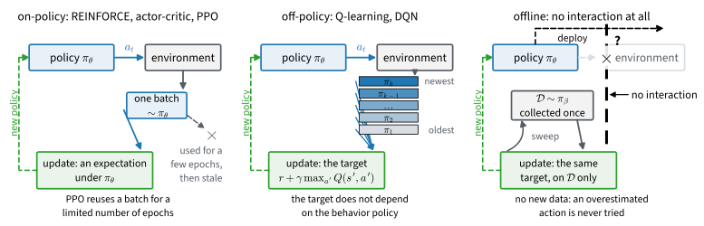

# Offline Reinforcement Learning
:label:`sec_offline`

The methods of this chapter collect their own data: they act, observe the
consequences, and update. In many applications, acting in order to learn is
expensive or unsafe, while records of past decisions are plentiful, for
example medical records or the logs of a deployed system
:cite:`Levine.Kumar.Tucker.ea.2020`. *Offline reinforcement learning*, also
called batch reinforcement learning, learns a policy from a fixed dataset
without any further interaction with the environment
:cite:`Levine.Kumar.Tucker.ea.2020,Fakoor.Mueller.Asadi.ea.2021`. We first ask
which data the updates of this chapter may use. We then run Q-learning on
fixed datasets from the slippery lake, where the optimal values are known, and
measure how its value estimates and its policies go wrong. A count-based
penalty, the simplest form of pessimism, repairs part of the failure.

```{.python .input #offline-rl-which-data-may-drive-which-update}
%%tab pytorch
import math
import numpy as np
import torch
from torch import nn
from torch.nn import functional as F
from d2l import torch as d2l
```

```{.python .input #offline-rl-which-data-may-drive-which-update}
%%tab jax
import math
import numpy as np
import jax
from jax import numpy as jnp
from flax import nnx
import optax
from d2l import jax as d2l
```

```{.python .input #offline-rl-offline-reinforcement-learning-1}
%%tab pytorch, jax
import gymnasium as gym
```

## Which Data an Update May Use

Whether an update may use data from other policies depends on the quantity
that it estimates. Offline learning is the extreme case, in which all data
come from other policies.

### On-Policy, Off-Policy, and Offline

A policy gradient is an expectation over the trajectories of the current
policy (:numref:`sec_policygradient`). Data from an older policy can be
reweighted by importance ratios, but the per-step surrogate that PPO builds
from them is accurate only near the policy that collected the data, so PPO
learns only from its latest batch and limits how far each batch moves the
policy (:numref:`sec_ppo`). Such methods are *on-policy*. The target of
Q-learning, $r + \gamma \max_{a'} Q(s', a')$, depends on the transition but not on the
policy that chose $a$, so a transition from any policy is a valid sample of
the same backup (:numref:`sec_qlearning`). The policy that collected the data
affects only which pairs are updated and how often. Q-learning is
*off-policy*, and the replay buffer of DQN reuses the transitions of many
earlier policies (:numref:`sec_dqn`). :numref:`fig_rl_data_rules` compares these two regimes
with the offline one.


:label:`fig_rl_data_rules`

### Two Methods for a Fixed Dataset

Let $\mathcal{D}$ be a dataset of transitions collected by a behavior policy
$\pi_\beta$. The simplest offline method ignores the rewards. *Behavior
cloning* fits a policy to the actions in the data by supervised learning, as
when :citet:`Pomerleau.1991` trained a network to steer a vehicle from
camera images paired with the steering of a human driver. In a table,
maximum-likelihood cloning estimates $\pi_\beta(a \mid s)$ by the frequency of
$a$ among the transitions
at $s$, and a clone that samples from these frequencies behaves like
$\pi_\beta$. Cloning also has a known weakness: a clone that errs with a
small probability on the states of the data can reach states that the data do
not contain, where it errs more. Over an episode of $T$ steps, a clone that
errs with probability $e$ on the states of the data can make as many as
$T^2 e$ mistakes in expectation, instead of the $T e$ that it would make on
the states of the data :cite:`Ross.Bagnell.2010,Ross.Gordon.Bagnell.2011`.
The growth with $T^2$ is possible because a first mistake can occur at any
step and can be followed by a mistake at every step that remains. DAgger avoids this by asking an expert to label the states that
the clone visits, which requires an expert who can be queried during training
:cite:`Ross.Gordon.Bagnell.2011`.

The second method is Q-learning on the fixed dataset: we sample transitions
from $\mathcal{D}$ and apply the update of :numref:`sec_qlearning` until the
estimates settle. Its limit can be computed directly. When the transitions
are sampled uniformly from $\mathcal{D}$, the next states of a pair
$(s, a)$ appear with their frequencies in the data, and its rewards with their
average. Q-learning thus samples from the *empirical MDP*, whose transition
probabilities $\hat{P}(s' \mid s, a)$ are these frequencies and whose rewards
$\hat{r}(s, a)$ are these averages; a pair that never occurs in the data has
reward zero and no successor states. For example, if a pair $(s, a)$ occurs
four times in $\mathcal{D}$, three times followed by $s'$ with reward $0$ and
once by $s''$ with reward $1$, then $\hat{P}(s' \mid s, a) = 3/4$,
$\hat{P}(s'' \mid s, a) = 1/4$, and $\hat{r}(s, a) = 1/4$. Under the
step-size conditions of :numref:`sec_qlearning`, the estimates of the pairs in
the data converge to the optimal Q-function of the empirical MDP, which value
iteration computes exactly. A pair that never occurs in the data keeps its
initial value, zero, which is also its optimal value in the empirical MDP,
since its reward is zero and it has no successor states. For
temporal-difference learning on a fixed dataset, :citet:`Sutton.Barto.2018`
call the analogous limit the certainty-equivalence estimate: it treats the
empirical model as if it were known with certainty.

## Offline Q-Learning on the Slippery Lake

We now measure how well the two methods do, and how well offline Q-learning
predicts its own performance.

### The Experiment

We use the slippery lake of :numref:`sec_mdp` with $\gamma = 0.95$. The true
model is available to us, though not to the methods, so value iteration gives
the optimal values, and policy evaluation gives the exact value of every
learned policy (:numref:`sec_valueiter`). We collect data with two behavior
policies. The first chooses its actions uniformly at random. The second is
*mostly expert*: with probability $0.9$ it takes an optimal action, and
otherwise an action chosen uniformly at random.

```{.python .input #offline-rl-the-experiment-1}
%%tab pytorch, jax
gamma, num_episodes, num_datasets, kappa = 0.95, 500, 15, 0.1
env = gym.make('FrozenLake-v1', is_slippery=True)
mdp = d2l.TabularMDP.from_gym(env, gamma)  # true model, unknown to the methods
V_star = d2l.value_iteration(mdp, num_iters=1000)[-1]
Q_star = mdp.backup(V_star)

def value(pi):
    """The exact value at the start state of a policy table pi[s, a]."""
    return d2l.policy_evaluation(mdp, pi, num_iters=1000)[-1][0]

expert = np.eye(4)[Q_star.argmax(1)]
behaviors = {'random': np.full((16, 4), 0.25),
             'mostly expert': 0.9 * expert + 0.1 * 0.25}
for name, pi in behaviors.items():
    print(f'{name} behavior policy: value {value(pi):.3f}')
print(f'optimal value V*(s0) = {V_star[0]:.3f}')
```

Each printed value is an expected return from the start state. A successful
episode of $k$ moves has return $\gamma^{k-1}$, and an unsuccessful one has
return zero (:numref:`sec_mdp`), so every value lies between zero and one
and rewards reaching the goal in few moves as well as reaching it at all.

For each behavior policy, we draw $15$ datasets of $500$ episodes each:

```{.python .input #offline-rl-the-experiment-2}
%%tab pytorch, jax
def collect(pi, seed):
    """A dataset of num_episodes episodes of the behavior policy pi[s, a]."""
    env.reset(seed=seed)
    return d2l.rollout(env, lambda s, rng: int(rng.choice(4, p=pi[s])),
                       num_episodes, np.random.default_rng(seed))

data = {name: [collect(pi, seed) for seed in range(num_datasets)]
        for name, pi in behaviors.items()}
```

The empirical MDP is built from counts. As in the target of Q-learning, a
transition into a terminal state contributes only its reward. The argument
`kappa` adds the penalty introduced below; with `kappa=0`, `offline_q`
returns the limit of Q-learning on the dataset.

```{.python .input #offline-rl-the-experiment-3}
%%tab pytorch, jax
def empirical_mdp(batch, kappa=0.0):
    """The MDP that a dataset describes, with rewards lowered by
    kappa / sqrt(n(s, a)); a pair without data has no successor states."""
    n, P, r = np.zeros((16, 4)), np.zeros((16, 4, 16)), np.zeros((16, 4))
    np.add.at(n, (batch.obs, batch.act), 1)
    np.add.at(P, (batch.obs, batch.act, batch.next_obs), 1 - batch.term)
    np.add.at(r, (batch.obs, batch.act), batch.rew)
    m = np.maximum(n, 1)
    return d2l.TabularMDP(P / m[..., None], r / m - kappa / np.sqrt(m),
                          gamma), n

def offline_q(batch, kappa=0.0):
    """The optimal Q-function of the empirical MDP, with state values
    floored at 0."""
    emp, _ = empirical_mdp(batch, kappa)
    V = np.zeros(emp.num_states)
    for _ in range(1000):
        V = np.maximum(emp.backup(V).max(axis=1), 0)
    return emp.backup(V)

def clone(batch):
    """Behavior cloning on a table: the action frequencies at each state,
    uniform where the dataset has no data."""
    n = np.zeros((16, 4))
    np.add.at(n, (batch.obs, batch.act), 1)
    total = n.sum(1, keepdims=True)
    return np.where(total > 0, n / np.maximum(total, 1), 0.25)
```

### Overestimation

For every dataset, we record the value that offline Q-learning predicts at
the start state, $\max_a \hat{Q}(s_0, a)$, and the true value of its greedy
policy. We compare them with the value of the clone:

```{.python .input #offline-rl-overestimation}
%%tab pytorch, jax
def assess(name, kappa=0.0):
    """Predicted and true values of offline Q-learning on every dataset."""
    Qs = [offline_q(batch, kappa) for batch in data[name]]
    pred = np.array([Q[0].max() for Q in Qs])
    true = np.array([value(np.eye(4)[Q.argmax(1)]) for Q in Qs])
    return pred, true

naive = {name: assess(name) for name in data}
for name, (pred, true) in naive.items():
    cloned = np.median([value(clone(batch)) for batch in data[name]])
    print(f'{name} data: cloning {cloned:.3f}, offline Q-learning '
          f'{np.median(true):.3f}, predicted {np.median(pred):.3f} (medians)')
    print(f'  prediction above the true value on {np.sum(pred > true)} and '
          f'above V*(s0) on {np.sum(pred > V_star[0])} of {num_datasets} '
          f'datasets')
```

Cloning reproduces the two behavior policies. In the median, offline
Q-learning finds better policies than cloning from both kinds of data. From
the random data, whose behavior policy has a value of only $0.008$, it
obtains a median value about as high as that of the mostly expert behavior
policy, and from the mostly expert data its median value exceeds the value of
that behavior policy. Its predictions, however, are too high. On every
dataset, the predicted value exceeds the true value of the learned policy, and
on most datasets it even exceeds $V^*(s_0)$, which no policy can exceed.

The optimal policy of the empirical MDP maximizes the estimated value over all
policies. It therefore tends to select a policy whose value the data happen to
overestimate, just as the maximum of noisy estimates is biased upward
(:numref:`sec_dqn`). On slippery ice, for example, a command moves the agent
in the commanded direction or in one of the two perpendicular directions,
each with probability $1/3$ (:numref:`sec_mdp`). If the data contain a pair
only twice and both times the agent reached the same cell, the empirical MDP
lets this command reach that cell with certainty. When that cell is better
than the other cells that the command can reach, the pair looks better than
it is, and the maximum over
actions favors it. Online, an overestimated action would soon be tried, and
the new data would correct its estimate. Offline, no new data arrive, and the
error remains :cite:`Levine.Kumar.Tucker.ea.2020`.

### Distribution Shift

The two kinds of data differ in how evenly they cover the actions. The next
cell finds, on every dataset, the states at which the learned policy takes a
suboptimal action. It counts how often the data contain that action, and how
often they contain an optimal action at the same state:

```{.python .input #offline-rl-distribution-shift}
%%tab pytorch, jax
def suboptimal_choices(name, kappa=0.0):
    """Over all datasets, the counts n(s, a) of the greedy actions that are
    worse than optimal, and of an optimal action at the same states."""
    chosen, best = [], []
    for batch in data[name]:
        _, n = empirical_mdp(batch)
        a = offline_q(batch, kappa).argmax(1)
        wrong = Q_star[np.arange(16), a] < Q_star.max(1) - 1e-9
        chosen += list(n[wrong, a[wrong]])
        best += list(n[wrong, Q_star[wrong].argmax(1)])
    return np.array(chosen), np.array(best)

for name in data:
    chosen, best = suboptimal_choices(name)
    print(f'{name} data: {len(chosen)} suboptimal choices')
    print(f'  the data contain the chosen action {np.median(chosen):.0f} '
          f'times and an optimal action {np.median(best):.0f} times (medians)')
```

On the mostly expert data, the optimal action at these states occurs hundreds
of times in the median, but the actions that the learned policy chooses occur
only about ten times. This gap comes from the behavior policy: at every state,
it takes one optimal action with probability $0.9 + 0.1/4 = 0.925$ and each of
the other three actions with probability $0.1/4 = 0.025$, so in expectation
the data contain that action $37$ times as often as each other action at the
same state. The
estimates of the rarely tried actions rest on few samples and are therefore
noisy, and a maximum over noisy estimates favors those that happen to be too
high (:numref:`sec_dqn`). Where it errs, the learned policy thus relies on
the actions that the data support least. This mismatch between the actions in
the data and the actions of the learned policy is called *distribution shift*
:cite:`Levine.Kumar.Tucker.ea.2020`. On the random data, all actions occur
about equally often, and the chosen and the optimal actions have similar
counts.

In a table, an action that never occurs in the data keeps its initial value,
zero. The rewards of the lake are nonnegative, so no true value is below
zero, and such actions are never overestimated here. With a neural network,
the estimates of such actions are extrapolated from the rest of the data, and
:citet:`Fujimoto.Meger.Precup.2019` call the resulting errors *extrapolation
error*. The loss has terms only for the pairs in the data, so no target
corrects these estimates, yet the maximum in the target of Q-learning
evaluates them and can select them when they are too high. Bootstrapping then
carries the error into the estimates of the pairs in the data
:cite:`Fujimoto.Meger.Precup.2019,Levine.Kumar.Tucker.ea.2020`.

## Pessimism

If the estimates of rarely tried actions are unreliable, the learner can trust
them less. *Pessimism* lowers each estimate by an amount that grows with its
uncertainty, so that the learned policy prefers actions whose values the data
support.

### A Count-Based Penalty

The simplest form of pessimism subtracts a penalty from the reward of every
pair in the empirical MDP,

$$\hat{r}_\kappa(s, a) = \hat{r}(s, a) - \frac{\kappa}{\sqrt{n(s, a)}},$$
:eqlabel:`eq_count_penalty`

where $n(s, a)$ counts the pair in the data and $\kappa > 0$ sets the
strength of the penalty. The penalty decreases as $1/\sqrt{n(s, a)}$, the rate
at which the standard deviation of an average of $n$ independent samples
decreases. :citet:`Rashidinejad.Zhu.Ma.ea.2021` prove bounds on the
suboptimality of the policy returned by VI-LCB, a variant of value iteration
with a penalty of this form; among other changes, its values start at zero
and never decrease. In `empirical_mdp`, a pair without data receives the
penalty $\kappa$, and we use $\kappa = 0.1$. At the median counts of the
mostly expert data above, the penalty is $0.1/\sqrt{10} \approx 0.03$ for the
suboptimal actions that the learned policies chose, and below $0.01$ for the
optimal actions, which occur hundreds of times. Without a floor, the
penalized values could become negative, although no true value is. A
transition into a terminal state contributes only its reward, so where the
values of the next states were negative, an action likely to end the episode,
for example in a hole, could look better than one that continues. Like the
state values of VI-LCB, the state values that `offline_q` computes in every
sweep therefore never fall below zero, the smallest return of this task. The
action values that it returns can still be negative, but by at most the
penalty of their pair.

The penalty resembles the exploration bonus of UCB in
:numref:`sec_qlearning`, which also shrinks with the count but is added to the
estimate. Online, an optimistic estimate leads the agent to try the action,
and the new data correct the estimate. Offline, no data can correct an
estimate, and the penalty instead lowers the estimates of the actions that
the data support least.

### Results

We repeat the evaluation with the penalty and compare each pessimistic policy
with the naive policy learned from the same dataset:

```{.python .input #offline-rl-pessimism}
%%tab pytorch, jax
for name in data:
    pred, true = assess(name, kappa)
    diff = true - naive[name][1]
    chosen, _ = suboptimal_choices(name, kappa)
    print(f'{name} data: pessimistic offline Q-learning {np.median(true):.3f}, '
          f'predicted {np.median(pred):.3f} (medians)')
    print(f'  prediction above the true value on {np.sum(pred > true)} and '
          f'above V*(s0) on {np.sum(pred > V_star[0])} of {num_datasets} '
          f'datasets')
    print(f'  better than naive on {np.sum(diff > 1e-9)}, worse on '
          f'{np.sum(diff < -1e-9)} datasets; {len(chosen)} suboptimal choices')
```

The penalty removes most of the overestimation. The predictions exceed
$V^*(s_0)$ on at most two of the fifteen datasets of each kind, and on most
datasets they lie below the true value of the learned policy. The effect on the policies depends on
the data. On the mostly expert data, the pessimistic policy is better than
the naive one on $12$ of the $15$ datasets and worse on none, and its median
value, $0.175$, is close to $V^*(s_0) = 0.180$. The penalty lowers the
estimates of the rarely tried actions the most, and the number of suboptimal
choices drops from $32$ to $12$. On the random data, all actions are tried
about equally often, and the pessimistic policy is worse than the naive one
on $8$ datasets and better on $1$; the number of suboptimal choices rises
from $37$ to $54$. In this experiment, the penalty thus helped
when the data contained some actions far more often than others, and it cost
value when the data contained all actions about equally often.

## Beyond Tables

With continuous states and actions, almost no state-action pair occurs twice
in the data, so counts carry no information, and offline methods must rely on
function approximation instead, in practice on neural networks. This last
part surveys them briefly.

### Constraining the Policy or the Values

Many deep offline methods use two related ideas: they keep the learned policy
close to the actions in the data, or, like the penalty, they lower the value
estimates of actions that the data do not support. Batch-constrained Q-learning (BCQ) restricts the
policy to actions that a generative model of the data considers likely
:cite:`Fujimoto.Meger.Precup.2019`. Conservative Q-learning (CQL) adds a term
to the loss that lowers the estimated values of the actions of the policy
being evaluated and raises those of the actions in the data, so that, for a
large enough weight on this term, the expected value of this policy under the
learned Q-function is a lower bound on its true value
:cite:`Kumar.Zhou.Tucker.ea.2020`. Implicit
Q-learning (IQL) never evaluates actions outside the data: in place of the
maximum, it fits an upper expectile of the values of the actions in the data
:cite:`Kostrikov.Nair.Levine.2022`. TD3+BC adds a behavior-cloning term to the
policy update of an off-policy actor-critic method
:cite:`Fujimoto.Gu.2021`. Continuous doubly constrained batch reinforcement
learning (CDC) combines a policy constraint, which limits the divergence from the
behavior policy, with a value constraint against overly optimistic estimates
:cite:`Fakoor.Mueller.Asadi.ea.2021`. Instead of penalizing every deviation
from the behavior policy, :citet:`Liu.Chaudhari.Fakoor.2023` bound the number
of decisions that may differ from it and use dynamic programming to decide
where to deviate.

### Learning without Bootstrapping

A different route avoids the maximum and bootstrapping altogether. The
Decision Transformer trains a sequence model on trajectories written as
returns-to-go, states, and actions, and at test time conditions it on a high
return :cite:`Chen.Lu.Rajeswaran.ea.2021`. On the benchmarks of that work,
its authors found it competitive with the model-free offline methods it was
compared with.
:citet:`Emmons.Eysenbach.Kostrikov.ea.2022` call this route reinforcement
learning via supervised learning, or RvS learning. They found that a
two-layer network trained by maximum likelihood, conditioned on goals or
rewards, is competitive with both these sequence models and methods based on
TD learning on the benchmarks they considered, and that RvS methods are
comparatively weak on random data.
:citet:`Brandfonbrener.Bietti.Buckman.ea.2022` show that conditioning on the
return finds a near-optimal policy only under assumptions
stronger than those of dynamic programming, among them nearly deterministic
dynamics, which the slippery lake does not have. :numref:`sec_rl_sequences`
turns to language models, where the policy itself is a sequence model.

### Choosing Hyperparameters without Interaction

Our evaluation used the true model of the lake to compute the value of every
learned policy. A real offline problem has no such model. Choosing $\kappa$,
or choosing between learned policies, then requires estimating the value of a
policy from the data of another policy, which is called off-policy
evaluation. Estimators based on importance sampling face the problem of
:numref:`sec_ppo`: their variance grows as the evaluated policy departs from
the behavior policy :cite:`Levine.Kumar.Tucker.ea.2020`.

## Summary

Score-function policy gradients estimate expectations under the current policy
and can reuse older data through importance ratios. Q-learning is off-policy
and can learn from transitions of any policy. Offline reinforcement learning
learns from a fixed dataset alone. Behavior cloning reproduces the behavior
policy. Q-learning on a fixed dataset converges to the optimal values of the
empirical MDP. On the slippery lake, it found, in the median, better policies
than cloning from both random and mostly expert data, but its predicted values
exceeded the true values of its own policies on every dataset and the optimal
value on most. Where the policies learned from the mostly expert data chose a
suboptimal action, the data typically contain that action about ten times and
an optimal action hundreds of times, an instance of distribution shift. A
count-based penalty removed most of the overestimation. It improved the
policies learned from the mostly expert data and lowered the median value of
those learned from the random data. Many deep offline methods constrain the
policy, the values, or both, and choosing their hyperparameters without
interaction requires off-policy evaluation.

## Exercises

1. [code] **More data.** Repeat the experiment with datasets of $100$ and
   $2{,}000$ episodes. How do the predicted values and the true values of
   naive offline Q-learning change with the amount of data?
1. [code] **The strength of the penalty.** Vary $\kappa$ over
   $\{0.01, 0.03, 0.1, 0.3\}$ on both kinds of data. What happens to the
   predictions and to the true values when the penalty is too weak, and when
   it is too strong?
1. [code] **Cloning the most frequent action.** Replace the clone, which
   samples from the action frequencies, by a policy that takes the most
   frequent action at each state. Compare it with the sampling clone and with
   offline Q-learning on both kinds of data, and explain the differences.
1. [code] **A support constraint.** In the spirit of BCQ, let the maximum in
   the backup of the empirical MDP range only over the actions that occur at
   least $m$ times at the next state, and take the value zero where no action
   qualifies. Restrict the greedy policy in the same way, except at states
   where no action qualifies. Compare this constraint for
   $m \in \{1, 5, 20\}$ with the count-based penalty on the mostly expert
   data.
1. **Off-policy evaluation.** Without the true model, how could you estimate
   the value of a learned policy from the dataset? Write down the
   importance-sampling estimate of the return of an episode, and explain why
   its variance is large for a deterministic policy that differs from the
   mostly expert behavior policy at a few states.

[Discussions](https://d2l.discourse.group/t/36806)

<!-- slides -->

::: {.slide}
::: {.cover}
[Dive into Deep Learning · §14.11]{.kicker}

Offline reinforcement learning<br>
**which data an update may use · the empirical MDP · overestimation · distribution shift · pessimism**
:::
:::

::: {.slide title="Which Data an Update May Use"}
{width=98%}

- on-policy: expectations under the current policy;
- off-policy: the target does not depend on the behavior policy;
- offline: a fixed dataset, no interaction.
:::

::: {.slide title="Q-Learning on a Fixed Dataset"}
Uniform sampling from $\mathcal{D}$ samples the *empirical MDP*:
$\hat{P}(s' \mid s, a)$ and $\hat{r}(s, a)$ are frequencies and averages.

Q-learning converges to its optimal Q-function; value iteration computes it
directly.

@offline-rl-the-experiment-3
:::

::: {.slide title="Overestimation"}
@offline-rl-overestimation
:::

::: {.slide title="Distribution Shift"}
@offline-rl-distribution-shift

On the mostly expert data, where the learned policy errs, it picks rarely
tried actions over well-supported optimal ones.
:::

::: {.slide title="Pessimism"}
$$\hat{r}_\kappa(s, a) = \hat{r}(s, a) - \frac{\kappa}{\sqrt{n(s, a)}}$$

@offline-rl-pessimism
:::

::: {.slide title="Beyond Tables"}
- constrain the policy (BCQ, TD3+BC), the values (CQL), or both (CDC);
- evaluate only actions in the data (IQL);
- bound the number of deviations from the behavior policy;
- condition a policy on the return or a goal (Decision Transformer, RvS);
- choosing hyperparameters needs off-policy evaluation.
:::
