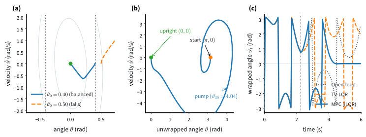

# Optimal Control, LQR, and Model Predictive Control
:label:`sec_optimal_control`

The tabular methods of :numref:`sec_mdp`–:numref:`sec_imitation`—from value iteration (:numref:`sec_valueiter`) and Q-learning (:numref:`sec_qlearning`) to behavior cloning and DAgger (:numref:`sec_imitation`)—all rely on a finite table with one row per state. What happens when the state is a continuous vector $\mathbf{x}_t \in \mathbb{R}^d$—positions, angles, and velocities, as in the vehicle of :numref:`sec_mdp`—and the action is a continuous control input $\mathbf{u}_t \in \mathbb{R}^m$ evolving under known dynamics $\mathbf{x}_{t+1} = f(\mathbf{x}_t, \mathbf{u}_t)$? Discretizing a continuous space into a grid does not scale: partitioning each of $d$ coordinates into $m$ bins explodes into $m^d$ states ($100^d$ cells at $100$ bins per coordinate), Bellman's *curse of dimensionality* :cite:`BellmanDPBook`.

Control theory solved this problem in continuous state and action spaces long before deep reinforcement learning, starting from an algebraic observation due to :citet:`Kalman.1960`. When the transition dynamics are linear in the state and control, and the one-step cost is quadratic in both, Bellman's backward dynamic programming preserves the quadratic form of the value function at every step. Instead of a table of $100^d$ entries, the exact value function $V_t(\mathbf{x}) = \mathbf{x}^\top \mathbf{P}_t \mathbf{x}$ is parameterized by a symmetric $d \times d$ matrix $\mathbf{P}_t$ with $d(d+1)/2$ independent numbers. The Bellman backup reduces to the *Riccati recursion*, and the optimal policy is a linear state-feedback law $\mathbf{u}_t^* = -\mathbf{K}_t \mathbf{x}_t$: the *Linear-Quadratic Regulator* (LQR) :cite:`Kalman.1960,Anderson.Moore.2007`.

Most physical systems are nonlinear, and actuators saturate. Two ideas extend LQR to nonlinear continuous control and form the backbone of modern trajectory optimization and robotics :cite:`Tedrake.2023,Bertsekas.2025`. First, *iterative LQR* (iLQR) :cite:`Li.Todorov.2004` repeatedly linearizes the nonlinear dynamics and quadratizes the cost around a candidate trajectory, solving a time-varying LQR problem in the backward pass to improve the trajectory in the forward pass. Second, *Model Predictive Control* (MPC) :cite:`Rawlings.Mayne.Diehl.2017` turns finite-horizon trajectory optimization into a closed-loop policy: at every step $t$, it re-solves the control problem over a receding lookahead horizon from the current measured state $\mathbf{x}_t$, applies only the first control $\mathbf{u}_{t|t}^*$, and re-plans at step $t+1$. This section develops all three tools—LQR, iLQR, and receding-horizon MPC—and shows where local linear feedback suffices, where nonlinear energy pumping is required, and how MPC sets the stage for planning with learned neural dynamics in :numref:`sec_model_based`.

```{.python .input #optimal-control-imports}
%%tab pytorch
import math
import numpy as np
import torch
from torch import nn
from torch.nn import functional as F
from d2l import torch as d2l
```

```{.python .input #optimal-control-imports}
%%tab jax
import math
import numpy as np
import jax
from jax import numpy as jnp
from flax import nnx
import optax
from d2l import jax as d2l
```

## Linear-Quadratic Regulation

### State-Space Dynamics and Quadratic Costs

In control notation, a continuous state is written $\mathbf{x}_t \in \mathbb{R}^d$ and an action (or control input) is written $\mathbf{u}_t \in \mathbb{R}^m$. Whereas reinforcement learning maximizes a reward $r(\mathbf{x}_t, \mathbf{u}_t)$, optimal control minimizes a stage cost $c(\mathbf{x}_t, \mathbf{u}_t) = -r(\mathbf{x}_t, \mathbf{u}_t)$. A discrete-time linear system evolves as

$$\mathbf{x}_{t+1} = \mathbf{A}\mathbf{x}_t + \mathbf{B}\mathbf{u}_t,$$
:eqlabel:`eq_lqr_dynamics`

where $\mathbf{A} \in \mathbb{R}^{d \times d}$ is the state-transition matrix and $\mathbf{B} \in \mathbb{R}^{d \times m}$ is the control-input matrix (the discrete-time counterpart of the linear ODEs in :numref:`sec_mdl-odes-solvers`). The target state is the origin $\mathbf{x} = \mathbf{0}$. Over a finite horizon of $H$ steps, we minimize the total quadratic cost

$$J(\mathbf{x}_0, \mathbf{u}_{0:H-1}) = \sum_{t=0}^{H-1} \big(\mathbf{x}_t^\top \mathbf{Q}\mathbf{x}_t + \mathbf{u}_t^\top \mathbf{R}\mathbf{u}_t\big) + \mathbf{x}_H^\top \mathbf{Q}_H \mathbf{x}_H,$$
:eqlabel:`eq_lqr_cost`

where $\mathbf{Q} \succeq \mathbf{0}$ and $\mathbf{Q}_H \succeq \mathbf{0}$ are symmetric positive-semidefinite $d \times d$ state-cost matrices, and $\mathbf{R} \succ \mathbf{0}$ is a symmetric positive-definite $m \times m$ control-cost matrix. Requiring $\mathbf{R} \succ \mathbf{0}$ ensures that large control efforts always carry a positive penalty, so the one-step minimization over $\mathbf{u}_t$ has a unique finite solution.

### Exact Continuous Dynamic Programming and the Riccati Recursion

Let $V_t(\mathbf{x})$ be the optimal cost-to-go from state $\mathbf{x}$ at step $t \in \{0, \ldots, H\}$. At the terminal step $t = H$, no control remains and $V_H(\mathbf{x}) = \mathbf{x}^\top \mathbf{P}_H \mathbf{x}$ with $\mathbf{P}_H = \mathbf{Q}_H$. Moving backward from $t+1$ to $t$, Bellman's optimality equation (:numref:`sec_valueiter`) states that

$$V_t(\mathbf{x}) = \min_{\mathbf{u} \in \mathbb{R}^m} \Big\{ \mathbf{x}^\top \mathbf{Q}\mathbf{x} + \mathbf{u}^\top \mathbf{R}\mathbf{u} + V_{t+1}(\mathbf{A}\mathbf{x} + \mathbf{B}\mathbf{u}) \Big\}.$$
:eqlabel:`eq_lqr_bellman`

Suppose by backward induction that $V_{t+1}(\mathbf{x}') = {\mathbf{x}'}^\top \mathbf{P}_{t+1} \mathbf{x}'$ for a symmetric positive-semidefinite matrix $\mathbf{P}_{t+1} \succeq \mathbf{0}$. Substituting $\mathbf{x}' = \mathbf{A}\mathbf{x} + \mathbf{B}\mathbf{u}$ expands the bracketed action-value function $Q_t(\mathbf{x}, \mathbf{u})$ into a strictly convex quadratic in $\mathbf{u}$:

$$
\begin{aligned}
Q_t(\mathbf{x}, \mathbf{u}) &= \mathbf{x}^\top(\mathbf{Q} + \mathbf{A}^\top \mathbf{P}_{t+1}\mathbf{A})\mathbf{x} + 2\mathbf{u}^\top \mathbf{B}^\top \mathbf{P}_{t+1}\mathbf{A}\mathbf{x} \\
&\quad + \mathbf{u}^\top(\mathbf{R} + \mathbf{B}^\top \mathbf{P}_{t+1}\mathbf{B})\mathbf{u}.
\end{aligned}
$$

Setting the gradient with respect to $\mathbf{u}$ to zero,

$$\nabla_{\mathbf{u}} Q_t(\mathbf{x}, \mathbf{u}) = 2(\mathbf{R} + \mathbf{B}^\top \mathbf{P}_{t+1}\mathbf{B})\mathbf{u} + 2\mathbf{B}^\top \mathbf{P}_{t+1}\mathbf{A}\mathbf{x} = \mathbf{0},$$

yields the unique optimal control in closed form:

$$\mathbf{u}_t^* = -\mathbf{K}_t \mathbf{x}_t, \qquad \mathbf{K}_t = (\mathbf{R} + \mathbf{B}^\top \mathbf{P}_{t+1}\mathbf{B})^{-1} \mathbf{B}^\top \mathbf{P}_{t+1}\mathbf{A}.$$
:eqlabel:`eq_lqr_gain`

Substituting $\mathbf{u} = -\mathbf{K}_t \mathbf{x}$ back into $Q_t(\mathbf{x}, \mathbf{u})$ confirms that $V_t(\mathbf{x}) = \mathbf{x}^\top \mathbf{P}_t \mathbf{x}$ remains purely quadratic, where $\mathbf{P}_t$ obeys the backward *discrete-time Riccati recursion*:

$$
\begin{aligned}
\mathbf{P}_t &= \mathbf{Q} + \mathbf{A}^\top \mathbf{P}_{t+1}\mathbf{A} \\
&\quad - \mathbf{A}^\top \mathbf{P}_{t+1}\mathbf{B}(\mathbf{R} + \mathbf{B}^\top \mathbf{P}_{t+1}\mathbf{B})^{-1}\mathbf{B}^\top \mathbf{P}_{t+1}\mathbf{A}.
\end{aligned}
$$
:eqlabel:`eq_riccati_recursion`

Three properties of :eqref:`eq_lqr_gain` and :eqref:`eq_riccati_recursion` deserve emphasis:

1. **No curse of dimensionality:** Each Bellman backup replaces a maximization over an infinite action space $\mathbb{R}^m$ and all states $\mathbb{R}^d$ by $O(d^3 + m^3)$ matrix operations on $\mathbf{P}_{t+1}$.
2. **Linear feedback gain:** The optimal policy $\pi_t^*(\mathbf{x}) = -\mathbf{K}_t \mathbf{x}$ is linear in the state, and the gain matrix $\mathbf{K}_t \in \mathbb{R}^{m \times d}$ depends only on $(\mathbf{A}, \mathbf{B}, \mathbf{Q}, \mathbf{R})$, not on the initial state $\mathbf{x}_0$.
3. **Certainty equivalence:** Even if zero-mean independent noise $\mathbf{w}_t$ with covariance $\boldsymbol{\Sigma}$ is added to the transition ($\mathbf{x}_{t+1} = \mathbf{A}\mathbf{x}_t + \mathbf{B}\mathbf{u}_t + \mathbf{w}_t$), the cross term $\mathbb{E}[\mathbf{w}_t^\top \mathbf{P}_{t+1}(\mathbf{A}\mathbf{x}_t + \mathbf{B}\mathbf{u}_t)]$ vanishes, adding only the constant $\textrm{tr}(\mathbf{P}_{t+1}\boldsymbol{\Sigma})$ to the value function while leaving the optimal feedback matrix $\mathbf{K}_t$ unchanged (exercise :exref:`ex_optimal-control-certainty-equivalence`).

As the horizon $H \to \infty$ (under standard controllability and observability conditions), $\mathbf{P}_t$ converges to a stationary solution $\mathbf{P}_\infty$ of the *Discrete Algebraic Riccati Equation* (DARE), and the time-invariant controller $\mathbf{u}_t = -\mathbf{K}_\infty \mathbf{x}_t$ stabilizes the closed-loop dynamics $\mathbf{x}_{t+1} = (\mathbf{A} - \mathbf{B}\mathbf{K}_\infty)\mathbf{x}_t$ so that every eigenvalue of $\mathbf{A} - \mathbf{B}\mathbf{K}_\infty$ lies strictly inside the unit circle, $\rho(\mathbf{A} - \mathbf{B}\mathbf{K}_\infty) < 1$.

### The Double Integrator

We test `riccati_lqr` on the vehicle from the state-augmentation example of :numref:`sec_mdp`: a unit mass moving along a line with state $\mathbf{x}_t = (p_t, v_t)^\top$ (position and velocity), control $u_t$ (acceleration), and time step $\Delta t = 0.1$. By Newton's laws, $p_{t+1} = p_t + v_t \Delta t + \frac{1}{2} u_t \Delta t^2$ and $v_{t+1} = v_t + u_t \Delta t$. We penalize position and velocity deviations with $\mathbf{Q} = \textrm{diag}(1.0, 0.1)$ and sweep the control-effort weight $r_u \in \{0.01, 0.10, 1.00\}$ in $\mathbf{R} = [r_u]$:

```{.python .input #optimal-control-riccati-lqr}
%%tab pytorch, jax
def riccati_lqr(A, B, Q, R, H=100):
    """Backward Riccati recursion for horizon H; returns (Ps, Ks) from t=0..H."""
    P = Q.copy()
    Ps, Ks = [P], []
    for _ in range(H):
        BtP = B.T @ P
        K = np.linalg.solve(R + BtP @ B, BtP @ A)
        P = Q + A.T @ P @ (A - B @ K)
        Ks.append(K)
        Ps.append(P)
    return Ps[::-1], Ks[::-1]

dt = 0.1
A_di = np.array([[1.0, dt], [0.0, 1.0]])
B_di = np.array([[0.5 * dt**2], [dt]])
Q_di = np.diag([1.0, 0.1])

for ru in (0.01, 0.10, 1.00):
    Ps, Ks = riccati_lqr(A_di, B_di, Q_di, np.array([[ru]]), H=100)
    K_inf, P_inf = Ks[0][0], Ps[0]
    rho = np.abs(np.linalg.eigvals(A_di - B_di @ Ks[0])).max()
    print(f'R={ru:4.2f}  K_inf=[{K_inf[0]:5.3f}, {K_inf[1]:5.3f}]  '
          f'P_00={P_inf[0, 0]:5.2f}  rho(A - B K)={rho:.3f}')
```

We can also plot the closed-loop position trajectories $p_t$ starting from $\mathbf{x}_0 = (1, 0)^\top$ under the three control-effort penalties:

```{.python .input #optimal-control-riccati-plot}
%%tab pytorch, jax
trajs, steps_di = [], np.arange(51) * dt
for ru in (0.01, 0.10, 1.00):
    _, Ks = riccati_lqr(A_di, B_di, Q_di, np.array([[ru]]), H=100)
    x, xs_di = np.array([1.0, 0.0]), [1.0]
    for _ in range(50):
        x = (A_di - B_di @ Ks[0]) @ x
        xs_di.append(x[0])
    trajs.append(xs_di)
d2l.plot(steps_di, trajs, 'time (s)', 'position $p_t$',
         legend=['R = 0.01', 'R = 0.10', 'R = 1.00'], figsize=(5, 3))
```

Look at the two components of the stationary feedback law $u_t^* = -k_p p_t - k_v v_t$: dynamic programming has automatically derived a *proportional-derivative* (PD) controller, pushing back against the position error $p_t$ with gain $k_p$ and damping the velocity $v_t$ with gain $k_v$. When control effort is cheap ($R = 0.01$), LQR chooses aggressive gains $\mathbf{K}_\infty = [7.613, 4.585]$ that contract the state norm at rate $\rho(\mathbf{A} - \mathbf{B}\mathbf{K}_\infty) = 0.761$ per step; when control effort is expensive ($R = 1.00$), it uses gentle accelerations $\mathbf{K}_\infty = [0.930, 1.395]$ with contraction rate $\rho = 0.930$ and a higher cumulative cost $V_0(\mathbf{x}_0) = \mathbf{x}_0^\top \mathbf{P}_\infty \mathbf{x}_0$ ($P_{00} = 15.00$ vs. $6.02$).

## Linearizing a Nonlinear System Around an Equilibrium

### Analytical Linearization of `Pendulum-v1`

Now consider a physical benchmark that will accompany us through the rest of this chapter and :numref:`chap_deep_rl`: the inverted pendulum (`Pendulum-v1`). A rigid rod of mass $m = 1$ and length $l = 1$ is pivoted at one end under gravity $g = 10$ and driven by a bounded motor torque $u_t \in [-2, 2]$. Its continuous state is $\mathbf{x}_t = (\vartheta_t, \dot\vartheta_t)^\top$, where $\vartheta_t$ is the angle measured from the upright vertical ($\vartheta = 0$ upright, $\vartheta = \pi$ hanging straight down) and $\omega_t = \dot\vartheta_t \in [-8, 8]$ is the angular velocity. Because the peak gravitational torque at the horizontal ($\vartheta = \pi/2$) is $mgl/2 = 5 > 2$, the motor is *underactuated*: it cannot lift the rod directly from the bottom to the top in a single push. Over one simulator step of $\Delta t = 0.05\text{ s}$, the semi-implicit Euler transition $\mathbf{x}_{t+1} = f(\mathbf{x}_t, u_t)$ is

$$
\begin{aligned}
\dot\vartheta_{t+1} &= \dot\vartheta_t + \Big(\frac{3g}{2l}\sin\vartheta_t + \frac{3}{ml^2}u_t\Big)\Delta t, \\
\vartheta_{t+1} &= \vartheta_t + \dot\vartheta_{t+1}\Delta t,
\end{aligned}
$$
:eqlabel:`eq_pendulum_discrete`

with angular velocity clipped to $[-8, 8]$. Each step incurs the quadratic stage cost $c(\vartheta_t, \dot\vartheta_t, u_t) = \vartheta_t^2 + 0.1\,\dot\vartheta_t^2 + 0.001\,u_t^2$ (with $\vartheta_t$ wrapped to $[-\pi, \pi]$, corresponding to $\mathbf{Q} = \textrm{diag}(1.0, 0.1)$ and $\mathbf{R} = [[0.001]]$), or equivalently emits the reward $r_t = -c(\vartheta_t, \dot\vartheta_t, u_t)$. Standard benchmark episodes run for $200$ steps ($10\text{ s}$): an uncontrolled pendulum scores around $-1{,}200$ to $-1{,}500$, whereas a controller that swings the rod up and balances it upright scores above $-200$. Here we plan directly with the known equations of motion :eqref:`eq_pendulum_discrete`; :numref:`sec_deeprl`, :numref:`sec_sac`, and :numref:`sec_model_based` will return to this exact pendulum benchmark when the agent must act or learn a dynamics model without knowing the physics.

The upright posture $\mathbf{x}^* = (0, 0)^\top$ with zero torque $u^* = 0$ is a fixed point, $f(\mathbf{x}^*, u^*) = \mathbf{x}^*$. Near any reference pair $(\bar{\mathbf{x}}, \bar{u})$, a first-order Taylor expansion approximates the nonlinear transition by a local linear model in the deviations $\delta\mathbf{x}_t = \mathbf{x}_t - \bar{\mathbf{x}}$ and $\delta u_t = u_t - \bar{u}$:

$$
\begin{aligned}
f(\mathbf{x}_t, u_t) - f(\bar{\mathbf{x}}, \bar{u}) &\approx \mathbf{A}(\bar{\mathbf{x}}, \bar{u})\,\delta\mathbf{x}_t + \mathbf{B}(\bar{\mathbf{x}}, \bar{u})\,\delta u_t, \\
\mathbf{A} &= \frac{\partial f}{\partial \mathbf{x}}(\bar{\mathbf{x}}, \bar{u}), \qquad \mathbf{B} = \frac{\partial f}{\partial u}(\bar{\mathbf{x}}, \bar{u}).
\end{aligned}
$$
:eqlabel:`eq_local_linearization`

Differentiating :eqref:`eq_pendulum_discrete` with respect to $(\vartheta_t, \dot\vartheta_t)$ and $u_t$ yields $\partial\dot\vartheta_{t+1}/\partial\vartheta_t = \frac{3g}{2l}\cos(\vartheta_t)\Delta t$ and $\partial\dot\vartheta_{t+1}/\partial u_t = \frac{3}{ml^2}\Delta t$:

```{.python .input #optimal-control-upright-lqr}
%%tab pytorch, jax
def pendulum_jacobians(th, dt=0.05, g=10.0):
    """Exact Jacobians (A, B) of Pendulum-v1 at angle th."""
    dthdot_dth = 1.5 * g * np.cos(th) * dt
    dthdot_du = 3.0 * dt
    A = np.array([[1.0 + dthdot_dth * dt, dt], [dthdot_dth, 1.0]])
    B = np.array([[dthdot_du * dt], [dthdot_du]])
    return A, B

A_p, B_p = pendulum_jacobians(0.0)
Q_p, R_p = np.diag([1.0, 0.1]), np.array([[0.001]])
Ps_p, Ks_p = riccati_lqr(A_p, B_p, Q_p, R_p, H=200)
K_lqr = Ks_p[0][0]
eigs_open = np.linalg.eigvals(A_p).real
eigs_closed = np.linalg.eigvals(A_p - B_p @ Ks_p[0]).real
print(f'A at upright:\n{A_p}')
print(f'open-loop eigenvalues:   {eigs_open[0]:.4f}, {eigs_open[1]:.4f}')
print(f'LQR gain K_inf:          [{K_lqr[0]:.3f}, {K_lqr[1]:.3f}]')
print(f'closed-loop eigenvalues: {eigs_closed[0]:.4f}, {eigs_closed[1]:.4f}')
```

At the upright fixed point, the open-loop Jacobian $\mathbf{A}$ has an unstable eigenvalue $\lambda_1 = 1.2133 > 1$: any small tilt grows exponentially at over $21\%$ per step, as seen in the phase portrait of :numref:`sec_mdl-odes-solvers`. Solving the Riccati recursion with `Pendulum-v1`'s cost matrices $\mathbf{Q} = \textrm{diag}(1, 0.1)$ and $\mathbf{R} = [[0.001]]$ produces the feedback gain $\mathbf{K}_\infty = [19.693, 5.263]$, which pulls both closed-loop eigenvalues inside the unit circle ($\lambda_1 = 0.8537, \lambda_2 = 0.2467$).

### Where Local Linearization Fails: Torque Saturation and the Basin of Attraction

How far from the top can this linear controller catch the pendulum when the motor torque is clipped to $[-2, 2]$? The gravitational torque pulling the pendulum down is $\frac{1}{2}mgl\sin\vartheta = 5\sin\vartheta$, whereas the motor supplies at most $|u| = 2$. Once $|\vartheta| > \arcsin(2/5) \approx 0.412\text{ rad}$ ($23.6^\circ$), gravity exceeds the peak holding torque of the motor. We test the clipped LQR policy $u_t = \textrm{clip}(-\mathbf{K}_\infty \mathbf{x}_t, -2, 2)$ on the full nonlinear pendulum from five starting angles $\vartheta_0$ at rest:

```{.python .input #optimal-control-lqr-basin}
%%tab pytorch, jax
def wrap(th):
    return ((th + np.pi) % (2 * np.pi)) - np.pi

def pendulum_step(x, u, dt=0.05, g=10.0):
    """One step of nonlinear Pendulum-v1 dynamics in (theta, thetadot)."""
    th, thdot = x
    u_c = float(np.clip(u, -2.0, 2.0))
    newthdot = float(np.clip(thdot + (1.5 * g * np.sin(th) + 3.0 * u_c) * dt,
                             -8.0, 8.0))
    newth = th + newthdot * dt
    cost = wrap(th)**2 + 0.1 * thdot**2 + 0.001 * u_c**2
    return np.array([newth, newthdot]), cost

for th0 in (0.20, 0.40, 0.50, 0.60, np.pi):
    x, total_cost = np.array([th0, 0.0]), 0.0
    for _ in range(200):
        u = -(K_lqr[0] * wrap(x[0]) + K_lqr[1] * x[1])
        x, c = pendulum_step(x, u)
        total_cost += c
    print(f'th0={th0:4.2f} rad: 200-step return={-total_cost:8.2f}, '
          f'final theta={wrap(x[0]):+6.3f} rad')
```

Inside the static holding threshold ($\vartheta_0 = 0.20$ and $0.40\text{ rad}$), linear LQR drives the pendulum straight to upright ($\vartheta_{200} = 0.000$) with near-zero cost (returns $-0.32$ and $-2.97$). Just outside that threshold ($\vartheta_0 = 0.50\text{ rad}$), full negative torque $u = -2$ cannot arrest the fall, and from the bottom ($\vartheta_0 = \pi$) the linear controller earns $-1471.86$ and never reaches the top. Because the motor is underactuated ($u_{\max} = 2 < 5$), swinging up from $\vartheta_0 = \pi$ requires *energy pumping*: pushing in one direction, reversing torque as the pendulum swings back through the bottom to build kinetic and potential energy, and only switching to upright stabilization once the rod climbs into the top catch basin.

## Nonlinear Trajectory Optimization via Iterative LQR

### Linearizing Along a Trajectory

A single linearization at $(\mathbf{0}, 0)$ knows nothing about the nonlinear sin$(\vartheta)$ curvature along a swing from $\vartheta_0 = \pi$. *Iterative Linear-Quadratic Regulation* (iLQR) :cite:`Li.Todorov.2004`, a Gauss–Newton variant of Differential Dynamic Programming :cite:`BellmanDPBook`, instead linearizes around an entire nominal trajectory.

To enforce the torque bound $u_t \in [-2, 2]$ smoothly without hard-clipping kinks, we parameterize $u_t = 2\tanh(v_t)$ via an unconstrained control variable $v_t \in \mathbb{R}$. Given any nominal control sequence $\bar{v}_{0:H-1}$ and its forward rollout $\bar{\mathbf{x}}_{0:H}$ under the true nonlinear dynamics $\mathbf{x}_{t+1} = f(\mathbf{x}_t, v_t)$, each iteration of iLQR performs two passes:

1. **Backward Riccati pass along $(\bar{\mathbf{x}}_{0:H}, \bar{v}_{0:H-1})$:** At each step $t = H-1, \ldots, 0$, compute the local Jacobians $\mathbf{A}_t = \frac{\partial f}{\partial \mathbf{x}}(\bar{\mathbf{x}}_t, \bar{v}_t)$ and $\mathbf{B}_t = \frac{\partial f}{\partial v}(\bar{\mathbf{x}}_t, \bar{v}_t)$, and form a second-order Taylor approximation of the action-value perturbation $\delta Q_t(\delta\mathbf{x}_t, \delta v_t)$ from the stage cost gradients $(\boldsymbol{\ell}_{\mathbf{x},t}, \ell_{v,t})$, Hessians $(\mathbf{L}_{\mathbf{x}\mathbf{x},t}, \ell_{vv,t})$, and the next step's value gradient $\mathbf{v}_{\mathbf{x},t+1}$ and Hessian $\mathbf{V}_{\mathbf{x}\mathbf{x},t+1}$:

   $$
   \begin{aligned}
   \mathbf{q}_{\mathbf{x},t} &= \boldsymbol{\ell}_{\mathbf{x},t} + \mathbf{A}_t^\top \mathbf{v}_{\mathbf{x},t+1}, \qquad q_{v,t} = \ell_{v,t} + \mathbf{B}_t^\top \mathbf{v}_{\mathbf{x},t+1}, \\
   \mathbf{Q}_{\mathbf{x}\mathbf{x},t} &= \mathbf{L}_{\mathbf{x}\mathbf{x},t} + \mathbf{A}_t^\top \mathbf{V}_{\mathbf{x}\mathbf{x},t+1}\mathbf{A}_t, \qquad \mathbf{q}_{v\mathbf{x},t} = \mathbf{B}_t^\top \mathbf{V}_{\mathbf{x}\mathbf{x},t+1}\mathbf{A}_t, \\
   q_{vv,t} &= \ell_{vv,t} + \mu + \mathbf{B}_t^\top \mathbf{V}_{\mathbf{x}\mathbf{x},t+1}\mathbf{B}_t,
   \end{aligned}
   $$

   where $\mu > 0$ is a Levenberg–Marquardt damping term. Minimizing over $\delta v_t$ gives an open-loop feedforward step $k_t = -q_{v,t}/q_{vv,t}$ and a local linear feedback gain $\mathbf{K}_t = -\mathbf{q}_{v\mathbf{x},t}/q_{vv,t}$.
2. **Forward rollout with backtracking line search:** Because the linear model is only accurate near $(\bar{\mathbf{x}}_t, \bar{v}_t)$, we roll out the *true nonlinear dynamics* with step size $\alpha \in \{1, 1/2, 1/4, \ldots\}$,

   $$
   \begin{aligned}
   v_t^{\textrm{new}} &= \bar{v}_t + \alpha\, k_t + \mathbf{K}_t(\mathbf{x}_t^{\textrm{new}} - \bar{\mathbf{x}}_t), \\
   \mathbf{x}_{t+1}^{\textrm{new}} &= f(\mathbf{x}_t^{\textrm{new}}, v_t^{\textrm{new}}),
   \end{aligned}
   $$
   :eqlabel:`eq_ilqr_forward`

   and accept the first $\alpha$ that decreases the true nonlinear trajectory cost.

One design detail of the trajectory cost is instructive. To pump energy from $\vartheta_0 = \pi$, the pendulum must first swing to $\vartheta > \pi$ on the opposite side before whipping back toward $\vartheta = 0$. If we place a heavy quadratic penalty $\vartheta_t^2$ on every early step $t$, a local gradient method refuses to swing away from $0$ because $\vartheta_t^2$ increases during the back-swing. Weighting the state cost lightly during the swing phase ($q_{\textrm{run}} = 0.02$ for $t < H - 20$) and heavily during the final capture window ($q_T = 100$ for $t \geq H - 20$) lets iLQR use the early steps to pump energy and the final steps to lock the rod at $(\vartheta, \dot\vartheta) = (0, 0)$:

```{.python .input #optimal-control-ilqr-swingup}
%%tab pytorch, jax
def step_tanh(x, v, dt=0.05, g=10.0):
    """Nonlinear step and analytical Jacobians (A_t, B_t) for u = 2 tanh(v)."""
    th, thdot = x[0], x[1]
    th_v = np.tanh(v)
    u = 2.0 * th_v
    du_dv = 2.0 * (1.0 - th_v**2)
    newthdot = thdot + (1.5 * g * np.sin(th) + 3.0 * u) * dt
    newth = th + newthdot * dt
    dthdot_dth = 1.5 * g * np.cos(th) * dt
    dthdot_dv = 3.0 * dt * du_dv
    A = np.array([[1.0 + dthdot_dth * dt, dt], [dthdot_dth, 1.0]])
    B = np.array([[dthdot_dv * dt], [dthdot_dv]])
    return np.array([newth, newthdot]), A, B, u

def ilqr_swingup(x0, H=80, iters=35, q_run=0.02, r_v=0.02, q_T=100.0,
                 vs_init=None):
    """iLQR trajectory optimization from x0 over horizon H."""
    vs = (np.array(vs_init, dtype=float) if vs_init is not None
          else np.array([0.2 if t < 15 else 0.0 for t in range(H)]))
    Q_base = np.diag([1.0, 0.1])
    for _ in range(iters):
        xs, As, Bs, us, cost = [np.array(x0, dtype=float)], [], [], [], 0.0
        for t in range(H):
            x_next, A, B, u = step_tanh(xs[-1], vs[t])
            As.append(A); Bs.append(B); us.append(u)
            w = q_T if t >= H - 20 else q_run
            cost += w * (xs[-1] @ Q_base @ xs[-1]) + r_v * vs[t]**2
            xs.append(x_next)
        cost += q_T * (xs[-1] @ Q_base @ xs[-1])

        Vx = 2.0 * q_T * (Q_base @ xs[-1])
        Vxx = 2.0 * q_T * Q_base
        ks, Ks = np.zeros(H), np.zeros((H, 2))
        for t in range(H - 1, -1, -1):
            w = q_T if t >= H - 20 else q_run
            A, B = As[t], Bs[t]
            Qx = 2.0 * w * (Q_base @ xs[t]) + A.T @ Vx
            Qv = 2.0 * r_v * vs[t] + (B.T @ Vx).item()
            Qxx = 2.0 * w * Q_base + A.T @ Vxx @ A
            Qvv = 2.0 * r_v + 1e-2 + (B.T @ Vxx @ B).item()
            Qvx = (B.T @ Vxx @ A).ravel()
            ks[t], Ks[t] = -Qv / Qvv, -Qvx / Qvv
            Vx = Qx + Qvx * ks[t]
            Vxx = Qxx + np.outer(Qvx, Ks[t])

        for alpha in (1.0, 0.5, 0.25, 0.1, 0.03):
            x_new, vs_new, c_new = np.array(x0, dtype=float), np.zeros(H), 0.0
            for t in range(H):
                v_t = vs[t] + alpha * ks[t] + Ks[t] @ (x_new - xs[t])
                vs_new[t] = v_t
                w = q_T if t >= H - 20 else q_run
                c_new += w * (x_new @ Q_base @ x_new) + r_v * v_t**2
                x_new, _, _, _ = step_tanh(x_new, v_t)
            c_new += q_T * (x_new @ Q_base @ x_new)
            if c_new < cost:
                vs = vs_new
                break
    return np.array(xs), np.array(us), vs, Ks, cost

xs_nom, us_nom, vs_nom, Ks_nom, _ = ilqr_swingup([np.pi, 0.0], H=80, iters=35)
for t in range(0, 81, 10):
    u_t = us_nom[t] if t < 80 else 0.0
    print(f't={t:2d}  theta={xs_nom[t, 0]:7.4f}  '
          f'thetadot={xs_nom[t, 1]:7.4f}  u={u_t:+6.3f}')
d2l.plot(np.arange(80) * 0.05, [xs_nom[:-1, 0], xs_nom[:-1, 1], us_nom],
         'time (s)', 'angle / velocity / torque',
         legend=[r'angle $\vartheta_t$', r'velocity $\dot{\vartheta}_t$',
                 r'torque $u_t$'], figsize=(5.5, 3.2))
```

Look at the trajectory that iLQR discovers in 35 iterations from the bottom $(\pi, 0)$:

- **Steps 0 to 10 (initial back-swing):** It pushes left ($u_0 = -1.782$) to $\vartheta_{10} = 2.652\text{ rad}$.
- **Steps 10 to 30 (energy pump):** It reverses torque ($u_{10} = +0.966 \to u_{20} = +1.681$), driving the pendulum through the bottom to $\vartheta_{30} = 4.038\text{ rad}$ on the other side to store gravitational potential energy.
- **Steps 30 to 60 (whip and catch):** It reverses torque again ($u_{30} = -1.807 \to u_{40} = -1.832$), reaching peak angular speed $\dot\vartheta_{40} = -4.440\text{ rad/s}$ as it climbs past the horizontal ($\vartheta_{40} = 1.567\text{ rad}$) into the upright catch basin ($\vartheta_{50} = 0.375\text{ rad}$) and brakes smoothly to rest at the top ($\vartheta_{60} = 0.0009\text{ rad}$, $\vartheta_{80} = 0.0001\text{ rad}$, $u_{80} = 0.000$).

## Receding-Horizon Model Predictive Control

### Open-Loop Plans, Local Feedback Tubes, and Online Re-Planning

An optimal trajectory $(\bar{\mathbf{x}}_{0:H}, \bar{u}_{0:H-1})$ is not yet a robust controller. We can execute the plan in three ways:

1. **Open-loop execution:** Apply the precomputed sequence $\bar{u}_t$ blind to the actual state $\mathbf{x}_t$. Because the upright posture is an unstable saddle, even a small disturbance or numerical drift pushes the trajectory off course.
2. **Time-varying LQR (TV-LQR) tracking:** Use the local feedback matrices $\mathbf{K}_t$ computed during the final backward pass of iLQR, applying $v_t = \bar{v}_t + \mathbf{K}_t(\mathbf{x}_t - \bar{\mathbf{x}}_t)$. This surrounds the nominal trajectory with a local linear feedback tube at zero online planning cost, but fails if a strong knock pushes $\mathbf{x}_t$ out of the tube into a region where a fresh swing-up pump is needed.
3. **Receding-horizon Model Predictive Control (MPC):** At every time step $t$, observe the true state $\mathbf{x}_t$, re-solve the finite-horizon control problem over a lookahead window of $H_{\textrm{mpc}}$ steps starting from $\mathbf{x}_t$ (warm-started by shifting the previous step's plan $\bar{v}_{1:H_{\textrm{mpc}}-1}$), apply *only the first control* $u_{t|t}^*$, and repeat at $t+1$ :cite:`Rawlings.Mayne.Diehl.2017`.

We compare all three controllers over $T = 120$ steps from $\mathbf{x}_0 = (\pi, 0)$ when an external angular-velocity impulse $\Delta\dot\vartheta \in \{0.0, +0.5, +2.2\}\text{ rad/s}$ strikes the pendulum at step $t = 45$, just as it climbs past the horizontal toward the upright catch basin:

```{.python .input #optimal-control-mpc-comparison}
%%tab pytorch, jax
T = 120
xs_pad = np.vstack([xs_nom, np.zeros((T - 80, 2))])
vs_pad = np.concatenate([vs_nom, np.zeros(T - 80)])
us_pad = np.concatenate([us_nom, np.zeros(T - 80)])
Ks_pad = np.vstack([Ks_nom, np.tile(Ks_nom[-1], (T - 80, 1))])

def mpc_action(x, vs_warm):
    """One receding-horizon MPC step: warm-started iLQR with fallback re-seed."""
    H_mpc = max(25, len(vs_warm))
    warm = np.concatenate([vs_warm, np.zeros(H_mpc)])[:H_mpc]
    xs_w, us_w, vs_w, _, _ = ilqr_swingup(x, H=H_mpc, iters=18, vs_init=warm)
    if abs(xs_w[-1, 0]) > 0.2:   # warm plan missed the top: re-plan over 60 steps
        _, us_s, vs_s, _, _ = ilqr_swingup(x, H=60, iters=25)
        return us_s[0], vs_s[0], vs_s[1:]
    return us_w[0], vs_w[0], vs_w[1:]

for impulse in (0.0, 0.5, 2.2):
    x_ol, x_tv, x_mpc = [np.array([np.pi, 0.0]) for _ in range(3)]
    ret_ol = ret_tv = ret_mpc = 0.0
    th_ol, th_tv, th_mpc = [], [], []
    vs_warm = vs_nom.copy()
    for t in range(T):
        if t == 45:
            for x in (x_ol, x_tv, x_mpc):
                x[1] += impulse
        th_ol.append(wrap(x_ol[0]))
        th_tv.append(wrap(x_tv[0]))
        th_mpc.append(wrap(x_mpc[0]))
        # 1. Open-loop
        ret_ol -= wrap(x_ol[0])**2 + 0.1 * x_ol[1]**2 + 0.001 * us_pad[t]**2
        x_ol, _, _, _ = step_tanh(x_ol, vs_pad[t])
        # 2. Time-varying LQR tracking
        v_tv = vs_pad[t] + Ks_pad[t] @ (x_tv - xs_pad[t])
        u_tv = 2.0 * np.tanh(v_tv)
        ret_tv -= wrap(x_tv[0])**2 + 0.1 * x_tv[1]**2 + 0.001 * u_tv**2
        x_tv, _, _, _ = step_tanh(x_tv, v_tv)
        # 3. Receding-horizon MPC
        u_m, v_m, vs_warm = mpc_action(x_mpc, vs_warm)
        ret_mpc -= wrap(x_mpc[0])**2 + 0.1 * x_mpc[1]**2 + 0.001 * u_m**2
        x_mpc, _, _, _ = step_tanh(x_mpc, v_m)
    print(f'impulse={impulse:+.1f} rad/s at t=45:')
    print(f'  Open-loop:  final theta={wrap(x_ol[0]):+6.3f}, return={ret_ol:6.1f}')
    print(f'  TV-LQR:     final theta={wrap(x_tv[0]):+6.3f}, return={ret_tv:6.1f}')
    print(f'  MPC (iLQR): final theta={wrap(x_mpc[0]):+6.3f}, return={ret_mpc:6.1f}')
d2l.plot(np.arange(T) * 0.05, [th_ol, th_tv, th_mpc],
         'time (s)', r'wrapped angle $\vartheta_t$ (rad)',
         legend=['Open-loop', 'TV-LQR', 'MPC (iLQR)'], figsize=(5.5, 3.2))
```

:numref:`fig_rl_optimal_control` places the three stages of this section side by side: the local LQR value contours and torque-saturation boundary around the upright equilibrium, the iLQR energy-pumping trajectory in the $(\vartheta, \dot\vartheta)$ phase plane, and the disturbance-rejection trajectories under the strong impulse $\Delta\dot\vartheta = +2.2\text{ rad/s}$ at $t = 45$.

![Optimal control from local LQR to receding-horizon MPC. (a) Upright LQR cost-to-go contours $V_\infty(\mathbf{x}) = \mathbf{x}^\top\mathbf{P}_\infty\mathbf{x}$ and the static holding boundary $|\vartheta| \leq \arcsin(2/5) \approx 0.412\text{ rad}$ (dotted): starting from $\vartheta_0 = 0.40\text{ rad}$ converges to the origin (blue), whereas $\vartheta_0 = 0.50\text{ rad}$ saturates the motor torque $|u| \leq 2$ and falls away (orange dashed). (b) The 80-step iLQR swing-up trajectory in the $(\vartheta, \dot\vartheta)$ phase plane, pumping from $(\pi, 0)$ to $\vartheta_{30} = 4.04\text{ rad}$ before whipping through the bottom to the upright equilibrium $(0, 0)$. (c) Wrapped angle $\vartheta_t$ when an impulse $\Delta\dot\vartheta = +2.2\text{ rad/s}$ strikes at $t = 45$ ($2.25\text{ s}$, vertical dotted line): open-loop and TV-LQR fail, while receding-horizon MPC plans a new swing-up and returns to $\vartheta = 0$.](../img/mdl-rl-optimal-control.svg)
:label:`fig_rl_optimal_control`

The three disturbance levels on our pendulum benchmark separate the three controllers cleanly:

- **No disturbance ($\Delta\dot\vartheta = 0.0$):** All three swing the pendulum up, earning returns around $-332$ to $-334$ (well above the $-200$ balancing bar once at the top; over the final 40 steps after $t=80$, open-loop begins to drift slightly to $\vartheta_{120} = +0.075\text{ rad}$ at the unstable saddle, while TV-LQR and MPC hold $\vartheta_{120} = 0.000\text{ rad}$).
- **Moderate disturbance ($\Delta\dot\vartheta = +0.5\text{ rad/s}$):** Open-loop execution is knocked off its precomputed schedule, falls back down, and ends at $\vartheta_{120} = -2.939\text{ rad}$ (return $-502.3$). Both TV-LQR ($\vartheta_{120} = -0.001\text{ rad}$, return $-333.9$) and MPC ($\vartheta_{120} = +0.000\text{ rad}$, return $-331.7$) absorb the push and lock the rod upright.
- **Strong disturbance ($\Delta\dot\vartheta = +2.2\text{ rad/s}$):** The knock arrests the upward climb and sends the pendulum falling back toward the bottom. TV-LQR's linear feedback around the old nominal trajectory saturates its torque and fails ($\vartheta_{120} = +1.959\text{ rad}$, return $-797.9$), because recovering requires a new swing-up pump that does not exist in a linear neighborhood of the old trajectory. Receding-horizon MPC detects that the shifted plan no longer reaches the top, plans a fresh swing-up from the post-disturbance state, and restores the pendulum to the upright equilibrium ($\vartheta_{120} = +0.000\text{ rad}$, return $-558.2$).

### From Classical Control to Reinforcement Learning

:numref:`tab_control_vs_rl` summarizes the dictionary between classical optimal control and reinforcement learning, and shows how the upcoming sections of this chapter and :numref:`chap_deep_rl` relax each assumption of LQR and iLQR:

:The bridge between classical optimal control and reinforcement learning.
:label:`tab_control_vs_rl`

| Concept | Classical Optimal Control | Reinforcement Learning |
|:--|:---|:---|
| Variables | state $\mathbf{x}_t \in \mathbb{R}^d$, control $\mathbf{u}_t \in \mathbb{R}^m$ | state $s_t \in \mathcal{S}$, action $a_t \in \mathcal{A}$ |
| Objective | minimize cumulative cost $\sum_t c(\mathbf{x}_t, \mathbf{u}_t)$ | maximize expected discounted return $\mathbb{E}[\sum_t \gamma^t r(s_t, a_t)]$ |
| Value function | cost-to-go $V_t(\mathbf{x}) = \mathbf{x}^\top \mathbf{P}_t \mathbf{x}$ (LQR) | state value $V^\pi(s)$ or action value $Q^\pi(s, a)$ |
| Bellman backup | Riccati recursion :eqref:`eq_riccati_recursion` | Bellman expectation / optimality operator (:numref:`sec_valueiter`) |
| Known nonlinear physics $f$ | gradient-based trajectory optimization (iLQR / DDP) + MPC | tree search or sampling-based MPC (:numref:`sec_model_based`) |
| Unknown dynamics, learned $\hat{f}_\phi$ | system identification + certainty-equivalent MPC | model-based RL with random shooting / CEM (:numref:`sec_model_based`) |
| Unknown dynamics, no model | model-free adaptive control | policy gradient (:numref:`sec_policygradient`, :numref:`sec_deeprl`), PPO (:numref:`sec_ppo`), DQN (:numref:`sec_dqn`), SAC (:numref:`sec_sac`) |

When the dynamics $f$ are unknown and must be acted on without fitting a transition model, we cannot compute the Jacobians $\mathbf{A}_t = \partial f/\partial \mathbf{x}$ and $\mathbf{B}_t = \partial f/\partial \mathbf{u}$ required by the backward Riccati pass. :numref:`sec_policygradient` shows how a stochastic policy $\pi_\theta(a \mid s)$ bypasses these unknown derivatives by differentiating the log-probability of its own sampled actions instead, and :numref:`sec_deeprl` and :numref:`sec_model_based` will return to our pendulum benchmark with neural policies and learned dynamics models.

## Summary

For linear dynamics $\mathbf{x}_{t+1} = \mathbf{A}\mathbf{x}_t + \mathbf{B}\mathbf{u}_t$ and quadratic costs $\mathbf{x}^\top\mathbf{Q}\mathbf{x} + \mathbf{u}^\top\mathbf{R}\mathbf{u}$, Bellman's backward dynamic programming has an exact closed-form solution in continuous space: the cost-to-go is quadratic, $V_t(\mathbf{x}) = \mathbf{x}^\top\mathbf{P}_t\mathbf{x}$, where $\mathbf{P}_t$ obeys the backward Riccati recursion, and the optimal policy is the linear feedback controller $\mathbf{u}_t^* = -\mathbf{K}_t\mathbf{x}_t$ (LQR). Linearizing a nonlinear system around an unstable fixed point via its analytical Jacobians stabilizes states inside the actuator-limited catch basin, but fails outside it when underactuated swing-up pumping is needed. Iterative LQR (iLQR) repeatedly linearizes the dynamics and quadratizes the cost around a nominal trajectory, discovering multi-phase energy-pumping trajectories via backward Riccati passes and forward nonlinear rollouts. Executing an open-loop plan fails under disturbances, and time-varying LQR feedback around a fixed trajectory handles only small perturbations; receding-horizon Model Predictive Control (MPC) re-solves the finite-horizon problem from the current state at each step and recovers even when large disturbances force a completely new trajectory.

## Exercises

1. **Completing the square in the Riccati backup.** Write $\mathbf{S}_{t+1} = \mathbf{R} + \mathbf{B}^\top\mathbf{P}_{t+1}\mathbf{B}$ and $\mathbf{K}_t = \mathbf{S}_{t+1}^{-1}\mathbf{B}^\top\mathbf{P}_{t+1}\mathbf{A}$.
    1. Show by expanding the product that for every $\mathbf{x} \in \mathbb{R}^d$ and $\mathbf{u} \in \mathbb{R}^m$,

       $$Q_t(\mathbf{x}, \mathbf{u}) = \mathbf{x}^\top\mathbf{P}_t\mathbf{x} + (\mathbf{u} + \mathbf{K}_t\mathbf{x})^\top \mathbf{S}_{t+1}(\mathbf{u} + \mathbf{K}_t\mathbf{x}),$$

       where $\mathbf{P}_t$ is given by :eqref:`eq_riccati_recursion`.
    1. Use $\mathbf{R} \succ \mathbf{0}$ and $\mathbf{P}_{t+1} \succeq \mathbf{0}$ to conclude that $\mathbf{S}_{t+1} \succ \mathbf{0}$, that $\mathbf{u}_t^* = -\mathbf{K}_t\mathbf{x}$ is the unique global minimizer of $Q_t(\mathbf{x}, \mathbf{u})$, and that $\mathbf{P}_t \succeq \mathbf{0}$.
    1. Verify the Joseph stabilized form

       $$\mathbf{P}_t = \mathbf{Q} + \mathbf{K}_t^\top\mathbf{R}\mathbf{K}_t + (\mathbf{A} - \mathbf{B}\mathbf{K}_t)^\top\mathbf{P}_{t+1}(\mathbf{A} - \mathbf{B}\mathbf{K}_t),$$

       and explain why every term on the right-hand side is manifestly positive semidefinite even when $\mathbf{K}_t$ is replaced by an arbitrary feedback matrix $\mathbf{K}$.

1. **Certainty equivalence under additive Gaussian noise.** Suppose the linear dynamics :eqref:`eq_lqr_dynamics` are perturbed by independent zero-mean noise vectors $\mathbf{w}_0, \ldots, \mathbf{w}_{H-1}$ with covariance $\mathbb{E}[\mathbf{w}_t\mathbf{w}_t^\top] = \boldsymbol{\Sigma}$, so that $\mathbf{x}_{t+1} = \mathbf{A}\mathbf{x}_t + \mathbf{B}\mathbf{u}_t + \mathbf{w}_t$.
    1. Prove by backward induction that the optimal cost-to-go is $V_t(\mathbf{x}) = \mathbf{x}^\top\mathbf{P}_t\mathbf{x} + c_t$, where $\mathbf{P}_t$ obeys the exact same deterministic Riccati recursion :eqref:`eq_riccati_recursion` and $c_t = \sum_{k=t+1}^{H} \textrm{tr}(\mathbf{P}_k \boldsymbol{\Sigma})$.
    1. Conclude that the optimal feedback policy $\mathbf{u}_t^* = -\mathbf{K}_t\mathbf{x}_t$ does not depend on the noise covariance $\boldsymbol{\Sigma}$. Where does this certainty-equivalence property break down if the noise is multiplicative, $\mathbf{x}_{t+1} = (\mathbf{A} + \tilde{\mathbf{A}}_t)\mathbf{x}_t + (\mathbf{B} + \tilde{\mathbf{B}}_t)\mathbf{u}_t$?
   :exlabel:`ex_optimal-control-certainty-equivalence`

1. [code] **Controllability and the infinite-horizon limit.** A linear system $(\mathbf{A}, \mathbf{B})$ with $d$ states is *controllable* if the controllability matrix $\mathcal{C} = [\mathbf{B}, \mathbf{A}\mathbf{B}, \ldots, \mathbf{A}^{d-1}\mathbf{B}]$ has full row rank $d$.
    1. Show that starting from $\mathbf{x}_0 = \mathbf{0}$, the state reached after $d$ steps equals $\mathbf{x}_d = \mathcal{C}\,[\mathbf{u}_{d-1}^\top, \mathbf{u}_{d-2}^\top, \ldots, \mathbf{u}_0^\top]^\top$, so full row rank of $\mathcal{C}$ is necessary and sufficient to reach every target state in $\mathbb{R}^d$ in $d$ steps.
    1. Compute $\textrm{rank}(\mathcal{C})$ and $\det(\mathcal{C})$ for the double integrator $(\mathbf{A}_{\textrm{di}}, \mathbf{B}_{\textrm{di}})$ and for the linearized upright pendulum $(\mathbf{A}_p, \mathbf{B}_p)$.
    1. Set $\mathbf{B}_{\textrm{un}} = [0, 0]^\top$ on the first coordinate of a decoupled unstable system $\mathbf{A} = \textrm{diag}(1.2, 0.8), \mathbf{B} = [0, 1]^\top$, and run `riccati_lqr` for $H \in \{10, 50, 100\}$. Which entry of $\mathbf{P}_0$ diverges as $H \to \infty$, and why?

1. [code] **Energy shaping vs. trajectory optimization.** Classical nonlinear control often swings a pendulum up by controlling its total mechanical energy $E(\vartheta, \dot\vartheta) = \frac{1}{2}ml^2\dot\vartheta^2 + \frac{1}{2}mgl\cos\vartheta$, which equals $E^* = \frac{1}{2}mgl = 5$ at the upright rest equilibrium $(\vartheta=0, \dot\vartheta=0)$ and $-5$ at the bottom $(\vartheta=\pi, \dot\vartheta=0)$ :cite:`Tedrake.2023`.
    1. Show that along continuous-time frictionless trajectories ($\ddot\vartheta = \frac{3g}{2l}\sin\vartheta + \frac{3}{ml^2}u$), the time rate of change of energy is $\dot E = u\dot\vartheta$, so applying torque $u = -k_E (E - E^*)\dot\vartheta$ with $k_E > 0$ drives $(E - E^*)^2$ monotonically downward whenever $\dot\vartheta \neq 0$.
    1. Implement a hybrid controller on `pendulum_step` that applies clipped energy pumping $u = \textrm{clip}(-k_E (E - E^*)\dot\vartheta, -2, 2)$ (with a tiny initial kick $u_0 = 2$) when $|\textrm{wrap}(\vartheta)| > 0.35$, and switches to the upright LQR controller $u = \textrm{clip}(-\mathbf{K}_\infty \mathbf{x}, -2, 2)$ once $|\textrm{wrap}(\vartheta)| \leq 0.35$. Compare its 200-step return from $(\pi, 0)$ with iLQR's return.

1. [code] **Horizon length and terminal cost in MPC.** In `mpc_action`, the lookahead horizon is $H_{\textrm{mpc}} = 60$ steps ($3\text{ s}$).
    1. Run the $\Delta\dot\vartheta = 0.0$ experiment of this section for $H_{\textrm{mpc}} \in \{15, 25, 40, 60\}$. At which horizon lengths does MPC fail to swing the pendulum up from $(\pi, 0)$, and why does a short horizon trap the planner near the bottom?
    1. Replace the terminal cost matrix $q_T \mathbf{Q}_{\textrm{base}}$ in `ilqr_swingup` by the infinite-horizon DARE matrix $\mathbf{P}_\infty$ computed by `riccati_lqr` at the upright equilibrium. Show that for initial states already within the upright basin ($|\vartheta_0| \leq 0.35$), a receding-horizon LQR controller with terminal cost $\mathbf{x}_H^\top \mathbf{P}_\infty \mathbf{x}_H$ produces the *exact* infinite-horizon optimal control $\mathbf{u}_t^* = -\mathbf{K}_\infty \mathbf{x}_t$ even when the MPC horizon is $H_{\textrm{mpc}} = 1$.

1. **Pontryagin costates and value gradients.** Let $\mathbf{x}_{t+1} = f(\mathbf{x}_t, \mathbf{u}_t)$ be a smooth deterministic system and $J = \sum_{t=0}^{H-1} c(\mathbf{x}_t, \mathbf{u}_t) + c_H(\mathbf{x}_H)$. Introduce Lagrange multipliers (called *costates* or *adjoints*) $\boldsymbol{\lambda}_1, \ldots, \boldsymbol{\lambda}_H \in \mathbb{R}^d$ for the constraints $\mathbf{x}_{t+1} - f(\mathbf{x}_t, \mathbf{u}_t) = \mathbf{0}$.
    1. Differentiate the Lagrangian $\mathcal{L} = J + \sum_{t=0}^{H-1} \boldsymbol{\lambda}_{t+1}^\top (f(\mathbf{x}_t, \mathbf{u}_t) - \mathbf{x}_{t+1})$ with respect to $\mathbf{x}_t$ and $\mathbf{u}_t$ to derive the backward adjoint equation

       $$\boldsymbol{\lambda}_H = \nabla_{\mathbf{x}} c_H(\mathbf{x}_H), \qquad \boldsymbol{\lambda}_t = \nabla_{\mathbf{x}} c(\mathbf{x}_t, \mathbf{u}_t) + \mathbf{A}_t^\top \boldsymbol{\lambda}_{t+1},$$

       and the gradient $\nabla_{\mathbf{u}_t} J = \nabla_{\mathbf{u}} c(\mathbf{x}_t, \mathbf{u}_t) + \mathbf{B}_t^\top \boldsymbol{\lambda}_{t+1}$ :cite:`Pontryagin.Boltyanskii.Gamkrelidze.ea.1962`.
    1. Compare the backward adjoint recursion with the first-order vectors $\mathbf{v}_{\mathbf{x},t}$ and $q_{v,t}$ in the backward pass of `ilqr_swingup` (and with backpropagation through time in :numref:`sec_bptt`). What does iLQR's second-order Hessian recursion $\mathbf{V}_{\mathbf{x}\mathbf{x},t}$ add beyond first-order backpropagation through time?

[Discussions](https://d2l.discourse.group/t/36887)

<!-- slides -->

::: {.slide}
::: {.cover}
[Dive into Deep Learning · §14.6]{.kicker}

Optimal Control, LQR, and Model Predictive Control<br>**linear-quadratic regulation · backward Riccati recursion · local linearization · iterative LQR · receding-horizon MPC**
:::
:::

::: {.slide title="Continuous State Spaces and Bellman's Curse"}
[Motivation & Mental Model]{.kicker}

::: {.cols .vc}
::: {.col}
- **The curse of dimensionality:** Discretizing each of $d$ state coordinates into $100$ bins requires $100^d$ grid cells ($10^{28}$ for a 7-joint robot arm with $d = 14$).
- **Kalman's algebraic insight (1960):** Linear dynamics and quadratic stage costs preserve an exact quadratic value function $V_t(\mathbf{x}) = \mathbf{x}^\top\mathbf{P}_t\mathbf{x}$ with only $d(d+1)/2$ unique matrix entries.
:::

::: {.col .fig .big}
@fig:ch14-rl-grid-vs-quadratic
:::
:::
:::

::: {.slide title="The Linear-Quadratic Regulator (LQR) Problem"}
[Linear Dynamics and Quadratic Costs]{.kicker}

::: {.cols .vc}
::: {.col}
$$\mathbf{x}_{t+1} = \mathbf{A}\mathbf{x}_t + \mathbf{B}\mathbf{u}_t$$
$$J = \sum_{t=0}^{H-1}\big(\mathbf{x}_t^\top\mathbf{Q}\mathbf{x}_t + \mathbf{u}_t^\top\mathbf{R}\mathbf{u}_t\big) + \mathbf{x}_H^\top\mathbf{Q}_H\mathbf{x}_H$$

- **Dynamics & penalties:** $\mathbf{A}, \mathbf{B}$ govern state evolution; $\mathbf{Q} \succeq \mathbf{0}$ penalizes state error and $\mathbf{R} \succ \mathbf{0}$ strictly penalizes control effort.
:::

::: {.col .fig}
@fig:ch14-rl-lqr-loop
:::
:::
:::

::: {.slide title="Exact Continuous Dynamic Programming"}
[Expanding the Bellman Backup]{.kicker}

Assuming by backward induction from $t = H$ ($\mathbf{P}_H = \mathbf{Q}_H$) that the cost-to-go at step $t+1$ is quadratic, $V_{t+1}(\mathbf{x}') = {\mathbf{x}'}^\top\mathbf{P}_{t+1}\mathbf{x}'$, Bellman's optimality equation becomes:

$$V_t(\mathbf{x}) = \min_{\mathbf{u} \in \mathbb{R}^m} \Big\{\mathbf{x}^\top\mathbf{Q}\mathbf{x} + \mathbf{u}^\top\mathbf{R}\mathbf{u} + (\mathbf{A}\mathbf{x} + \mathbf{B}\mathbf{u})^\top\mathbf{P}_{t+1}(\mathbf{A}\mathbf{x} + \mathbf{B}\mathbf{u})\Big\}$$

- **Strictly convex quadratic in $\mathbf{u}$:** Expanding the action-value bracket $Q_t(\mathbf{x}, \mathbf{u})$ groups into quadratic terms in $\mathbf{x}$, cross terms $2\mathbf{u}^\top\mathbf{B}^\top\mathbf{P}_{t+1}\mathbf{A}\mathbf{x}$, and a quadratic control term $\mathbf{u}^\top(\mathbf{R} + \mathbf{B}^\top\mathbf{P}_{t+1}\mathbf{B})\mathbf{u}$.
- **First-order optimality:** Setting $\nabla_{\mathbf{u}} Q_t(\mathbf{x}, \mathbf{u}) = 2(\mathbf{R} + \mathbf{B}^\top\mathbf{P}_{t+1}\mathbf{B})\mathbf{u} + 2\mathbf{B}^\top\mathbf{P}_{t+1}\mathbf{A}\mathbf{x} = \mathbf{0}$ solves the backup analytically in closed form.
:::

::: {.slide title="The Backward Riccati Recursion and Gain Matrix"}
[Closed-Form Linear State Feedback]{.kicker}

::: {.cols .vc}
::: {.col}
$$\mathbf{K}_t = (\mathbf{R} + \mathbf{B}^\top\mathbf{P}_{t+1}\mathbf{B})^{-1}\mathbf{B}^\top\mathbf{P}_{t+1}\mathbf{A}$$
$$\mathbf{P}_t = \mathbf{Q} + \mathbf{A}^\top\mathbf{P}_{t+1}(\mathbf{A} - \mathbf{B}\mathbf{K}_t)$$

- **Three structural properties:** (1) $O(d^3 + m^3)$ per step; (2) $\mathbf{K}_t$ is independent of start state $\mathbf{x}_0$; (3) additive Gaussian noise $\mathbf{w}_t \sim \mathcal{N}(\mathbf{0}, \boldsymbol{\Sigma})$ leaves $\mathbf{K}_t$ unchanged (*certainty equivalence*).
:::

::: {.col .fig}
@fig:ch14-rl-riccati-backward
:::
:::
:::

::: {.slide title="The Double Integrator: LQR Derives a PD Controller" layout="tight"}
[Infinite-Horizon Stationary Feedback]{.kicker}

@-optimal-control-riccati-lqr

:::

::: {.slide title="The Double Integrator: LQR Derives a PD Controller (cont.)" layout="tight"}
[Infinite-Horizon Stationary Feedback]{.kicker}

Applying `riccati_lqr` to a 1D vehicle $\mathbf{x}_t = (p_t, v_t)^\top$ driven by acceleration $u_t$ automatically derives a proportional-derivative (PD) controller $u_t^* = -k_p p_t - k_v v_t$:

@!optimal-control-riccati-lqr

- **Asymptotic stability:** As $H \to \infty$, $\mathbf{P}_t \to \mathbf{P}_\infty$ (the Discrete Algebraic Riccati Equation), placing all eigenvalues of $\mathbf{A} - \mathbf{B}\mathbf{K}_\infty$ strictly inside the unit circle ($\rho < 1$).

:::

::: {.slide title="Control Effort Penalty vs. Damping Speed"}
[Closed-Loop Trajectories of the Double Integrator]{.kicker}

Sweeping the control penalty $R \in \{0.01, 0.10, 1.00\}$ from initial position $\mathbf{x}_0 = (1, 0)^\top$ shows how $\mathbf{R}$ trades actuator effort against convergence speed:

::: {.cols .vc}
::: {.col}
- **Cheap control ($R = 0.01$):** High gains $\mathbf{K}_\infty = [7.613, 4.585]$ contract state error rapidly ($\rho = 0.761$, value $P_{00} = 6.02$).
- **Expensive control ($R = 1.00$):** Gentle gains $\mathbf{K}_\infty = [0.930, 1.395]$ brake slowly ($\rho = 0.930$, value $P_{00} = 15.00$).
:::

::: {.col .fig}
@!optimal-control-riccati-plot
:::
:::
:::

::: {.slide title="The Pendulum-v1 Continuous-Control Benchmark"}
[Our Running Nonlinear Control Testbed]{.kicker}

::: {.cols .vc}
::: {.col}
$$\dot{\vartheta}_{t+1} = \textrm{clip}\!\left(\dot{\vartheta}_t + \Big(\frac{3g}{2l}\sin\vartheta_t + \frac{3}{ml^2}u_t\Big)\Delta t,\; -8,\; 8\right)$$

- **Severe underactuation:** Motor torque is clipped to $u_t \in [-2, 2]$, whereas peak gravity at horizontal ($\vartheta = \pi/2$) is $\frac{1}{2}mgl = 5 > 2$.
- **Stage cost & balancing bar:** $c_t = \vartheta_t^2 + 0.1\,\dot{\vartheta}_t^2 + 0.001\,u_t^2$; random play scores $\approx -1{,}200$, while swing-up and balance scores **$\ge -200$**.
:::

::: {.col .fig}
@fig:ch14-rl-pendulum-physics
:::
:::
:::

::: {.slide title="Linearizing Nonlinear Physics at an Equilibrium"}
[First-Order Taylor Approximation]{.kicker}

For a smooth nonlinear system $\mathbf{x}_{t+1} = f(\mathbf{x}_t, u_t)$ near a fixed point $f(\mathbf{x}^*, u^*) = \mathbf{x}^*$, a first-order Taylor expansion gives a local linear model in $(\delta\mathbf{x}_t, \delta u_t)$:

$$\delta\mathbf{x}_{t+1} \approx \mathbf{A}\,\delta\mathbf{x}_t + \mathbf{B}\,\delta u_t, \qquad \mathbf{A} = \frac{\partial f}{\partial \mathbf{x}}(\mathbf{x}^*, u^*), \quad \mathbf{B} = \frac{\partial f}{\partial u}(\mathbf{x}^*, u^*)$$

- **Upright equilibrium of `Pendulum-v1`:** At $(\vartheta^*, \dot{\vartheta}^*) = (0, 0)$ with $u^* = 0$, $\sin\vartheta_t \approx \vartheta_t$ yields an exact local linear model $(\mathbf{A}_p, \mathbf{B}_p)$ around the unstable top saddle point.
:::

::: {.slide title="Stabilizing Upright Pendulum via Local LQR"}
[Shifting Unstable Eigenvalues Inside the Unit Circle]{.kicker}

Computing the exact Jacobians $(\mathbf{A}_p, \mathbf{B}_p)$ of `Pendulum-v1` at the upright equilibrium $\vartheta = 0$ and running the Riccati recursion stabilizes the saddle point:

@!optimal-control-upright-lqr

- **Open-loop instability vs. closed-loop stability:** The open-loop Jacobian has an unstable eigenvalue $\lambda_1 = 1.2133 > 1$ (tilts grow $21\%$ per step); LQR gain $\mathbf{K}_\infty = [19.693, 5.263]$ pulls both eigenvalues inside the unit circle ($0.8537$ and $0.2467$).
:::

::: {.slide title="Where Local LQR Fails: Torque Saturation"}
[Underactuation and the Catch Basin]{.kicker}

Gravity pulls the pendulum down with torque $\frac{1}{2}mgl\sin\vartheta = 5\sin\vartheta$, whereas the motor is clipped to $|u_t| \leq 2$, setting a static holding boundary at $|\vartheta| = \arcsin(2/5) \approx 0.412\text{ rad}$ ($23.6^\circ$):

@!optimal-control-lqr-basin

- **Sharp basin threshold:** Starting at $\vartheta_0 = 0.20$ or $0.40\text{ rad}$, clipped linear LQR catches and balances the rod at $\vartheta_{200} = 0.000\text{ rad}$.
- **Failure outside the basin:** At $\vartheta_0 = 0.50\text{ rad}$ ($5\sin 0.50 = 2.40 > 2$) or from the bottom ($\vartheta_0 = \pi$), full torque $u = -2$ cannot arrest gravity; swinging up requires multi-swing **energy pumping**.
:::

::: {.slide title="Iterative LQR (iLQR): Trajectory Linearization"}
[Gauss-Newton Trajectory Optimization]{.kicker}

::: {.cols .vc}
::: {.col}
$$v_t^{\textrm{new}} = \bar{v}_t + \alpha\,k_t + \mathbf{K}_t(\mathbf{x}_t^{\textrm{new}} - \bar{\mathbf{x}}_t)$$

- **Smooth torque squashing:** $u_t = 2\tanh(v_t)$ enforces $u_t \in (-2, 2)$ differentiably.
- **Backward Riccati + forward line search:** Compute time-varying Jacobians $(\mathbf{A}_t, \mathbf{B}_t)$, solve backward for $(k_t, \mathbf{K}_t)$, and roll out true nonlinear physics with backtracking $\alpha$.
:::

::: {.col .fig}
@fig:ch14-rl-ilqr-cycle
:::
:::
:::

::: {.slide title="iLQR Discovers Multi-Phase Energy Pumping" layout="tight"}
[Nonlinear Swing-Up from the Bottom]{.kicker}

::: {.cols .vc}
::: {.col}
In 35 iterations from the hanging equilibrium $(\pi, 0)$, iLQR discovers a three-phase swing-up and catch trajectory over $H = 80$ steps ($4.0\text{ s}$):

- **Steps 0–10 (back-swing):** Pushes left ($u_0 = -1.78$) to $\vartheta_{10} = 2.65\text{ rad}$.
- **Steps 10–30 (energy pump):** Reverses torque ($u_{20} = +1.68$) to swing through the bottom to $\vartheta_{30} = 4.04\text{ rad}$.
- **Steps 30–80 (whip & catch):** Reverses again ($u_{40} = -1.83$), hitting peak speed $\dot{\vartheta}_{40} = -4.44\text{ rad/s}$ and braking to rest at $\vartheta_{80} = 0.0001\text{ rad}$.
:::

::: {.col}
@!optimal-control-ilqr-swingup
:::
:::
:::

::: {.slide title="Open-Loop vs. TV-LQR vs. Receding-Horizon MPC"}
[From Trajectory Plans to Closed-Loop Control]{.kicker}

::: {.cols .vc}
::: {.col}
1. **Open-loop ($u_t = \bar{u}_t$):** Applies precomputed torques blind to state $\mathbf{x}_t$; any knock causes the unstable top saddle to fall.
2. **TV-LQR ($v_t = \bar{v}_t + \mathbf{K}_t(\mathbf{x}_t - \bar{\mathbf{x}}_t)$):** Wraps the path in a local feedback tube at zero online cost, but fails if pushed out of the tube.
3. **Receding-horizon MPC:** Re-solves horizon-$H_{\textrm{mpc}}$ iLQR from measured $\mathbf{x}_t$ at every step, applies $u_{t|t}^*$, and re-plans at $t+1$.
:::

::: {.col .fig .big}
@fig:ch14-rl-control-hierarchy
:::
:::
:::

::: {.slide title="Disturbance Rejection Under an Impulse at t = 45" layout="tight"}
[Testing Open-Loop, TV-LQR, and MPC]{.kicker}

::: {.cols .vc}
::: {.col .narrow}
Applying an external angular-velocity kick $\Delta\dot{\vartheta} \in \{0.0, +0.5, +2.2\}\text{ rad/s}$ at step $t = 45$ (just as the pendulum climbs toward the catch basin) separates the three controllers:
:::

::: {.col}
@!optimal-control-mpc-comparison
:::
:::
:::

::: {.slide title="Phase Portraits and Recovery from Strong Knocks"}
[Why Online Re-Planning Is Essential]{.kicker}

Comparing the three panels below shows how local LQR, trajectory optimization, and receding-horizon re-planning fit together:

{.nostretch width=58%}

- **Moderate knock ($\Delta\dot{\vartheta} = +0.5$):** Open-loop falls ($\vartheta_{120} = -2.94$), while both TV-LQR and MPC absorb the perturbation inside the linear tube ($\vartheta_{120} = 0.000$).
- **Strong knock ($\Delta\dot{\vartheta} = +2.2$):** Arrests the upward climb; TV-LQR saturates its linear feedback around the old plan and fails ($\vartheta_{120} = +1.96$), whereas **MPC detects the miss, plans a fresh swing-up pump, and restores $\vartheta_{120} = 0.000$**.
:::

::: {.slide title="Classical Optimal Control vs. Reinforcement Learning"}
[Unifying Dictionary Across Communities]{.kicker}

::: {.cols .vc}
::: {.col}
- **Variables & objective:** Optimal control minimizes stage cost $\sum_t c(\mathbf{x}_t, \mathbf{u}_t)$ over $(\mathbf{x}_t, \mathbf{u}_t) \in \mathbb{R}^d \times \mathbb{R}^m$; RL maximizes discounted return $\mathbb{E}[\sum_t \gamma^t r(s_t, a_t)]$.
- **Backups:** Riccati recursion on $\mathbf{x}^\top\mathbf{P}_t\mathbf{x}$ mirrors Bellman operator $\mathcal{T}$ on $V(s), Q(s, a)$.
- **Unknown physics:** System identification + MPC bridges directly to model-based RL (§15.6) and model-free policy gradients (§14.7).
:::

::: {.col .fig .big}
@fig:ch14-rl-control-vs-rl
:::
:::
:::

::: {.slide title="Concept Check: LQR, iLQR, and MPC"}
[Check Your Understanding]{.kicker}

Test your intuition on Riccati backups, torque saturation, and receding-horizon control:

1. **Riccati dimensionality:** For a humanoid robot with $d = 36$ state dimensions, how many entries would a coarse $10$-bin-per-axis grid require versus the symmetric Riccati matrix $\mathbf{P}_t$?
2. **Certainty equivalence:** If zero-mean Gaussian wind gusts $\mathbf{w}_t \sim \mathcal{N}(\mathbf{0}, \boldsymbol{\Sigma})$ perturb the linear double integrator $\mathbf{x}_{t+1} = \mathbf{A}\mathbf{x}_t + \mathbf{B}\mathbf{u}_t + \mathbf{w}_t$, how does the optimal feedback gain $\mathbf{K}_t$ change?
3. **TV-LQR vs. MPC:** Why did TV-LQR recover from the $+0.5\text{ rad/s}$ impulse at $t = 45$ but fail completely under the $+2.2\text{ rad/s}$ impulse?

::: {.d2l-note .fragment .fade-up}
**Answers:**

1. A 10-bin grid requires $10^{36}$ cells, whereas $\mathbf{P}_t \in \mathbb{R}^{36 \times 36}$ has only $d(d+1)/2 = 36 \times 37 / 2 = 666$ unique numbers.
2. $\mathbf{K}_t$ does not change at all! In $\mathbb{E}[(\mathbf{A}\mathbf{x} + \mathbf{B}\mathbf{u} + \mathbf{w})^\top\mathbf{P}_{t+1}(\mathbf{A}\mathbf{x} + \mathbf{B}\mathbf{u} + \mathbf{w})]$, the linear cross term in $\mathbf{w}$ vanishes and $\mathbb{E}[\mathbf{w}^\top\mathbf{P}_{t+1}\mathbf{w}] = \textrm{tr}(\mathbf{P}_{t+1}\boldsymbol{\Sigma})$ adds only a constant independent of $\mathbf{u}$.
3. The $+0.5\text{ rad/s}$ push kept the rod inside the local linear tube around the nominal trajectory, whereas $+2.2\text{ rad/s}$ knocked it back down where torque saturates and a brand-new multi-swing energy pump (re-planned by MPC) is required.
:::
:::

::: {.slide title="Summary: Classical Optimal Control Methods"}
[Key Takeaways]{.kicker}

| Method | Dynamics & Cost Model | Policy Form & Capabilities |
|:--|:--|:--|
| **Finite/Infinite LQR** | Linear $\mathbf{A}\mathbf{x} + \mathbf{B}\mathbf{u}$, quadratic $\mathbf{x}^\top\mathbf{Q}\mathbf{x} + \mathbf{u}^\top\mathbf{R}\mathbf{u}$ | Exact linear feedback $\mathbf{u}_t^* = -\mathbf{K}_t\mathbf{x}_t$ via backward Riccati recursion |
| **Local Equilibrium LQR** | Jacobian linearization $(\mathbf{A}, \mathbf{B})$ at fixed point $(\mathbf{x}^*, u^*)$ | Stabilizes unstable equilibria locally inside actuator saturation limits |
| **Iterative LQR (iLQR)** | Time-varying Jacobians $(\mathbf{A}_t, \mathbf{B}_t)$ along nominal rollout | Discovers nonlinear multi-swing trajectories via backward Riccati + line search |
| **TV-LQR Tracking** | Linear perturbation tube around nominal $(\bar{\mathbf{x}}_t, \bar{v}_t)$ | Closed-loop feedback $v_t = \bar{v}_t + \mathbf{K}_t(\mathbf{x}_t - \bar{\mathbf{x}}_t)$ for small disturbances |
| **Receding-Horizon MPC** | Re-solves horizon-$H_{\textrm{mpc}}$ optimization from $\mathbf{x}_t$ online | Global closed-loop recovery; plans fresh swing-ups after large knocks |
:::

