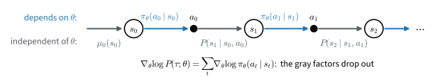
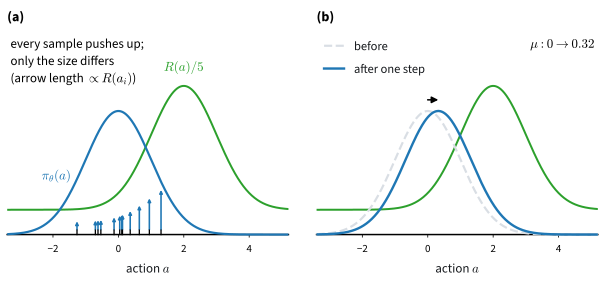
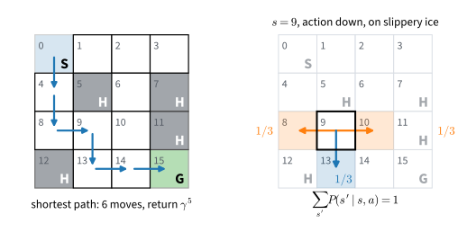

# Policy Gradient
:label:`sec_policygradient`

In the previous section a policy learned from an expert. Behavior cloning took one ascent step on the log-probability of each demonstrated action, with every action weighted by one. Now suppose there is no expert, only the agent's own attempts and the reward each attempt earned. An obvious guess keeps the update and changes the weights: push up the log-probability of every action the agent took, weighted by the return of the episode it belongs to, so that actions from episodes that paid off become more likely. Is this guess principled? How does the expected return change when the parameters $\theta$ of the policy move?

Ronald Williams answered this question in 1992 :cite:`Williams.1992`. The average of the guessed update is the gradient of the expected return, so the guess is stochastic gradient ascent, and he called the algorithm REINFORCE. The return of an episode depends on the environment's transition probabilities, which the agent does not know, yet the estimate needs only sampled episodes and the policy's own log-probabilities. Writing the policy down as a function $\pi_\theta(a \mid s)$ also lifts a limit of the value tables of :numref:`sec_qlearning`. Acting greedily on a table needs a maximum over a finite list of actions, whereas a parameterized policy can output a torque, or a distribution over a vocabulary of tokens. The same identity, applied to the next-token distribution of a language model, trains reasoning models from a single reward given to the finished answer.

We derive the estimator from the smallest problem with a policy gradient and run it on the verifier task of :numref:`sec_mdp`, where every gradient can be computed exactly, and on the lake. It is right on average, but it needs fresh episodes after every update, and a small batch leaves much noise.

```{.python .input #policy-gradient-policy-gradient}
%%tab pytorch
import math
import numpy as np
import torch
from torch import nn
from torch.nn import functional as F
from d2l import torch as d2l
```

```{.python .input #policy-gradient-policy-gradient}
%%tab jax
import math
import numpy as np
import jax
from jax import numpy as jnp
from flax import nnx
import optax
from d2l import jax as d2l
```

```{.python .input #policy-gradient-1}
%%tab pytorch, jax
import gymnasium as gym
```

## Parameterizing the Policy

Gradient ascent needs a policy that changes smoothly with its parameters. A deterministic policy is an argmax, which is piecewise constant: a small change of the parameters either changes nothing or switches the action. The probabilities of a stochastic policy can move by any small amount.

### Softmax Preferences

`Policy.tabular` from :numref:`sec_imitation` stores one parameter $\theta_{s,a}$, called a *preference*, for each state-action pair. A softmax over the actions turns the preferences at state $s$ into probabilities:

$$\pi_\theta(a \mid s) = \frac{e^{\theta_{s,a}}}{\sum_{a'} e^{\theta_{s,a'}}}.$$
:eqlabel:`eq_softmax_policy`

This is the softmax regression of :numref:`sec_softmax` with a state index as its input, the same policy that behavior cloning fitted. The zero table gives the uniform policy. Unlike $Q(s,a)$, a preference is not an estimate of return; adding the same constant to every preference at a state leaves the policy unchanged.

### The Score Function

The softmax is easy to differentiate. Since $\log \pi_\theta(a \mid s) = \theta_{s,a} - \log \sum_{a''} e^{\theta_{s,a''}}$, the derivative with respect to the preference $\theta_{s,a'}$ of any action $a'$ at the same state is

$$\frac{\partial \log \pi_\theta(a \mid s)}{\partial \theta_{s,a'}} = \mathbf{1}(a' = a) - \pi_\theta(a' \mid s),$$
:eqlabel:`eq_softmax_score`

and the derivative with respect to the preferences at every other state is zero. The vector $\nabla_\theta\log\pi_\theta(a\mid s)$ is called the *score function*. In words, increasing the log-probability of $a$ means raising its own preference and lowering every preference at $s$ in proportion to its probability. Writing $e_a$ for the indicator vector of action $a$, the row of the score at $s$ is $e_a - \pi_\theta(\cdot \mid s)$. Its components sum to zero, so the score has no component along the one direction that leaves the policy unchanged, adding a constant to every preference at $s$. We check the formula against automatic differentiation of `Policy.log_prob` at a random table:

```{.python .input #policy-gradient-the-score-function}
%%tab pytorch
rng = np.random.default_rng(0)
check = d2l.Policy.tabular(16, 4)
with torch.no_grad():   # move to a generic table, off the uniform start
    check.policy.weight.copy_(torch.as_tensor(rng.standard_normal((16, 4))))
check.log_prob(torch.tensor([6]), torch.tensor([2])).backward()
probs = np.exp(check.log_prob_np(np.repeat(6, 4), np.arange(4)))
hand = np.zeros((16, 4), dtype=np.float32)
hand[6], hand[6, 2] = -probs, 1 - probs[2]
print(bool(torch.allclose(check.policy.weight.grad, torch.as_tensor(hand),
                          atol=1e-6)))
```

```{.python .input #policy-gradient-the-score-function}
%%tab jax
rng = np.random.default_rng(0)
check = d2l.Policy.tabular(16, 4)
check.policy.embedding[...] = jnp.asarray(rng.standard_normal((16, 4)),
                                          jnp.float32)   # a generic table
score = nnx.grad(lambda policy: check.log_prob(
    jnp.array([6]), jnp.array([2]), policy).sum())(check.policy)
probs = np.exp(check.log_prob_np(np.repeat(6, 4), np.arange(4)))
hand = np.zeros((16, 4), dtype=np.float32)
hand[6], hand[6, 2] = -probs, 1 - probs[2]
print(bool(np.allclose(score.embedding[...], hand, atol=1e-6)))
```

:begin_tab:`jax`
JAX differentiates a function, not a module in place, so the check passes the policy network back into `log_prob` and takes `nnx.grad` with respect to it, as `policy_step` does.
:end_tab:

The gradient of the library's `log_prob` at state 6 and action 2 matches :eqref:`eq_softmax_score`, and it is zero in every other row of the table.

## The Policy Gradient

What is the gradient of the expected return, and can it be estimated from the agent's own episodes? The answer is cleanest with one state, and it keeps its form for trajectories.

### The Smallest Case

Take one state and two actions with preferences $\theta_1$ and $\theta_2$. Action 1 earns reward $1$ and action 2 earns $0$. Write $p = \pi_\theta(1)$. The expected reward is $J(\theta) = p$, and by :eqref:`eq_softmax_score` its derivative with respect to $\theta_1$ is $p(1 - p)$. Suppose that we could not compute $p$ but could only try actions. The derivative can still be written as an average over the policy's own actions. Multiply and divide each term by $\pi_\theta(a)$:

$$\frac{\partial J}{\partial \theta_1} = \sum_a r(a)\, \frac{\partial \pi_\theta(a)}{\partial \theta_1} = \sum_a \pi_\theta(a)\, r(a)\, \frac{\partial \log \pi_\theta(a)}{\partial \theta_1} = \mathbb{E}_{a \sim \pi_\theta}\Big[ r(a)\, \frac{\partial \log \pi_\theta(a)}{\partial \theta_1} \Big].$$

So one sampled action, its reward multiplied by its score, is an estimate of the derivative. With probability $p$ the sample is action 1, whose reward is $1$ and whose score is $1 - p$; with probability $1 - p$ the reward is zero and so is the estimate. The mean is $p(1 - p)$, the derivative itself. The second moment is $p(1-p)^2$, so the standard deviation is $(1-p)\sqrt{p(1-p)}$, which is

$$\sqrt{\frac{1 - p}{p}}$$

times the mean. When the paying action is rare, the estimate is right on average and useless in almost every single draw: it is usually zero, and occasionally about $1/p$ times too large. Averaging $n$ independent draws divides the ratio by $\sqrt n$.

The lake has the same structure at the start of learning. The uniform policy reaches the goal in about $1.4\%$ of episodes (:numref:`sec_valueiter`), on calm and slippery ice alike, because a uniformly random command is a uniformly random move. An episode that misses earns nothing. At $p = 0.014$ the ratio is $8.4$, and a batch of 16 episodes contains no success at all with probability $(1 - 0.014)^{16} \approx 0.80$. Four batches in five then give an estimate of zero. The rest of this section carries out the same computation with trajectories in place of the two actions.

### An Optimization Problem over Trajectories

On the lake an episode is a trajectory $\tau = (s_0, a_0, r_0, s_1, a_1, r_1, \ldots, s_T)$ that ends at the first terminal state $s_T$, so its length $T$ is random. The agent chooses each action and the environment chooses each next state, so the probability of a trajectory is a product of the policy's factors, the transition kernel's factors, and the start distribution $\mu_0$ of :numref:`sec_mdp`:

$$P(\tau; \theta) = \mu_0(s_0) \prod_{t=0}^{T-1} \pi_\theta(a_t \mid s_t)\ P(s_{t+1} \mid s_t, a_t).$$
:eqlabel:`eq_traj_prob`

Only the policy's factors depend on $\theta$. The objective is the expected return over these trajectories, with $R(\tau) = \sum_{t=0}^{T-1} \gamma^t r_t$:

$$J(\theta) = \mathbb{E}_{\tau \sim P(\cdot;\, \theta)} \big[ R(\tau) \big] = \sum_{\tau} R(\tau)\ P(\tau; \theta).$$
:eqlabel:`eq_pg_objective`

The lake has a fixed start state, so $J(\theta) = V^{\pi_\theta}(s_0)$ in the notation of :numref:`sec_valueiter`. On the verifier task $\mu_0$ is the uniform distribution over the four prompts.

### The Log-Derivative Trick

The step of the smallest case applies unchanged. The return $R(\tau)$ of a fixed trajectory does not depend on $\theta$; only its probability does. Moving the gradient inside the sum and multiplying and dividing by $P(\tau;\theta)$ gives

$$
\begin{aligned}
\nabla_\theta J(\theta) &= \sum_\tau R(\tau)\ \nabla_\theta P(\tau; \theta) = \sum_\tau P(\tau; \theta)\ R(\tau)\ \frac{\nabla_\theta P(\tau; \theta)}{P(\tau; \theta)}
= \sum_\tau P(\tau; \theta)\ R(\tau)\ \nabla_\theta \log P(\tau; \theta),
\end{aligned}
$$

that is,

$$\nabla_\theta J(\theta) = \mathbb{E}_{\tau \sim P(\cdot;\, \theta)} \Big[ R(\tau)\ \nabla_\theta \log P(\tau; \theta) \Big].$$
:eqlabel:`eq_pg_gradient`

The identity $\nabla \log P = \nabla P / P$ is called the *log-derivative trick*. It turns the gradient back into an average over the trajectories that the current policy produces, which we can sample. The sum over trajectories is infinite, because an episode can last any number of steps. Moving the gradient inside is still allowed: under a softmax policy every state has a positive probability of reaching a terminal state within a few steps, so long episodes are exponentially rare, and each step adds a score of bounded length.

### Cancellation of the Transition Probabilities
:label:`subsec_pg-cancellation`

The gradient still contains $\log P(\tau;\theta)$, and $P(\tau;\theta)$ contains the transition kernel, which the agent does not know. The logarithm of the product :eqref:`eq_traj_prob` is a sum, and only the policy's terms survive differentiation:

$$
\begin{aligned}
\nabla_\theta \log P(\tau; \theta) &= \nabla_\theta \Big[ \log \mu_0(s_0) + \sum_{t=0}^{T-1} \log \pi_\theta(a_t \mid s_t) + \sum_{t=0}^{T-1} \log P(s_{t+1} \mid s_t, a_t) \Big] \\
&= \sum_{t=0}^{T-1} \nabla_\theta \log \pi_\theta(a_t \mid s_t).
\end{aligned}
$$

:numref:`fig_rl_trajectory_chain` shows the chain of factors. The start distribution and the kernel do not depend on $\theta$, so their logarithms have zero gradient. The kernel still decides which trajectories we sample, but the estimator never evaluates it. This is what makes the method *model-free*, and it names the assumption the derivation needs: the dynamics must not depend on the policy's parameters (exercise :exref:`ex_policy-gradient-parameter-dependent-dynamics` drops it).


:label:`fig_rl_trajectory_chain`

### The REINFORCE Estimator

Substituting the sum of scores into :eqref:`eq_pg_gradient` and replacing the expectation by an average over $n$ trajectories $\tau_1, \ldots, \tau_n$ sampled from the current policy gives

$$\hat{u} = \frac{1}{n} \sum_{i=1}^n R(\tau_i) \sum_{t=0}^{T_i-1} \nabla_\theta \log \pi_\theta(a_t^i \mid s_t^i).$$
:eqlabel:`eq_reinforce`

Each trajectory pushes up the log-probability of every action it took, by an amount proportional to its return. This is the guess of the opening, and each term has expectation $\nabla_\theta J(\theta)$, so $\hat u$ is an unbiased estimate of the gradient. REINFORCE :cite:`Williams.1992` takes the ascent step $\theta \leftarrow \theta + \eta\, \hat u$ with a step size $\eta$, then samples a new batch from the updated policy. On the lake every return is nonnegative, so every sampled action is pushed up. Actions that were not sampled lose probability through the $-\pi_\theta(\cdot\mid s)$ part of the score, and an episode with return zero changes nothing.

:numref:`fig_rl_score_ascent` draws one step for a one-step problem with a continuous action, which a softmax over four actions cannot show as a curve. The policy is a Gaussian $\mathcal{N}(a; \mu, 1)$, whose score with respect to the mean is $a - \mu$. An episode is a single action $a$, so its return $R(a)$ is that action's reward, and the step reads $\mu \leftarrow \mu + \eta\, \frac{1}{n}\sum_i R(a_i)(a_i - \mu)$: the mean moves toward the sampled actions that paid most. Twelve samples move it to $0.32$, where the exact gradient would give $0.52$.

![One REINFORCE step on a one-step problem. The policy is $\pi_\theta(a) = \mathcal{N}(a; \mu, 1)$ with $\mu = 0$, and the reward is $R(a) = 0.4 + 2e^{-(a-2)^2/2}$, so the expected reward is $J = 0.92$ and the exact gradient is $\mathrm{d}J/\mathrm{d}\mu = 0.52$. (a) Twelve sampled actions each push up their own log-probability, weighted by their rewards; all rewards are positive, so every arrow points up. (b) The step $\mu \leftarrow \mu + \eta\,\frac{1}{12}\sum_i R(a_i)(a_i - \mu)$ with $\eta = 1$ moves the mean from $0$ to $0.32$, toward the actions with higher reward; the exact gradient would have moved it to $0.52$.](../img/mdl-rl-score-ascent.svg)
:label:`fig_rl_score_ascent`

## REINFORCE on the Running Examples

The verifier task has one step per episode and no transitions, so every quantity can be computed exactly. The lake has episodes of several steps and a transition kernel that the update never reads.

### The Verifier Task

The verifier task of :numref:`sec_mdp` has four arithmetic prompts $x$ and nine candidate responses $y$ shared by all of them. The policy is a table $\theta$ with one row of preferences per prompt, $\pi_\theta(y \mid x)$ is the softmax of row $x$, and the verifier pays $r(x, y) = 1$ for the correct answer and $0$ otherwise. A trajectory is a single response to a prompt, with probability $\mu_0(x)\,\pi_\theta(y \mid x)$ and no kernel at all. Row $x$ of $\theta$ affects only the expected score of prompt $x$, $J_x(\theta) = \sum_y \pi_\theta(y \mid x)\, r(x, y)$, and by :eqref:`eq_softmax_score` with the prompt in place of the state, its exact gradient is a sum of nine terms:

$$\nabla_{\theta_x} J_x(\theta) = \sum_{y} \pi_\theta(y \mid x)\, r(x, y)\, \big( e_y - \pi_\theta(\cdot \mid x) \big).$$

REINFORCE replaces this sum by an average over $K$ sampled responses. `verifier_step` samples $K$ responses for every prompt, turns their rewards into weights with the function `weighting`, and moves the row of $\theta$ by `lr` $= \eta$ times the weighted average of the $K$ scores. With `weighting = lambda r: r` the weights are the rewards and the step is :eqref:`eq_reinforce`; :numref:`sec_baselines` passes other weightings. The checker is the argument `reward`, so the same step can train against a different verifier.

```{.python .input #policy-gradient-the-reinforce-estimator-4}
%%tab pytorch, jax
def verifier_step(task, theta, K, reward, rng, weighting, lr=2.0):  #@save
    """One REINFORCE step on a VerifierTask: K responses per prompt, each
    score e_y - pi(.|x) (eq_softmax_score) weighted by weighting(rewards of
    the prompt's K responses), averaged over the K, one ascent step."""
    pi, g = task.policy(theta), np.zeros_like(theta)
    eye = np.eye(len(task.resp))
    for x in range(len(task.prompts)):         # one group of K per prompt
        ys = rng.choice(len(task.resp), K, p=pi[x])
        w = weighting(np.array([reward(x, y) for y in ys]))
        g[x] = (eye[ys] - pi[x]).T @ w / K
    return theta + lr * g
```

The exact-match verifier pays only the correct response $y^*$, so the estimate for prompt $x$ is $\frac{c}{K}\big(e_{y^*} - \pi_\theta(\cdot \mid x)\big)$, where $c$ counts the correct responses among the $K$. The count $c$ is binomial with success probability $p = \pi_\theta(y^* \mid x)$, so the estimate has mean $p\,(e_{y^*} - \pi_\theta(\cdot\mid x))$, the exact gradient, and relative standard deviation $\sqrt{(1-p)/(Kp)}$: the ratio of the smallest case divided by $\sqrt K$. At the reference table $p \approx 1/8$ on the two answerable prompts, so a group of $K = 16$ should be off by about $0.66$ of the gradient's length.

The next cell checks this prediction. It draws 10,000 estimates at the reference table (with `lr=1.0` the step minus $\theta$ is the estimate) and takes one step with $\eta = 2$:

```{.python .input #policy-gradient-the-reinforce-estimator-5}
%%tab pytorch, jax
task = d2l.VerifierTask()
theta0, pi0, R = task.theta_ref, task.policy(task.theta_ref), task.R
exact = pi0 * R - pi0 * (pi0 * R).sum(axis=1, keepdims=True)  # nine terms
rng = np.random.default_rng(0)
U = np.stack([verifier_step(task, theta0, 16, task.verify, rng, lambda r: r,
                            lr=1.0) - theta0 for _ in range(10_000)])
err = lambda u: np.linalg.norm(u - exact) / np.linalg.norm(exact)
print(f'one K=16 estimate is off by '
      f'{np.sqrt(np.mean([err(u) ** 2 for u in U])):.2f} of the gradient (RMS)')
print('the mean of M of them: ' + ', '.join(
    f'M={M}: {err(U[:M].mean(axis=0)):.3f}' for M in (10, 100, 1000, 10_000)))
print(f'groups without a success, per prompt: '
      f'{np.round((U == 0).all(axis=-1).mean(axis=0), 2)}')
after = [task.success(task.policy(theta0 + 2.0 * u)) for u in U]
print(f'success {task.success(pi0):.3f}; one step with lr = 2 gives '
      f'{task.success(task.policy(theta0 + 2.0 * exact)):.3f} (exact gradient),'
      f' median {np.median(after):.3f} (sampled)')
```

One estimate is off by $0.66$ of the gradient's length, as predicted. The error of the mean of $M$ estimates keeps falling as $M$ grows, on average like $0.66/\sqrt M$, and shows no floor: the estimator is unbiased. Each estimate amounts to one binomial count per answerable prompt, so a single average can land well below that rate or up to about twice above it. On each answerable prompt about $12\%$ of the groups contain no correct response, $(7/8)^{16} \approx 0.12$, and contribute nothing. On `8*8` and `9*9`, where no candidate passes the verifier, every group is empty: no amount of sampling produces a gradient for a prompt that no response solves. One exact step with $\eta = 2$ raises the success from $0.062$ to $0.077$, and a sampled step does about as well in the median. A sampled step never lowers the success on this task, because the only weighted score is that of the correct response.

### The Lake

On the lake an episode has several steps and the kernel enters. We use the calm lake, where every command moves the agent as intended, rather than the slippery ice of the earlier sections. The reason is how much one episode says about one action. At the uniform start both maps give the same walk and the same success probability of about $1.4\%$. But on slippery ice a command moves the agent in its own direction or in either perpendicular direction with probability $1/3$ each, so the one thing it controls is that the agent does not move the opposite way. At the uniform start this makes the exact gradient on slippery ice one third as long as on calm ice, while the noise of a one-episode estimate is about the same, so a batch must be nine times larger for the same precision (exercise :exref:`ex_policy-gradient-theorem-table` derives the factor).

As the policy improves the gap widens: successful episodes on slippery ice last tens of steps instead of six, so each success is shared among many more actions and discounted by $\gamma^{T-1}$. REINFORCE still learns on slippery ice, slowly (exercise :exref:`ex_policy-gradient-softmax-plateaus`).

We remove Gymnasium's default limit of 100 steps for this map. The objective :eqref:`eq_pg_objective` is defined over complete episodes, and the sum of rewards of a cut episode is not its return (:numref:`sec_mdp`). A softmax policy gives every action positive probability, so on this map every episode ends with probability one, and the cap of 10,000 steps is only a safeguard far above any episode these runs produce:

```{.python .input #policy-gradient-parameterizing-the-policy}
%%tab pytorch, jax
gamma = 0.95
env = gym.make('FrozenLake-v1', is_slippery=False, max_episode_steps=10_000)
```

`Batch` stores the transitions of several episodes in flat arrays, with the index one past the last step of each episode. `episode_returns` computes $R(\tau)$ for each episode, and `per_step` repeats one value per episode over that episode's steps, which turns a return into the weight of each of its actions. The container also records the next state and a flag `term` that marks *terminated*, never *truncated*: by the rule of :numref:`sec_mdp`, a cut episode has not reached a terminal state. Every lake episode here terminates, so the flag matters only once episodes are cut.

```{.python .input #policy-gradient-an-optimization-problem-over-trajectories-1}
%%tab pytorch, jax
class Batch:  #@save
    """A flat batch of transitions, plus the episode boundaries."""
    def __init__(self, obs, act, rew, next_obs, term, ep_ends):
        self.obs, self.act, self.rew = obs, act, rew
        self.next_obs, self.term = next_obs, term
        self.ep_ends = ep_ends    # one past the last step of each episode

    def __len__(self):
        return len(self.rew)

    def episodes(self):
        """Yield one slice per episode."""
        start = 0
        for end in self.ep_ends:
            yield slice(start, end)
            start = end

    def episode_returns(self, gamma=1.0):
        """R(tau), the discounted return, one number per episode."""
        return np.array([(gamma ** np.arange(ep.stop - ep.start)
                          * self.rew[ep]).sum() for ep in self.episodes()])

    def per_step(self, values):
        """Repeat one value per episode over that episode's steps."""
        return np.repeat(values, np.diff(self.ep_ends, prepend=0))
```

`rollout` fills a batch. It plays complete episodes with any policy written as a function `policy(obs, rng) -> action`, the acting protocol of `evaluate` in :numref:`sec_valueiter`, and appends each step's state, action, reward, next state and termination flag. All randomness of the agent comes from the NumPy generator `rng`, so the seed fixes every sampled episode.

```{.python .input #policy-gradient-an-optimization-problem-over-trajectories-2}
%%tab pytorch, jax
def rollout(env, policy, num_episodes, rng):  #@save
    """Collect complete episodes from `policy(obs, rng) -> action` as a
    Batch. `term` records `terminated`, never `truncated`: a time-limit cut
    is not a terminal state. All sampling runs through the numpy `rng`."""
    cols, ep_ends = [[] for _ in range(5)], []
    for _ in range(num_episodes):
        obs, done = env.reset()[0], False
        while not done:
            act = policy(obs, rng)
            next_obs, reward, terminated, truncated, _ = env.step(act)
            done = terminated or truncated
            for col, val in zip(cols, (obs, act, reward, next_obs,
                                       float(terminated))):
                col.append(val)
            obs = next_obs
        ep_ends.append(len(cols[0]))
    obs, act, rew, next_obs, term = (np.asarray(c) for c in cols)
    return Batch(obs, act, rew.astype(np.float32), next_obs,
                 term.astype(np.float32), np.asarray(ep_ends))
```

The training loop reuses `policy_step` from :numref:`sec_imitation`, which takes one optimizer step on $\frac{1}{N}\sum_t w_t \log \pi_\theta(a_t \mid s_t)$ over the $N$ steps of a batch. Behavior cloning passed $w_t = 1$; REINFORCE passes the return of the episode that contains step $t$. Internally `policy_step` minimizes the negative of this sum, a *surrogate loss*, whose value says nothing about how well the policy performs; only its gradient at the current $\theta$, the estimate, matters.

Two details differ from :eqref:`eq_reinforce`. First, `policy_step` divides by the number of steps $N$ rather than the number of episodes $n$, which divides the estimate by the mean episode length of the batch, a factor that varies from batch to batch. Second, the optimizer is Adam with the learning rate $0.1$ of `Policy.tabular`, not the plain step $\theta \leftarrow \theta + \eta\hat u$. Plain ascent crawls wherever an action has small probability, because by :eqref:`eq_softmax_score` the gradient of its preference carries that probability as a factor, while Adam moves each coordinate by about its learning rate (exercise :exref:`ex_policy-gradient-softmax-plateaus` compares the two). The loop collects a fresh batch, weights each step by its episode's return, takes one step, and yields the batch's mean return and its number of steps:

```{.python .input #policy-gradient-the-reinforce-estimator-1}
%%tab pytorch, jax
def train_reinforce_tabular(ac, env, gamma, seed, num_updates=256,  #@save
                            batch_episodes=16):
    """REINFORCE: a fresh batch from the current policy, every step of a
    trajectory weighted by that trajectory's return, one ascent step.
    Yields the batch's mean return and its number of steps."""
    rng = np.random.default_rng(seed)      # one stream for all sampling
    env.reset(seed=seed)
    for _ in range(num_updates):
        batch = rollout(env, ac.act, batch_episodes, rng)
        R = batch.episode_returns(gamma)
        d2l.policy_step(ac, batch.obs, batch.act, batch.per_step(R))
        yield float(R.mean()), len(batch)
```

We train twelve agents from the uniform policy, each with its own seed, and plot the mean return of each training batch, an estimate of $J(\theta)$, against the ceiling $\gamma^5 \approx 0.774$ of a six-step path:

```{.python .input #policy-gradient-the-reinforce-estimator-2}
%%tab pytorch, jax
agents = [d2l.Policy.tabular(16, 4) for _ in range(12)]  # uniform policies
runs = np.array([list(train_reinforce_tabular(ac, env, gamma, seed))
                 for seed, ac in enumerate(agents)])     # (seed, update, 2)
curves, steps = runs[..., 0], runs[..., 1].astype(int)
d2l.plot_curves({'REINFORCE': curves}, xlabel='update',
                ylabel='mean return of the batch', reference=gamma ** 5)
```

The plot shows the median of the twelve runs, with a band from the slowest to the fastest. The median starts flat because, as the smallest case predicted, most early batches contain no success and give a zero estimate. Once a batch succeeds, its actions become more likely, successes become more frequent, and the mean return rises quickly. Every run approaches the dashed ceiling within a few dozen updates and stays a little below it, because the policy is still stochastic and sometimes leaves the shortest path. The next cell shows the learned policy of the first agent, with the most probable action and its probability at each cell:

```{.python .input #policy-gradient-the-reinforce-estimator-3}
%%tab pytorch, jax
probs = agents[0].probs(16, 4)
d2l.show_grid(env.unwrapped.desc, probs.max(axis=1), probs.argmax(axis=1))
```

The policy concentrates on one of the three shortest paths to the goal, chosen by the episodes that happened to succeed first. The holes and the goal stay uniform, because no action is ever taken there. Cells off the chosen path keep most of the preferences they picked up from early successful episodes that passed through them. They change only when an episode strays through them, which becomes rare as the path firms up; between visits Adam's momentum carries the last change on for a few dozen updates, then they stay put. Nothing in this loop evaluated the transition kernel: `rollout` recorded the next states that the simulator sampled, and the update read only states, actions and returns. This is the cancellation of :numref:`subsec_pg-cancellation` at work, which the verifier task, having no kernel, could not show.

## The Policy Gradient Theorem

REINFORCE weights the score of every action by the return of the whole trajectory, including rewards that arrived before the action was taken. An action cannot affect rewards that are already collected, so those rewards should contribute nothing on average. The policy gradient theorem :cite:`Sutton.McAllester.Singh.ea.2000` makes this precise, and it rewrites the gradient as an average over the states the policy visits rather than over whole trajectories. To state it, let the chain stay in its terminal state after the episode ends, with zero reward, so that $s_t$ is defined for every $t$. Write $d^{\pi_\theta}_t(s) = \Pr(s_t = s)$ for the distribution of $s_t$ under $\pi_\theta$, and

$$d^{\pi_\theta}_\gamma(s) = (1 - \gamma) \sum_{t \geq 0} \gamma^t\, d^{\pi_\theta}_t(s)$$

for its discounted average over time, the *discounted state-occupancy distribution*. The factor $1-\gamma$ makes the weights $\gamma^t$ sum to one, so $d^{\pi_\theta}_\gamma$ is a probability distribution over states.

### Statement and Proof

**Proposition (policy gradient theorem).** *For the objective $J(\theta) = \mathbb{E}_{s_0 \sim \mu_0} [V^{\pi_\theta}(s_0)]$,*

$$\nabla_\theta J(\theta) = \mathbb{E}_{\tau \sim P(\cdot;\, \theta)} \Big[ \sum_{t \geq 0} \gamma^t\, \nabla_\theta \log \pi_\theta(a_t \mid s_t)\ Q^{\pi_\theta}(s_t, a_t) \Big] = \frac{1}{1 - \gamma}\, \mathbb{E}_{s \sim d^{\pi_\theta}_\gamma,\ a \sim \pi_\theta(\cdot \mid s)} \Big[ \nabla_\theta \log \pi_\theta(a \mid s)\ Q^{\pi_\theta}(s, a) \Big]$$
:eqlabel:`eq_pg_theorem`

**Proof.** By :eqref:`eq_pg_gradient` and the cancellation, $\nabla_\theta J = \mathbb{E}\big[\sum_t \nabla_\theta \log \pi_\theta(a_t \mid s_t)\, R(\tau)\big]$. At each $t$, split the return into the rewards before $t$ and those from $t$ on. The rewards before $t$ are fixed once the agent stands at $s_t$, while $a_t$ is still to be drawn, and the score of $a_t$ has mean zero given $s_t$: $\sum_a \pi_\theta(a \mid s)\nabla_\theta \log\pi_\theta(a\mid s) = \sum_a \nabla_\theta \pi_\theta(a\mid s) = \nabla_\theta 1 = 0$. So the earlier rewards contribute zero. For the rewards from $t$ on, condition on $(s_t, a_t)$: by the Markov property their expected discounted sum is $\gamma^t Q^{\pi_\theta}(s_t, a_t)$. This gives the first form. For the second, group the sum over $t$ by the state visited: for any function $f$, $\mathbb{E}\big[\sum_t \gamma^t f(s_t, a_t)\big] = \sum_s \sum_t \gamma^t d^{\pi_\theta}_t(s)\ \mathbb{E}_{a \sim \pi_\theta(\cdot\mid s)} f(s, a)$, and substitute the definition of $d^{\pi_\theta}_\gamma$. At terminal states $Q^{\pi_\theta} = 0$, so the steps after the end of an episode contribute nothing. $\blacksquare$

### Consequences

The theorem has three consequences. First, the score at time $t$ needs only the rewards from $t$ on, because the proof removed the earlier ones as zero-mean noise, so an estimator that drops them has the same mean and usually less noise. Second, the gradient is an average over the states the policy visits, weighted by how often and how early it visits them, so a state the policy rarely reaches receives little gradient, and a batch that never visits it gives its row an estimate of exactly zero; this is why the cells off the learned path above barely change. Third, many implementations drop the factor $\gamma^t$ from the first form. This replaces $d^{\pi_\theta}_\gamma$ by the undiscounted visitation of states, changes the relative weight of states visited late, and in general yields an update that is not the gradient of any objective :cite:`Nota.Thomas.2020`. Exercise :exref:`ex_policy-gradient-discount-that-implementations-drop` examines the difference.

## Costs and Limitations

### The On-Policy Data Requirement

The estimator :eqref:`eq_reinforce` averages trajectories drawn from the *current* policy. After one update the parameters have changed, and the trajectories already collected no longer follow $P(\tau;\theta)$. Methods with this requirement are called *on-policy*, and they collect a new batch for every update. Q-learning is *off-policy*: its update learns about the greedy policy from transitions that any behavior policy generated (:numref:`sec_qlearning`). We count the data that REINFORCE uses in environment steps:

```{.python .input #policy-gradient-on-policy-fresh-data-after-every-update}
%%tab pytorch, jax
hit = (curves >= 0.7).argmax(axis=1) + 1   # batches until the mean is 0.7
to_hit = np.array([s[:k].sum() for s, k in zip(steps, hit)])
for name, x in [('batches until a batch mean reaches 0.7', hit),
                ('environment steps until then', to_hit),
                ('environment steps of the full run', steps.sum(axis=1))]:
    print(f'{name:>38}: median {np.median(x):>6,.0f}, '
          f'range {x.min():,} to {x.max():,}')
```

A batch mean first reaches $0.7$, about $90\%$ of the ceiling, after 25 to 50 updates, which is 3,000 to 7,000 environment steps. The full run of 256 updates uses about 27,000 steps, because each update keeps collecting a new batch long after the policy has stopped improving. On the same map, tabular Q-learning with $\alpha = 0.9$ found, in almost every run, a greedy table that reaches the goal, and the whole run took about 3,500 steps (:numref:`sec_qlearning`). Reusing a batch for several updates is the obvious remedy, and it is unsound without a correction (exercise :exref:`ex_policy-gradient-breaking-policy-rule-purpose`).

### Unbiasedness and Variance

The lake, like the verifier task, permits a check against the exact gradient, because its model is known. In :numref:`sec_valueiter` the value of a policy solved the linear system $V^\pi = r_\pi + \gamma P_\pi V^\pi$, where $P_\pi(s' \mid s) = \sum_a \pi(a \mid s) P(s' \mid s, a)$ and $r_\pi(s) = \sum_a \pi(a \mid s)\, r(s, a)$. The objective is therefore

$$J(\theta) = V^{\pi_\theta}(s_0) = \Big[ \big(I - \gamma P_{\pi_\theta}\big)^{-1} r_{\pi_\theta} \Big]_{s_0}.$$
:eqlabel:`eq_pg_exact_objective`

Every entry of $P_{\pi_\theta}$ and $r_{\pi_\theta}$ is a smooth function of $\theta$, so automatic differentiation through the linear solve gives the exact $\nabla_\theta J$. Holes and the goal are absorbing states with zero reward in `TabularMDP.from_gym`, so the solve accounts for termination. We freeze a policy `probe` after 16 updates of the run with seed 3, which has started to climb by then:

```{.python .input #policy-gradient-unbiasedness-and-variance-1}
%%tab pytorch, jax
probe = d2l.Policy.tabular(16, 4)
list(train_reinforce_tabular(probe, env, gamma, 3, num_updates=16))  # train
mdp = d2l.TabularMDP.from_gym(env, gamma)
```

`policy_objective` computes $J(\theta)$ by :eqref:`eq_pg_exact_objective` from a preference table, a kernel `P[s, a, s']` and rewards `r[s, a]`, and the framework's `grad` differentiates it through the solve. We compute $J$ and its exact gradient at the probe:

```{.python .input #policy-gradient-unbiased-and-how-noisy-1}
%%tab pytorch
def policy_objective(theta, P, r, gamma):  #@save
    """J(theta) = V(s0) of the softmax policy, a differentiable linear solve."""
    pi = torch.softmax(theta, -1)
    P_pi = torch.einsum('sa,sat->st', pi, P)
    return torch.linalg.solve(torch.eye(len(P)) - gamma * P_pi,
                              (pi * r).sum(-1))[0]

P, r = torch.as_tensor(mdp.P).float(), torch.as_tensor(mdp.r).float()
theta = probe.policy.weight.detach()
g_exact = torch.func.grad(policy_objective)(theta, P, r, gamma).numpy()
print(f'J(theta) after 16 updates = '
      f'{float(policy_objective(theta, P, r, gamma)):.3f}, '
      f'against the ceiling gamma^5 = {gamma ** 5:.3f}')
```

```{.python .input #policy-gradient-unbiased-and-how-noisy-1}
%%tab jax
def policy_objective(theta, P, r, gamma):  #@save
    """J(theta) = V(s0) of the softmax policy, a differentiable linear solve."""
    pi = jax.nn.softmax(theta, -1)
    P_pi = jnp.einsum('sa,sat->st', pi, P)
    return jnp.linalg.solve(jnp.eye(len(P)) - gamma * P_pi,
                            (pi * r).sum(-1))[0]

P, r = jnp.asarray(mdp.P, jnp.float32), jnp.asarray(mdp.r, jnp.float32)
theta = probe.policy.embedding[...]
g_exact = np.asarray(jax.grad(policy_objective)(theta, P, r, gamma))
print(f'J(theta) after 16 updates = '
      f'{float(policy_objective(theta, P, r, gamma)):.3f}, '
      f'against the ceiling gamma^5 = {gamma ** 5:.3f}')
```

The probe lies partway between the uniform policy and the ceiling. Now hold $\theta$ fixed and draw the estimator many times. `tabular_score` sums the weighted scores $w_t\,(e_{a_t} - \pi_\theta(\cdot \mid s_t))$ of a batch, each into the row of its state, by :eqref:`eq_softmax_score`. `reinforce_estimate` computes one draw of :eqref:`eq_reinforce` with it, as `verifier_step` does: each step is weighted by its episode's return, and the sum is divided by $n$. For each batch size $n$ we draw fifty estimates and print three numbers relative to $\|\nabla_\theta J\|$: the root-mean-square error of one draw, the error of the mean of the fifty, and the error that an unbiased estimator would leave in that mean, the first number divided by $\sqrt{50}$:

```{.python .input #policy-gradient-unbiased-and-how-noisy-2}
%%tab pytorch, jax
def tabular_score(obs, act, w, pi):  #@save
    """sum_t w_t (e_{a_t} - pi(.|s_t)), each term added into row s_t: the
    weighted softmax score (eq_softmax_score) of a batch, the shape of pi."""
    u = np.zeros(pi.shape)
    np.add.at(u, obs, w[:, None] * (np.eye(pi.shape[1])[act] - pi[obs]))
    return u

def reinforce_estimate(env, probe, gamma, n, rng):
    """One draw of eq_reinforce at the frozen tabular policy `probe`: each
    step adds its trajectory's return times its score to row s; the sum is
    divided by n."""
    pi = probe.probs(env.observation_space.n, env.action_space.n)
    batch = rollout(env, probe.act, n, rng)
    w = batch.per_step(batch.episode_returns(gamma))
    return tabular_score(batch.obs, batch.act, w, pi).ravel() / n

rng, g = np.random.default_rng(4), g_exact.ravel()
for n in [4, 16, 64]:
    U = np.stack([reinforce_estimate(env, probe, gamma, n, rng)
                  for _ in range(50)])
    zero = int((U == 0).all(axis=1).sum())
    one = np.sqrt(((U - g) ** 2).sum(axis=1).mean()) / np.linalg.norm(g)
    mean = np.linalg.norm(U.mean(axis=0) - g) / np.linalg.norm(g)
    print(f'n={n:>2}: {zero:>2}/50 zero; one draw off by {one:.2f}, the mean '
          f'of 50 by {mean:.2f} (if unbiased: {one / np.sqrt(50):.2f})')
```

At $n = 4$ a single draw is off by more than three times the length of the gradient it estimates, and some draws can be zero because no episode in the batch reached the goal. The error halves each time $n$ quadruples, the $1/\sqrt n$ law of the smallest case. At every $n$ the mean of fifty draws is off by about as much as an unbiased estimator would be, so the test finds no bias; exercise :exref:`ex_policy-gradient-testing-unbiasedness` pushes it to many more draws, where a small bias would show.

### Plateaus and Convergence
:label:`subsec_pg-nonconcavity`

The objective is not concave in $\theta$. Already in the smallest case $J = p$ is a logistic function of $\theta_1 - \theta_2$, flat on both sides. Gradient ascent on a nonconcave function can in general stop at a poor stationary point. For the tabular softmax policy it cannot: there is no suboptimal stationary point, and exact gradient ascent with a small enough step converges to an optimal policy when the start distribution gives every state positive probability :cite:`Agarwal.Kakade.Lee.ea.2021,Mei.Xiao.Szepesvari.ea.2020`. Convergence can still be slow. Where the better action at a state has small probability, the gradient of its preference carries that probability as a factor, so ascent creeps across a plateau, and there are MDPs in which exact softmax ascent needs a number of steps exponential in the number of states :cite:`Li.Wei.Chi.ea.2021`.

Sampled updates with a fixed step size add a second risk. A few lucky batches can make the policy at some state nearly deterministic on a worse action, after which the gradient that would undo the choice is tiny, and the run stays committed for a long time :cite:`Mei.Dai.Xiao.ea.2021`. On the calm lake all twelve runs ended within a few hundredths of the ceiling; on slippery ice the same recipe settles at different levels from seed to seed, some well below the optimum, and exercise :exref:`ex_policy-gradient-softmax-plateaus` finds out why.

We can now improve a policy from its own episodes and their rewards alone, without a model, an expert, or a table of values, and on the verifier task the same update already has the shape of post-training a language model: a response is a trajectory, and its reward arrives at the end. The estimate is right on average, but at the probe policy, with four episodes per batch, a single draw is off by more than three times the gradient's length, and every failed episode contributes nothing. :numref:`sec_baselines` asks how much of that noise can be removed without moving the mean.

## Summary

Policy gradient methods improve a parameterized policy $\pi_\theta$ directly by gradient ascent on its expected return $J(\theta)$. The log-derivative trick writes $\nabla_\theta J$ as an average over the policy's own trajectories of the return times the trajectory's score, and the transition kernel drops out of the score, so the gradient can be estimated from sampled episodes without a model. REINFORCE weights the score of every action by the return of its episode, which is behavior cloning's update with returns in place of unit weights. On the verifier task and the calm lake the estimate matches the exact gradient on average, but on the lake a small batch is off by several times the gradient's length, and the error shrinks only as $1/\sqrt n$. The policy gradient theorem shows that rewards collected before an action contribute only noise; every update needs a fresh batch from the current policy.

## Exercises

1. **Parameter-dependent dynamics.** The derivation of
   :numref:`subsec_pg-cancellation` assumes that the transition
   probabilities do not depend on $\theta$. A recommender violates this
   assumption when users who see an item more often click it less.
    1. Suppose the dynamics are $P_\theta(s_{t+1} \mid s_t, a_t)$. Repeat
       the derivation of $\nabla_\theta \log P(\tau; \theta)$ and state the
       term that no longer vanishes. What would the agent need to know to
       compute it?
    1. In a one-step model, the recommender shows item 1 with probability
       $\pi_\theta(1) = \sigma(\theta)$ and item 0 otherwise, where $\sigma$
       is the logistic function. A shown item 1 is clicked with probability
       $1 - \sigma(\theta)$, item 0 is never clicked, and a click earns
       reward $1$. Compute $J(\theta)$ and $\mathrm{d}J/\mathrm{d}\theta$.
       Compare the derivative with the expectation of the REINFORCE estimate
       :eqref:`eq_reinforce`, which drops that term. Where does plain
       gradient ascent converge with each of the two?
   :exlabel:`ex_policy-gradient-parameter-dependent-dynamics`
1. [code] **Sparse rewards.** The smallest case of the text has one state,
   two actions, reward $1$ for action 1 and $0$ for action 2, and
   $p = \pi_\theta(1)$; a single-sample estimate has standard deviation
   $\sqrt{(1-p)/p}$ times its mean. On the lake the analogous quantity is the
   probability $p_0 \approx 0.014$ that an episode of the uniform policy
   reaches the goal, which :numref:`subsec_vi_slippery_ice` computes by
   policy evaluation at $\gamma = 1$.
    1. A batch with no success gives the estimate zero, and `policy_step`
       then leaves the zero table unchanged, so the policy stays uniform
       until the first success. What distribution does the number of
       updates up to and including the first nonzero estimate follow, and
       what is its mean for batches of 16 episodes? Record that number for
       each of the twelve training runs and compare it with the prediction
       and with the flat start of the training curve.
    1. Show that the mean of $n$ independent single-sample estimates has
       standard deviation $\sqrt{(1-p)/(np)}$ times its mean. How many
       episodes per batch would make the standard deviation equal to the
       mean at $p = p_0$? How does the answer change as training raises the
       success probability?
   :exlabel:`ex_policy-gradient-sparse-rewards`
1. **Shifted rewards.** A trajectory with return zero drops out of
   :eqref:`eq_reinforce`, so subtracting one from every reward is a
   tempting way to make failed episodes informative.
    1. In the two-action setting of the smallest case, change the rewards
       to $0$ for action 1 and $-1$ for action 2, which subtracts one from
       every return. Show that the mean of the single-sample estimate is
       unchanged and that the ratio of its standard deviation to its mean
       becomes $\sqrt{p/(1-p)}$. For which policies does the shift help,
       and for which does it hurt?
    1. On FrozenLake, the same subtraction makes every step earn $-1$ and
       the step into the goal earn $0$. Show that the return of an episode
       of $T$ steps decreases by $(1 - \gamma^T)/(1 - \gamma)$. Does this
       shift change $J$ by a constant, as in the two-action setting?
    1. The shift is the per-step charge of problem
       :exref:`ex_mdp-reward-design-its-failure`b of :numref:`sec_valueiter`,
       taken to $c = -1$. At
       $\gamma = 0.95$, compare the shifted return of the shortest path from
       the start into a hole with that of a shortest path to the goal on the
       calm lake. Which policy maximizes $J$ under the shifted
       rewards? Among the failed episodes of a batch, which ones does the
       estimate :eqref:`eq_reinforce` penalize least?
1. [code] **The theorem in a table.** ● For the tabular softmax policy,
   write $\rho_\gamma(s) = \sum_{t \geq 0} \gamma^t d^{\pi_\theta}_t(s)$
   for the discounted number of visits to $s$, so that
   $d^{\pi_\theta}_\gamma = (1 - \gamma)\rho_\gamma$ in :eqref:`eq_pg_theorem`.
    1. Combine the occupancy form of :eqref:`eq_pg_theorem` with
       :eqref:`eq_softmax_score` to show that
       $$\frac{\partial J}{\partial \theta_{s,a'}} = \rho_\gamma(s)\, \pi_\theta(a' \mid s) \big( Q^{\pi_\theta}(s,a') - V^{\pi_\theta}(s) \big).$$
    1. By problem :exref:`ex_value-iter-linear-system`b of
       :numref:`sec_valueiter`, $\rho_\gamma^\top$ is the row of
       $(I - \gamma P_{\pi_\theta})^{-1}$ that belongs to $s_0$. Compute
       $\rho_\gamma$, $V^{\pi_\theta}$ and $Q^{\pi_\theta}$ at the parameters
       of `probe` by linear solves with `mdp.P` and `mdp.r`, assemble the
       formula, and compare the result with `g_exact`.
    1. On slippery ice a command $a$ moves the agent in direction $a$ or in
       either perpendicular direction with probability $1/3$ each. Show
       that at the uniform policy both maps induce the same chain, hence
       the same $\rho_\gamma$ and $V$, and that the slippery $Q(s, a)$
       satisfies $Q_\textrm{slip}(s,a) - V(s) =
       -\tfrac{1}{3}\big(Q_\textrm{calm}(s, \bar a) - V(s)\big)$, where
       $\bar a$ is the command opposite to $a$. Conclude that the exact
       gradient at $\theta = 0$ is one third as long on slippery ice, and
       check it with `J_fn` on both transition tables.
   :exlabel:`ex_policy-gradient-theorem-table`
1. [code] **Reusing a batch.** ● Modify `train_reinforce_tabular` to call
   `policy_step` $k$ times on each batch without any correction, for
   $k \in \{1, 2, 5, 20\}$. Write $\theta_\textrm{old}$ for the parameters
   that collected the batch.
    1. On the calm lake, log the batch mean return and, after the
       $k$-th step, the mean and the maximum over the batch of the ratio
       $\pi_\theta(a_t \mid s_t) / \pi_{\theta_\textrm{old}}(a_t \mid s_t)$;
       `log_prob_np` evaluates both policies. How many environment steps
       does each $k$ need before the batch mean return reaches $0.7$, and
       how large does the ratio grow?
    1. As $k$ grows, the steps approach a maximizer of the surrogate
       $\sum_t w_t \log \pi_\theta(a_t \mid s_t)$ on the fixed batch, where
       $w_t$ is the return of the episode that contains step $t$. Find the
       maximizing tabular policy in closed form, and use it to explain the
       result of part a.
    1. Compare $k = 1$ with $k = 20$ on the slippery map
       (`is_slippery=True`) by the final $J(\theta)$, computed with
       :eqref:`eq_pg_exact_objective` from the slippery transition table.
       Each run takes seconds. Explain the difference from the
       calm lake with the closed form of part b.
   :exlabel:`ex_policy-gradient-breaking-policy-rule-purpose`
1. [code] **Testing unbiasedness.** ● The fifty-draw test of the text
   cannot reveal a bias smaller than the noise of fifty draws. A sharper
   test averages $M$ estimates: for an unbiased estimator, the error of the
   average keeps shrinking as $M$ grows, whereas for a biased one it levels
   off at the bias.
    1. At the parameters of `probe`, draw $M = 25{,}600$ estimates with
       `reinforce_estimate` at $n = 1$. Plot the error of the running
       average relative to $\|$`g_exact`$\|$ against $M$ on logarithmic
       axes. Explain the slope of the curve.
    1. Repeat the measurement with an environment rebuilt with
       `max_episode_steps` lowered to $20$ and to $10$, passed to
       `reinforce_estimate`, so that `rollout` ends some episodes by
       truncation. At what level does each curve settle? Of which objective
       are the truncated estimates unbiased estimates of the gradient?
   :exlabel:`ex_policy-gradient-testing-unbiasedness`
1. **Softmax plateaus.** ● Consider a single state with two actions,
   rewards $1$ and $0$, and initial preferences $\theta = (0, L)$ with
   $L > 0$, so that the better action starts with probability
   $1/(1 + e^L)$. This is the plateau of :numref:`subsec_pg-nonconcavity`
   in its smallest form.
    1. Show that $J$ depends on $\theta$ only through
       $x = \theta_1 - \theta_2$, as $J = \sigma(x)$ with the logistic
       function $\sigma$. Conclude that $J$ is not concave.
    1. Show that one step of plain gradient ascent with step size $\eta$
       increases $x$ by $2\eta\, \sigma(x)(1 - \sigma(x))$. Treat this as
       a differential equation, and show that reaching
       $\pi_\theta(1) = 1/2$ from $x = -L$ takes about $e^L / (2\eta)$
       steps when $L$ is large.
    1. Adam, fed the same exact gradients, moves each coordinate by about
       its learning rate $\eta$ per step while the sign of the gradient
       stays fixed. Estimate the number of steps it needs, and compare it
       with the answer of part b at $L = 10$ and $\eta = 0.1$. What does
       the comparison suggest about the use of Adam in `Policy.tabular`?
    1. [code] Run `train_reinforce_tabular` for 1,024 updates on the
       slippery map with several seeds and compute the final $J(\theta)$
       with :eqref:`eq_pg_exact_objective`. At which states is the final
       policy of a run that ends well below $V^*(s_0)$ nearly
       deterministic, and on which actions? Compute $\|\nabla_\theta J\|$
       there and at the uniform start. Is the final $\theta$ a stationary
       point? Run exact gradient ascent from it and from $\theta = 0$, and
       relate what you see to parts b and c.
   :exlabel:`ex_policy-gradient-softmax-plateaus`
1. [code] **The dropped discount.** ●● Many implementations omit the
   factor $\gamma^t$ from the trajectory form of :eqref:`eq_pg_theorem`,
   which gives the update field

   $$F(\theta) = \mathbb{E}_{\tau \sim P(\cdot;\, \theta)} \Big[ \sum_{t \geq 0} \nabla_\theta \log \pi_\theta(a_t \mid s_t)\ Q^{\pi_\theta}(s_t, a_t) \Big].$$

   :citet:`Nota.Thomas.2020` prove that $F$ need not be the gradient of any
   function, and they construct an MDP in which exact updates along $F$
   drive the policy toward the worst possible policy. The parts below check
   the first finding on FrozenLake and then construct a small MDP in which
   a step along $F$ lowers $J$, the starting point of the second.
    1. Following problem :exref:`ex_policy-gradient-theorem-table`a, show
       that

       $$F_{s,a'}(\theta) = \rho_1(s)\, \pi_\theta(a' \mid s) \big( Q^{\pi_\theta}(s,a') - V^{\pi_\theta}(s) \big),$$

       where $\rho_1(s) = \sum_{t \geq 0} \Pr(s_t = s,\ t < T)$ is the
       expected number of visits to $s$ before the episode ends. Compute
       $\rho_1$ by a linear solve in which the rows of the policy's
       transition matrix that belong to terminal states are set to zero.
    1. The Jacobian of a continuously differentiable gradient field is a
       Hessian and therefore symmetric. Compute the Jacobian $DF$ at the
       zero table and at the parameters of `probe` by automatic
       differentiation, and report $\|DF - DF^\top\| / \|DF\|$ in the
       Frobenius norm. Run the same check on $\nabla_\theta J$ as a control.
    1. Measure the cosine between $F$ and $\nabla_\theta J$ at the same two
       points. Give a practical reason why implementations accept $F$
       anyway.
    1. Show that $F(\theta)^\top \nabla_\theta J(\theta) \geq 0$ for the
       tabular softmax policy at every $\theta$, so that a small step along
       $F$ never lowers $J$ on FrozenLake. Then construct a small episodic
       MDP in which a single parameter controls the policy at two states
       visited in sequence, together with a $\theta$ at which
       $F(\theta)\, \mathrm{d}J/\mathrm{d}\theta < 0$.
   :exlabel:`ex_policy-gradient-discount-that-implementations-drop`
1. **The Gaussian step of the figure.** The policy of
   :numref:`fig_rl_score_ascent` is $\mathcal{N}(a; \mu, 1)$ and the reward
   is $R(a) = 0.4 + 2e^{-(a-2)^2/2}$.
    1. Show that $J(\mu) = 0.4 + \sqrt{2}\, e^{-(\mu-2)^2/4}$, and check
       the values $J = 0.92$ and $\mathrm{d}J/\mathrm{d}\mu = 0.52$ at
       $\mu = 0$.
    1. Show that the score with respect to $\mu$ is $a - \mu$ and verify
       directly that $\mathbb{E}[R(a)(a - \mu)] = \mathrm{d}J/\mathrm{d}\mu$.
       Compute the variance of the single-sample estimate $R(a)(a-\mu)$ at
       $\mu = 0$, and the standard deviation of the twelve-sample estimate
       relative to its mean. Is the figure's step to $0.32$ unusual?
    1. [code] In NumPy, run the twelve-sample update with $\eta = 1$ for 50
       steps from $\mu = 0$ with 100 seeds. Where does $\mu$ settle, and how
       does its spread around that point depend on $\eta$?

[Discussions](https://d2l.discourse.group/t/36798)

<!-- slides -->

::: {.slide}
::: {.cover}
[Dive into Deep Learning · §14.6]{.kicker}

Policy Gradient<br>
**softmax preferences · the log-derivative trick · REINFORCE · checks against the exact gradient · the policy gradient theorem**
:::
:::

::: {.slide title="Without an Expert, Only Returns Are Left to Weight the Update"}
[The problem]{.kicker}

Cloning raised $\log \pi_\theta(a_t \mid s_t)$ of each expert action with
weight 1. Without an expert, the agent has only its own episodes and their returns.

- Lake, 16 cells × 4 actions: the uniform policy reaches the goal in 1.4% of episodes.
- Verifier, 4 prompts × 9 responses: 0.062 of sampled responses pass; the ceiling is 0.5.

::: {.d2l-note}
Guess: weight each action by its episode's return.
**Is that gradient ascent on the expected return, and how noisy is it?**
:::
:::

::: {.slide title="By the End of This Deck You Can"}
[Goals]{.kicker}

- write a softmax policy and its score $e_a - \pi_\theta(\cdot \mid s)$;
- derive $\nabla_\theta J$ as an average over sampled episodes, without
  the transition probabilities;
- implement REINFORCE and train it on the verifier task and the lake;
- measure its error against the exact gradient and its cost in
  environment steps.

**Running examples:** the 4×4 lake without slipping ($\gamma = 0.95$) and
the four-prompt verifier. **Idea:** REINFORCE is cloning's update with
returns as the weights.
:::

::: {.slide title="Policy Gradient Learns a Policy from Its Own Returns"}
[Where this fits]{.kicker}

::: {.cols .vc}
::: {.col}
| section | adds |
|---|---|
| Markov Decision Processes | states, actions, returns; the lake, the verifier |
| Dynamic Programming | values from a known model |
| Temporal-Difference Learning | values from sampled transitions |
| Exploration | the cost of trying actions; bandits |
| Learning from Demonstrations | a policy from an expert's actions |
| **Policy Gradient** | **a policy from its own returns** |
| Baselines and Variance Reduction | less noise, the same mean |
| Function Approximation | networks in place of tables |
:::

::: {.col .narrow}
- **Uses:** softmax regression; the tabular policy and its update step
  from cloning; the exact value solve.
- **Skips:** variance reduction (next deck); network policies; training
  large language models.
:::
:::
:::

::: {.slide title="A Softmax Policy Has the Score $e_a - \pi_\theta(\cdot \mid s)$"}
$$\pi_\theta(a \mid s) = \frac{e^{\theta_{s,a}}}{\sum_{a''} e^{\theta_{s,a''}}},
\qquad
\frac{\partial \log \pi_\theta(a \mid s)}{\partial \theta_{s,a'}}
= \mathbf{1}(a' = a) - \pi_\theta(a' \mid s)$$

- An argmax policy is piecewise constant; softmax probabilities move smoothly.
- One *preference* $\theta_{s,a}$ per state and action; the zero table is uniform.
- The score's row at $s$ sums to zero; every other row is zero.

. . .

Automatic differentiation of the library's `log_prob` at $s = 6$, $a = 2$
agrees with the formula:

@!policy-gradient-the-score-function
:::

::: {.slide title="Reward Times Score Averages to the Derivative"}
One state, two actions: $r(1) = 1$, $r(2) = 0$, $p = \pi_\theta(1)$, so
$J = p$. Multiply and divide by $\pi_\theta(a)$:

$$\frac{\partial J}{\partial \theta_1}
= \sum_a \pi_\theta(a)\, r(a)\, \frac{\partial \log \pi_\theta(a)}{\partial \theta_1}
= \mathbb{E}_{a \sim \pi_\theta}\Big[ r(a)\, \frac{\partial \log \pi_\theta(a)}{\partial \theta_1} \Big]
= p\,(1 - p)$$

. . .

- One draw: $1 - p$ with probability $p$, else $0$. Unbiased.
- Standard deviation $= \sqrt{(1-p)/p}\ \times$ mean; $n$ draws divide this by $\sqrt n$.

::: {.d2l-note}
A rare success: the estimate is usually zero and occasionally about $1/p$
times too large.
:::
:::

::: {.slide title="Check: How Often Does a Batch on the Lake Say Nothing?"}
[Check]{.kicker}

Uniform policy on the lake: an episode succeeds with $p = 0.014$, and a
failed episode earns nothing.

1. Standard deviation over mean of a one-episode estimate?
2. Probability that a batch of 16 episodes contains no success?

::: {.fragment .fade-up}
1. $\sqrt{0.986 / 0.014} \approx 8.4$.
2. $0.986^{16} \approx 0.80$: four batches in five give the estimate zero.
:::
:::

::: {.slide title="The Log-Derivative Trick Makes $\nabla J$ an Average over the Policy's Own Episodes"}
$$P(\tau; \theta) = \mu_0(s_0) \prod_{t=0}^{T-1} \pi_\theta(a_t \mid s_t)\,
P(s_{t+1} \mid s_t, a_t), \qquad J(\theta) = \sum_\tau P(\tau; \theta)\, R(\tau)$$

$R(\tau) = \sum_t \gamma^t r_t$; $\mu_0$ is the start distribution (one
start cell on the lake, the four prompts on the verifier).

. . .

$R(\tau)$ is fixed; only $P$ depends on $\theta$, and $\nabla P = P\, \nabla \log P$:

$$\nabla_\theta J = \sum_\tau P(\tau; \theta)\, R(\tau)\, \nabla_\theta \log P(\tau; \theta)
= \mathbb{E}_{\tau \sim P(\cdot;\, \theta)}\big[ R(\tau)\, \nabla_\theta \log P(\tau; \theta) \big]$$
:::

::: {.slide title="The Transition Probabilities Drop Out of the Score"}
{width=98%}

- $\mu_0$ and $P(s' \mid s, a)$ do not depend on $\theta$: their logarithms have zero gradient.
- The kernel decides which episodes are sampled, but the estimate never evaluates it: **model-free**.
- The one assumption: the dynamics do not depend on $\theta$.
:::

::: {.slide title="REINFORCE Weights Every Score in an Episode by Its Return"}
$$\boxed{\ \hat u = \frac{1}{n} \sum_{i=1}^n R(\tau_i) \sum_{t=0}^{T_i-1}
\nabla_\theta \log \pi_\theta(a_t^i \mid s_t^i)\ }
\qquad \theta \leftarrow \theta + \eta\, \hat u$$

- Each term has mean $\nabla_\theta J$: $\hat u$ is unbiased.
- Cloning's step with returns in place of unit weights.
- Lake returns are $\geq 0$: sampled actions rise, the others fall through
  $-\pi_\theta(\cdot \mid s)$; an episode with return 0 changes nothing.
- After the step, a new batch from the updated policy.

[Williams 1992]{.small}
:::

::: {.slide title="Every Sampled Action Pushes Up; Only the Size Differs"}
{width=98%}

$\pi_\theta = \mathcal{N}(a; \mu, 1)$, score $a - \mu$; $R(a) = 0.4 + 2e^{-(a-2)^2/2}$, so $J = 0.92$, $\mathrm{d}J/\mathrm{d}\mu = 0.52$.
Twelve samples with $\eta = 1$ move $\mu$ from 0 to 0.32.
:::

::: {.slide title="On the Verifier, One Step Averages K Scores Weighted by Reward"}
Prompts `2+2`, `3*4`, `8*8`, `9*9`; nine shared responses; reward 1 for
the exact answer. One row of preferences $\theta$ per prompt.

@policy-gradient-the-reinforce-estimator-4

`weighting = lambda r: r` gives REINFORCE; `lr` is $\eta$.
:::

::: {.slide title="One Group of $K = 16$ Is Off by 0.66; the Mean Has No Floor"}
Correct count $c \sim \mathrm{Binomial}(K, p)$: relative error
$\sqrt{(1-p)/(Kp)} = 0.66$ at $p \approx 1/8$, $K = 16$.

@!policy-gradient-the-reinforce-estimator-5

. . .

- The mean of $M$ falls on average like $0.66/\sqrt M$; one average can land well below the rate or up to 2× above.
- $(7/8)^{16} \approx 0.12$ of groups miss; on `8*8` and `9*9` every group is empty: no gradient.
- One step with $\eta = 2$: success $0.062 \to 0.077$, exact or sampled (median).
:::

::: {.slide title="Without Slipping, the Exact Gradient Starts Three Times as Long"}
{width=72%}

- Uniform start: both maps give the same random walk, 1.4% success.
- Slippery: a command only rules out the opposite move: 1/3 the gradient, 9× the batch.
- Here: no slipping and no time limit, so every episode is complete.
:::

::: {.slide title="Check: What Does One Lucky Batch Change?"}
[Check]{.kicker}

Uniform policy, $n = 16$ episodes: fifteen fall into holes, one reaches
the goal in six moves, return $\gamma^5 \approx 0.774$.

1. Which rows of $\hat u$ are nonzero?
2. What are their entries?

::: {.fragment .fade-up}
1. The six states on the successful path; failed episodes have return 0.
2. Each such row is $\frac{\gamma^5}{16}\big(e_a - \tfrac14 \mathbf{1}\big)$:
   $+0.036$ on the action taken, $-0.012$ on each of the other three.
:::
:::

::: {.slide title="REINFORCE Is Cloning's Step with Returns as Weights"}
@policy-gradient-the-reinforce-estimator-1

- `rollout` plays complete episodes; `per_step` repeats each return over its episode's steps.
- `policy_step` (from cloning): one Adam step, learning rate 0.1, on
  $\frac{1}{N} \sum_t w_t \log \pi_\theta(a_t \mid s_t)$.
:::

::: {.slide title="Twelve Runs Sit Flat, Then Climb to Just Below $\gamma^5 \approx 0.774$"}
@!policy-gradient-the-reinforce-estimator-2

- Flat start: most early batches hold no success, so the estimate is zero.
- Then successes feed on themselves; the policy stays stochastic, so it ends a
  little below the six-step ceiling.
:::

::: {.slide title="The Learned Policy Commits to One Shortest Path"}
@!policy-gradient-the-reinforce-estimator-3

- One of three shortest paths, chosen by the first successful episodes.
- Holes and goal stay uniform; off-path cells change only when an episode strays there.
- The update read states, actions, returns: never the transition kernel.
:::

::: {.slide title="Each Update Buys a Fresh Batch: About 27,000 Steps per Run"}
Episodes from an old $\theta$ no longer follow $P(\tau; \theta)$:
REINFORCE is **on-policy**.

@!policy-gradient-on-policy-fresh-data-after-every-update

- A batch mean reaches 0.7, about 90% of the ceiling, after 25 to 50
  updates: 3,000 to 7,000 steps.
- Off-policy tabular Q-learning ($\alpha = 0.9$), same map: almost always
  a table that reaches the goal, in about 3,500 steps.
:::

::: {.slide title="Against the Exact Gradient, Fifty Draws Show No Bias"}
Exact: $J(\theta) = \big[(I - \gamma P_{\pi_\theta})^{-1} r_{\pi_\theta}\big]_{s_0}$,
differentiated through the solve, at a policy frozen after 16 updates.
Errors relative to $\|\nabla_\theta J\|$:

@!policy-gradient-unbiased-and-how-noisy-2

- At $n = 4$ one draw is off by more than three gradient lengths.
- The error halves each time $n$ quadruples: $1/\sqrt n$.
- The mean of 50 is as close as an unbiased estimator would be.
:::

::: {.slide title="Policy Gradient Theorem: A Score Needs Only What Follows It"}
$$\begin{aligned}
\nabla_\theta J
&= \mathbb{E}_{\tau}\Big[ \sum_{t \geq 0} \gamma^t\, \nabla_\theta \log \pi_\theta(a_t \mid s_t)\,
   Q^{\pi_\theta}(s_t, a_t) \Big] \\
&= \frac{1}{1 - \gamma}\, \mathbb{E}_{s \sim d^{\pi_\theta}_\gamma,\ a \sim \pi_\theta(\cdot \mid s)}
   \big[ \nabla_\theta \log \pi_\theta(a \mid s)\, Q^{\pi_\theta}(s, a) \big]
\end{aligned}$$

$Q^{\pi}(s,a)$: expected return after $a$ at $s$, then $\pi$.
$d^{\pi}_\gamma(s) = (1-\gamma) \sum_t \gamma^t \Pr(s_t = s)$: discounted state occupancy.

. . .

**Proof idea.** Given $s_t$, the score of $a_t$ has mean
$\sum_a \nabla_\theta \pi_\theta(a \mid s_t) = \nabla_\theta 1 = 0$: rewards before
$t$ drop out; rewards from $t$ on average to $\gamma^t Q^{\pi_\theta}(s_t, a_t)$.

[Sutton et al. 2000]{.small}
:::

::: {.slide title="Earlier Rewards Are Noise, and Rarely Visited States Get Little Gradient"}
- A score needs only the rewards from its step on: dropping the earlier
  ones keeps the mean and usually removes noise.
- States weigh by how often and how early $\pi$ visits them: rarely visited
  states, like the off-path cells, get little gradient.
- Dropping $\gamma^t$, as many implementations do, counts late visits like
  early ones: in general the gradient of no objective.

[Nota and Thomas 2020]{.small}
:::

::: {.slide title="J Is Not Concave, Yet Exact Softmax Ascent Reaches an Optimum"}
- Two actions: $J = \sigma(\theta_1 - \theta_2)$, flat on both sides.
- Tabular softmax, start spread over all states: exact ascent reaches an optimum.
- Slow where the better action is rare (its gradient carries its
  probability): exponentially many steps in some MDPs.
- Sampled steps can lock a state onto a worse action.
- No slipping: all twelve runs end within a few hundredths of the ceiling;
  on slippery ice, runs settle at different levels, some well below the optimum.

[Agarwal et al. 2021; Mei et al. 2020; Li et al. 2021; Mei et al. 2021]{.small}
:::

::: {.slide title="Check: Batch Size and Off-Path Cells"}
[Check]{.kicker}

1. At $n = 4$ one draw on the lake is off by about four gradient lengths.
   About how many episodes per batch bring it to one?
2. Why do the off-path cells of the learned policy barely change?

::: {.fragment .fade-up}
1. Error $\propto 1/\sqrt n$: $n \approx 4 \times 4^2 = 64$; the run
   measured about one at $n = 64$.
2. The policy rarely visits them: $d^{\pi}_\gamma(s)$ is tiny, and a batch that misses $s$ gives row $s$ a zero estimate.
:::
:::

::: {.slide title="Wrap-up"}
[Wrap-up]{.kicker}

- $\nabla_\theta J = \mathbb{E}\big[R(\tau) \sum_t \nabla_\theta \log \pi_\theta(a_t \mid s_t)\big]$: no kernel needed.
- REINFORCE: cloning's step with returns as weights.
- Verifier: a group of 16 is off by 0.66 of the gradient; unsolvable prompts get none.
- Lake: twelve runs climb to just below $\gamma^5 \approx 0.774$, about 27,000 steps each.
- Unbiased; at the probe, one draw at $n = 4$ is off by over 3×, falling as $1/\sqrt n$.
- Theorem: a score needs only the rewards that follow it.

**Next:** less noise without moving the mean: baselines.
:::
