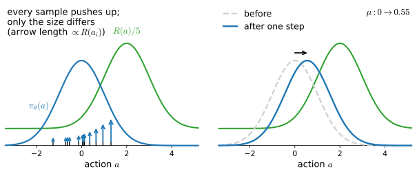

# Policy Gradient
:label:`sec_policygradient`

Value-based methods obtain a policy by maximizing an estimated action-value function. A policy-gradient method instead parameterizes $\pi_\theta(a \mid s)$ directly and optimizes the expected return $J(\theta)$ :cite:`Williams.1992`. The log-derivative identity expresses the gradient as an expectation over trajectories in which the unknown transition probabilities cancel. This produces the REINFORCE estimator, which can be computed from sampled rollouts without a model or value function. On the small FrozenLake problem, we can compare the estimator with the exact gradient and measure how its error changes with batch size.

The derivation below assumes that $\pi_\theta(a\mid s)$ is differentiable
and positive on sampled actions, that the environment dynamics do not
depend on $\theta$, and that differentiation may be interchanged with the
trajectory expectation. We use finite, almost-surely terminating episodes
with bounded rewards, which makes the required expectations finite. The
Monte Carlo estimator is on-policy: its trajectories are sampled from the
same $\pi_\theta$ whose gradient is being estimated. Later sections state
explicitly when an implementation replaces the exact discounted estimator
by a per-step surrogate.

```{.python .input #policy-gradient-policy-gradient}
%%tab pytorch
%matplotlib inline
from d2l import torch as d2l
import gymnasium as gym
import numpy as np
import torch
```

```{.python .input #policy-gradient-policy-gradient}
%%tab jax
%matplotlib inline
from d2l import jax as d2l
from flax import nnx
import gymnasium as gym
import jax
from jax import numpy as jnp
import numpy as np
```

## Parameterizing the Policy

We use the FrozenLake environment of :numref:`fig_rl_gridworld` with deterministic transitions.

```{.python .input #policy-gradient-parameterizing-the-policy}
%%tab pytorch, jax
gamma = 0.95
env = gym.wrappers.TimeLimit(
    gym.make('FrozenLake-v1', is_slippery=False).env, max_episode_steps=10_000)
```

We use deterministic FrozenLake because a nearly random policy reaches the goal too rarely on the slippery version for whole-trajectory REINFORCE to provide a useful signal at this computational budget. We also remove Gymnasium's default 100-step time limit and retain a 10,000-step cap only as a safeguard.

The objective is defined over complete episodes; treating a time-limit truncation as termination would instead optimize a truncated objective. A softmax policy assigns positive probability to every action, so on this finite deterministic map it reaches a terminal state with probability one. In a simulation of 100,000 episodes from the initial uniform policy, none exceeded 80 steps, and the safeguard was never reached. :numref:`sec_baselines` uses the same environment and horizon convention.

### Softmax Preferences

Gradient ascent requires a differentiable parameterization of the policy. `ActorCritic.tabular` from :numref:`sec_imitation` stores one parameter $\theta_{s,a}$, called a *preference*, for each state-action pair. A softmax converts the preferences at state $s$ into probabilities:

$$\pi_\theta(a \mid s) = \frac{e^{\theta_{s,a}}}{\sum_{a'} e^{\theta_{s,a'}}}.$$
:eqlabel:`eq_softmax_policy`

This is the softmax model of :numref:`sec_softmax` applied to a state index. It is also the policy class used for behavior cloning, so the same `policy_step` implementation can be reused with different weights. Zero preferences produce the uniform policy. The preferences are policy parameters; unlike $Q(s,a)$, they are not estimates of expected return.

### The Score Function

The softmax is easy to differentiate. Since $\log \pi_\theta(a \mid s) = \theta_{s,a} - \log \sum_{a'} e^{\theta_{s,a'}}$, the derivative with respect to the preference $\theta_{s,b}$ of any action $b$ at the same state is

$$\frac{\partial \log \pi_\theta(a \mid s)}{\partial \theta_{s,b}} = \mathbf{1}(b = a) - \pi_\theta(b \mid s),$$
:eqlabel:`eq_softmax_score`

and the derivative with respect to preferences at other states is zero. The vector $\nabla_\theta\log\pi_\theta(a\mid s)$ is the *score function*. Equation :eqref:`eq_softmax_score` increases the preference of the selected action and decreases the others in proportion to their probabilities. Its components sum to zero, so the update redistributes probability rather than changing its total. The following calculation verifies the identity at a nonuniform parameter table:

```{.python .input #policy-gradient-the-score-function}
%%tab pytorch
rng = np.random.default_rng(0)
check = d2l.ActorCritic.tabular(16, 4)
with torch.no_grad():   # move to a generic table, off the uniform start
    check.policy.weight.copy_(torch.as_tensor(rng.standard_normal((16, 4))))
check.log_prob(torch.tensor([6]), torch.tensor([2])).backward()
probs = np.exp(check.log_prob_np(np.repeat(6, 4), np.arange(4)))
hand = np.zeros((16, 4), dtype=np.float32)
hand[6], hand[6, 2] = -probs, 1 - probs[2]
print(bool(torch.allclose(check.policy.weight.grad, torch.as_tensor(hand),
                          atol=1e-6)))
```

```{.python .input #policy-gradient-the-score-function}
%%tab jax
rng = np.random.default_rng(0)
theta = jnp.asarray(rng.standard_normal((16, 4)))   # a generic table
score = jax.grad(lambda th: jax.nn.log_softmax(th[6])[2])(theta)
hand = jnp.zeros_like(theta).at[6].set(-jax.nn.softmax(theta[6]))
hand = hand.at[6, 2].add(1.0)
print(bool(jnp.allclose(score, hand, atol=1e-6)))
```

Both implementations confirm the identity. PyTorch differentiates the model's `log_prob`, while JAX differentiates the log-softmax as a function of the parameter table. The subsequent analysis uses :eqref:`eq_softmax_score` to interpret policy updates.

### The Case for Stochastic Policies

Although a deterministic optimal policy exists, stochastic parameterizations are useful for three reasons. First, sampling from the policy provides exploration, although positive probabilities alone do not guarantee adequate visitation in a finite dataset. Second, the softmax is differentiable, whereas an argmax is piecewise constant in its parameters. Third, the same form extends to neural-network policies (:numref:`sec_deeprl`) and to next-token distributions over a vocabulary (:numref:`sec_rl_sequences`).

## The Policy Gradient

We next derive the gradient of expected return with respect to the policy parameters.

### An Optimization Problem over Trajectories

As in :numref:`sec_valueiter`, suppose the agent starts at state $s_0$ and takes actions from $\pi_\theta$ for $T$ timesteps, producing a trajectory $\tau = (s_0, a_0, r_0, s_1, a_1, r_1, \ldots, s_T)$ with return $R(\tau) = \sum_{t=0}^{T-1} \gamma^t r(s_t, a_t)$. The probability of observing a particular trajectory $\tau$ is the product of the probabilities of each action taken by the agent and each transition made by the environment,

$$P(\tau; \theta) = \prod_{t=0}^{T-1} \pi_\theta(a_t \mid s_t)\ P(s_{t+1} \mid s_t, a_t).$$
:eqlabel:`eq_traj_prob`

If $s_0$ were sampled from the distribution $\mu_0$ of :numref:`sec_mdp`, the product would include a factor $\mu_0(s_0)$. This factor is independent of $\theta$, so it does not alter the following derivative. FrozenLake has a fixed start state; in text generation, $\mu_0$ corresponds to a distribution over prompts (:numref:`sec_rl_sequences`). The objective is the expected trajectory return,

$$J(\theta) = E_{\tau \sim P(\cdot;\, \theta)} \Big[ R(\tau) \Big] = \sum_{\tau} R(\tau)\ P(\tau; \theta),$$
:eqlabel:`eq_pg_objective`

where the sum ranges over trajectories of length $T$. Episodes that terminate early may be padded with an absorbing state and zero rewards, without changing the objective. The implementation stores only the observed portion of each episode. In the notation of :numref:`sec_valueiter`, $J(\theta)=V^{\pi_\theta}(s_0)$. We optimize this quantity directly:

$$\max_\theta J(\theta) = \max_\theta \sum_{\tau} R(\tau)\ P(\tau; \theta).$$

The `Batch` class stores transitions from several episodes in flat arrays together with their episode boundaries. It records the `terminated` flag separately from truncation, as required for bootstrapped targets (:numref:`sec_mdp`).

```{.python .input #policy-gradient-an-optimization-problem-over-trajectories-1}
%%tab pytorch, jax
class Batch:  #@save
    """A flat batch of transitions, plus the episode boundaries."""
    def __init__(self, obs, act, rew, next_obs, term, ep_ends):
        self.obs, self.act, self.rew = obs, act, rew
        self.next_obs, self.term = next_obs, term
        self.ep_ends = ep_ends    # one past the last step of each episode

    def __len__(self):
        return len(self.rew)

    def episodes(self):
        """Yield one slice per episode."""
        start = 0
        for end in self.ep_ends:
            yield slice(start, end)
            start = end

    def episode_returns(self, gamma=1.0):
        """R(tau), the discounted return, one number per episode."""
        return np.array([(gamma ** np.arange(ep.stop - ep.start)
                          * self.rew[ep]).sum() for ep in self.episodes()])
```

Filling it is a loop over the `evaluate` protocol of :numref:`sec_valueiter`, a policy being any function `policy(obs, rng) -> action`:

```{.python .input #policy-gradient-an-optimization-problem-over-trajectories-2}
%%tab pytorch, jax
def rollout(env, policy, num_episodes, rng):  #@save
    """Collect complete episodes from `policy(obs, rng) -> action` as a
    Batch; `term` records `terminated`, never `truncated` (:numref:`sec_mdp`).

    All sampling runs through the one numpy generator `rng`."""
    cols, ep_ends = [[] for _ in range(5)], []
    for _ in range(num_episodes):
        obs, done = env.reset()[0], False
        while not done:
            act = policy(obs, rng)
            next_obs, reward, terminated, truncated, _ = env.step(act)
            done = terminated or truncated
            for col, val in zip(cols, (obs, act, reward, next_obs,
                                       float(terminated))):
                col.append(val)
            obs = next_obs
        ep_ends.append(len(cols[0]))
    obs, act, rew, next_obs, term = (np.asarray(c) for c in cols)
    return Batch(obs, act, rew.astype(np.float32), next_obs,
                 term.astype(np.float32), np.asarray(ep_ends))
```

Both objects use NumPy arrays and are shared by the framework implementations. Conversion to framework arrays occurs inside update functions. The same `rollout` function is used by the later learning algorithms.

### The Log-Derivative Trick

To maximize $J(\theta)$ by gradient ascent we need its gradient. The return $R(\tau)$ of a fixed trajectory does not depend on $\theta$, only the probability of the trajectory does, so (the summation is finite, so we can exchange it with the gradient)

$$
\begin{aligned}
\nabla_\theta J(\theta) &= \nabla_\theta \sum_\tau R(\tau)\ P(\tau; \theta) = \sum_\tau R(\tau)\ \nabla_\theta P(\tau; \theta) \\
&= \sum_\tau R(\tau)\ P(\tau; \theta)\ \frac{\nabla_\theta P(\tau; \theta)}{P(\tau; \theta)} \\
&= \sum_\tau P(\tau; \theta)\ R(\tau)\ \nabla_\theta \log P(\tau; \theta),
\end{aligned}
$$

where we multiplied and divided by $P(\tau; \theta)$ and used the identity $\nabla \log P = \nabla P / P$. This step, known as the log-derivative trick, is important because it turns the gradient back into an average over trajectories,

$$\nabla_\theta J(\theta) = E_{\tau \sim P(\cdot;\, \theta)} \Big[ R(\tau)\ \nabla_\theta \log P(\tau; \theta) \Big],$$
:eqlabel:`eq_pg_gradient`

This expectation can be estimated by sampling trajectories from the current policy.

### Cancellation of the Transition Probabilities
:label:`subsec_pg-cancellation`

Although $P(\tau;\theta)$ contains the transition kernel, its derivative does not require evaluating that kernel. Taking the logarithm and differentiating gives

$$
\begin{aligned}
\nabla_\theta \log P(\tau; \theta) &= \nabla_\theta \Big[ \sum_{t=0}^{T-1} \log \pi_\theta(a_t \mid s_t) + \sum_{t=0}^{T-1} \log P(s_{t+1} \mid s_t, a_t) \Big] \\
&= \sum_{t=0}^{T-1} \nabla_\theta \log \pi_\theta(a_t \mid s_t).
\end{aligned}
$$

The transition probabilities do not depend on $\theta$, so their derivatives are zero. The kernel still determines the distribution of sampled trajectories, but the estimator need not evaluate it explicitly.

### The REINFORCE Estimator

We approximate the expectation in :eqref:`eq_pg_gradient` with an empirical average. The agent runs its current policy $\pi_\theta$ to collect $n$ trajectories $\tau_1, \ldots, \tau_n$ and computes

$$\hat{u} = \frac{1}{n} \sum_{i=1}^n R(\tau_i)\ \sum_{t=0}^{T-1} \nabla_\theta \log \pi_\theta(a_t^i \mid s_t^i),$$
:eqlabel:`eq_reinforce`

This is an unbiased estimate of $\nabla_\theta J(\theta)$. REINFORCE :cite:`Williams.1992` applies the ascent step $\theta\leftarrow\theta+\alpha\hat u$. Each trajectory return weights the scores of all actions in that trajectory. On FrozenLake the returns are nonnegative, so sampled actions receive nonnegative weights; their relative probabilities still change through the softmax coupling. Baselines introduced in :numref:`sec_baselines` provide weights that are positive for better-than-typical outcomes and negative for worse ones.

Since each update changes the policy, a new on-policy batch is collected before the next update. :numref:`fig_rl_score_ascent` illustrates one update.


:label:`fig_rl_score_ascent`

The implementation reuses `policy_step` from :numref:`sec_imitation`, which takes one Adam step with the learning rate `lr` of `ActorCritic.tabular` ($0.1$ by default) in place of the plain ascent step. Behavior cloning assigned weight one to each demonstrated action; REINFORCE assigns the trajectory return $R(\tau_i)$ to every action in trajectory $i$. The caller supplies the agent and records the number of environment steps:

```{.python .input #policy-gradient-the-reinforce-estimator-1}
%%tab pytorch, jax
def train_reinforce(ac, seed, steps, num_updates=256, batch_episodes=16):
    """REINFORCE: a fresh batch from the current policy, every step of a
    trajectory weighted by that trajectory's return, one ascent step."""
    rng = np.random.default_rng(seed)      # one stream for all sampling
    env.reset(seed=seed)
    for _ in range(num_updates):
        batch = rollout(env, ac.act, batch_episodes, rng)
        R = batch.episode_returns(gamma)
        d2l.policy_step(ac, batch,
                        np.repeat(R, np.diff(batch.ep_ends, prepend=0)))
        steps.append(len(batch))
        yield float(R.mean())
```

Equation :eqref:`eq_reinforce` divides the summed scores by the number of trajectories $n$, whereas `policy_step` averages over all steps in the batch. On a fixed batch these estimators have the same direction and differ by the mean episode length. Across batches, that factor is random and may correlate with performance. We retain the step-averaged implementation because it is common in practice; :numref:`sec_baselines` compares alternative normalizations. The following runs also report the mean return of each training batch as an estimate of $J(\theta)$:

```{.python .input #policy-gradient-the-reinforce-estimator-2}
%%tab pytorch, jax
agents, steps, curves = [], [], []
for seed in range(3):
    if tab.selected('pytorch'):
        torch.manual_seed(seed)            # init stream; the table is zeros
        agents.append(d2l.ActorCritic.tabular(16, 4))
    if tab.selected('jax'):
        agents.append(d2l.ActorCritic.tabular(16, 4, rngs=nnx.Rngs(seed)))
    steps.append([])
    curves.append(list(train_reinforce(agents[-1], seed, steps[-1])))
curves, steps = np.array(curves), np.array(steps)
d2l.plot_curves({'REINFORCE': curves}, xlabel='update',
                ylabel='mean return of the batch', reference=gamma ** 5)
```

Initially, many batches contain no successful trajectory. Their returns and hence their REINFORCE updates are zero. Once successful trajectories occur, their actions become more probable and later successes become more frequent. Within about thirty updates, the mean return exceeds $0.7$ and approaches $\gamma^5\approx0.774$, the return of a six-step path. It remains below this value because the policy is stochastic and sometimes deviates from the shortest path.

```{.python .input #policy-gradient-the-reinforce-estimator-3}
%%tab pytorch, jax
probs = np.exp(agents[0].log_prob_np(np.repeat(np.arange(16), 4),
                                     np.tile(np.arange(4), 16))).reshape(16, 4)
d2l.show_grid(env.unwrapped.desc, probs.max(axis=1), probs.argmax(axis=1))
```

The arrows show the most probable action in each state, and shading shows its probability. The learned policy concentrates on one of the three optimal six-step paths; the selected path depends on the sampled trajectories and can differ across seeds. The holes and goal remain uniform because actions are never taken from terminal states. Preferences at the other states change only if those states occur in successful episodes, and by far less than in proportion to their visit counts, because Adam scales the step of each coordinate separately.

### The Policy Gradient Theorem

REINFORCE weights a whole trajectory's score by the whole trajectory's return. The same gradient can be expressed by state occupancy rather than complete trajectories. Later sections use this form.

**Proposition (policy gradient theorem).** *For the objective $J(\theta) = E_{s_0 \sim \mu_0} [V^{\pi_\theta}(s_0)]$,*

$$\nabla_\theta J(\theta) = E_{\tau \sim P(\cdot;\, \theta)} \Big[ \sum_{t \geq 0} \gamma^t\, \nabla_\theta \log \pi_\theta(a_t \mid s_t)\ Q^{\pi_\theta}(s_t, a_t) \Big] = \frac{1}{1 - \gamma}\, E_{s \sim d^{\pi_\theta}_\gamma,\ a \sim \pi_\theta(\cdot \mid s)} \Big[ \nabla_\theta \log \pi_\theta(a \mid s)\ Q^{\pi_\theta}(s, a) \Big],$$
:eqlabel:`eq_pg_theorem`

*where $d^{\pi_\theta}_\gamma(s) = (1 - \gamma) \sum_{t \geq 0} \gamma^t \Pr(s_t = s)$ is the discounted state-occupancy distribution* :cite:`Sutton.McAllester.Singh.ea.2000`.

The theorem has three useful consequences. First, the score at time $t$ is weighted by $Q^{\pi_\theta}(s_t,a_t)$ rather than by rewards received before the action was taken; removing those earlier rewards yields the reward-to-go estimator of :numref:`sec_baselines`. Second, the occupancy form averages over the discounted frequency with which the policy visits each state, including the effect of the start distribution $\mu_0$. Third, omitting the factors $\gamma^t$, as many implementations do, replaces the discounted occupancy $d^{\pi_\theta}_\gamma$ by an undiscounted visitation distribution. This changes the relative weighting of states, and the resulting update is in general not the gradient of any objective :cite:`Nota.Thomas.2020`.

Exercise :exref:`ex_policy-gradient-discount-that-implementations-drop` examines the difference.

## Costs and Limitations

### The On-Policy Data Requirement

The estimator :eqref:`eq_reinforce` averages trajectories drawn from the *current* policy and approximates an expectation under $P(\tau;\theta)$. After the parameters change, previously collected trajectories no longer follow that distribution. Methods with this requirement are called *on-policy* and ordinarily collect a new batch for each update. Q-learning is *off-policy*: its update can learn about the greedy policy from transitions generated by another behavior policy (:numref:`sec_qlearning`). We compare their data requirements in environment steps:

```{.python .input #policy-gradient-on-policy-fresh-data-after-every-update}
%%tab pytorch, jax
hit = (curves >= 0.7).argmax(axis=1)
to_hit = np.array([s[:k + 1].sum() for s, k in zip(steps, hit)])
print(f'update at which the batch mean first reaches 0.7: {np.sort(hit)}')
print(f'environment steps spent by that update:  {np.sort(to_hit)}')
print(f'environment steps spent by the full run: {np.sort(steps.sum(axis=1))}')
```

Learning required roughly $3{,}000$--$4{,}500$ environment steps, while the complete run used about $27{,}000$. Data collection continues at every on-policy update even after performance has stabilized. The median Q-learning run in :numref:`sec_qlearning` used $95{,}569$ steps on the harder slippery environment, while its deterministic comparison used 256 episodes on this map. These results are not a controlled algorithm comparison, but they illustrate why interaction should be reported in environment steps.

Exercise :exref:`ex_policy-gradient-breaking-policy-rule-purpose` reuses a batch for several uncorrected updates and tracks the probability ratio between the updated policy and the policy that collected the data; :numref:`sec_ppo` develops a controlled form of such reuse.

### Unbiasedness and Variance

Unbiasedness in :eqref:`eq_reinforce` means that the expectation of the sampled vector equals $\nabla_\theta J(\theta)$. Exact gradients are generally unavailable, but the sixteen-state example permits a direct comparison. For the softmax policy, writing $P^\pi$ for its transition matrix and $r^\pi$ for its expected one-step reward, the objective of :eqref:`eq_pg_objective` has the closed form

$$J(\theta) = V^{\pi_\theta}(s_0) = \Big[ \big(I - \gamma P^{\pi_\theta}\big)^{-1} r^{\pi_\theta} \Big]_{s_0},$$
:eqlabel:`eq_pg_exact_objective`

a differentiable linear solve, so automatic differentiation gives the exact $\nabla_\theta J$. In the table `mdp` built below, holes and the goal are absorbing states with zero reward, so the solve accounts for termination. As in :numref:`sec_qlearning`, this exact solution provides a reference for a sampled estimator. We evaluate the policy after 16 updates, while its gradient is still appreciable:

```{.python .input #policy-gradient-unbiased-and-how-noisy-1}
%%tab pytorch
mdp = d2l.TabularMDP.from_gym(env, gamma)
P, r = torch.as_tensor(mdp.P).float(), torch.as_tensor(mdp.r).float()
torch.manual_seed(3)
probe = d2l.ActorCritic.tabular(16, 4)
for _ in train_reinforce(probe, 3, [], num_updates=16):
    pass
theta = probe.policy.weight.detach().requires_grad_(True)
pi = torch.softmax(theta, -1)
J = torch.linalg.solve(torch.eye(16) - gamma * torch.einsum('sa,sat->st',
                                                            pi, P),
                       (pi * r).sum(-1))[0]
g_exact = torch.autograd.grad(J, theta)[0].numpy()
print(f'J(theta) after 16 updates = {J.item():.3f}, '
      f'against the ceiling gamma^5 = {gamma ** 5:.3f}')
```

```{.python .input #policy-gradient-unbiased-and-how-noisy-1}
%%tab jax
mdp = d2l.TabularMDP.from_gym(env, gamma)
P, r = jnp.asarray(mdp.P), jnp.asarray(mdp.r)
probe = d2l.ActorCritic.tabular(16, 4, rngs=nnx.Rngs(3))
for _ in train_reinforce(probe, 3, [], num_updates=16):
    pass

def J_fn(theta):
    pi = jax.nn.softmax(theta, -1)
    return jnp.linalg.solve(jnp.eye(16) - gamma * jnp.einsum('sa,sat->st',
                                                             pi, P),
                            (pi * r).sum(-1))[0]

theta = probe.policy.embedding[...]
g_exact = np.asarray(jax.grad(J_fn)(theta))
print(f'J(theta) after 16 updates = {float(J_fn(theta)):.3f}, '
      f'against the ceiling gamma^5 = {gamma ** 5:.3f}')
```

Now hold $\theta$ fixed and draw the estimator :eqref:`eq_reinforce` fifty times at each batch size:

```{.python .input #policy-gradient-unbiased-and-how-noisy-2}
%%tab pytorch
def reinforce_estimate(n, rng):
    """One draw of eq_reinforce: n fresh trajectories at the frozen theta."""
    batch = rollout(env, probe.act, n, rng)
    w = np.repeat(batch.episode_returns(gamma),
                  np.diff(batch.ep_ends, prepend=0)).astype(np.float32)
    th = probe.policy.weight.detach().requires_grad_(True)
    logp = torch.log_softmax(th, -1)[torch.as_tensor(batch.obs),
                                     torch.as_tensor(batch.act)]
    return torch.autograd.grad((torch.as_tensor(w) * logp).sum() / n,
                               th)[0].numpy().ravel()

rng, g = np.random.default_rng(4), g_exact.ravel()
for n in [4, 16, 64]:
    U = np.stack([reinforce_estimate(n, rng) for _ in range(50)])
    zero = int((np.linalg.norm(U, axis=1) == 0).sum())
    cos = U.mean(axis=0) @ g / (np.linalg.norm(U.mean(axis=0))
                                * np.linalg.norm(g))
    err = np.linalg.norm(U - g, axis=1).mean() / np.linalg.norm(g)
    print(f'n={n:>3}: zero estimates {zero:>2}/50, cos(mean, exact) = '
          f'{cos:.2f}, single-estimate relative error = {err:.2f}')
```

```{.python .input #policy-gradient-unbiased-and-how-noisy-2}
%%tab jax
def reinforce_estimate(n, rng):
    """One draw of eq_reinforce: n fresh trajectories at the frozen theta."""
    batch = rollout(env, probe.act, n, rng)
    w = jnp.asarray(np.repeat(batch.episode_returns(gamma),
                              np.diff(batch.ep_ends, prepend=0)))
    def surrogate(th):
        logp = jax.nn.log_softmax(th, -1)[batch.obs, batch.act]
        return (w * logp).sum() / n
    return np.asarray(jax.grad(surrogate)(theta)).ravel()

rng, g = np.random.default_rng(4), g_exact.ravel()
for n in [4, 16, 64]:
    U = np.stack([reinforce_estimate(n, rng) for _ in range(50)])
    zero = int((np.linalg.norm(U, axis=1) == 0).sum())
    cos = U.mean(axis=0) @ g / (np.linalg.norm(U.mean(axis=0))
                                * np.linalg.norm(g))
    err = np.linalg.norm(U - g, axis=1).mean() / np.linalg.norm(g)
    print(f'n={n:>3}: zero estimates {zero:>2}/50, cos(mean, exact) = '
          f'{cos:.2f}, single-estimate relative error = {err:.2f}')
```

The mean of fifty estimates approaches the exact gradient as the batch size grows: its cosine with the exact gradient increases from about $0.93$ to $1.00$. This is consistent with unbiasedness, although cosine similarity alone is not a proof because it does not measure magnitude errors. Individual estimates remain noisy. At $n=4$, the typical error exceeds three and a half times the norm of the true gradient, and some batches contain no successful trajectories and therefore yield a zero estimate. The error decreases approximately as $1/\sqrt{n}$, from about $3.6$ to $1.7$ to $0.9$ as the batch size quadruples. :numref:`sec_baselines` evaluates variance-reduction methods against the same exact gradient.

### Nonconcavity of the Objective
:label:`subsec_pg-nonconcavity`

The objective $J(\theta)$ is generally nonconcave. The softmax makes it smooth, but a nearly deterministic suboptimal policy can lie on a plateau where the score and gradient are very small. Standard convergence results establish approach to a stationary point under assumptions such as smoothness, bounded estimator variance, and suitable decreasing step sizes. The fixed-rate Adam implementation used here does not satisfy those assumptions. Its success from a uniform initialization on this small environment is therefore empirical rather than a general guarantee.

## Summary

Policy gradient methods optimize a parameterized policy directly. The log-derivative identity expresses $\nabla_\theta J$ as an expectation over trajectory scores, and the transition probabilities vanish from the derivative. REINFORCE estimates this expectation from sampled trajectories. The policy gradient theorem gives an equivalent state-occupancy form weighted by $Q^{\pi_\theta}$. The estimator is unbiased but has sampling error that decreases as $1/\sqrt n$, and it is on-policy, requiring new trajectories after a policy update. The shared `Batch` and `rollout` utilities store and collect these trajectories.

**Experimental scope.** The training curves use three seeds on deterministic FrozenLake; the same estimator is ineffective at this budget on the slippery version. The gradient comparison probes one fixed intermediate policy with fifty samples at each batch size. It supports the predicted unbiasedness and $1/\sqrt{n}$ error scaling, while the numerical constants depend on the selected policy and environment.

## Exercises

1. **Parameter-dependent dynamics.** The derivation of
   :numref:`subsec_pg-cancellation` assumes that the transition
   probabilities do not depend on $\theta$. A recommender violates this
   assumption when users who see an item more often click it less.
    1. Suppose the dynamics are $P_\theta(s_{t+1} \mid s_t, a_t)$. Repeat
       the derivation of $\nabla_\theta \log P(\tau; \theta)$ and state the
       term that no longer vanishes. What would the agent need to know to
       compute it?
    1. In a one-step model, the recommender shows item 1 with probability
       $\pi_\theta(1) = \sigma(\theta)$ and item 0 otherwise, where $\sigma$
       is the logistic function. A shown item 1 is clicked with probability
       $1 - \sigma(\theta)$, item 0 is never clicked, and a click earns
       reward $1$. Compute $J(\theta)$ and $\mathrm{d}J/\mathrm{d}\theta$.
       Compare the derivative with the expectation of the REINFORCE estimate
       :eqref:`eq_reinforce`, which drops that term. Where does plain
       gradient ascent converge with each of the two?
1. [code] **Sparse rewards.** Consider a single state with two actions,
   softmax preferences $\theta_1, \theta_2$, reward $1$ for action 1 and
   $0$ for action 2, and write $p = \pi_\theta(1)$.
    1. Use :eqref:`eq_softmax_score` to find the mean and the standard
       deviation of the single-sample REINFORCE estimate of
       $\partial J / \partial \theta_1$. Show that the standard deviation is
       $\sqrt{(1-p)/p}$ times the mean.
    1. On FrozenLake, the analogous quantity is the probability $p_0$ that
       an episode of the uniform initial policy reaches the goal. Compute
       $p_0$ with `d2l.policy_evaluation` on
       `d2l.TabularMDP.from_gym(env, 1.0)`, whose value function at
       $\gamma = 1$ is the probability of reaching the goal (problem
       :exref:`ex_value-iter-undiscounted-lake`b of :numref:`sec_valueiter`).
       What fraction of the batches of 16 episodes in `train_reinforce`
       contains no success at the start of training, and what is the ratio
       of part a at $p = p_0$?
   :exlabel:`ex_policy-gradient-sparse-rewards`
1. **Shifted rewards.** A trajectory with return zero drops out of
   :eqref:`eq_reinforce`, so subtracting one from every reward is a
   tempting way to make failed episodes informative.
    1. In the two-action setting of problem
       :exref:`ex_policy-gradient-sparse-rewards`, change the rewards to $0$
       for action 1 and $-1$ for action 2, which subtracts one from every
       return. Show that the mean of the single-sample estimate is unchanged
       and that the ratio of problem
       :exref:`ex_policy-gradient-sparse-rewards`a becomes
       $\sqrt{p/(1-p)}$. For which policies does the shift help, and for
       which does it hurt?
    1. On FrozenLake, the same subtraction makes every step earn $-1$ and
       the step into the goal earn $0$. Show that the return of an episode
       of $T$ steps decreases by $(1 - \gamma^T)/(1 - \gamma)$. Does this
       shift change $J$ by a constant, as in the two-action setting?
    1. The shift is the per-step charge $c = -1$ of problem
       :exref:`ex_mdp-reward-design-its-failure`b of :numref:`sec_mdp`. At
       $\gamma = 0.95$, compare the shifted return of the shortest path from
       the start into a hole with that of a shortest path to the goal on the
       deterministic map. Which policy maximizes $J$ under the shifted
       rewards? Among the failed episodes of a batch, which ones does the
       estimate :eqref:`eq_reinforce` penalize least?
1. [code] **Batch size and learning rate.** Sweep `batch_episodes` of
   `train_reinforce` over $\{1, 4, 16, 64\}$ and the learning rate `lr` of
   `ActorCritic.tabular` over $\{0.03, 0.1, 0.3\}$, with three seeds each.
   Give every run a budget of $8{,}192$ episodes, that is,
   `num_updates=8192 // batch_episodes`. For every cell, record the number
   of episodes consumed before $J(\theta)$ first exceeds $0.5$, evaluating
   $J(\theta)$ exactly with :eqref:`eq_pg_exact_objective` after each
   update; the batch mean return is too coarse a criterion at batch size
   one. Each run can stop once $J(\theta)$ exceeds $0.5$. Which direction
   of the grid saves episodes, and which only trades updates for episodes?
   Explain the pattern from the way Adam scales its steps.
1. [code] **The theorem in a table.** ● For the tabular softmax policy,
   write $\rho(s) = \sum_{t \geq 0} \gamma^t \Pr(s_t = s)$ for the
   discounted number of visits to $s$, so that
   $d^{\pi_\theta}_\gamma = (1 - \gamma)\rho$ in :eqref:`eq_pg_theorem`.
    1. Combine the occupancy form of :eqref:`eq_pg_theorem` with
       :eqref:`eq_softmax_score` to show that
       $$\frac{\partial J}{\partial \theta_{s,b}} = \rho(s)\, \pi_\theta(b \mid s) \big( Q^{\pi_\theta}(s,b) - V^{\pi_\theta}(s) \big).$$
    1. By problem :exref:`ex_value-iter-linear-system`b of
       :numref:`sec_valueiter`, $\rho^\top$ is the row of
       $(I - \gamma P^{\pi_\theta})^{-1}$ that belongs to $s_0$. Compute
       $\rho$, $V^{\pi_\theta}$ and $Q^{\pi_\theta}$ at the parameters of
       `probe` by linear solves with `mdp.P` and `mdp.r`, assemble the
       formula, and compare the result with `g_exact`.
   :exlabel:`ex_policy-gradient-theorem-table`
1. [code] **Reusing a batch.** ● Modify `train_reinforce` to call
   `policy_step` $k$ times on each batch without any correction, for
   $k \in \{1, 2, 5, 20\}$. Write $\theta_\textrm{old}$ for the parameters
   that collected the batch.
    1. On the deterministic map, log the batch mean return and, after the
       $k$-th step, the mean and the maximum over the batch of the ratio
       $\pi_\theta(a_t \mid s_t) / \pi_{\theta_\textrm{old}}(a_t \mid s_t)$;
       `log_prob_np` evaluates both policies. How many environment steps
       does each $k$ need before the batch mean return reaches $0.7$, and
       how large does the ratio grow?
    1. As $k$ grows, the steps approach a maximizer of the surrogate
       $\sum_t w_t \log \pi_\theta(a_t \mid s_t)$ on the fixed batch, where
       $w_t$ is the return of the episode that contains step $t$. Find the
       maximizing tabular policy in closed form, and use it to explain the
       result of part a.
    1. Compare $k = 1$ with $k = 20$ on the slippery map
       (`is_slippery=True`) by the final $J(\theta)$, computed with
       :eqref:`eq_pg_exact_objective` from the slippery transition table.
       The runs take a few minutes. Explain the difference from the
       deterministic map with the closed form of part b.
   :exlabel:`ex_policy-gradient-breaking-policy-rule-purpose`
1. [code] **Testing unbiasedness.** ● The cosine that the section computes
   from fifty draws of `reinforce_estimate` cannot reveal a small bias. A
   sharper test averages $M$ estimates: for an unbiased estimator, the
   angle between the average and the exact gradient shrinks toward zero as
   $M$ grows, whereas for a biased one it levels off.
    1. At the parameters of `probe`, draw $M = 25{,}600$ estimates with
       `reinforce_estimate` at $n = 1$. Plot one minus the cosine between
       the running average and `g_exact` against $M$ on logarithmic axes.
       Explain the slope of the curve.
    1. Repeat the measurement after rebuilding `env` with
       `max_episode_steps` lowered to $20$ and to $10$, so that `rollout`
       ends some episodes by truncation. At what level does each curve
       settle? Which objective do the truncated estimates estimate the
       gradient of without bias?
1. **Softmax plateaus.** ● Consider a single state with two actions,
   rewards $1$ and $0$, and initial preferences $\theta = (0, L)$ with
   $L > 0$, so that the better action starts with probability
   $1/(1 + e^L)$. This is the plateau of :numref:`subsec_pg-nonconcavity`
   in its smallest form.
    1. Show that $J$ depends on $\theta$ only through
       $x = \theta_1 - \theta_2$, as $J = \sigma(x)$ with the logistic
       function $\sigma$. Conclude that $J$ is not concave.
    1. Show that one step of plain gradient ascent with step size $\alpha$
       increases $x$ by $2\alpha\, \sigma(x)(1 - \sigma(x))$. Treat this as
       a differential equation, and show that reaching
       $\pi_\theta(1) = 1/2$ from $x = -L$ takes about $e^L / (2\alpha)$
       steps when $L$ is large.
    1. Adam, fed the same exact gradients, moves each coordinate by about
       $\alpha$ per step while the sign of the gradient stays fixed.
       Estimate the number of steps it needs, and compare it with the
       answer of part b at
       $L = 10$ and $\alpha = 0.1$. What does the comparison suggest about
       the use of Adam in `ActorCritic.tabular`?
   :exlabel:`ex_policy-gradient-softmax-plateaus`
1. [code] **The dropped discount.** ●● Many implementations omit the
   factor $\gamma^t$ from the trajectory form of :eqref:`eq_pg_theorem`,
   which gives the update field

   $$F(\theta) = E_{\tau \sim P(\cdot;\, \theta)} \Big[ \sum_{t \geq 0} \nabla_\theta \log \pi_\theta(a_t \mid s_t)\ Q^{\pi_\theta}(s_t, a_t) \Big].$$

   :citet:`Nota.Thomas.2020` prove that $F$ need not be the gradient of any
   function, and they construct an MDP in which exact updates along $F$
   drive the policy toward the worst possible policy. The parts below check
   the first finding on FrozenLake and then construct a small MDP in which
   a step along $F$ lowers $J$, the starting point of the second.
    1. Following problem :exref:`ex_policy-gradient-theorem-table`a, show
       that

       $$F_{s,b}(\theta) = \eta(s)\, \pi_\theta(b \mid s) \big( Q^{\pi_\theta}(s,b) - V^{\pi_\theta}(s) \big),$$

       where $\eta(s) = \sum_{t \geq 0} \Pr(s_t = s)$ is the expected number
       of visits to $s$ in an episode. Compute $\eta$ by a linear solve in
       which the rows of the policy's transition matrix that belong to
       terminal states are set to zero.
    1. The Jacobian of a continuously differentiable gradient field is a
       Hessian and therefore symmetric. Compute the Jacobian $DF$ at the
       zero table and at the parameters of `probe` by automatic
       differentiation, and report $\|DF - DF^\top\| / \|DF\|$ in the
       Frobenius norm. Run the same check on $\nabla_\theta J$ as a control.
    1. Measure the cosine between $F$ and $\nabla_\theta J$ at the same two
       points. Give a practical reason why implementations accept $F$
       anyway.
    1. Show that $F(\theta)^\top \nabla_\theta J(\theta) \geq 0$ for the
       tabular softmax policy at every $\theta$, so that a small step along
       $F$ never lowers $J$ on FrozenLake. Then construct a small episodic
       MDP in which a single parameter controls the policy at two states
       visited in sequence, together with a $\theta$ at which
       $F(\theta)\, \mathrm{d}J/\mathrm{d}\theta < 0$.
   :exlabel:`ex_policy-gradient-discount-that-implementations-drop`

[Discussions](https://d2l.discourse.group/)

<!-- slides -->

::: {.slide}
::: {.cover}
[Dive into Deep Learning · §14.5]{.kicker}

Policy gradient<br>
**a parameterized policy · the log-derivative identity · model-free gradient estimation · bias and variance diagnostics**
:::
:::

::: {.slide title="Differentiate the Return Itself"}
No model (:numref:`sec_valueiter` had one), no expert
(:numref:`sec_imitation`), and no value function either: write the policy
as a differentiable function of $\theta$ and ascend $J(\theta)$.

$$\pi_\theta(a \mid s) = \frac{e^{\theta_{s,a}}}{\sum_{a'} e^{\theta_{s,a'}}},
\qquad J(\theta) = E_{\tau \sim P(\cdot;\, \theta)} \big[ R(\tau) \big]$$

- one free *preference* $\theta_{s,a}$ per pair: `ActorCritic.tabular`,
  reused from :numref:`sec_imitation`
- softmax keeps every probability positive: exploration built in early;
  support alone is not a visitation guarantee
- calm ice, and no time limit, both named as assumptions: the estimator
  isolates the policy distribution from the environment dynamics
:::

::: {.slide title="The Score Function, Verified"}
$$\frac{\partial \log \pi_\theta(a \mid s)}{\partial \theta_{s,b}}
= \mathbf{1}(b = a) - \pi_\theta(b \mid s)$$

@policy-gradient-the-score-function

. . .

Automatic differentiation verifies the analytic score identity in
both framework implementations.
:::

::: {.slide title="The Log-Derivative Trick"}
$R(\tau)$ does not depend on $\theta$; only the trajectory's
probability does:

$$\nabla_\theta J(\theta)
  = \sum_\tau R(\tau)\, \nabla_\theta P(\tau; \theta)
  = \sum_\tau P(\tau; \theta)\, R(\tau)\, \nabla_\theta \log P(\tau; \theta)$$

. . .

$$\nabla_\theta \log P(\tau; \theta)
= \sum_t \nabla_\theta \log \pi_\theta(a_t \mid s_t)$$

The transition terms have zero gradient because the kernel does not depend on the policy parameters.
Sampling $n$ trajectories gives **REINFORCE**:

$$\hat u = \frac{1}{n} \sum_i R(\tau_i)
\sum_t \nabla_\theta \log \pi_\theta(a_t^i \mid s_t^i)$$
:::

::: {.slide title="One Step, Drawn"}
{width=98%}

. . .

All rewards in this example are positive, so every sampled action
receives a positive weight. :numref:`sec_baselines` introduces
centered weights that can be positive or negative.
:::

::: {.slide title="Trajectories Become Data"}
@policy-gradient-an-optimization-problem-over-trajectories-2

`term` records `terminated`, not `truncated`; later algorithms use
the same distinction.
:::

::: {.slide title="REINFORCE on the Calm Lake"}
@policy-gradient-the-reinforce-estimator-1

. . .

@!policy-gradient-the-reinforce-estimator-2

Updates are zero until the first successful trajectory. The mean
return then increases and stabilizes below $\gamma^5 = 0.774$.
:::

::: {.slide title="What It Costs"}
The on-policy derivation requires trajectories from the current policy.

@!policy-gradient-on-policy-fresh-data-after-every-update

. . .

Learning requires about 3,000--4,500 steps, while the complete run
uses about 27,000 because every update collects new data. :numref:`sec_qlearning`'s
slippery-map run: 95,569 steps.
:::

::: {.slide title="Unbiased, Measured"}
On 16 states $J(\theta) = [(I - \gamma P^\pi)^{-1} r^\pi]_{s_0}$ is a
differentiable linear solve: autograd gives the **exact** gradient.

@!policy-gradient-unbiased-and-how-noisy-2

. . .

The mean estimate aligns with the exact gradient, while individual
batches have substantial error that decreases as $1/\sqrt{n}$.
:numref:`sec_baselines` uses the same exact-gradient reference.
:::

::: {.slide title="Recap"}
- The log-derivative identity expresses $\nabla_\theta J$ as an
  expectation over trajectory scores; kernel terms have zero derivative.
- REINFORCE weights each trajectory score by its return. Its sample
  mean is compared with the exact $\nabla_\theta J$ in this example.
- Policy gradient theorem: the same gradient over the discounted
  occupancy, $Q^\pi$ against the score.
- On-policy methods collect fresh data after every update.
- Because $J(\theta)$ is not concave, gradient ascent may reach only a
  stationary point rather than a globally optimal policy $\pi^*$.
- Noise falls only as $1/\sqrt{n}$: variance reduction is
  :numref:`sec_baselines`.
:::
