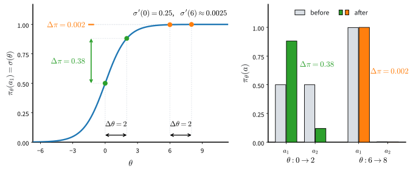
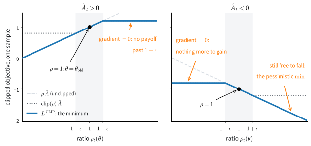

# Trust Regions and Proximal Policy Optimization
:label:`sec_ppo`

The actor-critic method of :numref:`sec_actorcritic` uses each batch of
trajectories for one policy step and then discards it. Using a batch for
several steps would save interaction with the environment, but it raises two
problems. The data then come from a policy that no longer exists, and nothing
limits how far the repeated steps move the policy. Since we now adjust the
parameters of the policy directly, we first ask what the size of a parameter
step means for the policy itself. The answer leads to trust-region methods
:cite:`Schulman.Levine.Abbeel.ea.2015`, which limit the change of the policy
rather than of the parameters, and to proximal policy optimization (PPO)
:cite:`Schulman.Wolski.Dhariwal.ea.2017`, which replaces the trust-region
constraint with a clipped objective. We prove the performance difference
lemma, from which the trust-region bound is derived, and test the clip on
CartPole with heavy reuse of each batch.

```{.python .input #ppo-trust-regions-and-proximal-policy-optimization-1}
%%tab pytorch
import math
import numpy as np
import torch
from torch import nn
from torch.nn import functional as F
from d2l import torch as d2l
```

```{.python .input #ppo-trust-regions-and-proximal-policy-optimization-1}
%%tab jax
import math
import numpy as np
import jax
from jax import numpy as jnp
from flax import nnx
import optax
from d2l import jax as d2l
```

```{.python .input #ppo-trust-regions-and-proximal-policy-optimization-2}
%%tab pytorch, jax
import gymnasium as gym
```

## Parameter Space versus Policy Space

Consider a policy with a single parameter $\theta$ and two actions, an example
from the lectures of :citet:`Achiam.2017`:

$$\pi_\theta(a) = \begin{cases} \sigma(\theta) & a = 1, \\ 1 - \sigma(\theta) & a = 2, \end{cases} \qquad \textrm{where } \sigma(\theta) = \frac{1}{1 + e^{-\theta}}.$$

Take two parameter steps of the same size, $\Delta\theta = 2$, from two
different starting points:

$$\pi_{\theta=0}(a{=}1) = \sigma(0) = 0.50 \ \xrightarrow{\ \Delta\theta = 2\ }\ \sigma(2) = 0.88, \qquad \pi_{\theta=6}(a{=}1) = \sigma(6) = 0.9975 \ \xrightarrow{\ \Delta\theta = 2\ }\ \sigma(8) = 0.9997.$$

The first step turns a policy that is indifferent between the two actions
into one that strongly prefers the first. The second step leaves the policy
almost unchanged. :numref:`fig_rl-policy-vs-parameter` shows both steps. The
derivative $\sigma'(\theta) = \sigma(\theta)(1 - \sigma(\theta))$ is $0.25$ at
$\theta = 0$ and about $0.0025$ at $\theta = 6$, so equal steps in parameter
space can be very different steps in policy space.


:label:`fig_rl-policy-vs-parameter`

This mismatch matters for on-policy learning. A large, noisy step from
$\theta = 0$ can move the policy close to a deterministic one. Then the score
of the preferred action is close to zero, and the other action is sampled so
rarely that the data collected afterwards seldom contain the evidence needed
to reverse the step. For the policy at $\theta = 8$ in the example above, the
score of the first action,
$\frac{d}{d\theta} \log \sigma(\theta) = 1 - \sigma(\theta)$, is about
$0.0003$, and the second action is sampled with this same probability, about
once in $3{,}000$ steps. Limiting the step in parameter space does not prevent
this, because the same parameter distance can mean a large or a negligible
change of behavior. The quantity to control is the change of the policy.

## Reusing a Batch

We next derive how to evaluate a new policy with data that an older policy
collected.

### Importance Sampling

Suppose that a batch of trajectories was collected by the policy
$\pi_{\theta_{\textrm{old}}}$ and that we want to estimate the expected value
of some function $f$ of the trajectory under another policy $\pi_\theta$. For
any $f$,

$$\mathbb{E}_{\tau \sim P(\cdot;\, \theta)} \big[ f(\tau) \big] = \sum_\tau P(\tau; \theta_{\textrm{old}})\ \frac{P(\tau; \theta)}{P(\tau; \theta_{\textrm{old}})}\, f(\tau) = \mathbb{E}_{\tau \sim P(\cdot;\, \theta_{\textrm{old}})} \Big[ \frac{P(\tau; \theta)}{P(\tau; \theta_{\textrm{old}})}\, f(\tau) \Big],$$
:eqlabel:`eq_change_of_measure`

provided that every trajectory with positive probability under $\pi_\theta$
also has positive probability under $\pi_{\theta_{\textrm{old}}}$, which holds
for softmax policies. The ratio reweights each trajectory of the old policy:
trajectories that the new policy makes more likely count more, and those that
it makes less likely count less. With $f = R$, the expected return of the new
policy becomes an expectation over the old policy's data:

$$J(\theta) = \mathbb{E}_{\tau \sim P(\cdot;\, \theta_{\textrm{old}})} \Big[ \frac{P(\tau; \theta)}{P(\tau; \theta_{\textrm{old}})}\, R(\tau) \Big].$$
:eqlabel:`eq_offpolicy_objective`

When $P(\tau; \theta)$ is expanded as in :eqref:`eq_traj_prob`, the
transition probabilities cancel between the numerator and the denominator,
and the weight becomes a product of ratios of action probabilities,
$\prod_{t} \pi_\theta(a_t \mid s_t) / \pi_{\theta_{\textrm{old}}}(a_t \mid s_t)$.
The resulting estimator is unbiased, but each factor can be much larger or
smaller than one, and the product over a long trajectory can vary over many
orders of magnitude. For example, let both policies ignore the state, with
action probabilities $(0.5, 0.5)$ for the old policy and $(0.6, 0.4)$ for the
new one. Under the old policy, each factor is $1.2$ or $0.8$ with equal
probability, so it has mean one and mean square $(1.44 + 0.64)/2 = 1.04$. On
an episode of fixed length $T$, the factors are independent, so the mean and
the mean square of the weight $W_T$ are the products of those of the factors:
$\mathbb{E}[W_T] = 1$ and $\mathbb{E}[W_T^2] = 1.04^T$. The variance is
therefore $\textrm{Var}[W_T] = 1.04^T - 1$: about $0.5$
for $T = 10$, $50$ for $T = 100$, and $3 \times 10^8$ for $T = 500$, the
length of a CartPole episode that reaches the time limit. A few trajectories
then dominate the estimate.

### The Per-Step Surrogate

The practical compromise keeps one ratio per step. With

$$\rho_t(\theta) = \frac{\pi_\theta(a_t \mid s_t)}{\pi_{\theta_{\textrm{old}}}(a_t \mid s_t)},$$

which is larger than one when the new policy makes the action $a_t$ more
likely than the old policy did and smaller than one when it makes it less
likely, we maximize the *surrogate objective*

$$\hat{L}(\theta) = \frac{1}{N} \sum_{t} \rho_t(\theta)\ \hat{A}_t,$$
:eqlabel:`eq_surrogate`

where the sum runs over the $N$ time steps of the batch and $\hat{A}_t$ are
advantage estimates computed with the old policy, for example GAE. A term
of the surrogate increases when the policy raises the probability of its
action and $\hat{A}_t > 0$, or lowers it and $\hat{A}_t < 0$. Compared
with :eqref:`eq_offpolicy_objective`, this keeps only the ratio of the action
at step $t$. In the example with action probabilities $(0.5, 0.5)$ and
$(0.6, 0.4)$, each term of the surrogate is weighted by $1.2$ or $0.8$,
whereas the weight of a trajectory of $500$ steps is a product of $500$ such
factors. The ratios $\rho_0 \cdots \rho_{t-1}$ of the earlier actions would
turn the old policy's distribution of the state $s_t$ into the new policy's;
dropping them evaluates the new policy's actions at the states that the old
policy visited.
The surrogate is accurate near the old policy: at
$\theta = \theta_{\textrm{old}}$, every ratio is one and
$\nabla_\theta \rho_t = \nabla_\theta \log \pi_\theta(a_t \mid s_t)$, so the
gradient of :eqref:`eq_surrogate` there is the policy gradient estimate of
:numref:`sec_deeprl`. Far from the old policy, the surrogate can be a poor
approximation of the objective, which raises the question of how far the
policy may move.

PPO reuses only the batch that it has just collected. Methods that also learn
from older data in a replay buffer must decide how much to trust it. For
importance weights $\rho_1, \ldots, \rho_n$, the *effective sample size*
$(\sum_i \rho_i)^2 / \sum_i \rho_i^2$ equals $n$ when all weights are equal
and approaches one when a single weight dominates; the weights
$(10, 1, 1, 1)$, for example, give $169/103 \approx 1.6$. P3O interleaves
on-policy updates with off-policy updates from a replay buffer. It divides
the effective sample size of the importance weights between the current
policy and the behavior policy of the buffer by $n$, and it uses the result
to set the strength of a KL penalty that keeps the two policies close and the
threshold at which the importance weights are clipped
:cite:`Fakoor.Chaudhari.Smola.2019`.

## Bounding the Step

To decide how far the policy may move, we relate the surrogate to the true
objective.

### The Performance Difference Lemma

Write $A^{\textrm{old}}$ for the advantage :eqref:`eq_advantage` of the old
policy.

**Proposition (performance difference lemma** :cite:`Kakade.Langford.2002`**).**
*For any two policies,*

$$J(\theta) - J(\theta_{\textrm{old}}) = \mathbb{E}_{\tau \sim P(\cdot;\, \theta)} \Big[ \sum_{t} \gamma^t\, A^{\textrm{old}}(s_t, a_t) \Big].$$
:eqlabel:`eq_perf_diff`

**Proof.** Write $V$ for the value function of the old policy. Along any
trajectory, the sum
$\sum_t \gamma^t \big( r_t + \gamma V(s_{t+1}) - V(s_t) \big)$ telescopes: the
intermediate values cancel in pairs, and the last value is zero at a terminal
state; on a trajectory that never ends, $\gamma^T V(s_T) \to 0$ as
$T \to \infty$, because $\gamma < 1$ and $|V| \leq r_{\max}/(1-\gamma)$
(:numref:`sec_mdp`). This leaves $R(\tau) - V(s_0)$. Take the expectation
over trajectories of the new policy. Given $s_t$ and $a_t$, the expected value
of $r_t + \gamma V(s_{t+1})$ is $Q^{\pi_{\theta_{\textrm{old}}}}(s_t, a_t)$,
because the reward and the next state are drawn by the environment, whichever
policy chose $a_t$. Each term thus contributes
$\gamma^t A^{\textrm{old}}(s_t, a_t)$. On the other
side, $\mathbb{E}[R(\tau)] = J(\theta)$, and
$\mathbb{E}[V(s_0)] = J(\theta_{\textrm{old}})$ because both policies start
from the same state distribution. $\blacksquare$

The lemma says that the new policy improves on the old one exactly by the old
advantages of the actions it takes, along the trajectories it produces. These
trajectories are not available before the new policy is run. The surrogate
:eqref:`eq_surrogate` uses the states of the old policy instead and accounts
for the new action probabilities through the ratios. The error of this
substitution depends on how different the two policies are.

### Trust Regions

:citet:`Schulman.Levine.Abbeel.ea.2015` bound this error. Let
$d_{\textrm{old}}(s) = \sum_{t} \gamma^t \Pr(s_t = s)$ be the discounted state
visits of the old policy, and let
$\bar{L}(\theta) = \sum_s d_{\textrm{old}}(s) \sum_a \pi_\theta(a \mid s)\, A^{\textrm{old}}(s, a)$.
At a state $s$, the average of $\rho_t(\theta)\, A^{\textrm{old}}(s, a_t)$
over actions $a_t$ drawn from the old policy is
$\sum_a \pi_\theta(a \mid s)\, A^{\textrm{old}}(s, a)$, because the ratio
cancels the probability of the old policy. Hence $\bar{L}(\theta)$ is the
expected value of $\sum_t \gamma^t \rho_t(\theta)\, A^{\textrm{old}}(s_t, a_t)$
over trajectories of the old policy: a version of the surrogate that uses
exact advantages and sums over each trajectory with the weights $\gamma^t$,
where :eqref:`eq_surrogate` averages over the steps without them
(:numref:`sec_deeprl`). With
$A_{\max} = \max_{s, a} |A^{\textrm{old}}(s, a)|$, the bound reads

$$J(\theta) \geq J(\theta_{\textrm{old}}) + \bar{L}(\theta) - \frac{4 \gamma A_{\max}}{(1-\gamma)^2}\ \max_s D_{\textrm{KL}}\big( \pi_{\theta_{\textrm{old}}}(\cdot \mid s)\ \Vert\ \pi_\theta(\cdot \mid s) \big),$$
:eqlabel:`eq_trpo_bound`

where $D_{\textrm{KL}}$ is the Kullback--Leibler divergence
(:numref:`sec_mdl-information_theory`). At $\theta = \theta_{\textrm{old}}$,
both $\bar{L}$ and the divergence are zero ($\bar{L}$ because the advantages
of a policy average to zero over its own actions, :eqref:`eq_advantage`), so
the right-hand side equals $J(\theta_{\textrm{old}})$. Any $\theta$ that
increases the right-hand side therefore also increases $J$: the value
$J(\theta)$ is at least the right-hand side at $\theta$, which exceeds its
value $J(\theta_{\textrm{old}})$ at $\theta_{\textrm{old}}$. At
$\gamma = 0.99$, however, the coefficient of the penalty is
$4 \cdot 0.99 / 0.01^2 \approx 40{,}000$ times $A_{\max}$, so
the steps that the bound certifies are tiny. The penalty measures the change
of the action distributions, the quantity that the two-action example
showed we must control. Trust region policy optimization (TRPO) turns this
bound into an algorithm with three approximations: it uses the sampled surrogate
:eqref:`eq_surrogate`, replaces the maximum divergence over all states by the
average over the visited states, and maximizes the surrogate subject to a
fixed bound on this average divergence instead of subtracting the penalty
:cite:`Schulman.Levine.Abbeel.ea.2015`. For small steps, the average
divergence is approximately
$\frac{1}{2} (\theta - \theta_{\textrm{old}})^\top F\, (\theta - \theta_{\textrm{old}})$,
where $F$ is the Fisher information matrix of the policy averaged over the
visited states, and the resulting direction is the natural policy gradient
:cite:`Amari.1998,Kakade.2002`. TRPO computes this step with second-order
optimization.

### The Clipped Objective

PPO keeps the idea of limiting the change of the policy but uses only first
derivatives. Instead of constraining the ratios, it removes the incentive to
push them far from one:

$$L^{\textrm{CLIP}}(\theta) = \frac{1}{N} \sum_{t} \min\Big( \rho_t(\theta)\, \hat{A}_t,\ \textrm{clip}\big(\rho_t(\theta),\ 1-\epsilon,\ 1+\epsilon\big)\, \hat{A}_t \Big),$$
:eqlabel:`eq_ppo_clip`

with a clipping parameter $\epsilon$, which :citet:`Schulman.Wolski.Dhariwal.ea.2017`
set to $0.2$ in their MuJoCo comparison with other algorithms, the best of
$0.1$, $0.2$, and $0.3$ in their ablation. Consider one sample. If
$\hat{A}_t > 0$, its term grows with $\rho_t$ only up to $\rho_t = 1+\epsilon$;
beyond that point, the clipped term is the smaller one, and the gradient of
the term is zero. If $\hat{A}_t < 0$, the same happens below $1-\epsilon$.
For example, with $\epsilon = 0.2$ and $\rho_t = 1.3$, a sample with
$\hat{A}_t = 1$ contributes $\min(1.3, 1.2) = 1.2$, a constant, so it no
longer pushes $\rho_t$ up. A sample with $\hat{A}_t = -1$ contributes
$\min(-1.3, -1.2) = -1.3$, the unclipped term, whose gradient keeps pushing
$\rho_t$ down toward the interval. The minimum makes the clipping one-sided: a change that lowers the
objective still counts in full, while a change in the favorable direction
stops being rewarded once the ratio leaves the interval. Since
$\min(x, y) \leq x$, each term is at most its unclipped value
$\rho_t(\theta)\, \hat{A}_t$, so $L^{\textrm{CLIP}}$ is a lower bound on the
surrogate :eqref:`eq_surrogate` :cite:`Schulman.Wolski.Dhariwal.ea.2017`. The
ratios themselves are not constrained: a finite step can carry a ratio past
the boundary, and the other samples move the same network, so a ratio can
still leave the interval. Clipping only removes the reward for moving it
further. :numref:`fig_rl_ppo_clip` plots the term of one sample.


:label:`fig_rl_ppo_clip`

Unlike the bound :eqref:`eq_trpo_bound`, the clipped objective comes with no
guarantee of improvement. Its justification is empirical, and the experiment
below tests it. The objective of PPO can also include a small multiple of the
entropy of the policy, an *entropy bonus*, which counteracts the policy
becoming deterministic. :citet:`Schulman.Wolski.Dhariwal.ea.2017` used it in
their Atari experiments but not in their MuJoCo ones. The entropy of the
policy at a state, $-\sum_a \pi_\theta(a \mid s) \log \pi_\theta(a \mid s)$
(:numref:`sec_mdl-information_theory`), is zero for a deterministic policy
and largest for the uniform one.

## PPO on CartPole

We now reuse each batch for many steps, with and without the clip.

### The Implementation

The function `ppo_epochs` takes a batch, its advantages, and the
log-probabilities of the actions under the policy that collected the batch,
all held fixed, and performs `num_epochs` gradient steps on the clipped
objective plus the entropy bonus, with the coefficient $0.01$ of the Atari
experiments of :citet:`Schulman.Wolski.Dhariwal.ea.2017`. Each step uses the
whole batch. With `use_clip=False`, it keeps the ratios and drops only the
clip. Before every step, it records three diagnostics of the current
policy: the fraction of samples whose ratio lies outside
$[1-\epsilon, 1+\epsilon]$, the average of
$\log \pi_{\theta_{\textrm{old}}}(a_t \mid s_t) - \log \pi_\theta(a_t \mid s_t)$
over the batch, which estimates the KL divergence between the old and the new
policy at the visited states, and the average entropy of the policy. The
first record thus describes the policy that collected the batch, where every
ratio is one, and the last record describes the policy before the final step.
The second diagnostic estimates the KL divergence because the actions of the
batch were drawn from the old policy and
$D_{\textrm{KL}}(p \Vert q) = \mathbb{E}_{a \sim p}\big[\log p(a) - \log q(a)\big]$.
For a policy that does not depend on the batch, each term, given its state
$s_t$, has the divergence at $s_t$ as its expected value. The policies after
the first step were fitted to the same actions, so for them this need not
hold. Unlike the divergence, the estimate can be negative on a batch: a term
is negative whenever the current policy gives the sampled action a higher
probability than the old policy did.

```{.python .input #ppo-the-implementation-4}
%%tab pytorch
def ppo_epochs(ac, batch, adv, logp_old, epsilon, num_epochs,  #@save
               entropy_coef=0.01, use_clip=True):
    """num_epochs steps on the surrogate for one fixed batch, clipped if
    use_clip; returns, measured before each step: fraction of ratios
    outside [1-eps, 1+eps], approximate KL divergence, and mean entropy."""
    obs, act = torch.as_tensor(batch.obs), torch.as_tensor(batch.act)
    adv, logp_old = torch.as_tensor(adv), torch.as_tensor(logp_old)
    diag = []
    for _ in range(num_epochs):
        logp_all = torch.log_softmax(ac.policy(obs), dim=-1)
        logp = logp_all.gather(-1, act[:, None]).squeeze(-1)
        rho = torch.exp(logp - logp_old)
        surr = rho * adv
        if use_clip:
            surr = torch.min(surr, rho.clamp(1 - epsilon, 1 + epsilon) * adv)
        entropy = -(logp_all.exp() * logp_all).sum(-1).mean()
        loss = -surr.mean() - entropy_coef * entropy
        ac.opt_pi.zero_grad()
        loss.backward()
        ac.opt_pi.step()
        diag.append((((rho - 1).abs() > epsilon).float().mean().item(),
                     (logp_old - logp).mean().item(), entropy.item()))
    return np.array(diag)
```

```{.python .input #ppo-the-implementation-4}
%%tab jax
@nnx.jit  #@save
def _ppo_step(policy, opt, obs, act, adv, logp_old, mask, epsilon,
              entropy_coef, use_clip):
    def loss_fn(policy):
        logp_all = jax.nn.log_softmax(policy(obs), axis=-1)
        logp = jnp.take_along_axis(logp_all, act[:, None], -1).squeeze(-1)
        rho = jnp.exp(logp - logp_old)
        surr = jnp.where(use_clip, jnp.minimum(
            rho * adv, jnp.clip(rho, 1 - epsilon, 1 + epsilon) * adv),
            rho * adv)
        entropy = -(jnp.exp(logp_all) * logp_all).sum(-1)
        loss = -(mask * (surr + entropy_coef * entropy)).sum() / mask.sum()
        return loss, (rho, logp, entropy)
    (_, (rho, logp, entropy)), grads = nnx.value_and_grad(
        loss_fn, has_aux=True)(policy)
    opt.update(policy, grads)
    n = mask.sum()
    return ((mask * (jnp.abs(rho - 1) > epsilon)).sum() / n,
            (mask * (logp_old - logp)).sum() / n, (mask * entropy).sum() / n)

def ppo_epochs(ac, batch, adv, logp_old, epsilon, num_epochs,  #@save
               entropy_coef=0.01, use_clip=True):
    """num_epochs steps on the surrogate for one fixed batch, clipped if
    use_clip; returns, measured before each step: fraction of ratios
    outside [1-eps, 1+eps], approximate KL divergence, and mean entropy."""
    obs, act, adv, logp_old, mask = d2l.padded(batch.obs, batch.act, adv,
                                                logp_old)
    step = nnx.cached_partial(_ppo_step, ac.policy, ac.opt_pi)
    return np.array([step(obs, act, adv, logp_old, mask, epsilon,
                          entropy_coef, use_clip)
                     for _ in range(num_epochs)])
```

The training loop extends the one of :numref:`sec_actorcritic` in one place.
It computes the GAE advantages with $\lambda = 0.95$ and the critic targets,
records the log-probabilities under the current policy, and then calls
`ppo_epochs` instead of taking a single step. We use $20$ epochs per batch,
each a single step on the whole batch, so that the effect of reuse is
visible; :citet:`Schulman.Wolski.Dhariwal.ea.2017` used $3$ to $15$ epochs,
each a pass over the batch in minibatches. The clip uses $\epsilon = 0.2$.

```{.python .input #ppo-the-implementation-5}
%%tab pytorch, jax
gamma, lam, epsilon_clip, num_epochs = 0.99, 0.95, 0.2, 20

def train_ppo(seed, use_clip, num_updates=60, batch_episodes=8,
              critic_steps=10, trace=None):
    """num_epochs steps per batch of GAE advantages, clipped if use_clip."""
    rng, env = np.random.default_rng(seed), gym.make('CartPole-v1')
    if tab.selected('pytorch'):
        torch.manual_seed(seed)
        ac = d2l.ActorCritic.mlp(4, 2)
    if tab.selected('jax'):
        ac = d2l.ActorCritic.mlp(4, 2, rngs=nnx.Rngs(seed))
    env.reset(seed=seed)
    for _ in range(num_updates):
        batch = d2l.rollout(env, ac.act, batch_episodes, rng)
        adv = batch.gae(ac.value_np, gamma, lam)
        targets = adv + ac.value_np(batch.obs)
        logp_old = ac.log_prob_np(batch.obs, batch.act)
        diag = ppo_epochs(ac, batch, d2l.normalize(adv), logp_old,
                          epsilon_clip, num_epochs, use_clip=use_clip)
        d2l.fit_value(ac, batch.obs, targets, num_steps=critic_steps)
        if trace is not None:
            trace.append(diag)
        yield batch.episode_returns().mean(), diag[-1, 2]  # return, entropy
```

### The Clip on and Off

We train with and without the clip on the same eight seeds:

```{.python .input #ppo-the-ablation-1}
%%tab pytorch, jax
runs, traces = {}, {}
for name, use_clip in [('clipped (PPO)', True), ('no clip', False)]:
    traces[name] = []
    runs[name] = np.array([list(train_ppo(s, use_clip, trace=traces[name]))
                           for s in range(8)])
d2l.plot_curves({name: r[:, :, 0] for name, r in runs.items()},
                xlabel='update', ylabel='mean return of the batch',
                reference=500)
```

As in :numref:`sec_actorcritic`, the curves show the median over the seeds,
with a band from the smallest to the largest value. From the first few
updates on, the band of the unclipped runs reaches down to returns near $10$
and, at many updates, up to $500$: some seeds reach the maximum while others
collapse. For each run, we print the
mean return over the last $10$ updates and the entropy of the policy recorded
at the last step of training:

```{.python .input #ppo-the-ablation-3}
%%tab pytorch, jax
for name, r in runs.items():
    print(f'{name:>13}: final return per seed {np.round(r[:, -10:, 0].mean(1))}')
    print(f'{"":>13}  final entropy per seed {np.round(r[:, -1, 1], 2)}')
```

With the clip, every seed reaches the maximum return of $500$ and ends
there. Without the clip, the outcome depends on the seed. In both
frameworks, at least half of the unclipped runs end below a return of $100$,
several of them close to $10$, the return of a pole that falls almost
immediately; the remaining runs end at higher returns. The runs
that collapse end with an entropy close to zero, that is, with a nearly
deterministic policy. This is the situation described at the beginning of the
section: once the policy is nearly deterministic, the score of its preferred
action is nearly zero, and the other action is sampled too rarely for the
data to reverse the change. The clipped runs keep a clearly positive
entropy; for comparison, the uniform policy over the two actions has entropy
$\log 2 \approx 0.69$.

### Inside a Batch

The diagnostics show how far the policy moves during the steps on one batch.
For each seed, both variants start from the same network and collect the
same first batch, so their first updates differ only in the clip. We plot
the approximate KL divergence between the policy that collected the first
batch and the policy after $k$ steps on it, for $k = 0, \ldots, 19$, with the
median over the seeds and a band from the smallest to the largest value:

```{.python .input #ppo-how-to-know-your-rl-is-broken-1}
%%tab pytorch, jax
first = {name: np.array(t)[::60] for name, t in traces.items()}  # (8, 20, 3)
d2l.plot_curves({name: d[:, :, 1] for name, d in first.items()},
                xlabel='steps taken on the first batch',
                ylabel='approximate KL divergence')
for name, d in first.items():
    print(f'{name:>13}: ratios outside [1 - eps, 1 + eps] after 19 steps: '
          f'{d[:, -1, 0].mean():.0%}')
```

Without the clip, the divergence grows steadily with the number of steps on
the first batch, and after $19$ steps nearly all ratios lie outside the
interval $[1-\epsilon, 1+\epsilon]$. With the clip, the divergence stays close
to zero. In both frameworks, the lower edge of the band of the clipped runs
falls slightly below zero at some steps, a value that the divergence itself
cannot take. Some ratios still leave the interval: a finite step can carry a
ratio past the boundary, and the gradients of the other samples and of the
entropy bonus also move it. The clipped objective, however, no longer
rewards moving such a ratio further. The clip thus limits how far one batch
can move the policy, which is what the trust-region bound asks for, without a
guarantee that the limit is small enough.

### Implementation Details

The PPO of this section is a teaching implementation. Practical
implementations differ in many details, such as minibatches, normalization of
observations and rewards, schedules for the step size, and the order of the
policy and value updates. These details matter. :citet:`Engstrom.Ilyas.Santurkar.ea.2020`
found that much of the improvement of PPO over TRPO in their experiments came
from such implementation choices rather than from the clipped objective, and
:citet:`Andrychowicz.Raichuk.Stanczyk.ea.2021` compared many design choices of
on-policy algorithms in a large-scale study. :citet:`Huang.Dossa.Raffin.ea.2022`
document $37$ implementation details of the original PPO implementation and
reproduce its results.

## Summary

Equal steps in parameter space can be very different steps in policy space,
so the change of the policy is the quantity to control. Importance sampling
evaluates a new policy with data from an old one, but the product of ratios
over a trajectory has high variance; the per-step surrogate keeps one ratio
per step and is accurate near the old policy. The performance difference
lemma relates the surrogate to the true objective, and the trust-region bound
turns a penalty on the KL divergence into a guarantee that the policy does not
get worse, which TRPO approximates. PPO replaces the constraint by a clipped
objective, which carries no guarantee. On CartPole, with twenty steps per
batch, every clipped run reached the maximum return, while at least half of
the unclipped runs collapsed to a nearly deterministic policy. PPO, like the
policy-gradient methods before it, learns only from the latest batch, which
its policy collected before the steps on that batch. The next section returns
to value-based learning, which can learn from old data.

## Exercises

1. **The surrogate at the old policy.** Show that
   $\nabla_\theta \rho_t(\theta) = \nabla_\theta \log \pi_\theta(a_t \mid s_t)$
   at $\theta = \theta_{\textrm{old}}$, and conclude that the gradients of
   :eqref:`eq_surrogate` and :eqref:`eq_ppo_clip` at the old policy equal the
   policy gradient estimate with the same advantages.
1. **One state.** For an MDP with a single state and episodes of length one,
   show that the performance difference lemma reduces to
   $J(\theta) - J(\theta_{\textrm{old}}) = \sum_a \pi_\theta(a)\, A^{\textrm{old}}(a)$,
   and that $\bar{L}(\theta) = J(\theta) - J(\theta_{\textrm{old}})$ for every
   $\theta$.
1. [code] **Reuse and the clip.** Repeat the experiment with $1$, $5$, and
   $20$ epochs per batch, with and without the clip. Why are the two variants
   identical with one epoch? How does the number of epochs affect the final
   returns of the unclipped runs?
1. [code] **The clipping parameter.** Repeat the clipped runs with
   $\epsilon \in \{0.05, 0.1, 0.2, 0.5\}$. Does a small $\epsilon$ slow
   learning, and does a large one still prevent collapse?
1. [code] **Early stopping on the KL divergence.** Instead of clipping, stop
   the epochs on a batch as soon as the approximate KL divergence exceeds
   $0.02$. Compare the learning curves and the number of steps taken per
   batch with those of the clipped runs. Since the approximate KL divergence
   can be negative, also show that, given $s_t$ and for a policy that does
   not depend on the batch, $\rho_t(\theta) - 1 - \log \rho_t(\theta)$ has
   the same expected value as
   $\log \pi_{\theta_{\textrm{old}}}(a_t \mid s_t) - \log \pi_\theta(a_t \mid s_t)$
   and is never negative, and repeat the comparison with the batch average
   of these terms.

[Discussions](https://d2l.discourse.group/t/36802)

<!-- slides -->

::: {.slide}
::: {.cover}
[Dive into Deep Learning · §14.8]{.kicker}

Trust regions and proximal policy optimization<br>
**parameter space versus policy space · importance sampling · the performance difference lemma · the clipped objective**
:::
:::

::: {.slide title="Equal Steps, Unequal Changes"}
{width=88%}

The same $\Delta\theta$ changes the policy a lot near $\theta = 0$ and almost
not at all near $\theta = 6$: control the change of the policy.
:::

::: {.slide title="Reusing a Batch"}
$$J(\theta) = \mathbb{E}_{\tau \sim \pi_{\theta_{\textrm{old}}}} \Big[ \prod_t \frac{\pi_\theta(a_t \mid s_t)}{\pi_{\theta_{\textrm{old}}}(a_t \mid s_t)}\, R(\tau) \Big]
\quad\longrightarrow\quad
\hat{L}(\theta) = \frac{1}{N} \sum_t \rho_t(\theta)\, \hat{A}_t$$

- unbiased but high variance on the left;
- one ratio per step on the right: accurate near $\theta_{\textrm{old}}$.
:::

::: {.slide title="How Far May the Policy Move?"}
$$J(\theta) - J(\theta_{\textrm{old}}) = \mathbb{E}_{\tau \sim \pi_\theta} \Big[ \sum_t \gamma^t A^{\textrm{old}}(s_t, a_t) \Big]$$

$$J(\theta) \geq J(\theta_{\textrm{old}}) + \bar{L}(\theta) - \frac{4 \gamma A_{\max}}{(1-\gamma)^2}\, \max_s D_{\textrm{KL}}\big( \pi_{\theta_{\textrm{old}}} \Vert \pi_\theta \big)$$

TRPO: maximize the surrogate subject to a bound on the average KL divergence.
:::

::: {.slide title="The Clipped Objective"}
{width=80%}

No reward for moving a ratio beyond $[1-\epsilon, 1+\epsilon]$; no guarantee
of improvement.
:::

::: {.slide title="The Clip on and Off"}
@ppo-the-ablation-1

. . .

@ppo-the-ablation-3
:::

::: {.slide title="Inside a Batch"}
@ppo-how-to-know-your-rl-is-broken-1
:::
