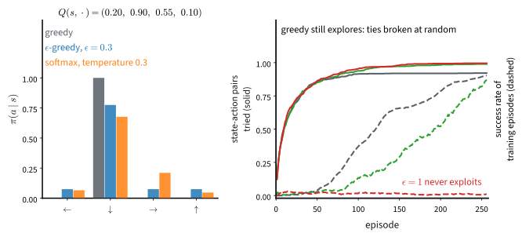

# Q-Learning
:label:`sec_qlearning`

Value iteration needs the transition kernel and the reward. In many problems,
neither is available; the agent can only act and observe what happens. In
this section, we study Q-learning
:cite:`Watkins.1989,Watkins.Dayan.1992`, which learns the optimal action
values from the agent's own experience. It replaces the expectation over next
states in the Bellman optimality equation by the transitions that the agent
actually observes. This raises a question that value iteration never faced:
which data should the agent collect? We address it with simple exploration
strategies, implement Q-learning on calm FrozenLake, and compare the learned
values with the exact solution of :numref:`sec_valueiter`.

```{.python .input #qlearning-temporal-differences-q-learning-and-exploration}
%%tab pytorch
import math
import numpy as np
import torch
from torch import nn
from torch.nn import functional as F
from d2l import torch as d2l
```

```{.python .input #qlearning-temporal-differences-q-learning-and-exploration}
%%tab jax
import math
import numpy as np
import jax
from jax import numpy as jnp
from flax import nnx
import optax
from d2l import jax as d2l
```

```{.python .input #qlearning-q-learning-1}
%%tab pytorch, jax
import gymnasium as gym
```

## From Value Iteration to Q-Learning

Q-learning keeps the backup of value iteration and changes how its
expectation is computed.

### The Sampled Backup

Written for action values, value iteration repeats the sweep

$$Q_{k+1}(s, a) = r(s, a) + \gamma \sum_{s'} P(s' \mid s, a) \max_{a'} Q_k(s', a') \quad \textrm{for all } s \in \mathcal{S},\ a \in \mathcal{A},$$

whose fixed point is $Q^*$ by :eqref:`eq_bellman_optimality_q`. We denote its
right-hand side by $(TQ)(s, a)$. The model enters this sweep only through an
expectation over the reward and the next state. Suppose the agent takes action
$a$ in state $s$ and observes the reward $r$ and the next state $s'$. Then the
*target* $r + \gamma \max_{a'} Q(s', a')$ is a random variable whose expected
value, given $s$ and $a$, is exactly $(TQ)(s, a)$. For a fixed table $Q$, this
follows from $\mathbb{E}[r \mid s, a] = r(s, a)$ (:numref:`sec_mdp`) and
$s' \sim P(\cdot \mid s, a)$:

$$\mathbb{E}\Big[ r + \gamma \max_{a'} Q(s', a') \;\Big|\; s, a \Big] = r(s, a) + \gamma \sum_{s'} P(s' \mid s, a) \max_{a'} Q(s', a') = (TQ)(s, a).$$

Q-learning moves the entry $Q(s, a)$ a step toward this target after every
observed transition:

$$Q(s, a) \leftarrow Q(s, a) + \alpha\, \delta, \qquad \delta = r + \gamma \max_{a'} Q(s', a') - Q(s, a),$$
:eqlabel:`eq_td_error`

where $\alpha \in (0, 1]$ is a step size. The quantity $\delta$ is called the
*temporal-difference error* (TD error) :cite:`Sutton.1988`: the difference
between the target, built from one observed step and the current estimate of
what follows, and the current estimate itself. Panel (d) of
:numref:`fig_rl_backups` draws this sampled backup. Because the update uses
only observed transitions, Q-learning needs no model.

The update is a stochastic version of the value-iteration sweep. Two
differences are worth stating. First, it changes one entry at a time, the one
that the agent just visited. Second, it uses a single sample of the next
state. If the transitions and rewards are deterministic, as on calm ice, the
target equals $(TQ)(s, a)$ exactly. Otherwise each target is noisy, and the
step size $\alpha$ makes $Q(s, a)$ an average over many visits. To see this,
rearrange the update as

$$Q(s, a) \leftarrow (1 - \alpha)\, Q(s, a) + \alpha \big( r + \gamma \max_{a'} Q(s', a') \big).$$

Each visit keeps a fraction $1 - \alpha$ of the old entry and mixes in a
fraction $\alpha$ of the new target. With $\alpha = 1$, the entry is simply
replaced by the target.

A small example on calm ice shows how values spread. In a table of zeros,
every target is zero until the agent first reaches the goal, which it can
enter only by moving right from state $14$. The goal is terminal and pays
one, so the target is $1$, and the update with $\alpha = 0.9$ sets
$Q(14, \textrm{right}) = 0 + 0.9 \cdot (1 - 0) = 0.9$. If
the agent's next move into state $14$ comes from state $13$, its target is
$0.95 \cdot 0.9 = 0.855$, and $Q(13, \textrm{right})$ becomes
$0.9 \cdot 0.855 \approx 0.77$, below $Q^*(13, \textrm{right}) = 0.95$. Values
thus spread back from the goal one step at a time, along the transitions that
the agent makes, and they start out too small. Value iteration spreads them
one step per sweep over all states (:numref:`fig_rl_value_wavefront`).

### Convergence

Taking the expectation of the TD error over the reward and the next state
gives $\mathbb{E}[\delta \mid s, a] = (TQ)(s, a) - Q(s, a)$, which is zero at
the fixed point $Q^*$. Q-learning is therefore a stochastic approximation of
value iteration :cite:`Robbins.Monro.1951`. For a finite MDP with bounded
rewards and $\gamma < 1$, the table converges to $Q^*$ with probability one
if every nonterminal state-action pair is updated infinitely often and the
step sizes used for each pair satisfy $\sum_k \alpha_k = \infty$ and
$\sum_k \alpha_k^2 < \infty$, where $\alpha_k$ is the step size at the $k$-th
update of that pair
:cite:`Watkins.Dayan.1992,Jaakkola.Jordan.Singh.1994,Tsitsiklis.1994`. The
agent never acts from a terminal state, so the entries of terminal states are
never updated, and in a table of zeros they keep their exact value, zero. A
step size that decreases like $1/k$ satisfies both conditions. With
$\alpha_k = 1/k$, for instance, the entry after $k$ updates is the plain
average of the $k$ targets that it has received, as one checks by induction
on $k$. A constant step size violates the second condition. It gives the
latest target the weight $\alpha$ however many updates came before, so with
noisy targets the estimates keep fluctuating instead of settling at $Q^*$.
With deterministic transitions and rewards there is no noise to average, and
the target equals $(TQ)(s, a)$. Since $Q^*(s, a) = (TQ^*)(s, a)$, the
difference $(TQ)(s, a) - Q^*(s, a)$ is $\gamma$ times an average over $s'$ of
$\max_{a'} Q(s', a') - \max_{a'} Q^*(s', a')$. As in the contraction proof of
:numref:`sec_valueiter`, each of these terms is at most
$\|Q - Q^*\|_\infty$ in absolute value, the largest error over all pairs.
The entry $Q'(s, a)$ after the update therefore satisfies

$$|Q'(s, a) - Q^*(s, a)| \leq (1 - \alpha)\, |Q(s, a) - Q^*(s, a)| + \alpha \gamma\, \|Q - Q^*\|_\infty \leq \big(1 - \alpha (1 - \gamma)\big)\, \|Q - Q^*\|_\infty.$$

The largest error never grows, and each time that every nonterminal pair has
been updated once more, it has shrunk at least by the factor
$1 - \alpha (1 - \gamma)$. In this case, a constant step size thus gives
convergence to $Q^*$ if every nonterminal pair is updated infinitely often;
the experiment below uses $\alpha = 0.9$. In the example above, every further
visit to $(14, \textrm{right})$ has the same target $1$ and
moves the estimate from $0.9$ to $0.99$ and then to $0.999$: the error
shrinks by the factor $1 - \alpha = 0.1$ per visit.

The update treats the target as a fixed number, although the target also
depends on $Q$. If we hold the target $y = r + \gamma \max_{a'} Q(s', a')$
fixed, the derivative of the squared error $\frac{1}{2} \big(y - Q(s, a)\big)^2$
with respect to the entry $Q(s, a)$ is $-\delta$. The update
:eqref:`eq_td_error` is therefore a gradient-descent step with step size
$\alpha$ on the squared error to a fixed label $y$, as in regression. For
this reason, Q-learning is called a *semi-gradient*
method :cite:`Sutton.Barto.2018`: it does not perform gradient descent on
the squared TD error, whose gradient would also differentiate through the
target. This distinction returns when the table becomes a neural network in
:numref:`sec_dqn`.

### Terminal States and Time Limits

When $s'$ is terminal, no reward follows it, so its continuation value is zero
and the target is $r$ alone. When an episode is cut by a time limit instead,
the state $s'$ is not terminal, and the target keeps the term
$\gamma \max_{a'} Q(s', a')$, as discussed in :numref:`sec_mdp`. In code,
both cases are handled by one factor, `gamma * (1 - terminated)`, which uses
the flag `terminated` and ignores `truncated`.

## Exploration

The convergence result requires every nonterminal state-action pair to be
updated over and over. Value iteration updates all pairs in every sweep;
Q-learning updates only the pairs that the agent visits.

### The Behavior Policy

The policy that the agent follows while it learns is called its *behavior
policy*. An agent that always takes the action with the largest estimate does
not try the actions whose estimates are smaller, so their estimates do not
improve. A uniformly random behavior policy tries every action, but it
rarely follows long paths, such as the six moves from the start of FrozenLake
to its goal, and it never uses what it has learned. Practical behavior
policies combine the two. The *$\epsilon$-greedy* policy takes a uniformly
random action with probability $\epsilon$ and the action with the largest
estimate otherwise. If this action is unique, the policy is

$$\pi(a \mid s) = \begin{cases} 1 - \epsilon + \epsilon/|\mathcal{A}| & \textrm{if } a = \mathrm{argmax}_{a'} Q(s, a'), \\ \epsilon/|\mathcal{A}| & \textrm{otherwise}. \end{cases}$$
:eqlabel:`epsilon_greedy`

The greedy action receives the extra $\epsilon/|\mathcal{A}|$ because the
random action, taken with probability $\epsilon$, coincides with it with
probability $1/|\mathcal{A}|$. A common choice decreases $\epsilon$ during
training, from one or a value near it, which favors trying actions, toward a
small value, which favors using the estimates :cite:`mnih2015human`. The
*softmax* policy is an alternative that favors actions with larger estimated
values,
$\pi(a \mid s) \propto \exp\big(Q(s, a) / \eta\big)$, with a
temperature $\eta > 0$: a large temperature makes it nearly uniform, and a
small one makes it nearly greedy. Panel (a) of :numref:`fig_rl_exploration`
compares these policies on one row of action values,
$Q(s, \cdot) = (0.20, 0.90, 0.55, 0.10)$ for the actions *left*, *down*,
*right*, and *up*. With $\epsilon = 0.3$, the $\epsilon$-greedy policy gives
the greedy action *down* the probability $1 - 0.3 + 0.3/4 = 0.775$ and each
of the other three actions $0.075$. The softmax policy with $\eta = 0.3$ gives
the probabilities $(0.07, 0.68, 0.21, 0.05)$. Unlike the $\epsilon$-greedy
policy, it distinguishes among the actions that are not greedy: *right*,
whose estimate is second largest, receives about three times the
probability of *left* and more than four times that of *up*.

![Exploration in tabular Q-learning. (a) One row of action values, $Q(s, \cdot) = (0.20, 0.90, 0.55, 0.10)$, turned into a greedy, an $\epsilon$-greedy ($\epsilon = 0.3$), and a softmax (temperature $0.3$) behavior policy. (b) Q-learning on calm FrozenLake with $\alpha = 0.9$ under three behavior policies, averaged over 20 runs: greedy with random tie-breaking (gray), $\epsilon$ annealed from $0.9$ to $0.05$ (green), and $\epsilon = 1$ (red). The solid lines show the fraction of the 44 nonterminal state-action pairs tried at least once, and the dashed lines the success rate of the training episodes themselves, averaged over a trailing window of $25$ episodes. With random tie-breaking, even the greedy policy tries most pairs. With $\epsilon = 1$ the agent tries nearly every pair but never acts on its estimates, so its training episodes rarely succeed.](../img/mdl-rl-exploration.svg)
:label:`fig_rl_exploration`

The schedule for $\epsilon$ and the $\epsilon$-greedy rule are short
functions, which we save for later sections. The rule breaks ties among
equally valued actions at random: if $k$ actions share the largest estimate,
each of them receives the probability
$(1 - \epsilon)/k + \epsilon/|\mathcal{A}|$ instead of the first case of
:eqref:`epsilon_greedy`, and every other action receives
$\epsilon/|\mathcal{A}|$. This matters at the start of training: in a
zero-initialized table every action is tied, and always choosing the first
action, as `np.argmax` does, would make the agent command *left* in every new
state.

```{.python .input #qlearning-the-implementation-2}
%%tab pytorch, jax
def linear_schedule(start, end, num_steps):  #@save
    """step -> value, interpolated from start to end, then held at end."""
    return lambda step: end + (start - end) * max(0.0, 1.0 - step / num_steps)
```

```{.python .input #qlearning-the-implementation-3}
%%tab pytorch, jax
def epsilon_greedy(q, epsilon, rng):  #@save
    """Explore with probability epsilon, else act greedily on the values q."""
    if rng.random() < epsilon:
        return int(rng.integers(len(q)))
    return int(rng.choice(np.flatnonzero(q == q.max())))  # random tie-break
```

### Optimism under Uncertainty

The $\epsilon$-greedy policy explores without regard to how much the agent
already knows about each action. Methods based on *optimism under
uncertainty* direct exploration toward actions whose values could still be
high, given the uncertainty of their estimates. The setting in which they are
best understood is the *multi-armed bandit*, an MDP with a single state: the agent repeatedly chooses one of
several actions and receives a random reward with an unknown mean. The upper
confidence bound rule (UCB) tries every action once and then chooses at round
$t$ the action

$$a_t = \underset{a}{\mathrm{argmax}} \Big[ \hat{\mu}(a) + \sqrt{\frac{2 \ln t}{n(a)}} \Big],$$

where $\hat{\mu}(a)$ is the average reward observed from action $a$ and
$n(a) \geq 1$ is the number of times it was chosen. The bonus is large for
actions that were rarely chosen and shrinks as evidence accumulates. At round
$t = 100$, for example, it is about $1.52$ for an action chosen $4$ times and
$0.38$ for an action chosen $64$ times. It shrinks like $1/\sqrt{n(a)}$, as
does the standard deviation of an average of $n(a)$ independent rewards. The
rule therefore chooses an action either because its average reward is high
or because it was chosen too rarely to rule out a high mean, which is the
sense in which it is optimistic. For rewards in
$[0, 1]$, the expected total shortfall of this rule relative to always
choosing the best action grows only logarithmically in the number of rounds
:cite:`Auer.CesaBianchi.Fischer.2002`. In contrast, an $\epsilon$-greedy
policy with a fixed $\epsilon > 0$ keeps choosing a random action in a
fraction $\epsilon$ of the rounds, so its shortfall grows linearly. In an MDP, exploration is harder,
because a poorly known state-action pair may be reachable only through a long
sequence of actions. On FrozenLake, with its $44$ nonterminal state-action
pairs, $\epsilon$-greedy exploration suffices, as panel (b) of
:numref:`fig_rl_exploration` shows.

## Q-Learning on Calm Ice

We now implement Q-learning and compare its result with the exact solution.

### The Implementation

We use calm FrozenLake with $\gamma = 0.95$, as in :numref:`sec_valueiter`.
The agent interacts with the environment only through `reset` and `step`. We
also compute $Q^*$ by value iteration, but only to grade the learned table
afterwards:

```{.python .input #qlearning-the-implementation-1}
%%tab pytorch, jax
gamma, num_episodes = 0.95, 256
env = gym.make('FrozenLake-v1', is_slippery=False)
mdp = d2l.TabularMDP.from_gym(env, gamma)   # used only for grading
Q_star = mdp.backup(d2l.value_iteration(mdp, num_iters=100)[-1])
```

The training loop follows the $\epsilon$-greedy behavior policy, applies the
update :eqref:`eq_td_error` after every step, and records the undiscounted
return of each episode and the number of times each pair was tried. Since
the transitions are deterministic, we use the constant step size $\alpha = 0.9$:

```{.python .input #qlearning-the-implementation-4}
%%tab pytorch, jax
def q_learning(env, num_episodes, alpha, epsilon, gamma, seed):
    """Tabular Q-learning; returns the table, the visit counts, and the
    return of every episode."""
    rng = np.random.default_rng(seed)
    Q = np.zeros((env.observation_space.n, env.action_space.n))
    visits, returns = np.zeros_like(Q), []
    env.reset(seed=seed)
    for episode in range(num_episodes):
        s, done, ret = env.reset()[0], False, 0.0
        while not done:
            a = epsilon_greedy(Q[s], epsilon(episode), rng)
            s_next, r, terminated, truncated, _ = env.step(a)
            target = r + gamma * (1 - terminated) * Q[s_next].max()
            Q[s, a] += alpha * (target - Q[s, a])
            visits[s, a] += 1
            s, done, ret = s_next, terminated or truncated, ret + r
        returns.append(ret)
    return Q, visits, np.array(returns)
```

The exploration rate decreases linearly from $0.9$ to $0.05$ over the $256$
episodes of a run. We train with ten random seeds and plot the undiscounted
return of the training episodes, which is one when the agent reached the goal
and zero otherwise, averaged over a window of $25$ episodes. The curve shows
the median over the seeds, and the band spans the smallest and largest values.

```{.python .input #qlearning-the-implementation-5}
%%tab pytorch, jax
epsilon = linear_schedule(0.9, 0.05, num_episodes - 1)
runs = [q_learning(env, num_episodes, 0.9, epsilon, gamma, seed)
        for seed in range(10)]
d2l.plot_curves({'Q-learning': np.array([ret for _, _, ret in runs])},
                xlabel='episode', ylabel='return per episode', smooth=25)
```

The success rate of the training episodes is low while the goal is still
rarely reached, and it rises once the value of reaching the goal has
propagated back through the table. At the end of training, the median stays
below one, because the behavior policy still takes random actions, with $\epsilon$ reaching $0.05$ only in the last episode, and some random actions lead into a hole.

### Measuring a Policy by Simulation

The training curve measures the behavior policy, which explores. To measure
the policy that Q-learning has learned, the one that acts greedily with
respect to the table, we run it in the environment and average the
discounted returns of its episodes. Later sections use the same function for
policies represented by neural networks, so we save it. A policy is any
function that maps a state and a random number generator to an action:

```{.python .input #qlearning-measuring-a-policy-by-simulation}
%%tab pytorch, jax
def evaluate(env, policy, num_episodes, gamma=1.0, rng=None):  #@save
    """Mean discounted return of `policy(obs, rng) -> action` over episodes."""
    total = 0.0
    for _ in range(num_episodes):
        obs, done, discount = env.reset()[0], False, 1.0
        while not done:
            obs, reward, terminated, truncated, _ = env.step(policy(obs, rng))
            done = terminated or truncated
            total, discount = total + discount * reward, discount * gamma
    return total / num_episodes
```

On calm ice, a greedy policy produces the same episode every time, so one
episode per seed suffices. We also compare the learned table with $Q^*$, once
on the state-action pairs along the path that the greedy policy follows, and
once over all pairs:

```{.python .input #qlearning-reading-the-curve-honestly-1}
%%tab pytorch, jax
greedy_returns = [evaluate(env, lambda s, rng: int(Q[s].argmax()), 1, gamma)
                  for Q, _, _ in runs]
print('greedy return per seed:', np.round(greedy_returns, 4))
print(f'gamma^5 = {gamma ** 5:.4f}')
path_err, all_err = [], []
for Q, _, _ in runs:
    s, done, path = env.reset()[0], False, []
    while not done:                       # follow the greedy policy once
        a = int(Q[s].argmax())
        path.append((s, a))
        s, _, terminated, truncated, _ = env.step(a)
        done = terminated or truncated
    path_err.append(max(abs(Q[p, q] - Q_star[p, q]) for p, q in path))
    all_err.append(np.abs(Q - Q_star).max())
print('largest |Q - Q*| on the greedy path:', np.round(path_err, 3))
print('largest |Q - Q*| over all pairs:    ', np.round(all_err, 3))
```

The greedy policy of every seed reaches the goal in six moves, the length of a
shortest path, and earns the optimal return $\gamma^5$. Along this path, the
learned values agree with $Q^*$. Elsewhere, the table can be far from $Q^*$:
the largest error over all pairs lies between about $0.77$ and $0.95$ for
every seed, whereas no action value on calm ice exceeds one.
Each update uses the current estimate at the next state, and on calm ice,
starting from zero, no estimate ever exceeds its true value. A pair that the
agent tried mostly before the values of its successors had been learned, and
rarely afterwards, keeps an estimate that is too small. Earning the optimal
return from the start state requires only that the action that `argmax`
picks at each state the policy visits is optimal, and in this experiment that
holds while parts of the table are still far from $Q^*$. The panels below
compare the learned values and greedy actions of one seed with the exact solution. Along the learned
path, every greedy action is optimal. At the start state, the two panels
show different actions because *down* and *right* are both optimal there,
with value $\gamma^5$, and `argmax` picks the first of the tied actions of
$Q^*$ (:numref:`sec_valueiter`). At states that the learned policy does not
visit, the greedy action can be suboptimal, as at the two states below the
start.

```{.python .input #qlearning-reading-the-curve-honestly-2}
%%tab pytorch, jax
Q0 = runs[0][0]
d2l.show_grid(env.unwrapped.desc, np.stack([Q0.max(-1), Q_star.max(-1)]),
              np.stack([Q0.argmax(-1), Q_star.argmax(-1)]),
              titles=['Q-learning, seed 0', 'value iteration'])
```

## Off-Policy Learning

The maximum in the target of :eqref:`eq_td_error` evaluates the greedy action
at the next state, whichever action the behavior policy takes there. Q-learning
therefore learns the values of the greedy policy while the agent follows a
different, exploratory policy. Methods with this property are called
*off-policy*. The SARSA algorithm :cite:`Rummery.Niranjan.1994` replaces the
maximum by the value of the action that the behavior policy actually takes
next, $r + \gamma Q(s', a')$. Suppose, for example, that the greedy action
at $s'$ has the estimate $0.9$ and that the behavior policy takes a random
action there whose estimate is $0.1$. The target of Q-learning is then
$r + 0.9\gamma$, and that of SARSA is $r + 0.1\gamma$. Because its target
uses the action that is actually taken, SARSA learns the values of the
behavior policy itself, exploration included, and is called *on-policy*.

Being off-policy is what allows Q-learning to learn from transitions collected
by other policies: by earlier versions of the agent, by another agent, or by
a fixed log of past interactions, as long as these data cover the
state-action pairs that matter. :numref:`sec_dqn` uses this property to reuse
old experience when the table is replaced by a neural network, and
:numref:`sec_offline` studies learning from a fixed dataset alone. The maximum
in the target also has a cost: a maximum over noisy estimates is biased
upward :cite:`vanHasselt.2010`, an effect that :numref:`sec_dqn` measures.

## Summary

Q-learning replaces the expectation in the value-iteration backup by sampled
transitions and moves one table entry toward its target after every step. The
target equals the Bellman optimality backup $(TQ)(s, a)$ in expectation, and
under sufficient exploration and step sizes that decrease like $1/k$, the
table converges to $Q^*$. Because it updates only the pairs that the agent
visits, the choice of behavior policy matters: $\epsilon$-greedy and softmax
policies trade trying actions against using the estimates, and optimistic
rules such as UCB direct exploration toward actions whose values could still
be high. On calm FrozenLake, every seed learned a greedy policy that follows
a shortest path, although the table remained far from $Q^*$ away from that
path. The maximum in the target makes Q-learning off-policy.

## Exercises

1. [code] **Step sizes on slippery ice.** Run Q-learning on slippery
   FrozenLake for $4{,}000$ episodes with three step-size rules: the constant
   $\alpha = 0.9$, the constant $\alpha = 0.1$, and
   $\alpha = 1/(1 + 0.1\, n(s, a))$, where $n(s, a)$ counts the updates of the
   pair. Plot the estimate of $Q(s_0, a)$ for the optimal action $a$ against
   the exact value from :numref:`sec_valueiter`. Which rules satisfy the
   conditions of the convergence result, and which estimate keeps fluctuating?
1. [code] **Behavior policies.** On calm ice, compare a constant
   $\epsilon \in \{0, 0.1, 1\}$ with the annealed schedule of the section. For
   each, record the fraction of state-action pairs tried and the return of
   the learned greedy policy. Then replace the random tie-breaking in
   `epsilon_greedy` by `np.argmax` and repeat the run with $\epsilon = 0$.
1. **Q-learning is not least squares.** A state $A$ has one action, reward
   zero, and moves to $B$ or $C$ with probability $1/2$ each. From $B$ and
   $C$, one action ends the episode with reward $1$ and $0$, respectively.
   Let $\gamma = 1$.
    1. Compute $Q^*$ for the three state-action pairs.
    1. Consider the sum of the expected squared TD errors of the three pairs,
       $\mathbb{E}\big[(Q(A) - Q(s'))^2\big] + (Q(B) - 1)^2 + Q(C)^2$, where $s'$ is
       the random successor of $A$. Show that it is not minimized at $Q^*$,
       and explain which term is responsible.
1. [code] **A bandit.** Implement the $\epsilon$-greedy rule with
   $\epsilon = 0.1$ and the UCB rule of the section for ten actions with
   Bernoulli rewards, whose means are $0.9$ for one action, $0.5$ for
   another, and $0.4$ for the remaining eight. Plot the total shortfall
   $\sum_{u \leq t} (\mu^* - \mu_{a_u})$ against $t$ for $10{,}000$ rounds,
   averaged over $20$ runs, and compare its growth for the two rules.
1. [code] **SARSA.** Implement SARSA on calm ice with a constant
   $\epsilon = 0.3$, next to Q-learning with the same behavior policy. Compare
   the learned values at the start state with $V^*(s_0)$, and compare the
   greedy policies of the two methods. Explain the differences in terms of
   which policy each method evaluates.

[Discussions](https://d2l.discourse.group/t/36797)

<!-- slides -->

::: {.slide}
::: {.cover}
[Dive into Deep Learning · §14.3]{.kicker}

Q-learning<br>
**the sampled backup · convergence · exploration · calm FrozenLake · off-policy learning**
:::
:::

::: {.slide title="From Value Iteration to Samples"}
Value iteration needs $P$:

$$Q_{k+1}(s, a) = r(s, a) + \gamma \sum_{s'} P(s' \mid s, a) \max_{a'} Q_k(s', a')$$

. . .

Q-learning uses one observed transition $(s, a, r, s')$:

$$Q(s, a) \leftarrow Q(s, a) + \alpha \big( \underbrace{r + \gamma \max_{a'} Q(s', a') - Q(s, a)}_{\delta,\ \textrm{the TD error}} \big)$$

$\mathbb{E}[\delta \mid s, a] = (TQ)(s, a) - Q(s, a)$: in expectation, a step
toward the value-iteration backup.
:::

::: {.slide title="When It Converges"}
Finite MDP, bounded rewards, $\gamma < 1$: $Q \to Q^*$ with probability one if

- every nonterminal pair is updated infinitely often;
- $\sum_k \alpha_k = \infty$ and $\sum_k \alpha_k^2 < \infty$ for each pair.

. . .

Terminal states: no continuation. Time limits: keep it, as
`gamma * (1 - terminated)` does.
:::

::: {.slide title="Exploration"}
{width=90%}

$\epsilon$-greedy, softmax, and optimism (UCB) trade trying actions against
using the estimates.
:::

::: {.slide title="Q-Learning on Calm Ice"}
@qlearning-the-implementation-4

. . .

@qlearning-the-implementation-5
:::

::: {.slide title="Grading the Learned Table"}
@qlearning-reading-the-curve-honestly-1

The greedy policy of every seed earns the optimal return $\gamma^5$ from the
start; away from its path, the table can be far from $Q^*$ and the greedy
action suboptimal.
:::

::: {.slide title="Off-Policy"}
- Q-learning bootstraps from $\max_{a'} Q(s', a')$: it learns the values of
  the greedy policy while following an exploratory one.
- SARSA bootstraps from the action actually taken: it learns the values of
  the behavior policy.

. . .

Off-policy learning can reuse old data (:numref:`sec_dqn`,
:numref:`sec_offline`).
:::
