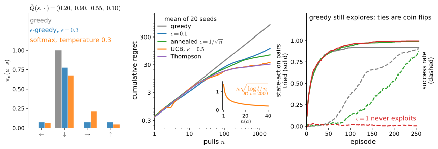

# Temporal-Difference Learning and Exploration
:label:`sec_qlearning`

Q-learning does not require a transition model or expert demonstrations. It replaces the expectation in the Bellman optimality operator with a sampled transition and updates an action-value estimate using the resulting temporal-difference error :cite:`Watkins.1989,Watkins.Dayan.1992`. This substitution introduces sampling noise and makes convergence depend on which state--action pairs the behavior policy visits. We first derive and evaluate the tabular update, then study exploration through multi-armed bandits and regret.

```{.python .input #qlearning-temporal-differences-q-learning-and-exploration}
%%tab pytorch
%matplotlib inline
from d2l import torch as d2l
import gymnasium as gym
import numpy as np
```

```{.python .input #qlearning-temporal-differences-q-learning-and-exploration}
%%tab jax
%matplotlib inline
from d2l import jax as d2l
import gymnasium as gym
import numpy as np
```

## The Sampled Backup

### From the Bellman Operator to the TD Update

Value iteration, written for the action-value function, sweeps

$$Q_{k+1}(s, a) = r(s, a) + \gamma \sum_{s' \in \mathcal{S}} P(s' \mid s, a) \max_{a' \in \mathcal{A}} Q_k (s', a'); \ \textrm{for all } s \in \mathcal{S} \textrm{ and } a \in \mathcal{A},$$

whose fixed point is $Q^*$; call the right-hand side $(TQ)(s, a)$, the optimality operator of :numref:`sec_valueiter` on action-value tables. We use $Q$ rather than $V$ because extracting the optimal policy from $Q^*$ requires only an argmax over a table row and no transition model. The kernel enters the sweep through one expectation, $E_{s' \sim P(\cdot \mid s, a)} [\max_{a'} Q_k(s', a')]$, and an expectation can be estimated from samples. Panel (d) of :numref:`fig_rl_backups` shows this substitution: Q-learning uses one sampled successor where the exact backup sums over every successor, while retaining the maximum over next actions.

Let the agent act with some data-collection policy $\pi_e(a \mid s)$, its *behavior policy*, and record $n$ trajectories of $T$ timesteps each, $\{ (s_t^i, a_t^i)_{t=0,\ldots,T-1}\}_{i=1,\ldots, n}$. The Bellman equations constrain the action values of all state--action pairs. A sampled objective can impose corresponding residual terms only for pairs present in the data:

$$\hat{Q} = \mathrm{argmin}_Q \underbrace{\frac{1}{nT} \sum_{i=1}^n \sum_{t=0}^{T-1} (Q(s_t^i, a_t^i) - r(s_t^i, a_t^i) - \gamma \max_{a'} Q(s_{t+1}^i, a'))^2}_{\stackrel{\textrm{def}}{=} \ell(Q)}.$$
:eqlabel:`q_learning_optimization_problem`

The objective does not evaluate the kernel explicitly. Instead, when the behavior policy $\pi_e$ takes action $a_t^i$ at state $s_t^i$, the next state $s_{t+1}^i$ is sampled from the transition distribution. The collected data therefore provide sampled access to the transition dynamics. For every constraint to be represented, $\pi_e$ must keep visiting every state-action pair.

An optimal deterministic policy would *not* qualify: it never takes the actions it considers suboptimal, so $\ell(Q)$ would contain no term for those state-action pairs and their values would be left unconstrained. The third part of this section takes that requirement seriously.

Instead of solving the joint problem directly, Q-learning updates individual table entries. For each observed transition $(s, a, r, s')$, it moves the corresponding entry toward the *bootstrapped target* $r + \gamma \max_{a'} Q(s', a')$, treating the target as a constant even though it contains $Q$:

$$Q(s, a) \leftarrow (1 - \alpha)\, Q(s, a) + \alpha \big( r + \gamma \max_{a'} Q(s', a') \big),$$
:eqlabel:`q_learning`

where $\alpha$ is the step size. Because the target itself depends on $Q$ and we deliberately hold it fixed, this is called a semi-gradient step: Q-learning is therefore not gradient descent on $\ell(Q)$ in the strict sense; it is a semi-gradient stochastic-approximation update. Rearranged, the update is a correction proportional to a single scalar,

$$\delta = r + \gamma \max_{a'} Q(s', a') - Q(s, a), \qquad Q(s, a) \leftarrow Q(s, a) + \alpha\, \delta.$$
:eqlabel:`eq_td_error`

The scalar $\delta$ is the *temporal-difference error* :cite:`Sutton.1988`: the observed reward plus the estimated best continuation, minus the current estimate. It also appears in the actor updates of :numref:`sec_actorcritic` and in deep Q-learning (:numref:`sec_dqn`).

*Monte Carlo* prediction waits until an episode ends and uses the realized return as a target for $Q^{\pi_e}(s_t,a_t)$, the value of the behavior policy. The target is unbiased but contains randomness from all subsequent transitions. *Temporal-difference* prediction bootstraps after one step; its target is biased while the value estimate is inaccurate but usually has lower variance :cite:`Sutton.1988,Sutton.Barto.2018`. Q-learning uses a maximum in this target to estimate $Q^*$. The multi-step methods of :numref:`sec_actorcritic` interpolate between Monte Carlo and one-step targets.

### Convergence and the Double-Sampling Problem

Suppose $\pi_e$ visits every state--action pair and collects unlimited data. Minimizing $\ell(Q)$ then recovers the value-iteration solution when transitions are deterministic, but not in general. In the population objective, conditioning on $(s,a)$ decomposes each squared term into a squared mean and a variance:

$$L(Q) = E_{(s, a) \sim \mu} \Big[ \big( Q(s, a) - (TQ)(s, a) \big)^2 \Big] + \gamma^2\, E_{(s, a) \sim \mu} \Big[ \mathrm{Var}_{s' \sim P(\cdot \mid s, a)} \big( \max_{a'} Q(s', a') \big) \Big],$$
:eqlabel:`eq_double_sampling`

Here $\mu$ is the visitation distribution of $\pi_e$. The first term is the squared Bellman residual and is zero at $Q^*$. The second term depends on $Q$ whenever transitions are stochastic, so the minimizer of $L$ need not be $Q^*$. Exercise :exref:`ex_qlearning-double-sampling-counterexample` gives a three-state counterexample. This is the *double-sampling problem*: an unbiased gradient of the squared Bellman residual requires two independent successors for the same $(s,a)$, which an ordinary environment interaction does not provide. For deterministic transitions the variance term vanishes.

Convergence instead follows from the expected update. Averaging :eqref:`eq_td_error` over $s'$ gives $E[\delta\mid s,a]=(TQ)(s,a)-Q(s,a)$, which is zero at the unique fixed point $Q^*$. Q-learning is therefore a stochastic approximation to Bellman fixed-point iteration. With the step-size conditions below and infinite visitation of every state-action pair, it converges to $Q^*$ with probability one :cite:`Watkins.Dayan.1992,Jaakkola.Jordan.Singh.1994`. Sampling variance affects the rate, while the behavior policy determines whether the coverage condition holds.

### Step Sizes and the Robbins-Monro Conditions

For each state-action pair, the Robbins--Monro conditions are $\sum_k\alpha_k=\infty$ and $\sum_k\alpha_k^2<\infty$ :cite:`Robbins.Monro.1951`. A constant step size violates the second condition. With stochastic transitions, its estimates continue to fluctuate around $Q^*$. In a deterministic environment, the target has no transition noise and an update has the form $Q(s,a)\leftarrow(1-\alpha)Q(s,a)+\alpha(TQ)(s,a)$. Updating all entries gives a contraction with modulus $(1-\alpha)+\alpha\gamma$. The sampled asynchronous method additionally requires repeated visitation of every entry.

Panel (c) of :numref:`fig_rl_exploration` measures this coverage for deterministic FrozenLake, where a constant step size of $0.9$ learns quickly within the finite budget.

The conditions are necessary for the guarantee, not sufficient for a budget. The sample-average rule $\alpha = 1/(1 + n(s, a))$, with $n(s, a)$ counting visits to the entry including the current one, passes Robbins-Monro but weights early targets computed from an inaccurate zero table as heavily as later, better-informed targets. At the tested finite budget, this slows learning substantially. Our default $\alpha = 1/(1 + 0.1\, n(s, a))$ also passes and approaches ten times that step size as the visit count grows. We compare all three schedules on the same seeds and report their finite-budget value errors and returns.

### Terminal Masking

The update requires terminal masking in an episodic environment. When $s'$ is terminal, its continuation value is zero, so the target contains only the immediate reward,

$$Q(s, a) \leftarrow Q(s, a) + \alpha \Big( r + \gamma\, \big(1 - \mathbf{1}(s' \textrm{ terminal})\big) \max_{a' \in \mathcal{A}} Q(s', a') - Q(s, a) \Big).$$

The mask uses `terminated`, not `truncated`: :numref:`sec_mdp` distinguishes a terminal state from an observation stopped by a time limit. Treating truncation as termination would impose an incorrect zero continuation value on a nonterminal state. In code the whole repair is one factor, `gamma * (1 - terminated) * Q[s_next].max()`.

## Q-Learning on the Lake

### The Implementation

We return to the slippery lake of :numref:`sec_mdp` with the same discount. The learner accesses the environment only through `reset` and `step`; `mdp`, `V_star`, and `pi_star` are retained solely to compare the learned table with the exact solution.

```{.python .input #qlearning-the-implementation-1}
%%tab pytorch, jax
gamma, num_episodes = 0.95, 4000
env = gym.make('FrozenLake-v1', is_slippery=True)
mdp = d2l.TabularMDP.from_gym(env, gamma)
V_star = d2l.value_iteration(mdp, num_iters=1000)[-1]
pi_star = mdp.backup(V_star).argmax(axis=1)
```

Two helpers, both plain numpy and both saved: the deep Q-network of :numref:`sec_dqn` and the PPO of :numref:`sec_ppo` will call them unchanged. The first turns a start value, an end value and a horizon into a schedule:

```{.python .input #qlearning-the-implementation-2}
%%tab pytorch, jax
def linear_schedule(start, end, num_steps):  #@save
    """step -> value, interpolated from start to end, then held at end."""
    return lambda step: end + (start - end) * max(0.0, 1.0 - step / num_steps)
```

The second is the behavior policy. With probability $\epsilon$ it takes a uniformly random action; otherwise it exploits the current table:

$$\pi_e(a \mid s) = \begin{cases} 1 - \epsilon + \epsilon/|\mathcal{A}| & a = \mathrm{argmax}_{a'} \hat{Q}(s, a') \\ \epsilon/|\mathcal{A}| & \textrm{otherwise}, \end{cases}$$
:eqlabel:`epsilon_greedy`

the *$\epsilon$-greedy* policy, with ties in the argmax broken uniformly at random. Random tie-breaking is necessary for exploration from a zero-initialized table, where every state begins as a four-way tie. In contrast, `np.argmax` always returns the first index:

```{.python .input #qlearning-the-implementation-3}
%%tab pytorch, jax
def epsilon_greedy(q, epsilon, rng):  #@save
    """Explore with probability epsilon, else act greedily on the values q."""
    if rng.random() < epsilon:
        return int(rng.integers(len(q)))
    # Random tie-breaking is load-bearing: np.argmax would always return
    # action 0 on a zero-initialized table, and an agent that only ever
    # proposes *left* on this lake never finds the goal.
    return int(rng.choice(np.flatnonzero(q == q.max())))
```

The implementation repeatedly selects an action, observes one transition, and changes one table entry by $\alpha\delta$. It mutates both the value table and the visit counts; the counts determine the step-size schedule and also record state--action coverage. The exploration rate decreases from $1$ to $0.05$ during the first half of training and remains at that floor thereafter:

```{.python .input #qlearning-the-implementation-4}
%%tab pytorch, jax
def q_learning(seed, Q, visits, env, num_episodes,
               alpha=lambda n: 1 / (1 + 0.1 * n)):
    """Tabular Q-learning; updates Q in place, yields each episode's return."""
    rng = np.random.default_rng(seed)
    epsilon = linear_schedule(1.0, 0.05, num_episodes // 2)
    env.reset(seed=seed)
    for episode in range(num_episodes):
        s, done, ret = env.reset()[0], False, 0.0
        while not done:
            a = epsilon_greedy(Q[s], epsilon(episode), rng)
            s_next, r, terminated, truncated, _ = env.step(a)
            visits[s, a] += 1
            delta = r + gamma * (1 - terminated) * Q[s_next].max() - Q[s, a]
            Q[s, a] += alpha(visits[s, a]) * delta
            s, done, ret = s_next, terminated or truncated, ret + r
        yield ret
```

Every cell here is numpy and shared between the frameworks: tabular reinforcement learning is index arithmetic, and the frameworks enter when the table becomes a network in :numref:`sec_deeprl`. Five seeds, one plain loop:

```{.python .input #qlearning-the-implementation-5}
%%tab pytorch, jax
Q = np.zeros((5, mdp.num_states, mdp.num_actions))
visits = np.zeros_like(Q)
returns = np.array([list(q_learning(k, Q[k], visits[k], env, num_episodes))
                    for k in range(5)])
d2l.plot_curves({'Q-learning': returns}, xlabel='episode',
                ylabel='return per episode', smooth=200)
```

The curve is a trailing 200-episode average, with the band spanning the seeds. It remains near zero while successful episodes are rare, increases as successful transitions update preceding state--action values, and flattens after the exploration schedule reaches its floor.

### The Learned Table against the Exact Solution

The curve plateaus near $0.55$, below the optimal success probability of $73.6$ percent measured in :numref:`sec_valueiter`. This comparison includes failures caused by the behavior policy's continuing exploration and therefore does not directly assess the learned table. Because the exact solution is available for this example, we can compare the learned values with $V^*$:

```{.python .input #qlearning-reading-the-curve-honestly-1}
%%tab pytorch, jax
print(f'max_s |V_Qhat(s) - V*(s)| per seed: '
      f'{np.round(np.abs(Q.max(axis=-1) - V_star).max(axis=-1), 3)}')
env.reset(seed=0)
opt = d2l.evaluate(env, lambda s, rng: int(pi_star[s]), num_episodes=2000)
rates = np.array([d2l.evaluate(env, lambda s, rng: int(Q[k, s].argmax()),
                               num_episodes=2000) for k in range(5)])
taxed = d2l.evaluate(env, lambda s, rng: int(pi_star[s])
                     if rng.random() > 0.05 else int(rng.integers(4)),
                     num_episodes=2000, rng=np.random.default_rng(1))
print(f'success rate: learned greedy {rates.min():.1%} to {rates.max():.1%} '
      f'over 5 seeds; pi* {opt:.1%}')
print(f'pi* forced to explore at epsilon = 0.05: {taxed:.1%}')
print(f'median environment steps: {int(np.median(visits.sum(axis=(1, 2))))}')
```

Across seeds, the learned value functions are within $0.006$ to $0.021$ of $V^*$ in the sup norm. Their greedy policies succeed in $71$ to $74$ percent of evaluation episodes, compared with the optimal value of $73.6$ percent; differences within this range are sampling error. When the optimal policy is forced to select a random action with probability $0.05$, its success rate falls to $54$ percent. The training curve therefore reflects both the learned policy and the continuing exploration of the behavior policy.

The median run used $95{,}569$ environment steps. By comparison, :numref:`sec_valueiter` certified $V^*$ after $164$ sweeps of $64$ exact model backups, or about $10{,}500$ backups. These quantities are not directly interchangeable: a Bellman backup requires the full transition kernel, whereas an environment step provides only one sampled transition. Exercise :exref:`ex_qlearning-like-like-comparison-value` compares the two methods while keeping these different information requirements explicit.

The following panels compare the learned and exact solutions:

```{.python .input #qlearning-reading-the-curve-honestly-2}
%%tab pytorch, jax
d2l.show_grid(env.unwrapped.desc, np.stack([Q[0].max(-1), V_star]),
              np.stack([Q[0].argmax(-1), pi_star]),
              titles=['Q-learning, seed 0', 'value iteration'])
```

The learned arrows reproduce the slip-aware strategy of :numref:`sec_valueiter`
except at state $6$: Q-learning selects *right*, whereas $\pi^*$ selects
*left*. State $6$ lies between holes $5$ and $7$, and the two actions have
equal values under $Q^*$, so this disagreement is a different resolution of an
exact tie. The value estimates are most accurate in frequently visited states
and coarser in the rarely visited top-right corner.

Now consider the deterministic special case. Disabling slip produces
deterministic transitions and noiseless targets, for which the
damped-contraction argument permits the constant $\alpha = 0.9$. In this
experiment, one sixteenth of the episode budget suffices:

```{.python .input #qlearning-reading-the-curve-honestly-3}
%%tab pytorch, jax
calm = gym.make('FrozenLake-v1', is_slippery=False)
table = np.zeros((mdp.num_states, mdp.num_actions))
for _ in q_learning(0, table, np.zeros_like(table), calm, 256,
                    alpha=lambda n: 0.9):
    pass
print(f'calm ice, 256 episodes, alpha = 0.9: greedy policy succeeds '
      f'{d2l.evaluate(calm, lambda s, rng: int(table[s].argmax()), 100):.0%}')
```

In the deterministic environment, the same method finds a perfect policy with about one sixteenth as many episodes and can use a much larger step size. This contrast shows how transition noise changes the sample and step-size requirements. To compare the three schedules, we track $Q(s_0,\textrm{left})$ across the same five seeds; its exact value is available from dynamic programming.

```{.python .input #qlearning-reading-the-curve-honestly-4}
%%tab pytorch, jax
Q_star = mdp.backup(V_star)
a0 = int(pi_star[0])
print(f'Q*(s0, {"<v>^"[a0]}) = {Q_star[0, a0]:.3f}')
trace = {}
for name, alpha in [('0.9 (constant)', lambda n: 0.9),
                    ('1/(1 + 0.1 n)', lambda n: 1 / (1 + 0.1 * n)),
                    ('1/(1 + n)', lambda n: 1 / (1 + n))]:
    runs = []
    for seed in range(5):
        Qa = np.zeros_like(Q[0])
        runs.append([Qa[0, a0] for _ in q_learning(
            seed, Qa, np.zeros_like(Qa), env, num_episodes, alpha)])
    trace[f'alpha = {name}'] = np.array(runs)
    print(f'alpha = {name:>14}: final estimates {np.round(runs, 3)[:, -1]}')
d2l.plot_curves(trace, xlabel='episode', ylabel='estimate of Q(s0, left)',
                reference=Q_star[0, a0])
```

The constant step size does not converge to a fixed value: after four thousand episodes, the five estimates range from $0.06$ to $0.27$, compared with the exact value $0.180$. The default decreasing schedule places all five estimates between $0.180$ and $0.195$. The sample-average schedule $1/(1+n)$ also satisfies the Robbins--Monro conditions, but all five estimates remain below $0.025$ at this budget because early, inaccurate targets retain substantial weight. The asymptotic conditions therefore do not determine which schedule performs best at a finite horizon.

### Feedback between Estimation and Data Collection

The behavior policy depends on the current value estimates, so estimation errors influence which data are collected next. If $\hat{Q}(s,a)$ is too large, an $\epsilon$-greedy policy selects $a$ more often and produces additional transitions whose expected TD errors reduce the overestimate. An underestimate is corrected less directly, because the action may be selected only through random exploration. This creates an asymmetry between overestimation and underestimation.

At a fixed point, the expected correction must vanish for every state--action pair visited by the behavior policy. By :eqref:`eq_td_error`, this is precisely the Bellman optimality condition on the visited set. Interaction can therefore direct data collection toward errors in the current estimate. Offline reinforcement learning, introduced in :numref:`sec_offline`, removes this feedback because it learns from a fixed dataset.

The preceding argument assumes continued exploration. To isolate the resulting tradeoff, we next study a multi-armed bandit, which removes state transitions and delayed rewards.

## Exploration and Regret

### The Multi-Armed Bandit

To isolate exploration, use the one-state MDP from :numref:`sec_mdp`.
Without transitions or delayed rewards, the resulting *multi-armed
bandit* requires the agent to balance estimating action values against
selecting actions with high expected reward. We use ten Bernoulli arms,
one of which has the largest success probability:

```{.python .input #qlearning-a-bandit-is-an-mdp-with-one-state}
%%tab pytorch, jax
arms = np.array([0.50, 0.42, 0.90, 0.25, 0.55, 0.38, 0.60, 0.32, 0.50, 0.45])

def bandit_run(rule, num_pulls, seed):
    """One state, one step: pull an arm, log the shortfall, update tallies."""
    rng = np.random.default_rng(seed)
    wins, count = np.zeros(len(arms)), np.zeros(len(arms))
    gap = np.empty(num_pulls)
    for t in range(num_pulls):
        a = rule(wins, count, t, rng)
        count[a] += 1
        wins[a] += float(rng.random() < arms[a])
        gap[t] = arms.max() - arms[a]
    return np.cumsum(gap)
```

A bandit policy is any rule from the running tallies to an arm, so
`epsilon_greedy` applies unchanged to the empirical means. In a
*contextual bandit*, a fresh context arrives each round independently of
previous actions, one action is scored, and the episode ends. The model
may generalize across contexts, but there are no controlled dynamics or
delayed rewards. :numref:`sec_rl_sequences` uses this distinction when
classifying single-turn preference optimization.

### Regret and the Epsilon-Greedy Family

A bandit permits evaluation by cumulative regret rather than success rate. Each pull contributes the gap between the best mean $\mu^* = \max_a \mu_a$ and the selected arm's mean,

$$\textrm{regret after } t \textrm{ pulls} = \sum_{u=1}^{t} \big( \mu^* - \mu_{a_u} \big),$$

which is what `bandit_run` accumulates. Its expectation is $\sum_a (\mu^* - \mu_a)\, E[n(a)]$: the gap of each arm multiplied by its expected number of pulls. *Sublinear* regret means that average regret per pull converges to zero. We compare three members of the $\epsilon$-greedy family over twenty independent runs:

```{.python .input #qlearning-regret-and-the-linear-tax}
%%tab pytorch, jax
def eps_rule(schedule):
    """Epsilon-greedy on the empirical means, with epsilon = schedule(t)."""
    return lambda wins, count, t, rng: epsilon_greedy(
        wins / np.maximum(count, 1), schedule(t), rng)

rules = {'greedy': eps_rule(lambda t: 0.0),
         'epsilon = 0.1': eps_rule(lambda t: 0.1),
         'annealed': eps_rule(lambda t: max(0.02, 1 / np.sqrt(t + 1)))}
regret = {name: np.array([bandit_run(rule, 2000, [2026, i, s])
                          for s in range(20)])
          for i, (name, rule) in enumerate(rules.items())}
for name, r in regret.items():
    print(f'{name:>13}: mean regret after 2000 pulls {r[:, -1].mean():6.1f}')
```

The greedy rule is sensitive to its first observations. It incurs little subsequent regret if it identifies the best arm early, but it can remain committed to a suboptimal arm; its mean regret is $824$. With fixed $\epsilon = 0.1$, the best arm is usually identified quickly, but uniform exploration continues throughout the run. For these arms, exploration alone costs approximately $0.04$ regret per pull, and the total after $2000$ pulls is $117$. Annealing $\epsilon$ reduces exploration as the estimates improve and lowers the total regret to $69$.

![Exploration, measured three ways. (a) One row of action values, $\hat Q(s, \cdot) = (0.20, 0.90, 0.55, 0.10)$, converted into greedy, $\epsilon$-greedy with $\epsilon = 0.3$, and softmax policies with temperature $0.3$. (b) Mean cumulative regret over 20 runs on the ten-armed Bernoulli bandit, shown on logarithmic axes. After $2000$ pulls, the regrets are $824$ for greedy, $117$ for fixed $\epsilon = 0.1$, $69$ for annealed $\epsilon$, $37$ for UCB with $\kappa = 0.5$, and $32$ for Thompson sampling. These finite runs do not measure asymptotic rates. The inset shows the UCB radius $\kappa \sqrt{\log t/n}$ at $t = 2000$. (c) Coverage of the 44 nonterminal state-action pairs (solid) and success rate of the training episodes (dashed) under three schedules for tabular Q-learning on deterministic FrozenLake. With random tie-breaking, the greedy policy covers 92 percent of the pairs; $\epsilon = 1$ covers nearly all pairs, but its training episodes, which never exploit, almost never succeed.](../img/mdl-rl-exploration.svg)
:label:`fig_rl_exploration`

### Optimism: UCB and Thompson Sampling

Panel (a) of :numref:`fig_rl_exploration` represents the preceding policies as distributions over a row of action values. It also includes the softmax policy introduced in :numref:`sec_policygradient`, whose temperature controls how concentrated the distribution is. The two remaining methods use uncertainty to direct exploration. Optimistic initialization starts each estimate above the attainable rewards, so an arm continues to be selected until observations lower its estimate :cite:`Sutton.Barto.2018`. The *upper confidence bound* (UCB) rule instead adds an uncertainty bonus and selects the largest upper confidence estimate:

$$a_t = \underset{a}{\mathrm{argmax}} \Big[ \hat{\mu}(a) + \kappa \sqrt{\log t \,/\, n(a)} \Big],$$
:eqlabel:`eq_ucb`

The bonus decreases with the number of observations $n(a)$ and increases slowly with $t$ while an arm is not selected :cite:`Auer.CesaBianchi.Fischer.2002`. Thus UCB adapts exploration separately for each arm. With the standard coefficient $\kappa=\sqrt{2}$, its regret is logarithmic in $t$, whereas fixed-$\epsilon$ exploration has linear regret. Smaller coefficients can work better on a particular finite problem but no longer satisfy that guarantee. Each arm is played once to initialize its index; subsequent choices are deterministic maximizers of the UCB score. Thompson sampling :cite:`Thompson.1933` takes a Bayesian approach. For Bernoulli rewards it maintains a Beta posterior for each arm, samples one mean from each posterior, and selects the arm with the largest sample. As observations accumulate, both methods concentrate their choices on well-supported arms:

```{.python .input #qlearning-optimism-ucb-and-thompson-sampling}
%%tab pytorch, jax
kappa = 0.5

def ucb(wins, count, t, rng):
    if (count == 0).any():          # play each arm once before pricing any
        return int(np.argmax(count == 0))
    return int(np.argmax(wins / count + kappa * np.sqrt(np.log(t) / count)))

def thompson(wins, count, t, rng):
    return int(rng.beta(1 + wins, 1 + count - wins).argmax())

for i, (name, rule) in enumerate([('UCB', ucb), ('Thompson', thompson)], 3):
    regret[name] = np.array([bandit_run(rule, 2000, [2026, i, s])
                             for s in range(20)])
    print(f'{name:>13}: mean regret after 2000 pulls '
          f'{regret[name][:, -1].mean():6.1f}')
d2l.plot_curves(regret, xlabel='pulls', ylabel='cumulative regret')
```

Both methods have lower regret than the $\epsilon$-greedy variants in this experiment. The curvature on the logarithmic plot is consistent with logarithmic regret, but $2000$ pulls cannot verify an asymptotic rate. The coefficient also matters: $\kappa=0.5$ was selected for these arms; $\kappa=\sqrt{2}$ gives regret near $200$, while $\kappa=0.15$ sometimes commits to a suboptimal arm and in one of twenty runs exceeds $900$. At $\kappa=0.5$, total regret ranges from $21$ to $53$ across seeds. The relative performance of UCB and Thompson sampling is therefore specific to this experiment.

**Online and offline uncertainty.** UCB adds an uncertainty term because an online agent can test optimistic estimates by collecting new observations. Offline methods often subtract an uncertainty penalty because no new data can correct an overestimate (:numref:`sec_offline`). The two terms express a related principle, but they are calibrated differently. UCB uses the online count and time, whereas an offline penalty is defined relative to a fixed dataset.

### Exploration in MDPs

Bandit actions are immediately available, whereas an uncertain state-action pair in an MDP may be reachable only through a particular sequence of actions. Under independent random exploration, the probability of executing a required sequence of $k$ actions decreases geometrically with $k$. Difficult MDPs therefore require exploration over temporally extended behavior.

One approach assigns bonuses to uncertain state-action pairs and propagates them through value backups, so the policy selects action sequences leading toward uncertain states. With function approximation, explicit counts are unavailable; alternatives include density-model pseudo-counts, curiosity based on prediction error, random network distillation, state archives, and ensembles for approximate posterior sampling :cite:`Burda.Edwards.Storkey.ea.2019`. FrozenLake does not expose this difficulty. With only 44 nonterminal state--action pairs, the exploration schedules used here provide broad coverage within the training budget.

## Off-Policy Learning

### The Off-Policy Mechanism

The $\max_{a'}$ in :eqref:`eq_td_error` evaluates a greedy continuation
independently of the action that the behavior policy actually takes at
$s'$. Q-learning is therefore *off-policy*: it estimates the value of the
greedy policy while data are generated by the exploratory policy $\pi_e$.
SARSA is the corresponding on-policy method; it bootstraps from the next
action actually selected and estimates the value of the behavior policy,
including its exploration :cite:`Sutton.Barto.2018`. This distinction
explains why Q-learning can use persistent exploration while its reported
greedy policy agrees with $\pi^*$. It also permits learning from older
experience, another agent, or a fixed log, provided the data continue to
cover the state--action pairs required by the target policy. Function
approximation can make this flexibility unstable (:numref:`sec_dqn`),
and a fixed dataset imposes the stronger coverage constraints studied in
:numref:`sec_offline`.

### Maximization Bias

The maximum of noisy estimates tends to exceed the maximum of their expectations because it selects entries with positive estimation errors. This produces *maximization bias* in bootstrapped targets. In the experiment, four of five final estimates of $Q(s_0,\textrm{left})$ exceed the true value $0.180$, and the fifth agrees to the reported precision. The bias decreases as tabular estimates converge, but it can persist under function approximation. Double Q-learning reduces it by using separate estimators to select and evaluate the maximizing action, although the resulting estimates can also be low :cite:`vanHasselt.2010`. :numref:`sec_dqn` studies this method.

## Summary

Q-learning replaces the expectation in a Bellman backup with a sampled transition. Its temporal-difference update is $Q \leftarrow Q + \alpha \delta$. In stochastic environments, this semi-gradient update should not be confused with minimizing a sampled squared Bellman residual, whose population objective contains an additional variance term. Under sustained visitation and Robbins--Monro step sizes, tabular Q-learning converges to $Q^*$. Exploration can be studied separately in a one-state bandit: fixed-$\epsilon$ exploration has linear regret, whereas UCB and Thompson sampling reduce exploration as uncertainty decreases. The maximum in the target makes Q-learning off-policy and also introduces maximization bias.

Replacing the table by a neural network gives the deep Q-learning methods developed in :numref:`sec_dqn`.

**Experimental scope.** The FrozenLake results use five seeds, one finite state space, and a fixed training budget. They show that tabular Q-learning approaches the exact solution under the tested schedule, but they do not establish an optimal schedule or a scaling law. The bandit curves average twenty runs; the UCB coefficient was tuned for these arms, and $2{,}000$ pulls are insufficient to verify an asymptotic regret rate. The reported exploration cost is specific to the geometry of this environment.

## Exercises

1. **Batch TD against Monte Carlo.** A Markov reward process is an MDP
   without actions: each state has a fixed distribution over the reward
   and the successor state. One such process has two
   nonterminal states $x$ and $y$, and $\gamma = 1$. A batch holds eight
   episodes: one moves from $x$ to $y$ with reward $0$ and then terminates
   with reward $0$; six start in $y$ and terminate with reward $1$; one
   starts in $y$ and terminates with reward $0$. TD(0) is the state-value
   form of :eqref:`eq_td_error` without the maximum,
   $V(s) \leftarrow V(s) + \alpha \big(r + \gamma V(s') - V(s)\big)$.
    1. Compute the Monte Carlo estimates of $V(x)$ and $V(y)$ from the
       batch, and the values to which TD(0) converges when it replays the
       batch many times with a small step size.
    1. Which pair of estimates has the smaller squared error on the eight
       observed returns?
    1. Estimate the transition probabilities and the expected rewards of
       the process by counting, and solve its Bellman equation exactly.
       Which of the two pairs of estimates does the solution reproduce?
    1. Which pair would you expect to predict the returns of future
       episodes from $x$ better, and under which assumption about the
       process?

    *Adapted from Richard S. Sutton and Andrew G. Barto,
    [Reinforcement Learning: An Introduction](http://incompleteideas.net/book/RLbook2020.pdf),
    Example 6.4.*
   :exlabel:`ex_qlearning-batch-td-monte-carlo`

1. **Truncation treated as termination.** A task has one state and one
   action, pays reward $1$ at every step, and never terminates. A time
   limit truncates every episode after $H$ steps, as `FrozenLake-v1` does
   after $100$. A faulty implementation masks the bootstrap with
   `terminated or truncated` instead of `terminated`.
    1. With decaying step sizes, the estimate converges to the value at
       which the expected update over the $H$ transitions of an episode
       vanishes. Find this value as a function of $\gamma$ and $H$, and
       compare it with the correct value $1/(1 - \gamma)$ at
       $\gamma = 0.95$ and $H = 100$. Which discount factor does the
       faulty implementation effectively use?
    1. Suppose instead that the time limit is part of the task, so that
       the return really ends after $H$ steps. Show that no single number
       is the correct value of the state. Add the number $h$ of remaining
       steps to the state, as in problem :exref:`ex_mdp-time-limits`b
       of :numref:`sec_mdp`. Find the value of each state $(s, h)$, and show
       that the mask `terminated or truncated` is then correct.
   :exlabel:`ex_qlearning-truncation-termination`

1. [code] **The exploration schedule.** On a zero-initialized table,
   `epsilon_greedy` breaks every tie uniformly at random, and every reward
   of FrozenLake is nonnegative.
    1. Show that every entry of the table stays exactly zero until the
       first successful episode, and that until then every $\epsilon$
       produces the same behavior. What does this imply for the episode of
       the first success as a criterion for choosing $\epsilon$?
    1. After the first success, which entries are positive? Show that an
       entry, once positive, stays positive, and that the greedy rule,
       $\epsilon = 0$, never again tries the zero entries of a row that
       contains a positive entry. Panel (c) of
       :numref:`fig_rl_exploration` shows this rule covering 92 percent of
       the nonterminal pairs of the calm lake and learning to succeed
       there. Predict whether it also learns a good policy on slippery
       ice.
    1. Give `q_learning` an argument `epsilon`, a function from the episode
       index to the exploration rate such as those returned by
       `linear_schedule`. On the slippery lake, run five seeds each with
       $\epsilon$ held at $0$, $0.1$, $0.5$ and $1$, and with the schedule
       `linear_schedule(1.0, 0.05, num_episodes // 2)` that `q_learning`
       uses in the section. For each setting, report the mean
       training return, the success rate of the final greedy policy under
       `d2l.evaluate` over $1000$ episodes, and
       $\max_s |\max_a \hat{Q}(s, a) - V^*(s)|$.
    1. Rank the settings by training return and by greedy success rate.
       Where do the two rankings disagree, and what explains the
       disagreement?
   :exlabel:`ex_qlearning-exploration-schedule`

1. **Greedy SARSA and Q-learning.** SARSA replaces the maximum in
   :eqref:`eq_td_error` by the value of the action $a'$ that the behavior
   policy selects at $s'$, $\delta = r + \gamma Q(s', a') - Q(s, a)$. An
   implementation selects $a'$ before it updates $Q(s, a)$ and then takes
   $a'$ at the next step. Suppose that both methods select actions
   greedily on their current tables and break ties by the same fixed rule.
   Are SARSA and Q-learning then the same algorithm, making the same action
   selections and the same updates? If they differ, construct a transition
   of the calm lake and table values for which the two methods select
   different actions at the next step.

    *Adapted from Richard S. Sutton and Andrew G. Barto,
    [Reinforcement Learning: An Introduction](http://incompleteideas.net/book/RLbook2020.pdf),
    Exercise 6.12.*

1. [code] **The double-sampling counterexample.** ● Build a three-state
   MDP with one action per state. From state $s$, the action gives reward
   $0$ and moves to $u_1$ or $u_2$ with probability $1/2$ each. From $u_1$,
   it gives reward $1$ and terminates; from $u_2$, it gives reward $0$ and
   terminates. Write $Q(s)$, $Q(u_1)$ and $Q(u_2)$ for the three entries.
    1. Differentiate one term of the sampled objective
       :eqref:`q_learning_optimization_problem` with respect to the table.
       Which entries have nonzero derivatives, and which of these
       derivatives does the semi-gradient update :eqref:`eq_td_error` drop?
    1. Write down $Q^*$ for the three entries.
    1. With $\mu$ uniform over the three pairs, write the population
       objective :eqref:`eq_double_sampling` explicitly and minimize it in
       closed form as a function of $\gamma$. Which entries does the
       minimizer distort relative to $Q^*$, and in which direction?
    1. Visit the three pairs equally often and run, with a decaying step
       size, both the semi-gradient update and stochastic gradient descent
       on the full derivative of part (a). Confirm that each converges to
       the point predicted in parts (b) and (c).
    1. Suppose that the environment can be reset to $s$, so that every
       visit to $s$ yields two independent successors. Use one of them in
       the target and the other in the derivative of part (a). Show that
       the resulting stochastic gradient is unbiased for the gradient of
       the squared Bellman residual, and confirm by simulation that it
       converges to $Q^*$.
   :exlabel:`ex_qlearning-double-sampling-counterexample`

1. [code] **Step sizes under a finite budget.** ● The section compares a
   constant step size with schedules $\alpha = 1/(1 + c\, n)$ for
   $c = 0.1$ and $c = 1$, where $n$ counts the visits to the entry,
   including the current one. For the analysis, treat the targets that
   one entry receives as independent draws with mean $m$ and variance
   $\sigma^2$.
    1. For a constant $\alpha$, find the variance of the estimate after
       many updates. Evaluate it at $\alpha = 0.9$ for
       $Q(s_0, \textrm{left})$, taking as targets $r + \gamma V^*(s')$ with
       $s'$ drawn from `mdp.P[0, a0]` and `V_star` from the section, and
       compare the resulting standard deviation with the spread of the five
       final constant-step estimates, $0.06$ to $0.27$ around the exact
       value $0.180$. Which assumption of the analysis fails for this
       entry, and where does the rest of the spread come from?
    1. For $c = 1$, write the estimate after $n$ visits as a weighted sum
       of the initial value and the $n$ targets. Which weight does the
       zero initialization receive?
    1. For general $c$, write the weight of the $k$-th target after $n$
       visits as a product, and compare the logarithm of the product with
       an integral to show that the weight grows like $k^{1/c - 1}$ in $k$
       for large $k \leq n$. How does $c = 0.1$ treat the targets that were
       computed from the early, inaccurate table?
    1. Sweep $c \in \{0.01, 0.03, 0.1, 0.3, 1\}$ on the slippery lake,
       five seeds each, and plot against $c$ both the final error
       $|\hat{Q}(s_0, \textrm{left}) - Q^*(s_0, \textrm{left})|$ and the
       sup-norm error $\|\hat{Q} - Q^*\|_\infty$ over all entries. Explain
       the shape of the curves with parts (a) and (c). Do the two error
       measures select the same $c$?

1. [code] **Samples against backups.** ● Take `Q_star` as ground truth.
    1. Record $\|\hat{Q} - Q^*\|_\infty$ after every episode of
       `q_learning` on the slippery lake and plot it against the number of
       environment steps, which the `visits` ledger counts. On the same
       axes, plot the error of value iteration, with $Q_k$ = `mdp.backup`
       of the $k$-th iterate of `d2l.value_iteration`, against the number
       of Bellman backups at $64$ per sweep. How many backups does value
       iteration need to reach the error that Q-learning reaches after
       $4000$ episodes?
    1. Add to `q_learning` a count of the observed transitions
       $(s, a, s')$ and a sum of the observed rewards for each pair. After
       $100$, $400$, $1000$ and $4000$ episodes, build the estimated model
       `d2l.TabularMDP(P_hat, r_hat, gamma)`, leaving the rows of unvisited
       pairs at zero, solve it with `d2l.value_iteration`, and add the
       error of its action values to the plot at the same environment
       steps. Which estimate makes better use of the samples, and what
       does it cost in computation? Relate the result
       to exercise :exref:`ex_qlearning-batch-td-monte-carlo`.
    1. Value iteration consumes model backups, Q-learning consumes
       environment steps, and the estimated model of part (b) consumes
       both. Suppose that one environment step costs as much computation
       as $b$ backups. Using your measurements, find for which range of
       $b$ each of the three methods reaches the error of Q-learning after
       $4000$ episodes at the lowest total cost. Which of the methods
       remain available to an agent that cannot read the transition
       kernel?
   :exlabel:`ex_qlearning-like-like-comparison-value`

1. [code] **Maximization bias in a two-state task.** ● Every episode
   starts in state $s_0$, which offers two actions: *right* terminates with
   reward $0$, and *left* moves to state $s_1$ with reward $0$. In $s_1$,
   each of $m$ actions terminates with a reward drawn from
   $\mathcal{N}(-0.1, 1)$, so *left* is a mistake. Use $\gamma = 1$, the
   constant step size $\alpha = 0.1$, zero initial values, and
   `epsilon_greedy` with $\epsilon = 0.1$.
    1. Implement tabular Q-learning for $m = 10$, and plot against the
       episode index the fraction of runs that take *left* in $s_0$,
       averaged over $1000$ runs of $300$ episodes. What fraction would an
       $\epsilon$-greedy agent acting on $Q^*$ show?
    1. Double Q-learning :cite:`vanHasselt.2010` keeps two tables $Q_1$
       and $Q_2$, acts $\epsilon$-greedily on $Q_1 + Q_2$, and flips a fair
       coin at each transition. On heads it updates
       $$Q_1(s, a) \leftarrow Q_1(s, a) + \alpha \big( r + \gamma\, Q_2(s', \mathrm{argmax}_{a'} Q_1(s', a')) - Q_1(s, a) \big),$$
       and on tails it applies the same update with the two tables
       exchanged. Add its curve to the plot.
    1. Every reward reachable through *left* has a negative mean. Explain
       how Q-learning's estimate of $Q(s_0, \textrm{left})$ nevertheless
       becomes positive. Predict how the Q-learning curve changes for
       $m = 1$ and for $m = 100$, and check. Which part of the effect at
       $m = 100$ comes from noisy estimates, and which from actions that
       have never been tried?

    *Adapted from Richard S. Sutton and Andrew G. Barto,
    [Reinforcement Learning: An Introduction](http://incompleteideas.net/book/RLbook2020.pdf),
    Example 6.7.*

1. **Logarithmic regret of UCB.** ●● With $\kappa = \sqrt{2}$, the rule
   :eqref:`eq_ucb` is UCB1 of :citet:`Auer.CesaBianchi.Fischer.2002`,
   whose Theorem 1 bounds the expected regret after $t$ pulls of arms with
   rewards in $[0, 1]$ by
   $$\sum_{a:\, \Delta_a > 0} \frac{8 \ln t}{\Delta_a} + \Big(1 + \frac{\pi^2}{3}\Big) \sum_a \Delta_a, \qquad \Delta_a = \mu^* - \mu_a.$$
   Derive this bound. The tool is Hoeffding's inequality: the mean
   $\hat{\mu}_n$ of $n$ independent rewards in $[0, 1]$ with mean $\mu$
   satisfies
   $$P(\hat{\mu}_n \geq \mu + \varepsilon) \leq e^{-2 n \varepsilon^2},$$
   and likewise for the lower tail.
    1. Fix a suboptimal arm $a$ and let
       $\ell = \lceil 8 \ln t / \Delta_a^2 \rceil$. Show that if arm $a$ is
       pulled at a step $u \leq t$ while $n(a) \geq \ell$, then either the
       index of the best arm lies at or below $\mu^*$, or the empirical
       mean of arm $a$ exceeds $\mu_a$ by more than its bonus.
    1. For fixed pull counts of both arms, bound the probability of each
       of the two events at step $u$ by $u^{-4}$. Take a union bound over
       the counts and sum over $u$ to show
       $E[n(a)] \leq \ell + \pi^2/3$ after $t$ pulls.
    1. Combine part (b) with the regret decomposition to obtain the
       theorem. Evaluate the bound for `arms` at $t = 2000$ and compare it
       with the regret near $200$ that the section reports for
       $\kappa = \sqrt{2}$. Which step of the proof loses the most?
    1. Repeat the argument for a general coefficient $\kappa$. For which
       $\kappa$ does the sum over steps in part (b) still converge, and
       what does the answer say about the section's choice
       $\kappa = 0.5$?
   :exlabel:`ex_qlearning-ucb-logarithmic-regret`

1. [extended] **Deep exploration.** ●● Under undirected exploration, the
   probability of executing a required sequence of $k$ actions decreases
   geometrically with $k$. Build a chain on which this decrease can be
   computed exactly: states
   $0, \ldots, N-1$, start in state $0$, action $0$ returns to state $0$,
   action $1$ advances one state, reaching state $N-1$ gives reward $1$
   and terminates, and episodes are truncated after $2N$ steps. Give the
   chain the `reset` and `step` interface of Gymnasium so that
   `q_learning`, with the `epsilon` argument of exercise
   :exref:`ex_qlearning-exploration-schedule`, runs on it unchanged.
    1. Show that the uniformly random policy succeeds in one episode with
       probability at most $2N \cdot 2^{-(N-1)}$, so that the expected
       number of episodes up to the first success is at least
       $2^{N-2}/N$. By the argument of problem
       :exref:`ex_qlearning-exploration-schedule`a, $\epsilon$-greedy
       Q-learning from a zero table acts uniformly at random until its
       first success, so the bound holds for it whatever the value of
       $\epsilon$.
    1. Measure the episode of the first success for
       $N \in \{4, 6, \ldots, 20\}$, five seeds each, and plot it against
       $N$ on a logarithmic axis together with the bound.
    1. Initialize every entry to $1$, an upper bound on every return, and
       act greedily with $\epsilon = 0$. Measure the same quantity, and
       explain its growth with $N$ by tracing which entries the first
       episodes lower.
    1. Move both agents to
       `gym.make('FrozenLake-v1', map_name='8x8', is_slippery=True)`, which
       also truncates at $100$ steps. Compare the optimistic greedy agent
       with the zero-initialized agent under the schedule
       `linear_schedule(1.0, 0.05, num_episodes // 2)` at $4000$ and
       $20000$ episodes, five seeds each. Report the success rate of the
       greedy policy under `d2l.evaluate`, the environment steps used,
       and, as a reference, the success rate of the optimal policy
       computed by value iteration. Does optimism keep its advantage on a
       stochastic map, and what does it cost?

   The whole project takes about five minutes of CPU time.

[Discussions](https://d2l.discourse.group/)

<!-- slides -->

::: {.slide}
::: {.cover}
[Dive into Deep Learning · §14.4]{.kicker}

Temporal differences, Q-learning and exploration<br>
**sampled backups · temporal-difference error · convergence · exploration**
:::
:::

::: {.slide title="The Sampled Backup"}
Value iteration needs $P$ inside one expectation. Replace it with the
transition you just observed:

$$\delta = r + \gamma \max_{a'} Q(s', a') - Q(s, a), \qquad
Q(s, a) \leftarrow Q(s, a) + \alpha\, \delta$$

- $\delta$ is the **temporal-difference error**: the sampled one-step
  target minus the current table estimate.
- Bootstrap masked by `terminated`, never `truncated`.

. . .

:numref:`fig_rl_backups`, panel (d): one blue branch instead of the sum,
the max at the next state kept.
:::

::: {.slide title="What Actually Converges"}
The sampled least-squares objective is *not* the right justification:

$$L(Q) = E_\mu \big[ (Q - TQ)^2 \big] + \gamma^2\, E_\mu \big[ \mathrm{Var}_{s'} ( \max_{a'} Q(s', a') ) \big]$$

$Q^*$ makes the first term zero, but the variance term can change the
minimizer (**double sampling**). It vanishes for deterministic transitions.

. . .

The expected update satisfies $E[\delta \mid s, a] = (TQ)(s, a) - Q(s, a)$,
zero exactly at $Q^*$. A stochastic approximation of value iteration,
convergent under Robbins-Monro steps.
:::

::: {.slide title="The Update in Code"}
@qlearning-the-implementation-3

. . .

@qlearning-the-implementation-4
:::

::: {.slide title="Graded Against Dynamic Programming"}
This finite example retains the exact MDP for evaluation.

@!qlearning-reading-the-curve-honestly-1

. . .

The table is within hundredths of $V^*$, and the greedy policy agrees with
$\pi^*$ within sampling error. With $\epsilon=0.05$, continuing exploration
reduces the measured success rate of the behavior policy to $54\%$.
:::

::: {.slide title="Step Sizes and Finite Budgets"}
@!qlearning-reading-the-curve-honestly-4

. . .

- constant $0.9$: estimates continue to fluctuate ($0.06$ to $0.27$)
- $1/(1 + 0.1 n)$: converged, leaning slightly high
- $1/(1 + n)$: satisfies Robbins--Monro but leaves **all five seeds** below $0.025$ at this budget
:::

::: {.slide title="Exploration Measured by Regret"}
A bandit is an MDP with one state. Regret assigns each pull the mean-reward
gap from the best arm.

{width=98%}

. . .

Greedy $824$ · fixed $\epsilon$ $117$ (linear regret) · annealed $69$ ·
UCB $37$ · Thompson $32$.
:::

::: {.slide title="Optimism and Uncertainty"}
$$a_t = \mathrm{argmax}_a \big[ \hat{\mu}(a) + \kappa \sqrt{\log t / n(a)} \big]$$

Per-arm exploration decreases as observations accumulate: logarithmic regret
under the stated UCB conditions, whereas fixed $\epsilon$ has linear regret (proved at $\kappa = \sqrt 2$; play each arm once
first). Thompson: sample a Beta posterior, play the argmax.

. . .

**Online and offline uncertainty.** Online exploration adds a confidence
radius that decreases with counts; offline pessimism (:numref:`sec_offline`)
subtracts an uncertainty penalty because no new samples can correct errors.
:::

::: {.slide title="Which Policy Is Being Learned"}
- The $\max_{a'}$ ignores the action the behavior took: **off-policy**.
  Learn about the greedy policy from data collected by any policy.
- One symbol away: SARSA bootstraps on the action taken, learning the
  behavior's value, $\epsilon$ floor and all.
- The $\max$ also produces positive bias here: four of five final estimates
  exceed the true $0.180$, and none are below it. Maximization bias, repaired in
  :numref:`sec_dqn`.
:::

::: {.slide title="Recap"}
- TD error :eqref:`eq_td_error`: the one-step residual; reused by every
  algorithm ahead.
- Convergence follows from the expected update's fixed point, not from
  minimizing the sampled squared objective (double sampling).
- Robbins-Monro is necessary for the guarantee; budgets decide between
  schedules that both pass.
- Online feedback: selecting an overestimated action provides data that can
  correct its estimate; this mechanism is absent offline.
- Fixed $\epsilon$ has linear regret; UCB and Thompson sampling reduce
  exploration as uncertainty decreases. The uncertainty term changes sign in
  :numref:`sec_offline`.
- The first $\max$ defines a greedy off-policy target; the same $\max$ can also introduce maximization bias.
:::
