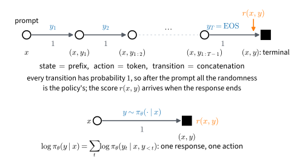

# Reinforcement Learning for Language Models
:label:`sec_rl_sequences`

Language models are trained in stages. Pretraining fits the next-token
distribution of a large corpus (:numref:`sec_gpt`). Post-training then adapts
the model to follow instructions or to solve problems, and reinforcement
learning is part of it. :citet:`ouyang2022training` fine-tuned a pretrained
model with PPO against a reward model learned from human preferences, and the
DeepSeek-R1 models were trained with reinforcement learning on rewards that
check the answers to math problems and run code against test cases
:cite:`DeepSeekAI.2025`. This section maps text generation onto the MDP of
:numref:`sec_mdp`, describes where the rewards come from, and derives the
objective behind the methods of this section. The tools come from the
earlier sections: the score function and baselines, PPO, and behavior
cloning.

```{.python .input #rl-sequences-sequences-are-trajectories}
%%tab pytorch
import math
import numpy as np
import torch
from torch import nn
from torch.nn import functional as F
from d2l import torch as d2l
```

```{.python .input #rl-sequences-sequences-are-trajectories}
%%tab jax
import math
import numpy as np
import jax
from jax import numpy as jnp
from flax import nnx
import optax
from d2l import jax as d2l
```

## Text Generation as a Decision Process

A response is a sequence of tokens, generated one at a time. We first write
this process as an MDP and then show that, for a reward on the complete
response, the response can be treated as a single action.

### The Token MDP

A language model with parameters $\theta$ maps a context to a distribution
over the next token (:numref:`sec_gpt`). The generation loop samples a token,
appends it to the context, and stops at the end-of-sequence token EOS
(:numref:`sec_decoding`). Reading the context as the state and the token as
the action gives the correspondence in :numref:`tab_rl_sequence_dictionary`.

:Text generation as a decision process.
:label:`tab_rl_sequence_dictionary`

| language modeling | reinforcement learning |
|:--|:--|
| prompt $x$ | start state $s_1$ |
| token $y_t$ | action $a_t$ |
| prefix $(x, y_{<t})$ | state $s_t$ |
| response $y = (y_1, \ldots, y_T)$ | trajectory |
| prefix ending in EOS, $(x, y)$ | terminal state |
| next-token distribution | policy $\pi_\theta(a \mid s)$ |
| score of a response | reward |

The state is the whole prefix, not only the last token. The next state is
the prefix with the sampled token appended, so the process is Markov, and
its transitions are deterministic and known: after the prompt, all randomness
comes from the policy (:numref:`fig_rl_token_mdp`). The prompt is the start
state of :numref:`sec_mdp`, written $s_1$ here because the tokens are numbered
from one. It is random: prompts are drawn from a distribution that does not
depend on $\theta$, so, as noted in :numref:`sec_policygradient`, its
probability drops out of every gradient. In
this section, a reward $r(x, y)$ scores the complete response and arrives when
the response ends, and we use $\gamma = 1$.


:label:`fig_rl_token_mdp`

### One Response, One Action

**Proposition.** Let the reward $r(x, y)$ arrive at the end of the response,
with all earlier rewards zero, and let $\gamma = 1$. Then

$$\nabla_\theta \log \pi_\theta(y \mid x) = \sum_{t=1}^{T} \nabla_\theta \log \pi_\theta(y_t \mid x, y_{<t}),$$
:eqlabel:`eq_seq_factorization`

and the REINFORCE estimate with reward-to-go and a baseline $b(x)$ that
depends only on the prompt weights the score of every token by the same
number, $r(x, y) - b(x)$.

**Proof.** By the chain rule of probability,
$\pi_\theta(y \mid x) = \prod_{t=1}^{T} \pi_\theta(y_t \mid x, y_{<t})$, with
no transition probabilities, since the transitions are deterministic. Taking
logarithms and gradients gives :eqref:`eq_seq_factorization`. With the reward
only at the end and $\gamma = 1$, the reward-to-go :eqref:`eq_rtg` of every
token equals $r(x, y)$. The baseline $b(x)$ does not depend on the response,
so by the zero-mean lemma of :numref:`sec_baselines`, subtracting it does not
change the expectation of the estimate. $\blacksquare$

We can therefore treat the response as a single action. Each prompt is then a
round of a *contextual bandit*, the bandit of :numref:`sec_qlearning` with a
context: a context is drawn, here the prompt, one action is chosen, and a
reward is received, and the action does not affect later contexts.
:citet:`ouyang2022training` describe their training environment as such a
bandit. The weight $r(x, y) - b(x)$ is the same for every token of a
response, so a single score per response does not tell which tokens made the
response good or bad. Multi-turn dialogue and tool use, in which the
responses of a user or a tool depend on the output of the model, have
nontrivial transitions and need the full sequential formulation.

## Where the Rewards Come From

Post-training uses three kinds of data: demonstrations, preferences between
responses, and rewards that a program computes.

### Demonstrations and Behavior Cloning

Before any reinforcement learning, :citet:`ouyang2022training` fine-tuned the
pretrained model on responses that people wrote for a set of prompts. This
*supervised fine-tuning* (SFT) maximizes the log-likelihood of the
demonstrated tokens. It is behavior cloning (:numref:`sec_offline`), with
the people as the behavior policy. The SFT model is the starting point of
the reinforcement learning stage, and it is also the reference policy
$\pi_{\textrm{ref}}$ of the objective below.

### Rewards from Preferences

For open-ended tasks, there is no formula for the quality of a response, but
people can compare two responses to the same prompt.
:citet:`Christiano.Leike.Brown.ea.2017` fit a reward function to human
comparisons of pairs of short trajectory segments with the Bradley–Terry model
:cite:`Bradley.Terry.1952`. :citet:`ouyang2022training` fit a reward model
$r_\phi(x, y)$ to comparisons of responses in the same way: the model assigns
the probability

$$P(y_w \succ y_l \mid x) = \sigma\big(r_\phi(x, y_w) - r_\phi(x, y_l)\big)$$
:eqlabel:`eq_bradley_terry`

to the event that the response $y_w$ is preferred to the response $y_l$,
where $\sigma$ is the sigmoid function. For example, the rewards
$r_\phi(x, y_w) = 1$ and $r_\phi(x, y_l) = 0$ give
$P(y_w \succ y_l \mid x) = \sigma(1) \approx 0.73$, and equal rewards give
$1/2$. The reward model maximizes the log-likelihood of the observed
comparisons, that is, it minimizes the average of
$-\log \sigma\big(r_\phi(x, y_w) - r_\phi(x, y_l)\big)$ over them. Two
properties of :eqref:`eq_bradley_terry` matter in the sequel. First, the
comparisons determine $r_\phi(x, \cdot)$ only up to an additive function of
the prompt, because adding $c(x)$ to the rewards of all responses to $x$
changes no probability. Second, the reward model is fitted to the responses
in its training data. Like the value estimates of :numref:`sec_offline`, it
can be wrong on responses unlike those, and a policy that maximizes it may
find them :cite:`Gao.Schulman.Hilton.2023`.

### Rewards That a Program Computes

For some tasks, a program can compute the reward: the final answer to a math
problem can be compared with the correct answer, and code can be run against
test cases. :citet:`Lambert.Morrison.Pyatkin.ea.2024` call training with such
rewards *reinforcement learning with verifiable rewards* (RLVR). A computed
reward is exact for the property that it checks, but nothing else. If a
checker only searches a response for the correct answer, for example, a
response that lists many candidate answers receives the full reward.

## Optimizing the Policy

With a reward in hand, the policy could be trained by the methods of this
chapter to maximize it. In reinforcement learning from human feedback (RLHF)
on language models, the objective is typically the reward minus a penalty for
moving away from the reference policy.

### The KL-Regularized Objective

:citet:`Gao.Schulman.Hilton.2023` trained policies against learned reward
models and measured their true quality with a fixed reward model that played
the role of human judges. As the policy moved away from its initialization,
the learned reward kept increasing, while the true quality first increased
and then decreased. To mitigate such over-optimization of the reward model,
:citet:`ouyang2022training` trained their PPO models to maximize the expected
reward minus a multiple of the KL divergence from the reference policy,

$$J_\beta(\pi) = \mathbb{E}_x\Big[ \mathbb{E}_{y \sim \pi(\cdot \mid x)}\big[ r(x, y) \big] - \beta\, D_{\textrm{KL}}\big( \pi(\cdot \mid x) \,\Vert\, \pi_{\textrm{ref}}(\cdot \mid x) \big) \Big],$$
:eqlabel:`eq_kl_objective`

where $\beta > 0$ sets the strength of the penalty. The divergence
$D_{\textrm{KL}}(\pi \Vert \pi_{\textrm{ref}}) = \mathbb{E}_{y \sim \pi}\big[\log \big( \pi(y \mid x) / \pi_{\textrm{ref}}(y \mid x) \big)\big]$
is zero for $\pi = \pi_{\textrm{ref}}$ and large when $\pi$ gives much
probability to responses that $\pi_{\textrm{ref}}$ rarely produces. Moving
probability to such responses therefore pays off only if the gain in reward
exceeds $\beta$ times the increase in the divergence. For a bounded reward,
the maximizer has a closed form.

**Proposition.** For every prompt $x$, the distribution $\pi(\cdot \mid x)$
that maximizes :eqref:`eq_kl_objective` is

$$\pi^*(y \mid x) = \frac{1}{Z(x)}\, \pi_{\textrm{ref}}(y \mid x) \exp\big( r(x, y)/\beta \big), \quad \textrm{where } Z(x) = \sum_{y} \pi_{\textrm{ref}}(y \mid x) \exp\big( r(x, y)/\beta \big).$$
:eqlabel:`eq_kl_optimum`

**Proof.** Fix $x$ and write $\pi(y)$ for $\pi(y \mid x)$. Taking logarithms
in :eqref:`eq_kl_optimum` gives
$r(x, y) = \beta \log \big( \pi^*(y) / \pi_{\textrm{ref}}(y) \big) + \beta \log Z(x)$.
Therefore

$$\mathbb{E}_{y \sim \pi}[r(x, y)] - \beta\, D_{\textrm{KL}}(\pi \Vert \pi_{\textrm{ref}}) = \mathbb{E}_{y \sim \pi}\Big[ r(x, y) - \beta \log \frac{\pi(y)}{\pi_{\textrm{ref}}(y)} \Big] = \mathbb{E}_{y \sim \pi}\Big[ \beta \log \frac{\pi^*(y)}{\pi(y)} \Big] + \beta \log Z(x) = -\beta\, D_{\textrm{KL}}(\pi \Vert \pi^*) + \beta \log Z(x).$$

The second equality substitutes this expression for $r(x, y)$, after which
the terms with $\pi_{\textrm{ref}}$ cancel, and the third is the definition of
$D_{\textrm{KL}}(\pi \Vert \pi^*)$. The KL divergence is nonnegative and zero
only for $\pi = \pi^*$, so $\pi^*$ is the unique maximizer, and the maximum
is $\beta \log Z(x)$. $\blacksquare$

The optimal policy reweights the reference policy by $\exp(r/\beta)$. For
example, for three responses with rewards $0$, $1$, and $2$, reference
probabilities $0.6$, $0.3$, and $0.1$, and $\beta = 1$, the products
$\pi_{\textrm{ref}}(y \mid x) \exp\big( r(x, y)/\beta \big)$ are about
$0.60$, $0.82$, and $0.74$. Dividing by their sum, $Z(x) \approx 2.15$, gives
$\pi^* \approx (0.28, 0.38, 0.34)$: the probability of the best response
rises from $0.1$ to $0.34$, and to $0.66$ for $\beta = 0.5$. As
$\beta \to \infty$, the optimal policy approaches $\pi_{\textrm{ref}}$. As
$\beta \to 0$, it concentrates on the responses with the largest reward
among those that $\pi_{\textrm{ref}}$ can produce.
:citet:`Korbak.Perez.Buckley.2022` read :eqref:`eq_kl_optimum` as a Bayesian
posterior, with $\pi_{\textrm{ref}}$ as the prior.

### A Reward Model That Can Be Exploited

To see what the penalty does, we construct a small example: five possible
responses to one prompt. The reward model agrees with the true quality of
the first four responses, but it overrates the fifth, which is useless and
which the reference policy rarely produces. This mimics a reward model that
is wrong on responses unlike those in its training data. We compute the
optimum :eqref:`eq_kl_optimum` exactly for a range of $\beta$ and plot the
expected scores against the KL divergence from the reference:

```{.python .input #rl-sequences-a-reward-model-that-can-be-exploited}
%%tab pytorch, jax
quality = np.array([0.6, 1.0, 0.3, 0.0, 0.0])  # true quality of each response
reward = np.array([0.6, 1.0, 0.3, 0.0, 2.0])   # a reward model: wrong on the last
logits = np.array([2.0, 1.0, 1.0, 0.0, -4.0])
pi_ref = np.exp(logits) / np.exp(logits).sum()  # rarely gives the last response

def kl_optimum(beta):
    """pi_ref(y) exp(r(y) / beta) / Z, eq_kl_optimum."""
    w = pi_ref * np.exp((reward - reward.max()) / beta)
    return w / w.sum()

betas = np.logspace(-1, 1, 41)
pis = [kl_optimum(beta) for beta in betas]
kl = [pi @ np.log(pi / pi_ref) for pi in pis]
true = np.array([pi @ quality for pi in pis])
d2l.plot(kl, [[pi @ reward for pi in pis], true],
         'KL divergence from the reference', 'expected score',
         legend=['reward model', 'true quality'], xscale='log',
         figsize=(5, 3))
best = true.argmax()
print(f'reference policy: true quality {pi_ref @ quality:.2f}')
print(f'best: beta = {betas[best]:.2f}, true quality {true[best]:.2f}')
print(f'beta = {betas[0]:.1f}: true quality {true[0]:.2f}, probability of '
      f'the overrated response {pis[0][-1]:.2f}')
```

Each point of the plot is the optimum for one value of $\beta$. As $\beta$
decreases, the policy moves away from the reference, so $\beta$ decreases
from left to right, and the score of the reward model increases throughout.
The true quality first increases, as the policy moves probability to the best
response, and then falls almost to zero, as the policy moves its probability
to the overrated response. In this example, a moderate $\beta$ gives the best
true quality, and the penalty decides on which side of the peak the policy
ends.

### PPO and GRPO

For a language model, the sum $Z(x)$ ranges over all possible responses, so
$\pi^*$ cannot be computed. Instead, the methods of this chapter can maximize
the objective with responses sampled from the policy.
:citet:`ouyang2022training` use PPO (:numref:`sec_ppo`) with a
learned value function. They add the penalty
$-\beta \log \big( \pi_\theta(y_t \mid s_t) / \pi_{\textrm{ref}}(y_t \mid s_t) \big)$
to the reward of every token. By the chain rule of probability, the
penalties of a response sum to $-\beta \log \big( \pi_\theta(y \mid x) / \pi_{\textrm{ref}}(y \mid x) \big)$,
whose expectation over $y$ is the KL term of :eqref:`eq_kl_objective`. The
penalized reward depends on $\theta$, but the score-function estimate may
treat it as fixed: the omitted term, from differentiating the
$\log \pi_\theta$ inside the penalty, has the expectation
$-\beta\, \mathbb{E}_{y \sim \pi_\theta}[\nabla_\theta \log \pi_\theta(y \mid x)] = 0$
by the zero-mean lemma of :numref:`sec_baselines`.

Group relative policy optimization (GRPO) removes the value network
:cite:`Shao.Wang.Zhu.ea.2024`. For each prompt $x$, it samples a group of $K$
responses $y_1, \ldots, y_K$ from $\pi_{\theta_{\textrm{old}}}$ and gives
every token of $y_j$ the advantage
$\hat{A}_j = (R_j - \bar{R}) / s_R$, where $R_j = r(x, y_j)$ and $\bar{R}$
and $s_R$ are the mean and the standard deviation of $R_1, \ldots, R_K$. With
$s_R$ computed with the divisor $K$ and with $10^{-8}$ added to it, which
avoids a division by zero when all $K$ rewards are equal, these are the
group-normalized weights
:eqref:`eq_group_normalized` of :numref:`sec_baselines`. For example, let the
reward be $1$ for a correct response and $0$ otherwise, and let one of
$K = 4$ responses be correct. Then $\bar{R} = 1/4$, and $R_j - \bar{R}$ is
$3/4$ for the correct response and $-1/4$ for each of the other three. These
four values sum to zero, and dividing by $s_R$ scales them all by the
same factor, so the advantage of the correct response is positive and three
times as large as the magnitude of each negative one. GRPO then maximizes,
averaged over prompts,

$$\frac{1}{K} \sum_{j=1}^{K} \frac{1}{T_j} \sum_{t=1}^{T_j} \Big[ \min\Big( \rho_{j,t}\, \hat{A}_j,\ \textrm{clip}\big(\rho_{j,t},\ 1-\epsilon,\ 1+\epsilon\big)\, \hat{A}_j \Big) - \beta\, k_{j,t} \Big],$$
:eqlabel:`eq_grpo`

where $T_j$ is the number of tokens of $y_j$, $\rho_{j,t}$ is the ratio of
:eqref:`eq_ppo_clip` for its $t$-th token, and $k_{j,t} = u - \log u - 1$
with $u = \pi_{\textrm{ref}}(y_{j,t} \mid s_{j,t}) / \pi_\theta(y_{j,t} \mid s_{j,t})$
at the prefix $s_{j,t}$ of that token. Each $k_{j,t}$ is nonnegative,
because $\log u \leq u - 1$. For a token sampled from $\pi_\theta$, the
expectation of $k_{j,t}$ is
$D_{\textrm{KL}}\big(\pi_\theta(\cdot \mid s_{j,t}) \Vert \pi_{\textrm{ref}}(\cdot \mid s_{j,t})\big)$:
the expectation of $u$ is the sum of the reference probabilities of all
tokens, which is one, and the expectation of $-\log u$ is this divergence.
GRPO differentiates $k_{j,t}$ with the sampled token held fixed, however,
and for one-token responses sampled from $\pi_\theta$, the expected gradient
of $k_{j,t}$ is that of $D_{\textrm{KL}}(\pi_{\textrm{ref}} \Vert \pi_\theta)$,
the divergence with its arguments swapped :cite:`Tang.Munos.2025`.

The group mean is a baseline for each prompt. Since it includes the
response's own reward, centering by it alone would shrink the expected
gradient by the factor $(K - 1)/K$ of :numref:`sec_baselines`, and RLOO uses
the mean of the other $K - 1$ rewards instead
:cite:`Ahmadian.Cremer.Galle.ea.2024`. If all $K$ responses to a prompt
receive the same reward, all their advantages are zero, and only the KL term
contributes to the gradient for that prompt. Among other changes, DAPO drops
the KL term, raises the upper end of the clipping range, and discards prompts
whose responses are all correct or all wrong :cite:`Yu.Zhang.Zhu.ea.2025`.

The clip and the KL penalty both keep the policy close to another policy,
but to different ones. The clip compares with $\pi_{\theta_{\textrm{old}}}$,
the policy that generated the batch, and limits each update
(:numref:`sec_ppo`). The penalty compares with the fixed reference
$\pi_{\textrm{ref}}$, and it changes the optimum itself,
:eqref:`eq_kl_optimum`. In large-scale training, the system that generates
the responses and the system that trains the policy can also differ in
numerical precision and sampling details, so that even fresh data can be
off-policy :cite:`Fakoor.Aubry.Stranges.ea.2026`.
:citet:`Fakoor.Aubry.Stranges.ea.2026` adopt P3O
:cite:`Fakoor.Chaudhari.Smola.2019`, which replaces the fixed clipping range
by a cap on the per-token ratios of the policy's probabilities to those of
the generating system. The cap is the effective sample size
(:numref:`sec_ppo`) of these ratios divided by the number of tokens. The
capped ratio multiplies the gradient of the token's log-probability as a
constant weight, through which no gradient flows, so unlike the clip of PPO,
it never removes a token's gradient. When stale or mismatched data make the
ratios uneven, the cap falls and the update tightens.

### Direct Preference Optimization

Solving :eqref:`eq_kl_optimum` for the reward gives
$r(x, y) = \beta \log \big( \pi^*(y \mid x) / \pi_{\textrm{ref}}(y \mid x) \big) + \beta \log Z(x)$.
In the Bradley–Terry model :eqref:`eq_bradley_terry`, only differences of
rewards for the same prompt appear, so the term $\beta \log Z(x)$ cancels:

$$P(y_w \succ y_l \mid x) = \sigma\Big( \beta \log \frac{\pi^*(y_w \mid x)}{\pi_{\textrm{ref}}(y_w \mid x)} - \beta \log \frac{\pi^*(y_l \mid x)}{\pi_{\textrm{ref}}(y_l \mid x)} \Big).$$

The cancellation is an instance of the first property noted after
:eqref:`eq_bradley_terry`, with $c(x) = \beta \log Z(x)$. The remaining terms
need only the probabilities of $y_w$ and $y_l$, whereas $Z(x)$ is a sum over
all responses and cannot be computed for a language model. Direct
preference optimization (DPO) replaces $\pi^*$ by $\pi_\theta$ and maximizes
the log-likelihood of the observed preferences over $\theta$
:cite:`Rafailov.Sharma.Mitchell.ea.2023`. The negative log-likelihood is the
loss of the reward model with
$\beta \log \big( \pi_\theta(y \mid x) / \pi_{\textrm{ref}}(y \mid x) \big)$ in
place of $r_\phi(x, y)$, so DPO minimizes the average over the dataset of

$$-\log \sigma\Big( \beta \log \frac{\pi_\theta(y_w \mid x)}{\pi_{\textrm{ref}}(y_w \mid x)} - \beta \log \frac{\pi_\theta(y_l \mid x)}{\pi_{\textrm{ref}}(y_l \mid x)} \Big).$$
:eqlabel:`eq_dpo_loss`

To see what minimizing this loss does to the policy, let
$\hat{r}_\theta(x, y) = \beta \log \big( \pi_\theta(y \mid x) / \pi_{\textrm{ref}}(y \mid x) \big)$
be the *implicit reward* of the policy, and let
$z = \hat{r}_\theta(x, y_w) - \hat{r}_\theta(x, y_l)$, so that the loss of a
pair is $-\log \sigma(z)$. Since $\log \sigma(z) = -\log(1 + e^{-z})$, its
derivative is $e^{-z} / (1 + e^{-z}) = \sigma(-z)$. The reference policy does
not depend on $\theta$, so
$\nabla_\theta z = \beta \big( \nabla_\theta \log \pi_\theta(y_w \mid x) - \nabla_\theta \log \pi_\theta(y_l \mid x) \big)$,
and the chain rule gives

$$\nabla_\theta \big( -\log \sigma(z) \big) = -\beta\, \sigma\big( \hat{r}_\theta(x, y_l) - \hat{r}_\theta(x, y_w) \big) \big( \nabla_\theta \log \pi_\theta(y_w \mid x) - \nabla_\theta \log \pi_\theta(y_l \mid x) \big).$$
:eqlabel:`eq_dpo_gradient`

Averaged over the dataset, this is the gradient that
:citet:`Rafailov.Sharma.Mitchell.ea.2023` give. A gradient-descent step on
:eqref:`eq_dpo_loss` therefore moves $\theta$ along
$\nabla_\theta \log \pi_\theta(y_w \mid x)$, the direction that raises the
log-probability of the preferred response, and against
$\nabla_\theta \log \pi_\theta(y_l \mid x)$. The difference of the two
gradients is the gradient of
$\log \pi_\theta(y_w \mid x) - \log \pi_\theta(y_l \mid x)$, so, unless the
two gradients are equal, a small enough step increases this difference. It
need not raise $\log \pi_\theta(y_w \mid x)$ itself: both log-probabilities
depend on the same parameters, and to first order the step lowers both whenever the inner
product of their gradients exceeds the squared norm of the gradient of
$\log \pi_\theta(y_w \mid x)$. The weight
$\sigma\big( \hat{r}_\theta(x, y_l) - \hat{r}_\theta(x, y_w) \big)$ is the
probability that the Bradley–Terry model :eqref:`eq_bradley_terry`, with
$\hat{r}_\theta$ in place of $r_\phi$, assigns to the opposite preference,
$y_l \succ y_w$. It exceeds $1/2$ when the implicit reward ranks the pair
wrongly and approaches one as the wrong margin grows, and it approaches zero
for a pair that the implicit reward already ranks correctly by a wide margin.
If $\pi_\theta$ starts at $\pi_{\textrm{ref}}$, all implicit rewards are zero
at the start, and every pair has the weight $1/2$.
:citet:`Rafailov.Sharma.Mitchell.ea.2023` report that a version of the update
without this weight can make the language model degenerate.

DPO needs no separate reward model and no sampling from the policy during
training. It learns from a fixed dataset of preferences, which makes it an
offline method in the sense of :numref:`sec_offline`.

FeynRL :cite:`Fakoor.Aubry.2026` is an open-source post-training framework
for language models and vision-language models. It provides reference
implementations of supervised fine-tuning, DPO, PPO, GRPO, DAPO, and P3O,
among other methods, each in its own module documented with its mathematics
and pseudocode, and the same code runs on one GPU or on many machines. It can
also generate responses and train the policy concurrently, with a
configurable staleness budget that bounds how far off-policy the data can
drift.

## Summary

In text generation, prompts are start states, tokens are actions, prefixes
are states, and the transitions append tokens deterministically. With a
reward on the complete response, the log-probability of the response is the
sum of the log-probabilities of its tokens, and every token's score receives
the same weight, so the response can be treated as a single action.
Post-training uses demonstrations, through supervised fine-tuning, which is
behavior cloning; preferences, through a Bradley–Terry reward model; and
rewards that a program computes. Since learned rewards can be wrong, RLHF
typically maximizes the reward minus a KL penalty to a reference policy, whose
optimum
reweights the reference by $\exp(r/\beta)$. PPO with a per-token penalty
maximizes this objective by sampling. GRPO replaces the value network by
group-normalized rewards and adds a KL estimate to the loss, whose gradient
is in general not that of the penalty. DPO uses :eqref:`eq_kl_optimum` to
write the reward in terms of the policy and fits the policy directly to a
fixed dataset of preferences.

## Exercises

1. **Per-token penalties.** Show that adding
   $-\beta \log \big( \pi_\theta(y_t \mid s_t) / \pi_{\textrm{ref}}(y_t \mid s_t) \big)$
   to the reward of every token gives, in expectation over responses, the
   objective :eqref:`eq_kl_objective`.
1. **The crossing point.** In the example, find the value of $\beta$ below
   which the overrated response is more likely than the best response under
   $\pi^*$. Derive it from :eqref:`eq_kl_optimum` and check it in the code.
1. **Groups without signal.** For a reward in $\{0, 1\}$ and a prompt that the
   policy solves with probability $p$, compute the probability that all $K$
   responses of a group receive the same reward. For which prompts does GRPO
   learn little, and how does the group size change this?
1. **Two anchors.** PPO's clip and the KL penalty both keep the new policy
   close to another policy. Which policy does each refer to? Which of the two
   changes the optimum of the objective, and which only limits the size of a
   single update? To compare, let every update replace $\pi_k$ by the
   maximizer $\pi_{k+1}$ of
   $\mathbb{E}_{y \sim \pi}[r(x, y)] - \tilde{\beta}\, D_{\textrm{KL}}\big(\pi(\cdot \mid x) \Vert \pi_k(\cdot \mid x)\big)$,
   starting from $\pi_0 = \pi_{\textrm{ref}}$. Show that $\pi_k$ is
   :eqref:`eq_kl_optimum` with $\beta = \tilde{\beta}/k$. Where do the
   iterates go as $k \to \infty$?

[Discussions](https://d2l.discourse.group/t/36807)

<!-- slides -->

::: {.slide}
::: {.cover}
[Dive into Deep Learning · §14.12]{.kicker}

Reinforcement learning for language models<br>
**text generation as an MDP · rewards from preferences and programs · the KL-regularized objective · PPO, GRPO, DPO**
:::
:::

::: {.slide title="Text Generation as an MDP"}
{width=70%}

$$\nabla_\theta \log \pi_\theta(y \mid x) = \sum_{t=1}^{T} \nabla_\theta \log \pi_\theta(y_t \mid x, y_{<t})$$

A reward on the whole response: one weight $r(x, y) - b(x)$ for every token.
:::

::: {.slide title="Where the Rewards Come From"}
- demonstrations: supervised fine-tuning is behavior cloning;
- preferences: a Bradley–Terry reward model,
  $P(y_w \succ y_l \mid x) = \sigma\big(r_\phi(x, y_w) - r_\phi(x, y_l)\big)$;
- programs: checked answers and test cases (RLVR).
:::

::: {.slide title="The KL-Regularized Objective"}
$$
J_\beta(\pi) = \mathbb{E}_x\Big[ \mathbb{E}_{y \sim \pi}[r(x, y)] - \beta\, D_{\textrm{KL}}\big( \pi \,\Vert\, \pi_{\textrm{ref}} \big) \Big]
\quad\Longrightarrow\quad
\pi^*(y \mid x) \propto \pi_{\textrm{ref}}(y \mid x)\, e^{r(x, y)/\beta}
$$

@rl-sequences-a-reward-model-that-can-be-exploited
:::

::: {.slide title="PPO, GRPO, DPO"}
- PPO: a value function and a per-token KL penalty;
- GRPO: $K$ responses per prompt,
  $\hat{A}_j = (R_j - \textrm{mean})/\textrm{std}$, no value network;
- the clip anchors to $\pi_{\theta_{\textrm{old}}}$, the penalty to
  $\pi_{\textrm{ref}}$;
- DPO: substitute $r = \beta \log(\pi^*/\pi_{\textrm{ref}}) + \beta \log Z$
  into Bradley–Terry and fit $\pi_\theta$ to the preferences;
- DPO gradient, with $\hat{r}_\theta = \beta \log(\pi_\theta/\pi_{\textrm{ref}})$:
  $-\beta\, \sigma\big(\hat{r}_\theta(x, y_l) - \hat{r}_\theta(x, y_w)\big) \nabla_\theta \big[\log \pi_\theta(y_w \mid x) - \log \pi_\theta(y_l \mid x)\big]$;
  the weight $\sigma(\cdot)$ is largest for pairs that $\hat{r}_\theta$ ranks
  wrongly.
:::
