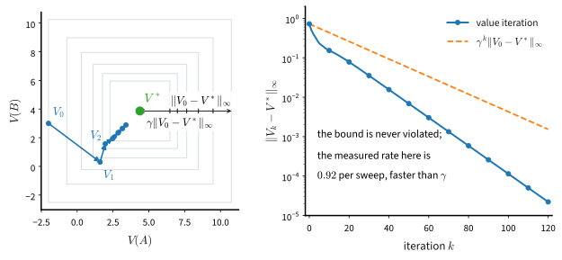

# Dynamic Programming
:label:`sec_valueiter`

When the MDP is known, that is, when we have the transition kernel and the
reward of :numref:`sec_mdp`, the best way to act can be computed rather than
learned. The method is *dynamic programming* :cite:`BellmanDPBook`. It rests
on one observation: the value of a state can be written in terms of the
immediate reward and the values of the states that may follow it. In this
section we define the value functions of a policy, derive the Bellman
equations that they satisfy, and prove that the simplest algorithm built on
these equations, value iteration, converges. We then add policy evaluation and
policy iteration and apply all three to FrozenLake, first on calm ice, where
every number can be checked by hand, and then on slippery ice, where the
optimal way to act is no longer the shortest path to the goal.

```{.python .input #value-iter-dynamic-programming}
%%tab pytorch
import math
import numpy as np
import torch
from torch import nn
from torch.nn import functional as F
from d2l import torch as d2l
```

```{.python .input #value-iter-dynamic-programming}
%%tab jax
import math
import numpy as np
import jax
from jax import numpy as jnp
from flax import nnx
import optax
from d2l import jax as d2l
```

```{.python .input #value-iter-dynamic-programming-1}
%%tab pytorch, jax
import gymnasium as gym
```

## Policies and Value Functions

We first make precise what it means for one way of acting to be better than
another.

### Policies

A *stochastic policy* $\pi(a \mid s)$, or policy for short, is a conditional
distribution over the actions $a \in \mathcal{A}$ given the state
$s \in \mathcal{S}$. For example, at some cell of the lake a policy might choose
*left*, *down*, *right*, and *up* with probabilities
$(0.4, 0.2, 0.1, 0.3)$. A *deterministic* policy puts all its probability on
one action at each state, and we then write $\pi(s)$ for that action. An agent
that follows a policy samples $a_t \sim \pi(\cdot \mid s_t)$ at every step.

### State Values and Action Values

Following a fixed policy from a state $s$ still produces different
trajectories on different runs, because the actions and the transitions are
random. We therefore score a policy by its expected return. The *value
function* of $\pi$ is

$$V^\pi(s) = \mathbb{E}\Big[ \sum_{t=0}^\infty \gamma^t r_t \;\Big|\; s_0 = s \Big],$$

where the expectation is over trajectories generated by
$a_t \sim \pi(\cdot \mid s_t)$ and $s_{t+1} \sim P(\cdot \mid s_t, a_t)$. It
assigns a number to every state. On calm ice, for example, a deterministic
policy that follows the six-move shortest path of :numref:`fig_rl_gridworld`
produces the same trajectory on every run from state $0$, so $V^\pi(0)$ is the
return of that trajectory, $\gamma^5 \approx 0.77$ at $\gamma = 0.95$
(:numref:`sec_mdp`). The *action-value function* fixes the first action and
follows the policy afterwards:

$$Q^\pi(s, a) = \mathbb{E}\Big[ \sum_{t=0}^\infty \gamma^t r_t \;\Big|\; s_0 = s,\ a_0 = a \Big].$$

The two are related in both directions. Averaging over the first action gives
the value, and separating the first step gives the action value:

$$V^\pi(s) = \sum_{a} \pi(a \mid s)\, Q^\pi(s, a), \qquad Q^\pi(s, a) = r(s, a) + \gamma \sum_{s'} P(s' \mid s, a)\, V^\pi(s').$$

The first relation holds because the first action is drawn from
$\pi(\cdot \mid s)$. The second holds because the first step earns $r(s, a)$
in expectation and leads to $s'$ with probability $P(s' \mid s, a)$. From $s'$
on, the agent follows $\pi$, and by the Markov property its expected return
from there is $V^\pi(s')$, which is discounted by $\gamma$ because it starts
one step later.

### The Advantage

The *advantage* of an action measures how much better it is than the policy's
average at the same state:

$$A^\pi(s, a) = Q^\pi(s, a) - V^\pi(s), \qquad \sum_a \pi(a \mid s)\, A^\pi(s, a) = 0.$$
:eqlabel:`eq_advantage`

The zero-mean identity follows from the first relation above, since the
probabilities $\pi(a \mid s)$ sum to one:
$\sum_a \pi(a \mid s)\, A^\pi(s, a) = \sum_a \pi(a \mid s)\, Q^\pi(s, a) - V^\pi(s) = 0$.
An action with positive advantage does better than the policy does on
average, and the policy-gradient methods of :numref:`sec_baselines` and later
sections increase the probability of such actions.

## The Bellman Equations

The expected returns above are sums over infinitely long trajectories. The
Markov property turns them into equations that relate the values of
neighboring states.

### The Expectation Equations

Split a trajectory that starts at $s$ after its first transition. The first
part consists of the action $a_0$, the reward $r_0$, and the next state $s_1$.
By the Markov property, the expected return of the remainder depends on the
past only through $s_1$, and it equals $V^\pi(s_1)$. The value at $s$ is
therefore the expected immediate reward plus the discounted expected value of
the next state:

$$V^\pi(s) = \sum_{a} \pi(a \mid s) \Big[ r(s, a) + \gamma \sum_{s'} P(s' \mid s, a)\, V^\pi(s') \Big] \quad \textrm{for all } s \in \mathcal{S}.$$
:eqlabel:`eq_dynamic_programming_val`

Conditioning also on the first action gives the corresponding equation for the
action value:

$$Q^\pi(s, a) = r(s, a) + \gamma \sum_{s'} P(s' \mid s, a) \sum_{a'} \pi(a' \mid s')\, Q^\pi(s', a') \quad \textrm{for all } s \in \mathcal{S},\ a \in \mathcal{A}.$$
:eqlabel:`eq_dynamic_programming_q`

These are the *Bellman expectation equations*. For a fixed policy,
:eqref:`eq_dynamic_programming_val` is a system of $|\mathcal{S}|$ linear
equations in the $|\mathcal{S}|$ unknowns $V^\pi(s)$.

### The Optimality Equation

The *optimal value function* $V^*(s)$ is the largest value $V^\pi(s)$ that any
policy achieves at $s$, and a policy is *optimal* if it achieves $V^*(s)$ at
every state simultaneously. For a finite MDP with $\gamma < 1$, an optimal
policy exists and can be chosen deterministic and independent of time
:cite:`Puterman.1994`. Its value function satisfies the *Bellman optimality
equation* :cite:`BellmanDPPaper,BellmanDPBook`

$$V^*(s) = \max_{a} \Big[ r(s, a) + \gamma \sum_{s'} P(s' \mid s, a)\, V^*(s') \Big] \quad \textrm{for all } s \in \mathcal{S},$$
:eqlabel:`eq_bellman_optimality`

and an optimal action at $s$ is one that attains the maximum:

$$\pi^*(s) = \underset{a}{\mathrm{argmax}} \Big[ r(s, a) + \gamma \sum_{s'} P(s' \mid s, a)\, V^*(s') \Big].$$
:eqlabel:`eq_optimal_policy`

Unlike the expectation equations, :eqref:`eq_bellman_optimality` mentions no
policy, and the maximum makes it nonlinear. We show below that it has
exactly one solution and that acting greedily with respect to this solution, as
in :eqref:`eq_optimal_policy`, is optimal.

The *optimal action-value function* $Q^*$ is the action-value function of an
optimal policy. By the second relation between $V^\pi$ and $Q^\pi$ above,
$Q^*(s, a)$ equals the bracket in :eqref:`eq_bellman_optimality`, so
$V^*(s) = \max_a Q^*(s, a)$. Substituting this maximum for $V^*(s')$ in the
bracket gives the optimality equation in terms of action values,

$$Q^*(s, a) = r(s, a) + \gamma \sum_{s'} P(s' \mid s, a) \max_{a'} Q^*(s', a'),$$
:eqlabel:`eq_bellman_optimality_q`

and the greedy action is $\mathrm{argmax}_a Q^*(s, a)$. Choosing it requires
no model: it compares the numbers $Q^*(s, a)$ of the actions at $s$, whereas
:eqref:`eq_optimal_policy` needs $r$ and $P$ to look one step ahead.
:numref:`sec_qlearning` will exploit this.

### Backup Diagrams

Each of these equations computes the value of a state, or of a state-action
pair, from the values one step later. Such updates are called *backups*, and
:numref:`fig_rl_backups` draws them. Its panels (a), (b), and (c) correspond
to :eqref:`eq_dynamic_programming_val`, :eqref:`eq_dynamic_programming_q`,
and :eqref:`eq_bellman_optimality`.

![Backup diagrams. Open circles are states and filled dots are state-action pairs; each diagram shows how the value at the root is computed from the values one step below it. (a) The value function averages over the policy's actions and the environment's next states. (b) The action-value function fixes the first action and averages afterwards. (c) The optimality equation replaces the average over actions by a maximum, drawn as an arc. (d) A sampled backup, used from :numref:`sec_qlearning` on, replaces the average over next states by the single observed transition, drawn in blue.](../img/mdl-rl-backups.svg)
:label:`fig_rl_backups`

## Value Iteration

The optimality equation defines $V^*$ implicitly. Value iteration computes it
by applying the right-hand side over and over.

### The Bellman Operator Is a Contraction

Read :eqref:`eq_bellman_optimality` as a map. The *Bellman optimality operator*
$T$ takes any table $V: \mathcal{S} \to \mathbb{R}$ to the table

$$(TV)(s) = \max_{a} \Big[ r(s, a) + \gamma \sum_{s'} P(s' \mid s, a)\, V(s') \Big],$$

so that the optimality equation states $V^* = TV^*$: the optimal value
function is a *fixed point* of $T$. We measure the distance between two tables
by the largest disagreement at any state,
$\|V - V'\|_\infty = \max_s |V(s) - V'(s)|$. Applying $T$ to two tables
brings them closer together: both receive the same rewards, so for each
action the brackets differ only by $\gamma$ times an average of
$V(s') - V'(s')$ over the next states.

**Proposition (contraction).** *For any two tables $V$ and $V'$,
$\|TV - TV'\|_\infty \leq \gamma\, \|V - V'\|_\infty$.*

**Proof.** Fix $s$, and write $f(a)$ and $g(a)$ for the bracketed terms in
$(TV)(s)$ and $(TV')(s)$. For every $a$,
$|f(a) - g(a)| = \gamma\, \big|\sum_{s'} P(s' \mid s, a)\big(V(s') - V'(s')\big)\big| \leq \gamma\, \|V - V'\|_\infty$,
because the probabilities are nonnegative and sum to one. The difference of
two maxima is at most the largest difference of their arguments,
$|\max_a f(a) - \max_a g(a)| \leq \max_a |f(a) - g(a)|$: if $a^*$ maximizes
$f$, then $\max_a f(a) - \max_a g(a) \leq f(a^*) - g(a^*)$, and the same
argument with $f$ and $g$ exchanged bounds the difference from below. Hence
$|(TV)(s) - (TV')(s)| \leq \gamma\, \|V - V'\|_\infty$ for every $s$.
$\blacksquare$

The same proof applies to the operator $T^\pi$ of a fixed policy, which
replaces the maximum by the average over $\pi(a \mid s)$ and whose fixed point
is $V^\pi$ by :eqref:`eq_dynamic_programming_val`. Both operators are also
*monotone*: if $V(s) \leq V'(s)$ at every state, then $TV \leq TV'$ and
$T^\pi V \leq T^\pi V'$, because the probabilities are nonnegative.

### Consequences

Since $\gamma < 1$, the contraction has three consequences
:cite:`Puterman.1994,Bertsekas.2025`. First, $T$ has at most one fixed point:
if $V = TV$ and $V' = TV'$, then
$\|V - V'\|_\infty \leq \gamma\, \|V - V'\|_\infty$, which forces $V = V'$.
Second, starting from any table $V_0$, the iterates $V_{k+1} = TV_k$ converge
to the fixed point at a geometric rate:

$$\|V_k - V^*\|_\infty = \|TV_{k-1} - TV^*\|_\infty \leq \gamma\, \|V_{k-1} - V^*\|_\infty \leq \cdots \leq \gamma^k\, \|V_0 - V^*\|_\infty.$$

(That a fixed point exists at all is Banach's fixed-point theorem: the
iterates form a Cauchy sequence.) Third, the change between two consecutive
iterates bounds the remaining error,
$\|V_k - V^*\|_\infty \leq \frac{\gamma}{1 - \gamma}\, \|V_k - V_{k-1}\|_\infty$,
which gives a stopping rule that can be checked during the computation.
:numref:`fig_rl_contraction` illustrates the geometric convergence.


:label:`fig_rl_contraction`

The contraction also confirms that greedy action selection is optimal.

**Proposition (greedy policies are optimal).** *Let $\gamma < 1$, let $V^*$ be
the fixed point of $T$, and let $\pi$ be a deterministic policy that is greedy
with respect to $V^*$, as in :eqref:`eq_optimal_policy`. Then $V^\pi = V^*$,
and $V^{\pi'}(s) \leq V^*(s)$ at every state for every policy $\pi'$ that
depends only on the current state.*

**Proof.** Greediness means $T^\pi V^* = TV^* = V^*$, so $V^*$ is the fixed
point of $T^\pi$, which is $V^\pi$. For any other policy $\pi'$, an average over
actions is at most their maximum, so $T^{\pi'} V^* \leq TV^* = V^*$. Applying
the monotone operator $T^{\pi'}$ repeatedly gives
$(T^{\pi'})^k V^* \leq V^*$ for every $k$, and the left-hand side converges to
the fixed point $V^{\pi'}$ of $T^{\pi'}$. $\blacksquare$

Policies that depend on the whole history cannot do better either, but that
proof requires more machinery :cite:`Puterman.1994`. The second consequence
and the proposition justify the following algorithm: its iterates converge to
$V^*$, and acting greedily with respect to $V^*$ is optimal. The third
consequence gives a rule for stopping it.

### Value Iteration on Calm Ice

*Value iteration* starts from a table $V_0$, which we set to zero, and
repeats the sweep

$$V_{k+1}(s) = \max_{a} \Big[ r(s, a) + \gamma \sum_{s'} P(s' \mid s, a)\, V_k(s') \Big] \quad \textrm{for all } s \in \mathcal{S},$$
:eqlabel:`eq_value_iteration`

that is, $V_{k+1} = TV_k$. In code, the sweep is a single line, because the
method `backup` of :numref:`sec_mdp` computes the bracket for every
state-action pair at once:

```{.python .input #value-iter-value-iteration-1}
%%tab pytorch, jax
def value_iteration(mdp, num_iters):  #@save
    """Sweep V <- max_a backup(V); return the whole history of iterates."""
    V, history = np.zeros(mdp.num_states), []
    for _ in range(num_iters):
        V = mdp.backup(V).max(axis=1)
        history.append(V)
    return np.array(history)
```

We first run it on calm ice, where every transition is deterministic, and
print the estimate at the start state after each sweep:

```{.python .input #value-iter-three-algorithms}
%%tab pytorch, jax
gamma = 0.95
calm = d2l.TabularMDP.from_gym(
    gym.make('FrozenLake-v1', is_slippery=False), gamma)
history = value_iteration(calm, num_iters=10)
print('V_k(s0) for k = 1, ..., 10:', np.round(history[:, 0], 4))
```

The estimate stays at zero for five sweeps and equals $\gamma^5 \approx 0.774$
from the sixth sweep on. :numref:`fig_rl_value_wavefront` shows why. In the
first sweep, $V_0 = 0$ reduces the bracket of :eqref:`eq_value_iteration` to
$r(s, a)$, so $V_1(s) = \max_a r(s, a)$. This is $1$ at state $14$, by the
move *right* into the goal, and $0$ at every other state. In the second
sweep, states $10$ and $13$, one move from state $14$, receive
$0 + \gamma \cdot 1 = 0.95$. On calm ice, a move toward the goal along a
shortest path loses only the factor $\gamma$, so
$V^*(s) = \gamma^{d(s) - 1}$ at every frozen cell $s$, where $d(s)$ is the
smallest number of moves that take the agent from $s$ into the goal. Such a
route cannot pass through a hole, which would end the episode. From state
$3$, for example, the route straight down enters the hole at state $7$, and
the shortest route, through states $2$, $6$, $10$, and $14$, takes
$d(3) = 5$ moves. Sweep $k$ makes the value correct at exactly the frozen
cells with $d(s) \leq k$. The start state is six moves from the goal and is
reached at the sixth sweep. Here the convergence is finite because the
transitions are deterministic, the only reward comes on entering the goal,
and $V_0 = 0$ is already correct at the terminal states; in general, the
convergence is only geometric, as on slippery ice below.


:label:`fig_rl_value_wavefront`

Following the greedy actions of :eqref:`eq_optimal_policy` from the start
state leads to the goal along a shortest path:

```{.python .input #value-iter-value-iteration-2}
%%tab pytorch, jax
V_calm = history[-1]
pi_calm = calm.backup(V_calm).argmax(axis=1)
s, path = 0, [0]
while s != 15:
    s = int(calm.P[s, pi_calm[s]].argmax())  # the unique next state
    path.append(s)
print('greedy path:', path)
```

Several shortest paths exist, for example through state $1$ or through state
$4$, and their first actions have equal values. `argmax` breaks such ties by
taking the first maximizing action, and any of the tied choices is optimal.

## Policy Evaluation and Policy Iteration

Value iteration computes the optimal values directly. Two related algorithms
evaluate a given policy and improve it step by step.

### Policy Evaluation

Replacing the maximum in :eqref:`eq_value_iteration` by the average under a
fixed policy $\pi$ gives the iteration $V_{k+1} = T^\pi V_k$, or

$$V_{k+1}(s) = \sum_{a} \pi(a \mid s) \Big[ r(s, a) + \gamma \sum_{s'} P(s' \mid s, a)\, V_k(s') \Big] \quad \textrm{for all } s \in \mathcal{S}.$$
:eqlabel:`eq_policy_eval`

This is *policy evaluation*. It converges to $V^\pi$ from any initial table,
because $T^\pi$ is a contraction. Since the equations are linear, they could
also be solved directly; the iteration has the advantage that it needs only
the backup. On FrozenLake it also works at $\gamma = 1$, where the linear
system is singular because every terminal state leads back to itself
(:numref:`sec_mdp`): at $\gamma = 1$, the equation of a terminal state $s$
reads $V(s) = V(s)$, which every number satisfies. Starting from $V_0 = 0$,
$k$ sweeps compute the expected discounted sum of the first $k$ rewards. At
$\gamma = 1$, the $k$-th sweep therefore gives the probability of entering
the goal within $k$ steps, since the only reward is the $1$ for entering the
goal, which no trajectory collects twice. As $k$ grows, these probabilities
increase to the probability of ever reaching the goal. We compute this
probability and the discounted value for the uniformly random policy:

```{.python .input #value-iter-policy-evaluation}
%%tab pytorch, jax
def policy_evaluation(mdp, pi, num_iters):  #@save
    """Same sweep with the max replaced by an average under pi(a|s)."""
    V, history = np.zeros(mdp.num_states), []
    for _ in range(num_iters):
        V = (pi * mdp.backup(V)).sum(axis=1)
        history.append(V)
    return np.array(history)

uniform = np.full((calm.num_states, calm.num_actions), 1 / calm.num_actions)
V_uniform = policy_evaluation(calm, uniform, 500)[-1]
calm_undiscounted = d2l.TabularMDP(calm.P, calm.r, gamma=1.0)
success = policy_evaluation(calm_undiscounted, uniform, 500)[-1][0]
print(f'V(s0): uniform policy {V_uniform[0]:.4f}, optimal {V_calm[0]:.4f}')
print(f'P(reach goal): uniform policy {success:.3f}')
```

The uniformly random policy reaches the goal with probability about $0.014$
and otherwise falls into a hole, so its value at the start state is small
compared with the optimal value. This value, about $0.008$, is also smaller
than the probability of reaching the goal, because a successful episode of
$k$ moves has return $\gamma^{k-1} \leq \gamma^5 \approx 0.77$
(:numref:`sec_mdp`).

### Policy Improvement and Policy Iteration

Evaluation followed by the greedy step :eqref:`eq_optimal_policy` gives a
second algorithm. To see why the greedy step helps, consider taking the
greedy action at $s$ once and following $\pi$ afterwards. The expected return
of doing so is $\max_a Q^\pi(s, a)$, which is at least the average
$V^\pi(s) = \sum_a \pi(a \mid s)\, Q^\pi(s, a)$. The following proposition
shows that taking the greedy action at every step is also at least as good,
so the greedy step never makes a policy worse.

**Proposition (policy improvement).** *Let $\gamma < 1$, let $\pi$ be a
policy, and let $\pi'$ be greedy with respect to $V^\pi$:
$\pi'(s) = \mathrm{argmax}_a \big[ r(s, a) + \gamma \sum_{s'} P(s' \mid s, a)\, V^\pi(s') \big]$.
Then $V^{\pi'}(s) \geq V^\pi(s)$ at every state. If equality holds at every
state, then $V^\pi = V^*$.*

**Proof.** Greediness gives $T^{\pi'} V^\pi = TV^\pi \geq T^\pi V^\pi = V^\pi$.
Since $T^{\pi'}$ is monotone, applying it repeatedly gives
$V^\pi \leq T^{\pi'} V^\pi \leq (T^{\pi'})^2 V^\pi \leq \cdots$, and the
sequence converges to the fixed point $V^{\pi'}$. If $V^{\pi'} = V^\pi$, every
term of the second chain equals $V^\pi$, so $TV^\pi = T^{\pi'} V^\pi = V^\pi$,
and $V^\pi$ is the fixed point $V^*$ of $T$. $\blacksquare$

*Policy iteration* alternates the two steps: evaluate the current policy,
then replace it by the greedy policy with respect to its values. Each round
improves the policy unless it is already optimal, and a finite MDP has
finitely many deterministic policies, so policy iteration reaches an optimal
policy after finitely many rounds :cite:`Puterman.1994`. We stop when the
greedy step gains nothing at any state, that is, when $TV^\pi = V^\pi$, which
makes $V^\pi$ the fixed point $V^*$. Testing instead whether the greedy policy
has stopped changing may never terminate if the policy keeps switching
between equally good ones :cite:`Sutton.Barto.2018`, for example when rounding
errors in the evaluation break a tie between two actions differently in each
round. Slippery ice has an exact tie at state $6$ below, but there both
action values are computed from the same numbers, so `argmax` breaks it the
same way in every round. Our implementation evaluates each policy with $n$
sweeps from $V_0 = 0$. By the second consequence, applied to $T^\pi$, they
leave an error of at most
$\gamma^n \|V^\pi\|_\infty \leq \gamma^n \max_{s, a} |r(s, a)| / (1 - \gamma)$,
and, for $\gamma < 1$, by default $n$ is the smallest positive integer that
makes this bound at most half the tolerance `tol`. Once the policy is
optimal, $V^\pi = V^*$, and the gain $TV - V = (TV - TV^*) + (V^* - V)$ of
the evaluated table $V$ is at most $1 + \gamma$ times half of `tol`, which is
less than `tol`, so the test passes. If the test still fails after $100$
rounds, the function raises an error:

```{.python .input #value-iter-policy-iteration-and-generalized-policy-iteration-1}
%%tab pytorch, jax
def policy_iteration(mdp, num_eval_sweeps=None, tol=1e-9):
    """Alternate full evaluation and greedy improvement until no state gains."""
    if num_eval_sweeps is None:  # gamma^n max|r| / (1 - gamma) <= tol / 2
        bound, max_r = tol * (1 - mdp.gamma) / 2, np.abs(mdp.r).max()
        num_eval_sweeps = 1 if mdp.gamma * max_r <= bound else math.ceil(
            math.log(bound / max_r) / math.log(mdp.gamma))
    pi = np.full((mdp.num_states, mdp.num_actions), 1 / mdp.num_actions)
    for rounds in range(1, 101):
        V = policy_evaluation(mdp, pi, num_eval_sweeps)[-1]
        Q = mdp.backup(V)
        if (Q.max(axis=1) <= V + tol).all():  # the greedy step gains nothing
            return V, rounds
        pi = np.eye(mdp.num_actions)[Q.argmax(axis=1)]
    raise RuntimeError('no convergence; increase num_eval_sweeps')

V_pi, rounds = policy_iteration(calm)
print(f'{rounds} rounds; largest |V - V*| = {np.abs(V_pi - V_calm).max():.1e}')
```

Policy iteration stops after a few rounds with the same values as value
iteration, up to rounding. Two rounds means that the greedy policy with
respect to the values of the uniformly random policy is already optimal: the
second round evaluates it and finds that the greedy step gains nothing.

### Generalized Policy Iteration

Evaluation and improvement need not alternate in complete phases. Policy
iteration evaluates each policy fully before improving it, whereas value
iteration improves after every single sweep. *Generalized policy iteration*
refers to any interleaving of steps that move the values toward those of the
current policy with steps that move the policy toward the greedy policy
:cite:`Sutton.Barto.2018`. :numref:`fig_rl_gpi` places the methods of this
chapter in this scheme: Q-learning in :numref:`sec_qlearning` takes single
sampled steps, and the actor-critic methods of :numref:`sec_actorcritic` update
a value estimate and a policy together. In the figure, a horizontal step
changes only the value estimate, and a vertical step changes only the policy.


:label:`fig_rl_gpi`

## Slippery Ice

On calm ice the optimal policy follows a shortest path. On slippery ice, every
action can also move the agent sideways, and the best action at a cell must
weigh the risk of sliding into a hole. We run both algorithms on the slippery
model:

```{.python .input #value-iter-what-the-optimal-policy-looks-like-on-ice-1}
%%tab pytorch, jax
env = gym.make('FrozenLake-v1', is_slippery=True)
slippery = d2l.TabularMDP.from_gym(env, gamma)
V_star = value_iteration(slippery, num_iters=1000)[-1]
pi_star = slippery.backup(V_star).argmax(axis=1)
V_pi, rounds = policy_iteration(slippery)
print(f'V*(s0) = {V_star[0]:.4f}; policy iteration: {rounds} rounds, '
      f'largest |V - V*| = {np.abs(V_pi - V_star).max():.1e}')
d2l.show_grid(env.unwrapped.desc, V_star, pi_star)
```

The optimal value at the start state, about $0.18$, is far below its value
of about $0.77$ on calm ice, and the convergence is now geometric rather than
finite (:numref:`fig_rl_contraction`). The arrows show that several optimal
actions point away from the goal. To see what the slip-aware policy gains, we
evaluate it and the policy that is optimal on calm ice exactly on the
slippery model. As for the uniformly random policy, we compute the discounted
value at the start state and the probability of ever reaching the goal, which
ignores the time limit of $100$ steps at which Gymnasium truncates an episode
(:numref:`sec_mdp`):

```{.python .input #value-iter-what-the-optimal-policy-looks-like-on-ice-2}
%%tab pytorch, jax
undiscounted = d2l.TabularMDP(slippery.P, slippery.r, gamma=1.0)
for name, pi in [('optimal on slippery ice', pi_star),
                 ('optimal on calm ice', pi_calm)]:
    one_hot = np.eye(slippery.num_actions)[pi]
    value = policy_evaluation(slippery, one_hot, 1000)[-1][0]
    success = policy_evaluation(undiscounted, one_hot, 5000)[-1][0]
    print(f'{name}: V(s0) = {value:.4f}, P(reach goal) = {success:.3f}')
```

The calm-ice policy, run on slippery ice, rarely reaches the goal (with
probability below $0.05$), and the slip-aware policy reaches it far more
often (with probability about $0.78$). As for the uniformly random policy,
each value is smaller than the probability of reaching the goal. For the
slip-aware policy, the ratio of the two, about $0.23$, is the average return
of its successful episodes, because every other episode has return zero.
This is far below the return $\gamma^5 \approx 0.77$ of a six-move episode.
Since $\gamma^{k-1}$ is convex in $k$, Jensen's inequality
(:numref:`subsec_mdl-jensen`) bounds the average return from below by
$\gamma^{\bar{k}-1}$, where $\bar{k}$ is the average number of moves of a
successful episode, so $\bar{k}$ is far above six: the successful episodes
are, on average, much longer than the shortest path. The slip-aware policy
does not reach the goal more often by avoiding cells next to a hole, which no
route to the goal can do: both neighbors of the start, states $1$ and $4$,
border the hole at state $5$. It differs in the commands it issues at such
cells. We call the probability that a command
leads into a hole on the next step its *hole risk*, and print it at every
frozen cell for the command of each policy and for the safest command
available:

```{.python .input #value-iter-slippery-ice-1}
%%tab pytorch, jax
desc = env.unwrapped.desc.flatten()
risk = slippery.P[:, :, desc == b'H'].sum(axis=2)  # P(next state is a hole)
frozen = np.flatnonzero(np.isin(desc, [b'S', b'F']))
print(f'{"state":<11}' + ''.join(f'{s:>5}' for s in frozen))
for name, pi in [('slip-aware', pi_star), ('calm-ice', pi_calm)]:
    print(f'{name:<11}' + ''.join(f'{risk[s, pi[s]]:>5.2f}' for s in frozen))
print(f'{"least":<11}' + ''.join(f'{risk[s].min():>5.2f}' for s in frozen))
```

The header lists the frozen cells. The rows `slip-aware` and `calm-ice` give
the hole risk of the command that each policy issues at a cell, and the row
`least` gives the smallest hole risk of the four commands. The slip-aware
policy issues a command of least hole risk at every cell, and this risk is
zero everywhere except at state $6$. The calm-ice policy takes a
hole risk of $1/3$ at five cells, among them states $4$ and $8$ on its
calm-ice route, and of $2/3$ at state $6$. Consider state $8$, directly above
the hole at state $12$. The command *up* moves the agent to state $4$, against
the wall back to state $8$, or to state $9$, so no outcome is a hole, whereas
the commands *left*, *down*, and *right* each fall into the hole with
probability $1/3$. The optimal policy chooses *up* there, although it moves
away from the goal. At state $6$, between the holes at states $5$ and $7$,
every command risks a hole. *Left* and *right* each risk one of them with
probability $1/3$ and have exactly equal action values, because their other
two outcomes are the same states $2$ and $10$; `argmax` picks *left*. The
same reasoning, averaging over the three possible outcomes in
:eqref:`eq_optimal_policy`, explains the other arrows that point away from
the goal.

## Summary

The value function of a policy is its expected return from each state, and the
action-value function fixes the first action. The Bellman expectation
equations relate the values of neighboring states under a fixed policy, and
the Bellman optimality equation characterizes the optimal values. For
$\gamma < 1$ the Bellman operator is a contraction, so the optimality equation
has a unique solution, value iteration converges to it at a geometric rate,
and acting greedily with respect to it is optimal. Policy evaluation computes
the values of a fixed policy, and policy iteration alternates evaluation with
greedy improvement, which never makes a policy worse. On calm FrozenLake the
optimal policy follows a shortest path; on slippery ice it issues at every
cell a command with the least risk of sliding into a hole, even when that
command points away from the goal. All of these methods need the transition
kernel and the reward. The next section removes this requirement.

## Exercises

1. [code] **The cost of a sweep.** Give the cost of one sweep of
   :eqref:`eq_value_iteration` in terms of the number of states, the number of
   actions, and the number of possible next states of each state-action pair.
   Which of these costs does the dense `mdp.backup` of :numref:`sec_mdp`
   incur? Use the geometric bound to show that, starting from $V_0 = 0$,
   $O\big(\log\big(r_{\max} / ((1 - \gamma)\varepsilon)\big) / \log(1/\gamma)\big)$
   sweeps suffice for an accuracy of $\varepsilon$, where $r_{\max}$ bounds
   the rewards as in :numref:`sec_mdp`. Then time value iteration on the
   $4 \times 4$ map and on the $8 \times 8$ map created by
   `gym.make('FrozenLake-v1', map_name='8x8', is_slippery=True)`.
1. **The stopping rule.** Derive
   $\|V_k - V^*\|_\infty \leq \frac{\gamma}{1 - \gamma}\, \|V_k - V_{k-1}\|_\infty$
   from the contraction by summing the changes of all later sweeps. How small
   must the change between two sweeps be to guarantee an error below
   $\varepsilon$? Then repeat the proof of the contraction with $\gamma = 1$
   and identify the step that no longer gives a contraction.
1. [code] **The discount on calm ice.** Predict $V^*(s_0)$ on calm ice for
   $\gamma \in \{0.5, 0.9, 0.99\}$ and run value iteration to check. Explain
   why the greedy path has the same length for all three discount factors.
   What happens at $\gamma = 0$, and which actions are then greedy at states
   other than state $14$?
1. **When $\gamma$ equals one.** The contraction requires $\gamma < 1$, yet
   value iteration with $\gamma = 1$ converges on FrozenLake.
    1. Show that, starting from $V_0 = 0$, the iterates $V_k(s)$ are
       nondecreasing in $k$ and bounded by one, and that $V_k(s)$ is the
       largest probability of entering the goal from $s$ within $k$ steps.
    1. Construct an MDP with two states and a single action on which the
       iterates grow without bound at $\gamma = 1$.
1. [code] **Counting backups.** Policy iteration needs few rounds, but every
   round evaluates a policy with many sweeps. Count the backups that value
   iteration and policy iteration each need to reach an error below $10^{-6}$
   on slippery ice, for $\gamma \in \{0.9, 0.95, 0.99\}$. How does the
   comparison change if each evaluation starts from the values of the
   previous round and stops after ten sweeps?

[Discussions](https://d2l.discourse.group/t/36795)

<!-- slides -->

::: {.slide}
::: {.cover}
[Dive into Deep Learning · §14.2]{.kicker}

Dynamic programming<br>
**value functions · the Bellman equations · a contraction · value and policy iteration · slippery ice**
:::
:::

::: {.slide title="Scoring a Policy"}
$$V^\pi(s) = \mathbb{E}\Big[ \sum_{t} \gamma^t r_t \;\Big|\; s_0 = s \Big], \qquad
Q^\pi(s, a) = \mathbb{E}\Big[ \sum_{t} \gamma^t r_t \;\Big|\; s_0 = s,\, a_0 = a \Big]$$

$$V^\pi(s) = \sum_a \pi(a \mid s)\, Q^\pi(s, a), \qquad
A^\pi(s, a) = Q^\pi(s, a) - V^\pi(s)$$

The advantage has mean zero under the policy.
:::

::: {.slide title="The Bellman Equations"}
Expectation (a fixed policy, linear):

$$V^\pi(s) = \sum_{a} \pi(a \mid s) \Big[ r(s, a) + \gamma \sum_{s'} P(s' \mid s, a)\, V^\pi(s') \Big]$$

Optimality (no policy, nonlinear):

$$V^*(s) = \max_{a} \Big[ r(s, a) + \gamma \sum_{s'} P(s' \mid s, a)\, V^*(s') \Big]$$
:::

::: {.slide title="A Contraction"}
$$\|TV - TV'\|_\infty \leq \gamma\, \|V - V'\|_\infty$$

- one fixed point, $V^*$;
- $\|V_k - V^*\|_\infty \leq \gamma^k \|V_0 - V^*\|_\infty$;
- greedy with respect to $V^*$ is optimal.

{width=80%}
:::

::: {.slide title="Value Iteration on Calm Ice"}
@value-iter-value-iteration-1

@value-iter-three-algorithms

. . .

{width=70%}
:::

::: {.slide title="Evaluate, Then Improve"}
- Policy evaluation: $V_{k+1} = T^\pi V_k \to V^\pi$.
- Policy improvement: greedy with respect to $V^\pi$ is at least as good.
- Policy iteration: alternate the two; finitely many rounds.

@value-iter-policy-iteration-and-generalized-policy-iteration-1
:::

::: {.slide title="Slippery Ice: Optimal Is Not Shortest"}
@value-iter-what-the-optimal-policy-looks-like-on-ice-2

. . .

At every cell the slip-aware policy takes the least risk of sliding into a
hole. At state $8$, *up* cannot reach the hole below; *left*, *down*, and
*right* each can, with probability $1/3$.
:::
