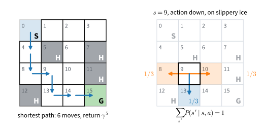
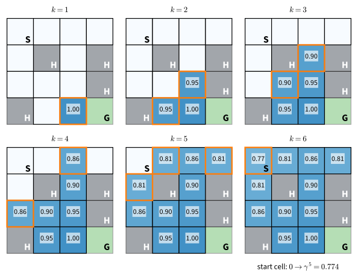
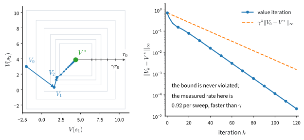
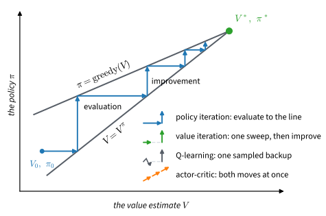

# Dynamic Programming
:label:`sec_valueiter`

The previous section wrote the frozen lake down as two arrays and a discount, and left a question open. In cell 9, *down* is the only command that cannot slide the agent into the hole next to it, but it slides the agent sideways two times in three. Is that safety worth the lost moves? On calm ice there would be nothing to decide: the shortest path to the goal takes six moves, and following it is best. On slippery ice the shortest path runs past the holes, and a command that gains a cell can, on a slip, end the episode. Which command is best cannot be read off the next cell. It depends on how much reward the agent can still expect from every cell it may land in, if it keeps acting well from there.

Richard Bellman studied such multistage decisions in the 1950s and found that this score, the *value* of a state, satisfies a local equation :cite:`BellmanDPBook`. The value of a cell is the reward of one move plus the discounted value of the cell that the move leads to, averaged over the slips. Values are defined by the whole future, yet each one is tied only to the values of its neighbors, so all of them can be computed together by repeating a one-step look-ahead. Bellman called the method *dynamic programming*. Its answers are the exact ones that the learning methods of later sections try to approach, and on a small problem they let us check those methods.

This section defines values for a fixed policy and for the best one, derives Bellman's equations, and shows that repeating the look-ahead converges, with a rule that says when to stop. On the slippery lake the policy it finds reaches the goal about sixteen times as often as the shortest path, and in four cells it walks away from the goal; we compute why. At the end we return to the approach bonus of the previous section and compute what it does to the best policy. Everything here reads the known transition table $P$.

```{.python .input #value-iter-dynamic-programming}
%%tab pytorch
import math
import numpy as np
import torch
from torch import nn
from torch.nn import functional as F
from d2l import torch as d2l
```

```{.python .input #value-iter-dynamic-programming}
%%tab jax
import math
import numpy as np
import jax
from jax import numpy as jnp
from flax import nnx
import optax
from d2l import jax as d2l
```

```{.python .input #value-iter-dynamic-programming-1}
%%tab pytorch, jax
import gymnasium as gym
```

## Values and the Bellman Equations

### Policies and Values

:numref:`sec_mdp` called any rule for choosing actions a policy. In general a *policy* $\pi(a \mid s)$ is a conditional distribution over the actions $a \in \mathcal{A}$ given the state $s \in \mathcal{S}$: at some cell of the lake the probabilities of *left*, *down*, *right* and *up* might be $(0.4, 0.2, 0.1, 0.3)$. We write $\pi(\cdot \mid s)$ for the whole distribution at $s$. A *deterministic* policy puts all its probability on one action, which we write $\pi(s)$.

Fix a policy. An agent that starts from $s_0$ draws $a_t \sim \pi(\cdot \mid s_t)$, moves to $s_{t+1} \sim P(\cdot \mid s_t, a_t)$, and collects the discounted return $\sum_t \gamma^t r(s_t, a_t)$ of :numref:`sec_mdp`. Different runs give different trajectories, so we score the start state by the average return,

$$V^\pi(s_0) = \mathbb{E}_{a_t \sim \pi(\cdot \mid s_t),\ s_{t+1} \sim P(\cdot \mid s_t, a_t)} \Big[ \sum_{t=0}^\infty \gamma^t r(s_t, a_t) \Big].$$

This is the *value function* of $\pi$. The start state is arbitrary, so $V^\pi$ assigns a number to every state: the reward an agent that follows $\pi$ from there can expect to collect. On the lake the only reward is the one for entering the goal, so $V^\pi(s)$ is the probability of reaching the goal from $s$, with each success weighted by $\gamma^t$ for the step $t$ on which it enters the goal.

The question at cell 9 compares commands, while $V^\pi$ averages over them. The *action value* pins the first action and follows the policy afterwards:

$$Q^\pi(s_0, a_0) = r(s_0, a_0) + \mathbb{E}_{a_t \sim \pi(\cdot \mid s_t),\ s_{t+1} \sim P(\cdot \mid s_t, a_t)} \Big[ \sum_{t=1}^\infty \gamma^t r(s_t, a_t) \Big].$$

The sum starts at $t = 1$ because the first reward is fixed by $a_0$: take the given action for one step, then follow the policy forever. Averaging the action value over the policy's own first action gives back the value,

$$V^\pi(s) = \sum_{a \in \mathcal{A}} \pi(a \mid s)\, Q^\pi(s, a) \quad \textrm{for all } s \in \mathcal{S}.$$

Thus $V^\pi(s)$ is a weighted average of the numbers $Q^\pi(s, \cdot)$ and never exceeds the largest of them: $\max_a Q^\pi(s, a) \geq V^\pi(s)$, with equality only if the policy puts all its probability on actions that attain the maximum. Every improvement step in this section starts from this inequality.

### The Expectation Form

The values are defined by infinite sums, but the Markov property ties each one to its neighbors. Split a trajectory after its first transition. The first part contains the action $a_0$, the reward $r(s_0, a_0)$ and the next state $s_1$; the rest is a trajectory that starts at $s_1$. By the Markov property the expected return of the rest depends on the past only through $s_1$, and it equals $V^\pi(s_1)$. The value at $s_0$ is therefore the expected immediate reward plus the discounted expected value of the next state:

$$V^\pi(s_0) = \mathbb{E}_{a_0 \sim \pi(\cdot \mid s_0)} \Big[ r(s_0, a_0) + \gamma\ \mathbb{E}_{s_1 \sim P(\cdot \mid s_0, a_0)} \Big[ V^\pi(s_1) \Big] \Big].$$
:eqlabel:`eq_dynamic_programming`

The outer expectation averages over the policy's choice of $a_0$; the inner one averages over the environment's next state $s_1$ given that action. For finite state and action spaces, the expectations are sums:

$$V^\pi(s) = \sum_{a \in \mathcal{A}} \pi(a \mid s) \Big[ r(s, a) + \gamma\ \sum_{s' \in \mathcal{S}} P(s' \mid s, a) V^\pi(s') \Big];\ \textrm{for all } s \in \mathcal{S}.$$
:eqlabel:`eq_dynamic_programming_val`

Conditioning also on the first action gives the corresponding equation for the action value:

$$Q^\pi(s, a) = r(s, a) + \gamma \sum_{s' \in \mathcal{S}} P(s' \mid s, a) \sum_{a' \in \mathcal{A}} \pi(a' \mid s')\ Q^\pi(s', a');\ \textrm{ for all } s \in \mathcal{S}, a \in \mathcal{A}.$$
:eqlabel:`eq_dynamic_programming_q`

These are the *Bellman expectation equations*. For a fixed policy, :eqref:`eq_dynamic_programming_val` is a system of $|\mathcal{S}|$ linear equations in the $|\mathcal{S}|$ unknowns $V^\pi(s)$: the infinite horizon has disappeared into the recursion.

One cell of the lake shows what kind of system this is. Take a policy that commands *down* in cell 14, next to the goal. *Down* runs into the bottom wall and leaves the agent in cell 14, and the two slips carry it left to cell 13 or right into the goal, which pays one. Each outcome has probability $1/3$, and the goal, a terminal state, has value zero, so :eqref:`eq_dynamic_programming_val` at cell 14 reads

$$V^\pi(14) = \frac{1}{3} + \frac{\gamma}{3} \big[ V^\pi(13) + V^\pi(14) \big].$$

The unknown $V^\pi(14)$ appears on both sides, because a slip can leave the agent where it was, and $V^\pi(13)$ depends in turn on its own neighbors, cell 14 among them. In a game tree the values could be filled in from the leaves back to the root, one at a time. The slippery lake has loops, and its equations must be solved together: as one linear system, or by starting from a guess and applying the right-hand side over and over. Both ways appear below.

Every right-hand side above evaluates the same bracket for one state-action pair: the immediate reward plus the discounted expected value of the next state. This one-step look-ahead is called a *backup*, because it carries values back from the successors to the state. On the arrays of `TabularMDP` from :numref:`sec_mdp`, the backups of all state-action pairs are one matrix product, which contracts the last axis of `P[s, a, s']` against a value vector `V`. We add it to the class as the method `backup`, which returns the array of brackets indexed by $(s, a)$:

```{.python .input #value-iter-the-expectation-form}
%%tab pytorch, jax
@d2l.add_to_class(d2l.TabularMDP)  #@save
def backup(self, V):
    """Q(s, a) = r(s, a) + gamma * sum_{s'} P(s'|s, a) V(s') for every
    state-action pair: the bracket of the Bellman equations."""
    return self.r + self.gamma * self.P @ V
```

### The Optimality Equation
:label:`subsec_vi_optimality`

An *optimal* policy maximizes the value. In principle the best policy could depend on the start state, look at the whole history of the episode, or randomize. For a discounted finite MDP none of this is needed, as :numref:`sec_mdp` stated:

**Proposition (a uniformly optimal policy exists).** *In a finite MDP with discount $0 \leq \gamma < 1$ there is a deterministic, stationary policy $\pi^*$ that is optimal at every state simultaneously: $V^{\pi^*}(s) \geq V^\pi(s)$ for all $s \in \mathcal{S}$ and all policies $\pi$, including stochastic policies and policies that depend on the history* :cite:`Puterman.1994`.

The value of a policy that depends on the history is defined by the same expected return. We write $V^* \equiv V^{\pi^*}$ and $Q^* \equiv Q^{\pi^*}$, and ask which equation $V^*$ satisfies. Two comparisons give the answer. First, the expectation equation of $\pi^*$ says that $V^*(s)$ equals the bracket $r(s, a) + \gamma \sum_{s'} P(s' \mid s, a) V^*(s')$ of the action $a = \pi^*(s)$, so $V^*(s)$ cannot exceed the largest bracket. Second, a policy that takes some action $a$ at $s$ once and follows $\pi^*$ afterwards has value equal to the bracket of $a$; by the proposition no policy beats $\pi^*$, so no bracket exceeds $V^*(s)$. Together, the two comparisons say that $V^*(s)$ is the largest bracket:

$$V^*(s) = \max_{a \in \mathcal{A}} \Big[ r(s, a) + \gamma\ \sum_{s' \in \mathcal{S}} P(s' \mid s, a)\ V^*(s') \Big];\ \textrm{for all } s \in \mathcal{S}.$$
:eqlabel:`eq_bellman_optimality`

This is the *Bellman optimality equation* :cite:`BellmanDPPaper,BellmanDPBook`. In words, the value of a state under optimal play is the value of the best first move followed by optimal play from wherever that move leads. Unlike the expectation form, the equation mentions no policy: it is an equation in the unknown table $V^*$, and it is nonlinear because of the maximum. The first comparison also shows that the action $\pi^*(s)$ attains the maximum. Given $V^*$, an optimal action is therefore found by one look-ahead with the model:

$$\pi^*(s) = \underset{a \in \mathcal{A}}{\mathrm{argmax}} \Big[ r(s, a) + \gamma \sum_{s' \in \mathcal{S}} P(s' \mid s, a)\ V^*(s') \Big].$$
:eqlabel:`eq_optimal_policy`

The action-value version of :eqref:`eq_bellman_optimality` follows by inserting $V^*(s') = \max_{a'} Q^*(s', a')$ into the bracket:

$$Q^*(s, a) = r(s, a) + \gamma \sum_{s' \in \mathcal{S}} P(s' \mid s, a) \max_{a' \in \mathcal{A}} Q^*(s', a').$$
:eqlabel:`eq_bellman_optimality_q`

The two forms differ in what extraction needs. From $Q^*$ the optimal action is $\pi^*(s) = \mathrm{argmax}_a Q^*(s, a)$, with no model, whereas extraction from $V^*$ through :eqref:`eq_optimal_policy` needs $P$ and $r$. The difference matters as soon as the model is unknown. When the model is known, the one-step look-ahead of :eqref:`eq_optimal_policy` can also be extended to many steps. Programs that play board games search many moves ahead, with the rules of the game as the model :cite:`Silver.Hubert.Schrittwieser.ea.2018` or with a model they learn :cite:`Schrittwieser.Antonoglou.Hubert.ea.2020`.

### Backup Diagrams

The four equations share one structure: the value at a root is assembled from the values one step below it. :numref:`fig_rl_backups` draws them side by side. The last diagram shows what a learner must do without the model: it cannot average over the environment's next states, so it uses the one transition it observed.

![Backup diagrams. Open circles are states, filled dots are state-action pairs, and each diagram shows how the value at the root is assembled from the values one step below it. Left to right: (a) the value function averages over the policy's actions and the environment's next states; (b) the action-value function fixes the first action and averages afterwards; (c) the optimality operator replaces the average over actions by a maximum, drawn as the arc; (d) a sampled backup cannot take the environment's average, so it uses the single observed transition, in blue, and keeps the maximum at the next state.](../img/mdl-rl-backups.svg)
:label:`fig_rl_backups`

## Value Iteration
:label:`subsec_vi_value_iteration`

We load the slippery lake of :numref:`sec_mdp` as a `TabularMDP` with $\gamma = 0.95$, together with one arrow glyph per action for printing:

```{.python .input #value-iter-three-algorithms}
%%tab pytorch, jax
gamma = 0.95
ARROWS = '<v>^'                    # left, down, right, up: actions 0 to 3
env = gym.make('FrozenLake-v1', is_slippery=True)
mdp = d2l.TabularMDP.from_gym(env, gamma)
```

### The Algorithm

The optimality equation defines $V^*$ only implicitly. To compute it, read the right-hand side of :eqref:`eq_bellman_optimality` as a map: the *Bellman optimality operator* $\mathcal{T}$ takes any table $V: \mathcal{S} \to \mathbb{R}$ and returns the table of best brackets,

$$(\mathcal{T}V)(s) = \max_{a \in \mathcal{A}} \Big[ r(s, a) + \gamma \sum_{s' \in \mathcal{S}} P(s' \mid s, a)\ V(s') \Big].$$
:eqlabel:`eq_bellman_operator`

The optimality equation says $V^* = \mathcal{T}V^*$: the optimal value function is a *fixed point* of $\mathcal{T}$. The simplest way to look for a fixed point is to apply the map over and over. Start from $V_0 = 0$ and sweep

$$V_{k+1}(s) = \max_{a \in \mathcal{A}} \Big[ r(s, a) + \gamma\ \sum_{s' \in \mathcal{S}} P(s' \mid s, a)\ V_k(s') \Big];\ \textrm{for all } s \in \mathcal{S},$$
:eqlabel:`eq_value_iteration`

that is, $V_{k+1} = \mathcal{T}V_k$. This is *value iteration* :cite:`BellmanDPBook`. Each sweep performs one backup per state-action pair and keeps the best one per state. In code the sweep is one line, because `backup` computes all the brackets at once. The function returns every iterate, so that we can watch the values move:

```{.python .input #value-iter-value-iteration-1}
%%tab pytorch, jax
def value_iteration(mdp, num_iters):  #@save
    """Sweep V <- max_a backup(V); return the whole history of iterates."""
    V, history = np.zeros(mdp.num_states), []
    for _ in range(num_iters):
        V = mdp.backup(V).max(axis=1)
        history.append(V)
    return np.array(history)
```

### Calm Ice

The smallest case is the lake without slips, where every command does what it says. The goal's reward is paid on the move into the goal, so a cell one move from the goal has value 1. A cell two moves away has value $\gamma$, because its best move reaches a cell of value 1 one step later. In general a cell whose shortest route around the holes takes $j$ moves has value $V^*(s) = \gamma^{j-1}$. Value iteration from $V_0 = 0$ finds these values one ring at a time. After sweep $k$, the cells within $k$ moves of the goal have nonzero values, each already final, and the others are still zero. :numref:`fig_rl_value_wavefront` shows the first six sweeps.


:label:`fig_rl_value_wavefront`

The cell below runs ten sweeps on the calm lake, counts the cells with a nonzero value after each sweep, and extracts the greedy policy `shortest` by :eqref:`eq_optimal_policy`:

```{.python .input #value-iter-what-the-optimal-policy-looks-like-on-ice-4}
%%tab pytorch, jax
calm = d2l.TabularMDP.from_gym(
    gym.make('FrozenLake-v1', is_slippery=False), gamma)
history_calm = value_iteration(calm, num_iters=10)
V_calm = history_calm[-1]
shortest = calm.backup(V_calm).argmax(axis=1)  # ties go to the lower action
print(f'cells with nonzero value after each sweep: '
      f'{(history_calm > 0).sum(axis=1)}')
print(f'V*(s0) on calm ice: {V_calm[0]:.4f};  gamma^5 = {gamma ** 5:.4f}')
```

The count grows 1, 3, 5, 7, 10, 11 and then stays at 11, the number of frozen cells other than the goal. After six sweeps every value is final, and the start cell holds $\gamma^5 = 0.774$. On calm ice, value iteration is a shortest-path algorithm: values travel back from the goal one move per sweep. Its greedy policy `shortest` moves along a shortest route from every cell. At cells 0 and 9 two moves are equally short, and `argmax` picks the first of them, *down*.

Slips change one thing. A slip can carry the agent back to a cell it came from, or leave it in place, as at cell 14 above, so the values feed back into each other. No finite number of sweeps then reaches them, and we must ask whether the iteration converges at all, how fast, and when to stop.

### Convergence via Contraction
:label:`subsec_vi_contraction`

All three answers rest on one property of $\mathcal{T}$: it brings any two tables closer together. We measure the distance between tables in the sup norm $\|V\|_\infty = \max_{s} |V(s)|$, the largest disagreement at any state.

**Proposition (the Bellman operator is a $\gamma$-contraction).** *For any two tables $V, V': \mathcal{S} \to \mathbb{R}$,*

$$\|\mathcal{T}V - \mathcal{T}V'\|_\infty \leq \gamma\, \|V - V'\|_\infty.$$

**Proof.** Fix $s$ and write $f(a)$ and $g(a)$ for the bracketed terms in $(\mathcal{T}V)(s)$ and $(\mathcal{T}V')(s)$. For every $a$, $|f(a) - g(a)| = \gamma\, |\sum_{s'} P(s' \mid s, a)(V(s') - V'(s'))| \leq \gamma \|V - V'\|_\infty$, because the probabilities are nonnegative and sum to one. The difference between two maxima is bounded by the largest difference of their inputs, $|\max_a f(a) - \max_a g(a)| \leq \max_a |f(a) - g(a)|$, so $|(\mathcal{T}V)(s) - (\mathcal{T}V')(s)| \leq \gamma \|V - V'\|_\infty$ for every $s$. $\blacksquare$

Thus one sweep shrinks the largest disagreement between any two tables by at least the factor $\gamma$, whatever the tables are. Applied to $V_k$ and to $V^*$, which $\mathcal{T}$ leaves in place, it says that every sweep shrinks the error of value iteration by at least $\gamma$. :numref:`fig_rl_contraction` shows this on an MDP with two states, where a table is a point in the plane.


:label:`fig_rl_contraction`

Four consequences follow. The first is that the fixed point is unique. If $V$ and $V'$ are both fixed points, then $\|V - V'\|_\infty = \|\mathcal{T}V - \mathcal{T}V'\|_\infty \leq \gamma \|V - V'\|_\infty$, which for $\gamma < 1$ forces $V = V'$. So $V^*$ is the only solution of the optimality equation.

The second is that value iteration converges from any start at a geometric rate. Write $e_k = \|V_k - V^*\|_\infty$ for the error after $k$ sweeps. Then

$$e_k = \|\mathcal{T}V_{k-1} - \mathcal{T}V^*\|_\infty \leq \gamma\, e_{k-1} \leq \cdots \leq \gamma^k e_0,$$

so the error falls below $10^{-6}$ after at most $\log(e_0/10^{-6})/\log(1/\gamma)$ sweeps. For $\gamma$ near one the denominator is about $1-\gamma$, and the sweep count grows in proportion to the effective horizon $1/(1-\gamma)$ of :numref:`sec_mdp`.

The third is that the iterates certify their own accuracy. The error $e_k$ cannot be observed, since $V^*$ is what we are computing, but the change between consecutive iterates can, and it bounds the error (exercise :exref:`ex_value-iter-certificate` derives the bound):

$$\|V_k - V^*\|_\infty \leq \frac{\gamma}{1 - \gamma}\, \|V_k - V_{k-1}\|_\infty.$$
:eqlabel:`eq_vi_certificate`

The right-hand side depends only on the last two iterates, so value iteration can stop as soon as it falls below the target.

The fourth concerns policies. Replacing the maximum in $\mathcal{T}$ by the average under a fixed policy $\pi$ gives the operator $\mathcal{T}^\pi$, which maps a table $V$ to the right-hand side of the expectation equation :eqref:`eq_dynamic_programming_val` with $V$ in place of $V^\pi$. The proof above, with an average in place of the maximum, shows that $\mathcal{T}^\pi$ is a $\gamma$-contraction too, so $V^\pi$ is its unique fixed point :cite:`Puterman.1994,Bertsekas.2025`. Now let $\pi$ be greedy with respect to $V^*$, as in :eqref:`eq_optimal_policy`. Then $\mathcal{T}^\pi V^* = \mathcal{T}V^* = V^*$, so $V^*$ is the fixed point of $\mathcal{T}^\pi$, which is $V^\pi$. Every greedy policy of $V^*$ is therefore optimal, whichever way ties between maximizing actions are broken, and extracting a policy with `argmax` is safe.

All four consequences need $\gamma < 1$. At $\gamma = 1$ the proof shows only that $\mathcal{T}$ does not increase distances, and both uniqueness and convergence can fail (exercise :exref:`ex_value-iter-undiscounted-lake`). The always-*up* policy of :numref:`sec_mdp`, which never ends its episode, shows how: with a reward of $0.05$ per step, its undiscounted values would grow by $0.05$ with every sweep and never converge. Problems in which every policy ends its episodes with probability one, called stochastic shortest-path problems, keep a unique solution at $\gamma = 1$ once the values of the terminal states are fixed at zero :cite:`Bertsekas.2025`.

### Slippery Ice

We now run value iteration on the slippery lake. After 1,000 sweeps the guarantee $\gamma^{1000} e_0$ is below $10^{-22}$, so we take the last iterate as $V^*$ and extract its greedy policy $\pi^*$ by :eqref:`eq_optimal_policy`. The cell checks the equation of cell 14 with the computed values, prints the action values $Q^*(9, \cdot)$ of the question in cell 9, and draws the values and greedy commands of both lakes:

```{.python .input #value-iter-value-iteration-2}
%%tab pytorch, jax
history = value_iteration(mdp, num_iters=1000)
V_star = history[-1]
Q_star = mdp.backup(V_star)
pi_star = Q_star.argmax(axis=1)
print(f'V*(s0) = {V_star[0]:.4f}, V*(13) = {V_star[13]:.4f}')
print(f'state 14: V* = {V_star[14]:.4f};  1/3 + gamma (V*(13) + V*(14)) / 3 = '
      f'{1 / 3 + gamma * (V_star[13] + V_star[14]) / 3:.4f}')
print(f'cell 9: Q*(9, a) for a = {", ".join(ARROWS)}: {Q_star[9].round(3)}')
d2l.show_grid(env.unwrapped.desc, [V_calm, V_star], [shortest, pi_star],
              titles=['calm ice', 'slippery ice'])
```

The equation of cell 14 holds with $V^*(13) = 0.509$: $\tfrac13 + 0.95\,(0.509 + 0.724)/3 = 0.724$, the same number on both sides. The question of cell 9 has its answer. Commanding *down* is worth $0.375$, against $0.289$ for *right*, the better of the commands that risk the hole: the safety of *down* is worth the sideways slips. Compared with calm ice, the slips lower every value. The start cell falls from $0.774$ to $0.180$, and even cell 14, beside the goal, is worth $0.724$ rather than $1$. The commands change as well. In four cells the slippery optimum points away from the goal, and in several others into a wall; :numref:`subsec_vi_slippery_ice` explains each of them.

How fast did the sweeps converge? The cell below plots the error $e_k$ of the first 170 sweeps against the guarantee $\gamma^k e_0$, with the tolerance $10^{-6}$ as a dashed line, and asserts that the guarantee is never violated:

```{.python .input #value-iter-value-iteration-3}
%%tab pytorch, jax
err = np.concatenate([[np.abs(V_star).max()],
                      np.abs(history - V_star).max(axis=1)])
k = np.arange(171)
assert (err[k] <= err[0] * gamma ** k + 1e-12).all()
d2l.plot_curves({'value iteration': err[k],
                 r'guarantee $\gamma^k e_0$': err[0] * gamma ** k},
                xlabel='sweep k', ylabel='sup-norm distance to V*',
                yscale='log', reference=1e-6)
```

On a logarithmic scale a geometric decay is a straight line. The guarantee falls by $\gamma = 0.95$ per sweep; from $e_0 = V^*(14) = 0.724$ it reaches $10^{-6}$ at sweep 264. The measured error falls faster, by about $0.92$ per sweep, and crosses the dashed line at sweep 158. The guarantee holds for every MDP with this discount, so neither the number of cells nor their distance from the goal enters it (exercise :exref:`ex_value-iter-contraction-rate` explains the faster rate).

### Stopping Rules

An implementation cannot watch the true error, since it does not know $V^*$. It must stop on something it can see. The cell compares two observable rules with the truth: stop when the sweep-to-sweep change $\|V_k - V_{k-1}\|_\infty$ falls below $10^{-6}$, or when the certificate :eqref:`eq_vi_certificate` does:

```{.python .input #value-iter-value-iteration-4}
%%tab pytorch, jax
gap = np.abs(np.diff(history, axis=0)).max(axis=1)
true_err = np.abs(history[1:] - V_star).max(axis=1)
certified = gamma / (1 - gamma) * gap
assert (true_err <= certified + 1e-12).all()
for name, e in [('sweep-to-sweep change', gap),
                ('certified error bound', certified),
                ('distance to V*', true_err)]:
    print(f'{name} first below 1e-6 at sweep {np.argmax(e <= 1e-6) + 2}')
print(f'distance to V* when the change first falls below 1e-6: '
      f'{true_err[np.argmax(gap <= 1e-6)]:.1e}')
k_cert = np.argmax(certified <= 1e-6) + 2
```

The rule on the change stops at sweep 128. There the true error is still $1.1 \times 10^{-5}$, more than eleven times the tolerance, and nothing the rule can see reveals this. The certificate stops at sweep 164, six sweeps after the true error first fell below $10^{-6}$ at sweep 158. It is conservative, but only slightly.

## Policy Evaluation and Policy Iteration

Value iteration improves the policy implicitly, at every sweep. A second family of methods separates the two jobs: measure how good a given policy is, then improve it. Measuring is also useful on its own, since it scores any policy, including ones we did not optimize.

### Policy Evaluation

Replace the maximum in the sweep by the policy's own average, that is, apply $\mathcal{T}^\pi$ instead of $\mathcal{T}$:

$$V^\pi_{k+1}(s) = \sum_{a \in \mathcal{A}} \pi(a \mid s) \Big[ r(s, a) + \gamma\ \sum_{s' \in \mathcal{S}} P(s' \mid s, a)\ V^\pi_k(s') \Big];\ \textrm{for all } s \in \mathcal{S}.$$
:eqlabel:`eq_policy_eval`

This is *policy evaluation*. It converges to $V^\pi$ from any start because $\mathcal{T}^\pi$ is a $\gamma$-contraction. The code is the value-iteration sweep with the maximum replaced by the average under `pi[s, a]`; we apply it to the uniformly random policy:

```{.python .input #value-iter-policy-evaluation}
%%tab pytorch, jax
def policy_evaluation(mdp, pi, num_iters):  #@save
    """Same sweep with the max replaced by an average under pi(a|s)."""
    V, history = np.zeros(mdp.num_states), []
    for _ in range(num_iters):
        V = (pi * mdp.backup(V)).sum(axis=1)
        history.append(V)
    return np.array(history)

uniform = np.ones((mdp.num_states, mdp.num_actions)) / mdp.num_actions
print(f'V(s0) for the uniformly random policy: '
      f'{policy_evaluation(mdp, uniform, 400)[-1][0]:.4f}')
```

The uniformly random policy has start value $0.0078$, about four percent of the optimum $0.180$: a walker that picks its commands at random rarely reaches the goal, and late when it does.

Without the maximum the equations are linear, and a table admits a direct solution. Write $P_\pi(s' \mid s) = \sum_a \pi(a \mid s) P(s' \mid s, a)$ for the kernel under $\pi$, the probability of moving from $s$ to $s'$ in one step when the action is drawn from $\pi$, and $r_\pi(s) = \sum_a \pi(a \mid s) r(s, a)$ for its expected reward. Then :eqref:`eq_dynamic_programming_val` reads $V^\pi = r_\pi + \gamma P_\pi V^\pi$, whose solution is

$$V^\pi = (I - \gamma P_\pi)^{-1} r_\pi.$$
:eqlabel:`eq_policy_value_solve`

The matrix $I - \gamma P_\pi$ is invertible for $\gamma < 1$, because $\gamma P_\pi$ shrinks every vector in the sup norm; exercise :exref:`ex_value-iter-linear-system` reads its inverse as discounted visit counts. For a table, one linear solve gives $V^\pi$ exactly. The sweeps do the same work one contraction at a time, and they are the form that extends to problems too large to solve directly. We add the solve to `TabularMDP`:

```{.python .input #value-iter-policy-evaluation-1}
%%tab pytorch, jax
@d2l.add_to_class(d2l.TabularMDP)  #@save
def policy_value(self, pi):
    """V^pi = (I - gamma P_pi)^{-1} r_pi exactly, for pi[s, a] the
    probability of action a at state s (one-hot rows: deterministic).
    Needs gamma < 1 here: from_gym's terminal states loop on themselves."""
    P_pi = np.einsum('sa,sat->st', pi, self.P)
    r_pi = (pi * self.r).sum(axis=1)
    return np.linalg.solve(np.eye(self.num_states) - self.gamma * P_pi,
                           r_pi)

print(f'V(s0) for the uniformly random policy, solved exactly: '
      f'{mdp.policy_value(uniform)[0]:.4f}')
```

Both methods give $0.0078$. The `einsum` forms $P_\pi$ by averaging the kernel's rows over the actions with the policy's probabilities. The solve needs $\gamma < 1$ on these arrays: `from_gym` stores each terminal state as a state whose actions lead back to itself, so at $\gamma = 1$ the matrix $I - P_\pi$ has a zero row there and is singular. Quantities at $\gamma = 1$, such as probabilities of reaching the goal, therefore use the sweeps.

### Policy Iteration and Generalized Policy Iteration
:label:`subsec_vi_policy_iteration`

Evaluation and the greedy step together suggest a different algorithm, due to :citet:`Howard.1960`: evaluate the current policy exactly, act greedily with respect to its values, and repeat. The greedy step rests on the inequality $\max_a Q^\pi(s, a) \geq V^\pi(s)$ from the start of the section, applied at every state at once.

**Proposition (policy improvement).** *Let $\pi$ be any policy and let $\pi'$ be greedy with respect to $V^\pi$, that is, $\pi'(s) = \mathrm{argmax}_a \big[ r(s, a) + \gamma \sum_{s'} P(s' \mid s, a) V^\pi(s') \big]$. Then $V^{\pi'}(s) \geq V^\pi(s)$ at every state, and if equality holds everywhere, then both policies are optimal.*

**Proof.** Greediness says that one step of $\pi'$ followed by the values of $\pi$ is at least as good as one step of $\pi$: $\mathcal{T}^{\pi'} V^\pi = \mathcal{T} V^\pi \geq \mathcal{T}^\pi V^\pi = V^\pi$. The operator $\mathcal{T}^{\pi'}$ is monotone, since its coefficients are probabilities: $V \leq U$ at every state implies $\mathcal{T}^{\pi'} V \leq \mathcal{T}^{\pi'} U$. Applying it repeatedly gives $V^\pi \leq \mathcal{T}^{\pi'} V^\pi \leq (\mathcal{T}^{\pi'})^2 V^\pi \leq \cdots$, and the sequence converges to the unique fixed point of $\mathcal{T}^{\pi'}$, which is $V^{\pi'}$. If $V^{\pi'} = V^\pi$, the first line reads $\mathcal{T}V^\pi = V^\pi$, so $V^\pi$ solves the optimality equation; its only solution is $V^*$, so $\pi$ is optimal. $\blacksquare$

Each round of *policy iteration* therefore either raises the value at some state or leaves every value unchanged, and in the second case the policy is already optimal. The values never decrease, so no policy recurs before the optimum is reached, and a finite MDP has finitely many deterministic policies: policy iteration ends after finitely many rounds :cite:`Puterman.1994`. The test for the end is the proposition's equality condition, that the greedy step gains nothing at any state. Testing instead whether the greedy policy has stopped changing can fail with ties, which the slippery lake has: at cell 6, *left* and *right* have the same action value, and rounding can flip `argmax` between them from one round to the next. The loop below starts from the uniform policy, evaluates each policy with `policy_value`, and stops when no action beats the current value by more than rounding error:

```{.python .input #value-iter-policy-iteration-and-generalized-policy-iteration-1}
%%tab pytorch, jax
pi, num_outer = uniform, 0
while True:
    V = mdp.policy_value(pi)                           # evaluate pi exactly
    Q = mdp.backup(V)
    num_outer += 1
    if (Q.max(axis=1) <= V + 1e-12).all():             # greedy gains nothing:
        break                                          # pi is optimal
    pi = np.eye(mdp.num_actions)[Q.argmax(axis=1)]     # improve
assert np.abs(V - V_star).max() < 1e-12
```

The assertion checks that policy iteration and value iteration agree on $V^*$ to twelve decimal places. The next cell counts the work each did. A backup is one evaluation of the bracket for one state-action pair, so a sweep of value iteration costs $|\mathcal{S}||\mathcal{A}| = 64$ backups:

```{.python .input #value-iter-policy-iteration-and-generalized-policy-iteration-2}
%%tab pytorch, jax
ok = [(mdp.backup(V_k).argmax(axis=1) == pi_star).all() for V_k in history]
assert all(ok[np.argmax(ok):])     # once optimal, the greedy policy stays so
first = mdp.backup(mdp.policy_value(uniform)).argmax(axis=1)
per_sweep = mdp.num_states * mdp.num_actions          # backups in one sweep
print(f'policy iteration: {num_outer} exact solves; the first greedy step '
      f'gives pi*: {(first == pi_star).all()}')
print(f'value iteration: certified at sweep {k_cert} '
      f'({k_cert * per_sweep:,} backups)')
print(f'its greedy policy already equals pi* from sweep {np.argmax(ok) + 1} '
      f'on ({(np.argmax(ok) + 1) * per_sweep:,} backups)')
```

Policy iteration needed two exact solves. The greedy policy of the uniform policy's values is already $\pi^*$, and the second round only confirms that the greedy step gains nothing. Value iteration needed 10,496 backups to certify its values, but its greedy policy was already $\pi^*$ after 14 sweeps, or 896 backups. A policy depends only on which action value is largest, so it can settle long before the values do. Each round of policy iteration solves a linear system in 16 unknowns, which is cheap here; with many states, the cubic cost of a solve is what makes sweeps preferable (exercise :exref:`ex_value-iter-backup-budgets` compares the costs).

Evaluation and improvement need not alternate in complete phases. *Generalized policy iteration* is the name for any scheme that interleaves steps that move the values toward $V^\pi$ with steps that move the policy toward the greedy one :cite:`Sutton.Barto.2018`. Policy iteration completes each evaluation before it improves; value iteration improves after a single sweep of evaluation. Methods that learn from experience take smaller and noisier steps of the same two kinds, computed from sampled transitions instead of the model. :numref:`fig_rl_gpi` draws four such schemes.

![Generalized policy iteration. The line $V = V^\pi$ holds the value estimates that are exact for their policy, the line $\pi = \mathrm{greedy}(V)$ the policies that are greedy for their estimate, and both hold only at $(V^*, \pi^*)$. From the same start, policy iteration evaluates all the way to the first line before each improvement, value iteration takes one sweep toward it, sampled backups take short noisy steps, and methods that update a policy and its value estimate together move both coordinates a little at once. The axes stand for the spaces of value functions and policies; the drawing is schematic.](../img/mdl-rl-gpi.svg)
:label:`fig_rl_gpi`

## The Optimal Policy on Slippery Ice
:label:`subsec_vi_slippery_ice`

The values say that $\pi^*$ is the best policy. How much better is it than the obvious alternative, the shortest path of calm ice, and why does it point away from the goal in four cells? We answer both questions exactly from the model, and check the answers by simulation.

### Monte Carlo Evaluation

A check that does not use the model runs the policy in the simulator and averages the returns. For this purpose we represent a policy as a function `policy(obs, rng)` from an observation to an action, which draws from the random generator `rng` if the policy is stochastic. The function `evaluate` returns the mean discounted return over a number of episodes:

```{.python .input #value-iter-what-the-optimal-policy-looks-like-on-ice-1}
%%tab pytorch, jax
def evaluate(env, policy, num_episodes, gamma=1.0, rng=None):  #@save
    """Mean discounted return of an acting policy over Monte Carlo episodes.

    A policy is any function `policy(obs, rng) -> action`; a deterministic
    policy ignores `rng`, a stochastic one draws from it."""
    total = 0.0
    for _ in range(num_episodes):
        obs, done, discount = env.reset()[0], False, 1.0
        while not done:
            obs, reward, terminated, truncated, _ = env.step(policy(obs, rng))
            done = terminated or truncated
            total, discount = total + discount * reward, discount * gamma
    return total / num_episodes
```

The variable `discount` holds $\gamma^t$ for the current step, and an episode ends on either `terminated` or `truncated`. With the default $\gamma = 1$ and the lake's single reward for entering the goal, the mean return is the fraction of episodes that reach the goal within the simulator's 100-step limit.

### Success Rates

The same probability can be computed from the model. At $\gamma = 1$, $k$ sweeps of policy evaluation from $V_0 = 0$ add up the expected rewards of the first $k$ steps. The only reward is the one for entering the goal, so the $k$-th iterate at $s_0$ is the probability of reaching the goal within $k$ steps, and $k = 100$ matches the simulator's limit. We build the model with $\gamma = 1$ as `lake1` and compute the probability for $\pi^*$, for `shortest` and for the uniform policy, each with a 2,000-episode Monte Carlo estimate beside it:

```{.python .input #value-iter-what-the-optimal-policy-looks-like-on-ice-2}
%%tab pytorch, jax
lake1 = d2l.TabularMDP.from_gym(env, 1.0)    # gamma = 1: V(s0) = P(goal)
rng = np.random.default_rng(0)
env.reset(seed=0)
for name, p in [('slip-aware optimum', np.eye(4)[pi_star]),
                ('shortest-path policy', np.eye(4)[shortest]),
                ('uniformly random policy', uniform)]:
    exact = policy_evaluation(lake1, p, 100)[-1][0]   # within 100 steps
    mc = evaluate(env, lambda s, rng: int(rng.choice(4, p=p[s])), 2000,
                  rng=rng)
    print(f'{name:>23}: goal within 100 steps {exact:.3f} exactly, '
          f'{mc:.3f} in 2000 episodes')
```

The optimal policy reaches the goal within 100 steps with probability $0.730$, the shortest-path policy with probability $0.045$, about one sixteenth as often, and the random walker with probability $0.014$. Each Monte Carlo estimate differs from its exact value by no more than sampling noise explains: the standard error of 2,000 episodes is about one percentage point at $0.73$ and a quarter of a point at $0.014$. The time limit costs $\pi^*$ a little, because its cautious commands make for long episodes and some that would reach the goal after more than 100 steps are cut off.

### Commands That Turn Away from the Goal

Why does the shortest path fail so badly? We look at each of the eleven frozen cells where the agent acts and ask two things: where the command of $\pi^*$ points, and how likely each policy's command is to move the agent into a hole on the next step. The direction is read from the calm-ice values: a command moves toward the goal if its calm-ice successor has a larger value `V_calm`, into a wall if the successor is the cell itself, and away from the goal otherwise; a move into a hole or the goal counts as away, since both have value zero on calm ice. The array `risk[s, a]` holds the one-step hole probability $\sum_{s' \textrm{ a hole}} P(s' \mid s, a)$:

```{.python .input #value-iter-what-the-optimal-policy-looks-like-on-ice-3}
%%tab pytorch, jax
desc = env.unwrapped.desc.flatten()
hole, end = desc == b'H', np.isin(desc, [b'H', b'G'])
risk = mdp.P[:, :, hole].sum(axis=-1)       # risk[s, a] = P(hole next | s, a)
move = calm.P[np.arange(16), pi_star] @ V_calm - V_calm   # on calm ice
for s in np.flatnonzero(~end):
    kind = ('toward the goal' if move[s] > 1e-9 else
            'into a wall' if move[s] > -1e-9 else 'away from the goal')
    print(f's={s:>2}: pi* {ARROWS[pi_star[s]]} {kind:<18}  hole risk: pi* '
          f'{risk[s, pi_star[s]]:.2f}, shortest {risk[s, shortest[s]]:.2f}, '
          f'least {risk[s].min():.2f}')
```

The optimal policy moves toward the goal in only two cells, 9 and 13. In five cells, 0, 1, 3, 4 and 14, it commands into a wall. Such a command turns the intended move into staying put and leaves the two slips as the moves that happen. At cell 4, for instance, *left* slides the agent up or down along the wall and never right into the hole at cell 5. At cell 14, *down* and *right* both reach the goal one time in three and stay in cell 14 one time in three. The third outcome is cell 13 for *down* and cell 10 for *right*, and cell 10 is worth less (0.40 against 0.51 in the grid above).

In four cells, 2, 6, 8 and 10, the optimal policy points away from the goal. At cells 8 and 10 the commands toward the goal can lead into a hole, 12 below cell 8 and 11 beside cell 10; *up* at 8 and *left* at 10 cannot, and *left* at 10 still slides the agent down to cell 14 one time in three. At cell 6 every command risks a hole, since holes lie on both sides. *Left* and *right* risk one third, *up* and *down* two thirds, and $\pi^*$ takes one of the two least risky commands, which tie; `argmax` picks *left*, and *right* would point toward the goal. It commands the move into hole 5, which happens one time in three, because both of its slips land on safe cells, while both slips of *up* and *down* land in holes. At cell 2 no command risks a hole, and *left* wins because it cannot slip the agent into the corner cell 3, the least valuable cell of the top row, from which every route passes back through cell 2.

Over all eleven cells the risk of the optimal command is the least available, and it is zero everywhere except at cell 6. The shortest-path policy takes a risk of one third at cells 1, 3, 4, 8 and 10 and of two thirds at cell 6. These one-step risks do not yet say where episodes end, because that also depends on how often each cell is visited. For a deterministic policy $\pi$, let $P_\pi$ be the kernel under $\pi$ with the rows of the terminal states set to zero, so that the process stops there. Both policies studied here end every episode with probability one, so $I - P_\pi$ is invertible, and the expected numbers of visits to the states, starting from $s_0 = 0$, form the row of $(I - P_\pi)^{-1}$ that belongs to $s_0$, which the function `falls` obtains by solving the transposed system. Visits times the hole risk of the command in each cell give the probability that the episode ends in a hole from that cell:

```{.python .input #value-iter-the-optimal-policy-on-slippery-ice-1}
%%tab pytorch, jax
def falls(mdp, pi, risk, end):
    """P(the episode falls into a hole from s), for each s, without a time
    limit: expected visits to s before the end, times the hole risk at s."""
    S, I = np.arange(mdp.num_states), np.eye(mdp.num_states)
    P_pi = mdp.P[S, pi] * ~end[:, None]                # stop at the end
    visits = np.linalg.solve(I - P_pi.T, I[0])         # starting from s0 = 0
    return visits * risk[S, pi] * ~end

for name, p in [('pi*', pi_star), ('shortest', shortest)]:
    f = falls(mdp, p, risk, end)
    print(f'{name:>8}: P(falls into a hole) {f.sum():.2f}, from ' +
          ', '.join(f'{s}: {f[s]:.2f}' for s in np.argsort(-f) if f[s] > 0))
```

Without a time limit the optimal policy falls into a hole with probability $0.22$, all of it at cell 6, and reaches the goal in the other $78$ percent of its episodes; the 100-step limit lowers this to the $0.730$ above. The shortest-path policy falls in $96$ percent of its episodes. About a third of the falls start from cell 4, on its route, and another third from cell 1, which is not on the route at all. The first command, *down* at cell 0, slips the agent right to cell 1 one time in three, and there `shortest` commands *right*, which slips down into the hole at cell 5 one time in three. The rest of the falls start from cells 8, 6, 3 and 10. The shortest path fails less on its own route than in the cells that slips carry it to, and the optimal policy avoids the holes in every cell where some command can.

## Reward Shaping and the Optimal Policy
:label:`subsec_vi_shaping`

:numref:`sec_mdp` proposed helping a learner on the sparse lake with a bonus of $0.3$ for every move that gets closer to the goal, in the Manhattan distance $\ell(s)$, and showed with calm-ice arithmetic that the bonus pays for going in circles. With value iteration and exact policy evaluation we can now compute what the bonus does to the best policy on slippery ice, and prove that the potential form proposed there leaves the best policy unchanged.

### An Approach Bonus

Averaged over the next state, the bonus adds $0.3$ times the probability of moving closer to the expected reward:

$$\tilde r(s, a) = r(s, a) + 0.3 \sum_{s'} P(s' \mid s, a)\, \mathbf{1}\big(\ell(s') < \ell(s)\big).$$

The cell builds this reward for bonuses of $0.3$, $0.1$ and $0$, finds the optimal policy of each shaped MDP by value iteration, and evaluates that policy under the original reward with `policy_value`. The row with bonus $0$ is the original problem:

```{.python .input #mdp-model-based-versus-model-free}
%%tab pytorch, jax
row, col = np.divmod(np.arange(16), 4)
dist = abs(row - 3) + abs(col - 3)     # l(s): grid steps to the goal at (3, 3)
closer = dist < dist[:, None, None]    # closer[s, :, s'] = 1 iff l(s') < l(s)

for bonus in [0.3, 0.1, 0.0]:
    shaped = d2l.TabularMDP(mdp.P, mdp.r + bonus * (mdp.P * closer).sum(-1),
                            gamma)
    V_shaped = value_iteration(shaped, num_iters=500)[-1]
    pi_shaped = shaped.backup(V_shaped).argmax(axis=1)
    V_true = mdp.policy_value(np.eye(mdp.num_actions)[pi_shaped])
    print(f'bonus {bonus}: at s=14 goes {ARROWS[pi_shaped[14]]}, shaped V(0) '
          f'{V_shaped[0]:.2f}, V(13) {V_shaped[13]:.2f}, V(14) '
          f'{V_shaped[14]:.2f}; true V(0) {V_true[0]:.3f}')
```

With a bonus of $0.3$ the shaped optimum commands *left* at cell 14, which leads to cell 13, 10 or 14 and never to the goal. Under the shaped reward its start value is $2.15$, far above the $0.180$ of the original optimum; under the original reward its value is zero, because it never reaches the goal. The shaped values show why. Cell 13 is worth more than cell 14 under the shaped reward, $1.71$ against $1.52$, because a move from 13 toward 14 collects the bonus, and from 14 the agent can always return to 13 to collect it again. This is the loop of :numref:`sec_mdp` with values attached: shuttling between cells 13 and 14 earns the bonus on every lap, which is worth more than the reward and bonus that entering the goal collects once. With a bonus of $0.1$ the loop is worth less than the goal, and the shaped optimum reaches the goal again, but its true value is $0.115$ rather than $0.180$, so it is a different and worse policy. One plausible bonus changes the optimal policy completely, and a smaller one still changes it.

### Potential-Based Shaping

The bonus that :numref:`sec_mdp` proposed instead is a difference of potentials,

$$\tilde r(s, a, s') = r(s, a) + \gamma \Phi(s') - \Phi(s),$$

for a bounded function $\Phi$ on the states. Around a loop its terms cancel up to the discount, and the following proposition shows that it changes the value of every policy by the same amount.

**Proposition (potential-based shaping).** *Let $0 \leq \gamma < 1$, let the terminal states be absorbing, as in `TabularMDP`, and let $\tilde V^\pi$ and $\tilde Q^\pi$ be the values under the shaped reward. Then for every policy $\pi$, state $s$ and action $a$,*

$$\tilde V^\pi(s) = V^\pi(s) - \Phi(s), \qquad \tilde Q^\pi(s, a) = Q^\pi(s, a) - \Phi(s).$$

*In particular $\tilde V^* = V^* - \Phi$ and $\tilde Q^*(s, a) = Q^*(s, a) - \Phi(s)$, and the shaped and the original MDP have the same optimal policies* :cite:`Ng.Harada.Russell.1999`.

**Proof.** Along any trajectory the shaping terms of the first $T$ steps telescope:

$$\sum_{t=0}^{T-1} \gamma^t \big( \gamma \Phi(s_{t+1}) - \Phi(s_t) \big) = \gamma^T \Phi(s_T) - \Phi(s_0).$$

As $T \to \infty$ the first term vanishes, because $\Phi$ is bounded and $\gamma < 1$. The shaped return of every trajectory is therefore its original return minus $\Phi(s_0)$. Taking expectations under $\pi$ from $s$ gives the first identity, and from $(s, a)$ the second. At each state the shift $\Phi(s)$ is the same for every policy and every action, so the ordering of policies and the maximizing actions of $Q^*(s, \cdot)$ are unchanged. $\blacksquare$

Thus a potential changes every value, but every policy feels the change equally, and the comparison between policies, which is all that optimization uses, stays the same. Exercise :exref:`ex_mdp-reward-design-its-failure`c checks $\tilde V^* = V^* - \Phi$ on the lake. :citet:`Ng.Harada.Russell.1999` also proved a converse. If an added term $F(s, a, s')$ is not a difference of potentials, then there are a kernel and a reward on the same states and actions for which no optimal policy of the shaped MDP is optimal for the original one. The approach bonus is such a term, and the slippery lake is such an MDP.

If a potential cannot change the optimal policy, why use one? For exact planning there is no reason, since value iteration finds the same policy with or without it. The purpose is a learner that sees only sampled transitions. A potential that rises toward the goal, such as $\Phi = -0.3\,\ell$, spreads the goal's reward over the route, so that a learner receives a signal on every move instead of only on the last one.

The proof used one property of `TabularMDP`: its terminal states are absorbing, so trajectories continue forever and the term $\gamma^T \Phi(s_T)$ vanishes in the limit. A simulator stops at the first terminal state instead. If that happens after $T$ steps, the shaped return of the episode is its original return plus $\gamma^T \Phi(s_T) - \Phi(s_0)$. The term $\gamma^T \Phi(s_T)$ depends on which terminal state the episode ends in, and when, so it can change which policy is best, unless $\Phi$ is zero at every terminal state. This is the condition that :numref:`sec_mdp` stated in words. The potential $\Phi = -0.3\,\ell$ is zero at the goal but negative at the holes. In a simulator it would therefore charge the agent for falling in, more for an early fall than for a late one, a penalty the original task does not contain.

Everything in this section read the table $P$: every backup averaged over the next states with their exact probabilities. We can now compute the value of every state and every command of a known finite MDP, find an optimal policy with a certificate, and check what a change of reward does to it. A learning agent is rarely given the table. It sees one transition at a time, the one its own action produced. :numref:`sec_qlearning` asks whether values and an optimal policy can be learned from such samples alone.

## Summary

Dynamic programming computes the best policy of a known MDP from the values of its states. The value $V^\pi(s)$ is the expected discounted return from $s$ under $\pi$, and the Bellman equations tie each value to those of its successors: by an average over actions for a fixed policy, by a maximum for the optimal one. For $\gamma < 1$ the Bellman operator $\mathcal{T}$ is a $\gamma$-contraction, so value iteration converges geometrically to the unique $V^*$ from any start and the change between sweeps certifies its error; policy iteration alternates exact evaluation, one linear solve, with a greedy improvement. On the slippery lake the optimal policy reaches the goal about sixteen times as often as the shortest path, because in every cell it chooses the command with the least risk of a hole, even when that command points away from the goal. A bonus that pays for approaching the goal can change the optimal policy, while a bonus that is a difference of potentials cannot.

## Exercises

1. [code] **Policy evaluation as a linear system.** By
   :eqref:`eq_policy_value_solve`, $V^\pi = M_\pi r_\pi$ with
   $M_\pi = (I - \gamma P_\pi)^{-1}$.
    1. Show that $I - \gamma P_\pi$ is invertible for $0 \leq \gamma < 1$ and
       that $M_\pi = \sum_{t \geq 0} \gamma^t P_\pi^t$.
    1. Interpret the entry $M_\pi(s, s')$ in terms of the visits to $s'$ by an
       agent that starts at $s$ and follows $\pi$ in the terminating process
       of problem :exref:`ex_mdp-discount-as-termination`b
       of :numref:`sec_mdp`. Conclude that every row of $M_\pi$ sums to
       $1/(1-\gamma)$, so that $(1 - \gamma) M_\pi(s, \cdot)$ is a
       distribution over states, the *discounted state-visitation
       distribution* of $\pi$ from $s$. Write $V^\pi(s)$ as $1/(1-\gamma)$
       times the expectation of $r_\pi$ under this distribution.
    1. Compute $M_\pi$ for the policy `uniform` on the slippery lake and check
       that $M_\pi r_\pi$ reproduces the start-state value $0.0078$ printed by
       `policy_evaluation`. Episodes of this policy last fewer than eight steps
       on average, yet the row of the start state sums to $20$. Where does the
       rest of the mass sit?
   :exlabel:`ex_value-iter-linear-system`
1. **Stopping certificate.** The certificate :eqref:`eq_vi_certificate` bounds
   the unobservable error $\|V_k - V^*\|_\infty$ by the observable change
   $\|V_k - V_{k-1}\|_\infty$.
    1. Derive it from the contraction proposition of
       :numref:`subsec_vi_contraction` by bounding the tail
       $\sum_{j \geq k} \|V_{j+1} - V_j\|_\infty$ of a telescoping sum. How
       small must the sweep-to-sweep change be to guarantee an error below a
       given tolerance?
    1. Derive an a priori bound that fixes the number of sweeps before value
       iteration starts and uses only $\gamma$, the tolerance and
       $\|V_1 - V_0\|_\infty$. Evaluate it for the slippery lake with
       $V_0 = 0$ and a tolerance of $10^{-6}$, and compare it with the $164$
       sweeps that the certificate needed in the value iteration of
       :numref:`subsec_vi_value_iteration` on this lake.
   :exlabel:`ex_value-iter-certificate`
1. **The undiscounted lake.** The contraction proposition of
   :numref:`subsec_vi_contraction` needs $\gamma < 1$, yet value iteration on
   FrozenLake also converges at $\gamma = 1$. In FrozenLake the holes and the
   goal are absorbing states with zero reward, and the only nonzero reward,
   $1$, is collected on entering the goal.
    1. Repeat the proof of the proposition with $\gamma = 1$. What does it
       still show? Then show that whenever the operator $\mathcal{T}$ of
       :eqref:`eq_bellman_operator` has a fixed point at $\gamma = 1$, it has
       infinitely many.
    1. Show that value iteration from $V_0 = 0$ at $\gamma = 1$ produces a
       nondecreasing sequence $V_0 \leq V_1 \leq V_2 \leq \cdots$ that is
       bounded by one, so that it converges. What does $V_k(s)$ measure?
    1. Construct a two-state MDP with a single action on which $V_k$ grows
       without bound at $\gamma = 1$. Which property of FrozenLake used in
       part b does it lack?
   :exlabel:`ex_value-iter-undiscounted-lake`
1. **Ties in policy iteration.** A common implementation of policy iteration
   stops when the greedy policy equals the current one, `(new == pi).all()`.
   On the slippery lake, *left* and *right* are both optimal at cell 6. On
   the $8 \times 8$ map, *left* and *up* are both optimal at state 51, and
   rounding errors can make the greedy policy of value iteration switch
   between them long after consecutive iterates differ only in the last
   digits.
    1. Explain how ties can keep this loop from terminating.
    1. The loop of :numref:`subsec_vi_policy_iteration` stops instead when
       the greedy step gains nothing at any state. Use the
       policy-improvement proposition to show that this test is reached
       after finitely many rounds, whichever way ties are broken, and that
       the policy at which it stops is optimal. Why does the test need a
       tolerance such as $10^{-12}$ in floating point?

    *Adapted from Sutton and Barto,
    [Reinforcement Learning: An Introduction](http://incompleteideas.net/book/RLbook2020.pdf),
    2nd edition, Exercise 4.4.*
   :exlabel:`ex_value-iter-ties`
1. [code] **Discount on calm and slippery ice.** On calm ice a cell $j$ moves
   from the goal has optimal value $\gamma^{j-1}$, as
   :numref:`fig_rl_value_wavefront` shows.
    1. Run `value_iteration` on the calm map for
       $\gamma \in \{0, 0.5, 0.9, 0.99\}$ and compare each greedy policy with
       `shortest`. Use the closed form to explain why the policy does not
       depend on $\gamma$ for $\gamma > 0$. What is special about
       $\gamma = 0$?
    1. Repeat on the slippery map for $\gamma \in \{0.5, 0.9, 0.99\}$. At
       which states does the optimal action change? For each of the three
       optimal policies, compute the probability of eventually reaching the
       goal. By the argument of problem
       :exref:`ex_value-iter-undiscounted-lake`b, this probability is the
       policy's value at $\gamma = 1$, which a few thousand sweeps of
       `policy_evaluation` on `d2l.TabularMDP.from_gym(env, 1.0)` compute.
    1. Explain the trend in these probabilities. Why do slips make the
       optimal policy depend on $\gamma$?
   :exlabel:`ex_value-iter-discount`
1. [code] **In-place sweeps.** ● `value_iteration` computes all of $V_{k+1}$
   from $V_k$. An *in-place* sweep instead visits the states in a fixed order
   and overwrites $V(s)$ immediately, so that states later in the same sweep
   already use the new values.
    1. Show that an in-place sweep is a $\gamma$-contraction in the sup norm
       for every order of the states, with the same fixed point as
       $\mathcal{T}$ of :eqref:`eq_bellman_operator`. Conclude that the
       certificate :eqref:`eq_vi_certificate` remains valid for its iterates.
    1. Implement the in-place sweep and count the sweeps that the certificate
       needs to reach $10^{-6}$, with the states in ascending and in
       descending order, on the slippery and the calm $4 \times 4$ and
       $8 \times 8$ maps. Compare the counts with those of `value_iteration`.
    1. Why does the order matter much more on calm ice than on slippery ice?
       Explain the calm-ice counts with :numref:`fig_rl_value_wavefront`.

    *Adapted from Sutton and Barto,
    [Reinforcement Learning: An Introduction](http://incompleteideas.net/book/RLbook2020.pdf),
    2nd edition, Sections 4.1 and 4.5.*
1. [code] **Measured contraction rate.** ● In
   :numref:`subsec_vi_value_iteration` the error of value iteration shrinks by
   a factor of about $0.92$ per sweep, faster than the guaranteed
   $\gamma = 0.95$. From sweep 14 on, the greedy
   policy of every iterate is `pi_star`.
    1. Show that from then on the error obeys the linear recursion
       $V_{k+1} - V^* = \gamma P_{\pi^*} (V_k - V^*)$, with $P_{\pi^*}$ the
       kernel under $\pi^*$ of :eqref:`eq_policy_value_solve`, and that the
       error is zero at the holes and the goal. Conclude that the asymptotic
       rate is the spectral radius $\rho$ of $\gamma P_{\pi^*}$ restricted to
       the nonterminal states, and compute $\rho$.
    1. Compute $\rho$ at $\gamma = 0.999$, using the optimal policy at that
       discount, and predict the number of sweeps that value iteration needs
       to reach an error of $10^{-6}$. The guarantee
       $\gamma^k \|V_0 - V^*\|_\infty$ needs more than $13{,}000$ sweeps. Check
       the prediction with `value_iteration`. Which property of FrozenLake makes
       $\rho$ smaller than $\gamma$?
    1. The rule $\|V_k - V_{k-1}\|_\infty \leq 10^{-6}$ of
       :numref:`subsec_vi_value_iteration` stops at sweep 128. There the true
       error was $11.7$ times the sweep-to-sweep change, well below
       the certificate's factor $\gamma/(1-\gamma) = 19$. Show that an error
       that shrinks geometrically with ratio $\rho$ gives the factor
       $\rho/(1-\rho)$. Why can the certificate :eqref:`eq_vi_certificate` not
       use $\rho$ in place of $\gamma$?
   :exlabel:`ex_value-iter-contraction-rate`
1. [code] **Improvement, quantified.** ● The policy-improvement proposition of
   :numref:`subsec_vi_policy_iteration` says that a greedy step does not
   lower the value. The following identity, a matrix form of the
   performance-difference lemma :cite:`Kakade.Langford.2002`, measures the
   gain. For a policy $\pi'$, let $\mathcal{T}^{\pi'}$ be the
   policy-evaluation operator of :eqref:`eq_policy_eval` for $\pi'$, and let
   $M_{\pi'}$ be the matrix of problem :exref:`ex_value-iter-linear-system`.
    1. Show that for any two policies $\pi$ and $\pi'$

       $$V^{\pi'} - V^\pi = M_{\pi'} \big( \mathcal{T}^{\pi'} V^\pi - V^\pi \big),$$

       and that
       $(\mathcal{T}^{\pi'} V^\pi - V^\pi)(s) = \sum_a \pi'(a \mid s)\, \big[ Q^\pi(s, a) - V^\pi(s) \big]$.
    1. Use the identity to reprove the policy-improvement proposition. Show
       that the improvement is strict at every state $s$ with
       $Q^\pi(s, \pi'(s)) > V^\pi(s)$.
    1. Apply the identity with $\pi^*$ in the role of $\pi$ to show that
       $V^{\pi'} \leq V^*$ for every stationary policy $\pi'$, stochastic
       ones included.
    1. Check the identity numerically at the start state for $\pi$ =
       `uniform` and $\pi' = \pi^*$.
   :exlabel:`ex_value-iter-improvement-quantified`
1. [code] **When the greedy policy is optimal.** ● In
   :numref:`subsec_vi_policy_iteration` the greedy policy of value iteration
   is optimal from sweep 14 on, while the certificate needs 164 sweeps. Let
   $V$ be any table, let $e = \|V - V^*\|_\infty$, and let $\pi$ be
   greedy with respect to $V$, so that $\pi(s)$ maximizes `mdp.backup(V)[s]`.
   Write $\mathcal{T}^\pi$ for the policy-evaluation operator
   of :eqref:`eq_policy_eval`.
    1. Show that $V^\pi(s) \geq V^*(s) - 2\gamma e/(1-\gamma)$ at
       every state :cite:`Singh.Yee.1994`, by inserting $\mathcal{T}^{\pi^*} V$
       and $\mathcal{T}^\pi V$ between $V^* = \mathcal{T}^{\pi^*} V^*$ and
       $V^\pi = \mathcal{T}^\pi V^\pi$. Evaluate the bound at sweep 14 on the
       slippery lake. What does it guarantee there?
    1. Let the *action gap* $\Delta$ be the smallest difference
       $V^*(s) - Q^*(s, a)$ over all states $s$ and all actions $a$ that are
       not optimal at $s$, with $Q^*$ from :eqref:`eq_bellman_optimality_q`.
       Show that $2\gamma e < \Delta$ implies that $\pi$ is optimal.
    1. Compute $\Delta$ for the slippery lake from `mdp.backup(V_star)`,
       treating actions within $10^{-9}$ of the maximum as optimal, and find
       the first sweep at which the condition of part b holds. Compare it with
       sweep 14. Why can the greedy policy be optimal long before the
       condition holds?
   :exlabel:`ex_value-iter-greedy-optimal`
1. [code] **Time limits under the optimal policy.** `gym.make` wraps
   FrozenLake in a time limit: after 100 steps the episode ends with
   `truncated=True` (:numref:`subsec_mdp-termination`).
    1. Propagate the state distribution $d^\pi_t$ of problem
       :exref:`ex_mdp-kernel-predicts-episodes`b of :numref:`sec_mdp` under
       `pi_star` instead of the random policy. Compute the probabilities that
       an episode reaches the goal, falls into a hole, or is truncated, and
       check the first against the $0.730$ computed
       in :numref:`subsec_vi_slippery_ice`. Compare the truncated fraction with
       the one that $d^\pi_{100}$ gives for the random policy.
    1. If the limit is part of the task, the best command can depend on the
       number of steps that remain (problem :exref:`ex_mdp-time-limits`).
       Show that $V_k$, the $k$-th iterate of value iteration at $\gamma = 1$
       from $V_0 = 0$, is the largest probability of reaching the goal within
       $k$ steps, attained by commanding the greedy action of $V_{k-1}$ when
       $k$ steps remain. Compute it for $k = 100$. How much more often than
       $\pi^*$ does this policy reach the goal within the limit?
   :exlabel:`ex_value-iter-time-limits`
1. [code] **Potential-based shaping.** ● The proposition of
   :numref:`subsec_vi_shaping` holds for every potential when the terminal
   states are absorbing, as in `TabularMDP`, but only for potentials that
   vanish at the terminal states when episodes stop there, as in the
   simulator.
    1. Add a constant $c$ to every entry of `mdp.r`, the absorbing states
       included. Show that the discounted return of every trajectory changes
       by the same amount, and find that amount. Which constant potential
       $\Phi$ satisfies $\gamma \Phi(s') - \Phi(s) = c$?
    1. Now charge the constant only while the episode runs: add $c$ to
       $r(s, a)$ at the nonterminal states alone. For
       $c \in \{-0.02, -0.01, 0.01, 0.05\}$, compute the optimal policy with
       `value_iteration`, and report its action at state 0, its value under
       the original reward with `mdp.policy_value`, and its probability of
       reaching the goal within 100 steps, computed as
       in :numref:`subsec_vi_slippery_ice`. Explain the effect of each sign of
       $c$ with the constant potential and the terminal condition.
    1. Replace the approach bonus of `shaped` by the potential
       $\Phi(s) = -0.3\, \ell(s)$, where $\ell$ is the Manhattan distance
       `dist`, and average the shaped reward over the next state, which gives
       at every state

        $$\tilde r(s, a) = r(s, a) + \sum_{s'} P(s' \mid s, a)\,[\gamma \Phi(s') - \Phi(s)].$$

       Check that the values $\tilde V$ that `value_iteration` returns
       satisfy $\tilde V(s) = V^*(s) - \Phi(s)$ at every state, and that the
       shaped optimum has the same value under the original reward as
       `pi_star`; at cell 6, where *left* and *right* tie, the two policies
       may differ. Then drop the shaping term at the terminal states, as a
       simulator that stops there would, and recompute the value of the
       optimum under the original reward. Finally set $\Phi$ to zero at the
       terminal states and repeat.

    *Adapted from Sutton and Barto,
    [Reinforcement Learning: An Introduction](http://incompleteideas.net/book/RLbook2020.pdf),
    Exercises 3.15 and 3.16.*
   :exlabel:`ex_mdp-reward-design-its-failure`
1. [extended] **Backup budgets.** ●● Policy iteration in
   :numref:`subsec_vi_policy_iteration` needed only two rounds, each with one
   exact linear solve, while value iteration needed 164 sweeps to certify its
   values. With many states a solve is too expensive, and the evaluation is
   done by sweeps instead. Measure cost in *backups*: one backup evaluates the
   bracket of :eqref:`eq_value_iteration` for one state-action pair, so a
   value-iteration sweep costs $|\mathcal{S}||\mathcal{A}|$ backups and an
   evaluation sweep of a deterministic policy costs $|\mathcal{S}|$.
   *Modified policy iteration* :cite:`Puterman.1994` interpolates between
   the two algorithms. It starts from $U_0 = 0$. Round $k$ performs one
   value-iteration sweep, which also yields the greedy policy $\pi_k$ of
   $U_k$, followed by $m$ sweeps of :eqref:`eq_policy_eval` for $\pi_k$ that
   start from the current table. With the operator $\mathcal{T}^{\pi_k}$ of
   :eqref:`eq_policy_eval`, a round reads
   $U_{k+1} = (\mathcal{T}^{\pi_k})^{m+1} U_k$. With $m = 0$ it is value
   iteration, and as $m \to \infty$ it becomes policy iteration.
    1. Let $V_k = \mathcal{T}^k U_0$ be the iterates of value iteration. Show
       that $\mathcal{T} U_0 \geq U_0$ implies
       $V_k \leq U_k \leq U_{k+1} \leq V^*$ for every $k$ and every $m$, and
       check that the premise holds on FrozenLake. Conclude that after the
       same number of rounds, modified policy iteration is never further from
       $V^*$ than value iteration.
    1. Implement modified policy iteration and plot the error
       $\|U - V^*\|_\infty$ of the current table $U$ after every sweep
       against the cumulative number of backups for
       $m \in \{0, 1, 5, 20, 100\}$ on the slippery $4 \times 4$ and
       $8 \times 8$ maps at $\gamma = 0.95$.
    1. Explain the shape of the curves for large $m$. Why does the error
       stall between greedy steps?
    1. Repeat part b at $\gamma = 0.99$. How does the $m$ that reaches an
       error of $10^{-6}$ with the fewest backups move as $\gamma \to 1$?
   :exlabel:`ex_value-iter-backup-budgets`

[Discussions](https://d2l.discourse.group/t/36795)

<!-- slides -->

::: {.slide}
::: {.cover}
[Dive into Deep Learning · §14.2]{.kicker}

Dynamic Programming<br>
**values · Bellman equations · contraction · the best path is not the shortest**
:::
:::

::: {.slide title="On Slippery Ice the Shortest Path Reaches the Goal in 4.5% of Episodes"}
[The problem]{.kicker}

{width=60%}

- Each command moves as intended or sideways, $1/3$ each; the goal pays 1.
- At cell 9 only *down* cannot slip into hole 5, but it slides sideways 2 times in 3.

::: {.d2l-note .warn}
Which command is best depends on what every reachable cell is worth.
:::
:::

::: {.slide title="By the End of This Deck You Can"}
[Goals]{.kicker}

- define a state's value and write Bellman's equations;
- prove that the Bellman operator contracts by $\gamma$, and stop with a certificate;
- score a policy with one linear solve and improve it greedily;
- compute the best policy on slippery ice and explain its odd commands;
- decide whether a reward bonus changes the best policy.

**Running example:** slippery FrozenLake 4×4, $\gamma = 0.95$, with $P$ and $r$ known.
:::

::: {.slide title="With the Model Known, the Best Policy Can Be Computed Exactly"}
[Where this fits]{.kicker}

::: {.cols .vc}
::: {.col}
| section | what the agent works from |
|---|---|
| Markov Decision Processes | the problem as arrays $P$, $r$, $\gamma$ |
| **Dynamic Programming** | **the known model: exact values** |
| Temporal-Difference Learning | sampled transitions |
| Exploration | the cost of trying actions |
| Learning from Demonstrations | an expert's actions |
| Policy Gradient | the returns of its own attempts |
| Baselines and Variance Reduction | less noisy gradient estimates |
| Function Approximation | a network instead of a table |
:::

::: {.col .narrow}
- **Uses:** states, actions, $P(s' \mid s, a)$, $r(s, a)$, the discounted return.
- **Skips:** unknown models, which every later section faces.
:::
:::
:::

::: {.slide title="A Value Scores the Whole Future of a State"}
A *policy* $\pi(a \mid s)$ is a distribution over actions at each state.

$$V^\pi(s) = \mathbb{E}\Big[\textstyle\sum_{t \geq 0} \gamma^t r(s_t, a_t) \,\Big|\, s_0 = s\Big]$$

with $a_t \sim \pi(\cdot \mid s_t)$ and $s_{t+1} \sim P(\cdot \mid s_t, a_t)$.

- On the lake: the chance of reaching the goal, weighted by $\gamma^t$.
- $Q^\pi(s, a)$: the same, with the first action pinned to $a$.
- $V^\pi(s) = \sum_a \pi(a \mid s)\, Q^\pi(s, a) \leq \max_a Q^\pi(s, a)$.
:::

::: {.slide title="Split After One Step: Values Solve a Linear System"}
After one move, the rest is worth $V^\pi(s')$ (Markov property):

$$V^\pi(s) = \sum_a \pi(a \mid s) \Big[ r(s, a) + \gamma \sum_{s'} P(s' \mid s, a)\, V^\pi(s') \Big]$$

- $|\mathcal{S}|$ linear equations in $|\mathcal{S}|$ unknowns.
- The bracket is a *backup*; on arrays `P[s, a, s']` and `r[s, a]`:

@value-iter-the-expectation-form
:::

::: {.slide title="Check: Write the Equation at Cell 14"}
[Check]{.kicker}

Cell 14 lies left of the goal, on the bottom wall; a move into a wall stays put.
The policy commands *down*. Write $V^\pi(14)$ (the goal is terminal, value 0).

::: {.fragment .fade-up}
::: {.d2l-note}
**Answer.** Wall: stay at 14; slips: 13, or the goal (reward 1); $1/3$ each.

$$V^\pi(14) = \tfrac13 + \tfrac{\gamma}{3}\big[V^\pi(13) + V^\pi(14)\big]$$

$V^\pi(14)$ is on both sides, and $V^\pi(13)$ depends on it: solve all equations together.
:::
:::
:::

::: {.slide title="The Best Policy Takes the Best Bracket at Every State"}
**Proposition.** Finite MDP, $\gamma < 1$: a deterministic, stationary $\pi^*$ is optimal at every state.

$$V^*(s) = \max_a \Big[ r(s, a) + \gamma \sum_{s'} P(s' \mid s, a)\, V^*(s') \Big]$$

- $V^*(s)$ is the bracket of $\pi^*(s)$; no bracket exceeds it (act once, then follow $\pi^*$).
- Nonlinear (the max); $\pi^*(s)$ is the argmax of the same bracket.
- $Q^*(s, a) = r(s, a) + \gamma \sum_{s'} P(s' \mid s, a) \max_{a'} Q^*(s', a')$:
  $\pi^*(s) = \arg\max_a Q^*(s, a)$ needs no model.

[Bellman 1957; Puterman 1994]{.small}
:::

::: {.slide title="Value Iteration Repeats the Best Backup from V₀ = 0"}
The *Bellman operator* $\mathcal{T}$ maps a table $V$ to its best brackets:

$$(\mathcal{T}V)(s) = \max_a \Big[ r(s, a) + \gamma \sum_{s'} P(s' \mid s, a)\, V(s') \Big], \qquad V^* = \mathcal{T}V^*$$

Sweep $V_{k+1} = \mathcal{T}V_k$: one backup per $(s, a)$, the best kept per state.

@value-iter-value-iteration-1
:::

::: {.slide title="On Calm Ice, Values Travel Back One Move per Sweep"}
{width=44%}

- A cell $j$ moves from the goal has $V^* = \gamma^{j-1}$; the start holds $\gamma^5 = 0.774$ from sweep 6 on.
- Slips feed values back into each other. Does the sweep still converge?
:::

::: {.slide title="Every Sweep Lands in a Square γ Times Smaller"}
::: {.cols .vc}
::: {.col}
- Two states, *stay* or *switch*; staying in $s_1$ pays 1; $\gamma = 0.8$; $V^* = (5, 4)$.
- Squares: radius $\gamma^k r_0$ around $V^*$, with $r_0 = 7$ from $V_0 = (-2, 3)$.
- Sweep $k$ lands inside square $k$, whatever the start.
:::

::: {.col .fig}

:::
:::
:::

::: {.slide title="The Bellman Operator Shrinks Every Distance by a Factor γ"}
Sup norm $\|V\|_\infty = \max_s |V(s)|$, the largest disagreement at any state.

$$\|\mathcal{T}V - \mathcal{T}V'\|_\infty \leq \gamma\, \|V - V'\|_\infty$$

I. Fix $s$; let $f(a)$ and $g(a)$ be the brackets of $V$ and of $V'$.

II. $|f(a) - g(a)| \leq \gamma \max_{s'} |V(s') - V'(s')|$, since $P(\cdot \mid s, a)$ averages.

III. $|\max_a f(a) - \max_a g(a)| \leq \max_a |f(a) - g(a)|$, at every $s$. $\blacksquare$
:::

::: {.slide title="A Contraction Makes V* Unique, Fast to Reach, and Certifiable"}
- **Unique:** two fixed points have $\|V - V'\|_\infty \leq \gamma \|V - V'\|_\infty$, so $V = V'$.
- **Rate:** $e_k = \|V_k - V^*\|_\infty \leq \gamma^k e_0$, from any start.
- **Certificate:** $\|V_k - V^*\|_\infty \leq \frac{\gamma}{1-\gamma} \|V_k - V_{k-1}\|_\infty$, which is observable.
- **Greedy is safe:** $\mathcal{T}^\pi$ (average under $\pi$) contracts too; for $\pi$ greedy on $V^*$,
  $\mathcal{T}^\pi V^* = V^*$, so $V^\pi = V^*$.
- **Needs $\gamma < 1$:** at $\gamma = 1$, uniqueness and convergence can fail.
:::

::: {.slide title="Check: At Cell 9, Is Safety Worth the Lost Moves?"}
[Check]{.kicker}

- Hole 5 lies above cell 9. *Down* cannot slip into it, but slides sideways 2 times in 3.
- *Right* gains a column, but slips up into the hole 1 time in 3.
- Which does $\pi^*$ command?

::: {.fragment .fade-up}
::: {.d2l-note}
**Answer.** *Down*: $Q^*(9, \textit{down}) = 0.375$, against $0.289$ for *right*.
Safety is worth the sideways slips.
:::
:::
:::

::: {.slide title="Slips Lower Every Value: the Start Falls from 0.774 to 0.180"}
@!value-iter-value-iteration-2

In four cells $\pi^*$ points away from the goal, and in five into a wall.
:::

::: {.slide title="The Error Beats Its Guarantee; Stop on the Certificate"}
@!value-iter-value-iteration-3

- Guarantee $\gamma^k e_0$ ($e_0 = 0.724$) reaches $10^{-6}$ at sweep 264; the error, at 158.
- Change $\|V_k - V_{k-1}\|_\infty < 10^{-6}$: stops at 128, error still $1.1 \times 10^{-5}$.
- Certificate $< 10^{-6}$: stops at 164, six sweeps late, never early.
:::

::: {.slide title="Policy Evaluation: One Linear Solve Scores Any Policy"}
- Replace the max by the average under $\pi$: sweeps $V_{k+1} = \mathcal{T}^\pi V_k$ reach $V^\pi$.
- Without the max, $V^\pi = r_\pi + \gamma P_\pi V^\pi$ is linear, with
  $P_\pi(s' \mid s) = \sum_a \pi(a \mid s) P(s' \mid s, a)$, $r_\pi(s) = \sum_a \pi(a \mid s)\, r(s, a)$:

$$V^\pi = (I - \gamma P_\pi)^{-1}\, r_\pi \qquad (\text{invertible for } \gamma < 1)$$

- Uniformly random policy: $V(s_0) = 0.0078$ both ways, 4% of the optimum $0.180$.
- One solve costs $O(|\mathcal{S}|^3)$; sweeps scale to larger problems.
:::

::: {.slide title="Acting Greedily on V^π Never Lowers Any Value"}
**Proposition.** If $\pi'$ is greedy on $V^\pi$, then $V^{\pi'} \geq V^\pi$ at every state;
if equal everywhere, both are optimal.

I. Greedy: $\mathcal{T}^{\pi'} V^\pi = \mathcal{T} V^\pi \geq \mathcal{T}^\pi V^\pi = V^\pi$.

II. $\mathcal{T}^{\pi'}$ is monotone (its weights are probabilities):
$V^\pi \leq \mathcal{T}^{\pi'} V^\pi \leq (\mathcal{T}^{\pi'})^2 V^\pi \leq \cdots \to V^{\pi'}$.

III. If $V^{\pi'} = V^\pi$, then $\mathcal{T}V^\pi = V^\pi$, so $V^\pi = V^*$. $\blacksquare$

[Howard 1960; Puterman 1994]{.small}
:::

::: {.slide title="Policy Iteration: Evaluate, Improve, Stop When Nothing Gains"}
@value-iter-policy-iteration-and-generalized-policy-iteration-1

- Values never fall, and deterministic policies are finite: the loop ends.
- Test the gain, not `argmax` changes: *left* and *right* tie at cell 6.
:::

::: {.slide title="The Policy Settles Long Before the Values Do"}
{width=98%}

- Policy iteration: 2 exact solves; the first greedy step already gives $\pi^*$.
- Value iteration: certified after 10,496 backups; its greedy policy is $\pi^*$ after 896.
:::

::: {.slide title="π* Reaches the Goal About 16 Times as Often as the Shortest Path"}
@!value-iter-what-the-optimal-policy-looks-like-on-ice-2

- Exact: 100 sweeps of policy evaluation at $\gamma = 1$; Monte Carlo agrees within sampling noise.
- No time limit: $\pi^*$ falls into a hole 22% of the time (all at cell 6), the shortest path 96%.
- A third of those falls start at cell 1, off the shortest route: slips carry it there.
:::

::: {.slide title="Check: Every Command at Cell 6 Risks a Hole. Which Is Best?"}
[Check]{.kicker}

Cell 6 has hole 5 on its left and hole 7 on its right; cells 2 above and 10 below are safe.
Which command risks the least?

::: {.fragment .fade-up}
::: {.d2l-note}
**Answer.** *Left* or *right*: risk $1/3$, against $2/3$ for *up* and *down*, whose slips both hit holes.
$\pi^*$ takes one of them (`argmax` picks *left*). In every cell its command has the least hole risk: zero except at cell 6.
:::
:::
:::

::: {.slide title="An Approach Bonus of 0.3 Makes the Best Policy Circle Forever"}
Add $0.3$ for each move closer to the goal (Manhattan distance $\ell$):

$$\tilde r(s, a) = r(s, a) + 0.3 \sum_{s'} P(s' \mid s, a)\, \mathbf{1}\big(\ell(s') < \ell(s)\big)$$

@!mdp-model-based-versus-model-free

- Bonus 0.3: shuttling between 13 and 14 earns the bonus every lap; true value 0.
- Bonus 0.1: the goal is reached again, but the policy is worth 0.115, not 0.180.
:::

::: {.slide title="A Difference of Potentials Cannot Change the Best Policy"}
$$\tilde r(s, a, s') = r(s, a) + \gamma \Phi(s') - \Phi(s), \qquad \Phi \text{ bounded}$$

- Telescopes: $\sum_{t<T} \gamma^t \big(\gamma\Phi(s_{t+1}) - \Phi(s_t)\big) = \gamma^T\Phi(s_T) - \Phi(s_0) \to -\Phi(s_0)$.
- So $\tilde V^\pi = V^\pi - \Phi$ for every $\pi$: same ranking, same $\pi^*$.
- Any other added term changes $\pi^*$ on some MDP, as the approach bonus does here.
- A simulator stops at a terminal state, so $\Phi$ must be 0 there.
- Use: a learner from samples gets a signal on every move, e.g. $\Phi = -0.3\,\ell$.

[Ng, Harada, Russell 1999]{.small}
:::

::: {.slide title="Wrap-up"}
[Wrap-up]{.kicker}

- Bellman's equations: an average over actions for $V^\pi$, a max for $V^*$.
- $\mathcal{T}$ contracts by $\gamma$: unique $V^*$, error $\leq \gamma^k e_0$, a stopping certificate.
- Lake: the change rule stops at sweep 128 (error $1.1 \times 10^{-5}$); the certificate at 164.
- Policy iteration: 2 solves; value iteration's greedy policy is $\pi^*$ from sweep 14.
- $\pi^*$ reaches the goal within 100 steps with probability 0.730, the shortest path 0.045.
- A 0.3 approach bonus makes $\pi^*$ circle; a difference of potentials keeps $\pi^*$.

**Next:** no table $P$, one sampled transition at a time. Can values still be learned?
:::
