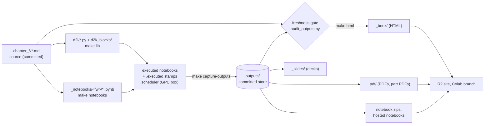

# Build guide

Start here if you need to build, re-run or publish any part of the book and
have no prior context. This page gives the mental model, the vocabulary and
step-by-step recipes for the common tasks. The details and the reasons behind
them are in the reference, [`build-system.md`](build-system.md); the notebook
scheduler has its own reference, [`notebook-scheduler.md`](notebook-scheduler.md).
Every command here was checked against the Makefile, `make/*.mk` and `tools/`
on 2026-11-12.

`make` means GNU Make 4.3 or newer. On macOS the system `make` is 3.81 and the
Makefile stops with an error; install `gmake` (`sudo port install gmake`) and
type `gmake` wherever this page says `make`.

## 1. The mental model

The book is built in two halves that meet in one committed directory,
`outputs/`.

- **Execution** turns each source file into one Jupyter notebook per framework
  (PyTorch, TensorFlow, JAX, MXNet), runs the notebooks, and *captures* their
  outputs into `outputs/`. It needs the framework venvs and, for most
  notebooks, NVIDIA GPUs. A full run takes 2.5 to 3 hours on the 4×RTX 4090 box.
- **Rendering** turns the source files plus `outputs/` into the HTML book,
  PDFs, slides and notebook downloads. It never executes code (Quarto runs with
  `execute.enabled: false`) and needs only `.venv-build` (Quarto), so it runs
  on any laptop.



Three facts explain most of the build's behaviour:

1. **The render reads only `outputs/`.** Re-executing a notebook changes
   nothing in the book until you run `make capture-outputs` and commit the
   result. `make all` executes but does not capture.
2. **Outputs are keyed by stable cell ID.** Every Python code fence in a
   source file carries a `#<id>` that never changes; the store, the slides
   and the HTML all look outputs up by that ID.
3. **"Stale" means the code changed, not the output.** A notebook is stale
   when the code that produced its stored outputs differs from the current
   code, library or framework version. A training plot that would look
   different on a re-run is not stale.

### Directories

| Path | What it holds | In git? | Made by |
|---|---|---|---|
| `chapter_*/*.md` | Source of truth: prose, code cells, slides | yes | you |
| `chapter_*/*.qmd` | Quarto input for the HTML book | no | `d2l_preprocess.py` (`make html`) |
| `d2l/torch.py`, `tensorflow.py`, `jax.py`, `mxnet.py` | The `d2l` library imported by every notebook. The header above the `#####   WARNING` line is hand-written; the rest is generated from `#@save` blocks | yes | `make lib` |
| `d2l/_blocks/<fw>/*.py` | One shard per library symbol, used only for freshness | no | `make lib` |
| `_notebooks/<fw>/<chapter>/` | Generated `.ipynb`, `.executed` stamps, `.d` dependency lists, `.provenance.json` sidecars, `MANIFEST.mk` | no (scratch) | `make notebooks`, execution |
| `outputs/<fw>/<chapter>/<file>.json` | Captured text outputs and fingerprints, one manifest per notebook | yes | `make capture-outputs` |
| `outputs/<fw>/<chapter>/<file>/` | Captured images | yes (Git LFS) | `make capture-outputs` |
| `img/*.svg`, `img/auto/` | Book figures and slide diagrams | yes | figure generators, `diagrams/` |
| `_book/`, `_pdf/`, `_slides/`, `_hosted_notebooks/` | Rendered products | no | render targets |
| `img/outputs/`, `_pdf/<fw>/img/outputs/` | Render scratch | no | render targets |
| `logs/` | One log per target and run, `logs/<target>-YYYYMMDD-HHMMSS.log` | no | every recipe |
| `data/` | Downloaded datasets; kept by `make clean` | no | notebooks |
| `.venv-<fw>`, `.venv-build` | One venv per framework, plus Quarto | no | `make venv-<fw>`, render targets |

## 2. Glossary

**Source file.** A `chapter_*/<file>.md`. Code cells are fenced
` ```{.python .input} ` blocks; `#@tab pytorch` (or `%%tab`) limits a cell to
some frameworks, untagged cells belong to all of them.

**Cell ID.** The `#<id>` on each code fence, assigned once by
`tools/add_cell_ids.py` and never renumbered. The store, slides (`@<id>`) and
HTML injection all key on it ([§4.2](build-system.md#42-the-one-index-that-matters-cell-id--output)).

**Stamp.** An empty file whose modification time records that a step ran.
The important one is `_notebooks/<fw>/<chapter>/<file>.executed`, touched
after a notebook executes successfully; Make and the scheduler re-run a
notebook when its stamp is missing or older than its `.ipynb` or a shard in
its `.d` file. Others: `.preprocess.stamp`, `d2l/.built`,
`_notebooks/<fw>/.generated`, `_slides/<fw>/.built`, `.figstamps/`.

**Manifest.** `outputs/<fw>/<chapter>/<file>.json`: the captured outputs of
one notebook in one framework, keyed by cell ID. Text is stored inline,
images as files next to it ([§2](build-system.md#2-the-committed-outputs-store-outputs)).

**Fingerprint.** A hash that stands for the code behind an output.
`code_fingerprint` (per cell) hashes that cell and every earlier code cell, so
editing cell 3 changes cells 3 to N. `d2l_lib_fingerprint` (per notebook)
hashes the library shards the notebook uses ([§3.1](build-system.md#31-the-two-freshness-signals)).

**Provenance.** The manifest's `provenance` block: `framework_version` (the
public version only, e.g. `torch==2.11.0`) and `d2l_lib_fingerprint`. Every
successful execution also writes an *execution sidecar*,
`_notebooks/<fw>/<chapter>/<file>.provenance.json`, recording the fingerprints
it ran under; capture checks it.

**Stale.** A notebook whose framework version, library fingerprint or any
cell's code fingerprint differs from the current tree, or that has code but no
manifest. *Hard* stale: a stale cell has text output (the page would print a
wrong value). *Soft* stale: only images are affected (an old but valid
sample) ([§3.2–3.3](build-system.md#32-stale--code-or-provenance-drift)).

**Capture (bless).** `make capture-outputs [FILES=...]`: copy outputs from
`_notebooks/` into `outputs/` and recompute fingerprints. Capture refuses
notebooks whose sidecar shows they ran under a different library or source
([§3.5](build-system.md#35-regenerated-when-a-new-render-occurs-the-requirement-made-concrete)).

**Freshness gate.** `tools/audit_outputs.py --verify-fresh`, the first step
of `make html`. It fails on hard-stale notebooks the host could re-run,
on orphaned cell IDs, on locked notebooks with changed code and on
unmaterialized LFS images. Slides and PDFs have no gate of their own.

**Host-capability tier.** Each notebook is classed `cpu`, `gpu` or
`multi-gpu`. The gate only fails on stale notebooks the host has enough GPUs
to re-run; the rest become warnings. A laptop therefore always renders
([§3.3a](build-system.md#33a-host-capability-aware-gate-render-anywhere)).

**Scheduler slot.** The unit `tools/notebook_scheduler.py` allocates: one GPU
slot per 7.5 GiB of each GPU's memory (3 per RTX 4090), one CPU slot per 8
cores. A notebook takes one slot unless it is listed as heavy, multi-GPU,
full-card or whole-box in `tools/runtime_env.py`
([notebook-scheduler.md §2](notebook-scheduler.md#2-per-notebook-resource-requirement)).

**`#@save` and shards.** A `#@save` comment in a code cell copies that
block into the `d2l` library (`make lib`, `tools/build_lib.py`). The library
is also split into one shard per symbol under `d2l/_blocks/<fw>/`; each
notebook's `.d` file lists the shards it reaches (transitively), which is how
a library edit marks exactly its users stale ([§3.4](build-system.md#34-the-d2l-save-ripple-made-precise)).

**`LIB_ONLY` files.** Source files listed in `LIB_ONLY_FILES` in
`tools/build_lib.py` that contribute `#@save` blocks to the library but are not
rendered or executed ([§3.4a](build-system.md#34a-build-only-library-sources-lib_only_files)).

**Lock.** A `<!-- execution: locked; requires: ... -->` line in a source
file. Builds then reuse the captured outputs instead of executing the notebook
([§3.7](build-system.md#37-locked-notebooks)).

**Materialize.** What a build does instead of executing a locked notebook:
it writes the stored outputs into the freshly generated `.ipynb` and touches
the stamp, so everything downstream works unchanged.

**Part PDF.** A PyTorch PDF of one part of the book (Basics, Advanced,
Language Models, Mathematics), cut out of the full PyTorch PDF by
`make pdf-parts` ([§6.6a](build-system.md#66a-per-part-pdfs-make-pdf-parts)).

**Hosted (Colab) notebooks.** Notebooks with a setup cell that installs pinned
packages and downloads the revision-pinned `d2l` helper, built by
`make hosted-notebooks` into `_hosted_notebooks/` and published to the
orphan `notebooks` branch by `make publish-colab`. The *notebook zips*
(`make notebook-zips`, `_book/notebooks/d2l-<fw>.zip`) are the offline
download ([§6.4.1](build-system.md#641-hosted-notebook-environment-contracts)).

## 3. Setup and target overview

```bash
./bootstrap.sh            # once per clone: git-lfs, node, .venv-build; pulls LFS images
./bootstrap.sh --pdf      # also TeX Live + rsvg-convert, for PDFs
make detect               # print GPUs, cores, RAM and the slot plan
make venv-pytorch         # a framework venv, only to execute notebooks
make help                 # the target list
```

| Target | What it does | Executes notebooks? | Needs |
|---|---|---|---|
| `html` | Freshness gate, then render `_book/` from `outputs/` | no | any host |
| `slides`, `slides-<fw>` | Render slide decks into `_slides/` | no | any host |
| `pdfs`, `pdf-<fw>` | Full-book PDFs into `_pdf/<fw>/` and `_book/pdf/` | no | XeLaTeX, rsvg-convert |
| `pdf-parts` | Part PDFs from the PyTorch book | no | as `pdf-pytorch` |
| `all-quick` | `lib`, `notebooks`, then slides, html, pdfs, part PDFs, zips, artifact check | no | any host + TeX |
| `lib` | Rebuild `d2l/*.py` and the shards | no | any host |
| `notebooks`, `notebooks-<fw>` | Generate `.ipynb` files (no execution) | no | `.venv-build` |
| `_notebooks/<fw>/<ch>/<f>.executed` | Execute one notebook | yes | that venv; GPU if it is a GPU notebook |
| `run-notebooks-<fw>`, `run-all-notebooks` | Execute every notebook whose stamp is stale | yes | GPU box |
| `capture-outputs [FILES=...] [UNLOCK=1]` | Copy executed outputs into `outputs/` | no | any host |
| `audit-outputs` | Report stale notebooks and integrity problems | no | any host |
| `refresh-stale` | Re-execute what the audit calls stale, then capture it | yes | GPU box |
| `render-fresh` | `refresh-stale`, then slides, html, pdfs, part PDFs | yes | GPU box |
| `all` | `lib`, `notebooks`, `run-all-notebooks`, then the `all-quick` render (no capture) | yes | GPU box, 2.5 to 3 h |
| `locks`, `rerun-locked FILES=...` | List locked notebooks; execute named ones | `rerun-locked` only | its hardware |
| `figures` | Re-run changed figure generators | no | `.venv-pytorch` |
| `deploy` | `all-quick`, then `publish-colab` and `upload-r2-delete` | no | credentials |
| `test-trap` | CPU regression tests for freshness, library deps and locks | no | any host |
| `clean`, `veryclean` | Delete build products; `veryclean` also `data/` and `logs/` | no | any host |

## 4. Recipes

Each recipe lists the commands, what success looks like, and the common
failures. Replace `chapter_x/foo.md` with your file and `pytorch` with the
framework.

| Task | Recipe |
|---|---|
| Render the book on a laptop | [4.1](#41-render-the-book-on-a-laptop) |
| Change prose, captions or slides only | [4.2](#42-change-prose-only) |
| Re-run one notebook and show its new output | [4.3](#43-change-a-code-cell-and-refresh-its-outputs) |
| Change library (`#@save`) code: what to re-run | [4.4](#44-change-a-save-library-function) |
| Add, split or move a section | [4.5](#45-add-split-or-move-a-section) |
| Add a figure | [4.6](#46-add-a-figure) |
| Full rebuild; failed notebooks after `make all` | [4.7](#47-full-rebuild-on-the-gpu-box) |
| Keep a paid-API or A100 notebook from re-running | [4.8](#48-lock-an-expensive-notebook-paid-api-a100-multi-node) |
| PDFs and part PDFs | [4.9](#49-build-pdfs-and-part-pdfs) |
| Inspect the state of a notebook run | [4.10](#410-diagnose-a-notebook-run-you-did-not-start) |
| Publish (R2, Colab, forum) | [4.11](#411-publish) |
| `make html` says outputs are stale | [4.12](#412-diagnose-a-stale-or-failing-freshness-gate) |

### 4.1 Render the book on a laptop

```bash
./bootstrap.sh                          # once
make notebooks                          # optional: lets the gate see code edits
make html                               # about 10 to 15 minutes
python3 -m http.server 8000 -d _book    # http://localhost:8000/
```

Success: the run ends with `Output: _book/index.html`. Warnings about stale
GPU notebooks are expected on a laptop; they render from the store.

Common failures:

- `GNU Make >= 4.3 required`: use `gmake`.
- `FAIL (verify-fresh): N committed output image(s) are unmaterialized
  Git-LFS pointers`: run `git lfs pull`.
- `FAIL (verify-fresh): ... stale INLINE outputs you can re-run on this host`:
  see [4.12](#412-diagnose-a-stale-or-failing-freshness-gate).

The gate compares the store against the generated notebooks. Without
`_notebooks/` (a fresh clone) it can only detect missing manifests and library
drift, not edited code; `make notebooks` needs only `.venv-build`.

### 4.2 Change prose only

```bash
$EDITOR chapter_x/foo.md
python3 tools/lint_source.py chapter_x/foo.md
make html
make slides-pytorch SLIDES_FILTER=chapter_x/foo.md     # if the slides changed
```

Nothing re-executes: only code cells enter a fingerprint, so prose, captions,
references, exercises and slide text never make a notebook stale. If
`slides-pytorch` says it is up to date, force it with `make -B`.

Common failures: the linter reports a `$` closed directly before a digit or an
`:eqlabel:` that does not attach (both break the PDF; CLAUDE.md "Gotchas");
an unbalanced `]` in a figure caption detaches its label.

### 4.3 Change a code cell and refresh its outputs

Do this for every framework the cell belongs to (an untagged cell belongs to
all of the file's frameworks: `ls outputs/*/chapter_x/foo.json` lists them).
To see whether a notebook runs on CPU or needs a GPU (after any `make` run has
written the `MANIFEST.mk` files):

```bash
awk '/chapter_x\/foo\.executed/ {print $1}' _notebooks/*/MANIFEST.mk
# EXECUTED_CPU_pytorch → CPU notebook; EXECUTED_GPU_… / EXECUTED_MULTI_GPU_… → needs 1 / 2 GPUs
```

CPU notebooks re-run on any host, a Mac included; GPU notebooks need a GPU
host. The first execution in a framework creates `.venv-<fw>` (several GB of
wheels on Linux).

```bash
$EDITOR chapter_x/foo.md
python3 tools/add_cell_ids.py chapter_x/foo.md        # IDs for new cells
python3 tools/lint_source.py chapter_x/foo.md
rm -f _notebooks/pytorch/chapter_x/foo.executed       # force the re-run
make _notebooks/pytorch/chapter_x/foo.executed        # regenerate + execute
python3 tools/capture_outputs.py --frameworks pytorch chapter_x/foo.md
git diff --stat outputs/                              # review what changed
make html
git add chapter_x/foo.md outputs/ && git commit
```

When you re-ran every framework of the file, `make capture-outputs
FILES=chapter_x/foo.md` captures all of them at once. It captures every
generated notebook of that file, so do not use it after re-running only some
frameworks: a generated but unexecuted notebook would overwrite good outputs.

Success: `make` exits 0 and the stamp exists; capture prints `Captured N
notebooks`; `python3 tools/audit_outputs.py --stale` no longer lists the file.

Common failures:

- The notebook fails. Make stops without a stamp; the cause is in
  `logs/nb-errors/<fw>/<chapter>/<file>.log`, the full run in
  `logs/run-<fw>-*.log`. Fix the code; never comment out the failing call.
- `REFUSING to capture ... (the freshness-disagreement trap)`: the executed
  notebook ran under an older library or source. Re-run it, then capture.
- A memory-heavy JAX notebook runs out of GPU memory when started directly
  (a direct `make` uses a fixed 40% memory fraction). Run it through the
  scheduler, which sizes the fraction to the slots it reserves:

  ```bash
  rm -f _notebooks/jax/chapter_x/foo.executed
  python3 tools/notebook_scheduler.py --files chapter_x/foo.md --frameworks jax
  ```

`make -B _notebooks/...executed` also forces a re-run, but `-B` remakes every
prerequisite as well: it runs `uv sync` on `.venv-<fw>` and `.venv-build`,
rebuilds the library and regenerates the notebook. Deleting the stamp is
cheaper and also catches cells that were only moved or deleted, which do not
change the `.ipynb` timestamp.

### 4.4 Change a `#@save` library function

A `#@save` block is part of `d2l/<lib>.py`, which other notebooks import,
possibly in other chapters and frameworks.

```bash
$EDITOR chapter_y/bar.md                 # the #@save block
make lib                                 # rewrites d2l/*.py and the shards
git diff --stat d2l/                     # which libraries changed
make notebooks                           # so the audit can compare code
python3 tools/audit_outputs.py --stale   # every source file now stale
make audit-outputs                       # same, with framework and reason
```

Who goes stale: every notebook whose `.d` file lists a changed shard,
directly or through another library symbol (for example everything that
trains with `d2l.Trainer` when `ProgressBoard` changes). The reason column
reads `d2l_lib_fingerprint: sha256:... → sha256:...`. The audit does not see
changes to `d2l/__init__.py`, to package versions other than the framework's,
or to datasets ([§3.4](build-system.md#34-the-d2l-save-ripple-made-precise)).

Before any re-run, read every caller of the changed symbol
(`grep -rn "d2l.<name>" chapter_*/`): a library change is a change to all of
them. Then, on the GPU box:

```bash
ulimit -u 8000
make refresh-stale          # rm the stale stamps, execute them, capture them
```

`refresh-stale` captures even when some notebooks failed. Check the
`=== scheduler done: N/N ok, 0 failed ===` line; if anything failed, restore
its manifests (`git checkout -- outputs/<fw>/<chapter>/<file>.json
outputs/<fw>/<chapter>/<file>/`), fix it and re-run it as in 4.3. Commit the
source, `d2l/*.py` and `outputs/` together.

On a host with fewer GPUs than some stale notebooks need, do not use
`refresh-stale` or `run-all-notebooks`: the scheduler never skips a notebook
it cannot place and waits for ever once the rest is done. Re-run the CPU
notebooks one by one as in 4.3 and leave the rest to the GPU box.

Helpers used only by the Advanced part (chapters 9 to 17) are tagged
`#@tab pytorch, jax`; an untagged helper adds TensorFlow and MXNet copies and
makes those frameworks stale too.

### 4.5 Add, split or move a section

1. **Files.** Create or `git mv` the `.md`. The first line is `# Title`
   followed by `:label:`sec_...``. Keep a moved section's label.
2. **Order and numbers.** Add the file to `_quarto.yml` and to
   `CHAPTER_NUMBERING` in `tools/d2l_preprocess.py` at the same position, and
   renumber the `[N, k]` entries after it. A file missing from the map renders
   unnumbered; dict order that differs from `_quarto.yml` silently
   misnumbers the PDF ([§4.1](build-system.md#41-execution-independent-numbering--cross-references)).
3. **Cell IDs.** Run `python3 tools/add_cell_ids.py chapter_x/new.md`. Cells
   that move keep their IDs; never edit an ID by hand.
4. **Labels and references.** Refer with `:numref:` only. A `subsec_X` label
   must not share its stem with a `sec_X` label (both become `sec-X`). Check
   with `python3 tools/lint_source.py --corpus`.
5. **Library.** Moving a `#@save` block under a different `:label:` changes
   its shard (the "Defined in" docstring) and stales its users; check with
   `make lib && git diff --stat d2l/` and 4.4.
6. **Outputs.** A new or renamed file has no manifest, which the gate treats
   as stale. A split leaves orphaned cell IDs in the old file's manifest,
   which fails the gate. Execute and capture both files (4.3) and
   `git rm -r` the manifests and image directories of files that no longer
   exist.
7. **Slides and forum.** Each file has its own `<!-- slides -->` section.
   New pages get a forum topic (4.11).
8. **Check.** `make html`; `img/front-book-org.svg` shows chapter numbers and
   is redrawn by `tools/gen_mdl_front_figures.py` (then `make figures`).

### 4.6 Add a figure

Illustrative figures are SVGs produced by committed matplotlib generators,
never drawn in a notebook cell. Follow the `mdl-figure` skill and the figure
rules in CLAUDE.md ("Content authoring"):

```bash
$EDITOR tools/gen_mdl_<chapter>_figures.py
make figures                                   # re-runs changed generators only
/opt/local/bin/rsvg-convert -z 2 img/mdl-<prefix>-<id>.svg -o /tmp/f.png   # look at it
git add tools/gen_mdl_<chapter>_figures.py img/mdl-<prefix>-<id>.svg
```

Include it as `` plus `:label:`fig_...``.
`make figures` uses `.venv-pytorch` and is never part of `all` or
`all-quick`. Generators are byte-idempotent: a second run must leave
`git diff img/` empty.

### 4.7 Full rebuild on the GPU box

```bash
ulimit -u 8000                       # default 4096 threads is too few
make clean                           # optional: a pristine run; keeps data/
setsid nohup bash -c 'ulimit -u 8000; make all' \
    > logs/all-manual-$(date +%Y%m%d-%H%M%S).out 2>&1 < /dev/null &
```

Detach long runs as above (or use `tmux`): a run tied to your shell or to an
agent's background task dies with it. Follow progress in
`logs/scheduler-*.log`; each notebook prints `OK (Ns) [GPU 2] (k/total done)`
or `FAIL`. Do not edit source `.md` files while it runs (a source change
regenerates notebooks mid-run), and do not start `make html` or another
render in the same tree.

Success: the scheduler log ends with `=== scheduler done: N/N ok, 0 failed
===`, and `make all` exits 0 after rendering everything. Then capture the
new outputs, which `make all` did not do:

```bash
make capture-outputs                 # all notebooks: only after 0 failed
make audit-outputs                   # expect "✓ no stale notebooks."
git add outputs/ d2l/ && git commit
make all-quick                       # re-render from the new store
```

Settings that matter on this box:

- **Shared GPUs.** If another user's jobs occupy the cards, add
  `D2L_GPU_LIVE_GATE=1` and fewer slots, e.g.
  `make all GPU_SLOTS_PER=2,2,2,2` ([notebook-scheduler.md §5](notebook-scheduler.md#5-configuration--overrides)).
- **Timeouts.** A notebook may run 3600 s by default; longer ones are listed
  in `NOTEBOOK_TIMEOUTS` in `tools/runtime_env.py`.
- **Thread limit.** `RuntimeError: can't start new thread` or
  `Resource temporarily unavailable` means `ulimit -u` was too low; the
  notebooks that never started are counted as failed
  ([§13](build-system.md#13-failure-modes--gotchas)).

#### If the run reports failed notebooks

`make all` still renders the book and then exits non-zero; a non-zero exit
does not mean nothing was built.

1. List the failures: the `FAILED:` lines at the end of the scheduler log, or
   `python3 tools/notebook_run_summary.py`.
2. Read the cause in `logs/nb-errors/<fw>/<chapter>/<file>.log`.
3. Decide whether it is the notebook or the load. A JAX notebook that hits
   the timeout, an MXNet "Build with USE_OPENCV=1" error, or a thread error
   under full load usually passes when run alone. A traceback in the
   notebook's own code is a bug: fix the source.
4. Re-run only the failures. A failed notebook has no stamp, so
   `make run-all-notebooks` executes just those (plus anything you edited);
   for one notebook use the scheduler command in 4.3.
5. Capture once the summary says `0 failed`. To capture earlier, name the
   files that passed with `FILES=`, never the failed one: capture would
   store whatever the failed run left behind, or refuse the whole call.

### 4.8 Lock an expensive notebook (paid API, A100, multi-node)

Locks keep notebooks that cost money or special hardware (paid API calls,
A100 or multi-node runs) from re-running in every build. The behaviour, error
messages and edge cases are in [§3.7](build-system.md#37-locked-notebooks).

Lock a notebook once its captured outputs are good:

```bash
# 1. capture it normally (4.3); a lock needs a manifest
# 2. add one line to the source, outside code fences:
#    <!-- execution: locked; requires: openrouter -->
python3 tools/lint_source.py chapter_x/foo.md   # validates the directive
make locks                                      # status should be "clean"
git commit chapter_x/foo.md
```

From then on every build materializes it from `outputs/` and the scheduler
prints `LOCKED (skipped)`. Prose edits are fine; editing a code cell makes
`make html` fail until you re-run it.

Re-run it on purpose and replace its outputs:

```bash
make rerun-locked FILES=chapter_x/foo.md FRAMEWORKS=pytorch
make capture-outputs FILES=chapter_x/foo.md UNLOCK=1
make locks
git add outputs/ && git commit
```

Capture right after the re-run: until then the paid outputs exist only in
`_notebooks/`, which `make clean` deletes.

### 4.9 Build PDFs and part PDFs

```bash
./bootstrap.sh --pdf          # once: xelatex + rsvg-convert
make pdf-pytorch              # one book → _pdf/pytorch/_pdf/Dive-into-Deep-Learning-pytorch.pdf
make pdfs                     # all four, one after another
make pdf-parts                # part PDFs → _book/pdf/parts/ (builds pdf-pytorch first)
python3 tools/check_book_artifacts.py
```

Each `pdf-<fw>` also copies its PDF into `_book/pdf/`. `all-quick` and `all`
build the four books in parallel (`-j$(RENDER_JOBS)` with a capped Quarto
heap; `make detect` shows `RENDER_JOBS`); do not add your own `-j` without
that cap. Never run a PDF build at the same time as `make html`: the HTML
render walks `_pdf/` and aborts when a PDF render deletes its scratch
directory ([§6.8](build-system.md#68-html-render--why-its-a-single-quarto-render-not-parallel)).

Common failures ([§6.6](build-system.md#66-pdf-build-xelatex-via-quarto--pitfalls-and-how-its-kept-green)):

- `ERROR: /tmp has only N MiB free`: free space in `$TMPDIR` (Quarto stages
  there; a full `/tmp` used to produce half-length books).
- `main.lua:7348` assertion: stale scratch PDFs; `make clean` or
  `find img/outputs _pdf/*/img/outputs -name '*.pdf' -delete`.
- LaTeX errors such as `Environment psmallmatrix undefined` or
  `\symcal allowed only in math mode`: source math problems, see §6.6.

### 4.10 Diagnose a notebook run you did not start

The scheduler, stamps and logs together tell you the state of `_notebooks/`:

```bash
python3 tools/notebook_run_plan.py --list     # stamps missing, per framework and pool
python3 tools/notebook_run_summary.py         # OK / FAILED per framework, last error
ls logs/nb-errors/*/                          # per-notebook failure logs
ps -eLf -u $USER | wc -l                      # threads in use, against ulimit -u
```

### 4.11 Publish

`make deploy` runs `all-quick`, then `publish-colab` and `upload-r2-delete`
(both run even if the other fails). The parts:

```bash
make upload-r2-dry-run        # what would upload to the staging-d2l bucket
make upload-r2                # incremental upload of _book/ (needs .env, aws)
make upload-r2-delete         # also delete bucket objects missing from _book/
make upload-r2-full R2_BUCKET=temporary-d2l   # another bucket, full upload
make publish-colab            # rebuild hosted notebooks, force-push the orphan
                              # `notebooks` branch, verify it
python3 tools/create_forum_topics.py           # pages without a forum link (dry run)
python3 tools/create_forum_topics.py --create  # create topics, insert the links
```

Rules: the `notebooks` branch is an orphan serving branch; never open a PR
from it or merge it. Forum topics need the key in
`~/.config/d2l/discourse.env`; commit the `[Discussions](...)` links the
script inserts.

Common failures: a standalone `make html` empties `_book/`, removing the
PDFs and notebook zips; `upload-r2-delete` would then delete them from the
bucket. Before uploading after a standalone `make html`, run
`make notebook-zips` and copy the PDFs back
(`cp _pdf/<fw>/_pdf/Dive-into-Deep-Learning-<fw>.pdf _book/pdf/`). Images
replaced under the same name stay cached by the CDN for up to 8 hours.

### 4.12 Diagnose a stale or failing freshness gate

`make html` stops with `Outputs stale — re-run + 'make capture-outputs', or
'make render-fresh'.` Above that line the gate printed what is wrong. To see
the full list without rendering:

```bash
make audit-outputs                          # human report: [HARD]/[soft], framework, reason
python3 tools/audit_outputs.py --stale      # just the source files
python3 tools/audit_outputs.py --stale-stamps   # the .executed stamps to delete
python3 tools/audit_outputs.py --json       # everything, for scripts
```

| Message | Meaning | Fix |
|---|---|---|
| `... stale INLINE outputs you can re-run on this host` | Code, library or framework version changed since capture, and the host has the GPUs to re-run it | Re-run and capture (4.3, 4.4), or `make render-fresh` on the GPU box |
| `⚠ N stale notebook(s) need more GPUs than this host has` | Same, but the host cannot run them | Nothing; a warning. The GPU box refreshes them |
| `N notebook(s) with code cells but NO manifest` | New or renamed file never captured | Execute and capture it |
| `ORPHANED cell ids` then `integrity errors above` | The store has a cell ID the notebook no longer has (cell deleted, file split) | Re-run and capture that notebook |
| `N LOCKED notebook(s) would show code beside outputs of other code` | A locked notebook's code changed | Revert the edit, or 4.8 re-run |
| `unmaterialized Git-LFS pointers` | Images not downloaded | `git lfs pull` |

Reasons in the report:

- `N cell(s) with changed code`: a code cell (or an earlier one) changed.
- `d2l_lib_fingerprint: ... → ...`: a `#@save` symbol it uses changed (4.4).
- `framework_version: torch==2.11.0 → torch==2.12.0`: your venv's
  framework is not the version the store was captured with. Usually the fix
  is `make venv-pytorch` to return to the pinned version, not a re-run.

For a staging preview while a planned re-run is pending,
`make html ALLOW_STALE=1` turns the failure into a warning. Such a build shows
old outputs beside new code; upload it only to a staging bucket
([§6.2a](build-system.md#62a-staging-override-make-html-allow_stale1)).

## 5. Rules that bite

| Rule | Why | More |
|---|---|---|
| Never edit `chapter_*/*.qmd` or `_notebooks/` files | They are regenerated from the `.md` on the next build | [architecture.md](architecture.md#html-multi-framework) |
| Never edit or reuse a cell ID | The store, slides and HTML find outputs by ID; a changed ID orphans them | [§4.2](build-system.md#42-the-one-index-that-matters-cell-id--output) |
| Capture only after a run that ended `0 failed` | Capture copies whatever is in `_notebooks/`, including what a failed run left | 4.7 |
| Capture only frameworks you executed | `FILES=` alone captures every generated notebook of the file | 4.3 |
| `make all` does not capture | The render reads `outputs/`, so new results stay invisible until captured and committed | [§6.4](build-system.md#64-aggregate--full-build-targets-the-rebuild-everything-path) |
| Never wrap `make html` in `-j`, and never run it next to PDF or slide renders or notebook runs | Quarto walks the whole tree at startup and aborts when another job deletes a directory; a split render is 15 to 20 times slower per page | [§6.8](build-system.md#68-html-render--why-its-a-single-quarto-render-not-parallel) |
| Never add an outer `make -j` around notebook execution | The scheduler owns all concurrency | [notebook-scheduler.md](notebook-scheduler.md) |
| Raise `ulimit -u` to 8000 before a full run | The default 4096 threads runs out at full concurrency | [§13](build-system.md#13-failure-modes--gotchas) |
| Do not edit source `.md` files during a notebook run | A source change regenerates notebooks mid-run | [§13](build-system.md#13-failure-modes--gotchas) |
| Never ship an `ALLOW_STALE=1` build | It shows outputs beside code that did not produce them | [§6.2a](build-system.md#62a-staging-override-make-html-allow_stale1) |
| Keep `CHAPTER_NUMBERING` order equal to `_quarto.yml` order | The PDF pairs chapters with the map by position | [§4.1](build-system.md#41-execution-independent-numbering--cross-references) |
| Do not upgrade a framework casually | `framework_version` stales that framework's whole store | [§3.1](build-system.md#31-the-two-freshness-signals) |
| Stop Quarto's `deno`/`pandoc` children when you stop a render | An orphaned render deletes the next render's temporary files | [§13](build-system.md#13-failure-modes--gotchas) |
| Never run MXNet GPU operations off the main thread | It corrupts the CUDA context and needs a reboot | [§6.7](build-system.md#67-resource-aware-scheduling-gpu--cpu--ram-autodetect) |

## 6. Where to read more

| Question | Read |
|---|---|
| What exactly makes a notebook stale? | [build-system.md §3.1–3.3a](build-system.md#3-freshness-model-the-heart-of-the-design) |
| Which notebooks does a library change reach, and what is not tracked? | [§3.4](build-system.md#34-the-d2l-save-ripple-made-precise) |
| Why did capture refuse? What is the sidecar? | [§3.5](build-system.md#35-regenerated-when-a-new-render-occurs-the-requirement-made-concrete) |
| Why is there colour or a progress bar in an output? | [§3.6](build-system.md#36-output-hygiene-no-terminal-decoration-in-the-store) |
| Everything about locks | [§3.7](build-system.md#37-locked-notebooks) |
| How numbering, labels and `CHAPTER_NUMBERING` work | [§4.1](build-system.md#41-execution-independent-numbering--cross-references) |
| What does each aggregate target run? | [§6.4](build-system.md#64-aggregate--full-build-targets-the-rebuild-everything-path) |
| Colab and hosted environment checks | [§6.4.1](build-system.md#641-hosted-notebook-environment-contracts) |
| Updating the MXNet wheel | [§6.5](build-system.md#65-updating-a-framework-wheel-pin-mxnet) |
| PDF pitfalls, part PDFs, page size | [§6.6–6.6b](build-system.md#66-pdf-build-xelatex-via-quarto--pitfalls-and-how-its-kept-green) |
| How the scheduler places notebooks; how to mark a heavy notebook | [notebook-scheduler.md §2–3](notebook-scheduler.md#2-per-notebook-resource-requirement) |
| Which Makefile module owns which target; R2 buckets and credentials | [§6.9](build-system.md#69-makefile-layout-extracted-scripts--artifact-phase-timing) |
| Known failure modes | [§13](build-system.md#13-failure-modes--gotchas) |
| What each tool and file is | [architecture.md](architecture.md) |
| How the build got here | [build-history.md](build-history.md) |
| Source syntax: `:label:`, `:numref:`, tabs | [syntax.md](syntax.md) |
