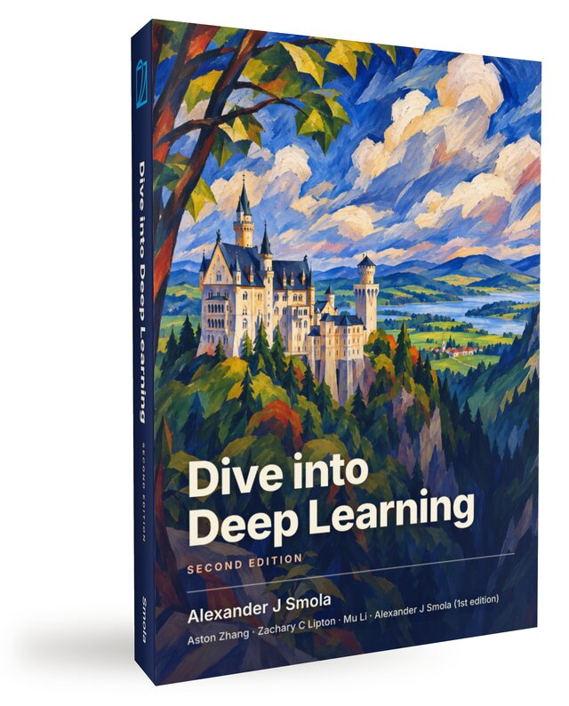
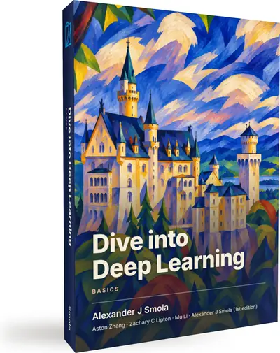
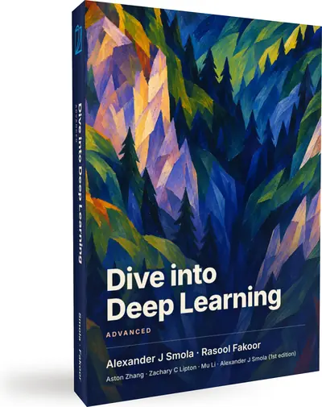
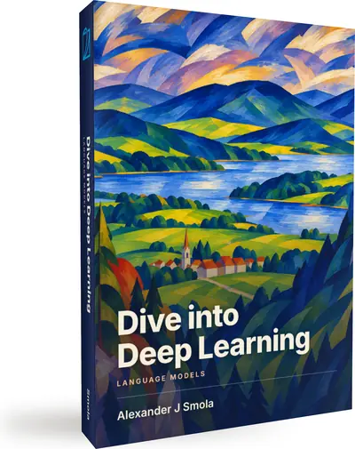
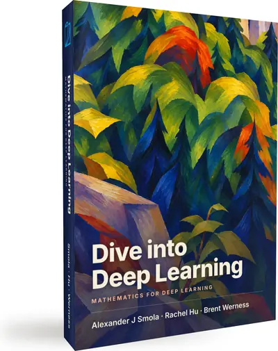

```{=html}
<style>
/* Quarto emits #title-block-header twice when `title-block-style: none` meets
   the book-level author/date metadata; the hero below renders the title. */
#title-block-header { display: none !important; }

/* ── Landing page (scoped to .d2l-landing) ─────────────────────────────
   One section style: a hairline rule above each h2. Only links and real
   controls (tabs, the copy buttons, <summary>) respond to the pointer.
   The site theme (cosmo) is light-only, so the tokens have no dark set. */
.d2l-landing {
  --ink: #15181C;
  --ink-2: #3A4049;
  --ink-3: #6A717B;
  --line: #E7E9EC;
  --bg-soft: #F8F9FB;
  --link: #1976D2;
  --measure: 40rem;
  font-family: 'Source Sans 3', -apple-system, BlinkMacSystemFont, 'Segoe UI', sans-serif;
  font-size: 1rem;
  line-height: 1.6;
  color: var(--ink-2);
}
.d2l-landing p, .d2l-landing li { font-size: 1rem; }
.d2l-landing img { max-width: 100%; height: auto; }
.d2l-landing section { margin: 2.5rem 0; }
.d2l-landing section > h2 {
  font-size: 1.5rem;
  font-weight: 600;
  color: var(--ink);
  margin: 0 0 1rem;
  padding: 1.5rem 0 0;
  border: 0;
  border-top: 1px solid var(--line);
  letter-spacing: -0.01em;
}
.d2l-landing h3 {
  font-size: 1.0625rem;
  font-weight: 600;
  color: var(--ink);
  margin: 0 0 0.35rem;
}
.d2l-landing .prose { max-width: var(--measure); }
.d2l-landing .muted { color: var(--ink-3); }

/* ── Hero ─────────────────────────────────────────────────── */
.d2l-hero {
  display: grid;
  grid-template-columns: minmax(0, 1fr) 280px;
  gap: 2.5rem;
  align-items: center;
  margin: 1.5rem 0 0 !important;
}
.d2l-hero h1 {
  font-size: clamp(2.125rem, 4vw, 3rem);
  line-height: 1.1;
  font-weight: 700;
  color: var(--ink);
  margin: 0;
  letter-spacing: -0.02em;
  border: 0;
  padding: 0;
}
.d2l-hero .edition {
  margin: 0.4rem 0 1.25rem;
  font-size: 1.0625rem;
  color: var(--ink-3);
}
.d2l-hero .lede {
  font-size: 1.1875rem;
  color: var(--ink);
  max-width: var(--measure);
  margin: 0 0 1rem;
}
.d2l-hero p { max-width: var(--measure); margin: 0 0 0.75rem; }
.d2l-hero .start { margin-top: 1.25rem; font-weight: 600; }
.d2l-hero-cover { text-align: center; margin: 0; }
.d2l-hero-cover img { width: 280px; }
.d2l-hero-cover figcaption { font-size: 0.875rem; color: var(--ink-3); margin-top: 0.25rem; }

/* ── Part cards ───────────────────────────────────────────── */
.d2l-parts {
  display: grid;
  grid-template-columns: repeat(4, minmax(0, 1fr));
  gap: 1.5rem;
}
.d2l-part { margin: 0; }
.d2l-part .cover { display: block; max-width: 180px; margin: 0 0 0.75rem; }
.d2l-part .cover img { display: block; width: 100%; }
.d2l-part .range { font-size: 0.875rem; color: var(--ink-3); margin: 0 0 0.4rem; }
.d2l-part p { margin: 0 0 0.4rem; font-size: 0.9375rem; }
.d2l-part .after { color: var(--ink-3); }
.d2l-part .links { font-size: 0.9375rem; margin-top: 0.5rem; }
.d2l-part .status {
  display: inline-block;
  font-size: 0.8125rem;
  font-weight: 600;
  color: #8A4B00;
  background: #FFF3E0;
  border-radius: 3px;
  padding: 0 0.4rem;
  margin-left: 0.25rem;
  vertical-align: 1px;
}
.d2l-also { margin-top: 1.5rem; max-width: 52rem; }

/* ── Code sample (generated by tools/render_landing_sample.py) ─────── */
.d2l-sample .tab-content { border: 0; padding: 0; }
.d2l-sample .nav-tabs { margin-bottom: 0.75rem; }
.d2l-sample-body {
  display: grid;
  grid-template-columns: minmax(0, 1.5fr) minmax(0, 1fr);
  gap: 1.5rem;
  align-items: start;
}
.d2l-sample-code div.sourceCode { margin: 0 0 0.75rem; overflow-x: auto; }
.d2l-sample-code pre { margin: 0; }
/* scroll, do not wrap: wrapped Python lines read as different code */
.d2l-sample-code pre, .d2l-sample-code pre code { white-space: pre !important; }
.d2l-sample-out { margin: 0; }
.d2l-sample-out img { display: block; width: 100%; }
.d2l-sample-out figcaption { font-size: 0.875rem; color: var(--ink-3); margin-top: 0.5rem; }
.d2l-sample-note { max-width: var(--measure); margin-top: 0.75rem; color: var(--ink-3); font-size: 0.9375rem !important; }

/* ── What comes with the book (boxes are not links; links inside are) ─ */
.d2l-features {
  display: grid;
  grid-template-columns: repeat(3, minmax(0, 1fr));
  gap: 1.25rem 2rem;
}
.d2l-feature { margin: 0; }
.d2l-feature p { margin: 0 0 0.35rem; font-size: 0.9375rem; }

/* ── What is new ──────────────────────────────────────────── */
.d2l-new {
  display: grid;
  grid-template-columns: minmax(0, 1.4fr) minmax(0, 1fr);
  gap: 1rem 2.5rem;
}
.d2l-new ul { margin: 0; padding-left: 1.2rem; }
.d2l-new li { margin: 0 0 0.4rem; }

/* ── Teaching, map and logo grid ──────────────────────────── */
.d2l-stat { font-size: 1.125rem !important; color: var(--ink); margin: 1.5rem 0 0.25rem; }
.d2l-stat strong { font-size: 1.5rem; }
.d2l-uni-confirmed { color: var(--ink-3); margin: 0 0 1rem; }
.d2l-map { margin: 1rem 0 1.5rem; }
.d2l-map img { display: block; width: 100%; border: 1px solid var(--line); border-radius: 4px; }
.d2l-map figcaption { font-size: 0.875rem; color: var(--ink-3); margin-top: 0.4rem; }
.d2l-uni-logos {
  display: grid;
  grid-template-columns: repeat(auto-fill, minmax(84px, 1fr));
  gap: 0.5rem;
}
.d2l-uni-logos > a, .d2l-uni-logos > span {
  display: flex;
  align-items: center;
  justify-content: center;
  aspect-ratio: 1 / 1;
  padding: 0.3rem;
  border-radius: 4px;
}
.d2l-uni-logos img {
  display: block;
  max-width: 100%;
  max-height: 100%;
  width: auto;
  height: auto;
  object-fit: contain;
}
.d2l-uni-logos > a:hover, .d2l-uni-logos > a:focus-visible { background: var(--bg-soft); outline: 1px solid var(--line); }
.d2l-uni-logo-invert { filter: invert(1); }
.d2l-uni-all { margin-top: 1rem; }
.d2l-uni-all > summary { cursor: pointer; color: var(--link); font-weight: 600; padding: 0.25rem 0; }
.d2l-uni-all > summary:hover { text-decoration: underline; }
.d2l-uni-country {
  font-size: 0.9375rem !important;
  margin: 1.25rem 0 0.4rem !important;
  color: var(--ink) !important;
}
.d2l-uni-country span { color: var(--ink-3); font-weight: 400; }

/* ── Endorsements ─────────────────────────────────────────── */
.d2l-quotes {
  display: grid;
  grid-template-columns: repeat(2, minmax(0, 1fr));
  gap: 1.5rem 2.5rem;
}
.d2l-quote { margin: 0; }
.d2l-quote blockquote {
  margin: 0 0 0.4rem;
  padding: 0 0 0 0.9rem;
  border-left: 2px solid var(--line);
  font-size: 1rem;
  color: var(--ink-2);
}
.d2l-quote figcaption { font-size: 0.9375rem; color: var(--ink-3); padding-left: 0.9rem; }
.d2l-quote figcaption strong { color: var(--ink); font-weight: 600; }

/* ── People ───────────────────────────────────────────────── */
.d2l-authors {
  display: grid;
  grid-template-columns: repeat(4, minmax(0, 1fr));
  gap: 1.5rem;
  margin: 1rem 0 2rem;
}
.d2l-person { margin: 0; }
.d2l-person img { width: 96px; height: 96px; border-radius: 50%; object-fit: cover; display: block; margin-bottom: 0.5rem; }
.d2l-person .name { display: block; font-weight: 600; color: var(--ink); }
.d2l-person .affil { display: block; }
.d2l-person .affil, .d2l-contrib .affil { color: var(--ink-3); font-size: 0.9375rem; }
.d2l-person .role { display: block; font-size: 0.875rem; color: var(--ink-3); }
.d2l-contribs {
  list-style: none;
  padding: 0;
  margin: 0.5rem 0 1rem;
  columns: 2;
  column-gap: 2rem;
}
.d2l-contrib {
  display: grid;
  grid-template-columns: 40px minmax(0, 1fr);
  gap: 0.75rem;
  align-items: center;
  margin: 0 0 0.75rem;
  break-inside: avoid;
}
.d2l-contrib img { width: 40px; height: 40px; border-radius: 50%; object-fit: cover; display: block; }
.d2l-contrib .name { font-weight: 600; }
.d2l-contrib .what { display: block; font-size: 0.9375rem; color: var(--ink-2); }

/* ── Citation ─────────────────────────────────────────────── */
.d2l-cite-block { position: relative; margin: 0 0 1rem; max-width: 48rem; }
.d2l-cite-block h3 { font-size: 0.9375rem; }
.d2l-cite-block pre {
  background: #F5F7FA;
  border: 1px solid var(--line);
  border-radius: 4px;
  padding: 0.85rem 1rem;
  font-family: 'JetBrains Mono', ui-monospace, monospace;
  font-size: 0.8125rem;
  color: var(--ink);
  overflow-x: auto;
  margin: 0;
}
.d2l-copy {
  position: absolute;
  top: 2rem;
  right: 0.5rem;
  font: inherit;
  font-size: 0.8125rem;
  color: var(--link);
  background: #fff;
  border: 1px solid var(--line);
  border-radius: 3px;
  padding: 0.1rem 0.5rem;
  cursor: pointer;
}
.d2l-copy:hover, .d2l-copy:focus-visible { border-color: var(--link); }

/* ── Narrow screens ───────────────────────────────────────── */
@media (max-width: 1100px) {
  .d2l-parts { grid-template-columns: repeat(2, minmax(0, 1fr)); }
  .d2l-features { grid-template-columns: repeat(2, minmax(0, 1fr)); }
}
@media (max-width: 820px) {
  .d2l-hero { grid-template-columns: minmax(0, 1fr); gap: 1rem; }
  .d2l-hero-cover img { width: 200px; }
  .d2l-sample-body, .d2l-new, .d2l-quotes { grid-template-columns: minmax(0, 1fr); }
  .d2l-contribs { columns: 1; }
  .d2l-authors { grid-template-columns: repeat(2, minmax(0, 1fr)); }
}
@media (max-width: 600px) {
  .d2l-parts { grid-template-columns: minmax(0, 1fr); gap: 1.25rem; }
  .d2l-part { display: grid; grid-template-columns: 110px minmax(0, 1fr); gap: 0 1rem; }
  .d2l-part .cover { grid-row: 1 / span 6; margin: 0; }
  .d2l-features { grid-template-columns: minmax(0, 1fr); }
  .d2l-uni-logos { grid-template-columns: repeat(auto-fill, minmax(72px, 1fr)); }
  /* phones: half of the first screen; the rest is in the <details> */
  .d2l-uni-first > :nth-child(n+49) { display: none; }
  .d2l-copy { top: 1.9rem; }
}
</style>

<div class="d2l-landing">

<section class="d2l-hero">
  <div>
    <h1>Dive into Deep Learning</h1>
    <p class="edition">Second edition, November 2026</p>
    <p class="lede">A textbook that teaches deep learning by building it. Every section is a notebook: the mathematics, the code, and the output of running that code.</p>
    <p>By <strong>Alexander&nbsp;J.&nbsp;Smola</strong>. First edition by Aston Zhang, Zachary&nbsp;C. Lipton, Mu&nbsp;Li and Alexander&nbsp;J. Smola (Cambridge University Press, 2023).</p>
    <p>Free to read online, as PDFs and as notebooks. Basics and the mathematics appendix come in PyTorch, JAX, TensorFlow and MXNet, Advanced in PyTorch and JAX; Language Models will be in PyTorch.</p>
    <p class="start"><a href="chapter_introduction/index.html">Start reading: Introduction&nbsp;&rarr;</a></p>
  </div>
  <figure class="d2l-hero-cover">
    <a href="pdf/Dive-into-Deep-Learning-pytorch.pdf"></a>
    <figcaption><a href="pdf/Dive-into-Deep-Learning-pytorch.pdf">The whole book as one PDF (PyTorch, 75&nbsp;MB)</a></figcaption>
  </figure>
</section>

<section>
  <h2>The book in four parts</h2>
  <div class="d2l-parts">
    <article class="d2l-part">
      <a class="cover" href="pdf/parts/Dive-into-Deep-Learning-basics-pytorch.pdf"></a>
      <h3><a href="chapter_basics/index.html">Basics</a></h3>
      <p class="range">Chapters 1&ndash;8 &middot; PyTorch, JAX, TensorFlow, MXNet</p>
      <p>Tensors and gradients, linear regression and classification, multilayer perceptrons, convolutional networks and sequence models.</p>
      <p class="after">After it you can train, debug and evaluate a network on images or text.</p>
      <p class="links"><a href="chapter_basics/index.html">Read online</a> &middot; <a href="pdf/parts/Dive-into-Deep-Learning-basics-pytorch.pdf">PDF</a></p>
    </article>
    <article class="d2l-part">
      <a class="cover" href="pdf/parts/Dive-into-Deep-Learning-advanced-pytorch.pdf"></a>
      <h3><a href="chapter_advanced/index.html">Advanced</a></h3>
      <p class="range">Chapters 9&ndash;17 &middot; PyTorch, JAX</p>
      <p>Optimization, attention, transformers, state space models, computational performance, reinforcement learning, GANs and diffusion models.</p>
      <p class="after">After it you can build and train a transformer, find what limits its speed on one GPU or several, and train agents and generative models.</p>
      <p class="links"><a href="chapter_advanced/index.html">Read online</a> &middot; <a href="pdf/parts/Dive-into-Deep-Learning-advanced-pytorch.pdf">PDF</a></p>
    </article>
    <article class="d2l-part">
      <a class="cover" href="pdf/parts/Dive-into-Deep-Learning-language-models-pytorch.pdf"></a>
      <h3><a href="chapter_language-models/index.html">Language Models</a> <span class="status">In preparation</span></h3>
      <p class="range">Chapters 18&ndash;31 &middot; PyTorch</p>
      <p>How language models are pretrained, scaled across machines, fine-tuned, aligned, compressed and served.</p>
      <p class="after">The chapters are outlines so far.</p>
      <p class="links"><a href="chapter_language-models/index.html">Outline</a> &middot; <a href="pdf/parts/Dive-into-Deep-Learning-language-models-pytorch.pdf">PDF</a></p>
    </article>
    <article class="d2l-part">
      <a class="cover" href="pdf/parts/Dive-into-Deep-Learning-mathematics-for-deep-learning-pytorch.pdf"></a>
      <h3><a href="chapter_mathematics-for-deep-learning/index.html">Mathematics for Deep Learning</a></h3>
      <p class="range">Chapters 33&ndash;38 &middot; PyTorch, JAX, TensorFlow, MXNet</p>
      <p>Linear algebra, calculus, optimization, probability and statistical learning, information theory, and dynamics.</p>
      <p class="after">After it you can follow the derivations behind the main text, and read papers that take this background for granted.</p>
      <p class="links"><a href="chapter_mathematics-for-deep-learning/index.html">Read online</a> &middot; <a href="pdf/parts/Dive-into-Deep-Learning-mathematics-for-deep-learning-pytorch.pdf">PDF</a></p>
    </article>
  </div>
  <p class="d2l-also">Also in the book: <a href="chapter_image-models/index.html">Image Models</a> (chapter 32, the first edition&rsquo;s computer vision chapter), <a href="chapter_tools-for-deep-learning/index.html">Tools for Deep Learning</a> (chapter 39: notebooks, cloud instances, hardware, serving, the <code>d2l</code> library) and the <a href="chapter_attic/index.html">Attic</a> (chapters 40&ndash;44: Gaussian processes, hyperparameter optimization, recommender systems, and the first edition&rsquo;s NLP chapters).</p>
</section>

<section>
  <h2>A section is a notebook</h2>
  <p class="prose">Here is the end of the concise softmax regression section: the model, and the four lines that train it on Fashion-MNIST for ten epochs. The plot is what running this cell produced; the validation accuracy ends near 83%. The tabs switch the framework here and in the book.</p>
<!-- @sample-begin (auto-generated by tools/render_landing_sample.py from chapter_linear-classification/softmax-regression-concise.md and outputs/) -->
<div class="panel-tabset d2l-sample" data-group="framework">
<ul class="nav nav-tabs" role="tablist">
<li class="nav-item" role="presentation"><a class="nav-link active" id="d2l-sample-tab-pytorch" data-bs-toggle="tab" data-bs-target="#d2l-sample-pytorch" role="tab" aria-controls="d2l-sample-pytorch" aria-selected="true" href="#d2l-sample-pytorch">PyTorch</a></li>
<li class="nav-item" role="presentation"><a class="nav-link" id="d2l-sample-tab-tensorflow" data-bs-toggle="tab" data-bs-target="#d2l-sample-tensorflow" role="tab" aria-controls="d2l-sample-tensorflow" aria-selected="false" href="#d2l-sample-tensorflow">TensorFlow</a></li>
<li class="nav-item" role="presentation"><a class="nav-link" id="d2l-sample-tab-jax" data-bs-toggle="tab" data-bs-target="#d2l-sample-jax" role="tab" aria-controls="d2l-sample-jax" aria-selected="false" href="#d2l-sample-jax">JAX</a></li>
<li class="nav-item" role="presentation"><a class="nav-link" id="d2l-sample-tab-mxnet" data-bs-toggle="tab" data-bs-target="#d2l-sample-mxnet" role="tab" aria-controls="d2l-sample-mxnet" aria-selected="false" href="#d2l-sample-mxnet">MXNet</a></li>
</ul>
<div class="tab-content">
<div id="d2l-sample-pytorch" class="tab-pane fade active show" role="tabpanel" aria-labelledby="d2l-sample-tab-pytorch">
<div class="d2l-sample-body">
<div class="d2l-sample-code">
<div class="sourceCode"><pre class="sourceCode python"><code class="sourceCode python"><span class="kw">class</span> SoftmaxRegression(d2l.Classifier):
    <span class="co">&quot;&quot;&quot;The softmax regression model.&quot;&quot;&quot;</span>
    <span class="kw">def</span> <span class="fu">__init__</span>(<span class="va">self</span>, num_outputs, lr):
        <span class="bu">super</span>().<span class="fu">__init__</span>()
        <span class="va">self</span>.save_hyperparameters()
        <span class="va">self</span>.net <span class="op">=</span> nn.Sequential(nn.Flatten(),
                                 nn.LazyLinear(num_outputs))

    <span class="kw">def</span> weight_init(<span class="va">self</span>, module):
        <span class="co"># The Trainer calls this after the lazy layer has learned its shape</span>
        <span class="cf">if</span> <span class="bu">isinstance</span>(module, nn.Linear):
            nn.init.normal_(module.weight, std<span class="op">=</span><span class="fl">0.01</span>)
            nn.init.zeros_(module.bias)

    <span class="kw">def</span> forward(<span class="va">self</span>, X):
        <span class="cf">return</span> <span class="va">self</span>.net(X)</code></pre></div>
<div class="sourceCode"><pre class="sourceCode python"><code class="sourceCode python">data <span class="op">=</span> d2l.FashionMNIST(batch_size<span class="op">=</span><span class="dv">256</span>)
model <span class="op">=</span> SoftmaxRegression(num_outputs<span class="op">=</span><span class="dv">10</span>, lr<span class="op">=</span><span class="fl">0.1</span>)
trainer <span class="op">=</span> d2l.Trainer(max_epochs<span class="op">=</span><span class="dv">10</span>)
trainer.fit(model, data)</code></pre></div>
</div>
<figure class="d2l-sample-out">

<figcaption>The stored output of the last cell, from the book&#8217;s PyTorch run. <a href="chapter_linear-classification/softmax-regression-concise.html">Read this section</a> &middot; <a href="https://colab.research.google.com/github/smolix/d2l-neu/blob/notebooks/pytorch/chapter_linear-classification/softmax-regression-concise.ipynb">Open in Colab</a></figcaption>
</figure>
</div>
</div>
<div id="d2l-sample-tensorflow" class="tab-pane fade" role="tabpanel" aria-labelledby="d2l-sample-tab-tensorflow">
<div class="d2l-sample-body">
<div class="d2l-sample-code">
<div class="sourceCode"><pre class="sourceCode python"><code class="sourceCode python"><span class="kw">class</span> SoftmaxRegression(d2l.Classifier):
    <span class="co">&quot;&quot;&quot;The softmax regression model.&quot;&quot;&quot;</span>
    <span class="kw">def</span> <span class="fu">__init__</span>(<span class="va">self</span>, num_outputs, lr):
        <span class="bu">super</span>().<span class="fu">__init__</span>()
        <span class="va">self</span>.save_hyperparameters()
        <span class="va">self</span>.net <span class="op">=</span> tf.keras.models.Sequential()
        <span class="va">self</span>.net.add(tf.keras.layers.Flatten())
        <span class="va">self</span>.net.add(tf.keras.layers.Dense(
            num_outputs,
            kernel_initializer<span class="op">=</span>tf.initializers.RandomNormal(stddev<span class="op">=</span><span class="fl">0.01</span>)))

    <span class="kw">def</span> forward(<span class="va">self</span>, X):
        <span class="cf">return</span> <span class="va">self</span>.net(X)</code></pre></div>
<div class="sourceCode"><pre class="sourceCode python"><code class="sourceCode python">data <span class="op">=</span> d2l.FashionMNIST(batch_size<span class="op">=</span><span class="dv">256</span>)
model <span class="op">=</span> SoftmaxRegression(num_outputs<span class="op">=</span><span class="dv">10</span>, lr<span class="op">=</span><span class="fl">0.1</span>)
trainer <span class="op">=</span> d2l.Trainer(max_epochs<span class="op">=</span><span class="dv">10</span>)
trainer.fit(model, data)</code></pre></div>
</div>
<figure class="d2l-sample-out">

<figcaption>The stored output of the last cell, from the book&#8217;s TensorFlow run. <a href="chapter_linear-classification/softmax-regression-concise.html">Read this section</a> &middot; <a href="https://colab.research.google.com/github/smolix/d2l-neu/blob/notebooks/tensorflow/chapter_linear-classification/softmax-regression-concise.ipynb">Open in Colab</a></figcaption>
</figure>
</div>
</div>
<div id="d2l-sample-jax" class="tab-pane fade" role="tabpanel" aria-labelledby="d2l-sample-tab-jax">
<div class="d2l-sample-body">
<div class="d2l-sample-code">
<div class="sourceCode"><pre class="sourceCode python"><code class="sourceCode python"><span class="kw">class</span> SoftmaxRegression(d2l.Classifier):
    <span class="co">&quot;&quot;&quot;The softmax regression model.&quot;&quot;&quot;</span>
    <span class="kw">def</span> <span class="fu">__init__</span>(<span class="va">self</span>, num_outputs, lr, num_inputs<span class="op">=</span><span class="dv">784</span>, rngs<span class="op">=</span><span class="va">None</span>):
        <span class="bu">super</span>().<span class="fu">__init__</span>()
        <span class="va">self</span>.save_hyperparameters(ignore<span class="op">=</span>[<span class="st">&#39;rngs&#39;</span>])
        rngs <span class="op">=</span> nnx.Rngs(d2l.get_key()) <span class="cf">if</span> rngs <span class="kw">is</span> <span class="va">None</span> <span class="cf">else</span> rngs
        <span class="va">self</span>.net <span class="op">=</span> nnx.Linear(num_inputs, num_outputs,
                              kernel_init<span class="op">=</span>nnx.initializers.normal(<span class="fl">0.01</span>),
                              rngs<span class="op">=</span>rngs)

    <span class="kw">def</span> forward(<span class="va">self</span>, X):
        X <span class="op">=</span> X.reshape((X.shape[<span class="dv">0</span>], <span class="op">-</span><span class="dv">1</span>))  <span class="co"># Flatten</span>
        <span class="cf">return</span> <span class="va">self</span>.net(X)</code></pre></div>
<div class="sourceCode"><pre class="sourceCode python"><code class="sourceCode python">data <span class="op">=</span> d2l.FashionMNIST(batch_size<span class="op">=</span><span class="dv">256</span>)
model <span class="op">=</span> SoftmaxRegression(num_outputs<span class="op">=</span><span class="dv">10</span>, lr<span class="op">=</span><span class="fl">0.1</span>)
trainer <span class="op">=</span> d2l.Trainer(max_epochs<span class="op">=</span><span class="dv">10</span>)
trainer.fit(model, data)</code></pre></div>
</div>
<figure class="d2l-sample-out">

<figcaption>The stored output of the last cell, from the book&#8217;s JAX run. <a href="chapter_linear-classification/softmax-regression-concise.html">Read this section</a> &middot; <a href="https://colab.research.google.com/github/smolix/d2l-neu/blob/notebooks/jax/chapter_linear-classification/softmax-regression-concise.ipynb">Open in Colab</a></figcaption>
</figure>
</div>
</div>
<div id="d2l-sample-mxnet" class="tab-pane fade" role="tabpanel" aria-labelledby="d2l-sample-tab-mxnet">
<div class="d2l-sample-body">
<div class="d2l-sample-code">
<div class="sourceCode"><pre class="sourceCode python"><code class="sourceCode python"><span class="kw">class</span> SoftmaxRegression(d2l.Classifier):
    <span class="co">&quot;&quot;&quot;The softmax regression model.&quot;&quot;&quot;</span>
    <span class="kw">def</span> <span class="fu">__init__</span>(<span class="va">self</span>, num_outputs, lr):
        <span class="bu">super</span>().<span class="fu">__init__</span>()
        <span class="va">self</span>.save_hyperparameters()
        <span class="va">self</span>.net <span class="op">=</span> nn.Dense(num_outputs)
        <span class="va">self</span>.net.initialize(init.Normal(sigma<span class="op">=</span><span class="fl">0.01</span>))

    <span class="kw">def</span> forward(<span class="va">self</span>, X):
        <span class="cf">return</span> <span class="va">self</span>.net(X)</code></pre></div>
<div class="sourceCode"><pre class="sourceCode python"><code class="sourceCode python">data <span class="op">=</span> d2l.FashionMNIST(batch_size<span class="op">=</span><span class="dv">256</span>)
model <span class="op">=</span> SoftmaxRegression(num_outputs<span class="op">=</span><span class="dv">10</span>, lr<span class="op">=</span><span class="fl">0.1</span>)
trainer <span class="op">=</span> d2l.Trainer(max_epochs<span class="op">=</span><span class="dv">10</span>)
trainer.fit(model, data)</code></pre></div>
</div>
<figure class="d2l-sample-out">

<figcaption>The stored output of the last cell, from the book&#8217;s MXNet run. <a href="chapter_linear-classification/softmax-regression-concise.html">Read this section</a> &middot; <a href="https://colab.research.google.com/github/smolix/d2l-neu/blob/notebooks/mxnet/chapter_linear-classification/softmax-regression-concise.ipynb">Open in Colab</a></figcaption>
</figure>
</div>
</div>
</div>
</div>
<p class="d2l-sample-note">Every output in the book comes from running its notebooks: 211 in PyTorch, 124 in TensorFlow, 191 in JAX and 130 in MXNet.</p>
<!-- @sample-end -->
</section>

<section>
  <h2>What comes with the book</h2>
  <div class="d2l-features">
    <div class="d2l-feature">
      <h3>Notebooks you can run</h3>
      <p>Each section opens in Colab or Kaggle, or downloads as a notebook, from the buttons at its top. <a href="chapter_appendix-tools-for-deep-learning/hosted-notebooks.html">Running the notebooks</a>.</p>
      <p>All notebooks as a zip: <a href="notebooks/d2l-pytorch.zip">PyTorch</a> &middot; <a href="notebooks/d2l-jax.zip">JAX</a> &middot; <a href="notebooks/d2l-tensorflow.zip">TensorFlow</a> &middot; <a href="notebooks/d2l-mxnet.zip">MXNet</a></p>
    </div>
    <div class="d2l-feature">
      <h3>Slides for each section</h3>
      <p>A slide deck for every section of Basics, Advanced and the mathematics appendix, with the same code and outputs as the book. <a href="slides/index.html">All slide decks</a>.</p>
    </div>
    <div class="d2l-feature">
      <h3>Exercises</h3>
      <p>Each section ends with exercises, from checks on a derivation to small experiments with the code. <a href="chapter_linear-classification/softmax-regression-concise.html#exercises">The exercises of the section above</a>.</p>
    </div>
    <div class="d2l-feature">
      <h3>A forum thread per section</h3>
      <p>The foot of every section links to its own thread, where readers ask questions and report errors. <a href="https://d2l.discourse.group">The forum</a>.</p>
    </div>
    <div class="d2l-feature">
      <h3>The mathematics, in full</h3>
      <p>Six chapters with the proofs and derivations the main text points to instead of repeating. <a href="chapter_mathematics-for-deep-learning/index.html">Mathematics for Deep Learning</a>.</p>
    </div>
    <div class="d2l-feature">
      <h3>Your framework</h3>
      <p>Basics and the mathematics appendix in PyTorch, JAX, TensorFlow and MXNet; Advanced in PyTorch and JAX; Language Models will be PyTorch only. Pick one tab and the whole book follows. <a href="chapter_installation/index.html">Installation</a>.</p>
    </div>
  </div>
</section>

<section>
  <h2>What is new in the second edition</h2>
  <div class="d2l-new">
    <div>
      <h3>New or rebuilt</h3>
      <ul>
        <li>The book is split into parts. Basics is a companion for an introductory course.</li>
        <li>Advanced goes close to the current state of the art in optimization, transformers, state space models, reinforcement learning, GANs and diffusion models.</li>
        <li>The mathematics appendix grew, with more on optimization, information theory, and the dynamics behind diffusion and flow models.</li>
        <li>All code was brought up to current framework versions, and every framework a chapter covers reaches similar results on the same problem.</li>
        <li>Pending GitHub issues, pull requests and forum bug reports were worked through, and the code, text, experiments and mathematics were checked for consistency.</li>
      </ul>
    </div>
    <div>
      <h3>Not there yet</h3>
      <ul>
        <li>Language Models: planned, not yet written.</li>
        <li>Image Models: still the first edition&rsquo;s computer vision chapter.</li>
        <li>Not covered: graphics, audio, speech, semi-supervised learning, and a detailed treatment of agents.</li>
      </ul>
    </div>
  </div>
  <p><a href="chapter_preface/index.html">Preface to the second edition</a></p>
</section>

<section>
  <h2>Teaching with the book</h2>
  <p class="prose">Basics fits an introductory course, and the mathematics appendix can serve as the text for an introductory mathematics course for the field. The slides, notebooks, exercises and forum above are free to use in class. The text is licensed under <a href="https://creativecommons.org/licenses/by-sa/4.0/">CC BY-SA 4.0</a> (<a href="https://github.com/smolix/d2l-neu/blob/main/LICENSE">LICENSE</a>), and the sample and reference code under a modified MIT licence (<a href="https://github.com/smolix/d2l-neu/blob/main/LICENSE-SAMPLECODE">LICENSE-SAMPLECODE</a>).</p>
  <p class="d2l-stat"><strong>500+</strong> universities in 70+ countries have taught with <em>Dive into Deep Learning</em>.</p>
  <figure class="d2l-map">
    
    <figcaption>Universities that have taught with the book (data of November 2026).</figcaption>
  </figure>
<!-- @universities-begin (auto-generated by tools/render_logo_grid.py from tools/universities.json) -->
      <p class="d2l-uni-confirmed">Confirmed with public evidence: 406 universities in 65 countries; their logos link to a course page that lists the book.</p>
      <div class="d2l-uni-logos d2l-uni-first">
        <a href="https://www.unibo.it/en/study/course-units-transferable-skills-moocs/course-unit-catalogue/course-unit/2025/455264" title="Università degli Studi di Bologna — 93398 — Architectures for Artificial Intelligence M (2025/26) — Luca Benini (Module 1), Francesco Conti (Module 2)" target="_blank" rel="noopener"></a>
        <a href="https://seng.hkust.edu.hk/sites/default/files/IMCE/UG/Course%20Syllabus/Spring_2022-2023/COMP4211_Spring%2022-23.pdf" title="Hong Kong University of Science and Technology — COMP4211 — Machine Learning — (unknown)" target="_blank" rel="noopener"></a>
        <a href="http://www.ambujtewari.com/stats315-winter2024/" title="University of Michigan — STATS / DATA SCI 315 — Introduction to Deep Learning (Winter 2024) — Ambuj Tewari" target="_blank" rel="noopener"></a>
        <a href="https://programsandcourses.anu.edu.au/course/COMP3242/First%20Semester/4129" title="Australian National University — COMP3242 Deep Learning — Prof Stephen Gould" target="_blank" rel="noopener"></a>
        <a href="https://nust.edu.pk/wp-content/uploads/course_content_files/858234879_BI-430%20%2CDeep%20Learning%20in%20Life%20Sciences.pdf" title="National University of Sciences and Technology — BI-430 Deep Learning in Life Sciences" target="_blank" rel="noopener"></a>
        <a href="https://slazebni.cs.illinois.edu/spring25/" title="University of Illinois Urbana Champaign — CS 444 — Deep Learning for Computer Vision — Svetlana Lazebnik" target="_blank" rel="noopener"></a>
        <a href="https://brown-deep-learning.github.io/dl-website-s24/syllabus.pdf" title="Brown University — CSCI 1470/2470 Deep Learning — Ritambhara Singh" target="_blank" rel="noopener"></a>
        <a href="https://deeplearning.cs.cmu.edu/S25/index.html" title="Carnegie Mellon University — 11-785 Introduction to Deep Learning — Bhiksha Raj and course staff" target="_blank" rel="noopener"></a>
        <a href="https://www.cmi.ac.in/~pranabendu/aml23/" title="Chennai Mathematical Institute — Advanced Machine Learning — Pranabendu Misra" target="_blank" rel="noopener"></a>
        <a href="https://github.com/rphilipzhang/AI-PhD-S26" title="Chinese University of Hong Kong — DOTE 6635: AI for Business Research — Prof. Renyu (Philip) Zhang" target="_blank" rel="noopener"></a>
        <a href="https://sds.cuhk.edu.cn/" title="Chinese University of Hong Kong Shenzhen — DDA 4220 Deep Learning and Applications" target="_blank" rel="noopener"></a>
        <a href="https://www.cs.cornell.edu/courses/cs4782/2026sp/" title="Cornell University — CS 4782 / CS 5782: Introduction to Deep Learning — Prof. Kilian Q. Weinberger, Prof. Wei-Chiu Ma" target="_blank" rel="noopener"></a>
        <a href="https://edu.epfl.ch/coursebook/en/deep-learning-EE-559" title="EPFL — EE-559: Deep Learning — Prof. Andrea Cavallaro, Prof. François Fleuret" target="_blank" rel="noopener"></a>
        <a href="https://www.fiec.espol.edu.ec/en/undergraduate-programs/data-science-and-artificial-intelligence-online" title="Escuela Superior Politecnica del Litoral — Data Science and Artificial Intelligence (Machine Learning / Deep Learning) — Facultad de Ingeniería en Electricidad y Computación (FIEC)" target="_blank" rel="noopener"></a>
        <a href="https://www.comp.hkbu.edu.hk/v1/?page=course_details&amp;code=COMP7250" title="Hong Kong Baptist University — Machine Learning" target="_blank" rel="noopener"></a>
        <a href="https://www.cse.iitb.ac.in/~cs772/" title="Indian Institute of Technology Bombay — CS772 Deep Learning for Natural Language Processing — Pushpak Bhattacharyya" target="_blank" rel="noopener"></a>
        <a href="https://scai.iitd.ac.in/" title="Indian Institute of Technology Delhi — Deep Learning (Yardi School of AI / CEP Advanced Certificate Programme in AI, ML and DL)" target="_blank" rel="noopener"></a>
        <a href="https://sites.google.com/iitgn.ac.in/es413/home" title="Indian Institute of Technology Gandhinagar — ES 413: Deep Learning — Anirban Dasgupta (2025), Mayank Singh (2022-23)" target="_blank" rel="noopener"></a>
        <a href="https://www.iitg.ac.in/dsai/dsai_sixth_sem_btech_minor.html" title="Indian Institute of Technology Guwahati — DA322M Elements of Deep Learning — Artificial Intelligence" target="_blank" rel="noopener"></a>
        <a href="https://www.cse.iitk.ac.in/users/piyush/" title="Indian Institute of Technology Kanpur — CS771A: Introduction to Machine Learning / CS772A: Probabilistic Machine Learning — Prof. Piyush Rai" target="_blank" rel="noopener"></a>
        <a href="https://www.cse.iitm.ac.in/~miteshk/CS6910.html" title="Indian Institute of Technology Madras — CS6910 / CS7015 Deep Learning — Mitesh M. Khapra" target="_blank" rel="noopener"></a>
        <a href="https://www.iitp.ac.in/~arijit/web/index.php?id=courses%2F2024_CS551" title="Indian Institute of Technology Patna — CS551: Introduction to Deep Learning — Arijit Mondal, Joydeep Chandra" target="_blank" rel="noopener"></a>
        <a href="https://www.lse.ac.uk/resources/calendar2025-2026/courseGuides/ST/2025_ST456.htm" title="London School of Economics and Political Science — ST456 — Deep Learning (2023-24, 2025-26) / ST449 — Artificial Intelligence (2024-25, 2025-26) / ST510 — Foundations of Machine Learning (2024-25) — Alessandro De Palma (ST456 2025-26), Dr Tengyao Wang (ST449)" target="_blank" rel="noopener"></a>
        <a href="https://www.cs.mcgill.ca/~isabeau/COMP551/F24/" title="McGill University — COMP 551: Applied Machine Learning — Reihaneh Rabbany, Isabeau Prémont-Schwarz" target="_blank" rel="noopener"></a>
        <a href="https://handbook.monash.edu/current/units/ECE4179" title="Monash University — ECE4179 Neural networks and deep learning — Computer Systems Engineering" target="_blank" rel="noopener"></a>
        <a href="https://nitdelhi.ac.in/wp-content/uploads/2025/07/M_TECH_ECE_2024_2025_ONWARDS.pdf" title="National Institute of Technology Delhi — ECEM 534 Deep Learning and AI for Signal Processing — Communication Engineering" target="_blank" rel="noopener"></a>
        <a href="https://www.csie.ntu.edu.tw/~htlin/course/" title="National Taiwan University — Machine Learning / Machine Learning Techniques — 林軒田 (Hsuan-Tien Lin)" target="_blank" rel="noopener"></a>
        <a href="https://phyweb.physics.nus.edu.sg/~phywjs/AIS5103/ais5103.html" title="National University of Singapore — AIS5103 Foundations of Deep Learning — Prof. Wang Jian-Sheng" target="_blank" rel="noopener"></a>
        <a href="https://www.ntnu.no/studier/emner/IT3030" title="Norwegian University of Science and Technology — Deep Learning" target="_blank" rel="noopener"></a>
        <a href="https://plms.postech.ac.kr/local/ubion/course/syllabusV.php?id=7827" title="Pohang University of Science and Technology — AIGS538 Deep Learning — Namhoon Lee" target="_blank" rel="noopener"></a>
        <a href="https://catalogo.uc.cl/index.php?tmpl=component&amp;option=com_catalogo&amp;view=programa&amp;sigla=INF3812" title="Pontificia Universidad Catolica de Chile — INF3812 Deep Learning (Magíster en Inteligencia Artificial) — Departamento de Ciencia de la Computación" target="_blank" rel="noopener"></a>
        <a href="https://nlp.cs.princeton.edu/cos484/" title="Princeton University — COS 484: Natural Language Processing — Prof. Karthik Narasimhan, Prof. Danqi Chen" target="_blank" rel="noopener"></a>
        <a href="https://www.cs.purdue.edu/homes/rayyeh/courses/cs59300cvd/fa2025/" title="Purdue University — CS59300CVD Computer Vision With Deep Learning — Raymond A. Yeh" target="_blank" rel="noopener"></a>
        <a href="https://www.cs.rpi.edu/~zaki/" title="Rensselaer Polytechnic Institute — CSCI 4969/6969: Machine Learning for Bioinformatics / Computational Biology — Mohammed J. Zaki" target="_blank" rel="noopener"></a>
        <a href="https://ischoolapps.sjsu.edu/gss/ajax/showSheet.php?id=10033" title="San Jose State University — INFO 287: Problem Solving with Data Part II — Souvick Ghosh" target="_blank" rel="noopener"></a>
        <a href="https://www.sutd.edu.sg/dai/course/60-001-applied-deep-learning/" title="Singapore University of Technology and Design — 60.001 Applied Deep Learning — Design" target="_blank" rel="noopener"></a>
        <a href="https://fsc.stevens.edu/fa690/" title="Stevens Institute of Technology" target="_blank" rel="noopener"></a>
        <a href="https://keshet.technion.ac.il/ut-enim-ad-minim-veniam-quis-nostrud-exercitation-ullamco/" title="Technion   Israel Institute of Technology — Deep Learning — Joseph Keshet and Daniel Soudry" target="_blank" rel="noopener"></a>
        <a href="https://people.tamu.edu/~sji/classes/syllabus-CSCE421-ML-Fall2023.pdf" title="Texas A&amp;M University" target="_blank" rel="noopener"></a>
        <a href="https://www.usfq.edu.ec/" title="Universidad San Francisco de Quito — Deep Learning / Inteligencia Artificial (Colegio de Ciencias e Ingenierías)" target="_blank" rel="noopener"></a>
        <a href="https://apps.uc.pt/courses/PT/unit/99807/25568/2025-2026?common_core=true&amp;type=ram&amp;id=12661" title="Universidade de Coimbra — 02056692 — Inteligência Artificial para Visão por Computador (AI for Computer Vision, 2025-26) — Jorge Manuel Moreira de Campos Pereira Batista" target="_blank" rel="noopener"></a>
        <a href="https://unica-ml.github.io/ml" title="University of Cagliari — Machine Learning — Battista Biggio" target="_blank" rel="noopener"></a>
        <a href="https://datac182fa24.github.io/" title="University of California, Berkeley — Data C182: Designing, Visualizing and Understanding Deep Neural Networks — Eric Kim" target="_blank" rel="noopener"></a>
        <a href="https://www.cl.cam.ac.uk/teaching/2425/L46/" title="University of Cambridge — L46: Principles of Machine Learning Systems — Prof. Nic Lane, Dr. Titouan Parcollet" target="_blank" rel="noopener"></a>
        <a href="https://bme.ufl.edu/" title="University of Florida — BME 6938: Multimodal Data Mining — Dr. Peng Liu" target="_blank" rel="noopener"></a>
        <a href="https://campus.aau.at/studium/course/109642" title="University of Klagenfurt — 650.025 Machine Learning and Deep Learning — Konstantin Schekotihin" target="_blank" rel="noopener"></a>
        <a href="https://github.com/glouppe/info8010-deep-learning" title="University of Liege — INFO8010 — Deep Learning — Gilles Louppe" target="_blank" rel="noopener"></a>
        <a href="https://www.cs.umd.edu/class/fall2024/cmsc472/" title="University of Maryland — CMSC472 Introduction to Deep Learning — Abhinav Shrivastava" target="_blank" rel="noopener"></a>
        <a href="https://sunju.org/teach/" title="University of Minnesota, Twin Cities — CSCI 5527: Deep Learning: Models, Computation, and Applications — Ju Sun" target="_blank" rel="noopener"></a>
        <a href="https://github.com/craffel/comp664-deep-learning-spring-2023" title="University of North Carolina at Chapel Hill — COMP 664 — Deep Learning (Spring 2023) — Colin Raffel" target="_blank" rel="noopener"></a>
        <a href="https://hengfan2010.github.io/teaching/24S-5218/index.htm" title="University of North Texas — CSCE 5218 — Deep Learning (Spring 2024) — Heng Fan" target="_blank" rel="noopener"></a>
        <a href="https://www.seas.upenn.edu/~cis5190/fall2025/resources.html" title="University of Pennsylvania — CIS 4190/5190 — Applied Machine Learning, Fall 2025, UPenn SEAS — Information Science" target="_blank" rel="noopener"></a>
        <a href="https://usm.maine.edu/department-computer-science/cos-432-deep-learning/" title="University of Southern Maine — COS 432 Deep Learning — Bruce MacLeod" target="_blank" rel="noopener"></a>
        <a href="https://github.com/craffel/csc413-2516-deep-learning-fall-2024" title="University of Toronto — CSC 413/2516 — Neural Networks and Deep Learning (Fall 2024) — Colin Raffel" target="_blank" rel="noopener"></a>
        <a href="https://courses.cs.washington.edu/courses/csep590a/26wi/schedule/" title="University of Washington — CSE P 590 — Simon S. Du" target="_blank" rel="noopener"></a>
        <a href="https://pages.cs.wisc.edu/~sharonli/courses/cs762_fall2023/index.html" title="University of Wisconsin–Madison — CS 762 — Advanced Deep Learning (Fall 2022, Fall 2023) — Sharon Li" target="_blank" rel="noopener"></a>
        <a href="https://elearning.unimib.it/course/info.php?id=61652" title="Università degli Studi di Milano-Bicocca — Advanced Artificial Intelligence, Machine Learning and Deep Learning (A.Y. 2025-26) — Italo Francesco Zoppis" target="_blank" rel="noopener"></a>
        <a href="https://vit.ac.in/wp-content/uploads/2026/01/MCA-2025-2026-AY.pdf" title="VIT (Vellore Institute of Technology), Vellore — MAI — M.Tech Artificial Intelligence (2024–25); MCA (2025–26 Academic Year) — Engineering" target="_blank" rel="noopener"></a>
        <a href="https://yonseivnl.github.io/courses/dl2023spring" title="Yonsei University" target="_blank" rel="noopener"></a>
        <a href="https://www.abasynisb.edu.pk/program/bs-artificial-intelligence-bsai/curriculum" title="Abasyn University Islamabad Campus — BS Artificial Intelligence Curriculum — Deep Learning &amp; Machine Learning" target="_blank" rel="noopener"></a>
        <a href="https://sylabusy.agh.edu.pl/" title="AGH University of Krakow — Machine Learning, Application of Mathematics — Geophysics" target="_blank" rel="noopener"></a>
        <a href="https://eng.asu.edu.eg/courses/11343/details/347" title="Ain Shams University — CSE374s Fundamentals of Deep Learning" target="_blank" rel="noopener"></a>
        <a href="https://alexu.edu.eg/index.php/en/" title="Alexandria University — Intelligent Systems Program — Machine Learning &amp; Deep Learning — Data Science" target="_blank" rel="noopener"></a>
        <a href="https://www.amity.edu/" title="Amity University — B.Tech Computer Science and Engineering — Deep Learning — Technology" target="_blank" rel="noopener"></a>
        <a href="https://www.amrita.edu" title="Amrita Vishwa Vidyapeetham — Finite Element Method with Large Language Models / Deep Learning" target="_blank" rel="noopener"></a>
        <a href="https://www.andhrauniversity.edu.in/syllabus/ug/37%20DATA%20SCIENCE%20%28B.Sc.%29%20MAJOR.pdf" title="Andhra University — B.Sc. Honours Data Science Major, Deep Learning" target="_blank" rel="noopener"></a>
        <a href="https://www.aplustopper.com/ad3501-deep-learning-syllabus/" title="Anna University — AD3501 Deep Learning (Regulation 2021) — Data Science" target="_blank" rel="noopener"></a>
        <a href="https://www.adnu.edu.ph/college-of-computer-studies/" title="Ateneo de Naga University — BS Computer Science — Machine Learning &amp; Deep Learning Track" target="_blank" rel="noopener"></a>
        <a href="https://www.acu.edu.au/handbook/handbook-2026/unit/aint600" title="Australian Catholic University — AINT600 Applied Deep Learning and Neural Networks" target="_blank" rel="noopener"></a>
        <a href="https://guies.uab.cat/guies_docents/public/portal/html/2024/assignatura/106573/en" title="Autonomous University of Barcelona — Neural Networks and Deep Learning (Xarxes Neuronals i Aprenentatge Profund) — Prof. Dimosthenis Karatzas" target="_blank" rel="noopener"></a>
        <a href="https://dsai.biu.ac.il/data-science-related-courses-at-bar-ilan-university/" title="Bar Ilan University — Data Science and Deep Learning Courses at Bar-Ilan — Data Science, AI Institute" target="_blank" rel="noopener"></a>
        <a href="https://barnard.edu/computer-science" title="Barnard College — Computer Science Program — Machine Learning &amp; Deep Learning — Columbia University" target="_blank" rel="noopener"></a>
        <a href="https://www.bimsa.cn/research_detail/DeeLea.html" title="Beijing Institute of Mathematical Sciences and Applications — Deep Learning — Guoqing Hu (胡国庆)" target="_blank" rel="noopener"></a>
        <a href="https://ects.beykoz.edu.tr/bilgipaketi/eobsakts/ders/ders_id/10719/program_kodu/3007004/h/1378/s//st/E6/submenuheader/0/ln/en/print/1" title="Beykoz University — Deep Learning" target="_blank" rel="noopener"></a>
        <a href="https://github.com/tirtharajdash/CS-F425_Deep-Learning" title="Birla Institute of Technology and Science Pilani — CS F425 Deep Learning — Dr. Tirtharaj Dash" target="_blank" rel="noopener"></a>
        <a href="https://www.bmu.edu.in/social/b-tech-computer-science-engineering-where-logics-meets-creativity/" title="BML Munjal University — B.Tech Computer Science and Engineering (AI/ML Specialization) — Technology" target="_blank" rel="noopener"></a>
        <a href="https://miayuanai.github.io/csci3370/f24/" title="Boston College — CSCI 3370 Deep Learning — Yuan Yuan" target="_blank" rel="noopener"></a>
        <a href="https://www.bu.edu/csmet/files/2025/01/CS_767_General_Information_2025.pdf" title="Boston University — CS 767 Advanced Machine Learning and Neural Networks — Avi Mohan" target="_blank" rel="noopener"></a>
        <a href="https://www.bracu.ac.bd/research-area/data-analysis-and-machine-learning" title="Brac University — Data Analysis and Machine Learning Curriculum — Engineering" target="_blank" rel="noopener"></a>
        <a href="https://chuxuzhang.github.io/course/COSI165B.html" title="Brandeis University — COSI 165B — Deep Learning — Chuxu Zhang (Assistant Professor of Computer Science)" target="_blank" rel="noopener"></a>
        <a href="https://portal.vik.bme.hu/kepzes/targyak/BMEVIIIPHDV003-00/" title="Budapest University of Technology and Economics — Advanced Topics in Computer Vision Systems (Számítógépes látórendszerek haladóknak) — Dr. Márton Szemenyei, Márton Vaitkus, Dr. Kálmán Kovács, Dr. Mátyás Szántó" target="_blank" rel="noopener"></a>
        <a href="https://bilgipaketi.uludag.edu.tr/Ders/IndexENG/1241785" title="Bursa Uludag University — Artificial Intelligence" target="_blank" rel="noopener"></a>
        <a href="https://eng.cu.edu.eg/en/" title="Cairo University — Machine Learning and Deep Neural Networks" target="_blank" rel="noopener"></a>
        <a href="https://ceng481.cankaya.edu.tr/" title="Cankaya University — CENG 481 Artificial Neural Networks — A. Nurdan Saran" target="_blank" rel="noopener"></a>
        <a href="https://africa.engineering.cmu.edu/" title="Carnegie Mellon University Africa — Introduction to Deep Learning — Prof. Bhiksha Raj, Prof. Rita Singh" target="_blank" rel="noopener"></a>
        <a href="https://ufal.mff.cuni.cz/courses/npfl099" title="Charles University — Statistical Dialogue Systems — Dr. Ondřej Dušek" target="_blank" rel="noopener"></a>
        <a href="https://ouc.ai/zhenghaiyong/courses/dl/2024fall/index.html" title="China Ocean University — 深度学习 (Deep Learning), Fall 2024 — DL2024Fall — 郑海永 (Haiyong Zheng)" target="_blank" rel="noopener"></a>
        <a href="https://znxy.cqust.edu.cn/__local/D/8D/EF/8D4B1DAADB3BBAA399816448951_B63B31C4_16C213.pdf?e=.pdf" title="Chongqing University of Science and Technology — 深度学习 (Deep Learning), 智能科学与技术专业 — (unknown)" target="_blank" rel="noopener"></a>
        <a href="https://christuniversity.in/uploads/course/MSc_AI_23-24_20230907104038.pdf" title="Christ University Bengaluru — MSc AI (Artificial Intelligence and Machine Learning) — 2023-24" target="_blank" rel="noopener"></a>
        <a href="https://www.cp.eng.chula.ac.th/" title="Chulalongkorn University — 2110743 Machine Learning &amp; Deep Learning" target="_blank" rel="noopener"></a>
        <a href="https://escuela.math.cinvestav.mx/" title="CINVESTAV — La Inteligencia Artificial desde una Perspectiva Matemática — Dr. Feliú Sagols Troncoso" target="_blank" rel="noopener"></a>
        <a href="https://www.ee.cityu.edu.hk/~lmpo/ee4016/pdf/2026_AI_L01A_Course.pdf" title="City University of Hong Kong — EE4016 — AI with Deep Learning — (unknown — lmpo)" target="_blank" rel="noopener"></a>
        <a href="https://cusat.ac.in" title="Cochin University of Science and Technology — Deep Learning (MCA / M.Sc Data Science)" target="_blank" rel="noopener"></a>
        <a href="https://www.coeptech.ac.in/" title="College of Engineering Pune — Honours in Computer Engineering: Deep Learning" target="_blank" rel="noopener"></a>
        <a href="https://courses.cs.colostate.edu/cs545/syllabus/" title="Colorado State University — CS 545 — Asa Ben-Hur" target="_blank" rel="noopener"></a>
        <a href="https://psychology.columbia.edu/content/graduate-courses" title="Columbia University — GR6080 Neural Networks — Nikolaus Kriegeskorte" target="_blank" rel="noopener"></a>
      </div>
      <details class="d2l-uni-all">
        <summary>All 474 universities, by country</summary>
        <h3 class="d2l-uni-country">Algeria <span>1</span></h3>
        <div class="d2l-uni-logos">
          <a href="https://www.esi.dz/" title="Ecole Nationale Superieure dInformatique — Apprentissage Automatique et Profond (Machine Learning &amp; Deep Learning) — École Nationale Supérieure d&#x27;Informatique" target="_blank" rel="noopener"></a>
        </div>
        <h3 class="d2l-uni-country">Argentina <span>4</span></h3>
        <div class="d2l-uni-logos">
          <a href="https://innovacion.itba.edu.ar/educacion-ejecutiva/tic/deep-learning" title="Instituto Tecnologico de Buenos Aires — Certificación Avanzada en Deep Learning" target="_blank" rel="noopener"></a>
          <a href="https://bibliotecadigital.exactas.uba.ar/download/programa/programa_n20241532.pdf" title="Universidad de Buenos Aires — Fundamentos del Procesamiento de Imágenes — Dra. María Elena Buemi, Dr. Daniel Acevedo" target="_blank" rel="noopener"></a>
          <a href="https://www.untdf.edu.ar/" title="Universidad Nacional de Tierra del Fuego — Aprendizaje Profundo y Redes Neuronales" target="_blank" rel="noopener"></a>
          <a href="https://www.utn.edu.ar/" title="Universidad Tecnológica Nacional — Diplomatura en Aprendizaje Profundo / Redes Neuronales Artificiales" target="_blank" rel="noopener"></a>
        </div>
        <h3 class="d2l-uni-country">Australia <span>12</span></h3>
        <div class="d2l-uni-logos">
          <a href="https://www.acu.edu.au/handbook/handbook-2026/unit/aint600" title="Australian Catholic University — AINT600 Applied Deep Learning and Neural Networks" target="_blank" rel="noopener"></a>
          <a href="https://programsandcourses.anu.edu.au/course/COMP3242/First%20Semester/4129" title="Australian National University — COMP3242 Deep Learning — Prof Stephen Gould" target="_blank" rel="noopener"></a>
          <a href="https://www.deakin.edu.au/courses/unit?unit=SIT744" title="Deakin University — SIT744 Deep Learning" target="_blank" rel="noopener"></a>
          <a href="https://handbook.monash.edu/current/units/ECE4179" title="Monash University — ECE4179 Neural networks and deep learning — Computer Systems Engineering" target="_blank" rel="noopener"></a>
          <a href="https://handbook.murdoch.edu.au/" title="Murdoch University — ICT303 Advanced Machine Learning and Artificial Intelligence" target="_blank" rel="noopener"></a>
          <span class="d2l-uni-cell" title="University of Canberra"></span>
          <span class="d2l-uni-cell" title="University of Melbourne"></span>
          <a href="https://webcms3.cse.unsw.edu.au/COMP9444/25T2/outline" title="University of New South Wales — COMP9444 — Neural Networks and Deep Learning (2025 T2) — Alan Blair, Hao Xue" target="_blank" rel="noopener"></a>
          <a href="https://www.newcastle.edu.au/course/COMP3330" title="University of Newcastle — COMP3330: Machine Intelligence (Artificial Neural Networks and Deep Learning) — Stephan Chalup" target="_blank" rel="noopener"></a>
          <a href="https://lo.unisa.edu.au/mod/glossary/view.php?fullsearch=0&amp;hook=L&amp;id=3089147&amp;mode=author&amp;page=-1&amp;sortkey=LASTNAME&amp;sortorder=desc" title="University of South Australia — COMP 5075 — Yee Wei Law" target="_blank" rel="noopener"></a>
          <span class="d2l-uni-cell" title="University of Sydney"></span>
          <a href="https://handbook.uts.edu.au/subjects/42028.html" title="University of Technology Sydney — 42028 Deep Learning and Convolutional Neural Networks — Dr. Nabin Sharma" target="_blank" rel="noopener"></a>
        </div>
        <h3 class="d2l-uni-country">Austria <span>2</span></h3>
        <div class="d2l-uni-logos">
          <a href="https://cai.fhstp.ac.at/" title="St. Polten University of Applied Sciences — Deep Learning &amp; Generative AI (Data Science &amp; AI)" target="_blank" rel="noopener"></a>
          <a href="https://campus.aau.at/studium/course/109642" title="University of Klagenfurt — 650.025 Machine Learning and Deep Learning — Konstantin Schekotihin" target="_blank" rel="noopener"></a>
        </div>
        <h3 class="d2l-uni-country">Bangladesh <span>3</span></h3>
        <div class="d2l-uni-logos">
          <a href="https://www.bracu.ac.bd/research-area/data-analysis-and-machine-learning" title="Brac University — Data Analysis and Machine Learning Curriculum — Engineering" target="_blank" rel="noopener"></a>
          <span class="d2l-uni-cell" title="Leading University"></span>
          <a href="https://datascience.uiu.ac.bd/wp-content/uploads/sites/11/2025/08/Data_Science_Curriculum-233.pdf" title="United International University — DS 4211 Deep Learning" target="_blank" rel="noopener"></a>
        </div>
        <h3 class="d2l-uni-country">Belgium <span>2</span></h3>
        <div class="d2l-uni-logos">
          <a href="https://onderwijsaanbod.kuleuven.be/syllabi/e/H0Q42AE.htm" title="KU Leuven — H0Q42A — Artificial Neural Networks and Deep Learning — Verbeke Mathias" target="_blank" rel="noopener"></a>
          <a href="https://github.com/glouppe/info8010-deep-learning" title="University of Liege — INFO8010 — Deep Learning — Gilles Louppe" target="_blank" rel="noopener"></a>
        </div>
        <h3 class="d2l-uni-country">Brazil <span>16</span></h3>
        <div class="d2l-uni-logos">
          <span class="d2l-uni-cell" title="Pontificia Universidade Catolica do Rio de Janeiro"></span>
          <a href="https://www.ucb.br/" title="Universidade Catolica de Brasilia — MBA em Ciência de Dados e Inteligência Artificial — Aprendizado Profundo" target="_blank" rel="noopener"></a>
          <a href="https://www.ic.unicamp.br/historico-ic/graduacao/plano-desenvolvimento-disciplinas/1s2025/MC934A.pdf" title="Universidade Estadual de Campinas — MC934A — Tópicos em Engenharia de Computação (Deep Learning) — Alexandre Xavier Falcão" target="_blank" rel="noopener"></a>
          <a href="https://ww2.inf.ufg.br/~anderson/deeplearning/" title="Universidade Federal de Goiás — Deep Learning (Redes Neurais Profundas) — Anderson da Silva Soares" target="_blank" rel="noopener"></a>
          <a href="https://deep-ufmg.github.io/" title="Universidade Federal de Minas Gerais — Aprendizado Profundo (Deep Learning) — Flávio Figueiredo" target="_blank" rel="noopener"></a>
          <a href="https://decom.ufop.br/" title="Universidade Federal de Ouro Preto — PCC182 — Processamento de Linguagem Natural (PLN) — Departamento de Computação (DECOM)" target="_blank" rel="noopener"></a>
          <a href="https://deeplearning.cin.ufpe.br/" title="Universidade Federal de Pernambuco — Deep Learning — Adriano L. I. Oliveira, Cleber Zanchettin" target="_blank" rel="noopener"></a>
          <a href="https://posautomacao.ufsc.br/disciplinas/" title="Universidade Federal de Santa Catarina — Inteligência Artificial Generativa — Programa de Pós-Graduação em Engenharia de Automação e Sistemas (PosAutomação)" target="_blank" rel="noopener"></a>
          <a href="https://www.ppgcc.ufscar.br/pt-br/programa/estrutura-curricular/disciplinas-do-programa/cco-03-2-02-aprendizado-profundo-para-reconhecimento-visual-deep-learning-for-visual-recognition" title="Universidade Federal de São Carlos — CCO-03.2.02 — Aprendizado Profundo Para Reconhecimento Visual (Deep Learning For Visual Recognition) — Jurandy Gomes de Almeida Junior" target="_blank" rel="noopener"></a>
          <a href="https://ufv-inf721-2024-2.lucasnferreira.com/" title="Universidade Federal de Viçosa — INF 721 — Aprendizado em Redes Neurais Profundas (Deep Learning) — Lucas N. Ferreira" target="_blank" rel="noopener"></a>
          <a href="https://cursos.unipampa.edu.br/cursos/ppgcap/estrutura-curricular/componentes-curriculares/componente-deep-learning/" title="Universidade Federal do Pampa — Deep Learning (PPGCAP) — Programa de Pós-Graduação em Computação Aplicada" target="_blank" rel="noopener"></a>
          <span class="d2l-uni-cell" title="Universidade Federal do Rio de Janeiro"></span>
          <a href="https://furg.br/" title="Universidade Federal do Rio Grande — Aprendizado Profundo / Redes Neurais Convolucionais (PPGCOMP) — Programa de Pós-Graduação em Computação" target="_blank" rel="noopener"></a>
          <a href="https://www.mackenzie.br/fileadmin/ARQUIVOS/Public/6-pos-graduacao/upm-higienopolis/EAD/Intelig%C3%AAncia_Artificial/EAD_EMENTA_-_INTELIGENCIA_ARTIFICIAL_.pdf" title="Universidade Presbiteriana Mackenzie — Ementa: Inteligência Artificial (Deep Learning) — Pós-Graduação EAD Mackenzie" target="_blank" rel="noopener"></a>
          <a href="https://www.utfpr.edu.br/cursos/programas-de-pos-graduacao/cpgei-ct/area-academica/disciplinas/deep-learning-deep-0001" title="Universidade Tecnológica Federal do Paraná — DEEP-0001 — Deep Learning / Aprendizado Profundo — CPGEI" target="_blank" rel="noopener"></a>
          <a href="https://www.icmc.usp.br/pos-graduacao/disciplinas?programa=55134&amp;disciplina=SSC5984" title="University of Sao Paulo — SSC5984 / SSC0967 Inteligência Artificial Embarcada (Embedded Artificial Intelligence) — Vanderlei Bonato, Danilo Hernane Spatti" target="_blank" rel="noopener"></a>
        </div>
        <h3 class="d2l-uni-country">Canada <span>9</span></h3>
        <div class="d2l-uni-logos">
          <a href="https://www.concordia.ca/academics/undergraduate/calendar/current/section-71-gina-cody-school-of-engineering-and-computer-science/section-71-70-department-of-computer-science-and-software-engineering/section-71-70-10-computer-science-and-software-engineering-courses.html#COMP433" title="Concordia University — COMP 433 Introduction to Deep Learning — Dr. Geraldin Nanfack, Dr. Eugene Belilovsky" target="_blank" rel="noopener"></a>
          <a href="https://www.cs.mcgill.ca/~isabeau/COMP551/F24/" title="McGill University — COMP 551: Applied Machine Learning — Reihaneh Rabbany, Isabeau Prémont-Schwarz" target="_blank" rel="noopener"></a>
          <a href="https://csci4052u.science.ontariotechu.ca/" title="Ontario Tech University — CSCI 4052U Machine Learning II — Ken Pu" target="_blank" rel="noopener"></a>
          <a href="https://www.cs.queensu.ca/undergraduate/courses/CISC473.html" title="Queen&#x27;s University — CISC 473 / CISC 867: Deep Learning" target="_blank" rel="noopener"></a>
          <a href="https://www.sfu.ca/outlines.html?2024/fall/cmpt/420/d100" title="Simon Fraser University — CMPT 420/728: Deep Learning — Dr. Wuyang Chen" target="_blank" rel="noopener"></a>
          <a href="https://www.cs.ubc.ca/~van/cpsc533/rl.html" title="University of British Columbia — CPSC 533 Reinforcement Learning resources — Michiel van de Panne" target="_blank" rel="noopener"></a>
          <a href="https://github.com/craffel/csc413-2516-deep-learning-fall-2024" title="University of Toronto — CSC 413/2516 — Neural Networks and Deep Learning (Fall 2024) — Colin Raffel" target="_blank" rel="noopener"></a>
          <a href="https://watml.github.io/" title="University of Waterloo — CS 480/680 — Introduction to Machine Learning (Winter 2024) — Hongyang Zhang and Yaoliang Yu" target="_blank" rel="noopener"></a>
          <a href="https://www.eng.uwo.ca/electrical/undergraduate/Programs/AISE_4010_1259.pdf" title="Western University — AISE 4010 — Deep Learning for Time Series Data, Western University Faculty of Engineering — AISE Program" target="_blank" rel="noopener"></a>
        </div>
        <h3 class="d2l-uni-country">Chile <span>2</span></h3>
        <div class="d2l-uni-logos">
          <a href="https://catalogo.uc.cl/index.php?tmpl=component&amp;option=com_catalogo&amp;view=programa&amp;sigla=INF3812" title="Pontificia Universidad Catolica de Chile — INF3812 Deep Learning (Magíster en Inteligencia Artificial) — Departamento de Ciencia de la Computación" target="_blank" rel="noopener"></a>
          <a href="https://github.com/dccuchile/CC6204" title="Universidad de Chile — CC6204 — Deep Learning — Jorge Pérez (with TAs Gabriel Chaperon, Ho Jin Kang, Juan-Pablo Silva, Mauricio Romero, Jesús Pérez-Martín)" target="_blank" rel="noopener"></a>
        </div>
        <h3 class="d2l-uni-country">China <span>34</span></h3>
        <div class="d2l-uni-logos">
          <a href="https://www.bimsa.cn/research_detail/DeeLea.html" title="Beijing Institute of Mathematical Sciences and Applications — Deep Learning — Guoqing Hu (胡国庆)" target="_blank" rel="noopener"></a>
          <a href="https://ouc.ai/zhenghaiyong/courses/dl/2024fall/index.html" title="China Ocean University — 深度学习 (Deep Learning), Fall 2024 — DL2024Fall — 郑海永 (Haiyong Zheng)" target="_blank" rel="noopener"></a>
          <a href="https://sds.cuhk.edu.cn/" title="Chinese University of Hong Kong Shenzhen — DDA 4220 Deep Learning and Applications" target="_blank" rel="noopener"></a>
          <a href="https://znxy.cqust.edu.cn/__local/D/8D/EF/8D4B1DAADB3BBAA399816448951_B63B31C4_16C213.pdf?e=.pdf" title="Chongqing University of Science and Technology — 深度学习 (Deep Learning), 智能科学与技术专业 — (unknown)" target="_blank" rel="noopener"></a>
          <a href="https://cs.dlut.edu.cn/" title="Dalian University of Technology — 深度学习 (Deep Learning) — 计算机科学与技术学院" target="_blank" rel="noopener"></a>
          <a href="https://lanyunshi.github.io/resources/html/deep-learning2024-2025.html" title="East China Normal University — 深度学习 (Deep Learning), 2024-2025 academic year — 兰韵诗 (Lanyunshi), 数据科学与工程学院" target="_blank" rel="noopener"></a>
          <a href="https://fudan.edu.cn/" title="Fudan University — 神经网络与深度学习 (Neural Networks and Deep Learning) — 邱锡鹏 (Xipeng Qiu)" target="_blank" rel="noopener"></a>
          <a href="https://courses.gdut.edu.cn/course/view.php?id=1381" title="Guangdong University of Technology — 机器学习（2024年春） (Machine Learning, Spring 2024) — and a second ML course (id=1967) — (unknown — course on courses.gdut.edu.cn / 自动化学院)" target="_blank" rel="noopener"></a>
          <a href="https://hdu.edu.cn" title="Hangzhou Dianzi University — 深度学习与人工智能 (Deep Learning &amp; AI) — 计算机学院媒体智能实验室 (MIL)" target="_blank" rel="noopener"></a>
          <a href="https://www.icourse163.org/spoc/course/HIT-1469674174" title="Harbin Institute of Technology — 深度学习理论及实践 (Deep Learning Theory and Practice) — MOOC on icourse163.org — 刘远超 (Liu Yuanchao)" target="_blank" rel="noopener"></a>
          <a href="https://scie.usth.edu.cn/__local/9/4F/2C/2EE8FAECB48CD117456EF3891C7_BEADB2B9_180BE9.pdf" title="Heilongjiang University of Science and Technology — 深度学习 — 智能与信息工程学院" target="_blank" rel="noopener"></a>
          <a href="https://cs.hust.edu.cn/rcpy/bksjy/kc.htm" title="Huazhong University of Science and Technology — 深度学习 (Deep Learning) — Technology" target="_blank" rel="noopener"></a>
          <a href="https://www.lzhit.edu.cn/rjxy/info/1098/1341.htm" title="Liuzhou Institute of Technology — 动手学深度学习 (Deep Learning) — (unknown)" target="_blank" rel="noopener"></a>
          <a href="https://www.nchu.edu.cn/en" title="Nanchang Hangkong University — Deep Learning and Artificial Intelligence Curriculum" target="_blank" rel="noopener"></a>
          <a href="http://jwc.nnudy.edu.cn/c211/20240731/i35828.html" title="Nanjing Normal University Zhongbei College — 深度学习与智能应用 (AI micro-specialty, Autumn 2024) — (unknown)" target="_blank" rel="noopener"></a>
          <a href="https://lamda.nju.edu.cn/" title="Nanjing University — 人工智能导论 (Introduction to Artificial Intelligence &amp; Deep Learning) — 周志华 (Zhi-Hua Zhou), LAMDA Group" target="_blank" rel="noopener"></a>
          <a href="https://www.icourse163.org/course/NJUE-1469604166" title="Nanjing University of Finance and Economics — 机器学习 (Machine Learning), MOOC on icourse163.org — (unknown — 课程团队)" target="_blank" rel="noopener"></a>
          <a href="https://phbs.pku.edu.cn/" title="Peking University — Advanced Machine Learning (Module 4, 2025–2026)" target="_blank" rel="noopener"></a>
          <a href="https://iie.sanyau.edu.cn/2025/0714/c1929a401860/page.psp" title="Sanya University — 智能信息处理实践 — 甘林" target="_blank" rel="noopener"></a>
          <a href="https://splab.sdu.edu.cn/zryycl1.htm" title="Shandong University — 自然语言处理 (Natural Language Processing) — 孙宇清 (Prof. Sun Yuqing), 语义计算实验室" target="_blank" rel="noopener"></a>
          <a href="https://github.com/rphilipzhang/AI-PhD-Antai-Su2024" title="Shanghai Jiao Tong University — Artificial Intelligence for Business Research, Antai College of Economics and Management, Summer 2024 — Renyu (Philip) Zhang (visiting, CUHK Business School)" target="_blank" rel="noopener"></a>
          <a href="https://www.shiep.edu.cn/" title="Shanghai University of Electric Power — Deep Learning &amp; Artificial Intelligence" target="_blank" rel="noopener"></a>
          <a href="https://sime.sufe.edu.cn/" title="Shanghai University of Finance and Economics — Deep Learning &amp; Machine Learning" target="_blank" rel="noopener"></a>
          <a href="https://eams.shanghaitech.edu.cn/eams/courseSearchOther%21syllabusInfoView.action?syllabus.id=703" title="ShanghaiTech University — CS280 Deep Learning — 许岚" target="_blank" rel="noopener"></a>
          <span class="d2l-uni-cell" title="Shenzhen University"></span>
          <a href="https://www.tsinghua.edu.cn" title="Tsinghua University — 机器学习与深度学习 (Machine Learning and Deep Learning) — Technology" target="_blank" rel="noopener"></a>
          <a href="https://jwba.ucas.ac.cn/sc/course/courseplan/305340" title="University of Chinese Academy of Sciences — 深度学习理论与实践 / Deep Learning Theory and Practice — 姜海勇" target="_blank" rel="noopener"></a>
          <span class="d2l-uni-cell" title="University of International Business and Economics"></span>
          <a href="http://staff.ustc.edu.cn/~fuxm/" title="University of Science and Technology of China — 几何深度学习 (Geometric Deep Learning) — 傅孝明 (Xiao-Ming Fu)" target="_blank" rel="noopener"></a>
          <span class="d2l-uni-cell" title="Xi&#x27;an Jiaotong Liverpool University"></span>
          <a href="https://informatics.xmu.edu.cn/" title="Xiamen University — 深度学习 (Deep Learning) — 卢杨 (Yang Lu)" target="_blank" rel="noopener"></a>
          <a href="https://www.ynu.edu.cn/" title="Yunnan University — 深度学习原理与实践 (Deep Learning Principles and Practice) — 信息学院, 软件学院" target="_blank" rel="noopener"></a>
          <a href="https://www.icourse163.org/course/ZJU-1206573810" title="Zhejiang University — 机器学习 (Machine Learning) — MOOC on icourse163.org — (unknown — 浙江大学)" target="_blank" rel="noopener"></a>
          <a href="https://www.zztrc.edu.cn/__local/5/BC/C3/4E5492609634B70326B14CFADC0_A30F2740_78037.pdf" title="Zhengzhou Tourism College — PyTorch — 信息工程学院" target="_blank" rel="noopener"></a>
        </div>
        <h3 class="d2l-uni-country">Colombia <span>7</span></h3>
        <div class="d2l-uni-logos">
          <a href="https://www.unibague.edu.co/" title="Universidad de Ibagué — Aprendizaje Automático y Redes Neuronales (D+TEC / Facultad de Ingeniería)" target="_blank" rel="noopener"></a>
          <a href="https://economia.uniandes.edu.co/" title="Universidad de los Andes — Aprendizaje de máquinas: aplicaciones en el sector público — Prof. Jorge Gallego" target="_blank" rel="noopener"></a>
          <a href="https://www.uninorte.edu.co/" title="Universidad del Norte — Deep Learning / Redes Neuronales" target="_blank" rel="noopener"></a>
          <a href="https://www.icesi.edu.co/" title="Universidad Icesi — Certificación en Aprendizaje Profundo / Redes Neuronales y Deep Learning" target="_blank" rel="noopener"></a>
          <a href="https://catalogo.umng.edu.co/cgi-bin/koha/opac-detail.pl?biblionumber=37154" title="Universidad Militar Nueva Granada — Dive into Deep Learning (Catálogo Biblioteca UMNG / Recursos Docentes)" target="_blank" rel="noopener"></a>
          <a href="https://mlds.unal.edu.co/" title="Universidad Nacional de Colombia Sede Manizales — MLDS — Deep Learning: Introducción al aprendizaje profundo con Python — Grupo MLDS UNAL" target="_blank" rel="noopener"></a>
          <a href="https://utp.edu.co/" title="Universidad Tecnologica de Pereira — Aprendizaje de Máquina (Machine Learning) / Tópicos Especiales en Deep Learning — Maestría en Ingeniería Eléctrica" target="_blank" rel="noopener"></a>
        </div>
        <h3 class="d2l-uni-country">Cyprus <span>2</span></h3>
        <div class="d2l-uni-logos">
          <a href="https://www.cyi.ac.cy/index.php/education/masters-programs/simulation-and-data-sciences/sds-418-deep-learning-approaches.html" title="Cyprus Institute — SDS 418 Deep Learning Approaches" target="_blank" rel="noopener"></a>
          <a href="https://www.emu.edu.tr/en/programs/artificial-intelligence-engineering-undergraduate-program/1760?tab=curriculum" title="Eastern Mediterranean University — CMPE429 Deep Learning" target="_blank" rel="noopener"></a>
        </div>
        <h3 class="d2l-uni-country">Czech Republic <span>2</span></h3>
        <div class="d2l-uni-logos">
          <a href="https://ufal.mff.cuni.cz/courses/npfl099" title="Charles University — Statistical Dialogue Systems — Dr. Ondřej Dušek" target="_blank" rel="noopener"></a>
          <span class="d2l-uni-cell" title="Masaryk University"></span>
        </div>
        <h3 class="d2l-uni-country">Denmark <span>2</span></h3>
        <div class="d2l-uni-logos">
          <span class="d2l-uni-cell" title="IT Universitetet i Kobenhavn"></span>
          <span class="d2l-uni-cell" title="University of Copenhagen"></span>
        </div>
        <h3 class="d2l-uni-country">Ecuador <span>4</span></h3>
        <div class="d2l-uni-logos">
          <a href="https://atenea.epn.edu.ec/" title="Escuela Politecnica Nacional — Ciencia de Datos e Inteligencia Artificial (Malla Curricular / Sílabo) — Facultad de Ingeniería en Sistemas (FIS)" target="_blank" rel="noopener"></a>
          <a href="https://www.fiec.espol.edu.ec/en/undergraduate-programs/data-science-and-artificial-intelligence-online" title="Escuela Superior Politecnica del Litoral — Data Science and Artificial Intelligence (Machine Learning / Deep Learning) — Facultad de Ingeniería en Electricidad y Computación (FIEC)" target="_blank" rel="noopener"></a>
          <a href="https://www.ups.edu.ec/" title="Universidad Politécnica Salesiana, Cuenca — Aprendizaje Profundo y Redes Neuronales Artificiales" target="_blank" rel="noopener"></a>
          <a href="https://www.usfq.edu.ec/" title="Universidad San Francisco de Quito — Deep Learning / Inteligencia Artificial (Colegio de Ciencias e Ingenierías)" target="_blank" rel="noopener"></a>
        </div>
        <h3 class="d2l-uni-country">Egypt <span>5</span></h3>
        <div class="d2l-uni-logos">
          <a href="https://eng.asu.edu.eg/courses/11343/details/347" title="Ain Shams University — CSE374s Fundamentals of Deep Learning" target="_blank" rel="noopener"></a>
          <a href="https://alexu.edu.eg/index.php/en/" title="Alexandria University — Intelligent Systems Program — Machine Learning &amp; Deep Learning — Data Science" target="_blank" rel="noopener"></a>
          <a href="https://eng.cu.edu.eg/en/" title="Cairo University — Machine Learning and Deep Neural Networks" target="_blank" rel="noopener"></a>
          <a href="https://mu.menofia.edu.eg/fci/Home/en" title="Menoufia University — Faculty of Computers and Information - Deep Learning — Information" target="_blank" rel="noopener"></a>
          <a href="https://minia.edu.eg/fci/" title="Minia University — Machine Learning and Deep Learning (Faculty of Computers and Information) — Information" target="_blank" rel="noopener"></a>
        </div>
        <h3 class="d2l-uni-country">Finland <span>1</span></h3>
        <div class="d2l-uni-logos">
          <a href="https://studyguide.jyu.fi/2025/en/courseunit/ties4700/" title="University of Jyväskylä — TIES4700 — Deep Learning (5 cr)" target="_blank" rel="noopener"></a>
        </div>
        <h3 class="d2l-uni-country">France <span>8</span></h3>
        <div class="d2l-uni-logos">
          <a href="https://www.imt-mines-ales.fr" title="IMT Mines Ales — Apprentissage profond (Deep Learning) / Informatique et Intelligence Artificielle — Centre d&#x27;Enseignement et de Recherche en Informatique et Systèmes (CERIS)" target="_blank" rel="noopener"></a>
          <span class="d2l-uni-cell" title="Institut catholique d&#x27;arts et metiers (ICAM)"></span>
          <span class="d2l-uni-cell" title="Institut de recherche en informatique de Toulouse"></span>
          <span class="d2l-uni-cell" title="Institut Superieur De L&#x27;electronique Et Du Numerique"></span>
          <a href="https://univ-cotedazur.eu/" title="Universite Cote dAzur — Minor Artificial Intelligence: Introduction to Deep Learning (DS4H / 3IA Côte d&#x27;Azur) — Anaïs Ollagnier, Michel Riveill, Diane Lingrand" target="_blank" rel="noopener"></a>
          <a href="https://www.utc.fr/" title="Universite de technologie de Compiegne — AOS2 — Apprentissage Profond (Deep Learning) — Sylvain Rousseau" target="_blank" rel="noopener"></a>
          <a href="https://ai-master.lisn.fr/" title="Universite Paris Saclay — Master’s in Artificial Intelligence (M1 &amp; M2 AI) — Deep Learning — Master Informatique, LISN" target="_blank" rel="noopener"></a>
          <a href="https://formations.univ-grenoble-alpes.fr/" title="Université Grenoble Alpes — UE Apprentissage statistique 2 — Master de Mathématiques et Applications" target="_blank" rel="noopener"></a>
        </div>
        <h3 class="d2l-uni-country">Germany <span>18</span></h3>
        <div class="d2l-uni-logos">
          <a href="https://www.wiwiss.fu-berlin.de/fachbereich/vwl/bach/" title="Free University of Berlin — Machine Learning for Economists — Prof. Dr. Philipp Bach" target="_blank" rel="noopener"></a>
          <a href="https://hpi.de/en/studies/during-your-studies/courses/it-systems-engineering-ma/course/sose-20-3033-introduction-to-deep-learning.html" title="Hasso Plattner Institut — SOSE-20-3033 — Introduction to Deep Learning — Not named on public page (HPI Digital Health / IT-Systems Engineering MA)" target="_blank" rel="noopener"></a>
          <a href="https://www.hhu.de" title="Heinrich Heine Universitat Dusseldorf — Einführung in Deep Learning (EiDL) — Dr. Konrad Völkel" target="_blank" rel="noopener"></a>
          <span class="d2l-uni-cell" title="Hertie School"></span>
          <a href="https://www.hs-bremen.de" title="Hochschule Bremen — Deep Learning — Prof. Dr.-Ing. Patrick Draheim, Prof. Dr.-Ing. Benjamin Lehmann" target="_blank" rel="noopener"></a>
          <span class="d2l-uni-cell" title="Hochschule fur Technik und Wirtschaft"></span>
          <a href="https://github.com/Humboldt-WI/delta" title="Humboldt University of Berlin — Deep Learning for Text Analytics — Prof. Dr. Stefan Lessmann" target="_blank" rel="noopener"></a>
          <a href="https://www.uni-hannover.de/" title="Leibniz Universitat Hannover — Deep Learning Foundations — Institute of Data Science, L3S Research Center" target="_blank" rel="noopener"></a>
          <span class="d2l-uni-cell" title="Leuphana University of Luneburg"></span>
          <a href="https://slds-lmu.github.io/i2dl/" title="LMU Munich — Introduction to Deep Learning — Prof. Dr. Bernd Bischl" target="_blank" rel="noopener"></a>
          <a href="https://www.tu-darmstadt.de/" title="Technical University of Darmstadt — Deep Learning: Architectures &amp; Methods — Prof. Dr. Kristian Kersting" target="_blank" rel="noopener"></a>
          <a href="https://ge.in.tum.de/teaching/" title="Technical University of Munich — Master-Seminar: Deep Learning in Physics — Prof. Dr. Nils Thuerey" target="_blank" rel="noopener"></a>
          <a href="https://web.ml.tu-berlin.de/teaching/courses/" title="Technische Universitat Berlin — Deep Learning 1 (DL1) / Deep Learning 2 (DL2) — Prof. Dr. Klaus-Robert Müller, Dr. Grégoire Montavon" target="_blank" rel="noopener"></a>
          <a href="https://hci.iwr.uni-heidelberg.de/teaching/machine_learning_essentials_2023" title="Universitat Heidelberg — Machine Learning Essentials" target="_blank" rel="noopener"></a>
          <a href="https://uni-tuebingen.de/fakultaeten/mathematisch-naturwissenschaftliche-fakultaet/fachbereiche/informatik/lehrstuehle/autonomous-vision/lectures/deep-learning/" title="Universitat Tubingen — Deep Learning (Autonomous Vision Group) — Andreas Geiger" target="_blank" rel="noopener"></a>
          <span class="d2l-uni-cell" title="University of Augsburg"></span>
          <a href="https://univis.uni-bamberg.de/form?autoexports=session&amp;dir=wiai%2Fbereic%2Flehrst_5&amp;dsc=anew%2Flecture_view&amp;lvs=wiai%2Fbereic%2Flehrst_5%2F2&amp;print=1&amp;sem=2024w" title="University of Bamberg — xAI-DL-M Deep Learning — Christian Ledig" target="_blank" rel="noopener"></a>
          <a href="https://www.stine.uni-hamburg.de/scripts/mgrqispi.dll?APPNAME=CampusNet&amp;ARGUMENTS=-N000000000000002%2C-N000718%2C-N0%2C-N392533957706676%2C-N392533957711677%2C-N0%2C-N0%2C-N0&amp;PRGNAME=COURSEDETAILS" title="University of Hamburg — 64-233 Data-driven Intelligent Systems — Cornelius Andreas Stefan Weber" target="_blank" rel="noopener"></a>
        </div>
        <h3 class="d2l-uni-country">Ghana <span>1</span></h3>
        <div class="d2l-uni-logos">
          <span class="d2l-uni-cell" title="University of Ghana"></span>
        </div>
        <h3 class="d2l-uni-country">Greece <span>3</span></h3>
        <div class="d2l-uni-logos">
          <a href="https://msc2024.dit.hua.gr/en/course/vathia-mathhsh/" title="Harokopio University — Deep Learning — Christos Diou, Georgios Th. Papadopoulos" target="_blank" rel="noopener"></a>
          <a href="https://courses.ntua.gr/course/view.php?id=953" title="National Technical University of Athens — Neural Networks and Intelligent Systems — (ECE Department, NTUA)" target="_blank" rel="noopener"></a>
          <a href="https://www.ceid.upatras.gr/" title="University of Patras — Deep Learning (Βαθιά Μάθηση)" target="_blank" rel="noopener"></a>
        </div>
        <h3 class="d2l-uni-country">Guatemala <span>1</span></h3>
        <div class="d2l-uni-logos">
          <a href="https://www.url.edu.gt/" title="Universidad Rafael Landívar — Deep Learning / Aprendizaje Profundo (Facultad de Ingeniería)" target="_blank" rel="noopener"></a>
        </div>
        <h3 class="d2l-uni-country">Hong Kong <span>5</span></h3>
        <div class="d2l-uni-logos">
          <a href="https://github.com/rphilipzhang/AI-PhD-S26" title="Chinese University of Hong Kong — DOTE 6635: AI for Business Research — Prof. Renyu (Philip) Zhang" target="_blank" rel="noopener"></a>
          <a href="https://www.ee.cityu.edu.hk/~lmpo/ee4016/pdf/2026_AI_L01A_Course.pdf" title="City University of Hong Kong — EE4016 — AI with Deep Learning — (unknown — lmpo)" target="_blank" rel="noopener"></a>
          <a href="https://www.comp.hkbu.edu.hk/v1/?page=course_details&amp;code=COMP7250" title="Hong Kong Baptist University — Machine Learning" target="_blank" rel="noopener"></a>
          <a href="https://www.polyu.edu.hk/dsai/-/media/department/dsai/programme/sdfs/dsai5206.pdf" title="Hong Kong Polytechnic University — DSAI5206 — (Deep Learning / AI course, School of Data Science and AI) — (unknown)" target="_blank" rel="noopener"></a>
          <a href="https://seng.hkust.edu.hk/sites/default/files/IMCE/UG/Course%20Syllabus/Spring_2022-2023/COMP4211_Spring%2022-23.pdf" title="Hong Kong University of Science and Technology — COMP4211 — Machine Learning — (unknown)" target="_blank" rel="noopener"></a>
        </div>
        <h3 class="d2l-uni-country">Hungary <span>3</span></h3>
        <div class="d2l-uni-logos">
          <a href="https://portal.vik.bme.hu/kepzes/targyak/BMEVIIIPHDV003-00/" title="Budapest University of Technology and Economics — Advanced Topics in Computer Vision Systems (Számítógépes látórendszerek haladóknak) — Dr. Márton Szemenyei, Márton Vaitkus, Dr. Kálmán Kovács, Dr. Mátyás Szántó" target="_blank" rel="noopener"></a>
          <a href="https://github.com/saxovia/deepnetworkdevelopment" title="Eötvös Loránd University (ELTE), Budapest — Deep Network Development (2025/26, Semester 1)" target="_blank" rel="noopener"></a>
          <a href="https://www.inf.u-szeged.hu" title="University of Szeged — Bevezetés a mélytanulásba (Introduction to Deep Learning / Machine Learning) — Institute of Informatics" target="_blank" rel="noopener"></a>
        </div>
        <h3 class="d2l-uni-country">Iceland <span>1</span></h3>
        <div class="d2l-uni-logos">
          <a href="https://ugla.hi.is/kennsluskra/index.php?tab=nam&amp;chapter=namskeid&amp;id=707431" title="University of Iceland — REI506M / TÖL506M: Inngangur að djúpum tauganetum (Introduction to Deep Neural Networks) — Steinn Guðmundsson" target="_blank" rel="noopener"></a>
        </div>
        <h3 class="d2l-uni-country">India <span>58</span></h3>
        <div class="d2l-uni-logos">
          <a href="https://www.amity.edu/" title="Amity University — B.Tech Computer Science and Engineering — Deep Learning — Technology" target="_blank" rel="noopener"></a>
          <a href="https://www.amrita.edu" title="Amrita Vishwa Vidyapeetham — Finite Element Method with Large Language Models / Deep Learning" target="_blank" rel="noopener"></a>
          <a href="https://www.andhrauniversity.edu.in/syllabus/ug/37%20DATA%20SCIENCE%20%28B.Sc.%29%20MAJOR.pdf" title="Andhra University — B.Sc. Honours Data Science Major, Deep Learning" target="_blank" rel="noopener"></a>
          <a href="https://www.aplustopper.com/ad3501-deep-learning-syllabus/" title="Anna University — AD3501 Deep Learning (Regulation 2021) — Data Science" target="_blank" rel="noopener"></a>
          <a href="https://github.com/tirtharajdash/CS-F425_Deep-Learning" title="Birla Institute of Technology and Science Pilani — CS F425 Deep Learning — Dr. Tirtharaj Dash" target="_blank" rel="noopener"></a>
          <a href="https://www.bmu.edu.in/social/b-tech-computer-science-engineering-where-logics-meets-creativity/" title="BML Munjal University — B.Tech Computer Science and Engineering (AI/ML Specialization) — Technology" target="_blank" rel="noopener"></a>
          <a href="https://www.cmi.ac.in/~pranabendu/aml23/" title="Chennai Mathematical Institute — Advanced Machine Learning — Pranabendu Misra" target="_blank" rel="noopener"></a>
          <a href="https://christuniversity.in/uploads/course/MSc_AI_23-24_20230907104038.pdf" title="Christ University Bengaluru — MSc AI (Artificial Intelligence and Machine Learning) — 2023-24" target="_blank" rel="noopener"></a>
          <a href="https://cusat.ac.in" title="Cochin University of Science and Technology — Deep Learning (MCA / M.Sc Data Science)" target="_blank" rel="noopener"></a>
          <a href="https://www.coeptech.ac.in/" title="College of Engineering Pune — Honours in Computer Engineering: Deep Learning" target="_blank" rel="noopener"></a>
          <a href="https://www.dsu.edu.in/images/Engineering/AIML-dept/PDF/Syllabus_2021-25.pdf" title="Dayananda Sagar University — B.Tech CSE Artificial Intelligence &amp; Machine Learning, Deep Learning" target="_blank" rel="noopener"></a>
          <a href="https://gvpce.ac.in" title="Gayatri Vidya Parishad College of Engineering (Autonomous) — Principles of Deep Learning (Professional Elective) — Engineering" target="_blank" rel="noopener"></a>
          <span class="d2l-uni-cell" title="Goa University"></span>
          <a href="https://www.greatlakes.edu.in/e-learning-programs/" title="Great Lakes Institute of Management — Deep Learning (PGDM Analytics Elective / PGP-AIML)" target="_blank" rel="noopener"></a>
          <a href="https://iiitl.ac.in/wp-content/uploads/2023/06/M.-Sc-Data_Science-course-structure-and-syllabus.pdf" title="Indian Institute of Information Technology Lucknow — DLE631C Deep Learning — Chandranath Adak" target="_blank" rel="noopener"></a>
          <a href="https://cdn.iiitu.ac.in/uploads/course/CYSyllabus2024_28.pdf" title="Indian Institute of Information Technology Una — B.Tech Computer Science and Engineering, Deep Learning" target="_blank" rel="noopener"></a>
          <a href="https://onlinecourses.nptel.ac.in/noc26_cs01/preview" title="Indian Institute of Science Bangalore — Foundations of Deep Learning: Concepts and Applications — Sriram Ganapathy; Ashwini Kodipalli; Baishali Garai" target="_blank" rel="noopener"></a>
          <a href="https://www.cse.iitb.ac.in/~cs772/" title="Indian Institute of Technology Bombay — CS772 Deep Learning for Natural Language Processing — Pushpak Bhattacharyya" target="_blank" rel="noopener"></a>
          <a href="https://scai.iitd.ac.in/" title="Indian Institute of Technology Delhi — Deep Learning (Yardi School of AI / CEP Advanced Certificate Programme in AI, ML and DL)" target="_blank" rel="noopener"></a>
          <a href="https://sites.google.com/iitgn.ac.in/es413/home" title="Indian Institute of Technology Gandhinagar — ES 413: Deep Learning — Anirban Dasgupta (2025), Mayank Singh (2022-23)" target="_blank" rel="noopener"></a>
          <a href="https://www.iitg.ac.in/dsai/dsai_sixth_sem_btech_minor.html" title="Indian Institute of Technology Guwahati — DA322M Elements of Deep Learning — Artificial Intelligence" target="_blank" rel="noopener"></a>
          <a href="https://ai.iith.ac.in/" title="Indian Institute of Technology Hyderabad — Deep Learning — Prof. Vineeth N. Balasubramanian" target="_blank" rel="noopener"></a>
          <a href="https://iitj.ac.in/PageImages/Gallery/07-2025/CSE-Courses-Details.pdf" title="Indian Institute of Technology Jodhpur — CSE (multiple courses) — Deep Learning referenced in CSE course catalog — (department-level document; multiple instructors)" target="_blank" rel="noopener"></a>
          <a href="https://www.cse.iitk.ac.in/users/piyush/" title="Indian Institute of Technology Kanpur — CS771A: Introduction to Machine Learning / CS772A: Probabilistic Machine Learning — Prof. Piyush Rai" target="_blank" rel="noopener"></a>
          <a href="https://cse.iitkgp.ac.in" title="Indian Institute of Technology Kharagpur — Deep Learning — Prof. Pawan Goyal, Prof. Abir Das" target="_blank" rel="noopener"></a>
          <a href="https://www.cse.iitm.ac.in/~miteshk/CS6910.html" title="Indian Institute of Technology Madras — CS6910 / CS7015 Deep Learning — Mitesh M. Khapra" target="_blank" rel="noopener"></a>
          <a href="https://sps.iitmandi.ac.in/files/COURSE_HANDBOOK_Undergraduate_in_Physics_-2.pdf" title="Indian Institute of Technology Mandi — CS-672 Advanced Topics in Deep Learning" target="_blank" rel="noopener"></a>
          <a href="https://www.iitp.ac.in/~arijit/web/index.php?id=courses%2F2024_CS551" title="Indian Institute of Technology Patna — CS551: Introduction to Deep Learning — Arijit Mondal, Joydeep Chandra" target="_blank" rel="noopener"></a>
          <span class="d2l-uni-cell" title="Indian Institute of Technology Ropar"></span>
          <a href="https://iittp.ac.in/" title="Indian Institute of Technology Tirupati — Advanced Data Science and Artificial Intelligence Laboratory" target="_blank" rel="noopener"></a>
          <span class="d2l-uni-cell" title="Indira Gandhi National Open University"></span>
          <a href="https://github.com/aflah02/SemWiseResourcesIIIT" title="Indraprastha Institute of Information Technology, Delhi — Deep Learning (Curriculum Resources)" target="_blank" rel="noopener"></a>
          <a href="https://pgadmissions.iiit.ac.in/" title="International Institute of Information Technology, Hyderabad — Deep Learning / Neural Networks" target="_blank" rel="noopener"></a>
          <span class="d2l-uni-cell" title="Kongu Engineering College"></span>
          <span class="d2l-uni-cell" title="KPR Institute of Engineering and Technology"></span>
          <a href="https://mbcet.ac.in/wp-content/uploads/2025/06/Curriculum-2022_CSEAI_B-Tech4year-06062025.pdf" title="Mar Baselios College of Engineering and Technology — B.Tech CSE Artificial Intelligence, Deep Learning — Engineering" target="_blank" rel="noopener"></a>
          <a href="https://www.nitttrchd.ac.in" title="National Institute of Technical Teachers Training &amp; Research — Deep Learning Essentials for Engineering Applications (FDP/Short-term Course) — Engineering, NITTTR Chandigarh" target="_blank" rel="noopener"></a>
          <a href="https://nitdelhi.ac.in/wp-content/uploads/2025/07/M_TECH_ECE_2024_2025_ONWARDS.pdf" title="National Institute of Technology Delhi — ECEM 534 Deep Learning and AI for Signal Processing — Communication Engineering" target="_blank" rel="noopener"></a>
          <a href="https://nitkkr.ac.in/wp-content/uploads/2024/07/Scheme-and-Syllabus-of-B.Tech-Information-Technology.pdf" title="National Institute of Technology Kurukshetra — ITOE 405 Deep Learning" target="_blank" rel="noopener"></a>
          <span class="d2l-uni-cell" title="National Institute of Technology Rourkela"></span>
          <a href="https://www.nitt.edu" title="National Institute of Technology Tiruchirappalli — ECPE53: Deep Learning" target="_blank" rel="noopener"></a>
          <a href="https://www.nitw.ac.in" title="National Institute of Technology, Warangal — Deep Learning (B.Tech / M.Tech Computer Science and Engineering) — Engineering" target="_blank" rel="noopener"></a>
          <a href="https://www.niet.co.in/pdf/syllabus-fourth-year-2023-24/B.Tech-in-Computer-Science-and-Engineering-Artificial-Intelligence-AI-Fourth-Year-2023-24.pdf" title="Noida Institute of Engineering and Technology — B.Tech CSE Artificial Intelligence, Deep Learning — Engineering" target="_blank" rel="noopener"></a>
          <a href="https://nriit.edu.in/wp-content/uploads/2021/11/I-YEAR-B.TECH-CSD-NRIA20-SYLLABUS.pdf" title="NRI Institute of Technology — B.Tech CSE Data Science syllabus, Deep Learning — Engineering" target="_blank" rel="noopener"></a>
          <a href="https://pes.edu" title="PES University — Deep Learning / Topics in Deep Learning" target="_blank" rel="noopener"></a>
          <a href="https://www.pvpsiddhartha.ac.in/autonomous20/32/csd/20DS3603.pdf" title="Prasad V. Potluri Siddhartha Institute of Technology — 20DS3603 Deep Learning — Engineering" target="_blank" rel="noopener"></a>
          <a href="https://onlinecourses.nptel.ac.in/noc26_cs01/preview" title="RV University Bengaluru — Foundations of Deep Learning: Concepts and Applications (NPTEL NOC26-CS01, jointly with IISc) — Prof. Ashwini Kodipalli and Prof. Baishali Garai" target="_blank" rel="noopener"></a>
          <a href="https://sites.google.com/sliet.ac.in/akabiography" title="Sant Longowal Institute of Engineering Technology — Deep Learning &amp; Artificial Intelligence — Dr. Ashwani Kumar Aggarwal" target="_blank" rel="noopener"></a>
          <a href="https://www.svnit.ac.in" title="Sardar Vallabhbhai National Institute of Technology, Surat — Deep Learning / Artificial Intelligence" target="_blank" rel="noopener"></a>
          <a href="https://snu.edu.in" title="Shiv Nadar University — CSD4210: Computer Vision and Deep Learning" target="_blank" rel="noopener"></a>
          <a href="https://www.unishivaji.ac.in/syllabusnew/" title="Shivaji University Kolhapur — MET-404: Deep Learning" target="_blank" rel="noopener"></a>
          <a href="https://www.srmist.edu.in" title="SRM Institute of Science and Technology — 21AIC301J: Deep Learning Techniques" target="_blank" rel="noopener"></a>
          <a href="https://csed.thapar.edu/upload/files/AI_ML24.pdf" title="Thapar Institute of Engineering and Technology" target="_blank" rel="noopener"></a>
          <a href="https://vardhaman.org/" title="Vardhaman College of Engineering — Deep Learning and Neural Networks (B.Tech CSE / AIML) — Engineering" target="_blank" rel="noopener"></a>
          <a href="https://www.vmou.ac.in/" title="Vardhman Mahaveer Open University — Master of Computer Applications (MCA) — Data Science &amp; Advanced Computing" target="_blank" rel="noopener"></a>
          <a href="https://vnit.ac.in" title="Visvesvaraya National Institute of Technology Nagpur — Machine Learning Algorithms and Applications / Deep Learning" target="_blank" rel="noopener"></a>
          <a href="https://vit.ac.in/wp-content/uploads/2026/01/MCA-2025-2026-AY.pdf" title="VIT (Vellore Institute of Technology), Vellore — MAI — M.Tech Artificial Intelligence (2024–25); MCA (2025–26 Academic Year) — Engineering" target="_blank" rel="noopener"></a>
          <a href="https://xim.edu.in/" title="Xavier University Bhubaneswar — B.Tech CSE / MBA-BA: Deep Learning &amp; Neural Networks — Engineering" target="_blank" rel="noopener"></a>
        </div>
        <h3 class="d2l-uni-country">Indonesia <span>7</span></h3>
        <div class="d2l-uni-logos">
          <a href="https://ejournal3.undip.ac.id/index.php/gaussian" title="Diponegoro University — Deep Learning and Time Series Modeling (Jurnal Gaussian) — Mathematics" target="_blank" rel="noopener"></a>
          <span class="d2l-uni-cell" title="Institut Teknologi Bandung"></span>
          <a href="https://airobotik-vokasi.unpak.ac.id/" title="Pakuan University — Kecerdasan Buatan dan Robotika (Deep Learning &amp; Artificial Intelligence) — Sekolah Vokasi, Universitas Pakuan" target="_blank" rel="noopener"></a>
          <a href="https://www.unand.ac.id/" title="Universitas Andalas, Padang — Deep Learning / Machine Learning (Jurusan Sistem Informasi)" target="_blank" rel="noopener"></a>
          <a href="https://cs.ui.ac.id/" title="Universitas Indonesia — Deep Learning / Machine Learning (Fakultas Ilmu Komputer - Fasilkom UI)" target="_blank" rel="noopener"></a>
          <a href="https://www.uny.ac.id/" title="Universitas Negeri Yogyakarta — Machine Learning / Deep Learning (Fakultas Teknik)" target="_blank" rel="noopener"></a>
          <a href="https://www.unud.ac.id/" title="Universitas Udayana — Machine Learning / Deep Learning (Program Studi Informatika)" target="_blank" rel="noopener"></a>
        </div>
        <h3 class="d2l-uni-country">Iran <span>3</span></h3>
        <div class="d2l-uni-logos">
          <a href="https://hhaji.github.io/Deep-Learning/" title="Shahid Beheshti University — Deep Learning Using PyTorch (2020) — Hossein Hajiabolhassan (Data Science Center)" target="_blank" rel="noopener"></a>
          <span class="d2l-uni-cell" title="Sharif University of Technology"></span>
          <a href="https://hhaji.github.io/Deep-Learning/" title="University of Tehran — Deep Learning — Hossein Hajiabolhassan" target="_blank" rel="noopener"></a>
        </div>
        <h3 class="d2l-uni-country">Iraq <span>2</span></h3>
        <div class="d2l-uni-logos">
          <span class="d2l-uni-cell" title="University of Baghdad"></span>
          <a href="https://uomosul.edu.iq/engineering/wp-content/uploads/sites/9/2023/10/Artificial-Intelligence.pdf" title="University of Mosul — Artificial Intelligence, M.Sc. course" target="_blank" rel="noopener"></a>
        </div>
        <h3 class="d2l-uni-country">Ireland <span>2</span></h3>
        <div class="d2l-uni-logos">
          <span class="d2l-uni-cell" title="Trinity College Dublin"></span>
          <span class="d2l-uni-cell" title="University College Dublin"></span>
        </div>
        <h3 class="d2l-uni-country">Israel <span>3</span></h3>
        <div class="d2l-uni-logos">
          <a href="https://dsai.biu.ac.il/data-science-related-courses-at-bar-ilan-university/" title="Bar Ilan University — Data Science and Deep Learning Courses at Bar-Ilan — Data Science, AI Institute" target="_blank" rel="noopener"></a>
          <a href="https://shnaton.huji.ac.il/index.php/NewSyl/67822/2/2022/" title="Hebrew University of Jerusalem — Introduction to Deep Learning (מבוא ללמידה עמוקה) — Prof. Raanan Fattal" target="_blank" rel="noopener"></a>
          <a href="https://keshet.technion.ac.il/ut-enim-ad-minim-veniam-quis-nostrud-exercitation-ullamco/" title="Technion   Israel Institute of Technology — Deep Learning — Joseph Keshet and Daniel Soudry" target="_blank" rel="noopener"></a>
        </div>
        <h3 class="d2l-uni-country">Italy <span>14</span></h3>
        <div class="d2l-uni-logos">
          <a href="http://chrome.ws.dei.polimi.it/index.php?title=Artificial_Neural_Networks_and_Deep_Learning" title="Politecnico di Milano — 054307 Artificial Neural Networks and Deep Learning (AN2DL) — Matteo Matteucci, Giacomo Boracchi" target="_blank" rel="noopener"></a>
          <span class="d2l-uni-cell" title="Sapienza Universita di Roma"></span>
          <a href="https://www.unibocconi.eu/" title="Universita Bocconi — Deep Learning / Machine Learning (MSc in Artificial Intelligence)" target="_blank" rel="noopener"></a>
          <a href="https://www.uniba.it/" title="Universita degli Studi di Bari Aldo Moro — Deep Learning (Laurea Magistrale in Data Science) — Gennaro Vessio" target="_blank" rel="noopener"></a>
          <a href="https://www.unibs.it/" title="Universita degli Studi di Brescia — Deep Learning (Laurea Magistrale in Ingegneria Informatica) — Ivan Serina" target="_blank" rel="noopener"></a>
          <a href="https://www.dei.unipd.it/" title="Universita degli Studi di Padova — Elements of Deep Learning (DEI / Ph.D. Program) — Gian Antonio Susto" target="_blank" rel="noopener"></a>
          <a href="https://unica-ml.github.io/ml" title="University of Cagliari — Machine Learning — Battista Biggio" target="_blank" rel="noopener"></a>
          <a href="https://syllabus.unict.it/insegnamento.php?id=16349" title="University of Catania — Neural Computing (INF/01, 6 CFU), Master in Data Science / Deep Learning – Modulo BASIC, 2023/2024 — Sebastiano Battiato" target="_blank" rel="noopener"></a>
          <a href="https://ai.dinfo.unifi.it/teaching/dl_2025.html" title="University of Florence — B031278 — Deep Learning (Fall 2025) — Paolo Frasconi" target="_blank" rel="noopener"></a>
          <a href="https://www.unimi.it/" title="University of Milan — Visione Artificiale — Prof. Raffaella Lanzarotti, Prof. Federico Pedersini" target="_blank" rel="noopener"></a>
          <a href="https://www.unibo.it/en/study/course-units-transferable-skills-moocs/course-unit-catalogue/course-unit/2025/455264" title="Università degli Studi di Bologna — 93398 — Architectures for Artificial Intelligence M (2025/26) — Luca Benini (Module 1), Francesco Conti (Module 2)" target="_blank" rel="noopener"></a>
          <a href="https://elearning.unimib.it/course/info.php?id=61652" title="Università degli Studi di Milano-Bicocca — Advanced Artificial Intelligence, Machine Learning and Deep Learning (A.Y. 2025-26) — Italo Francesco Zoppis" target="_blank" rel="noopener"></a>
          <a href="https://vision.unipv.it/DL/" title="Università degli Studi di Pavia — Deep Learning (A.A. 2025-2026), Facoltà di Ingegneria — Marco Piastra" target="_blank" rel="noopener"></a>
          <a href="http://www.ce.uniroma2.it/courses/ml2425/" title="Università degli Studi di Roma Tor Vergata — Machine Learning (A.A. 2024/25 and 2023/24) — (Computer Engineering dept., ce.uniroma2.it / tvml.github.io)" target="_blank" rel="noopener"></a>
        </div>
        <h3 class="d2l-uni-country">Japan <span>7</span></h3>
        <div class="d2l-uni-logos">
          <a href="https://momiji.hiroshima-u.ac.jp/" title="Hiroshima University — Basics of AI (AI基礎) - Deep Learning — Education, Research Center for Artificial Intelligence, Data Innovation" target="_blank" rel="noopener"></a>
          <span class="d2l-uni-cell" title="Keio University"></span>
          <a href="https://syllabus.adm.nagoya-u.ac.jp/data/2024/06_2024_X320000619811.html" title="Nagoya University — Special Course on Applied Mathematics II — 宇澤達" target="_blank" rel="noopener"></a>
          <a href="https://www.st.oita-u.ac.jp/students/undergraduate/doc/syl_csisp.pdf" title="Oita University — Special Topics in Computer Science 1 — 青谷知幸" target="_blank" rel="noopener"></a>
          <a href="https://ry.rikkyo.ac.jp/syllabus/pdf/2025/ken_ai.pdf" title="Rikkyo University — AI-related deep learning seminar" target="_blank" rel="noopener"></a>
          <a href="https://www.tohoku.ac.jp" title="Tohoku University — Deep Neural Networks Boot Camp" target="_blank" rel="noopener"></a>
          <a href="https://andrew-griffen.github.io" title="University of Tokyo — Dive into Deep Learning — Prof. Andrew S. Griffen" target="_blank" rel="noopener"></a>
        </div>
        <h3 class="d2l-uni-country">Kazakhstan <span>1</span></h3>
        <div class="d2l-uni-logos">
          <a href="https://nu.edu.kz" title="Nazarbayev University — CSCI 494/594: Deep Learning — Artificial Intelligence (SCAI)" target="_blank" rel="noopener"></a>
        </div>
        <h3 class="d2l-uni-country">Luxembourg <span>1</span></h3>
        <div class="d2l-uni-logos">
          <a href="https://www.uni.lu/fstm-en/study-programs/master-in-information-and-computer-sciences/" title="University of Luxembourg — Introduction to Deep Learning" target="_blank" rel="noopener"></a>
        </div>
        <h3 class="d2l-uni-country">Malaysia <span>1</span></h3>
        <div class="d2l-uni-logos">
          <a href="https://www.mmu.edu.my/fist/" title="Multimedia University — Deep Learning and Generative AI Technology (Faculty of Information Science and Technology) — Technology (FIST)" target="_blank" rel="noopener"></a>
        </div>
        <h3 class="d2l-uni-country">Mexico <span>5</span></h3>
        <div class="d2l-uni-logos">
          <a href="https://escuela.math.cinvestav.mx/" title="CINVESTAV — La Inteligencia Artificial desde una Perspectiva Matemática — Dr. Feliú Sagols Troncoso" target="_blank" rel="noopener"></a>
          <a href="https://www.cic.ipn.mx/" title="Instituto Politécnico Nacional — Deep Learning / Redes Neuronales y Aprendizaje Profundo" target="_blank" rel="noopener"></a>
          <a href="https://mcdatos.itam.mx/es/aprendizaje-de-maquina-avanzado" title="Instituto Tecnologico Autonomo de Mexico — Aprendizaje de Máquina Avanzado (Deep Learning) — Maestría en Ciencia de Datos ITAM" target="_blank" rel="noopener"></a>
          <a href="https://research.tec.mx/" title="Tecnológico de Monterrey, Campus Guadalajara — Aprendizaje Profundo y Visión Artificial (Advanced AI Hub) — Dr. Gilberto Ochoa Ruiz, Dr. Enrique Cortés" target="_blank" rel="noopener"></a>
          <a href="https://turing.iimas.unam.mx/~ricardoml/course/iap/" title="Universidad Nacional Autonoma de Mexico — Aprendizaje Profundo (Deep Learning) — Licenciatura en Ciencia de Datos — Berenice and Ricardo Montalvo Lezama" target="_blank" rel="noopener"></a>
        </div>
        <h3 class="d2l-uni-country">Morocco <span>1</span></h3>
        <div class="d2l-uni-logos">
          <a href="https://ensias.um5.ac.ma/" title="Mohammed V University in Rabat — Apprentissage Profond (Deep Learning), ENSIAS — École Nationale Supérieure d&#x27;Informatique et d&#x27;Analyse des Systèmes (ENSIAS)" target="_blank" rel="noopener"></a>
        </div>
        <h3 class="d2l-uni-country">Netherlands <span>6</span></h3>
        <div class="d2l-uni-logos">
          <span class="d2l-uni-cell" title="Radboud Universiteit"></span>
          <span class="d2l-uni-cell" title="Technische Universiteit Delft"></span>
          <a href="https://studiegids.universiteitleiden.nl/en/courses/122697/introduction-to-deep-learning" title="Universiteit Leiden — 4343INTDL — Introduction to Deep Learning (2024-25) — Dr. D.M. Pelt" target="_blank" rel="noopener"></a>
          <span class="d2l-uni-cell" title="Universiteit van Amsterdam"></span>
          <a href="https://www.rug.nl/ocasys/rug/vak/show?code=WBAI056-05" title="University of Groningen — WBAI056-05: Introduction to Machine Learning (for AI) — Engineering" target="_blank" rel="noopener"></a>
          <a href="https://ssc.wur.nl/Studiegids/Vak/GRS-34806" title="Wageningen University — GRS-34806 Deep Learning in Data Science — Laboratory of Geo-Information Science, Remote Sensing" target="_blank" rel="noopener"></a>
        </div>
        <h3 class="d2l-uni-country">Nigeria <span>1</span></h3>
        <div class="d2l-uni-logos">
          <a href="https://fulokoja.edu.ng/academic-programme.php?i=bachelor-of-science-degree-in-computer-science&amp;section=structure-and-content" title="Federal University Lokoja — Bachelor of Science in Computer Science (CSC 208 / CSC 309: Artificial Intelligence &amp; Machine Learning)" target="_blank" rel="noopener"></a>
        </div>
        <h3 class="d2l-uni-country">Norway <span>2</span></h3>
        <div class="d2l-uni-logos">
          <a href="https://www.ntnu.no/studier/emner/IT3030" title="Norwegian University of Science and Technology — Deep Learning" target="_blank" rel="noopener"></a>
          <a href="https://www.uio.no/studier/emner/matnat/ifi/IN4310/" title="University of Oslo — IN3310 / IN4310 Deep Learning for Image Analysis — Ali Ramezani-Kebrya" target="_blank" rel="noopener"></a>
        </div>
        <h3 class="d2l-uni-country">Pakistan <span>6</span></h3>
        <div class="d2l-uni-logos">
          <a href="https://www.abasynisb.edu.pk/program/bs-artificial-intelligence-bsai/curriculum" title="Abasyn University Islamabad Campus — BS Artificial Intelligence Curriculum — Deep Learning &amp; Machine Learning" target="_blank" rel="noopener"></a>
          <a href="https://habib.edu.pk" title="Habib University — Introduction to Deep Learning (&amp; Lab)" target="_blank" rel="noopener"></a>
          <a href="https://im.itu.edu.pk/deeplearning2021/" title="Information Technology University Lahore — Deep Learning — Mohsen Ali" target="_blank" rel="noopener"></a>
          <a href="https://web.lums.edu.pk/~hmd/assets/teaching/EE414_Tutorials.pdf" title="Lahore University of Management Sciences — EE 414/517, CS 437/5317 Deep Learning — Hassan Mohy-ud-Din" target="_blank" rel="noopener"></a>
          <a href="https://nust.edu.pk/wp-content/uploads/course_content_files/858234879_BI-430%20%2CDeep%20Learning%20in%20Life%20Sciences.pdf" title="National University of Sciences and Technology — BI-430 Deep Learning in Life Sciences" target="_blank" rel="noopener"></a>
          <a href="https://cs.qau.edu.pk/" title="Quaid-i-Azam University — Deep Learning &amp; Advanced Computer Vision" target="_blank" rel="noopener"></a>
        </div>
        <h3 class="d2l-uni-country">Peru <span>3</span></h3>
        <div class="d2l-uni-logos">
          <a href="https://neptuno.pucp.edu.pe/homepucp/curso/deep-learning/" title="Pontificia Universidad Catolica del Peru — Deep Learning (Educación Continua / Posgrado) — Departamento de Ingeniería" target="_blank" rel="noopener"></a>
          <span class="d2l-uni-cell" title="Universidad de Ingeniería y Tecnología"></span>
          <a href="https://lamolina.edu.pe/" title="Universidad Nacional Agraria La Molina — Aprendizaje Profundo / Redes Neuronales Convolucionales" target="_blank" rel="noopener"></a>
        </div>
        <h3 class="d2l-uni-country">Philippines <span>2</span></h3>
        <div class="d2l-uni-logos">
          <a href="https://www.adnu.edu.ph/college-of-computer-studies/" title="Ateneo de Naga University — BS Computer Science — Machine Learning &amp; Deep Learning Track" target="_blank" rel="noopener"></a>
          <a href="https://unp.edu.ph" title="University of Northern Philippines — BS Computer Science — Machine Learning &amp; Intelligent Systems Track — Information Technology" target="_blank" rel="noopener"></a>
        </div>
        <h3 class="d2l-uni-country">Poland <span>2</span></h3>
        <div class="d2l-uni-logos">
          <a href="https://sylabusy.agh.edu.pl/" title="AGH University of Krakow — Machine Learning, Application of Mathematics — Geophysics" target="_blank" rel="noopener"></a>
          <a href="https://informatorects.uw.edu.pl/en/courses/view?prz_kod=1100-UM2" title="University of Warsaw — 1100-UM2 Machine Learning II — Artur Kalinowski" target="_blank" rel="noopener"></a>
        </div>
        <h3 class="d2l-uni-country">Portugal <span>5</span></h3>
        <div class="d2l-uni-logos">
          <a href="https://apps.uc.pt/courses/PT/unit/99807/25568/2025-2026?common_core=true&amp;type=ram&amp;id=12661" title="Universidade de Coimbra — 02056692 — Inteligência Artificial para Visão por Computador (AI for Computer Vision, 2025-26) — Jorge Manuel Moreira de Campos Pereira Batista" target="_blank" rel="noopener"></a>
          <a href="https://www.ulusofona.pt/en/lisboa/bachelor/computation-and-applied-mathematics/ULHT6638-24450" title="Universidade Lusófona — ULHT6638-24450 — Machine Learning II" target="_blank" rel="noopener"></a>
          <a href="https://guia.unl.pt/en/2022/fct/program/1059/course/12423" title="Universidade NOVA de Lisboa — 12423 — Deep Learning (Aprendizagem Profunda) — Cláudia Alexandra Magalhães Soares, João Alexandre Carvalho Pinheiro Leite" target="_blank" rel="noopener"></a>
          <a href="https://www.ua.pt/pt/uc/42282" title="University of Aveiro — Complementos de Aprendizagem Automática (Complements of Machine Learning) — Prof. Sérgio Guilherme Aleixo de Matos" target="_blank" rel="noopener"></a>
          <a href="https://fenix.tecnico.ulisboa.pt/" title="University of Lisbon — Deep Learning / Deep Structured Learning (Aprendizagem Profunda) — Prof. André Martins" target="_blank" rel="noopener"></a>
        </div>
        <h3 class="d2l-uni-country">Qatar <span>1</span></h3>
        <div class="d2l-uni-logos">
          <a href="https://catalog.hbku.edu.qa/course-descriptions/" title="Hamad Bin Khalifa University — Applied Deep Learning — Engineering" target="_blank" rel="noopener"></a>
        </div>
        <h3 class="d2l-uni-country">Romania <span>2</span></h3>
        <div class="d2l-uni-logos">
          <a href="https://cs.ubbcluj.ro/" title="Universitatea Babes Bolyai — Computer Vision and Deep Learning (Viziune computerizată și deep learning) — Computer Science" target="_blank" rel="noopener"></a>
          <a href="https://info.uvt.ro/" title="Universitatea de Vest din Timisoara — Deep Learning / Rețele Neuronale și Învățare Profundă (BSc in Artificial Intelligence) — Facultatea de Matematică și Informatică" target="_blank" rel="noopener"></a>
        </div>
        <h3 class="d2l-uni-country">Russia <span>2</span></h3>
        <div class="d2l-uni-logos">
          <a href="https://www.nosu.ru" title="North Ossetian State University — Машинное и глубокое обучение (Machine and Deep Learning) — Computer Science" target="_blank" rel="noopener"></a>
          <a href="https://dl.skoltech.ru/" title="Skolkovo Institute of Science and Technology — Deep Learning — Ivan Oseledets" target="_blank" rel="noopener"></a>
        </div>
        <h3 class="d2l-uni-country">Rwanda <span>1</span></h3>
        <div class="d2l-uni-logos">
          <a href="https://africa.engineering.cmu.edu/" title="Carnegie Mellon University Africa — Introduction to Deep Learning — Prof. Bhiksha Raj, Prof. Rita Singh" target="_blank" rel="noopener"></a>
        </div>
        <h3 class="d2l-uni-country">Saudi Arabia <span>4</span></h3>
        <div class="d2l-uni-logos">
          <a href="https://iu.edu.sa/" title="Islamic University of Medina — CCS-3423 / CSD-5111: Deep Learning — Information Systems" target="_blank" rel="noopener"></a>
          <a href="https://ml.kaust.edu.sa/courses.html" title="King Abdullah University of Science and Technology — Machine Learning / Deep Learning — KAUST Machine Learning Group" target="_blank" rel="noopener"></a>
          <span class="d2l-uni-cell" title="King Fahd University of Petroleum and Minerals"></span>
          <span class="d2l-uni-cell" title="King Faisal University"></span>
        </div>
        <h3 class="d2l-uni-country">Singapore <span>2</span></h3>
        <div class="d2l-uni-logos">
          <a href="https://phyweb.physics.nus.edu.sg/~phywjs/AIS5103/ais5103.html" title="National University of Singapore — AIS5103 Foundations of Deep Learning — Prof. Wang Jian-Sheng" target="_blank" rel="noopener"></a>
          <a href="https://www.sutd.edu.sg/dai/course/60-001-applied-deep-learning/" title="Singapore University of Technology and Design — 60.001 Applied Deep Learning — Design" target="_blank" rel="noopener"></a>
        </div>
        <h3 class="d2l-uni-country">Slovakia <span>1</span></h3>
        <div class="d2l-uni-logos">
          <a href="http://cogsci.fmph.uniba.sk/~farkas/" title="Univerzita Komenskeho v Bratislave — 2-AIN-111 / 2-AIN-222: Neurónové siete a Hlboké učenie (Neural Networks and Deep Learning) — Prof. Ing. Igor Farkaš, Dr." target="_blank" rel="noopener"></a>
        </div>
        <h3 class="d2l-uni-country">Slovenia <span>1</span></h3>
        <div class="d2l-uni-logos">
          <a href="https://www.fs.uni-lj.si/" title="University of Ljubljana — Neural Networks (Nevronske mreže) — Prof. Dr. Edvard Govekar, Assist. Prof. Dr. Primož Potočnik" target="_blank" rel="noopener"></a>
        </div>
        <h3 class="d2l-uni-country">South Africa <span>2</span></h3>
        <div class="d2l-uni-logos">
          <span class="d2l-uni-cell" title="Durban University of Technology"></span>
          <a href="https://ie.sun.ac.za/" title="Stellenbosch University — Applied Deep Learning 874 / Deep Learning (Industrial Engineering 874) — Dr. J. Burger, Dr. Jean Dufourq" target="_blank" rel="noopener"></a>
        </div>
        <h3 class="d2l-uni-country">South Korea <span>14</span></h3>
        <div class="d2l-uni-logos">
          <a href="https://cmsfox.ewha.ac.kr/aix/board/notice.do?articleNo=757832&amp;attachNo=486516&amp;mode=download" title="Ewha Womans University — G18425 Deep Learning — Taehoon Shin" target="_blank" rel="noopener"></a>
          <a href="https://uehwan.github.io/" title="Gwangju Institute of Science and Technology — AI Experience Laboratory — Ue-Hwan Kim" target="_blank" rel="noopener"></a>
          <a href="https://www.hufs.ac.kr" title="Hankuk University of Foreign Studies — Deep Learning Applications (딥러닝 응용) — Management Engineering, AI Convergence" target="_blank" rel="noopener"></a>
          <span class="d2l-uni-cell" title="Jeonbuk National University"></span>
          <span class="d2l-uni-cell" title="Korea Aerospace University"></span>
          <a href="https://com.khu.ac.kr/resources/user/download/ice/%EC%BB%B4%ED%93%A8%ED%84%B0%EA%B3%B5%ED%95%99/%EC%9D%B8%EA%B3%B5%EC%A7%80%EB%8A%A5.pdf" title="Kyung Hee University — Artificial Intelligence" target="_blank" rel="noopener"></a>
          <span class="d2l-uni-cell" title="Kyungpook National University"></span>
          <a href="https://plms.postech.ac.kr/local/ubion/course/syllabusV.php?id=7827" title="Pohang University of Science and Technology — AIGS538 Deep Learning — Namhoon Lee" target="_blank" rel="noopener"></a>
          <a href="https://gsds.snu.ac.kr/course/m3239-002300003/" title="Seoul National University — 데이터사이언스 특강: 메타러닝 (Data Science Special Lecture: Meta Learning) — Taesup Kim" target="_blank" rel="noopener"></a>
          <a href="https://seoultech.ac.kr" title="Seoul National University of Science and Technology — Deep Learning &amp; Applied Artificial Intelligence" target="_blank" rel="noopener"></a>
          <a href="https://sogang.ac.kr" title="Sogang University — Deep Learning &amp; Computer Vision" target="_blank" rel="noopener"></a>
          <a href="https://sookmyung.ac.kr" title="Sookmyung Women&#x27;s University — 딥러닝원리와응용 (Principles and Applications of Deep Learning)" target="_blank" rel="noopener"></a>
          <a href="https://bmi.skku.edu/?page_id=2531" title="Sungkyunkwan University — DHC5035: Deep Learning in Health Informatics — Prof. Soo-Yong Shin" target="_blank" rel="noopener"></a>
          <a href="https://yonseivnl.github.io/courses/dl2023spring" title="Yonsei University" target="_blank" rel="noopener"></a>
        </div>
        <h3 class="d2l-uni-country">South Sudan <span>1</span></h3>
        <div class="d2l-uni-logos">
          <a href="https://uojai.github.io/deeplearning/resources.html" title="University of Juba — Deep Learning — Dr. Felix Gonda (Assistant Professor of Computer Science, AI Lab)" target="_blank" rel="noopener"></a>
        </div>
        <h3 class="d2l-uni-country">Spain <span>10</span></h3>
        <div class="d2l-uni-logos">
          <a href="https://guies.uab.cat/guies_docents/public/portal/html/2024/assignatura/106573/en" title="Autonomous University of Barcelona — Neural Networks and Deep Learning (Xarxes Neuronals i Aprenentatge Profund) — Prof. Dimosthenis Karatzas" target="_blank" rel="noopener"></a>
          <span class="d2l-uni-cell" title="Autonomous University of Madrid"></span>
          <a href="https://aplicaciones.uc3m.es/cpa/generaFicha?est=378&amp;asig=19203&amp;idioma=2" title="Universidad Carlos III de Madrid — 19203 — Neural Networks (Master in Applied Artificial Intelligence, 2025/26) — Lancho Serrano, Alejandro" target="_blank" rel="noopener"></a>
          <a href="https://bisite.usal.es/es/formacion/cursos/rna" title="Universidad de Salamanca — Redes Neuronales Artificiales: Modelos actuales y el paradigma del Deep Learning — Grupo BISITE" target="_blank" rel="noopener"></a>
          <a href="https://estudios.unizar.es/estudio/asignatura?anyo_academico=2021&amp;asignatura_id=60979&amp;estudio_id=20210682&amp;centro_id=110&amp;plan_id_nk=623" title="Universidad de Zaragoza — Deep learning" target="_blank" rel="noopener"></a>
          <a href="https://www.etsit.upm.es/" title="Universidad Politecnica de Madrid — Introduction to Multimodal Artificial Intelligence (IMAN) — Prof. Luis Alfonso Hernández Gómez" target="_blank" rel="noopener"></a>
          <a href="https://en.urjc.es/universidad/campus/sedes/7094-inteligencia-artificial" title="Universidad Rey Juan Carlos — Inteligencia Artificial" target="_blank" rel="noopener"></a>
          <a href="https://www.ub.edu/" title="Universitat de Barcelona — Deep Learning (Grau en Ciència de Dades) — Jordi Vitrià Marca" target="_blank" rel="noopener"></a>
          <a href="https://telecombcn-dl.github.io/dlai-2020/" title="Universitat Politecnica de Catalunya — Deep Learning for Artificial Intelligence (DLAI 2020) — Xavier Giró-i-Nieto, Amaia Salvador" target="_blank" rel="noopener"></a>
          <a href="https://decsai.ugr.es/" title="University of Granada — Visión por Computador (Computer Vision)" target="_blank" rel="noopener"></a>
        </div>
        <h3 class="d2l-uni-country">Sri Lanka <span>1</span></h3>
        <div class="d2l-uni-logos">
          <span class="d2l-uni-cell" title="University of Moratuwa"></span>
        </div>
        <h3 class="d2l-uni-country">Sweden <span>4</span></h3>
        <div class="d2l-uni-logos">
          <a href="https://liu.se/en/education/course/" title="Linköping University — Transfer Learning for Life Science — Information Science (IDA)" target="_blank" rel="noopener"></a>
          <a href="https://www.lusem.lu.se/" title="Lund University — Statistics: Deep Learning and Artificial Intelligence Methods — LUSEM" target="_blank" rel="noopener"></a>
          <span class="d2l-uni-cell" title="Stockholm University"></span>
          <span class="d2l-uni-cell" title="Umea University"></span>
        </div>
        <h3 class="d2l-uni-country">Switzerland <span>2</span></h3>
        <div class="d2l-uni-logos">
          <a href="https://edu.epfl.ch/coursebook/en/deep-learning-EE-559" title="EPFL — EE-559: Deep Learning — Prof. Andrea Cavallaro, Prof. François Fleuret" target="_blank" rel="noopener"></a>
          <span class="d2l-uni-cell" title="University of Basel"></span>
        </div>
        <h3 class="d2l-uni-country">Taiwan <span>9</span></h3>
        <div class="d2l-uni-logos">
          <a href="http://service005.sds.fcu.edu.tw/" title="Feng Chia University — AI Deep Learning (AI 深度學習) / Machine Learning — Computer Science" target="_blank" rel="noopener"></a>
          <a href="https://www.csie.ncu.edu.tw/" title="National Central University — Web Intelligence and Message Understanding (訊息理解與Web智慧) — Prof. Chia-Hui Chang (張嘉惠)" target="_blank" rel="noopener"></a>
          <a href="https://ds.ncku.edu.tw/" title="National Cheng Kung University — Deep Learning (深度學習) — Prof. Hao-Yang Teng (鄧皓陽)" target="_blank" rel="noopener"></a>
          <a href="https://newdoc.nccu.edu.tw/teaschm/1122/schmPrv.jsp-yy=112&amp;smt=2&amp;num=352769&amp;gop=00&amp;s=1.html" title="National Chengchi University — 金融科技概論 (Introduction to Financial Technology), code 352769001 — LIAO SZU-LANG (廖四郎)" target="_blank" rel="noopener"></a>
          <a href="https://onepiece.nchu.edu.tw/cofsys/plsql/Syllabus_main?v_class_nbr=4674&amp;v_strm=1102" title="National Chung Hsing University — Structural Machine Learning Models and Its Applications — G. J. Peng" target="_blank" rel="noopener"></a>
          <a href="https://sis.nsysu.edu.tw/" title="National Sun Yat sen University — 深度學習 (Deep Learning) / 電腦視覺之深度學習 — Engineering" target="_blank" rel="noopener"></a>
          <a href="https://www.csie.ntu.edu.tw/~htlin/course/" title="National Taiwan University — Machine Learning / Machine Learning Techniques — 林軒田 (Hsuan-Tien Lin)" target="_blank" rel="noopener"></a>
          <a href="https://csie.nuu.edu.tw/" title="National United University — 深度學習與影像辨識 (Deep Learning and Image Recognition) — 韓欽銓 (Chin-Chuan Han), 李衍緯 (Yen-Wei Li)" target="_blank" rel="noopener"></a>
          <a href="https://course.thu.edu.tw/view/112/1/1046" title="Tunghai University — 深度學習應用 (Deep Learning Applications), code 1046, Term 1121 — 陳隆彬 (Chen Long-bin)" target="_blank" rel="noopener"></a>
        </div>
        <h3 class="d2l-uni-country">Thailand <span>1</span></h3>
        <div class="d2l-uni-logos">
          <a href="https://www.cp.eng.chula.ac.th/" title="Chulalongkorn University — 2110743 Machine Learning &amp; Deep Learning" target="_blank" rel="noopener"></a>
        </div>
        <h3 class="d2l-uni-country">Tunisia <span>1</span></h3>
        <div class="d2l-uni-logos">
          <span class="d2l-uni-cell" title="Institut Superieur d&#x27;Informatique et des Techniques de Communication"></span>
        </div>
        <h3 class="d2l-uni-country">Turkey <span>15</span></h3>
        <div class="d2l-uni-logos">
          <a href="https://ects.beykoz.edu.tr/bilgipaketi/eobsakts/ders/ders_id/10719/program_kodu/3007004/h/1378/s//st/E6/submenuheader/0/ln/en/print/1" title="Beykoz University — Deep Learning" target="_blank" rel="noopener"></a>
          <a href="https://bilgipaketi.uludag.edu.tr/Ders/IndexENG/1241785" title="Bursa Uludag University — Artificial Intelligence" target="_blank" rel="noopener"></a>
          <a href="https://ceng481.cankaya.edu.tr/" title="Cankaya University — CENG 481 Artificial Neural Networks — A. Nurdan Saran" target="_blank" rel="noopener"></a>
          <a href="https://ois.fbu.edu.tr/bilgipaketi/index/ders/ders_id/27887/program_kodu/0702001/h/600/s/8/st/D/ln/tr" title="Fenerbahce University — Deep Learning" target="_blank" rel="noopener"></a>
          <a href="https://gazi.edu.tr/" title="Gazi Universitesi — Derin Öğrenme / Makine Öğrenmesi (Deep Learning / Machine Learning) — Bilgisayar Mühendisliği Bölümü" target="_blank" rel="noopener"></a>
          <a href="https://ois.atlas.edu.tr/bilgipaketi/index/ders/ders_id/31175/program_kodu/0501002/h/465/s/8/st/DE/ln/en/print/1/" title="Istanbul Atlas University — NLP and Deep Learning" target="_blank" rel="noopener"></a>
          <a href="https://ninova.itu.edu.tr/" title="Istanbul Teknik Universitesi — Deep Learning for Business Applications / Deep Learning — İTÜ Artificial Intelligence, Data Science Application, Research Center" target="_blank" rel="noopener"></a>
          <a href="https://ois.istinye.edu.tr/bilgipaketi/eobsakts/ders/ders_id/13149/program_kodu/0403001/h/1303/s/8/st/D/ln/en" title="Istinye University — Deep Learning in Medical Image Processing" target="_blank" rel="noopener"></a>
          <a href="https://cse-eng.marmara.edu.tr/dosya/eng/cse/documents/syllabus_tr/te/v0/CSE4079.pdf" title="Marmara University — CSE4079 Deep Learning — Çiğdem Eroğlu Erdem" target="_blank" rel="noopener"></a>
          <a href="https://sis.mef.edu.tr/bilgipaketi/index/ders/ders_id/11772/program_kodu/0201001/h/908/s/1/st/N/ln/en/print/1/" title="MEF University — Deep Learning" target="_blank" rel="noopener"></a>
          <a href="https://user.ceng.metu.edu.tr/~skalkan/" title="Middle East Technical University — Deep Learning — Prof. Dr. Sinan Kalkan, Assoc. Prof. Dr. Emre Akbas" target="_blank" rel="noopener"></a>
          <a href="https://www.sabanciuniv.edu/" title="Sabanci University — CS 415: Introduction to Deep Learning — Prof. Dr. Erchan Aptoula" target="_blank" rel="noopener"></a>
          <a href="https://nku.edu.tr" title="Tekirdag Namik Kemal Universitesi — Derin Öğrenme ve Yapay Zekâ (Deep Learning &amp; Artificial Intelligence)" target="_blank" rel="noopener"></a>
          <a href="https://obs.yyu.edu.tr/ogrenci/ogr0513/default.aspx?DersID=AcE1h3VcdqGBe9VvO85F3g%3D%3D&amp;MufredatID=1wFcxggE3j%2F5m6CZLfYfLQ%3D%3D&amp;RaporAdi=T4ox+MwXMZRJbJMT%2FVo8f9JdIYSvlJZF1r6lbnFpVzc%3D&amp;Yil=K7ixeY%2FHQs+z6wCIawyq5A%3D%3D" title="Van Yuzuncu Yil University — FBYZR7051 Deep Learning I — Fatih Kutlu" target="_blank" rel="noopener"></a>
          <a href="https://bologna.yildiz.edu.tr/index.php?aid=33&amp;id=10166&amp;r=course%2Fview" title="Yildiz Technical University — Artificial Intelligence" target="_blank" rel="noopener"></a>
        </div>
        <h3 class="d2l-uni-country">Ukraine <span>1</span></h3>
        <div class="d2l-uni-logos">
          <a href="https://kpi.ua/" title="National Technical University of Ukraine — Deep Learning and Neural Network Architectures — Computer Science" target="_blank" rel="noopener"></a>
        </div>
        <h3 class="d2l-uni-country">United Kingdom <span>12</span></h3>
        <div class="d2l-uni-logos">
          <span class="d2l-uni-cell" title="Heriot-Watt University"></span>
          <a href="https://wp.doc.ic.ac.uk/bkainz/teaching/70010-deep-learning-from-2023/" title="Imperial College London — 60034/70010/97111 — Deep Learning (from 2024) — Bernhard Kainz" target="_blank" rel="noopener"></a>
          <span class="d2l-uni-cell" title="Lancaster University"></span>
          <a href="https://www.lse.ac.uk/resources/calendar2025-2026/courseGuides/ST/2025_ST456.htm" title="London School of Economics and Political Science — ST456 — Deep Learning (2023-24, 2025-26) / ST449 — Artificial Intelligence (2024-25, 2025-26) / ST510 — Foundations of Machine Learning (2024-25) — Alessandro De Palma (ST456 2025-26), Dr Tengyao Wang (ST449)" target="_blank" rel="noopener"></a>
          <a href="https://www.newman.ac.uk" title="Newman University — MSc Applied Artificial Intelligence (Deep Learning &amp; Neural Networks) — Society, Professional Studies" target="_blank" rel="noopener"></a>
          <span class="d2l-uni-cell" title="Queen Mary University of London"></span>
          <span class="d2l-uni-cell" title="University of Bristol"></span>
          <a href="https://www.cl.cam.ac.uk/teaching/2425/L46/" title="University of Cambridge — L46: Principles of Machine Learning Systems — Prof. Nic Lane, Dr. Titouan Parcollet" target="_blank" rel="noopener"></a>
          <span class="d2l-uni-cell" title="University of Edinburgh"></span>
          <span class="d2l-uni-cell" title="University of Hull"></span>
          <a href="https://www.nottingham.ac.uk/ugstudy/course/Computer-Science-BSc" title="University of Nottingham — COMP3009 Machine Learning — Dr. Xin Chen" target="_blank" rel="noopener"></a>
          <a href="https://www.st-andrews.ac.uk/management-information/programmes-and-modules/postgraduate/2024-2025/modules/CS5014/" title="University of St Andrews — CS5014 Machine Learning" target="_blank" rel="noopener"></a>
        </div>
        <h3 class="d2l-uni-country">United States <span>99</span></h3>
        <div class="d2l-uni-logos">
          <a href="https://barnard.edu/computer-science" title="Barnard College — Computer Science Program — Machine Learning &amp; Deep Learning — Columbia University" target="_blank" rel="noopener"></a>
          <a href="https://miayuanai.github.io/csci3370/f24/" title="Boston College — CSCI 3370 Deep Learning — Yuan Yuan" target="_blank" rel="noopener"></a>
          <a href="https://www.bu.edu/csmet/files/2025/01/CS_767_General_Information_2025.pdf" title="Boston University — CS 767 Advanced Machine Learning and Neural Networks — Avi Mohan" target="_blank" rel="noopener"></a>
          <a href="https://chuxuzhang.github.io/course/COSI165B.html" title="Brandeis University — COSI 165B — Deep Learning — Chuxu Zhang (Assistant Professor of Computer Science)" target="_blank" rel="noopener"></a>
          <a href="https://brown-deep-learning.github.io/dl-website-s24/syllabus.pdf" title="Brown University — CSCI 1470/2470 Deep Learning — Ritambhara Singh" target="_blank" rel="noopener"></a>
          <a href="https://deeplearning.cs.cmu.edu/S25/index.html" title="Carnegie Mellon University — 11-785 Introduction to Deep Learning — Bhiksha Raj and course staff" target="_blank" rel="noopener"></a>
          <a href="https://courses.cs.colostate.edu/cs545/syllabus/" title="Colorado State University — CS 545 — Asa Ben-Hur" target="_blank" rel="noopener"></a>
          <a href="https://psychology.columbia.edu/content/graduate-courses" title="Columbia University — GR6080 Neural Networks — Nikolaus Kriegeskorte" target="_blank" rel="noopener"></a>
          <a href="https://www.cs.cornell.edu/courses/cs4782/2026sp/" title="Cornell University — CS 4782 / CS 5782: Introduction to Deep Learning — Prof. Kilian Q. Weinberger, Prof. Wei-Chiu Ma" target="_blank" rel="noopener"></a>
          <a href="https://s3.amazonaws.com/files.commons.gc.cuny.edu/wp-content/blogs.dir/48989/files/2026/01/Syllabus_Introduction_to_Machine_Learning_Fall_2026-1.pdf" title="CUNY Graduate Center — Introduction to Machine Learning — Md Abu Hanif" target="_blank" rel="noopener"></a>
          <a href="https://gaotx-cs.github.io/teaching/csc578/" title="DePaul University — CSC578 Neural Networks and Deep Learning — Tianxiang Gao" target="_blank" rel="noopener"></a>
          <a href="https://www2.stat.duke.edu/~sayan/561/2020/index_pre.html" title="Duke University — STA561 / COMPSCI571 / ECE682 Probabilistic Machine Learning — Sayan Mukherjee" target="_blank" rel="noopener"></a>
          <a href="https://www.cs.emory.edu/~cheung/Courses/MyInterests/MachineLearning/Books/" title="Emory University — CS 334 / CS 534: Machine Learning &amp; Deep Learning Resources — Prof. Joyce Ho, Prof. Li Xiong" target="_blank" rel="noopener"></a>
          <span class="d2l-uni-cell" title="George Mason University"></span>
          <a href="https://cs.georgetown.edu/" title="Georgetown University — Introduction to Deep Learning with Neural Nets — Sarah Adel Bargal, Joe Garman" target="_blank" rel="noopener"></a>
          <a href="https://chaozhang.org" title="Georgia Institute of Technology — Deep Learning for Text Data — Chao Zhang" target="_blank" rel="noopener"></a>
          <a href="https://www.ggu.edu" title="Golden Gate University — Neural Networks and Deep Learning for Vision, Language and Graphs — Technology Program" target="_blank" rel="noopener"></a>
          <a href="https://harvard-iacs.github.io/CS287/supplemental" title="Harvard University — AC295/CS287 — Deep Learning for NLP — Chris Tanner" target="_blank" rel="noopener"></a>
          <a href="https://apps.ep.jhu.edu/syllabus/spring-2024/605.742.82" title="Johns Hopkins University — 605.742 — Deep Neural Networks — Oleg Melnikov" target="_blank" rel="noopener"></a>
          <a href="https://wiki.kdd.cs.ksu.edu/page/courses-vision" title="Kansas State University — Computer Vision — William H. Hsu" target="_blank" rel="noopener"></a>
          <a href="https://drcs.codes/deep-learning/ksu/cs4277/syllabus.html" title="Kennesaw State University — CS 4277 Deep Learning — Christopher Simpkins" target="_blank" rel="noopener"></a>
          <span class="d2l-uni-cell" title="Make School"></span>
          <a href="https://dcai.csail.mit.edu/" title="Massachusetts Institute of Technology — Introduction to Data-Centric AI (MIT IAP 2024) — MIT CSAIL" target="_blank" rel="noopener"></a>
          <a href="https://hal.cse.msu.edu/teaching/2024-spring-deep-learning/" title="Michigan State University — Deep Learning (Spring 2024) — Vishnu Naresh Boddeti" target="_blank" rel="noopener"></a>
          <a href="https://middlebury-csci-0451.github.io/CSCI-0451-s24/" title="Middlebury College — CSCI 0451 Machine Learning — Phil Chodrow" target="_blank" rel="noopener"></a>
          <a href="https://faculty-web.msoe.edu/yoder/cs3450/" title="Milwaukee School of Engineering — CS3450 Deep Learning — Josiah Yoder" target="_blank" rel="noopener"></a>
          <a href="https://web.njit.edu/~ikoutis/courses/ds677-s23.htm" title="New Jersey Institute of Technology — DS677 — Deep Learning (Spring 2023) — Ioannis Koutis" target="_blank" rel="noopener"></a>
          <a href="https://engineering.nyu.edu/sites/default/files/2020-11/CS-GY%209223%20Deep%20Learning.pdf" title="New York University — CS-GY 9223 — Deep Learning — (Fall 2020 section)" target="_blank" rel="noopener"></a>
          <a href="https://dongkuanx27.github.io/page-teaching.html" title="North Carolina State University — CSC 791/591 Efficient Deep Learning — Dongkuan Xu" target="_blank" rel="noopener"></a>
          <a href="https://course.ccs.neu.edu/ds4440f24/" title="Northeastern University — DS4440 — Practical Neural Networks — Byron Wallace" target="_blank" rel="noopener"></a>
          <a href="https://interactiveaudiolab.github.io/course-deep-learning/" title="Northwestern University — COMP_SCI 449 — Deep Learning (Spring 2024, Spring 2025, Spring 2026) — Bryan Pardo" target="_blank" rel="noopener"></a>
          <a href="https://www.ohio.edu/" title="Ohio University — CS 6890 Deep Learning — Computer Science" target="_blank" rel="noopener"></a>
          <a href="https://sites.psu.edu/gvwc/course/ai-570-deep-learning/" title="Pennsylvania State University — AI-570 — Deep Learning (Penn State Great Valley / World Campus) — Not named on public syllabus page" target="_blank" rel="noopener"></a>
          <a href="https://cs.pomona.edu/classes/cs152/archive/21-22Spring/" title="Pomona College — CS 152 — Neural Networks (Spring 2022) — Anthony Clark" target="_blank" rel="noopener"></a>
          <a href="https://web.cecs.pdx.edu/~lipor/courses/519/" title="Portland State University — EE 5191 Deep Learning Theory &amp; Fundamentals (also listed as EE 519) — John Lipor (Associate Professor, Electrical &amp; Computer Engineering)" target="_blank" rel="noopener"></a>
          <a href="https://nlp.cs.princeton.edu/cos484/" title="Princeton University — COS 484: Natural Language Processing — Prof. Karthik Narasimhan, Prof. Danqi Chen" target="_blank" rel="noopener"></a>
          <a href="https://www.cs.purdue.edu/homes/rayyeh/courses/cs59300cvd/fa2025/" title="Purdue University — CS59300CVD Computer Vision With Deep Learning — Raymond A. Yeh" target="_blank" rel="noopener"></a>
          <a href="https://www.cs.rpi.edu/~zaki/" title="Rensselaer Polytechnic Institute — CSCI 4969/6969: Machine Learning for Bioinformatics / Computational Biology — Mohammed J. Zaki" target="_blank" rel="noopener"></a>
          <span class="d2l-uni-cell" title="Rowan University"></span>
          <a href="https://datascience.sas.rutgers.edu/images/data-science/sample_syllabi/CS462__Introduction_to_Deep_Learning.pdf" title="Rutgers, The State University of New Jersey — CS 462 — Introduction to Deep Learning (Spring 2022) — Hao Wang" target="_blank" rel="noopener"></a>
          <a href="https://ischoolapps.sjsu.edu/gss/ajax/showSheet.php?id=10033" title="San Jose State University — INFO 287: Problem Solving with Data Part II — Souvick Ghosh" target="_blank" rel="noopener"></a>
          <a href="https://webpages.scu.edu/ftp/msamorani/syllabi/MSIS%202634_Das%20Sanjiv%20R_Fall%202020.pdf" title="Santa Clara University — MSIS 2534/2634 Natural Language Processing — Sanjiv Das" target="_blank" rel="noopener"></a>
          <a href="https://www.snhu.edu/program-finder/undergraduate/bs-computer-science-machine-learning" title="Southern New Hampshire University — Machine Learning and Deep Learning Concepts" target="_blank" rel="noopener"></a>
          <a href="https://my.suu.edu/syllabus/202620/ANLY-6500-B70/" title="Southern Utah University — ANLY 6500 Advanced Data Analytics — Xinglong Ju" target="_blank" rel="noopener"></a>
          <a href="https://c.d2l.ai/stanford-cs329p/" title="Stanford University — CS 329P: Practical Machine Learning — Alex Smola, Mu Li, Qingqing Huang" target="_blank" rel="noopener"></a>
          <a href="https://www.binghamton.edu/computer-science/" title="State University of New York at Binghamton — CS 480E / CS 537: Introduction to Deep Learning" target="_blank" rel="noopener"></a>
          <a href="https://fsc.stevens.edu/fa690/" title="Stevens Institute of Technology" target="_blank" rel="noopener"></a>
          <a href="https://stonybrook.edu/ams/academics/undergraduate/ug-courses/ams-380.html" title="Stony Brook University — AMS 380: Data Mining" target="_blank" rel="noopener"></a>
          <a href="https://people.tamu.edu/~sji/classes/syllabus-CSCE421-ML-Fall2023.pdf" title="Texas A&amp;M University" target="_blank" rel="noopener"></a>
          <a href="https://cse.tcu.edu/computer-science/files/syllabi/COSC40523.pdf" title="Texas Christian University — COSC 40523: Deep Learning — Dr. Chetraj Pandey" target="_blank" rel="noopener"></a>
          <a href="https://www.cs.tufts.edu/" title="Tufts University — CS 150-GM: Generative Models — Associate Professor Liping Liu" target="_blank" rel="noopener"></a>
          <a href="https://catalog.buffalo.edu/" title="University at Buffalo — CSE 676: Introduction to Deep Learning / Deep Learning — Dr. Sreyasee Das Bhattacharjee" target="_blank" rel="noopener"></a>
          <a href="https://csce.uark.edu/~lz006/course/2021fall/5063.html" title="University of Arkansas — CSCE 5063 — Machine Learning (Fall 2021) — Liang Zhao (csce.uark.edu/~lz006)" target="_blank" rel="noopener"></a>
          <a href="https://datac182fa24.github.io/" title="University of California, Berkeley — Data C182: Designing, Visualizing and Understanding Deep Neural Networks — Eric Kim" target="_blank" rel="noopener"></a>
          <span class="d2l-uni-cell" title="University of California, Irvine"></span>
          <a href="https://uclaml.github.io/CS269-Spring2022/" title="University of California, Los Angeles — CS269 — Foundations of Deep Learning (Spring 2022) — Quanquan Gu" target="_blank" rel="noopener"></a>
          <a href="https://shangjingbo1226.github.io/teaching/2025-winter-CSE151A-ML" title="University of California, San Diego — CSE 151A — Introduction to Machine Learning (Winter 2025) — Jingbo Shang" target="_blank" rel="noopener"></a>
          <a href="https://lileicc.github.io/course/dl23w/" title="University of California, Santa Barbara — CS 190I — Deep Learning (Winter 2023) — Lei Li" target="_blank" rel="noopener"></a>
          <span class="d2l-uni-cell" title="University of California, Santa Cruz"></span>
          <a href="https://shahana-ibrahim.github.io/EEL6812/" title="University of Central Florida — EEL6812 Introduction to Neural Networks and Deep Learning — Shahana Ibrahim" target="_blank" rel="noopener"></a>
          <span class="d2l-uni-cell" title="University of Cincinnati"></span>
          <a href="https://cse.ucdenver.edu/~biswasa/teaching/2023-spring-DL-5931/" title="University of Colorado Denver — CSCI-5931 — Deep Learning (Spring 2023) — Ashis Biswas (&quot;Dr. B&quot;)" target="_blank" rel="noopener"></a>
          <a href="https://math.uconn.edu/" title="University of Connecticut — MATH 5671: Financial Data Mining and Big Data Analytics — Prof. Cuong Do" target="_blank" rel="noopener"></a>
          <span class="d2l-uni-cell" title="University of Delaware"></span>
          <a href="https://bme.ufl.edu/" title="University of Florida — BME 6938: Multimodal Data Mining — Dr. Peng Liu" target="_blank" rel="noopener"></a>
          <a href="https://manoa.hawaii.edu/" title="University of Hawaii at Manoa — EE 645 / ECE 445: Machine Learning — Prof. Narayana Prasad Santhanam" target="_blank" rel="noopener"></a>
          <span class="d2l-uni-cell" title="University of Idaho"></span>
          <a href="https://www.cs.uic.edu/~zhangx/teaching/CS512_Spring_2024_Syllabus.pdf" title="University of Illinois at Chicago — CS 512 — Advanced Machine Learning (Spring 2024) — Prof. Xinhua Zhang" target="_blank" rel="noopener"></a>
          <a href="https://slazebni.cs.illinois.edu/spring25/" title="University of Illinois Urbana Champaign — CS 444 — Deep Learning for Computer Vision — Svetlana Lazebnik" target="_blank" rel="noopener"></a>
          <a href="https://www.ms.uky.edu/~qye/MA421/ma421.html" title="University of Kentucky — MA 421G Mathematical Introduction to Deep Learning — Qiang Ye" target="_blank" rel="noopener"></a>
          <a href="https://louisville.edu/facultysenate/committees/standing-committees/academic-programs-committee/proposals/2024/november/grad-cert-in-analytics-for-decision-making/curriculum-new-course-syllabi" title="University of Louisville — IE 662 Predictive Analytics for Decision Making — Luis Segura" target="_blank" rel="noopener"></a>
          <a href="https://www.cs.umd.edu/class/fall2024/cmsc472/" title="University of Maryland — CMSC472 Introduction to Deep Learning — Abhinav Shrivastava" target="_blank" rel="noopener"></a>
          <a href="https://bdal.umbc.edu/resources/knowledge-base/" title="University of Maryland Baltimore County — Big Data Analytics Lab Deep Learning Resources — BDAL Research Group" target="_blank" rel="noopener"></a>
          <a href="http://www.ambujtewari.com/stats315-winter2024/" title="University of Michigan — STATS / DATA SCI 315 — Introduction to Deep Learning (Winter 2024) — Ambuj Tewari" target="_blank" rel="noopener"></a>
          <a href="https://sunju.org/teach/" title="University of Minnesota, Twin Cities — CSCI 5527: Deep Learning: Models, Computation, and Applications — Ju Sun" target="_blank" rel="noopener"></a>
          <a href="https://dxg-engineering.unl.edu/hasan/deep-learning/" title="University of Nebraska-Lincoln — CSCE 496/896 Deep Learning — Iftekharul Hasan" target="_blank" rel="noopener"></a>
          <a href="https://www.cse.unr.edu/~bebis/CS791/Fall2026/Handouts/syllabus.pdf" title="University of Nevada, Reno" target="_blank" rel="noopener"></a>
          <a href="https://www.cs.unh.edu/~dietz/teaching/nn/index.html" title="University of New Hampshire — Neural Networks (deep learning) course, Laura Dietz, UNH Computer Science — Laura Dietz" target="_blank" rel="noopener"></a>
          <a href="https://github.com/craffel/comp664-deep-learning-spring-2023" title="University of North Carolina at Chapel Hill — COMP 664 — Deep Learning (Spring 2023) — Colin Raffel" target="_blank" rel="noopener"></a>
          <a href="https://architparnami.github.io/teaching/dsba-6165-spring-2025" title="University of North Carolina at Charlotte — DSBA 6165: Deep Learning &amp; Artificial Intelligence — Archit Parnami" target="_blank" rel="noopener"></a>
          <a href="https://hengfan2010.github.io/teaching/24S-5218/index.htm" title="University of North Texas — CSCE 5218 — Deep Learning (Spring 2024) — Heng Fan" target="_blank" rel="noopener"></a>
          <a href="https://www.ou.edu/content/dam/coe/cs/course-syllabi/spring-2026/CS_5043_Lan_Sp26.pdf" title="University of Oklahoma — CS5043 Advanced Machine Learning — Chao Lan" target="_blank" rel="noopener"></a>
          <a href="https://www.seas.upenn.edu/~cis5190/fall2025/resources.html" title="University of Pennsylvania — CIS 4190/5190 — Applied Machine Learning, Fall 2025, UPenn SEAS — Information Science" target="_blank" rel="noopener"></a>
          <a href="https://people.cs.pitt.edu/~kovashka/cs1678_sp24/" title="University of Pittsburgh — CS 1678/2078 — Intro to Deep Learning (Spring 2024) — Adriana Kovashka" target="_blank" rel="noopener"></a>
          <a href="https://homepage.cs.uri.edu/~malvarez/teaching/csc-561/" title="University of Rhode Island — CSC 561 Neural Networks and Deep Learning — Marco Alvarez" target="_blank" rel="noopener"></a>
          <span class="d2l-uni-cell" title="University of Rochester"></span>
          <a href="https://ee541.usc-ece.com/syllabus.html" title="University of Southern California — EE 541 — A Computational Introduction to Deep Learning, USC Viterbi — Brandon Franzke" target="_blank" rel="noopener"></a>
          <a href="https://usm.maine.edu/department-computer-science/cos-432-deep-learning/" title="University of Southern Maine — COS 432 Deep Learning — Bruce MacLeod" target="_blank" rel="noopener"></a>
          <a href="https://ranger.uta.edu/~kamangar/" title="University of Texas at Arlington — CSE 4311 / CSE 5368: Neural Networks and Deep Learning / Neural Networks — Prof. Farhad Kamangar" target="_blank" rel="noopener"></a>
          <a href="https://www.cs.utexas.edu/~philkr/" title="University of Texas at Austin — CS 342 Neural Networks (Deep Learning) — Philipp Krähenbühl" target="_blank" rel="noopener"></a>
          <a href="https://dox.utdallas.edu/syl154373" title="University of Texas at Dallas — CS 6375 — Wei Yang" target="_blank" rel="noopener"></a>
          <a href="https://linklab-uva.github.io/robotlearning/materials/" title="University of Virginia — Learning in Robotics — Madhur Behl" target="_blank" rel="noopener"></a>
          <a href="https://courses.cs.washington.edu/courses/csep590a/26wi/schedule/" title="University of Washington — CSE P 590 — Simon S. Du" target="_blank" rel="noopener"></a>
          <a href="https://pages.cs.wisc.edu/~sharonli/courses/cs762_fall2023/index.html" title="University of Wisconsin–Madison — CS 762 — Advanced Deep Learning (Fall 2022, Fall 2023) — Sharon Li" target="_blank" rel="noopener"></a>
          <span class="d2l-uni-cell" title="Virginia Commonwealth University"></span>
          <a href="https://bzyzz.github.io/teaching/2023-Spring-CS5814-Intro-DL" title="Virginia Tech" target="_blank" rel="noopener"></a>
          <a href="https://csee.statler.wvu.edu/" title="West Virginia University — CpE 520 / CPE 620: Application of Neural Networks (Deep Learning) — Nasser Nasrabadi" target="_blank" rel="noopener"></a>
          <a href="https://cpsc.yale.edu/" title="Yale University — CPSC 4520 / CPSC 5520 Deep Learning Theory and Applications — Smita Krishnaswamy" target="_blank" rel="noopener"></a>
          <span class="d2l-uni-cell" title="Yeshiva University"></span>
        </div>
        <h3 class="d2l-uni-country">Vietnam <span>7</span></h3>
        <div class="d2l-uni-logos">
          <span class="d2l-uni-cell" title="FPT University"></span>
          <a href="https://hust.edu.vn" title="Hanoi University of Science and Technology — IT3320E: Introduction to Deep Learning" target="_blank" rel="noopener"></a>
          <a href="https://huflit.edu.vn" title="Ho Chi Minh City University of Foreign Languages and Information Technology — Deep Learning (Học sâu) / Machine Learning" target="_blank" rel="noopener"></a>
          <a href="https://hcmut.edu.vn" title="Ho Chi Minh City University of Technology — CO3133: Deep Learning and Its Applications (Học sâu và Ứng dụng)" target="_blank" rel="noopener"></a>
          <a href="https://vnu.edu.vn" title="Vietnam National University, Hanoi — Deep Learning (Học Sâu)" target="_blank" rel="noopener"></a>
          <span class="d2l-uni-cell" title="Vietnamese German University"></span>
          <a href="https://guide.glib.hcmus.edu.vn/trangchinh/FIT/%E1%BB%A9ng-d%E1%BB%A5ng-th%E1%BB%8B-gi%C3%A1c-m%C3%A1y-t%C3%ADnh" title="VNU-HCM University of Science — Ứng dụng thị giác máy tính" target="_blank" rel="noopener"></a>
        </div>
        <h3 class="d2l-uni-country">Zimbabwe <span>1</span></h3>
        <div class="d2l-uni-logos">
          <a href="https://cai.hit.ac.zw" title="Harare Institute of Technology — Deep Learning and Artificial Intelligence (CAI Compute) — Centre for Artificial Intelligence (CAI)" target="_blank" rel="noopener"></a>
        </div>
      </details>
      <!-- @universities-end -->
</section>

<section>
  <h2>What people said about the first edition</h2>
  <div class="d2l-quotes">
    <figure class="d2l-quote">
      <blockquote>Dive into Deep Learning strikes an excellent balance between hands-on learning and in-depth explanation. I&rsquo;ve used it in my deep learning course and recommend it to anyone who wants to develop a thorough and practical understanding of deep learning.</blockquote>
      <figcaption><strong>Colin Raffel</strong>, Assistant Professor, UNC Chapel Hill</figcaption>
    </figure>
    <figure class="d2l-quote">
      <blockquote>This is a highly welcome addition to the machine learning literature, with a focus on hands-on experience implemented via the integration of Jupyter notebooks. Students of deep learning should find this invaluable to become proficient in this field.</blockquote>
      <figcaption><strong>Bernhard Sch&ouml;lkopf</strong>, Director, Max Planck Institute for Intelligent Systems</figcaption>
    </figure>
    <figure class="d2l-quote">
      <blockquote>This is a timely, fascinating book, providing with not only a comprehensive overview of deep learning principles but also detailed algorithms with hands-on programming code, and moreover, a state-of-the-art introduction to deep learning in computer vision and natural language processing. Dive into this book if you want to dive into deep learning!</blockquote>
      <figcaption><strong>Jiawei Han</strong>, Michael Aiken Chair Professor, University of Illinois Urbana-Champaign</figcaption>
    </figure>
    <figure class="d2l-quote">
      <blockquote>In less than a decade, the AI revolution has swept from research labs to broad industries to every corner of our daily life. Dive into Deep Learning is an excellent text on deep learning and deserves attention from anyone who wants to learn why deep learning has ignited the AI revolution: the most powerful technology force of our time.</blockquote>
      <figcaption><strong>Jensen Huang</strong>, Founder and CEO, NVIDIA</figcaption>
    </figure>
  </div>
</section>

<section>
  <h2>Authors</h2>
  <p class="prose">Second edition: Alexander J. Smola. First edition: Aston Zhang, Zachary C. Lipton, Mu Li and Alexander J. Smola.</p>
  <!-- Each affiliation is the text of one .affil span; multiple affiliations are joined with " &middot; ". -->
  <div class="d2l-authors">
    <figure class="d2l-person">
      
      <span class="name">Alexander J. Smola</span>
      <span class="affil">Boson AI</span>
      <span class="role">First and second edition</span>
    </figure>
    <figure class="d2l-person">
      
      <span class="name">Aston Zhang</span>
      <span class="affil">OpenAI</span>
      <span class="role">First edition</span>
    </figure>
    <figure class="d2l-person">
      
      <span class="name">Zachary C. Lipton</span>
      <span class="affil">CMU &middot; Abridge</span>
      <span class="role">First edition</span>
    </figure>
    <figure class="d2l-person">
      
      <span class="name">Mu Li</span>
      <span class="affil">Boson AI</span>
      <span class="role">First edition</span>
    </figure>
  </div>

  <h3>Chapter contributors</h3>
  <ul class="d2l-contribs">
    <li class="d2l-contrib"><span><a class="name" href="https://sites.google.com/site/rfakoor">Rasool Fakoor</a> <span class="affil">Modal</span><span class="what">Reinforcement learning and diffusion models</span></span></li>
    <li class="d2l-contrib"><span><a class="name" href="https://www.linkedin.com/in/brent-werness-1506471b7/">Brent Werness</a> <span class="affil">Amazon</span><span class="what">Mathematics for Deep Learning</span></span></li>
    <li class="d2l-contrib"><span><a class="name" href="https://www.linkedin.com/in/rachelsonghu/">Rachel Hu</a> <span class="affil">Energent.ai</span><span class="what">Mathematics for Deep Learning</span></span></li>
    <li class="d2l-contrib"><span><a class="name" href="https://pratikac.github.io/">Pratik Chaudhari</a> <span class="affil">University of Pennsylvania</span><span class="what">Reinforcement learning (first edition)</span></span></li>
    <li class="d2l-contrib"><span><a class="name" href="https://cs.brown.edu/~kasadiat/">Kavosh Asadi</a> <span class="affil">Meta</span><span class="what">Reinforcement learning (first edition)</span></span></li>
    <li class="d2l-contrib"><span><a class="name" href="https://cims.nyu.edu/~andrewgw/">Andrew Gordon Wilson</a> <span class="affil">NYU &middot; Perplexity</span><span class="what">Gaussian processes</span></span></li>
    <li class="d2l-contrib"><span><a class="name" href="https://aaronkl.github.io/">Aaron Klein</a> <span class="affil">ELLIS Institute T&uuml;bingen</span><span class="what">Hyperparameter optimization</span></span></li>
    <li class="d2l-contrib"><span><a class="name" href="https://mseeger.github.io/">Matthias Seeger</a> <span class="affil">Amazon</span><span class="what">Hyperparameter optimization</span></span></li>
    <li class="d2l-contrib"><span><a class="name" href="http://www0.cs.ucl.ac.uk/staff/c.archambeau/">Cedric Archambeau</a> <span class="affil">Helsing</span><span class="what">Hyperparameter optimization</span></span></li>
    <li class="d2l-contrib"><span><a class="name" href="https://shuaizhang.tech/">Shuai Zhang</a> <span class="affil">Stealth</span><span class="what">Recommender systems; the first edition&rsquo;s PDF style</span></span></li>
    <li class="d2l-contrib"><span><a class="name" href="https://vanzytay.github.io/">Yi Tay</a> <span class="affil">Google DeepMind</span><span class="what">Recommender systems</span></span></li>
    <li class="d2l-contrib"><span><a class="name" href="https://github.com/AnirudhDagar">Anirudh Dagar</a> <span class="affil">Amazon</span><span class="what">PyTorch and JAX code (first edition)</span></span></li>
    <li class="d2l-contrib"><span><a class="name" href="https://terrytangyuan.github.io/about/">Yuan Tang</a> <span class="affil">TensorScale AI</span><span class="what">TensorFlow code (first edition)</span></span></li>
  </ul>
  <p class="prose muted">The <a href="chapter_preface/index.html#acknowledgments">acknowledgments</a> in the preface thank the many readers who improved the book on GitHub and in the forum.</p>
</section>

<section class="d2l-cite">
  <h2>Cite the book</h2>
  <div class="d2l-cite-block">
    <h3>Second edition</h3>
    <button type="button" class="d2l-copy" aria-label="Copy the second-edition BibTeX entry">Copy</button>
    <pre><code>@book{smola2026dive,
  title   = {Dive into Deep Learning},
  author  = {Smola, Alexander J.},
  edition = {Second},
  year    = {2026},
  note    = {\url{<span class="d2l-site-url">https://d2l.ai</span>}}
}</code></pre>
  </div>
  <div class="d2l-cite-block">
    <h3>First edition</h3>
    <button type="button" class="d2l-copy" aria-label="Copy the first-edition BibTeX entry">Copy</button>
    <pre><code>@book{zhang2023dive,
  title     = {Dive into Deep Learning},
  author    = {Zhang, Aston and Lipton, Zachary C. and Li, Mu and Smola, Alexander J.},
  publisher = {Cambridge University Press},
  year      = {2023},
  note      = {\url{https://D2L.ai}}
}</code></pre>
  </div>
</section>

</div>

<script>
(function () {
  // The second edition's citation names the address the page is served from,
  // so it stays right when the site moves (fallback in the markup: d2l.ai).
  if (/^https?:$/.test(location.protocol) && !/^(localhost|127\.|0\.0\.0\.0)/.test(location.hostname)) {
    document.querySelectorAll('.d2l-site-url').forEach(function (el) {
      el.textContent = location.origin;
    });
  }
  document.querySelectorAll('.d2l-copy').forEach(function (btn) {
    btn.addEventListener('click', function () {
      var text = btn.parentElement.querySelector('pre').innerText;
      var done = function () { btn.textContent = 'Copied'; setTimeout(function () { btn.textContent = 'Copy'; }, 1500); };
      if (navigator.clipboard) { navigator.clipboard.writeText(text).then(done, function () {}); }
    });
  });
})();
</script>
```
