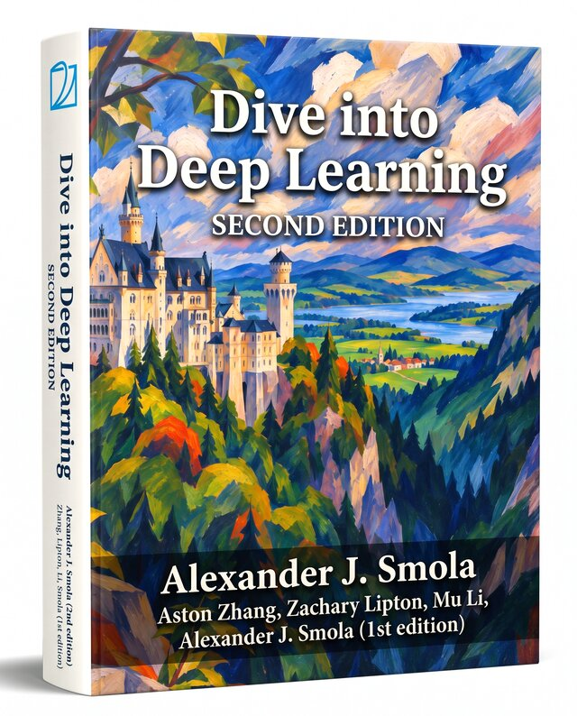

```{=html}
<style>
/* Suppress Quarto's auto title block on the landing page. Quarto emits
   two `#title-block-header` headers when `title-block-style: none` is
   set alongside the book-level author/date metadata in _quarto.yml; the
   hero section below renders the title, author list, and date itself,
   so hide both unconditionally. */
#title-block-header { display: none !important; }

/* ── Landing page styles (scoped to .d2l-landing) ─────────── */
.d2l-landing {
  --d2l-blue: #2196F3;
  --d2l-blue-dark: #1976D2;
  --d2l-blue-darker: #0D47A1;
  --d2l-blue-light: #BBDEFB;
  --d2l-blue-50: #E8F3FD;
  --d2l-deep-orange: #FF5722;
  --d2l-ink: #15181C;
  --d2l-ink-2: #3A4049;
  --d2l-ink-3: #6A717B;
  --d2l-ink-4: #9CA3AD;
  --d2l-line: #E7E9EC;
  --d2l-line-soft: #F0F2F5;
  --d2l-bg: #FFFFFF;
  --d2l-bg-soft: #F8F9FB;

  font-family: 'Source Sans 3', -apple-system, BlinkMacSystemFont, 'Segoe UI', sans-serif;
  color: var(--d2l-ink-2);
  line-height: 1.65;
}

.d2l-landing h2 {
  font-size: 1.625rem;
  font-weight: 600;
  color: var(--d2l-ink);
  border-bottom: none;
  padding-bottom: 0;
  margin: 0 0 1.25rem;
  letter-spacing: -0.01em;
}

.d2l-landing section { margin: 4rem 0; }
.d2l-landing section:first-of-type { margin-top: 1.5rem; }

/* ── Hero ─────────────────────────────────────────────────── */
.d2l-hero {
  display: grid;
  grid-template-columns: minmax(0, 1.4fr) minmax(0, 1fr);
  gap: 3rem;
  align-items: center;
  padding: 3rem 0 3.5rem;
  border-bottom: 1px solid var(--d2l-line);
}
.d2l-hero h1 {
  font-size: clamp(2.25rem, 4.2vw, 3.25rem);
  line-height: 1.1;
  font-weight: 700;
  color: var(--d2l-ink);
  margin: 0 0 1rem;
  letter-spacing: -0.02em;
  border: none;
  padding: 0;
}
.d2l-hero .lede {
  font-size: 1.1875rem;
  color: var(--d2l-ink-2);
  margin: 0 0 1rem;
  max-width: 38rem;
}
.d2l-hero .meta {
  font-size: 0.9375rem;
  color: var(--d2l-ink-3);
  margin: 0 0 1.75rem;
}
.d2l-hero .meta strong { color: var(--d2l-ink); font-weight: 600; }
.d2l-hero .ctas { display: flex; flex-wrap: wrap; gap: 0.625rem; }

.d2l-btn {
  display: inline-flex;
  align-items: center;
  gap: 0.4rem;
  padding: 0.625rem 1.1rem;
  font-size: 0.9375rem;
  font-weight: 600;
  border-radius: 6px;
  text-decoration: none !important;
  border: 1px solid transparent;
  transition: background 120ms ease, border-color 120ms ease, color 120ms ease;
}
.d2l-btn-primary {
  background: var(--d2l-blue);
  color: #fff !important;
}
.d2l-btn-primary:hover { background: var(--d2l-blue-dark); color: #fff !important; }
.d2l-btn-secondary {
  background: #fff;
  color: var(--d2l-blue-dark) !important;
  border-color: var(--d2l-line);
}
.d2l-btn-secondary:hover {
  border-color: var(--d2l-blue);
  color: var(--d2l-blue) !important;
}

.d2l-hero-cover {
  display: flex;
  justify-content: center;
}
.d2l-hero-cover img {
  max-width: 100%;
  width: 320px;
  height: auto;
  /* The cover is a photographed book on a white ground with its shadow
     already in the image (static/landing/cover-second-edition.jpg, a
     640 px copy of static/cover/d2l-second-edition.jpeg with the ground
     lifted to white), so no CSS shadow is added. */
}

@media (max-width: 820px) {
  .d2l-hero { grid-template-columns: 1fr; gap: 2rem; padding: 2rem 0; }
  .d2l-hero-cover { order: -1; }
  .d2l-hero-cover img { width: 220px; }
}

/* ── Frameworks strip ─────────────────────────────────────── */
.d2l-frameworks {
  background: var(--d2l-blue-50);
  border: 1px solid var(--d2l-blue-light);
  border-radius: 10px;
  padding: 1.75rem 2rem;
  display: flex;
  flex-wrap: wrap;
  align-items: center;
  gap: 1.25rem 2rem;
}
.d2l-frameworks .copy {
  flex: 1 1 320px;
  min-width: 0;
}
.d2l-frameworks .copy h2 {
  font-size: 1.1875rem;
  margin: 0 0 0.25rem;
}
.d2l-frameworks .copy p {
  margin: 0;
  font-size: 0.9375rem;
  color: var(--d2l-ink-2);
}
.d2l-fw-list {
  display: flex;
  flex-wrap: wrap;
  gap: 0.5rem;
  list-style: none;
  margin: 0;
  padding: 0;
}
.d2l-fw-list li {
  background: #fff;
  border: 1px solid var(--d2l-blue-light);
  color: var(--d2l-blue-darker);
  font-weight: 600;
  font-size: 0.875rem;
  padding: 0.4rem 0.85rem;
  border-radius: 999px;
  font-family: 'JetBrains Mono', ui-monospace, monospace;
  letter-spacing: -0.01em;
}

/* ── Feature grid ─────────────────────────────────────────── */
.d2l-feature-grid {
  display: grid;
  grid-template-columns: repeat(auto-fit, minmax(240px, 1fr));
  gap: 1.25rem;
}
.d2l-feature {
  background: #fff;
  border: 1px solid var(--d2l-line);
  border-radius: 8px;
  padding: 1.4rem 1.4rem 1.5rem;
  transition: border-color 150ms ease, box-shadow 150ms ease;
}
.d2l-feature:hover {
  border-color: var(--d2l-blue-light);
  box-shadow: 0 4px 14px -8px rgba(33, 150, 243, 0.35);
}
.d2l-feature .icon {
  width: 36px; height: 36px;
  display: inline-flex;
  align-items: center; justify-content: center;
  background: var(--d2l-blue-50);
  color: var(--d2l-blue-dark);
  border-radius: 6px;
  margin-bottom: 0.85rem;
  font-size: 1.1rem;
  font-weight: 700;
}
.d2l-feature h3 {
  font-size: 1rem;
  font-weight: 600;
  color: var(--d2l-ink);
  margin: 0 0 0.4rem;
}
.d2l-feature p {
  font-size: 0.9375rem;
  color: var(--d2l-ink-2);
  margin: 0;
}

/* ── Authors / contributors (shared layout) ────────────────── */
.d2l-authors,
.d2l-contributors {
  display: grid;
  grid-template-columns: repeat(auto-fit, minmax(190px, 1fr));
  gap: 1.5rem;
  justify-content: start;
}
.d2l-author,
.d2l-contributor {
  text-align: left;
  margin: 0;
}
.d2l-author img,
.d2l-contributor img {
  width: 128px; height: 128px;
  border-radius: 50%;
  object-fit: cover;
  border: 3px solid #fff;
  box-shadow: 0 0 0 1px var(--d2l-line), 0 6px 18px -10px rgba(15, 23, 42, 0.25);
  transition: box-shadow 150ms ease, transform 150ms ease;
}
.d2l-author .name,
.d2l-contributor .name {
  display: block;
  font-weight: 600;
  color: var(--d2l-ink);
  margin-top: 0.85rem;
  font-size: 1rem;
}
.d2l-author .affil,
.d2l-contributor .affil {
  display: block;
  color: var(--d2l-ink-3);
  font-size: 0.875rem;
  margin-top: 0.15rem;
}
.d2l-contributor a {
  text-decoration: none !important;
  color: inherit !important;
  display: block;
}
.d2l-contributor a:hover img {
  box-shadow: 0 0 0 1px var(--d2l-blue-light), 0 6px 18px -6px rgba(33, 150, 243, 0.35);
  transform: translateY(-1px);
}

.d2l-contrib-group {
  margin-top: 1.75rem;
}
.d2l-contrib-group:first-child { margin-top: 0; }
.d2l-contrib-group h3 {
  font-size: 1rem;
  font-weight: 600;
  color: var(--d2l-ink);
  margin: 0 0 1rem;
  letter-spacing: -0.005em;
}
.d2l-contrib-group h3 .chapter-name {
  color: var(--d2l-ink-3);
  font-weight: 500;
}

/* ── Universities ─────────────────────────────────────────── */
.d2l-universities {
  background: var(--d2l-bg);
  border: 1px solid var(--d2l-line);
  border-radius: 10px;
  padding: 1.75rem 2rem;
}
.d2l-universities .stat {
  display: flex;
  align-items: baseline;
  gap: 0.6rem;
  margin: 0 0 1.5rem;
  flex-wrap: wrap;
}
.d2l-universities .stat .num {
  font-size: 2.25rem;
  font-weight: 700;
  color: var(--d2l-blue-dark);
  letter-spacing: -0.02em;
  line-height: 1;
}
.d2l-universities .stat .desc {
  color: var(--d2l-ink-2);
  font-size: 1rem;
}

/* Logo grid: each cell is a fixed-aspect box with the logo centered.
   Wider cells (140px min) keep wordmark logos readable; the cell uses
   the full width and height of its track via object-fit: contain with
   center-center positioning, so portrait/landscape/square logos all
   look comparable instead of one being tiny in a corner. */
.d2l-uni-logos {
  display: grid;
  grid-template-columns: repeat(auto-fill, minmax(96px, 1fr));
  gap: 0.5rem;
  align-items: stretch;
  justify-items: stretch;
}
.d2l-uni-logos a,
.d2l-uni-logos > img {
  display: flex;
  align-items: center;
  justify-content: center;
  width: 100%;
  aspect-ratio: 1 / 1;
  padding: 0.25rem;
  box-sizing: border-box;
  text-decoration: none;
}
.d2l-uni-logos img,
.d2l-uni-logos a img {
  display: block;
  max-width: 100%;
  max-height: 100%;
  width: auto;
  height: auto;
  object-fit: contain;
  object-position: center center;
  filter: grayscale(0.4);
  opacity: 0.85;
  transition: filter 150ms ease, opacity 150ms ease, transform 150ms ease;
}
.d2l-uni-logos img:hover,
.d2l-uni-logos a:hover img {
  filter: grayscale(0);
  opacity: 1;
  transform: translateY(-1px);
}
.d2l-uni-note {
  margin: 1.25rem 0 0;
  font-size: 0.8125rem;
  color: var(--d2l-ink-3);
  font-style: italic;
}

/* ── Testimonials ─────────────────────────────────────────── */
.d2l-quotes {
  display: grid;
  grid-template-columns: repeat(auto-fit, minmax(280px, 1fr));
  gap: 1.25rem;
}
.d2l-quote {
  background: #fff;
  border: 1px solid var(--d2l-line);
  border-left: 3px solid var(--d2l-blue);
  border-radius: 6px;
  padding: 1.25rem 1.4rem;
}
.d2l-quote blockquote {
  margin: 0 0 0.75rem;
  font-size: 0.9375rem;
  color: var(--d2l-ink-2);
  font-style: italic;
}
.d2l-quote blockquote::before { content: "\201C"; color: var(--d2l-blue); margin-right: 0.1rem; }
.d2l-quote blockquote::after  { content: "\201D"; color: var(--d2l-blue); margin-left: 0.1rem; }
.d2l-quote .attrib {
  font-size: 0.8125rem;
  color: var(--d2l-ink-3);
}
.d2l-quote .attrib strong { color: var(--d2l-ink); font-weight: 600; }

/* ── Citation ─────────────────────────────────────────────── */
.d2l-cite pre {
  background: #F5F7FA;
  border: 1px solid var(--d2l-line);
  border-left: 3px solid var(--d2l-blue-light);
  border-radius: 0 6px 6px 0;
  padding: 1rem 1.2rem;
  font-family: 'JetBrains Mono', ui-monospace, monospace;
  font-size: 0.8125rem;
  color: var(--d2l-ink);
  overflow-x: auto;
  margin: 0;
}

/* ── Footer (resources) ───────────────────────────────────── */
.d2l-resources {
  display: grid;
  grid-template-columns: repeat(auto-fit, minmax(200px, 1fr));
  gap: 1rem;
  border-top: 1px solid var(--d2l-line);
  padding-top: 2rem;
}
.d2l-resources a {
  display: block;
  padding: 0.85rem 1rem;
  border: 1px solid var(--d2l-line);
  border-radius: 6px;
  background: #fff;
  font-weight: 600;
  color: var(--d2l-blue-dark) !important;
  text-decoration: none !important;
  transition: border-color 150ms ease, color 150ms ease;
}
.d2l-resources a:hover {
  border-color: var(--d2l-blue);
  color: var(--d2l-blue) !important;
}
.d2l-resources a small {
  display: block;
  font-weight: 400;
  color: var(--d2l-ink-3);
  font-size: 0.8125rem;
  margin-top: 0.2rem;
}

/* ── Adoption map ─────────────────────────────────────────── */
.d2l-adoption-map {
  border-top: 1px solid var(--d2l-line);
  padding-top: 2rem;
}
.d2l-adoption-map figure {
  margin: 0;
}
.d2l-adoption-map img {
  display: block;
  width: 100%;
  height: auto;
  border: 1px solid var(--d2l-line);
  border-radius: 8px;
}
.d2l-adoption-map figcaption {
  margin-top: 0.75rem;
  color: var(--d2l-ink-3);
  font-size: 0.875rem;
}
</style>

<div class="d2l-landing">

<section class="d2l-hero">
  <div>
    <h1>Dive into Deep Learning</h1>
    <p class="lede">Interactive deep learning, with code, math, and discussions — implemented in PyTorch, JAX, TensorFlow, and MXNet.</p>
    <p class="meta">By <strong>Aston Zhang</strong>, <strong>Zachary&nbsp;C.&nbsp;Lipton</strong>, <strong>Mu&nbsp;Li</strong>, and <strong>Alexander&nbsp;J.&nbsp;Smola</strong> &middot; Adopted at <strong>500+ universities</strong> in 70+ countries &middot; Published by Cambridge University Press.</p>
    <div class="ctas">
      <a class="d2l-btn d2l-btn-primary" href="chapter_preface/index.html">Get started</a>
      <a class="d2l-btn d2l-btn-secondary" href="https://d2l.ai/d2l-en.pdf">Free PDF</a>
      <a class="d2l-btn d2l-btn-secondary" href="https://github.com/d2l-ai/d2l-en">GitHub</a>
      <a class="d2l-btn d2l-btn-secondary" href="https://d2l.discourse.group">Discuss</a>
    </div>
  </div>
  <div class="d2l-hero-cover">
    <a href="https://d2l.ai/d2l-en.pdf" aria-label="Download free PDF">
      
    </a>
  </div>
</section>

<section>
  <div class="d2l-frameworks">
    <div class="copy">
      <h2>One book, four frameworks</h2>
      <p>Every example runs end-to-end in your framework of choice. Switch tabs to see the same idea in idiomatic code for each.</p>
    </div>
    <ul class="d2l-fw-list">
      <li>PyTorch</li>
      <li>JAX</li>
      <li>TensorFlow</li>
      <li>MXNet</li>
    </ul>
  </div>
</section>

<section>
  <h2>What you get</h2>
  <div class="d2l-feature-grid">
    <div class="d2l-feature">
      <div class="icon">{ }</div>
      <h3>Code you can run</h3>
      <p>Every concept ships with executable Jupyter notebooks. Tweak hyperparameters and see the effect immediately.</p>
    </div>
    <div class="d2l-feature">
      <div class="icon">∑</div>
      <h3>Math grounded in intuition</h3>
      <p>Derivations stay close to the code. Equations, figures, and prose are interwoven, not relegated to appendices.</p>
    </div>
    <div class="d2l-feature">
      <div class="icon">↔</div>
      <h3>Truly multi-framework</h3>
      <p>The same chapter, the same explanations, in PyTorch, JAX, TensorFlow, and MXNet. Pick your framework, keep the book.</p>
    </div>
    <div class="d2l-feature">
      <div class="icon">☁</div>
      <h3>Runs anywhere</h3>
      <p>Local Jupyter, Google Colab, Amazon SageMaker Studio Lab, or your own GPU box. No paywalls, no setup hurdles.</p>
    </div>
    <div class="d2l-feature">
      <div class="icon">🎓</div>
      <h3>Classroom-tested</h3>
      <p>Used as a primary or supplementary text at 500+ universities. Slide decks, exercises, and a discussion forum included.</p>
    </div>
    <div class="d2l-feature">
      <div class="icon">∞</div>
      <h3>Always free, always evolving</h3>
      <p>The book is fully open-source. New chapters and corrections land continuously, in step with the field.</p>
    </div>
  </div>
</section>

<section>
  <h2>Authors</h2>
  <div class="d2l-authors">
    <figure class="d2l-author">
      
      <span class="name">Aston Zhang</span>
      <span class="affil">AWS</span>
    </figure>
    <figure class="d2l-author">
      
      <span class="name">Zachary C. Lipton</span>
      <span class="affil">Carnegie Mellon University</span>
    </figure>
    <figure class="d2l-author">
      
      <span class="name">Mu Li</span>
      <span class="affil">Boson AI &middot; AWS</span>
    </figure>
    <figure class="d2l-author">
      
      <span class="name">Alexander J. Smola</span>
      <span class="affil">Boson AI &middot; CMU</span>
    </figure>
  </div>
</section>

<section>
  <h2>Chapter contributors</h2>
  <p style="color: var(--d2l-ink-3); margin: -0.5rem 0 1.75rem; max-width: 50rem;">Specialist authors who led the writing of individual chapters in the second volume.</p>

  <div class="d2l-contrib-group">
    <h3>Reinforcement Learning</h3>
    <div class="d2l-contributors">
      <figure class="d2l-contributor">
        <a href="https://pratikac.github.io/">
          
          <span class="name">Pratik Chaudhari</span>
          <span class="affil">UPenn &middot; Amazon</span>
        </a>
      </figure>
      <figure class="d2l-contributor">
        <a href="https://sites.google.com/site/rfakoor">
          
          <span class="name">Rasool Fakoor</span>
          <span class="affil">Amazon</span>
        </a>
      </figure>
      <figure class="d2l-contributor">
        <a href="https://cs.brown.edu/~kasadiat/">
          
          <span class="name">Kavosh Asadi</span>
          <span class="affil">Amazon</span>
        </a>
      </figure>
    </div>
  </div>

  <div class="d2l-contrib-group">
    <h3>Gaussian Processes</h3>
    <div class="d2l-contributors">
      <figure class="d2l-contributor">
        <a href="https://cims.nyu.edu/~andrewgw/">
          
          <span class="name">Andrew Gordon Wilson</span>
          <span class="affil">NYU &middot; Amazon</span>
        </a>
      </figure>
    </div>
  </div>

  <div class="d2l-contrib-group">
    <h3>Hyperparameter Optimization</h3>
    <div class="d2l-contributors">
      <figure class="d2l-contributor">
        <a href="https://aaronkl.github.io/">
          
          <span class="name">Aaron Klein</span>
          <span class="affil">Amazon</span>
        </a>
      </figure>
      <figure class="d2l-contributor">
        <a href="https://mseeger.github.io/">
          
          <span class="name">Matthias Seeger</span>
          <span class="affil">Amazon</span>
        </a>
      </figure>
      <figure class="d2l-contributor">
        <a href="http://www0.cs.ucl.ac.uk/staff/c.archambeau/">
          
          <span class="name">Cedric Archambeau</span>
          <span class="affil">Amazon</span>
        </a>
      </figure>
    </div>
  </div>

  <div class="d2l-contrib-group">
    <h3>Recommender Systems</h3>
    <div class="d2l-contributors">
      <figure class="d2l-contributor">
        <a href="https://shuaizhang.tech/">
          
          <span class="name">Shuai Zhang</span>
          <span class="affil">Amazon</span>
        </a>
      </figure>
      <figure class="d2l-contributor">
        <a href="https://vanzytay.github.io/">
          
          <span class="name">Yi Tay</span>
          <span class="affil">Google</span>
        </a>
      </figure>
    </div>
  </div>

  <div class="d2l-contrib-group">
    <h3>Mathematics for Deep Learning</h3>
    <div class="d2l-contributors">
      <figure class="d2l-contributor">
        <a href="https://www.linkedin.com/in/brent-werness-1506471b7/">
          
          <span class="name">Brent Werness</span>
          <span class="affil">Amazon</span>
        </a>
      </figure>
      <figure class="d2l-contributor">
        <a href="https://www.linkedin.com/in/rachelsonghu/">
          
          <span class="name">Rachel Hu</span>
          <span class="affil">Amazon</span>
        </a>
      </figure>
    </div>
  </div>
</section>

<section>
  <h2>Framework adaptation leads</h2>
  <p style="color: var(--d2l-ink-3); margin: -0.5rem 0 1.75rem; max-width: 50rem;">Driving the per-framework code: porting every example to PyTorch, JAX, and TensorFlow.</p>
  <div class="d2l-contributors">
    <figure class="d2l-contributor">
      <a href="https://github.com/AnirudhDagar">
        
        <span class="name">Anirudh Dagar</span>
        <span class="affil">PyTorch &amp; JAX &middot; Amazon</span>
      </a>
    </figure>
    <figure class="d2l-contributor">
      <a href="https://terrytangyuan.github.io/about/">
        
        <span class="name">Yuan Tang</span>
        <span class="affil">TensorFlow &middot; Akuity</span>
      </a>
    </figure>
  </div>
</section>

<section>
  <h2>Adopted at universities worldwide</h2>
  <div class="d2l-universities">
    <p class="stat"><span class="num">500+</span><span class="desc">universities in 70+ countries teach with <em>Dive into Deep Learning</em>.</span></p>
    <div class="d2l-uni-logos">
<!-- @universities-begin (auto-generated by tools/render_logo_grid.py from tools/universities.json) -->
      <a href="https://www.abasynisb.edu.pk/program/bs-artificial-intelligence-bsai/curriculum" title="Abasyn University Islamabad Campus" target="_blank" rel="noopener"></a>
      <a href="https://sylabusy.agh.edu.pl/" title="AGH University of Krakow" target="_blank" rel="noopener"></a>
      <a href="https://eng.asu.edu.eg/courses/11343/details/347" title="Ain Shams University" target="_blank" rel="noopener"></a>
      <a href="https://alexu.edu.eg/index.php/en/" title="Alexandria University" target="_blank" rel="noopener"></a>
      <a href="https://www.amity.edu/" title="Amity University" target="_blank" rel="noopener"></a>
      <a href="https://www.amrita.edu" title="Amrita Vishwa Vidyapeetham" target="_blank" rel="noopener"></a>
      <a href="https://www.andhrauniversity.edu.in/syllabus/ug/37%20DATA%20SCIENCE%20%28B.Sc.%29%20MAJOR.pdf" title="Andhra University" target="_blank" rel="noopener"></a>
      <a href="https://www.aplustopper.com/ad3501-deep-learning-syllabus/" title="Anna University" target="_blank" rel="noopener"></a>
      <a href="https://www.adnu.edu.ph/college-of-computer-studies/" title="Ateneo de Naga University" target="_blank" rel="noopener"></a>
      <a href="https://www.acu.edu.au/handbook/handbook-2026/unit/aint600" title="Australian Catholic University" target="_blank" rel="noopener"></a>
      <a href="https://programsandcourses.anu.edu.au/course/COMP3242/First%20Semester/4129" title="Australian National University" target="_blank" rel="noopener"></a>
      <a href="https://guies.uab.cat/guies_docents/public/portal/html/2024/assignatura/106573/en" title="Autonomous University of Barcelona" target="_blank" rel="noopener"></a>
      <a href="https://www.uam.es/eps/guias-docentes" title="Autonomous University of Madrid" target="_blank" rel="noopener"></a>
      <a href="https://dsai.biu.ac.il/data-science-related-courses-at-bar-ilan-university/" title="Bar Ilan University" target="_blank" rel="noopener"></a>
      <a href="https://barnard.edu/computer-science" title="Barnard College" target="_blank" rel="noopener"></a>
      <a href="https://www.bimsa.cn/research_detail/DeeLea.html" title="Beijing Institute of Mathematical Sciences and Applications" target="_blank" rel="noopener"></a>
      <a href="https://ects.beykoz.edu.tr/bilgipaketi/eobsakts/ders/ders_id/10719/program_kodu/3007004/h/1378/s//st/E6/submenuheader/0/ln/en/print/1" title="Beykoz University" target="_blank" rel="noopener"></a>
      <a href="https://github.com/tirtharajdash/CS-F425_Deep-Learning" title="Birla Institute of Technology and Science Pilani" target="_blank" rel="noopener"></a>
      <a href="https://www.bmu.edu.in/social/b-tech-computer-science-engineering-where-logics-meets-creativity/" title="BML Munjal University" target="_blank" rel="noopener"></a>
      <a href="https://miayuanai.github.io/csci3370/f24/" title="Boston College" target="_blank" rel="noopener"></a>
      <a href="https://www.bu.edu/csmet/files/2025/01/CS_767_General_Information_2025.pdf" title="Boston University" target="_blank" rel="noopener"></a>
      <a href="https://www.bracu.ac.bd/research-area/data-analysis-and-machine-learning" title="Brac University" target="_blank" rel="noopener"></a>
      <a href="https://chuxuzhang.github.io/course/COSI165B.html" title="Brandeis University" target="_blank" rel="noopener"></a>
      <a href="https://brown-deep-learning.github.io/dl-website-s24/syllabus.pdf" title="Brown University" target="_blank" rel="noopener"></a>
      <a href="https://portal.vik.bme.hu/kepzes/targyak/BMEVIIIPHDV003-00/" title="Budapest University of Technology and Economics" target="_blank" rel="noopener"></a>
      <a href="https://bilgipaketi.uludag.edu.tr/Ders/IndexENG/1241785" title="Bursa Uludag University" target="_blank" rel="noopener"></a>
      <a href="https://eng.cu.edu.eg/en/" title="Cairo University" target="_blank" rel="noopener"></a>
      <a href="https://ceng481.cankaya.edu.tr/" title="Cankaya University" target="_blank" rel="noopener"></a>
      <a href="https://deeplearning.cs.cmu.edu/S25/index.html" title="Carnegie Mellon University" target="_blank" rel="noopener"></a>
      <a href="https://africa.engineering.cmu.edu/" title="Carnegie Mellon University Africa" target="_blank" rel="noopener"></a>
      <a href="https://ufal.mff.cuni.cz/courses/npfl099" title="Charles University" target="_blank" rel="noopener"></a>
      <a href="https://www.cmi.ac.in/~pranabendu/aml23/" title="Chennai Mathematical Institute" target="_blank" rel="noopener"></a>
      <a href="https://ouc.ai/zhenghaiyong/courses/dl/2024fall/index.html" title="China Ocean University" target="_blank" rel="noopener"></a>
      <a href="https://github.com/rphilipzhang/AI-PhD-S26" title="Chinese University of Hong Kong" target="_blank" rel="noopener"></a>
      <a href="https://sds.cuhk.edu.cn/" title="Chinese University of Hong Kong Shenzhen" target="_blank" rel="noopener"></a>
      <a href="https://znxy.cqust.edu.cn/__local/D/8D/EF/8D4B1DAADB3BBAA399816448951_B63B31C4_16C213.pdf?e=.pdf" title="Chongqing University of Science and Technology" target="_blank" rel="noopener"></a>
      <a href="https://christuniversity.in/uploads/course/MSc_AI_23-24_20230907104038.pdf" title="Christ University Bengaluru" target="_blank" rel="noopener"></a>
      <a href="https://www.cp.eng.chula.ac.th/" title="Chulalongkorn University" target="_blank" rel="noopener"></a>
      <a href="https://escuela.math.cinvestav.mx/" title="CINVESTAV" target="_blank" rel="noopener"></a>
      <a href="https://www.ee.cityu.edu.hk/~lmpo/ee4016/pdf/2026_AI_L01A_Course.pdf" title="City University of Hong Kong" target="_blank" rel="noopener"></a>
      <a href="https://cusat.ac.in" title="Cochin University of Science and Technology" target="_blank" rel="noopener"></a>
      <a href="https://www.coeptech.ac.in/" title="College of Engineering Pune" target="_blank" rel="noopener"></a>
      <a href="https://courses.cs.colostate.edu/cs545/syllabus/" title="Colorado State University" target="_blank" rel="noopener"></a>
      <a href="https://psychology.columbia.edu/content/graduate-courses" title="Columbia University" target="_blank" rel="noopener"></a>
      <a href="https://www.concordia.ca/academics/undergraduate/calendar/current/section-71-gina-cody-school-of-engineering-and-computer-science/section-71-70-department-of-computer-science-and-software-engineering/section-71-70-10-computer-science-and-software-engineering-courses.html#COMP433" title="Concordia University" target="_blank" rel="noopener"></a>
      <a href="https://www.cs.cornell.edu/courses/cs4782/2026sp/" title="Cornell University" target="_blank" rel="noopener"></a>
      <a href="https://vertexaisearch.cloud.google.com/grounding-api-redirect/AUZIYQEePnyo12WknD4kFS_0iq0mCTK9H2FQCvQVe-Y4EQ9n2gF1_o3JwCnWlTv67KpapD81eFNcLv8p8arLEhkSeeCVaJpR2-cWH5AHvZMwRwkxlbQOfxXj83qRyGQdILkXKpyKsz3UJIPJPEaHIqnlzEFh2_CoUlxoQw5blSN6AJtHLXWEORl6DA4gldPDqOvBuxZVqSD6CUOzvuUXL7qFCJKN8U5w4VBVmr-I" title="CUNY Graduate Center" target="_blank" rel="noopener"></a>
      <a href="https://www.cyi.ac.cy/index.php/education/masters-programs/simulation-and-data-sciences/sds-418-deep-learning-approaches.html" title="Cyprus Institute" target="_blank" rel="noopener"></a>
      <a href="https://cs.dlut.edu.cn/" title="Dalian University of Technology" target="_blank" rel="noopener"></a>
      <a href="https://www.dsu.edu.in/images/Engineering/AIML-dept/PDF/Syllabus_2021-25.pdf" title="Dayananda Sagar University" target="_blank" rel="noopener"></a>
      <a href="https://www.deakin.edu.au/courses/unit?unit=SIT744" title="Deakin University" target="_blank" rel="noopener"></a>
      <a href="https://gaotx-cs.github.io/teaching/csc578/" title="DePaul University" target="_blank" rel="noopener"></a>
      <a href="https://ejournal3.undip.ac.id/index.php/gaussian" title="Diponegoro University" target="_blank" rel="noopener"></a>
      <a href="https://www2.stat.duke.edu/~sayan/561/2020/index_pre.html" title="Duke University" target="_blank" rel="noopener"></a>
      <a href="https://www.dut.ac.za/faculty/accounting-and-informatics/information-technology/" title="Durban University of Technology" target="_blank" rel="noopener"></a>
      <a href="https://lanyunshi.github.io/resources/html/deep-learning2024-2025.html" title="East China Normal University" target="_blank" rel="noopener"></a>
      <a href="https://www.emu.edu.tr/en/programs/artificial-intelligence-engineering-undergraduate-program/1760?tab=curriculum" title="Eastern Mediterranean University" target="_blank" rel="noopener"></a>
      <a href="https://www.esi.dz/" title="Ecole Nationale Superieure dInformatique" target="_blank" rel="noopener"></a>
      <a href="https://www.cs.emory.edu/~cheung/Courses/MyInterests/MachineLearning/Books/" title="Emory University" target="_blank" rel="noopener"></a>
      <a href="https://github.com/saxovia/deepnetworkdevelopment" title="Eötvös Loránd University (ELTE), Budapest" target="_blank" rel="noopener"></a>
      <a href="https://edu.epfl.ch/coursebook/en/deep-learning-EE-559" title="EPFL" target="_blank" rel="noopener"></a>
      <a href="https://atenea.epn.edu.ec/" title="Escuela Politecnica Nacional" target="_blank" rel="noopener"></a>
      <a href="https://www.fiec.espol.edu.ec/en/undergraduate-programs/data-science-and-artificial-intelligence-online" title="Escuela Superior Politecnica del Litoral" target="_blank" rel="noopener"></a>
      <a href="https://cmsfox.ewha.ac.kr/aix/board/notice.do?articleNo=757832&amp;attachNo=486516&amp;mode=download" title="Ewha Womans University" target="_blank" rel="noopener"></a>
      <a href="https://fulokoja.edu.ng/academic-programme.php?i=bachelor-of-science-degree-in-computer-science&amp;section=structure-and-content" title="Federal University Lokoja" target="_blank" rel="noopener"></a>
      <a href="https://ois.fbu.edu.tr/bilgipaketi/index/ders/ders_id/27887/program_kodu/0702001/h/600/s/8/st/D/ln/tr" title="Fenerbahce University" target="_blank" rel="noopener"></a>
      <a href="http://service005.sds.fcu.edu.tw/" title="Feng Chia University" target="_blank" rel="noopener"></a>
      <a href="https://github.com/34759421/Learning-Resources-Sharing-FPTU-campus-HCMC-Artificial-Intelligence" title="FPT University" target="_blank" rel="noopener"></a>
      <a href="https://www.wiwiss.fu-berlin.de/fachbereich/vwl/bach/" title="Free University of Berlin" target="_blank" rel="noopener"></a>
      <a href="https://fudan.edu.cn/" title="Fudan University" target="_blank" rel="noopener"></a>
      <a href="https://gvpce.ac.in" title="Gayatri Vidya Parishad College of Engineering (Autonomous)" target="_blank" rel="noopener"></a>
      <a href="https://gazi.edu.tr/" title="Gazi Universitesi" target="_blank" rel="noopener"></a>
      <a href="https://mingruiliu.github.io/" title="George Mason University" target="_blank" rel="noopener"></a>
      <a href="https://cs.georgetown.edu/" title="Georgetown University" target="_blank" rel="noopener"></a>
      <a href="https://chaozhang.org" title="Georgia Institute of Technology" target="_blank" rel="noopener"></a>
      <a href="https://www.unigoa.ac.in/uploads/syllabus/me-computer-science-and-engineering-artificial-intelligence-and-machine-learning_syllabus_35820251022.060733.pdf" title="Goa University" target="_blank" rel="noopener"></a>
      <a href="https://www.ggu.edu" title="Golden Gate University" target="_blank" rel="noopener"></a>
      <a href="https://www.greatlakes.edu.in/e-learning-programs/" title="Great Lakes Institute of Management" target="_blank" rel="noopener"></a>
      <a href="https://courses.gdut.edu.cn/course/view.php?id=1381" title="Guangdong University of Technology" target="_blank" rel="noopener"></a>
      <a href="https://uehwan.github.io/" title="Gwangju Institute of Science and Technology" target="_blank" rel="noopener"></a>
      <a href="https://habib.edu.pk" title="Habib University" target="_blank" rel="noopener"></a>
      <a href="https://catalog.hbku.edu.qa/course-descriptions/" title="Hamad Bin Khalifa University" target="_blank" rel="noopener"></a>
      <a href="https://hdu.edu.cn" title="Hangzhou Dianzi University" target="_blank" rel="noopener"></a>
      <a href="https://www.hufs.ac.kr" title="Hankuk University of Foreign Studies" target="_blank" rel="noopener"></a>
      <a href="https://hust.edu.vn" title="Hanoi University of Science and Technology" target="_blank" rel="noopener"></a>
      <a href="https://cai.hit.ac.zw" title="Harare Institute of Technology" target="_blank" rel="noopener"></a>
      <a href="https://www.icourse163.org/spoc/course/HIT-1469674174" title="Harbin Institute of Technology" target="_blank" rel="noopener"></a>
      <a href="https://msc2024.dit.hua.gr/en/course/vathia-mathhsh/" title="Harokopio University" target="_blank" rel="noopener"></a>
      <a href="https://harvard-iacs.github.io/CS287/supplemental" title="Harvard University" target="_blank" rel="noopener"></a>
      <a href="https://hpi.de/en/studies/during-your-studies/courses/it-systems-engineering-ma/course/sose-20-3033-introduction-to-deep-learning.html" title="Hasso Plattner Institut" target="_blank" rel="noopener"></a>
      <a href="https://shnaton.huji.ac.il/index.php/NewSyl/67822/2/2022/" title="Hebrew University of Jerusalem" target="_blank" rel="noopener"></a>
      <a href="https://scie.usth.edu.cn/__local/9/4F/2C/2EE8FAECB48CD117456EF3891C7_BEADB2B9_180BE9.pdf" title="Heilongjiang University of Science and Technology" target="_blank" rel="noopener"></a>
      <a href="https://www.hhu.de" title="Heinrich Heine Universitat Dusseldorf" target="_blank" rel="noopener"></a>
      <a href="https://vertexaisearch.cloud.google.com/grounding-api-redirect/AUZIYQG1F20y3lMYq9KTXPCSu41k29ELQPce-BP0MrKKzDhKsLMO0y1wphENXdrK7qCx6aWju4StQfSBAWAciLwuluJPyXrTKYgRZ_JYjjWcusryC08fjryH5aBv00neat5Jc1jJPlMtiKt5LMDTB5ns7DjTSdhU962pzuR1E3jDsJAj" title="Heriot-Watt University" target="_blank" rel="noopener"></a>
      <a href="https://www.hertie-school.org/en/programmes/mds-curriculum" title="Hertie School" target="_blank" rel="noopener"></a>
      <a href="https://momiji.hiroshima-u.ac.jp/" title="Hiroshima University" target="_blank" rel="noopener"></a>
      <a href="https://huflit.edu.vn" title="Ho Chi Minh City University of Foreign Languages and Information Technology" target="_blank" rel="noopener"></a>
      <a href="https://hcmut.edu.vn" title="Ho Chi Minh City University of Technology" target="_blank" rel="noopener"></a>
      <a href="https://www.hs-bremen.de" title="Hochschule Bremen" target="_blank" rel="noopener"></a>
      <a href="https://www.htw-berlin.de/studium/studiengaenge/master-informatik-in-ingenieurwissenschaften/" title="Hochschule fur Technik und Wirtschaft" target="_blank" rel="noopener"></a>
      <a href="https://www.comp.hkbu.edu.hk/v1/?page=course_details&amp;code=COMP7250" title="Hong Kong Baptist University" target="_blank" rel="noopener"></a>
      <a href="https://www.polyu.edu.hk/dsai/-/media/department/dsai/programme/sdfs/dsai5206.pdf" title="Hong Kong Polytechnic University" target="_blank" rel="noopener"></a>
      <a href="https://seng.hkust.edu.hk/sites/default/files/IMCE/UG/Course%20Syllabus/Spring_2022-2023/COMP4211_Spring%2022-23.pdf" title="Hong Kong University of Science and Technology" target="_blank" rel="noopener"></a>
      <a href="https://cs.hust.edu.cn/rcpy/bksjy/kc.htm" title="Huazhong University of Science and Technology" target="_blank" rel="noopener"></a>
      <a href="https://github.com/Humboldt-WI/delta" title="Humboldt University of Berlin" target="_blank" rel="noopener"></a>
      <a href="https://wp.doc.ic.ac.uk/bkainz/teaching/70010-deep-learning-from-2023/" title="Imperial College London" target="_blank" rel="noopener"></a>
      <a href="https://www.imt-mines-ales.fr" title="IMT Mines Ales" target="_blank" rel="noopener"></a>
      <a href="https://iiitl.ac.in/wp-content/uploads/2023/06/M.-Sc-Data_Science-course-structure-and-syllabus.pdf" title="Indian Institute of Information Technology Lucknow" target="_blank" rel="noopener"></a>
      <a href="https://cdn.iiitu.ac.in/uploads/course/CYSyllabus2024_28.pdf" title="Indian Institute of Information Technology Una" target="_blank" rel="noopener"></a>
      <a href="https://onlinecourses.nptel.ac.in/noc26_cs01/preview" title="Indian Institute of Science Bangalore" target="_blank" rel="noopener"></a>
      <a href="https://www.cse.iitb.ac.in/~cs772/" title="Indian Institute of Technology Bombay" target="_blank" rel="noopener"></a>
      <a href="https://scai.iitd.ac.in/" title="Indian Institute of Technology Delhi" target="_blank" rel="noopener"></a>
      <a href="https://sites.google.com/iitgn.ac.in/es413/home" title="Indian Institute of Technology Gandhinagar" target="_blank" rel="noopener"></a>
      <a href="https://www.iitg.ac.in/dsai/dsai_sixth_sem_btech_minor.html" title="Indian Institute of Technology Guwahati" target="_blank" rel="noopener"></a>
      <a href="https://ai.iith.ac.in/" title="Indian Institute of Technology Hyderabad" target="_blank" rel="noopener"></a>
      <a href="https://iitj.ac.in/PageImages/Gallery/07-2025/CSE-Courses-Details.pdf" title="Indian Institute of Technology Jodhpur" target="_blank" rel="noopener"></a>
      <a href="https://www.cse.iitk.ac.in/users/piyush/" title="Indian Institute of Technology Kanpur" target="_blank" rel="noopener"></a>
      <a href="https://cse.iitkgp.ac.in" title="Indian Institute of Technology Kharagpur" target="_blank" rel="noopener"></a>
      <a href="https://www.cse.iitm.ac.in/~miteshk/CS6910.html" title="Indian Institute of Technology Madras" target="_blank" rel="noopener"></a>
      <a href="https://sps.iitmandi.ac.in/files/COURSE_HANDBOOK_Undergraduate_in_Physics_-2.pdf" title="Indian Institute of Technology Mandi" target="_blank" rel="noopener"></a>
      <a href="https://www.iitp.ac.in/~arijit/web/index.php?id=courses%2F2024_CS551" title="Indian Institute of Technology Patna" target="_blank" rel="noopener"></a>
      
      <a href="https://iittp.ac.in/" title="Indian Institute of Technology Tirupati" target="_blank" rel="noopener"></a>
      
      <a href="https://github.com/aflah02/SemWiseResourcesIIIT" title="Indraprastha Institute of Information Technology, Delhi" target="_blank" rel="noopener"></a>
      <a href="https://im.itu.edu.pk/deeplearning2021/" title="Information Technology University Lahore" target="_blank" rel="noopener"></a>
      
      
      
      
      
      <a href="https://www.cic.ipn.mx/" title="Instituto Politécnico Nacional" target="_blank" rel="noopener"></a>
      <a href="https://mcdatos.itam.mx/es/aprendizaje-de-maquina-avanzado" title="Instituto Tecnologico Autonomo de Mexico" target="_blank" rel="noopener"></a>
      <a href="https://innovacion.itba.edu.ar/educacion-ejecutiva/tic/deep-learning" title="Instituto Tecnologico de Buenos Aires" target="_blank" rel="noopener"></a>
      <a href="https://pgadmissions.iiit.ac.in/" title="International Institute of Information Technology, Hyderabad" target="_blank" rel="noopener"></a>
      <a href="https://iu.edu.sa/" title="Islamic University of Medina" target="_blank" rel="noopener"></a>
      <a href="https://ois.atlas.edu.tr/bilgipaketi/index/ders/ders_id/31175/program_kodu/0501002/h/465/s/8/st/DE/ln/en/print/1/" title="Istanbul Atlas University" target="_blank" rel="noopener"></a>
      <a href="https://ninova.itu.edu.tr/" title="Istanbul Teknik Universitesi" target="_blank" rel="noopener"></a>
      <a href="https://ois.istinye.edu.tr/bilgipaketi/eobsakts/ders/ders_id/13149/program_kodu/0403001/h/1303/s/8/st/D/ln/en" title="Istinye University" target="_blank" rel="noopener"></a>
      
      
      <a href="https://apps.ep.jhu.edu/syllabus/spring-2024/605.742.82" title="Johns Hopkins University" target="_blank" rel="noopener"></a>
      <a href="https://wiki.kdd.cs.ksu.edu/page/courses-vision" title="Kansas State University" target="_blank" rel="noopener"></a>
      
      <a href="https://drcs.codes/deep-learning/ksu/cs4277/syllabus.html" title="Kennesaw State University" target="_blank" rel="noopener"></a>
      <a href="https://ml.kaust.edu.sa/courses.html" title="King Abdullah University of Science and Technology" target="_blank" rel="noopener"></a>
      <a href="https://faculty.kfupm.edu.sa/ICS/hluqman/courses/221-ICS471.html" title="King Fahd University of Petroleum and Minerals" target="_blank" rel="noopener"></a>
      <a href="https://www.kfu.edu.sa/ar/Deans/E-Learning/Documents/bsc-web/new/assets/pdf/diploma/computer-science/3271-109-17.pdf" title="King Faisal University" target="_blank" rel="noopener"></a>
      
      
      
      <a href="https://onderwijsaanbod.kuleuven.be/syllabi/e/H0Q42AE.htm" title="KU Leuven" target="_blank" rel="noopener"></a>
      <a href="https://com.khu.ac.kr/resources/user/download/ice/%EC%BB%B4%ED%93%A8%ED%84%B0%EA%B3%B5%ED%95%99/%EC%9D%B8%EA%B3%B5%EC%A7%80%EB%8A%A5.pdf" title="Kyung Hee University" target="_blank" rel="noopener"></a>
      
      <a href="https://web.lums.edu.pk/~hmd/assets/teaching/EE414_Tutorials.pdf" title="Lahore University of Management Sciences" target="_blank" rel="noopener"></a>
      
      
      <a href="https://www.uni-hannover.de/" title="Leibniz Universitat Hannover" target="_blank" rel="noopener"></a>
      
      <a href="https://liu.se/en/education/course/" title="Linköping University" target="_blank" rel="noopener"></a>
      <a href="https://www.lzhit.edu.cn/rjxy/info/1098/1341.htm" title="Liuzhou Institute of Technology" target="_blank" rel="noopener"></a>
      <a href="https://slds-lmu.github.io/i2dl/" title="LMU Munich" target="_blank" rel="noopener"></a>
      <a href="https://www.lse.ac.uk/resources/calendar2025-2026/courseGuides/ST/2025_ST456.htm" title="London School of Economics and Political Science" target="_blank" rel="noopener"></a>
      <a href="https://www.lusem.lu.se/" title="Lund University" target="_blank" rel="noopener"></a>
      
      <a href="https://mbcet.ac.in/wp-content/uploads/2025/06/Curriculum-2022_CSEAI_B-Tech4year-06062025.pdf" title="Mar Baselios College of Engineering and Technology" target="_blank" rel="noopener"></a>
      <a href="https://cse-eng.marmara.edu.tr/dosya/eng/cse/documents/syllabus_tr/te/v0/CSE4079.pdf" title="Marmara University" target="_blank" rel="noopener"></a>
      
      <a href="https://dcai.csail.mit.edu/" title="Massachusetts Institute of Technology" target="_blank" rel="noopener"></a>
      <a href="https://www.cs.mcgill.ca/~isabeau/COMP551/F24/" title="McGill University" target="_blank" rel="noopener"></a>
      <a href="https://sis.mef.edu.tr/bilgipaketi/index/ders/ders_id/11772/program_kodu/0201001/h/908/s/1/st/N/ln/en/print/1/" title="MEF University" target="_blank" rel="noopener"></a>
      <a href="https://mu.menofia.edu.eg/fci/Home/en" title="Menoufia University" target="_blank" rel="noopener"></a>
      <a href="https://hal.cse.msu.edu/teaching/2024-spring-deep-learning/" title="Michigan State University" target="_blank" rel="noopener"></a>
      <a href="https://user.ceng.metu.edu.tr/~skalkan/" title="Middle East Technical University" target="_blank" rel="noopener"></a>
      <a href="https://middlebury-csci-0451.github.io/CSCI-0451-s24/" title="Middlebury College" target="_blank" rel="noopener"></a>
      <a href="https://faculty-web.msoe.edu/yoder/cs3450/" title="Milwaukee School of Engineering" target="_blank" rel="noopener"></a>
      <a href="https://minia.edu.eg/fci/" title="Minia University" target="_blank" rel="noopener"></a>
      <a href="https://ensias.um5.ac.ma/" title="Mohammed V University in Rabat" target="_blank" rel="noopener"></a>
      <a href="https://handbook.monash.edu/current/units/ECE4179" title="Monash University" target="_blank" rel="noopener"></a>
      <a href="https://www.mmu.edu.my/fist/" title="Multimedia University" target="_blank" rel="noopener"></a>
      <a href="https://handbook.murdoch.edu.au/" title="Murdoch University" target="_blank" rel="noopener"></a>
      <a href="https://syllabus.adm.nagoya-u.ac.jp/data/2024/06_2024_X320000619811.html" title="Nagoya University" target="_blank" rel="noopener"></a>
      <a href="https://www.nchu.edu.cn/en" title="Nanchang Hangkong University" target="_blank" rel="noopener"></a>
      <a href="http://jwc.nnudy.edu.cn/c211/20240731/i35828.html" title="Nanjing Normal University Zhongbei College" target="_blank" rel="noopener"></a>
      <a href="https://lamda.nju.edu.cn/" title="Nanjing University" target="_blank" rel="noopener"></a>
      <a href="https://www.icourse163.org/course/NJUE-1469604166" title="Nanjing University of Finance and Economics" target="_blank" rel="noopener"></a>
      <a href="https://www.csie.ncu.edu.tw/" title="National Central University" target="_blank" rel="noopener"></a>
      <a href="https://ds.ncku.edu.tw/" title="National Cheng Kung University" target="_blank" rel="noopener"></a>
      <a href="https://newdoc.nccu.edu.tw/teaschm/1122/schmPrv.jsp-yy=112&amp;smt=2&amp;num=352769&amp;gop=00&amp;s=1.html" title="National Chengchi University" target="_blank" rel="noopener"></a>
      <a href="https://guides.lib.nchu.edu.tw/c.php?g=939671" title="National Chung Hsing University" target="_blank" rel="noopener"></a>
      <a href="https://www.nitttrchd.ac.in" title="National Institute of Technical Teachers Training &amp; Research" target="_blank" rel="noopener"></a>
      <a href="https://www.nitw.ac.in" title="National Institute of Technology, Warangal" target="_blank" rel="noopener"></a>
      <a href="https://nitdelhi.ac.in/wp-content/uploads/2025/07/M_TECH_ECE_2024_2025_ONWARDS.pdf" title="National Institute of Technology Delhi" target="_blank" rel="noopener"></a>
      <a href="https://nitkkr.ac.in/wp-content/uploads/2024/07/Scheme-and-Syllabus-of-B.Tech-Information-Technology.pdf" title="National Institute of Technology Kurukshetra" target="_blank" rel="noopener"></a>
      <a href="https://www.nitrkl.ac.in/CS/Syllabus/33?sid=9067" title="National Institute of Technology Rourkela" target="_blank" rel="noopener"></a>
      <a href="https://www.nitt.edu" title="National Institute of Technology Tiruchirappalli" target="_blank" rel="noopener"></a>
      <a href="https://sis.nsysu.edu.tw/" title="National Sun Yat sen University" target="_blank" rel="noopener"></a>
      <a href="https://www.csie.ntu.edu.tw/~htlin/course/" title="National Taiwan University" target="_blank" rel="noopener"></a>
      <a href="https://courses.ntua.gr/course/view.php?id=953" title="National Technical University of Athens" target="_blank" rel="noopener"></a>
      <a href="https://kpi.ua/" title="National Technical University of Ukraine" target="_blank" rel="noopener"></a>
      <a href="https://csie.nuu.edu.tw/" title="National United University" target="_blank" rel="noopener"></a>
      <a href="https://nust.edu.pk/wp-content/uploads/course_content_files/858234879_BI-430%20%2CDeep%20Learning%20in%20Life%20Sciences.pdf" title="National University of Sciences and Technology" target="_blank" rel="noopener"></a>
      <a href="https://phyweb.physics.nus.edu.sg/~phywjs/AIS5103/ais5103.html" title="National University of Singapore" target="_blank" rel="noopener"></a>
      <a href="https://nu.edu.kz" title="Nazarbayev University" target="_blank" rel="noopener"></a>
      <a href="https://web.njit.edu/~ikoutis/courses/ds677-s23.htm" title="New Jersey Institute of Technology" target="_blank" rel="noopener"></a>
      <a href="https://engineering.nyu.edu/sites/default/files/2020-11/CS-GY%209223%20Deep%20Learning.pdf" title="New York University" target="_blank" rel="noopener"></a>
      <a href="https://www.newman.ac.uk" title="Newman University" target="_blank" rel="noopener"></a>
      <a href="https://www.niet.co.in/pdf/syllabus-fourth-year-2023-24/B.Tech-in-Computer-Science-and-Engineering-Artificial-Intelligence-AI-Fourth-Year-2023-24.pdf" title="Noida Institute of Engineering and Technology" target="_blank" rel="noopener"></a>
      <a href="https://dongkuanx27.github.io/page-teaching.html" title="North Carolina State University" target="_blank" rel="noopener"></a>
      <a href="https://www.nosu.ru" title="North Ossetian State University" target="_blank" rel="noopener"></a>
      <a href="https://course.ccs.neu.edu/ds4440f24/" title="Northeastern University" target="_blank" rel="noopener"></a>
      <a href="https://interactiveaudiolab.github.io/course-deep-learning/" title="Northwestern University" target="_blank" rel="noopener"></a>
      <a href="https://www.ntnu.no/studier/emner/IT3030" title="Norwegian University of Science and Technology" target="_blank" rel="noopener"></a>
      <a href="https://nriit.edu.in/wp-content/uploads/2021/11/I-YEAR-B.TECH-CSD-NRIA20-SYLLABUS.pdf" title="NRI Institute of Technology" target="_blank" rel="noopener"></a>
      <a href="https://www.ohio.edu/" title="Ohio University" target="_blank" rel="noopener"></a>
      <a href="https://www.st.oita-u.ac.jp/students/undergraduate/doc/syl_csisp.pdf" title="Oita University" target="_blank" rel="noopener"></a>
      <a href="https://csci4052u.science.ontariotechu.ca/" title="Ontario Tech University" target="_blank" rel="noopener"></a>
      <a href="https://airobotik-vokasi.unpak.ac.id/" title="Pakuan University" target="_blank" rel="noopener"></a>
      <a href="https://phbs.pku.edu.cn/" title="Peking University" target="_blank" rel="noopener"></a>
      <a href="https://sites.psu.edu/gvwc/course/ai-570-deep-learning/" title="Pennsylvania State University" target="_blank" rel="noopener"></a>
      <a href="https://pes.edu" title="PES University" target="_blank" rel="noopener"></a>
      <a href="https://plms.postech.ac.kr/local/ubion/course/syllabusV.php?id=7827" title="Pohang University of Science and Technology" target="_blank" rel="noopener"></a>
      <a href="http://chrome.ws.dei.polimi.it/index.php?title=Artificial_Neural_Networks_and_Deep_Learning" title="Politecnico di Milano" target="_blank" rel="noopener"></a>
      <a href="https://cs.pomona.edu/classes/cs152/archive/21-22Spring/" title="Pomona College" target="_blank" rel="noopener"></a>
      <a href="https://catalogo.uc.cl/index.php?tmpl=component&amp;option=com_catalogo&amp;view=programa&amp;sigla=INF3812" title="Pontificia Universidad Catolica de Chile" target="_blank" rel="noopener"></a>
      <a href="https://neptuno.pucp.edu.pe/homepucp/curso/deep-learning/" title="Pontificia Universidad Catolica del Peru" target="_blank" rel="noopener"></a>
      <a href="https://www.inf.puc-rio.br/wp-content/uploads/2024/07/INF2008.pdf" title="Pontificia Universidade Catolica do Rio de Janeiro" target="_blank" rel="noopener"></a>
      <a href="https://web.cecs.pdx.edu/~lipor/courses/519/" title="Portland State University" target="_blank" rel="noopener"></a>
      <a href="https://www.pvpsiddhartha.ac.in/autonomous20/32/csd/20DS3603.pdf" title="Prasad V. Potluri Siddhartha Institute of Technology" target="_blank" rel="noopener"></a>
      <a href="https://nlp.cs.princeton.edu/cos484/" title="Princeton University" target="_blank" rel="noopener"></a>
      <a href="https://www.cs.purdue.edu/homes/rayyeh/courses/cs59300cvd/fa2025/" title="Purdue University" target="_blank" rel="noopener"></a>
      <a href="https://cs.qau.edu.pk/" title="Quaid-i-Azam University" target="_blank" rel="noopener"></a>
      <a href="https://www.cs.queensu.ca/undergraduate/courses/CISC473.html" title="Queen&#x27;s University" target="_blank" rel="noopener"></a>
      <a href="https://vertexaisearch.cloud.google.com/grounding-api-redirect/AUZIYQHMI9F4KrFSY25LtoNGEsOm3KWvsiC0a3A1ksAj7oeg7byYIOJ7-rdvVk_929iJ5f724hN68piMw66-ewCSNK6KvAg7GMa5FBk-eUZnGT9SKn7HajUksIxSuUsK7TS2D8VV0k5e0441" title="Queen Mary University of London" target="_blank" rel="noopener"></a>
      <a href="https://www.ru.nl/en/students/education/course-guide" title="Radboud Universiteit" target="_blank" rel="noopener"></a>
      <a href="https://www.cs.rpi.edu/~zaki/" title="Rensselaer Polytechnic Institute" target="_blank" rel="noopener"></a>
      <a href="https://ry.rikkyo.ac.jp/syllabus/pdf/2025/ken_ai.pdf" title="Rikkyo University" target="_blank" rel="noopener"></a>
      <a href="https://csm.rowan.edu/departments/cs/programs/course_descriptions/graduate.html" title="Rowan University" target="_blank" rel="noopener"></a>
      <a href="https://www.cs.rutgers.edu/academics/undergraduate/courses/course-synopses/col/01-198-462-introduction-to-deep-learning" title="Rutgers, The State University of New Jersey" target="_blank" rel="noopener"></a>
      <a href="https://onlinecourses.nptel.ac.in/noc26_cs01/preview" title="RV University Bengaluru" target="_blank" rel="noopener"></a>
      <a href="https://www.sabanciuniv.edu/" title="Sabanci University" target="_blank" rel="noopener"></a>
      <a href="https://vertexaisearch.cloud.google.com/grounding-api-redirect/AUZIYQF9OWDhDkl19ertIgESDBToVZ2sQyEhBJavLxgRlSMkt83GQIlEibcxkS7gGAjZP83A-I8NXoeWOsZI2TX7WP26LyKnig0b8S-7w7in2KfgDrTPPOgMSkkXL4ZfDcPCwjTo7Q-VNCCWonzzw18W0AmQ_g==" title="San Jose State University" target="_blank" rel="noopener"></a>
      <a href="http://sliet.ac.in/department-of-computer-science-engineering/" title="Sant Longowal Institute of Engineering Technology" target="_blank" rel="noopener"></a>
      <a href="https://webpages.scu.edu/ftp/msamorani/syllabi/MSIS%202634_Das%20Sanjiv%20R_Fall%202020.pdf" title="Santa Clara University" target="_blank" rel="noopener"></a>
      <a href="https://iie.sanyau.edu.cn/2025/0714/c1929a401860/page.psp" title="Sanya University" target="_blank" rel="noopener"></a>
      <a href="https://corsidilaurea.uniroma1.it/en/corso/2023/30836/programmazione" title="Sapienza Universita di Roma" target="_blank" rel="noopener"></a>
      <a href="https://www.svnit.ac.in" title="Sardar Vallabhbhai National Institute of Technology, Surat" target="_blank" rel="noopener"></a>
      <a href="https://gsds.snu.ac.kr/course/m3239-002300003/" title="Seoul National University" target="_blank" rel="noopener"></a>
      <a href="https://seoultech.ac.kr" title="Seoul National University of Science and Technology" target="_blank" rel="noopener"></a>
      <a href="https://hhaji.github.io/Deep-Learning/" title="Shahid Beheshti University" target="_blank" rel="noopener"></a>
      <a href="https://splab.sdu.edu.cn/zryycl1.htm" title="Shandong University" target="_blank" rel="noopener"></a>
      <a href="https://github.com/dive-into-llms" title="Shanghai Jiao Tong University" target="_blank" rel="noopener"></a>
      <a href="https://www.shiep.edu.cn/" title="Shanghai University of Electric Power" target="_blank" rel="noopener"></a>
      <a href="https://sime.sufe.edu.cn/" title="Shanghai University of Finance and Economics" target="_blank" rel="noopener"></a>
      <a href="https://eams.shanghaitech.edu.cn/eams/courseSearchOther%21syllabusInfoView.action?syllabus.id=703" title="ShanghaiTech University" target="_blank" rel="noopener"></a>
      <a href="https://github.com/amirezzati/deep-learning-course" title="Sharif University of Technology" target="_blank" rel="noopener"></a>
      <a href="https://szu.edu.cn" title="Shenzhen University" target="_blank" rel="noopener"></a>
      <a href="https://snu.edu.in" title="Shiv Nadar University" target="_blank" rel="noopener"></a>
      <a href="https://www.unishivaji.ac.in/syllabusnew/" title="Shivaji University Kolhapur" target="_blank" rel="noopener"></a>
      <a href="https://www.sfu.ca/outlines.html?2024/fall/cmpt/420/d100" title="Simon Fraser University" target="_blank" rel="noopener"></a>
      <a href="https://www.sutd.edu.sg/dai/course/60-001-applied-deep-learning/" title="Singapore University of Technology and Design" target="_blank" rel="noopener"></a>
      <a href="https://dl.skoltech.ru/" title="Skolkovo Institute of Science and Technology" target="_blank" rel="noopener"></a>
      <a href="https://sogang.ac.kr" title="Sogang University" target="_blank" rel="noopener"></a>
      <a href="https://sookmyung.ac.kr" title="Sookmyung Women&#x27;s University" target="_blank" rel="noopener"></a>
      <a href="https://www.snhu.edu/program-finder/undergraduate/bs-computer-science-machine-learning" title="Southern New Hampshire University" target="_blank" rel="noopener"></a>
      <a href="https://my.suu.edu/syllabus/202620/ANLY-6500-B70/" title="Southern Utah University" target="_blank" rel="noopener"></a>
      <a href="https://www.srmist.edu.in" title="SRM Institute of Science and Technology" target="_blank" rel="noopener"></a>
      <a href="https://cai.fhstp.ac.at/" title="St. Polten University of Applied Sciences" target="_blank" rel="noopener"></a>
      <a href="https://c.d2l.ai/stanford-cs329p/" title="Stanford University" target="_blank" rel="noopener"></a>
      <a href="https://www.binghamton.edu/computer-science/" title="State University of New York at Binghamton" target="_blank" rel="noopener"></a>
      <a href="https://ie.sun.ac.za/" title="Stellenbosch University" target="_blank" rel="noopener"></a>
      <a href="https://www.stevens.edu/course/cpe-695-applied-machine-learning" title="Stevens Institute of Technology" target="_blank" rel="noopener"></a>
      <a href="https://www.su.se/english/search-courses-and-programmes/mt7042-1.412431" title="Stockholm University" target="_blank" rel="noopener"></a>
      <a href="https://www.stonybrook.edu/commcms/ams/academics/undergraduate/_courses/ams380" title="Stony Brook University" target="_blank" rel="noopener"></a>
      <a href="https://bmi.skku.edu/?page_id=2531" title="Sungkyunkwan University" target="_blank" rel="noopener"></a>
      <a href="https://www.tu-darmstadt.de/" title="Technical University of Darmstadt" target="_blank" rel="noopener"></a>
      <a href="https://ge.in.tum.de/teaching/" title="Technical University of Munich" target="_blank" rel="noopener"></a>
      <a href="https://keshet.technion.ac.il/ut-enim-ad-minim-veniam-quis-nostrud-exercitation-ullamco/" title="Technion   Israel Institute of Technology" target="_blank" rel="noopener"></a>
      <a href="https://web.ml.tu-berlin.de/teaching/courses/" title="Technische Universitat Berlin" target="_blank" rel="noopener"></a>
      <a href="https://studiegids.tudelft.nl/a/course/CS4240" title="Technische Universiteit Delft" target="_blank" rel="noopener"></a>
      <a href="https://research.tec.mx/" title="Tecnológico de Monterrey, Campus Guadalajara" target="_blank" rel="noopener"></a>
      <a href="https://nku.edu.tr" title="Tekirdag Namik Kemal Universitesi" target="_blank" rel="noopener"></a>
      <a href="https://engineering.tamu.edu/cse/academics/courses/csce-636.html" title="Texas A&amp;M University" target="_blank" rel="noopener"></a>
      <a href="https://cse.tcu.edu/computer-science/files/syllabi/COSC40523.pdf" title="Texas Christian University" target="_blank" rel="noopener"></a>
      <a href="https://csed.thapar.edu/upload/files/AI_ML24.pdf`" title="Thapar Institute of Engineering and Technology" target="_blank" rel="noopener"></a>
      <a href="https://www.tohoku.ac.jp" title="Tohoku University" target="_blank" rel="noopener"></a>
      <a href="https://vertexaisearch.cloud.google.com/grounding-api-redirect/AUZIYQE93nF8ampDK5ZrN4F6nJ5k110vJQHDwE6x0otqRCogj6MEGrNgsBdfTxBnv1wUauN914QAU7lU5CIhUrG7QxHdoWRUj9n3_Wk4KEaKFJB7xow7rbP00GQ86uabQL1W08bGlQ==" title="Trinity College Dublin" target="_blank" rel="noopener"></a>
      <a href="https://www.tsinghua.edu.cn" title="Tsinghua University" target="_blank" rel="noopener"></a>
      <a href="https://www.cs.tufts.edu/" title="Tufts University" target="_blank" rel="noopener"></a>
      <a href="https://course.thu.edu.tw/view/112/1/1046" title="Tunghai University" target="_blank" rel="noopener"></a>
      <a href="https://www.umu.se/en/education/courses/deep-learning/" title="Umea University" target="_blank" rel="noopener"></a>
      <a href="https://datascience.uiu.ac.bd/wp-content/uploads/sites/11/2025/08/Data_Science_Curriculum-233.pdf" title="United International University" target="_blank" rel="noopener"></a>
      <a href="https://aplicaciones.uc3m.es/cpa/generaFicha?est=378&amp;asig=19203&amp;idioma=2" title="Universidad Carlos III de Madrid" target="_blank" rel="noopener"></a>
      <a href="https://bibliotecadigital.exactas.uba.ar/download/programa/programa_n20241532.pdf" title="Universidad de Buenos Aires" target="_blank" rel="noopener"></a>
      <a href="https://github.com/dccuchile/CC6204" title="Universidad de Chile" target="_blank" rel="noopener"></a>
      <a href="https://www.unibague.edu.co/" title="Universidad de Ibagué" target="_blank" rel="noopener"></a>
      <a href="https://utec.edu.pe/carreras/ciencia-de-datos/malla-curricular" title="Universidad de Ingeniería y Tecnología" target="_blank" rel="noopener"></a>
      <a href="https://economia.uniandes.edu.co/" title="Universidad de los Andes" target="_blank" rel="noopener"></a>
      <a href="https://guias.usal.es/node/306706" title="Universidad de Salamanca" target="_blank" rel="noopener"></a>
      <a href="https://estudios.unizar.es/estudio/asignatura?anyo_academico=2024&amp;asignatura_id=68135" title="Universidad de Zaragoza" target="_blank" rel="noopener"></a>
      <a href="https://www.uninorte.edu.co/" title="Universidad del Norte" target="_blank" rel="noopener"></a>
      <a href="https://www.icesi.edu.co/" title="Universidad Icesi" target="_blank" rel="noopener"></a>
      <a href="https://catalogo.umng.edu.co/cgi-bin/koha/opac-detail.pl?biblionumber=37154" title="Universidad Militar Nueva Granada" target="_blank" rel="noopener"></a>
      <a href="https://lamolina.edu.pe/" title="Universidad Nacional Agraria La Molina" target="_blank" rel="noopener"></a>
      <a href="https://turing.iimas.unam.mx/~ricardoml/course/iap/" title="Universidad Nacional Autonoma de Mexico" target="_blank" rel="noopener"></a>
      <a href="https://mlds.unal.edu.co/" title="Universidad Nacional de Colombia Sede Manizales" target="_blank" rel="noopener"></a>
      <a href="https://www.untdf.edu.ar/" title="Universidad Nacional de Tierra del Fuego" target="_blank" rel="noopener"></a>
      <a href="https://www.ups.edu.ec/" title="Universidad Politécnica Salesiana, Cuenca" target="_blank" rel="noopener"></a>
      <a href="https://www.etsit.upm.es/" title="Universidad Politecnica de Madrid" target="_blank" rel="noopener"></a>
      <a href="https://www.url.edu.gt/" title="Universidad Rafael Landívar" target="_blank" rel="noopener"></a>
      <a href="https://gestion2.urjc.es/guias/" title="Universidad Rey Juan Carlos" target="_blank" rel="noopener"></a>
      <a href="https://www.usfq.edu.ec/" title="Universidad San Francisco de Quito" target="_blank" rel="noopener"></a>
      <a href="https://www.utn.edu.ar/" title="Universidad Tecnológica Nacional" target="_blank" rel="noopener"></a>
      <a href="https://utp.edu.co/" title="Universidad Tecnologica de Pereira" target="_blank" rel="noopener"></a>
      <a href="https://www.ucb.br/" title="Universidade Catolica de Brasilia" target="_blank" rel="noopener"></a>
      <a href="https://apps.uc.pt/courses/PT/unit/99807/25568/2025-2026?common_core=true&amp;type=ram&amp;id=12661" title="Universidade de Coimbra" target="_blank" rel="noopener"></a>
      <a href="https://www.ic.unicamp.br/historico-ic/graduacao/plano-desenvolvimento-disciplinas/1s2025/MC934A.pdf" title="Universidade Estadual de Campinas" target="_blank" rel="noopener"></a>
      <a href="https://ww2.inf.ufg.br/~anderson/deeplearning/" title="Universidade Federal de Goiás" target="_blank" rel="noopener"></a>
      <a href="https://deep-ufmg.github.io/" title="Universidade Federal de Minas Gerais" target="_blank" rel="noopener"></a>
      <a href="https://decom.ufop.br/" title="Universidade Federal de Ouro Preto" target="_blank" rel="noopener"></a>
      <a href="https://deeplearning.cin.ufpe.br/" title="Universidade Federal de Pernambuco" target="_blank" rel="noopener"></a>
      <a href="https://www.ppgcc.ufscar.br/pt-br/programa/estrutura-curricular/disciplinas-do-programa/cco-03-2-02-aprendizado-profundo-para-reconhecimento-visual-deep-learning-for-visual-recognition" title="Universidade Federal de São Carlos" target="_blank" rel="noopener"></a>
      <a href="https://posautomacao.ufsc.br/disciplinas/" title="Universidade Federal de Santa Catarina" target="_blank" rel="noopener"></a>
      <a href="https://ufv-inf721-2024-2.lucasnferreira.com/" title="Universidade Federal de Viçosa" target="_blank" rel="noopener"></a>
      <a href="https://cursos.unipampa.edu.br/cursos/ppgcap/estrutura-curricular/componentes-curriculares/componente-deep-learning/" title="Universidade Federal do Pampa" target="_blank" rel="noopener"></a>
      <a href="https://siga.ufrj.br/" title="Universidade Federal do Rio de Janeiro" target="_blank" rel="noopener"></a>
      <a href="https://furg.br/" title="Universidade Federal do Rio Grande" target="_blank" rel="noopener"></a>
      <a href="https://www.ulusofona.pt/en/lisboa/bachelor/computation-and-applied-mathematics/ULHT6638-24450" title="Universidade Lusófona" target="_blank" rel="noopener"></a>
      <a href="https://guia.unl.pt/en/2022/fct/program/1059/course/12423" title="Universidade NOVA de Lisboa" target="_blank" rel="noopener"></a>
      <a href="https://www.mackenzie.br/fileadmin/ARQUIVOS/Public/6-pos-graduacao/upm-higienopolis/EAD/Intelig%C3%AAncia_Artificial/EAD_EMENTA_-_INTELIGENCIA_ARTIFICIAL_.pdf" title="Universidade Presbiteriana Mackenzie" target="_blank" rel="noopener"></a>
      <a href="https://www.utfpr.edu.br/cursos/programas-de-pos-graduacao/cpgei-ct/area-academica/disciplinas/deep-learning-deep-0001" title="Universidade Tecnológica Federal do Paraná" target="_blank" rel="noopener"></a>
      <a href="https://vision.unipv.it/DL/" title="Università degli Studi di Pavia" target="_blank" rel="noopener"></a>
      <a href="https://www.unibocconi.eu/" title="Universita Bocconi" target="_blank" rel="noopener"></a>
      <a href="https://www.uniba.it/" title="Universita degli Studi di Bari Aldo Moro" target="_blank" rel="noopener"></a>
      <a href="https://www.unibs.it/" title="Universita degli Studi di Brescia" target="_blank" rel="noopener"></a>
      <a href="https://www.dei.unipd.it/" title="Universita degli Studi di Padova" target="_blank" rel="noopener"></a>
      <a href="http://www.ce.uniroma2.it/courses/ml2425/" title="Università degli Studi di Roma Tor Vergata" target="_blank" rel="noopener"></a>
      <a href="https://www.unibo.it/en/study/course-units-transferable-skills-moocs/course-unit-catalogue/course-unit/2025/455264" title="Università degli Studi di Bologna" target="_blank" rel="noopener"></a>
      <a href="https://www.unand.ac.id/" title="Universitas Andalas, Padang" target="_blank" rel="noopener"></a>
      <a href="https://cs.ui.ac.id/" title="Universitas Indonesia" target="_blank" rel="noopener"></a>
      <a href="https://www.uny.ac.id/" title="Universitas Negeri Yogyakarta" target="_blank" rel="noopener"></a>
      <a href="https://www.unud.ac.id/" title="Universitas Udayana" target="_blank" rel="noopener"></a>
      <a href="https://www.ub.edu/" title="Universitat de Barcelona" target="_blank" rel="noopener"></a>
      <a href="https://hci.iwr.uni-heidelberg.de/" title="Universitat Heidelberg" target="_blank" rel="noopener"></a>
      <a href="https://telecombcn-dl.github.io/" title="Universitat Politecnica de Catalunya" target="_blank" rel="noopener"></a>
      <a href="https://uni-tuebingen.de/fakultaeten/mathematisch-naturwissenschaftliche-fakultaet/fachbereiche/informatik/lehrstuehle/autonomous-vision/lectures/deep-learning/" title="Universitat Tubingen" target="_blank" rel="noopener"></a>
      <a href="https://www.ubbcluj.ro/ro/infoubb/posturi_vacante/files/cercetare/2025/269/tematica.pdf" title="Universitatea Babes Bolyai" target="_blank" rel="noopener"></a>
      <a href="https://info.uvt.ro/" title="Universitatea de Vest din Timisoara" target="_blank" rel="noopener"></a>
      <a href="https://univ-cotedazur.eu/" title="Universite Cote dAzur" target="_blank" rel="noopener"></a>
      <a href="https://www.utc.fr/" title="Universite de technologie de Compiegne" target="_blank" rel="noopener"></a>
      <a href="https://formations.univ-grenoble-alpes.fr/" title="Université Grenoble Alpes" target="_blank" rel="noopener"></a>
      <a href="https://ai-master.lisn.fr/" title="Universite Paris Saclay" target="_blank" rel="noopener"></a>
      <a href="https://studiegids.universiteitleiden.nl/en/courses/122697/introduction-to-deep-learning" title="Universiteit Leiden" target="_blank" rel="noopener"></a>
      
      <a href="https://catalog.buffalo.edu/" title="University at Buffalo" target="_blank" rel="noopener"></a>
      <a href="https://vertexaisearch.cloud.google.com/grounding-api-redirect/AUZIYQHhCxI8K1iwJuIU6egqO6Re0jPOgUraBLtuBk5rWkieYQIo2pc47JQK0Isv0_YAmbfSdypOxDhMHNekM6aMTomHuvPMOHGHnmUVKDUfrbvwWGolmTweNppJFfU=" title="University College Dublin" target="_blank" rel="noopener"></a>
      <a href="https://csce.uark.edu/~lz006/course/2021fall/5063.html" title="University of Arkansas" target="_blank" rel="noopener"></a>
      
      <a href="https://www.ua.pt/pt/uc/42282" title="University of Aveiro" target="_blank" rel="noopener"></a>
      
      <a href="https://univis.uni-bamberg.de/form?autoexports=session&amp;dir=wiai%2Fbereic%2Flehrst_5&amp;dsc=anew%2Flecture_view&amp;lvs=wiai%2Fbereic%2Flehrst_5%2F2&amp;print=1&amp;sem=2024w" title="University of Bamberg" target="_blank" rel="noopener"></a>
      <a href="https://vorlesungsverzeichnis.unibas.ch/en/search?id=15731-01" title="University of Basel" target="_blank" rel="noopener"></a>
      <a href="https://vertexaisearch.cloud.google.com/grounding-api-redirect/AUZIYQFWXtPUznlRth1sE-pza-h5xs9QUWrFUkPghUSPKlvrURt39gm7yOOVB-OvFA1bkPF3V_8Qz-wRc70p33S2O-vwaLTxIYyprRueqBH5UTxwp1T8hoXWZwmH-7F9XKLpzg-ZGXc3EccaQwNRK5drEhCqU5glS1_qK2Nv9zUH12lihroR" title="University of Bristol" target="_blank" rel="noopener"></a>
      <a href="https://www.cs.ubc.ca/~van/cpsc533/rl.html" title="University of British Columbia" target="_blank" rel="noopener"></a>
      <a href="https://unica-ml.github.io/ml" title="University of Cagliari" target="_blank" rel="noopener"></a>
      <a href="https://datac182fa24.github.io/" title="University of California, Berkeley" target="_blank" rel="noopener"></a>
      
      <a href="https://uclaml.github.io/CS269-Spring2022/" title="University of California, Los Angeles" target="_blank" rel="noopener"></a>
      <a href="https://shangjingbo1226.github.io/teaching/2025-winter-CSE151A-ML" title="University of California, San Diego" target="_blank" rel="noopener"></a>
      <a href="https://lileicc.github.io/course/dl23w/" title="University of California, Santa Barbara" target="_blank" rel="noopener"></a>
      
      <a href="https://www.cl.cam.ac.uk/teaching/2425/L46/" title="University of Cambridge" target="_blank" rel="noopener"></a>
      
      <a href="https://syllabus.unict.it/insegnamento.php?id=16349" title="University of Catania" target="_blank" rel="noopener"></a>
      <a href="https://shahana-ibrahim.github.io/EEL6812/" title="University of Central Florida" target="_blank" rel="noopener"></a>
      <a href="https://jwba.ucas.ac.cn/sc/course/courseplan/305340" title="University of Chinese Academy of Sciences" target="_blank" rel="noopener"></a>
      
      <a href="https://cse.ucdenver.edu/~biswasa/teaching/2023-spring-DL-5931/" title="University of Colorado Denver" target="_blank" rel="noopener"></a>
      <a href="https://math.uconn.edu/" title="University of Connecticut" target="_blank" rel="noopener"></a>
      
      <a href="https://vertexaisearch.cloud.google.com/grounding-api-redirect/AUZIYQHcX0Ay_8rgqCY0SPVKQkG9tWbm-0VHcq4qyRVHlt6qb-Z0xbQ_RVR8_epNp6lwp2uE7niuDK9z3dLZVl3YvOnN4Xtq5l-B_oFD1nGKpbEGROAyvcw1saE_OIDv8pSabuyxJfdX9SW-YKw0R2EIShWjUti0_v6LMVSVDE1AoZUrQ76a_Xy1cRmw3tbBIXhooIvElsUFgtNmkEhLwlZpLLBov-TKfRgZBUQfn0NltK7x7lX2oGiTaHc=" title="University of Delaware" target="_blank" rel="noopener"></a>
      <a href="https://vertexaisearch.cloud.google.com/grounding-api-redirect/AUZIYQFyKxSBM67ITFxA4hr-vHfYODvdUyMALW1vlk9r5nqGSTGfexyBzl7fVgrH3gAGMvENQUS7zVxlLURU_vNv5bIo-LrUtea2kLm7cFvUfgBKs1a5cXhqS0BFO3R_xtVk9-EEVsTeKAyz8A==" title="University of Edinburgh" target="_blank" rel="noopener"></a>
      <a href="https://ai.dinfo.unifi.it/teaching/dl_2025.html" title="University of Florence" target="_blank" rel="noopener"></a>
      <a href="https://bme.ufl.edu/" title="University of Florida" target="_blank" rel="noopener"></a>
      
      <a href="https://decsai.ugr.es/" title="University of Granada" target="_blank" rel="noopener"></a>
      <a href="https://www.rug.nl/ocasys/rug/vak/show?code=WBAI056-05" title="University of Groningen" target="_blank" rel="noopener"></a>
      <a href="https://www.stine.uni-hamburg.de/scripts/mgrqispi.dll?APPNAME=CampusNet&amp;ARGUMENTS=-N000000000000002%2C-N000718%2C-N0%2C-N392533957706676%2C-N392533957711677%2C-N0%2C-N0%2C-N0&amp;PRGNAME=COURSEDETAILS" title="University of Hamburg" target="_blank" rel="noopener"></a>
      <a href="https://manoa.hawaii.edu/" title="University of Hawaii at Manoa" target="_blank" rel="noopener"></a>
      
      <a href="https://ugla.hi.is/kennsluskra/index.php?tab=nam&amp;chapter=namskeid&amp;id=707431" title="University of Iceland" target="_blank" rel="noopener"></a>
      
      <a href="https://www.cs.uic.edu/~zhangx/teaching/CS512_Spring_2024_Syllabus.pdf" title="University of Illinois at Chicago" target="_blank" rel="noopener"></a>
      <a href="https://slazebni.cs.illinois.edu/spring25/" title="University of Illinois Urbana Champaign" target="_blank" rel="noopener"></a>
      
      <a href="https://uojai.github.io/deeplearning/resources.html" title="University of Juba" target="_blank" rel="noopener"></a>
      <a href="https://studyguide.jyu.fi/2025/en/courseunit/ties4700/" title="University of Jyväskylä" target="_blank" rel="noopener"></a>
      <a href="https://www.ms.uky.edu/~qye/MA421/ma421.html" title="University of Kentucky" target="_blank" rel="noopener"></a>
      <a href="https://campus.aau.at/studium/course/109642" title="University of Klagenfurt" target="_blank" rel="noopener"></a>
      <a href="https://github.com/glouppe/info8010-deep-learning" title="University of Liege" target="_blank" rel="noopener"></a>
      <a href="https://fenix.tecnico.ulisboa.pt/" title="University of Lisbon" target="_blank" rel="noopener"></a>
      <a href="https://www.fs.uni-lj.si/" title="University of Ljubljana" target="_blank" rel="noopener"></a>
      <a href="https://louisville.edu/facultysenate/committees/standing-committees/academic-programs-committee/proposals/2024/november/grad-cert-in-analytics-for-decision-making/curriculum-new-course-syllabi" title="University of Louisville" target="_blank" rel="noopener"></a>
      <a href="https://www.uni.lu/fstm-en/study-programs/master-in-information-and-computer-sciences/" title="University of Luxembourg" target="_blank" rel="noopener"></a>
      <a href="https://www.cs.umd.edu/class/fall2024/cmsc472/" title="University of Maryland" target="_blank" rel="noopener"></a>
      <a href="https://bdal.umbc.edu/resources/knowledge-base/" title="University of Maryland Baltimore County" target="_blank" rel="noopener"></a>
      
      <a href="http://www.ambujtewari.com/stats315-winter2024/" title="University of Michigan" target="_blank" rel="noopener"></a>
      <a href="https://www.unimi.it/" title="University of Milan" target="_blank" rel="noopener"></a>
      <a href="https://elearning.unimib.it/course/info.php?id=61652" title="Università degli Studi di Milano-Bicocca" target="_blank" rel="noopener"></a>
      <a href="https://sunju.org/teach/" title="University of Minnesota, Twin Cities" target="_blank" rel="noopener"></a>
      
      <a href="https://uomosul.edu.iq/engineering/wp-content/uploads/sites/9/2023/10/Artificial-Intelligence.pdf" title="University of Mosul" target="_blank" rel="noopener"></a>
      <a href="https://dxg-engineering.unl.edu/hasan/deep-learning/" title="University of Nebraska-Lincoln" target="_blank" rel="noopener"></a>
      <a href="https://www.cse.unr.edu/~bebis/CS791/Fall2025/Handouts/syllabus.pdf" title="University of Nevada, Reno" target="_blank" rel="noopener"></a>
      <a href="https://www.cs.unh.edu/~dietz/teaching/nn/index.html" title="University of New Hampshire" target="_blank" rel="noopener"></a>
      <a href="https://webcms3.cse.unsw.edu.au/COMP9444/25T2/outline" title="University of New South Wales" target="_blank" rel="noopener"></a>
      <a href="https://www.newcastle.edu.au/course/COMP3330" title="University of Newcastle" target="_blank" rel="noopener"></a>
      <a href="https://github.com/craffel/comp664-deep-learning-spring-2023" title="University of North Carolina at Chapel Hill" target="_blank" rel="noopener"></a>
      <a href="https://vertexaisearch.cloud.google.com/grounding-api-redirect/AUZIYQFcVUnr-y4vdt5GURP08uqMWkr6SrBhwUGgFWlHMHhtciRoTAp0lAikNtA9tNPPLm2kmzNp0PXrdTjVZMtQiHtZ4inC0-YcCFxXvXx30jhk-LTI6nqfxtGCD_3rSyHSZHovliT2AsfyWzeagfcoeRIF9aWmGLfOSSs-_uIz6vMbXk4X5PqFc-faguNUSwvU86jDJbAMDp4Umy8Q2zi7w2Ao0vUDs97B7U2cDew=" title="University of North Carolina at Charlotte" target="_blank" rel="noopener"></a>
      <a href="https://hengfan2010.github.io/teaching/24S-5218/index.htm" title="University of North Texas" target="_blank" rel="noopener"></a>
      <a href="https://unp.edu.ph" title="University of Northern Philippines" target="_blank" rel="noopener"></a>
      <a href="https://www.nottingham.ac.uk/ugstudy/course/Computer-Science-BSc" title="University of Nottingham" target="_blank" rel="noopener"></a>
      <a href="https://www.ou.edu/content/dam/coe/cs/course-syllabi/spring-2026/CS_5043_Lan_Sp26.pdf" title="University of Oklahoma" target="_blank" rel="noopener"></a>
      <a href="https://www.uio.no/studier/emner/matnat/ifi/IN4310/" title="University of Oslo" target="_blank" rel="noopener"></a>
      <a href="https://www.ceid.upatras.gr/" title="University of Patras" target="_blank" rel="noopener"></a>
      <a href="https://www.seas.upenn.edu/~cis5190/fall2025/resources.html" title="University of Pennsylvania" target="_blank" rel="noopener"></a>
      <a href="https://people.cs.pitt.edu/~kovashka/cs1678_sp24/" title="University of Pittsburgh" target="_blank" rel="noopener"></a>
      <a href="https://homepage.cs.uri.edu/~malvarez/teaching/csc-561/" title="University of Rhode Island" target="_blank" rel="noopener"></a>
      <a href="https://www.cs.rochester.edu/~cxu22/t/298F21/" title="University of Rochester" target="_blank" rel="noopener"></a>
      <a href="https://www.icmc.usp.br/pos-graduacao/disciplinas?programa=55134&amp;disciplina=SSC5984" title="University of Sao Paulo" target="_blank" rel="noopener"></a>
      <a href="http://staff.ustc.edu.cn/~fuxm/" title="University of Science and Technology of China" target="_blank" rel="noopener"></a>
      <a href="https://lo.unisa.edu.au/mod/glossary/view.php?fullsearch=0&amp;hook=L&amp;id=3089147&amp;mode=author&amp;page=-1&amp;sortkey=LASTNAME&amp;sortorder=desc" title="University of South Australia" target="_blank" rel="noopener"></a>
      <a href="https://ee541.usc-ece.com/syllabus.html" title="University of Southern California" target="_blank" rel="noopener"></a>
      <a href="https://usm.maine.edu/department-computer-science/cos-432-deep-learning/" title="University of Southern Maine" target="_blank" rel="noopener"></a>
      <a href="https://www.st-andrews.ac.uk/management-information/programmes-and-modules/postgraduate/2024-2025/modules/CS5014/" title="University of St Andrews" target="_blank" rel="noopener"></a>
      <a href="https://www.sydney.edu.au/courses/units-of-study/2026/comp/comp5329.html" title="University of Sydney" target="_blank" rel="noopener"></a>
      <a href="https://www.inf.u-szeged.hu" title="University of Szeged" target="_blank" rel="noopener"></a>
      <a href="https://handbook.uts.edu.au/subjects/42028.html" title="University of Technology Sydney" target="_blank" rel="noopener"></a>
      <a href="https://hhaji.github.io/Deep-Learning/" title="University of Tehran" target="_blank" rel="noopener"></a>
      <a href="https://ranger.uta.edu/~kamangar/" title="University of Texas at Arlington" target="_blank" rel="noopener"></a>
      <a href="https://www.cs.utexas.edu/~philkr/" title="University of Texas at Austin" target="_blank" rel="noopener"></a>
      <a href="https://dox.utdallas.edu/syl154373" title="University of Texas at Dallas" target="_blank" rel="noopener"></a>
      <a href="https://andrew-griffen.github.io" title="University of Tokyo" target="_blank" rel="noopener"></a>
      <a href="https://github.com/craffel/csc413-2516-deep-learning-fall-2024" title="University of Toronto" target="_blank" rel="noopener"></a>
      <a href="https://linklab-uva.github.io/robotlearning/materials/" title="University of Virginia" target="_blank" rel="noopener"></a>
      <a href="https://informatorects.uw.edu.pl/en/courses/view?prz_kod=1100-UM2" title="University of Warsaw" target="_blank" rel="noopener"></a>
      <a href="https://courses.cs.washington.edu/courses/csep590a/26wi/schedule/" title="University of Washington" target="_blank" rel="noopener"></a>
      <a href="https://watml.github.io/" title="University of Waterloo" target="_blank" rel="noopener"></a>
      <a href="https://pages.cs.wisc.edu/~sharonli/courses/cs762_fall2023/index.html" title="University of Wisconsin–Madison" target="_blank" rel="noopener"></a>
      <a href="http://cogsci.fmph.uniba.sk/~farkas/" title="Univerzita Komenskeho v Bratislave" target="_blank" rel="noopener"></a>
      <a href="https://obs.yyu.edu.tr/ogrenci/ogr0513/default.aspx?DersID=AcE1h3VcdqGBe9VvO85F3g%3D%3D&amp;MufredatID=1wFcxggE3j%2F5m6CZLfYfLQ%3D%3D&amp;RaporAdi=T4ox+MwXMZRJbJMT%2FVo8f9JdIYSvlJZF1r6lbnFpVzc%3D&amp;Yil=K7ixeY%2FHQs+z6wCIawyq5A%3D%3D" title="Van Yuzuncu Yil University" target="_blank" rel="noopener"></a>
      <a href="https://vardhaman.org/" title="Vardhaman College of Engineering" target="_blank" rel="noopener"></a>
      <a href="https://www.vmou.ac.in/" title="Vardhman Mahaveer Open University" target="_blank" rel="noopener"></a>
      <a href="https://vnu.edu.vn" title="Vietnam National University, Hanoi" target="_blank" rel="noopener"></a>
      <a href="https://vgu.edu.vn/study-programs/bachelor/computer-science" title="Vietnamese German University" target="_blank" rel="noopener"></a>
      <a href="https://vertexaisearch.cloud.google.com/grounding-api-redirect/AUZIYQEBdxx9IlUl2x9wf1qCUhhc-1V3D7_3rOJZI3jJDXOLxAJ10a5UvR89dZBGtnxzyMLUmiP5z2G0-aBohUkKfJQc6uS8d7fmw9gUZZqpu5e4rap3VnutJcRQy7kuOaj9rG3p" title="Virginia Commonwealth University" target="_blank" rel="noopener"></a>
      <a href="https://cs.vt.edu/Graduate/Courses.html" title="Virginia Tech" target="_blank" rel="noopener"></a>
      <a href="https://vnit.ac.in" title="Visvesvaraya National Institute of Technology Nagpur" target="_blank" rel="noopener"></a>
      <a href="https://vit.ac.in/wp-content/uploads/2026/01/MCA-2025-2026-AY.pdf" title="VIT (Vellore Institute of Technology), Vellore" target="_blank" rel="noopener"></a>
      <a href="https://guide.glib.hcmus.edu.vn/trangchinh/FIT/%E1%BB%A9ng-d%E1%BB%A5ng-th%E1%BB%8B-gi%C3%A1c-m%C3%A1y-t%C3%ADnh" title="VNU-HCM University of Science" target="_blank" rel="noopener"></a>
      <a href="https://ssc.wur.nl/Studiegids/Vak/GRS-34806" title="Wageningen University" target="_blank" rel="noopener"></a>
      <a href="https://csee.statler.wvu.edu/" title="West Virginia University" target="_blank" rel="noopener"></a>
      <a href="https://www.eng.uwo.ca/electrical/undergraduate/Programs/AISE_4010_1259.pdf" title="Western University" target="_blank" rel="noopener"></a>
      <a href="https://xim.edu.in/" title="Xavier University Bhubaneswar" target="_blank" rel="noopener"></a>
      <a href="https://www.xjtlu.edu.cn/en/study/departments/school-of-advanced-technology/computing" title="Xi&#x27;an Jiaotong Liverpool University" target="_blank" rel="noopener"></a>
      <a href="https://informatics.xmu.edu.cn/" title="Xiamen University" target="_blank" rel="noopener"></a>
      <a href="https://cpsc.yale.edu/" title="Yale University" target="_blank" rel="noopener"></a>
      <a href="https://www.yu.edu/katz/programs/graduate/ms-artificial-intelligence" title="Yeshiva University" target="_blank" rel="noopener"></a>
      <a href="https://bologna.yildiz.edu.tr/index.php?aid=33&amp;id=10166&amp;r=course%2Fview" title="Yildiz Technical University" target="_blank" rel="noopener"></a>
      <a href="https://yonseivnl.github.io/courses/aic3100_2023s/" title="Yonsei University" target="_blank" rel="noopener"></a>
      <a href="https://www.ynu.edu.cn/" title="Yunnan University" target="_blank" rel="noopener"></a>
      <a href="https://www.icourse163.org/course/ZJU-1206573810" title="Zhejiang University" target="_blank" rel="noopener"></a>
      <a href="https://www.zztrc.edu.cn/__local/5/BC/C3/4E5492609634B70326B14CFADC0_A30F2740_78037.pdf" title="Zhengzhou Tourism College" target="_blank" rel="noopener"></a>
      <!-- @universities-end -->
    </div>
    <p class="d2l-uni-note">Click a logo to see a course at that institution adopting the book.</p>
  </div>
</section>

<section>
  <h2>What people are saying</h2>
  <div class="d2l-quotes">
    <div class="d2l-quote">
      <blockquote>In a way that strikes the perfect balance between hands-on learning and mathematical rigor, this book is the most accessible and resourceful guide to deep learning we currently have.</blockquote>
      <p class="attrib"><strong>Course adopter</strong>, R1 university</p>
    </div>
    <div class="d2l-quote">
      <blockquote>The notebooks make it easy to get students from zero to a working model in a single lecture. The math is there when you want it and stays out of the way when you don't.</blockquote>
      <p class="attrib"><strong>Instructor</strong>, graduate ML course</p>
    </div>
    <div class="d2l-quote">
      <blockquote>I switched from PyTorch to JAX mid-semester and didn't have to switch textbooks. That alone is unheard of.</blockquote>
      <p class="attrib"><strong>Researcher</strong>, industry lab</p>
    </div>
  </div>
</section>

<section class="d2l-cite">
  <h2>Cite the book</h2>
  <pre><code>@book{zhang2023dive,
  title     = {Dive into Deep Learning},
  author    = {Zhang, Aston and Lipton, Zachary C. and Li, Mu and Smola, Alexander J.},
  publisher = {Cambridge University Press},
  note      = {\url{https://D2L.ai}},
  year      = {2023}
}</code></pre>
</section>

<section>
  <h2>Resources</h2>
  <div class="d2l-resources">
    <a href="chapter_preface/index.html">Read the book<small>Start with the preface</small></a>
    <a href="https://d2l.ai/d2l-en.pdf">PDF (PyTorch)<small>Single-file download</small></a>
    <a href="https://github.com/d2l-ai/d2l-en">Source on GitHub<small>Notebooks &amp; library</small></a>
    <a href="https://courses.d2l.ai">Courses<small>Slides &amp; videos</small></a>
    <a href="https://d2l.discourse.group">Discussion forum<small>Per-chapter Q&amp;A</small></a>
    <a href="https://zh.d2l.ai">Chinese edition<small>中文版</small></a>
  </div>
</section>

<section class="d2l-adoption-map">
  <h2>Global university adoption</h2>
  <figure>
    
  </figure>
</section>

</div>
```

